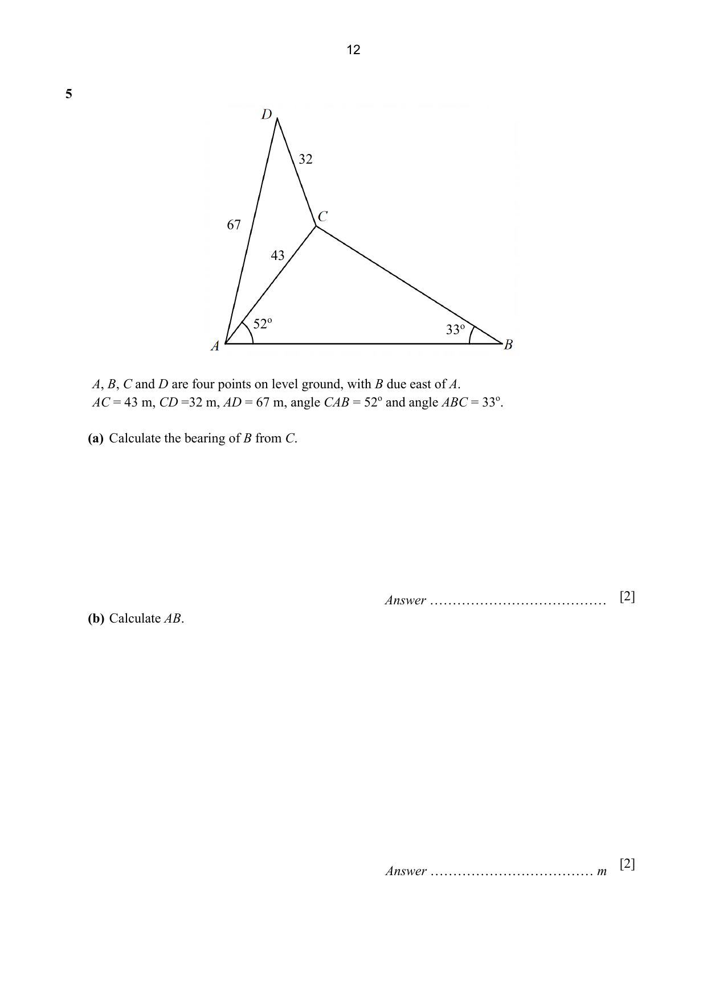
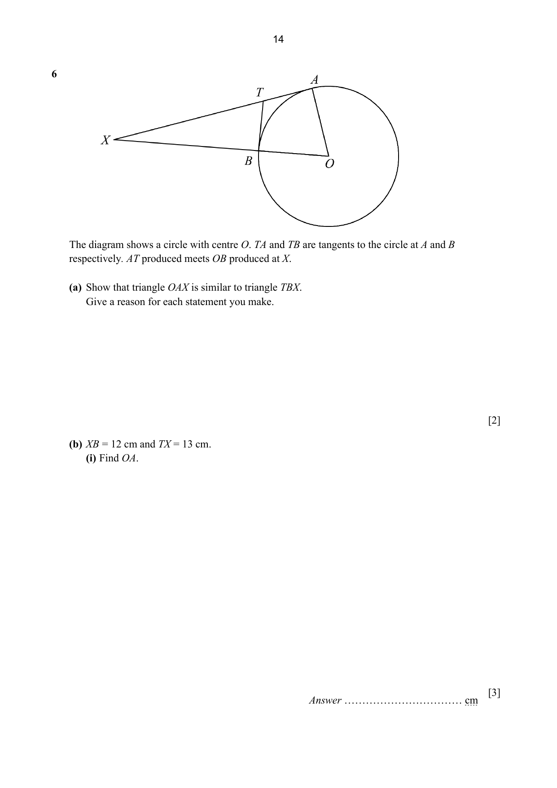
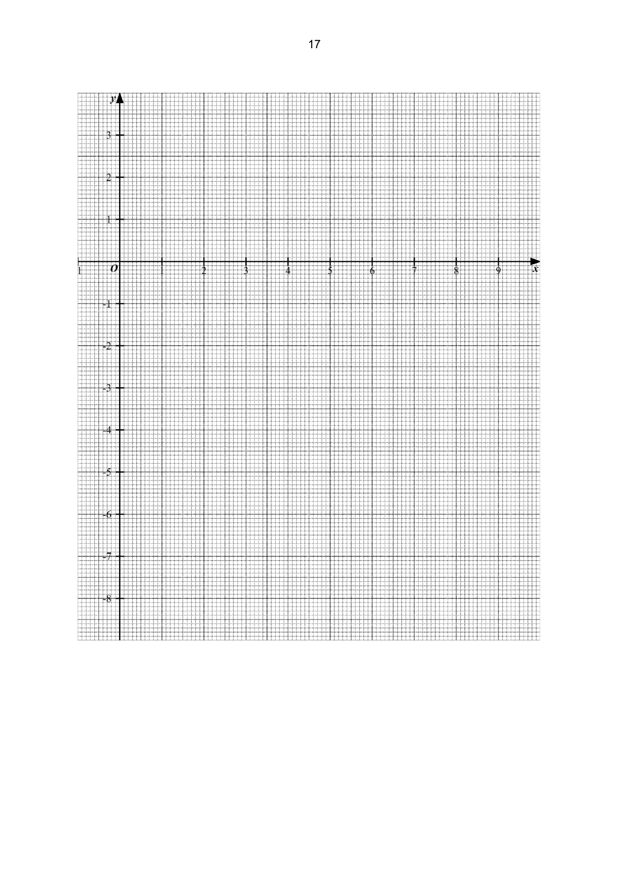
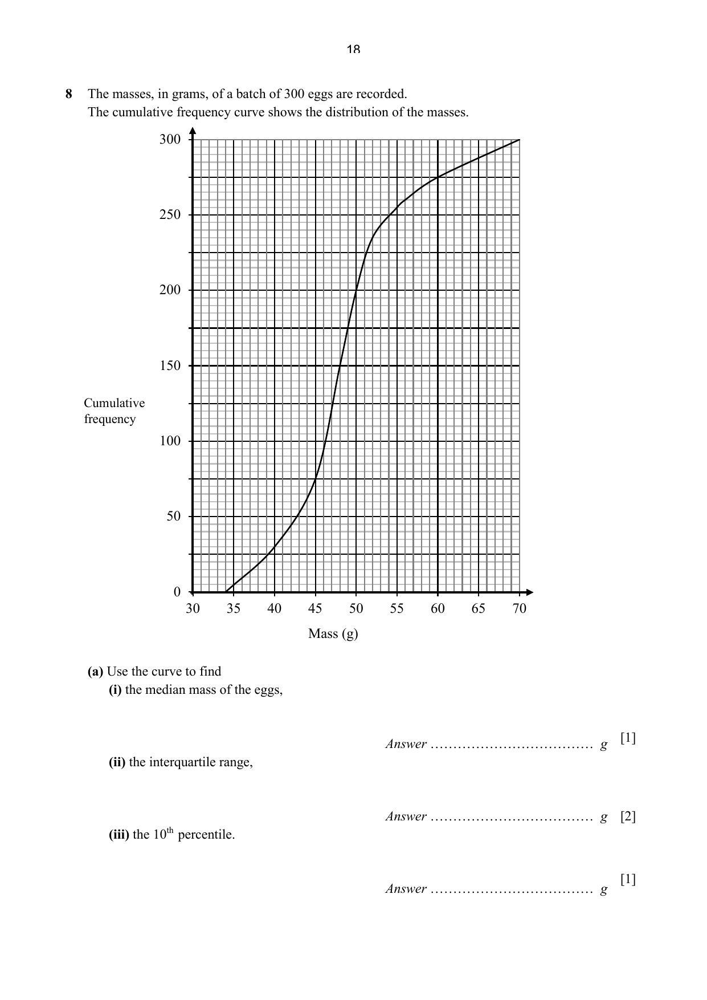
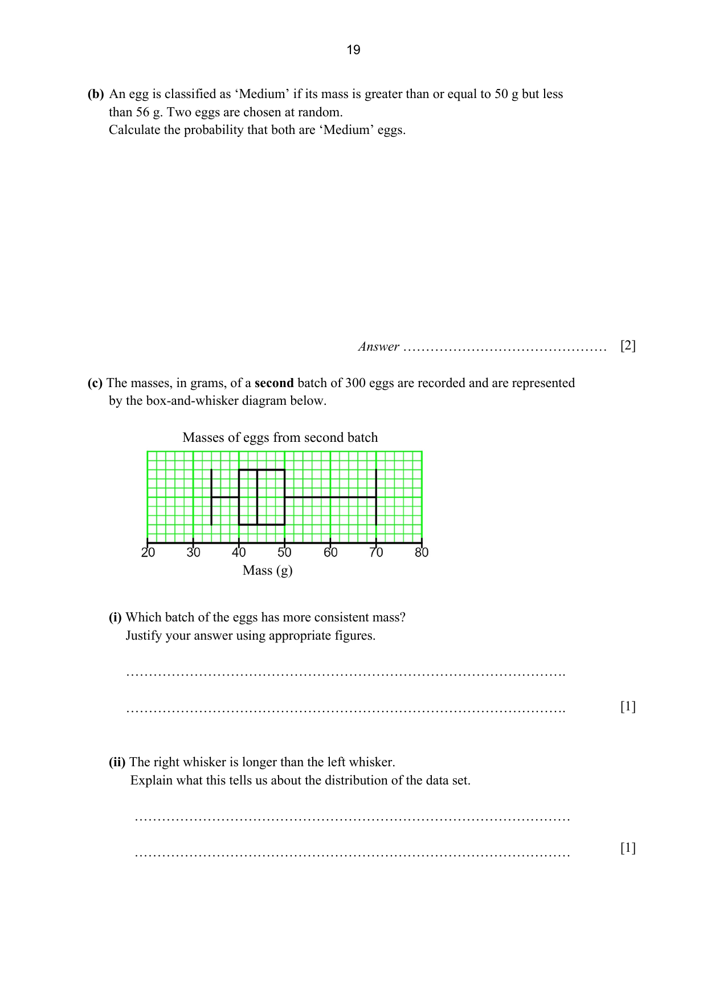

# Tampines Secondary School — Mathematics 4052/02 Paper 2 (cleaned)

> **Institution:** Tampines Secondary School
> **Exam:** Preliminary Examination 2024
> **Level:** Secondary Four Express / Five Normal Academic
> **Subjects:** Elementary Mathematics
> **Paper:** 4052/02 Paper 2
> **Date:** 23 August 2024
> **Duration:** 2 hours 15 minutes
> **Total Marks:** 90
> **Source:** `2024 TPSS EMATH P2 PRELIM QP.pdf`

---

## Instructions

Write your name, class and register number in the spaces at the top of this page.
Write in dark blue or black pen.
You may use an HB pencil for any diagrams or graphs.
Do not use staples, paper clips, glue or correction fluid.

Answer all the questions.
If working is needed for any question it must be shown with the answer.
Omission of essential working will result in loss of marks.
The use of an approved scientific calculator is expected, where appropriate.
If the degree of accuracy is not specified in the question, and if the answer is not exact, give the answer to three significant figures. Give answers in degrees to one decimal place.
For $\pi$, use either your calculator value of $3.142$, unless the question requires the answer in terms of $\pi$.

The number of marks is given in brackets [ ] at the end of each question or part question.
The total number of marks for this paper is 90.

---

## Mathematical Formulae

*Compound interest*

$$
\text{Total amount} = P\left(1+\frac{r}{100}\right)^{n}
$$

*Mensuration*

$$
\text{Curved surface area of a cone} = \pi rl
$$

$$
\text{Surface area of a sphere} = 4\pi r^{2}
$$

$$
\text{Volume of a cone} = \frac{1}{3}\pi r^{2}h
$$

$$
\text{Volume of a sphere} = \frac{4}{3}\pi r^{3}
$$

$$
\text{Area of triangle } ABC = \frac{1}{2}ab\sin C
$$

$$
\text{Arc length} = r\theta,\text{ where }\theta\text{ is in radians}
$$

$$
\text{Sector area} = \frac{1}{2}r^{2}\theta,\text{ where }\theta\text{ is in radians}
$$

*Trigonometry*

$$
\frac{a}{\sin A} = \frac{b}{\sin B} = \frac{c}{\sin C}
$$

$$
a^{2} = b^{2}+c^{2}-2bc\cos A
$$

*Statistics*

$$
\text{Mean} = \frac{\sum fx}{\sum f}
$$

$$
\text{Standard deviation} = \sqrt{\frac{\sum fx^{2}}{\sum f}-\left(\frac{\sum fx}{\sum f}\right)^{2}}
$$

---

### Q1

> **Marks:** 11
> **Page:** 3–4

(a) Simplify $\dfrac{6(a+1)^{3}}{7b} \div \dfrac{9(a+1)}{28b}$. [2]
> **Topic:** N7 Equations and inequalities
> **Sub-topic:** Equations and inequalities
> **LO:** [[context/subjects/o-level-e-maths/learning-objectives/o-level-e-maths-N7c.md|N7c]]

(b) $x = a+\dfrac{bv^{2}}{k}$

(i) Find $x$ when $a = 2$, $b = 3$, $v = -4$ and $k = 5$. [1]
> **Topic:** N5 Algebraic expressions and formulae
> **Sub-topic:** Algebraic expressions and formulae
> **LO:** [[context/subjects/o-level-e-maths/learning-objectives/o-level-e-maths-N5l.md|N5l]]

(ii) Rearrange the formula to make $v$ the subject. [3]
> **Topic:** N5 Algebraic expressions and formulae
> **Sub-topic:** Algebraic expressions and formulae
> **LO:** [[context/subjects/o-level-e-maths/learning-objectives/o-level-e-maths-N5k.md|N5k]]

(c) Solve the simultaneous equations.

$$
4x+7y = -23
$$

$$
6x-2y = 3
$$

You must show your working. [3]
> **Topic:** N7 Equations and inequalities
> **Sub-topic:** Equations and inequalities
> **LO:** [[context/subjects/o-level-e-maths/learning-objectives/o-level-e-maths-N7c.md|N7c]]

(d) Write as a single fraction in its simplest form

$$
\frac{x^{2}}{(x+y)(x-3y)}-\frac{x-y}{x-3y}.
$$

[2]
> **Topic:** N7 Equations and inequalities
> **Sub-topic:** Equations and inequalities
> **LO:** [[context/subjects/o-level-e-maths/learning-objectives/o-level-e-maths-N7c.md|N7c]]

### Q2

> **Marks:** 10
> **Page:** 5–6

(a) Faiz invested ＄25 000 in an account which paid simple interest.
At the end of 9 months, the value of the investment was ＄26 500.
Calculate the interest rate per annum of the investment. [2]
> **Topic:** N3 Percentage
> **Sub-topic:** Percentage
> **LO:** [[context/subjects/o-level-e-maths/learning-objectives/o-level-e-maths-N3d.md|N3d]]

(b) Jane exchanged 500 Singapore dollars (＄) into Thai baht (THB) when the exchange rate was ＄1 $= 26.77$ THB. She travelled to Thailand and spent 10 600 THD.
On her return to Singapore, she exchanged the remaining Thai baht into dollars with the exchange rate ＄1 $= 26.88$ THB.

Calculate the amount she received in dollars. Correct your answer to the nearest cent. [2]
> **Topic:** N3 Percentage
> **Sub-topic:** Percentage
> **LO:** [[context/subjects/o-level-e-maths/learning-objectives/o-level-e-maths-N3d.md|N3d]]

(c) The cash price of a furniture set was ＄2700. Kim bought the set under a hire purchase scheme: 15% deposit and monthly instalments of ＄68 for 36 months.

Calculate the amount of interest paid as a percentage of the cash price. [3]
> **Topic:** N3 Percentage
> **Sub-topic:** Percentage
> **LO:** [[context/subjects/o-level-e-maths/learning-objectives/o-level-e-maths-N3d.md|N3d]]

(d) By selling an item at 25% discount off the marked price, a shopkeeper still makes 10% profit on his cost. If the cost price is ＄180, calculate the marked price of the item. [3]
> **Topic:** N3 Percentage
> **Sub-topic:** Percentage
> **LO:** [[context/subjects/o-level-e-maths/learning-objectives/o-level-e-maths-N3d.md|N3d]]

### Q3

> **Marks:** 10
> **Page:** 7–8

The diagram shows a rectangular cardboard $ABCD$ with $AB = (3x+1)$ cm and $AD = (x+13)$ cm. A square of side 3 cm is cut from each corner. The remaining cardboard is then folded along the dotted lines to form an open rectangular box with base $PQRS$ and height 3 cm. The volume of the tray is 930 cm$^{3}$.

(a) Form an equation, in terms of $x$, to represent this information and show that it simplifies to $3x^{2}+16x-345 = 0$. [4]
> **Topic:** N7 Equations and inequalities
> **Sub-topic:** Equations and inequalities
> **LO:** [[context/subjects/o-level-e-maths/learning-objectives/o-level-e-maths-N7a.md|N7a]]

(b) Solve the equation $3x^{2}+16x-345 = 0$.
Give your solutions correct to two decimal places. [3]
> **Topic:** N1 Numbers and their operations
> **Sub-topic:** Numbers and their operations
> **LO:** [[context/subjects/o-level-e-maths/learning-objectives/o-level-e-maths-N1g.md|N1g]]

(c) Find the length of the diagonal $SQ$. [3]
> **Topic:** N7 Equations and inequalities
> **Sub-topic:** Equations and inequalities
> **LO:** [[context/subjects/o-level-e-maths/learning-objectives/o-level-e-maths-N7a.md|N7a]]

### Q4

> **Marks:** 11
> **Page:** 9–11

(a) $A$ is the point $(3, 7)$ and $B$ is the point $(13, -8)$.

(i) Find $\overrightarrow{AB}$. [2]
> **Topic:** G7 Vectors in two dimensions
> **Sub-topic:** Vectors in two dimensions
> **LO:** [[context/subjects/o-level-e-maths/learning-objectives/o-level-e-maths-G7h.md|G7h]]

(ii) Given that $\overrightarrow{BA} = 2\overrightarrow{AP}$, find the coordinates of $P$. [2]
> **Topic:** G7 Vectors in two dimensions
> **Sub-topic:** Vectors in two dimensions
> **LO:** [[context/subjects/o-level-e-maths/learning-objectives/o-level-e-maths-G7h.md|G7h]]

(b) In triangle $OCB$, $A$ is the midpoint of $OC$ and $P$ is the point on $CB$ such that $CP = \dfrac{3}{4}CB$. The line $OB$ produced to $D$ such that $OB = 2BD$. $\overrightarrow{OA} = 2\mathbf{a}$ and $\overrightarrow{OB} = 2\mathbf{b}$.

The diagram shows $O$ to $C$ with $A$ between them, $P$ on $CB$, and $D$ beyond $B$ on the line $OB$.

(i) Express $\overrightarrow{CP}$ in terms of $\mathbf{a}$ and $\mathbf{b}$, as simply as possible. [2]
> **Topic:** G7 Vectors in two dimensions
> **Sub-topic:** Vectors in two dimensions
> **LO:** [[context/subjects/o-level-e-maths/learning-objectives/o-level-e-maths-G7h.md|G7h]]

(ii) Express $\overrightarrow{AP}$ in terms of $\mathbf{a}$ and $\mathbf{b}$, as simply as possible. [1]
> **Topic:** G7 Vectors in two dimensions
> **Sub-topic:** Vectors in two dimensions
> **LO:** [[context/subjects/o-level-e-maths/learning-objectives/o-level-e-maths-G7h.md|G7h]]

(iii) Show that $A$, $P$ and $D$ lie on the same straight line. [3]
> **Topic:** G7 Vectors in two dimensions
> **Sub-topic:** Vectors in two dimensions
> **LO:** [[context/subjects/o-level-e-maths/learning-objectives/o-level-e-maths-G7h.md|G7h]]

(iv) Find $\dfrac{\text{Area of } \triangle OCB}{\text{Area of } \triangle CPD}$. [1]
> **Topic:** G7 Vectors in two dimensions
> **Sub-topic:** Vectors in two dimensions
> **LO:** [[context/subjects/o-level-e-maths/learning-objectives/o-level-e-maths-G7h.md|G7h]]

### Q5

> **Marks:** 9
> **Page:** 12–13

$A$, $B$, $C$ and $D$ are four points on level ground, with $B$ due east of $A$.
$AC = 43$ m, $CD = 32$ m, $AD = 67$ m, angle $CAB = 52^{\circ}$ and angle $ABC = 33^{\circ}$.

(a) Calculate the bearing of $B$ from $C$. [2]
> **Topic:** G4 Pythagoras' theorem and trigonometry
> **Sub-topic:** Pythagoras' theorem and trigonometry
> **LO:** [[context/subjects/o-level-e-maths/learning-objectives/o-level-e-maths-G4g.md|G4g]]

(b) Calculate $AB$. [2]
> **Topic:** G4 Pythagoras' theorem and trigonometry
> **Sub-topic:** Pythagoras' theorem and trigonometry
> **LO:** [[context/subjects/o-level-e-maths/learning-objectives/o-level-e-maths-G4g.md|G4g]]

(c) Calculate angle $CDA$. [3]
> **Topic:** G4 Pythagoras' theorem and trigonometry
> **Sub-topic:** Pythagoras' theorem and trigonometry
> **LO:** [[context/subjects/o-level-e-maths/learning-objectives/o-level-e-maths-G4g.md|G4g]]

(d) A drone hovers 60 m vertically above $D$.
Find the angle of depression of $A$ from the drone. [2]
> **Topic:** G4 Pythagoras' theorem and trigonometry
> **Sub-topic:** Pythagoras' theorem and trigonometry
> **LO:** [[context/subjects/o-level-e-maths/learning-objectives/o-level-e-maths-G4g.md|G4g]]

### Q6

> **Marks:** 10
> **Page:** 14–15

The diagram shows a circle with centre $O$. $TA$ and $TB$ are tangents to the circle at $A$ and $B$ respectively. $AT$ produced meets $OB$ produced at $X$.

(a) Show that triangle $OAX$ is similar to triangle $TBX$.
Give a reason for each statement you make. [2]
> **Topic:** G2 Congruence and similarity
> **Sub-topic:** Congruence and similarity
> **LO:** [[context/subjects/o-level-e-maths/learning-objectives/o-level-e-maths-G2i.md|G2i]]

(b) $XB = 12$ cm and $TX = 13$ cm.

(i) Find $OA$. [3]
> **Topic:** G2 Congruence and similarity
> **Sub-topic:** Congruence and similarity
> **LO:** [[context/subjects/o-level-e-maths/learning-objectives/o-level-e-maths-G2i.md|G2i]]

(ii) Calculate, as a fraction in its simplest form, the numerical value of the ratio

$$
\frac{\text{area of triangle } TBX}{\text{area of quadrilateral } OATB}.
$$

[2]
> **Topic:** G2 Congruence and similarity
> **Sub-topic:** Congruence and similarity
> **LO:** [[context/subjects/o-level-e-maths/learning-objectives/o-level-e-maths-G2i.md|G2i]]

(iii) Calculate the reflex angle $AOB$ in radians. [3]
> **Topic:** G2 Congruence and similarity
> **Sub-topic:** Congruence and similarity
> **LO:** [[context/subjects/o-level-e-maths/learning-objectives/o-level-e-maths-G2i.md|G2i]]

### Q7

> **Marks:** 11
> **Page:** 16–17

(a) Complete the table of values for $y = 10-x-\dfrac{16}{x}$. [1]
> **Topic:** N6 Functions and graphs
> **Sub-topic:** Functions and graphs
> **LO:** [[context/subjects/o-level-e-maths/learning-objectives/o-level-e-maths-N6j.md|N6j]]

| $x$ | 1 | 2 | 3 | 4 | 5 | 6 | 7 | 8 | 9 |
| --- | --- | --- | --- | --- | --- | --- | --- | --- | --- |
| $y$ | $-7$ | 0 | 1.7 |  | 1.8 | 1.3 | 0.7 | 0 | $-0.8$ |

(b) On the grid opposite, draw the graph of $y = 10-x-\dfrac{16}{x}$ for $1 \le x \le 9$. [3]
> **Topic:** N6 Functions and graphs
> **Sub-topic:** Functions and graphs
> **LO:** [[context/subjects/o-level-e-maths/learning-objectives/o-level-e-maths-N6j.md|N6j]]

The grid has $x$ from 0 to 9 and $y$ from $-8$ to 3.

(c) By drawing a tangent, find the gradient of the curve at $x = 3$. [2]
> **Topic:** G6 Coordinate geometry
> **Sub-topic:** Coordinate geometry
> **LO:** [[context/subjects/o-level-e-maths/learning-objectives/o-level-e-maths-G6c.md|G6c]]

(d) Use your graph to solve $9-x-\dfrac{16}{x} = 0$. [2]
> **Topic:** N6 Functions and graphs
> **Sub-topic:** Functions and graphs
> **LO:** [[context/subjects/o-level-e-maths/learning-objectives/o-level-e-maths-N6j.md|N6j]]

(e) The straight line $y = mx-1$ intersects the curve $y = 10-x-\dfrac{16}{x}$ at two points.

(i) Write down and simplify the equation, in terms of $m$, in the form $Ax^{2}+Bx+16 = 0$, which is satisfied by the values of $x$ at the points of intersection. [2]
> **Topic:** N6 Functions and graphs
> **Sub-topic:** Functions and graphs
> **LO:** [[context/subjects/o-level-e-maths/learning-objectives/o-level-e-maths-N6j.md|N6j]]

(ii) If the values of $y$ at the points of intersection are greater than or equal to zero, find the least value of $m$. [1]
> **Topic:** N6 Functions and graphs
> **Sub-topic:** Functions and graphs
> **LO:** [[context/subjects/o-level-e-maths/learning-objectives/o-level-e-maths-N6j.md|N6j]]

### Q8

> **Marks:** 8
> **Page:** 18–19

The masses, in grams, of a batch of 300 eggs are recorded.
The cumulative frequency curve shows the distribution of the masses.

(a) Use the curve to find

(i) the median mass of the eggs, [1]
> **Topic:** S1 Data handling and analysis
> **Sub-topic:** Data handling and analysis
> **LO:** [[context/subjects/o-level-e-maths/learning-objectives/o-level-e-maths-S1f.md|S1f]]

(ii) the interquartile range, [2]
> **Topic:** S1 Data handling and analysis
> **Sub-topic:** Data handling and analysis
> **LO:** [[context/subjects/o-level-e-maths/learning-objectives/o-level-e-maths-S1f.md|S1f]]

(iii) the 10th percentile. [1]
> **Topic:** S1 Data handling and analysis
> **Sub-topic:** Data handling and analysis
> **LO:** [[context/subjects/o-level-e-maths/learning-objectives/o-level-e-maths-S1f.md|S1f]]

(b) An egg is classified as 'Medium' if its mass is greater than or equal to 50 g but less than 56 g. Two eggs are chosen at random.
Calculate the probability that both are 'Medium' eggs. [2]
> **Topic:** S2 Probability
> **Sub-topic:** Probability
> **LO:** [[context/subjects/o-level-e-maths/learning-objectives/o-level-e-maths-S2c.md|S2c]]

(c) The masses, in grams, of a second batch of 300 eggs are recorded and are represented by the box-and-whisker diagram below. The scale runs from 20 g to 80 g.

(i) Which batch of the eggs has more consistent mass?
Justify your answer using appropriate figures. [1]
> **Topic:** S1 Data handling and analysis
> **Sub-topic:** Data handling and analysis
> **LO:** [[context/subjects/o-level-e-maths/learning-objectives/o-level-e-maths-S1f.md|S1f]]

(ii) The right whisker is longer than the left whisker.
Explain what this tells us about the distribution of the data set. [1]
> **Topic:** S1 Data handling and analysis
> **Sub-topic:** Data handling and analysis
> **LO:** [[context/subjects/o-level-e-maths/learning-objectives/o-level-e-maths-S1f.md|S1f]]

### Q9

> **Marks:** 10
> **Page:** 21–23

The table shows the utility charges for Chen's family in July 2024.
It includes the charges for utilities such as electricity (in kilowatt-hours), gas (in kilowatt-hours), water (in cubic metres) and refuse removal. The charges for electricity, gas and water are dependent on their usage while refuse removal is a fixed amount.

|  | Usage | Rate (＄) | Amount (＄) | Total (＄) |
| --- | --- | --- | --- | --- |
| Electricity Services | 289 kWh | $p$ | 86.09 | 86.09 |
| Gas Services | 11 kWh | 0.2312 | 2.54 | 2.54 |
| Water Services | 8.5 Cu M | 1.2900 | 10.97 |  |
| Waterborne Tax | 8.5 Cu M | 1.0000 | 8.50 |  |
| Water Conservation Tax | ＄10.97 | 50% | 5.49 | 24.96 |
| Refuse Removal | 1 Qty | 9.00 | 9.00 | 9.00 |
| Subtotal |  |  | 122.59 | 122.59 |
| GST | ＄122.59 | 9% | $r$ | $r$ |
| Current Charges: (inclusive of GST) |  |  |  | $s$ |

(a) Calculate the values of $p$, $r$ and $s$. [3]
> **Topic:** S1 Data handling and analysis
> **Sub-topic:** Data handling and analysis
> **LO:** [[context/subjects/o-level-e-maths/learning-objectives/o-level-e-maths-S1f.md|S1f]]

(b) Chen considers installing an air-conditioner in his home at the beginning of August.
He finds the following information from the National Environmental Agency (NEA) website on energy-efficient appliances and online electrical store.

| Model of air-conditioner | Energy-efficient label | Annual energy cost (＄), 6-hour usage/day | Annual energy cost (＄), 7-hour usage/day |
| --- | --- | --- | --- |
| A | 3 ticks | 792 | 923 |
| B | 4 ticks | 616 | 717 |
| C | 4 ticks | 789 | 894 |
| D | 5 ticks | 552 | 643 |
| E | 5 ticks | 594 | 688 |

More ticks indicate more energy-efficient.
Annual Energy Cost is based on the current rate in the utility charge, excluding GST.
Example: If air-conditioner model A is used for 6 hours daily, the annual energy cost is ＄792.

Tips on Buying Energy-Efficient Air-Conditioner

- Choose an energy efficient air-conditioner with more ticks on the energy label.
- Choose models with lower Life Cycle Costs (LCC).
LCC $=$ Purchase Price $+$ Annual Energy Cost $\times 7$

| Model of air-conditioner | A | B | C | D | E |
| --- | --- | --- | --- | --- | --- |
| Purchase Price ＄ (excluding GST) | 1690 | 2749 | 1989 | 3499 | 3305 |

The chart shows Chen's electricity consumption trend. Monthly usage, in kWh: January 332, February 292, March 299, April 283, May 326, June 285, July 289. A dashed line marks the July neighbour average, 659 kWh. A solid line marks the July national average, 505 kWh. The chart also prints Electricity Services usage 289 kWh.

Chen considers buying an air-conditioner with at least 4-ticks label, with low LCC and intends to use it for 6 hours each day. He expects an increase in electricity consumption in August, in addition to the 289 kWh recorded in July. However, he wants to keep his August total electricity consumption to be below July National average.

Assuming the costs for gas, water services and refuse removal charge remain unchanged, suggest the model of air-conditioner he should opt for and estimate the August utility charge.
Justify any decision you make and show your calculations clearly. [7]
> **Topic:** S1 Data handling and analysis
> **Sub-topic:** Data handling and analysis
> **LO:** [[context/subjects/o-level-e-maths/learning-objectives/o-level-e-maths-S1f.md|S1f]]
