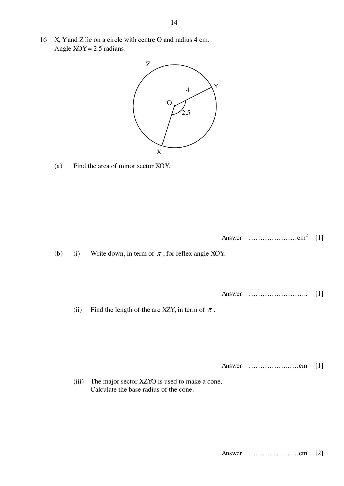
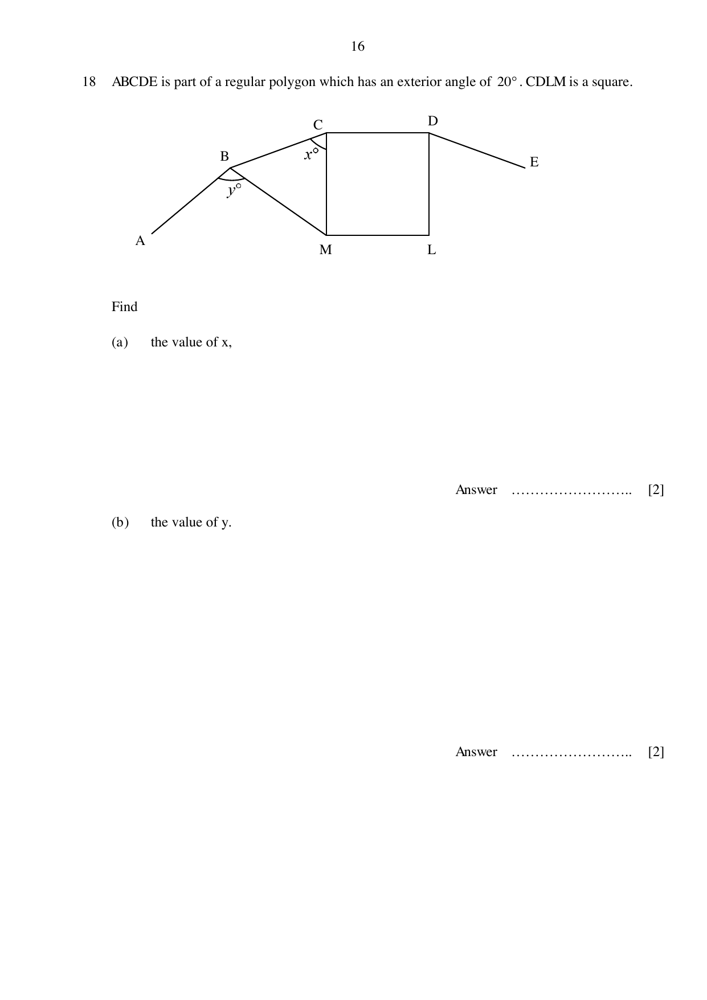
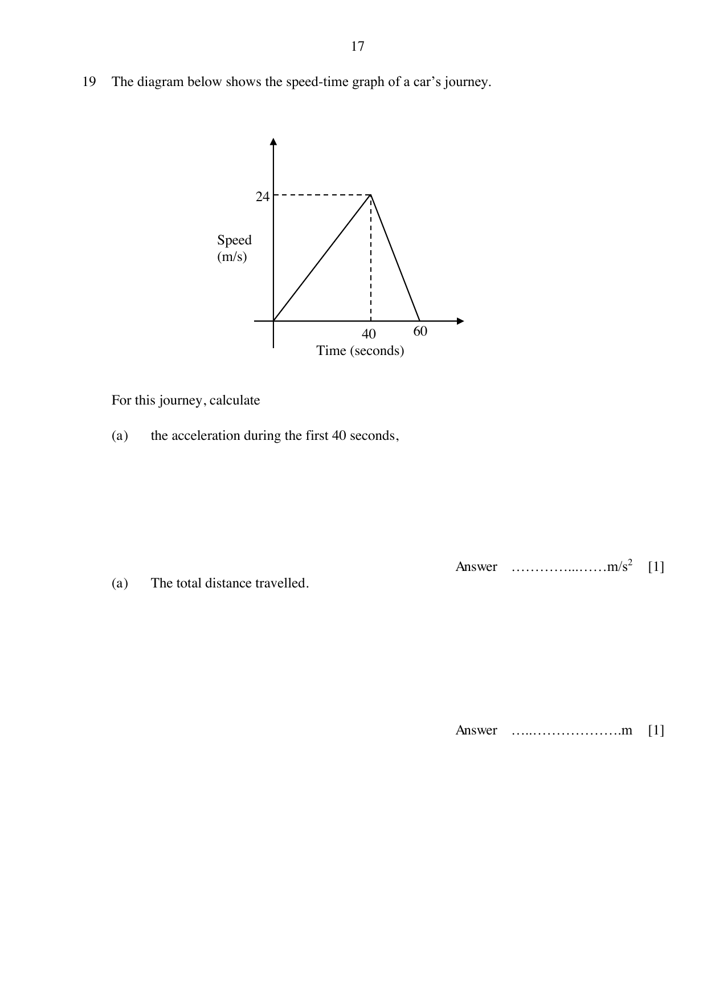

# Woodgrove Secondary School — Mathematics 4052/01 Paper 1 (cleaned)

> **Institution:** Woodgrove Secondary School
> **Exam:** Preliminary Examination 2024
> **Level:** Secondary 4 Express / 5 Normal Academic
> **Subjects:** Elementary Mathematics
> **Paper:** 4052/01 Paper 1
> **Date:** 27 August 2024
> **Duration:** 2 hours 15 minutes
> **Total Marks:** 90
> **Source:** `WGSS_2024_Prelim_EMath_4052(1)_QP.pdf`

---

## Instructions

Write your class, index number and name on the work you hand in.
Write in dark blue or black pen on both sides of the paper.
You may use a HB pencil for any diagrams or graphs.
Do not use staples, paper clips, glue or correction fluid.

Answer all questions.

The number of marks in given in brackets [ ] at the end of each question or part question.
If working is needed for any question it must be shown with the answer.
Omission of essential working will result in loss of marks.
The total number of marks for this paper is 90.

The use of an approved scientific calculator is expected, where appropriate.
If the degree of accuracy is not specified in the question and if the answer is not exact, give the answer correct to three significant figures. Give answers in degrees to one decimal place.
For $\pi$, use either your calculator value of $3.142$.

---

## Mathematical Formulae

*Compound interest*

$$
\text{Total amount} = P\left(1+\frac{r}{100}\right)^{n}
$$

*Mensuration*

$$
\text{Curved surface area of a cone} = \pi rl
$$

$$
\text{Surface area of a sphere} = 4\pi r^{2}
$$

$$
\text{Volume of a cone} = \frac{1}{3}\pi r^{2}h
$$

$$
\text{Volume of a sphere} = \frac{4}{3}\pi r^{3}
$$

$$
\text{Area of triangle } ABC = \frac{1}{2}ab\sin C
$$

$$
\text{Arc length} = r\theta,\text{ where }\theta\text{ is in radians}
$$

$$
\text{Sector area} = \frac{1}{2}r^{2}\theta,\text{ where }\theta\text{ is in radians}
$$

*Trigonometry*

$$
\frac{a}{\sin A} = \frac{b}{\sin B} = \frac{c}{\sin C}
$$

$$
a^{2} = b^{2}+c^{2}-2bc\cos A
$$

*Statistics*

$$
\text{Mean} = \frac{\sum fx}{\sum f}
$$

$$
\text{Standard Deviation} = \sqrt{\frac{\sum fx^{2}}{\sum f}-\left(\frac{\sum fx}{\sum f}\right)^{2}}
$$

---

### Q1

> **Marks:** 2
> **Page:** 3

(a) Calculate $\dfrac{-11+\sqrt{(-11)^{2}-\dfrac{20}{11}}}{8\times 0.6}$.

Write your answer correct to 4 significant figures. [1]
> **Topic:** N1 Numbers and their operations
> **Sub-topic:** Numbers and their operations
> **LO:** [[context/subjects/o-level-e-maths/learning-objectives/o-level-e-maths-N1g.md|N1g]]

(b) Write your answer to part (a) in standard form. [1]
> **Topic:** N1 Numbers and their operations
> **Sub-topic:** Numbers and their operations
> **LO:** [[context/subjects/o-level-e-maths/learning-objectives/o-level-e-maths-N1g.md|N1g]]

### Q2

> **Marks:** 2
> **Topic:** N5 Algebraic expressions and formulae
> **Sub-topic:** Algebraic expressions and formulae
> **LO:** [[context/subjects/o-level-e-maths/learning-objectives/o-level-e-maths-N5j.md|N5j]]
> **Page:** 3

Expand and simplify $(2x+5)(3+4x)$. [2]

### Q3

> **Marks:** 3
> **Page:** 3

Solve

(a) $3-4x = 21$. [1]
> **Topic:** N7 Equations and inequalities
> **Sub-topic:** Equations and inequalities
> **LO:** [[context/subjects/o-level-e-maths/learning-objectives/o-level-e-maths-N7f.md|N7f]]

(b) $2x < 3x+1 \le 13$, [2]
> **Topic:** N7 Equations and inequalities
> **Sub-topic:** Equations and inequalities
> **LO:** [[context/subjects/o-level-e-maths/learning-objectives/o-level-e-maths-N7f.md|N7f]]

### Q4

> **Marks:** 4
> **Page:** 4

(a) Express $4312$ as a product of its prime factors. [1]
> **Topic:** N1 Numbers and their operations
> **Sub-topic:** Numbers and their operations
> **LO:** [[context/subjects/o-level-e-maths/learning-objectives/o-level-e-maths-N1b.md|N1b]]

(b) Given $588 = 2^{2}\times 3\times 7^{2}$.

Find

(i) The largest integer which is a factor of both $588$ and $4312$. [1]
> **Topic:** N1 Numbers and their operations
> **Sub-topic:** Numbers and their operations
> **LO:** [[context/subjects/o-level-e-maths/learning-objectives/o-level-e-maths-N1b.md|N1b]]

(ii) The smallest integer which is the multiple of both $588$ and $4312$. [1]
> **Topic:** N1 Numbers and their operations
> **Sub-topic:** Numbers and their operations
> **LO:** [[context/subjects/o-level-e-maths/learning-objectives/o-level-e-maths-N1b.md|N1b]]

(iii) The smallest integer value of $m$ such that $4312m$ is a perfect square. [1]
> **Topic:** N1 Numbers and their operations
> **Sub-topic:** Numbers and their operations
> **LO:** [[context/subjects/o-level-e-maths/learning-objectives/o-level-e-maths-N1b.md|N1b]]

### Q5

> **Marks:** 5
> **Page:** 5

Given that the coordinates of point $A$ is $(-2, 11)$ and point $B$ is $(5, -11)$.

Find

(a) length $AB$, [2]
> **Topic:** G6 Coordinate geometry
> **Sub-topic:** Coordinate geometry
> **LO:** [[context/subjects/o-level-e-maths/learning-objectives/o-level-e-maths-G6c.md|G6c]]

(b) equation of the straight-line $AB$. [3]
> **Topic:** G6 Coordinate geometry
> **Sub-topic:** Coordinate geometry
> **LO:** [[context/subjects/o-level-e-maths/learning-objectives/o-level-e-maths-G6c.md|G6c]]

### Q6

> **Marks:** 3
> **Topic:** N5 Algebraic expressions and formulae
> **Sub-topic:** Algebraic expressions and formulae
> **LO:** [[context/subjects/o-level-e-maths/learning-objectives/o-level-e-maths-N5m.md|N5m]]
> **Page:** 5

Simplify $\dfrac{9x^{2}-4}{12x^{2}-x-6}$. [3]

### Q7

> **Marks:** 4
> **Topic:** N7 Equations and inequalities
> **Sub-topic:** Equations and inequalities
> **LO:** [[context/subjects/o-level-e-maths/learning-objectives/o-level-e-maths-N7f.md|N7f]]
> **Page:** 6

Solve $\dfrac{2}{x+1}-3 = \dfrac{1}{2x-5}$. [4]

### Q8

> **Marks:** 4
> **Page:** 7

The table below shows a multiple-choice test Sam and Roger took.

|  | Correct | No attempt | Incorrect |
| --- | --- | --- | --- |
| Sam | 14 | 5 | 1 |
| Roger | 15 | 0 | 5 |

(a) Represent this information in a $2\times 3$ matrix, $S$. [1]
> **Topic:** N9 Matrices
> **Sub-topic:** Matrices
> **LO:** [[context/subjects/o-level-e-maths/learning-objectives/o-level-e-maths-N9b.md|N9b]]

(b) The marks are awarded as follow:

Correct $= 2$ marks

No attempt $= 0$ mark

Incorrect $= -1$ mark

Represent the information in a $3\times 1$ matrix, $T$.

Evaluate $ST$ [2]
> **Topic:** N9 Matrices
> **Sub-topic:** Matrices
> **LO:** [[context/subjects/o-level-e-maths/learning-objectives/o-level-e-maths-N9b.md|N9b]]

(c) Explain what your answer to (b) represents. [1]
> **Topic:** N9 Matrices
> **Sub-topic:** Matrices
> **LO:** [[context/subjects/o-level-e-maths/learning-objectives/o-level-e-maths-N9b.md|N9b]]

### Q9

> **Marks:** 5
> **Page:** 8

Factorise completely.

(a) $abc-3c-6+2ab$ [2]
> **Topic:** N5 Algebraic expressions and formulae
> **Sub-topic:** Algebraic expressions and formulae
> **LO:** [[context/subjects/o-level-e-maths/learning-objectives/o-level-e-maths-N5h.md|N5h]]

(b) $80x^{4}-5$ [3]
> **Topic:** N5 Algebraic expressions and formulae
> **Sub-topic:** Algebraic expressions and formulae
> **LO:** [[context/subjects/o-level-e-maths/learning-objectives/o-level-e-maths-N5h.md|N5h]]

### Q10

> **Marks:** 3
> **Topic:** N2 Ratio and proportion
> **Sub-topic:** Ratio and proportion
> **LO:** [[context/subjects/o-level-e-maths/learning-objectives/o-level-e-maths-N2a.md|N2a]]
> **Page:** 8

Ken divides his monthly salary into daily expenses, spending and saving in the ratio $3:4:5$ respectively. Later he decides to spend ＄1200 more daily the new ratio become $9:8:7$. Calculate his monthly salary. [3]

### Q11

> **Marks:** 4
> **Page:** 9

John conducted a survey on the average time spent reading per week. This survey was carried out outside Woodlands Regional Library. The table below represents the survey results.

| Time spends (t) in hours | $0 \le t < 2$ | $2 \le t < 4$ | $4 \le t < 6$ | $6 \le t < 8$ | $8 \le t < 10$ | $10 \le t < 12$ |
| --- | --- | --- | --- | --- | --- | --- |
| Frequency | 3 | 8 | 9 | 15 | 3 | 2 |

(a) Calculate the percentage of people spend between 6 to 8 hours per week in reading. [1]
> **Topic:** N3 Percentage
> **Sub-topic:** Percentage
> **LO:** [[context/subjects/o-level-e-maths/learning-objectives/o-level-e-maths-N3d.md|N3d]]

(b) Calculate the average time spend in reading. [1]
> **Topic:** N3 Percentage
> **Sub-topic:** Percentage
> **LO:** [[context/subjects/o-level-e-maths/learning-objectives/o-level-e-maths-N3d.md|N3d]]

(c) John concludes that the result in part (b) is the average of time spent in reading by a Singaporean. Do you agree, give a reason. [2]
> **Topic:** N3 Percentage
> **Sub-topic:** Percentage
> **LO:** [[context/subjects/o-level-e-maths/learning-objectives/o-level-e-maths-N3d.md|N3d]]

### Q12

> **Marks:** 5
> **Page:** 10

The expression $x^{2}-4x+7$ can be written in the form of $(x-a)^{2}+b$

(a) Find the value of $a$ and $b$. [2]
> **Topic:** N6 Functions and graphs
> **Sub-topic:** Functions and graphs
> **LO:** [[context/subjects/o-level-e-maths/learning-objectives/o-level-e-maths-N6g.md|N6g]]

(b) Explain why the expression gives a minimum value. [2]
> **Topic:** N6 Functions and graphs
> **Sub-topic:** Functions and graphs
> **LO:** [[context/subjects/o-level-e-maths/learning-objectives/o-level-e-maths-N6g.md|N6g]]

(c) Write down the minimum value. [1]
> **Topic:** N6 Functions and graphs
> **Sub-topic:** Functions and graphs
> **LO:** [[context/subjects/o-level-e-maths/learning-objectives/o-level-e-maths-N6g.md|N6g]]

### Q13

> **Marks:** 3
> **Page:** 11

The diagram shows a quadrilateral $WXYZ$.

(a) Construct the perpendicular bisector of $XY$. [1]
> **Topic:** G2 Congruence and similarity
> **Sub-topic:** Congruence and similarity
> **LO:** [[context/subjects/o-level-e-maths/learning-objectives/o-level-e-maths-G2e.md|G2e]]

(b) Construct the bisector of angle $WXY$. [1]
> **Topic:** G2 Congruence and similarity
> **Sub-topic:** Congruence and similarity
> **LO:** [[context/subjects/o-level-e-maths/learning-objectives/o-level-e-maths-G2e.md|G2e]]

(c) Point $A$ in the quadrilateral is equidistant from $X$ and $Y$ and is closer to the line $WX$ then to line $XY$. Mark and label a possible location for point $A$ in the diagram above. [1]
> **Topic:** G2 Congruence and similarity
> **Sub-topic:** Congruence and similarity
> **LO:** [[context/subjects/o-level-e-maths/learning-objectives/o-level-e-maths-G2e.md|G2e]]

### Q14

> **Marks:** 4
> **Page:** 12

In the diagram $ABC$ is a straight line, $BC = 10$ cm, $CD = 8$ cm and $BD = 6$ cm.

(a) Explain why a circle that passes through $B$, $C$ and $D$ can be drawn in the above diagram. Give reasons for each step of your working. [3]
> **Topic:** G3 Properties of circles
> **Sub-topic:** Properties of circles
> **LO:** [[context/subjects/o-level-e-maths/learning-objectives/o-level-e-maths-G3a.md|G3a]]

(b) Hence find the exact value of $\cos ABD$. [1]
> **Topic:** G3 Properties of circles
> **Sub-topic:** Properties of circles
> **LO:** [[context/subjects/o-level-e-maths/learning-objectives/o-level-e-maths-G3a.md|G3a]]

### Q15

> **Marks:** 5
> **Page:** 13

The diagram shows a parallelogram $ABCD$. $APQ$, $BRQ$, $CRS$ and $DPS$ are straight lines which bisect angles $A$, $B$, $C$ and $D$ respectively.

(a) Show that angle $PAD =$ angle $RCB$. [2]
> **Topic:** G2 Congruence and similarity
> **Sub-topic:** Congruence and similarity
> **LO:** [[context/subjects/o-level-e-maths/learning-objectives/o-level-e-maths-G2e.md|G2e]]

(b) Prove that triangles $ADP$ and $CBR$ are congruent. [3]
> **Topic:** G2 Congruence and similarity
> **Sub-topic:** Congruence and similarity
> **LO:** [[context/subjects/o-level-e-maths/learning-objectives/o-level-e-maths-G2i.md|G2i]]

### Q16

> **Marks:** 5
> **Page:** 14

$X$, $Y$ and $Z$ lie on a circle with centre $O$ and radius $4$ cm. Angle $XOY = 2.5$ radians.

(a) Find the area of minor sector $XOY$. [1]
> **Topic:** G5 Mensuration
> **Sub-topic:** Mensuration
> **LO:** [[context/subjects/o-level-e-maths/learning-objectives/o-level-e-maths-G5b.md|G5b]]

(b) (i) Write down, in term of $\pi$, for reflex angle $XOY$. [1]
> **Topic:** G5 Mensuration
> **Sub-topic:** Mensuration
> **LO:** [[context/subjects/o-level-e-maths/learning-objectives/o-level-e-maths-G5b.md|G5b]]

(ii) Find the length of the arc $XZY$, in term of $\pi$. [1]
> **Topic:** G5 Mensuration
> **Sub-topic:** Mensuration
> **LO:** [[context/subjects/o-level-e-maths/learning-objectives/o-level-e-maths-G5b.md|G5b]]

(iii) The major sector $XZYO$ is used to make a cone. Calculate the base radius of the cone. [2]
> **Topic:** G5 Mensuration
> **Sub-topic:** Mensuration
> **LO:** [[context/subjects/o-level-e-maths/learning-objectives/o-level-e-maths-G5b.md|G5b]]

### Q17

> **Marks:** 7
> **Page:** 15

(a) Simplify.

(i) $\dfrac{a^{3}}{3a^{2}}\times 27a^{6}$ [2]
> **Topic:** N1 Numbers and their operations
> **Sub-topic:** Numbers and their operations
> **LO:** [[context/subjects/o-level-e-maths/learning-objectives/o-level-e-maths-N1h.md|N1h]]

(ii) $\sqrt[4]{\dfrac{4}{16x^{3}}}$ [2]
> **Topic:** N1 Numbers and their operations
> **Sub-topic:** Numbers and their operations
> **LO:** [[context/subjects/o-level-e-maths/learning-objectives/o-level-e-maths-N1h.md|N1h]]

(b) $\dfrac{49^{2a}}{7^{b}} = 343^{4c}$. Find an expression for $b$ in terms of $a$ and $c$. [3]
> **Topic:** N1 Numbers and their operations
> **Sub-topic:** Numbers and their operations
> **LO:** [[context/subjects/o-level-e-maths/learning-objectives/o-level-e-maths-N1h.md|N1h]]

### Q18

> **Marks:** 4
> **Page:** 16

$ABCDE$ is part of a regular polygon which has an exterior angle of $20^{\circ}$. $CDLM$ is a square.

Find

(a) the value of $x$, [2]
> **Topic:** G1 Angles, triangles and polygons
> **Sub-topic:** Angles, triangles and polygons
> **LO:** [[context/subjects/o-level-e-maths/learning-objectives/o-level-e-maths-G1f.md|G1f]]

(b) the value of $y$. [2]
> **Topic:** G1 Angles, triangles and polygons
> **Sub-topic:** Angles, triangles and polygons
> **LO:** [[context/subjects/o-level-e-maths/learning-objectives/o-level-e-maths-G1f.md|G1f]]

### Q19

> **Marks:** 2
> **Page:** 17

The diagram below shows the speed-time graph of a car's journey.

For this journey, calculate

(a) the acceleration during the first $40$ seconds, [1]
> **Topic:** N6 Functions and graphs
> **Sub-topic:** Functions and graphs
> **LO:** [[context/subjects/o-level-e-maths/learning-objectives/o-level-e-maths-N6c.md|N6c]]

(a) The total distance travelled. [1]
> **Topic:** N6 Functions and graphs
> **Sub-topic:** Functions and graphs
> **LO:** [[context/subjects/o-level-e-maths/learning-objectives/o-level-e-maths-N6c.md|N6c]]

### Q20

> **Marks:** 4
> **Page:** 18

$\xi = \{x : x\text{ is an integer and }-3 \le x < 7\}$

$P = \{x : -3 < x < 3\}$

$Q = \{x : 0 < x \le 3\}$

(a) Draw a Venn diagram below to illustrate this information. [1]
> **Topic:** N8 Set language and notation
> **Sub-topic:** Set language and notation
> **LO:** [[context/subjects/o-level-e-maths/learning-objectives/o-level-e-maths-N8c.md|N8c]]

(b) List the elements in

(i) $P'$, [1]
> **Topic:** N8 Set language and notation
> **Sub-topic:** Set language and notation
> **LO:** [[context/subjects/o-level-e-maths/learning-objectives/o-level-e-maths-N8c.md|N8c]]

(ii) $P \cap Q$. [1]
> **Topic:** N8 Set language and notation
> **Sub-topic:** Set language and notation
> **LO:** [[context/subjects/o-level-e-maths/learning-objectives/o-level-e-maths-N8c.md|N8c]]

(c) Write down $n(P' \cup Q)$ [1]
> **Topic:** N8 Set language and notation
> **Sub-topic:** Set language and notation
> **LO:** [[context/subjects/o-level-e-maths/learning-objectives/o-level-e-maths-N8c.md|N8c]]

### Q21

> **Marks:** 6
> **Page:** 19

The first four terms in a sequence of numbers, $x_{1}$, $x_{2}$, $x_{3}$, $x_{4}$, $\ldots$ are given below.

$$
\begin{aligned}
x_{1} &= 2(0)+1 = 1 \\
x_{2} &= 2(1)+3 = 5 \\
x_{3} &= 2(2)+5 = 9 \\
x_{4} &= 2(3)+7 = 13
\end{aligned}
$$

(a) Write down an expression for $x_{5}$. [1]
> **Topic:** N5 Algebraic expressions and formulae
> **Sub-topic:** Algebraic expressions and formulae
> **LO:** [[context/subjects/o-level-e-maths/learning-objectives/o-level-e-maths-N5e.md|N5e]]

(b) Find an expression, in term of $n$, for the $n$th term, $x_{n}$, of the sequence. [2]
> **Topic:** N5 Algebraic expressions and formulae
> **Sub-topic:** Algebraic expressions and formulae
> **LO:** [[context/subjects/o-level-e-maths/learning-objectives/o-level-e-maths-N5e.md|N5e]]

(c) Evaluate $x_{20}$ [1]
> **Topic:** N5 Algebraic expressions and formulae
> **Sub-topic:** Algebraic expressions and formulae
> **LO:** [[context/subjects/o-level-e-maths/learning-objectives/o-level-e-maths-N5e.md|N5e]]

(d) Explain why $203$ is not a term of this sequence. [2]
> **Topic:** N5 Algebraic expressions and formulae
> **Sub-topic:** Algebraic expressions and formulae
> **LO:** [[context/subjects/o-level-e-maths/learning-objectives/o-level-e-maths-N5e.md|N5e]]

### Q22

> **Marks:** 6
> **Page:** 20

A survey was carried out to find out the number of emails received in a week by each of a group of students.

The table below represents the result of the survey.

| Number of emails ($n$) | Frequency |
| --- | --- |
| $0 \le n < 10$ | 8 |
| $10 \le n < 20$ | 13 |
| $20 \le n < 30$ | 25 |
| $30 \le n < 40$ | 30 |
| $40 \le n < 50$ | 18 |
| $50 \le n < 60$ | 6 |

(a) Find the probability that two students, chosen in random, both received at least $40$ emails. [2]
> **Topic:** S2 Probability
> **Sub-topic:** Probability
> **LO:** [[context/subjects/o-level-e-maths/learning-objectives/o-level-e-maths-S2c.md|S2c]]

(b) Which interval contain the median number of emails received by the students. [1]
> **Topic:** S2 Probability
> **Sub-topic:** Probability
> **LO:** [[context/subjects/o-level-e-maths/learning-objectives/o-level-e-maths-S2c.md|S2c]]

(c) Calculate an estimate of the mean number of emails received by the students. [1]
> **Topic:** S2 Probability
> **Sub-topic:** Probability
> **LO:** [[context/subjects/o-level-e-maths/learning-objectives/o-level-e-maths-S2c.md|S2c]]

(d) Calculate an estimate of the standard deviation. [2]
> **Topic:** S2 Probability
> **Sub-topic:** Probability
> **LO:** [[context/subjects/o-level-e-maths/learning-objectives/o-level-e-maths-S2c.md|S2c]]
