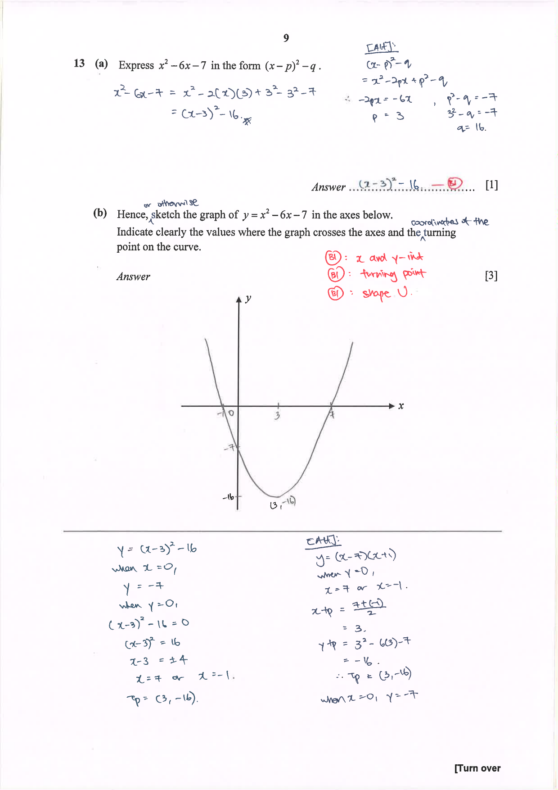
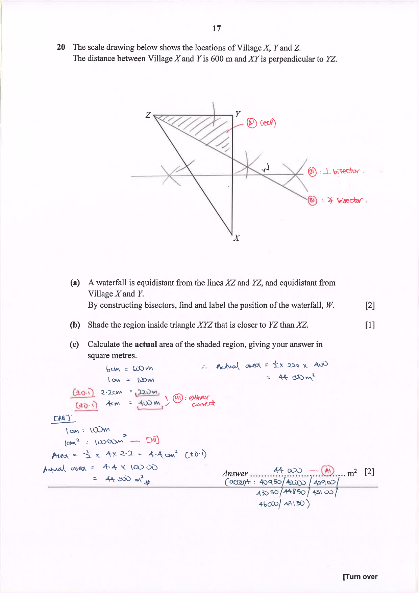

# Xinmin Secondary School — Mathematics 4052/01 Paper 1 Mark Scheme (cleaned)

> **Institution:** Xinmin Secondary School (Sekolah Menengah Xinmin)
> **Exam:** Preliminary Examination 2024
> **Level:** Secondary 4 Express
> **Subjects:** Elementary Mathematics
> **Paper:** 4052/01 Paper 1
> **Date:** 21 August 2024
> **Duration:** 2 hour 15 minutes
> **Total Marks:** 90
> **Source:** `XMSS E Math Prelim P1 2024 Mark Scheme.pdf`

The source is a scanned question paper with handwritten marking. Page numbers below are the paired question paper's physical pages. The scan and the question paper have the same pagination.

Handwritten notes name markers Q1–Q17: Alan and Q18–Q23: Yan Jin. Cover annotation: "Answer scheme."

---

### Q1

> **Marks:** 2
> **Sub-topic:** Number
> **Page:** 3

(a) $\dfrac{8.75}{\sqrt{4.86+0.982}} = 2.7459 = 2.75$ [B1]

(b) $(5.87\times 10^{6})\div(3.94\times 10^{-2}) = 1.4898\times 10^{8} = 1.49\times 10^{8}$ [B1]

### Q2

> **Marks:** 2
> **Sub-topic:** Number
> **Page:** 3

(a) $540 = 2^{2}\times 3^{3}\times 5$ [B1]

(b) $x = 5$, $y = 3$ [B1]

### Q3

> **Marks:** 3
> **Sub-topic:** Algebra
> **Page:** 4

(a) $24a^{2}b^{5}\div 8a^{6}b^{-2} = 3a^{-4}b^{7} = \dfrac{3b^{7}}{a^{4}}$ [B1]

Penalise if not in positive index form. A note says this is usually not the case and will be own decision.

(b) $(3^{2})^{k}\times\dfrac{1}{3^{6}} = 3^{k}$ [M1, both forms accepted]

$3^{2k}\times 3^{-6} = 3^{k}$

$3^{2k-6} = 3^{k}$

$2k-6 = k$

$k = 6$ [A1]

### Q4

> **Marks:** 3
> **Sub-topic:** Algebra
> **Page:** 4

In cents: $50x+90(x+30)\ge 15200$ [M1, correct inequality]

$50x+90x+2700\ge 15200$

$140x\ge 12500$

$x\ge 89.285$ [M1, for simplification]

$x = 90$ [A1]

Alternative in dollars: $0.5x+0.9(x+30)\ge 152$, so $1.4x\ge 125$ and $x\ge 89.285$, hence $x = 90$.

Penalise under presentation on the cover page if students write $x\ge 90$.

### Q5

> **Marks:** 3
> **Sub-topic:** Algebra
> **Page:** 5

Elimination: $2x+6y = 58$ and $2x-5y = -30$. Subtract to get $11y = 88$, so $y = 8$ and $x = 5$. [M1 for elimination, A1]

Substitution: $x = 29-3y$, then $2(29-3y) = 5y-30$, so $y = 8$ and $x = 5$. [M1 for substitution]

### Q6

> **Marks:** 3
> **Sub-topic:** Algebra
> **Page:** 5

$x^{2}(10+y) = x^{2}+k$ [M1]

$10x^{2}+yx^{2} = x^{2}+k$

$9x^{2}+yx^{2} = k$

$x^{2}(9+y) = k$

$x^{2} = \dfrac{k}{9+y}$ [M1]

$x = \pm\sqrt{\dfrac{k}{9+y}}$ [A1]

Alternative: $10+y = 1+\dfrac{k}{x^{2}}$, so $9+y = \dfrac{k}{x^{2}}$.

### Q7

> **Marks:** 2
> **Sub-topic:** Geometry
> **Page:** 6

$\angle CED = x^{\circ}$ (base angles of an isosceles triangle).

$\angle ECA = 2x^{\circ}$ (exterior angle of a triangle). [M1]

Since $\angle ECA = \angle CAB = 2x^{\circ}$, by alternate angles and parallel lines, $AB\parallel CE$. [A1]

Minus 1 mark from this question if reasons are wrong or missing.

### Q8

> **Marks:** 4
> **Sub-topic:** Algebra
> **Page:** 6

(a) $5(3x-2y)-2(x+4y) = 15x-10y-2x-8y = 13x-18y$ [M1 either correct expansion, A1]

(b) $12p^{2}+8-(3p-2)^{2} = 12p^{2}+8-(9p^{2}-12p+4) = 3p^{2}+12p+4$ [M1, A1]

### Q9

> **Marks:** 4
> **Sub-topic:** Number
> **Page:** 7

(a) $1:25000$ gives $52.2:1305000$. $1305000\text{ cm} = 13.05\text{ km}$. [M1, A1]

(b) $1\text{ cm}:0.25\text{ km}$, so $1\text{ cm}^{2}:0.0625\text{ km}^{2}$. Map area $= \dfrac{6.57}{0.0625} = 105.12\text{ cm}^{2}$. [M1, A1]

### Q10

> **Marks:** 4
> **Sub-topic:** Geometry
> **Page:** 7

Each interior angle of the octagon $= \dfrac{(8-2)\times 180^{\circ}}{8} = 135^{\circ}$. [M1]

Interior angle of the $n$-gon $= 360^{\circ}-69^{\circ}-135^{\circ} = 156^{\circ}$. [M1]

Each exterior angle $= 180^{\circ}-156^{\circ} = 24^{\circ}$.

$n = \dfrac{360^{\circ}}{24^{\circ}} = 15$. [M1, A1]

Alternative: $\dfrac{(n-2)\times 180^{\circ}}{n} = 156$, so $n = 15$.

### Q11

> **Marks:** 3
> **Sub-topic:** Algebra
> **Page:** 8

(a) $F = \dfrac{k}{d^{2}}$. $5.5 = \dfrac{k}{2^{2}}$, so $k = 22$. Hence $F = \dfrac{22}{d^{2}}$. [M1, A1]

(b) $3 = \dfrac{22}{d^{2}}$, so $d = \sqrt{\dfrac{22}{3}} = 2.7080 = 2.71$ cm. [B1]

### Q12

> **Marks:** 5
> **Sub-topic:** Algebra
> **Page:** 8

(a) $6x^{3}+11x^{2}-7x = x(6x^{2}+11x-7) = x(3x+7)(2x-1)$ [M1, A1]

(b) $\dfrac{2x}{(2x+5)(2x-5)}+\dfrac{3}{2x-5}$ [M1, factorise $4x^{2}-25$]

$= \dfrac{2x+3(2x+5)}{(2x+5)(2x-5)} = \dfrac{8x+15}{(2x+5)(2x-5)}$ [M1 combining, A1]

Or $\dfrac{8x+15}{4x^{2}-25}$.

### Q13

> **Marks:** 4
> **Sub-topic:** Graphs
> **Page:** 9

(a) $x^{2}-6x-7 = (x-3)^{2}-16$ [B1]

(b) Crosses the axes at $x = -1$, $x = 7$ and $y = -7$. Turning point $(3,-16)$. U-shaped curve. [B1 intercepts, B1 turning point, B1 shape]

When $x = 0$, $y = -7$. When $y = 0$, $(x-3)^{2} = 16$, so $x = 7$ or $x = -1$.

The worked curve is on the scheme page.

### Q14

> **Marks:** 4
> **Sub-topic:** Algebra
> **Page:** 10

(a) F-3 perimeter $36$ cm, F-4 perimeter $44$ cm. [B1]

(b) $8n+12$ cm [B1]

(c) $8n+12 = 100$, so $8n = 88$ and $n = 11$. [M1]

Since $n$ is an integer, it is possible. It happens in the F-11 block. [A1]

### Q15

> **Marks:** 4
> **Sub-topic:** Geometry
> **Page:** 11

(a) $\dfrac{XY}{XW} = \dfrac{8}{12} = \dfrac{2}{3}$ and $\angle WXY = \angle ZXW$ (common angle). $\dfrac{XW}{XZ} = \dfrac{12}{18} = \dfrac{2}{3}$.

Hence triangle $WXY$ is similar to triangle $ZXW$ (SAS similarity). [M1, A1]

(b) $\dfrac{\text{area of }WXY}{x} = \left(\dfrac{2}{3}\right)^{2} = \dfrac{4}{9}$, so area of $WXY = \dfrac{4}{9}x$.

Area of $WYZ = x-\dfrac{4}{9}x = \dfrac{5}{9}x\text{ cm}^{2}$. [M1, A1]

### Q16

> **Marks:** 6
> **Sub-topic:** Graphs
> **Page:** 12

(a) At $B(0,7)$, $7 = ka^{0}$, so $k = 7$. [B1]

$63 = 7a^{-(-2)} = 7a^{2}$, so $a^{2} = 9$ and $a = 3$. [M1, A1]

(b) $m_{AB} = \dfrac{63-7}{-2-0} = -28$, so $y = -28x+7$. [M1, A1]

(c) $y = -28x+k$, where $k\in\mathbb{R}$ and $k\neq 7$. Or $y = -28x+1$. [B1]

### Q17

> **Marks:** 5
> **Sub-topic:** Mensuration
> **Page:** 13

(a) Volume of Cone B $= \dfrac{1}{3}\pi(12)^{2}(20) = 960\pi\text{ cm}^{3}$. [M1, A1]

(b) From Cone A, $\dfrac{1}{3}\pi(4)^{2}h = 40\pi$, so $h = 7.5$. [M1]

$\dfrac{r_{A}}{r_{B}} = \dfrac{4}{12} = \dfrac{1}{3}$ but $\dfrac{h_{A}}{h_{B}} = \dfrac{7.5}{20} = \dfrac{3}{8}$. Since the ratios are not equal, Cone A is not similar to Cone B. [M1, A1]

Alternative: $\left(\dfrac{r_{A}}{r_{B}}\right)^{3} = \dfrac{1}{27}$ but $\dfrac{V_{A}}{V_{B}} = \dfrac{40\pi}{960\pi} = \dfrac{1}{24}$. Since $\dfrac{V_{A}}{V_{B}}\neq\left(\dfrac{r_{A}}{r_{B}}\right)^{3}$, the cones are not similar.

### Q18

> **Marks:** 5
> **Sub-topic:** Matrices
> **Page:** 14–15

(a)

$$
F = \begin{pmatrix} 3 & 5 & 2 & 4 \\ 5 & 4 & 1 & 3 \\ 5 & 7 & 0 & 2 \end{pmatrix}
$$

[B1]

(b)

$$
P = FC = \begin{pmatrix} 17.90 \\ 16.20 \\ 15.70 \end{pmatrix}
$$

[B1] Do not penalise if 2 decimal places are not shown.

(c) The elements of $P$ represent the cost price of a Birthday, Promotion and Get Well Soon bouquet respectively. [B1]

(d)

$$
\begin{pmatrix} 1.5 & 0 & 0 \\ 0 & 1.35 & 0 \\ 0 & 0 & 1.4 \end{pmatrix}\begin{pmatrix} 17.90 \\ 16.20 \\ 15.70 \end{pmatrix} = \begin{pmatrix} 26.85 \\ 21.87 \\ 21.98 \end{pmatrix}
$$

[M1, A1] Penalise accuracy if not in 1 decimal place. A row-matrix product the other way is not accepted for the method mark.

### Q19

> **Marks:** 5
> **Sub-topic:** Statistics
> **Page:** 16

(a) Median $= \dfrac{230+320}{2} = 275$ g. [B1]

(b) $94.6$ g. [B1]

(c) $\dfrac{4}{12} = \dfrac{1}{3}$. [B1]

(d) The median mass increases by $20$ g, to $295$ g, but the standard deviation remains unchanged. Either statement is accepted; the increase must be stated. [B2]

### Q20

> **Marks:** 5
> **Sub-topic:** Geometry
> **Page:** 17

(a) Angle bisector of $\angle XZY$ and the perpendicular bisector of $XY$ meet at $W$. [B1 each construction]

(b) Shade the region on the $YZ$ side of the angle bisector, inside the triangle. [B1]

(c) Measured $6$ cm represents $600$ m, so $1$ cm represents $100$ m. Measured legs about $2.2$ cm and $4$ cm ($\pm 0.1$).

Actual area $= \dfrac{1}{2}\times 220\times 400 = 44000\text{ m}^{2}$. [M1, A1]

Accept $40950$, $42000$, $42900$, $43050$, $44000$, $44850$, $45100$, $46000$, $46150$.

### Q21

> **Marks:** 5
> **Sub-topic:** Mensuration
> **Page:** 18

(a) Area of trapezium $= \dfrac{1}{2}(17+20)h = 18.5h$. [M1]

$18.5h\times 24 = 6660$, so $h = 15$. [M1, A1]

(b) $6660\text{ cm}^{3} = 0.00666\text{ m}^{3}$. Mass $= 2500\times 0.00666 = 16.65$ g, or $16\dfrac{13}{20}$ g. [M1, A1]

### Q22

> **Marks:** 4
> **Sub-topic:** Mensuration
> **Page:** 19

Major sector perimeter $= r(2\pi-\theta)+2r$. [M1]

Minor sector perimeter $= r\theta+2r$. [M1]

$3(r\theta+2r) = r(2\pi-\theta)+2r$ [M1]

$3\theta+6 = 2\pi-\theta+2$

$4\theta+4 = 2\pi$

$\theta+1 = \dfrac{\pi}{2}$

$\theta = 0.57079 = 0.571$ (shown). [A1]

### Q23

> **Marks:** 5
> **Sub-topic:** Trigonometry
> **Page:** 20

(a) $\tan\theta = \dfrac{345}{500}$, so $\theta = 34.605^{\circ}$.

Bearing $= 90^{\circ}+34.605^{\circ} = 124.6^{\circ}$. [M1, A1]

Penalise accuracy if not in 1 decimal place.

(b) Shortest distance from $B$ to $AC$ is $283.95$ m. [M1]

$\tan\theta = \dfrac{64}{283.95}$, so $\theta = 12.7^{\circ}$. [M1, A1]

Alternative area method: area $= \dfrac{1}{2}\times 500\times 345 = 86250$, $AC = \sqrt{500^{2}+345^{2}} = 607.47$, and $\dfrac{1}{2}\times 607.47\times h = 86250$ gives $h = 283.96$.

Penalise accuracy if not in 1 decimal place.
