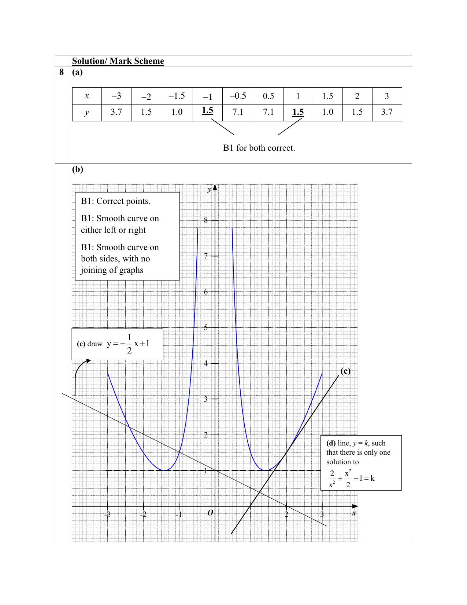

# Xinmin Secondary School — Mathematics 4052/02 Paper 2 Mark Scheme (cleaned)

> **Institution:** Xinmin Secondary School
> **Exam:** Preliminary Examination 2024
> **Level:** Secondary 4 Express
> **Subjects:** Elementary Mathematics
> **Paper:** 4052/02 Paper 2
> **Date:** 22 August 2024
> **Duration:** 2 hours 15 minutes
> **Total Marks:** 90
> **Source:** `XMSS E Math Prelim P2 Mark Scheme.pdf`

Page numbers below are the paired question paper's physical pages.

---

### Q1

> **Marks:** 10
> **Sub-topic:** Algebra
> **Page:** 3–4

(a) $5(2x+7) = 2(7-x)$ [M1]

$10x+35 = 14-2x$

$12x = -21$

$x = -1\dfrac{3}{4}$, also accept $-\dfrac{7}{4}$. [A1]

Alternative: $5(2x+7)-2(7-x) = 0$.

(b) $(2x-3)(x-4) = 2$

$2x^{2}-11x+10 = 0$ [M1]

$x = \dfrac{11\pm\sqrt{(-11)^{2}-4(2)(10)}}{2(2)}$ [M1]

$x = \dfrac{11\pm\sqrt{41}}{4}$

$x = 1.15$ or $4.35$ [A1, A1]

(c) $\dfrac{15x^{2}}{2y}\times\dfrac{8}{3x^{2}y} = \dfrac{20}{y^{2}}$ [B1]

(d) $\dfrac{(a+3b)(x-2)}{(a+3b)(a-2b)} = \dfrac{x-2}{a-2b}$ [M1 numerator, M1 denominator, A1]

### Q2

> **Marks:** 12
> **Sub-topic:** Number
> **Page:** 5–7

(a) Cody should invest in account A because the interest is calculated 12 times each year, compared with once a year for account B, so each calculation is on a larger amount and account A generates more interest. [B1]

Do not accept a calculated example that reaches a conclusion from the calculation alone. The key idea is more frequent compounding.

(b) $20000\left(1+\dfrac{x}{100}\right)^{3} = 22823.32$ [M1]

$1+\dfrac{x}{100} = \sqrt[3]{\dfrac{22823.32}{20000}}$ [M1]

$x = 4.4999 = 4.5$ (1 d.p.) [A1]

(c) (i) $\dfrac{40}{100}\times 156000+36\times 2800 = 163200$. Total ＄163 200. [M1, A1]

(ii) Value after 3 years $= 156000(0.92)^{3} = 121475.328$. [M1]

Loss $= 163200-121475.328 = 41724.672$.

Percentage loss $= \dfrac{41724.672}{163200}\times 100\% = 25.6\%$ (3 s.f.). [M1, A1]

(d) America: $368\times 2\times 1.35 = 993.60$ Singapore dollars. [M1]

Canada: $250\times 3\times\dfrac{1}{1.02} = 735.2941$ Singapore dollars. [M1]

Total $= (993.60+735.2941)\times\dfrac{101.5}{100} = 1754.82$. [A1]

### Q3

> **Marks:** 9
> **Sub-topic:** Statistics
> **Page:** 8–9

(a) (i) Median mark $= 35$. [B1]

(ii) $38-30 = 8$. [M1, A1]

(iii) $\dfrac{60}{100}\times 80 = 48$. From the graph, the 60th percentile is $36$. [B1]

(b) $\dfrac{85}{100}\times 80 = 68$, so $12$ students scored less than $x$. From the graph, $x = 25$. [M1, A1]

(c) (i) Chemistry median $32$, IQR $40-25 = 15$. Physics median $35$, IQR $8$.

Students perform better in Physics because the median is $35$, compared with $32$ for Chemistry. [B1]

The Physics marks are more consistent because the interquartile range is $8$, compared with $15$ for Chemistry. [B1]

Values of the median or IQR must be used.

(ii) The entire box-and-whisker plot shifts to the right by one mark. [B1]

### Q4

> **Marks:** 9
> **Sub-topic:** Probability
> **Page:** 10–11

$\xi = \{2, 3, 4, \ldots, 15\}$, $A = \{4, 8, 12\}$, $B = \{2, 3, 4, 6, 8, 12\}$. $A$ is a proper subset of $B$.

(a) (i) $B' = \{5, 7, 9, 10, 11, 13, 14, 15\}$. [B1]

(ii) $2, 3, 6$. [B1]

(iii) $0$. [B1]

(b) (i)

|  | Physics | Not Physics |
| --- | --- | --- |
| Literature | 13 | 5 |
| Not Literature | 7 | 15 |

[A1 both Physics cells, B1 for 5]

Let $x$ be the number who take both Physics and Literature.

$\dfrac{x}{40}\times\dfrac{x-1}{39} = \dfrac{1}{10}$ [M1]

$x^{2}-x-156 = 0$

$(x-13)(x+12) = 0$

$x = 13$ ($x = -12$ rejected). [M1]

Full credit if the first column is found by trial and error with working, for example $\dfrac{13}{40}\times\dfrac{12}{39} = \dfrac{1}{10}$.

(ii) $\dfrac{18}{40}\times\dfrac{22}{39}\times 2 = \dfrac{33}{65}$. [M1, allow ecf, A1]

### Q5

> **Marks:** 8
> **Sub-topic:** Mensuration
> **Page:** 12–13

(a) $\dfrac{2}{3}\pi(2r)^{3} = \dfrac{1}{3}\pi(2r)^{2}h$ [M1 hemisphere, M1 cone]

$\dfrac{16}{3}\pi r^{3} = \dfrac{4}{3}\pi r^{2}h$

$h = 4r$ [A1]

(b) $\dfrac{2}{3}\pi(2r)^{3} = 450$, so $r = 2.9947$ (5 s.f.). [M1, A1]

$l = \sqrt{(2r)^{2}+(4r)^{2}} = 13.392$. [M1]

Total surface area $= 2\pi(2\times 2.9947)^{2}+\pi(2\times 2.9947)(13.392) = 477\text{ cm}^{2}$ (3 s.f.). [M1, A1]

### Q6

> **Marks:** 11
> **Sub-topic:** Geometry
> **Page:** 14–15

(a) $\angle PQS = \angle SRP$ (angles in the same segment).

$\angle OSP = \angle OPS$ (base angles of an isosceles triangle).

$\angle QSP = \angle QSO+\angle OSP = \angle RPO+\angle OPS = \angle RPS$.

$PS$ is common. By AAS, triangles $SQP$ and $PRS$ are congruent. [M1 any two reasons, M2 all three, A1]

A maximum of 1 mark is deducted from this question for any wrong reason.

(b) $\angle POS = 64^{\circ}\times 2 = 128^{\circ}$ (angle at the centre).

$\angle OPT = \angle OST = 90^{\circ}$ (tangent perpendicular to radius).

$\angle PTS = 360^{\circ}-90^{\circ}-90^{\circ}-128^{\circ} = 52^{\circ}$. [M1]

$\angle PTS+\angle PRS = 52^{\circ}+64^{\circ} = 116^{\circ}\neq 180^{\circ}$. By the opposite-segment property, a circle cannot pass through $P$, $R$, $S$ and $T$. [A1]

(c) (i) $\angle OPS = \dfrac{180^{\circ}-128^{\circ}}{2} = 26^{\circ}$.

$\dfrac{r}{\sin 26^{\circ}} = \dfrac{13.5}{\sin 128^{\circ}}$, so $r = 7.5100 = 7.51$ cm (3 s.f.), shown. [M1, A1]

Alternative cosine rule: $13.5^{2} = 2r^{2}-2r^{2}\cos 128^{\circ}$.

(ii) $PT = 7.5100\tan 64^{\circ} = 15.397$. [M1]

Area of kite $OPTS = \dfrac{1}{2}\times 15.397\times 7.5100\times 2 = 115.63\text{ cm}^{2}$. [M1]

Major sector $= \dfrac{232}{360}\times\pi\times 7.5100^{2} = 114.18\text{ cm}^{2}$. [M1]

Total $= 230\text{ cm}^{2}$ (3 s.f.). [A1]

### Q7

> **Marks:** 10
> **Sub-topic:** Vectors
> **Page:** 16–18

(a) $-5+3k = 1$, so $k = 2$ and $B$ is $(1, 12)$. [M1, M1]

$C$ is $(1, 0)$. Area $= \dfrac{1}{2}\times 6\times 12 = 36$ units$^{2}$. [M1, A1]

(b) (i) (a) $\overrightarrow{OX} = \dfrac{1}{2}\mathbf{a}+\dfrac{1}{2}\mathbf{b}$. [M1, A1]

(b) $\overrightarrow{OD} = 3\mathbf{a}$. [M1]

$\overrightarrow{OY} = 3\mathbf{a}-(2\mathbf{a}-\mathbf{b}) = \mathbf{a}+\mathbf{b}$. [A1]

(ii) $O$, $X$ and $Y$ are collinear. $\overrightarrow{OX} = \dfrac{1}{2}\overrightarrow{OY}$, or $X$ is the midpoint of $OY$. [B1, B1]

Both parts of (b)(i) must be correct before these marks are awarded.

### Q8

> **Marks:** 11
> **Sub-topic:** Graphs
> **Page:** 20–21

(a) Missing values: when $x = -1$, $y = 1.5$; when $x = 1$, $y = 1.5$. [B1 both]

(b) Correct points [B1]. Smooth curve on one side [B1]. Smooth curves on both sides, not joined across the asymptote [B1].

(c) Tangent at $(2, 1.5)$. Example gradient $\dfrac{3-0}{3-1} = 1.5$. Accept $1.3$ to $1.7$. [M1, A1]

(d) $k = 0.9$, $0.95$ or $1$. [B1]

(e) Dividing $x^{4}+x^{3}-4x^{2}+4 = 0$ by $2x^{2}$ gives $\dfrac{2}{x^{2}}+\dfrac{x^{2}}{2}-1 = -\dfrac{1}{2}x+1$. [M1]

Draw $y = -\dfrac{1}{2}x+1$. [M1]

$x = -1.1$, $-1.05$, $-1$, $-0.95$ or $-0.9$ [A1]

and $x = -2.3$, $-2.35$, $-2.4$, $-2.45$ or $-2.5$. [A1]

### Q9

> **Marks:** 10
> **Sub-topic:** Real-world context
> **Page:** 22–24

(a) $[250+0.375\times(1400-1000)]\times 1.564 = 625.60$. Answer ＄625.60. [B1]

(b) Mean of the twelve monthly diesel readings, including $2.3$, $2.7$, $2.7$, $\ldots$, $2.5$, $2.7$, is ＄2.57 (2 d.p.). [M1, A1]

(c) Compare only cars that seat the whole family (Toyoyo Joah and Ponda Fleet). Be consistent: mean fuel with mean fuel, or dearest fuel with dearest fuel. Ponda Jezel seats only 5.

Method 1, mean fuel, annual cost. Mean petrol $= 3.525$ dollars per litre. [M1]

Annual fuel: Fleet $3.525\times\dfrac{11000}{25} = 1551$; Joah $2.57\times\dfrac{11000}{16} = 1766.875$. [M1 either]

Road tax: Fleet $684.25$; Joah $1212.10$. [M1 either]

Interest: Fleet $\dfrac{4}{100}\times 172000\times 7 = 48160$; Joah $\dfrac{4}{100}\times 160000\times 7 = 44800$. [M1 either]

Annual cost: Fleet $33686.68$; Joah $32236.12$. [A1 each]

Ean should buy the Toyoyo Joah. It seats the family and the annual cost ＄32 236.12 is lower than the Ponda Fleet at ＄33 686.68. [A1]

Method 2 uses the same rates over 7 years: Fleet ＄235 806.75 and Joah ＄225 652.83.

Method 3 uses the dearest fuel, ＄3.80 per litre of petrol and ＄2.70 per litre of diesel. Annual cost: Fleet ＄33 807.68 and Joah ＄32 325.49.

Method 4 over 7 years at those dearest prices: Fleet ＄236 653.75 and Joah ＄226 278.45.

In every accepted method the Toyoyo Joah is cheaper.
