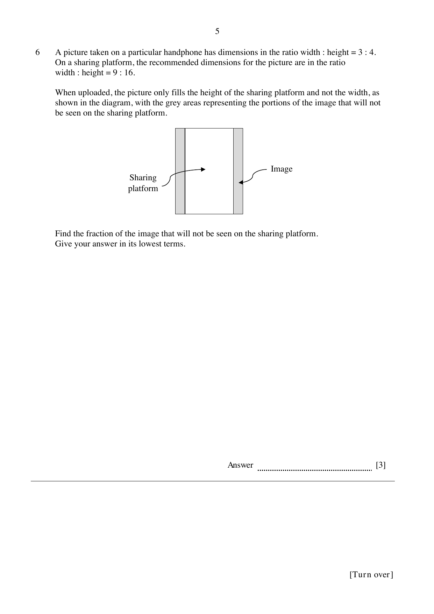
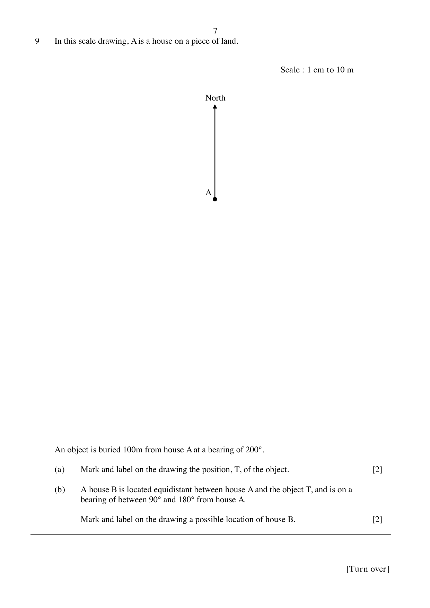
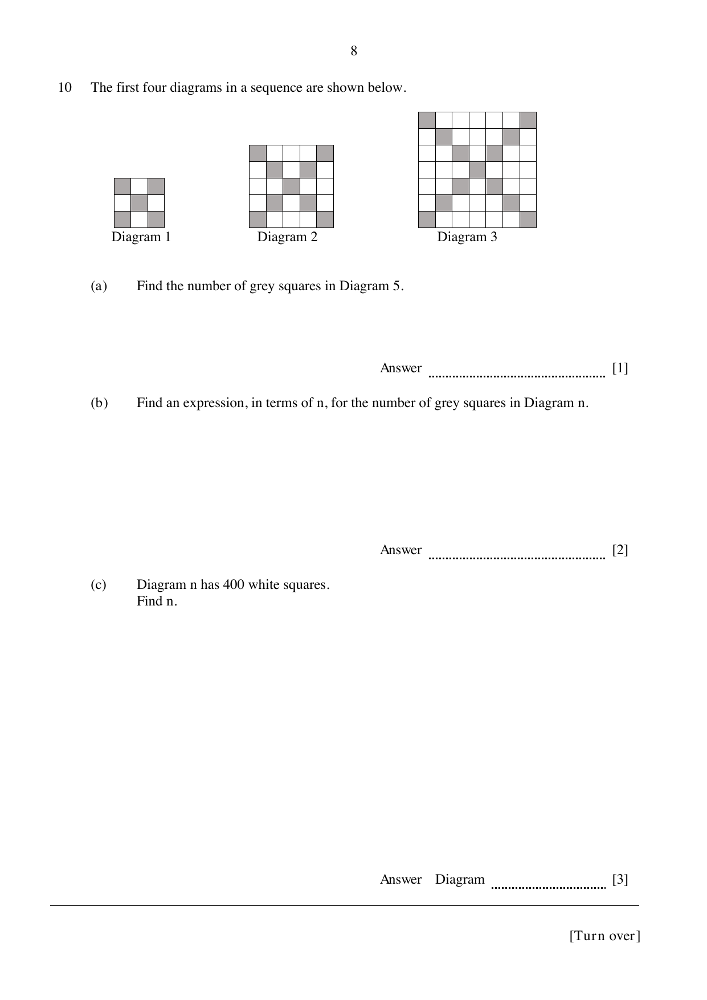
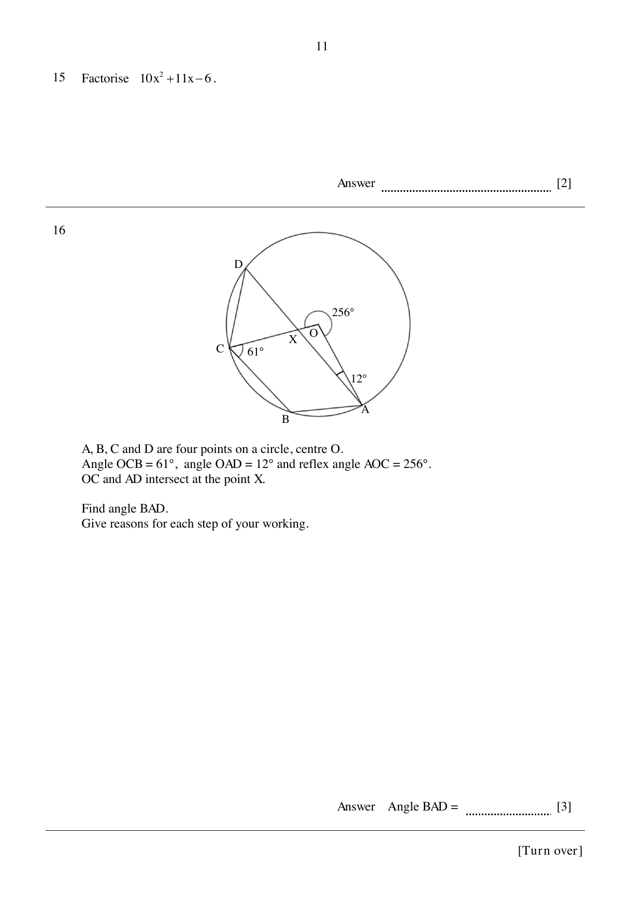
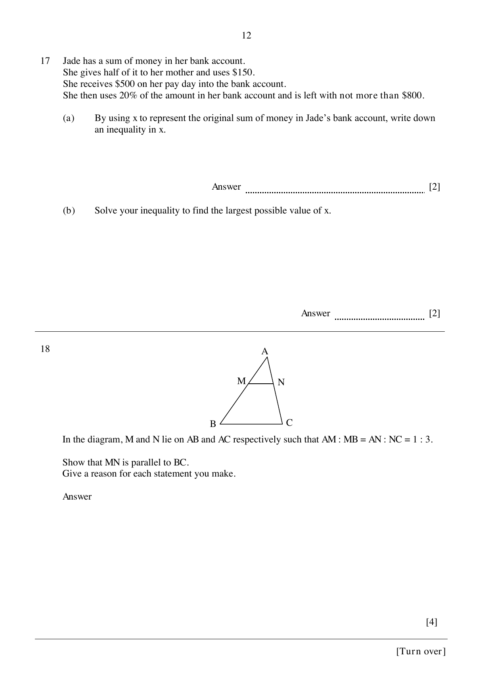
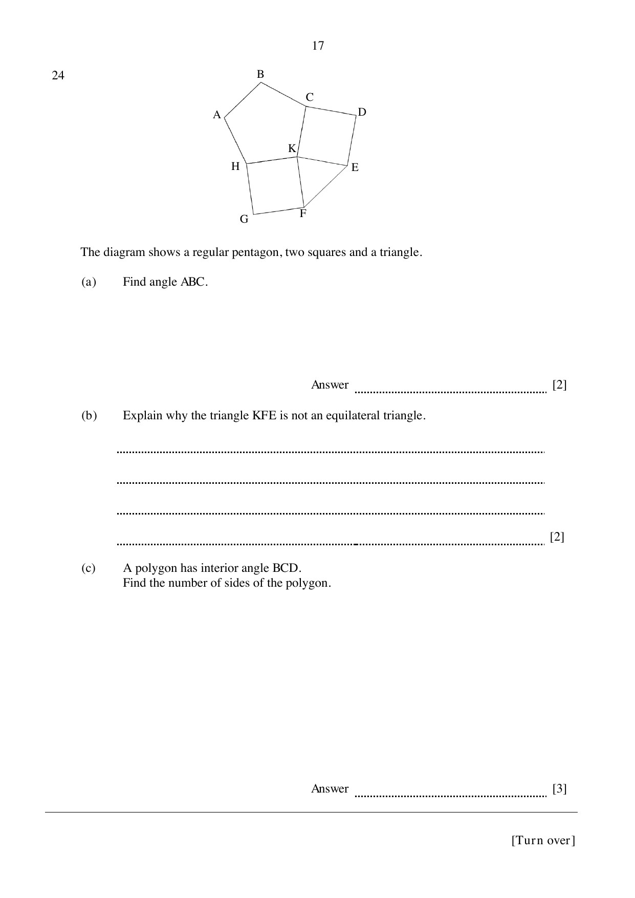
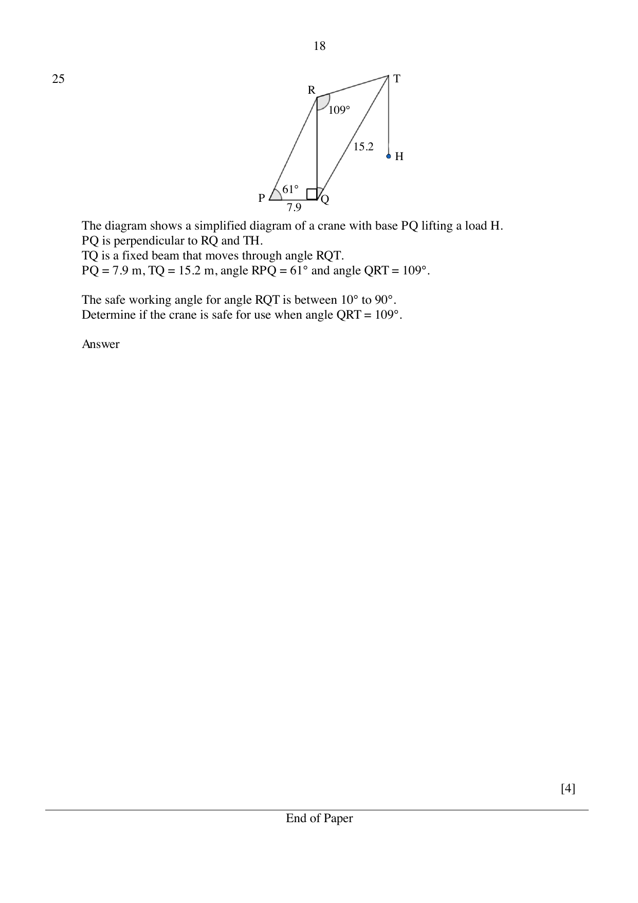
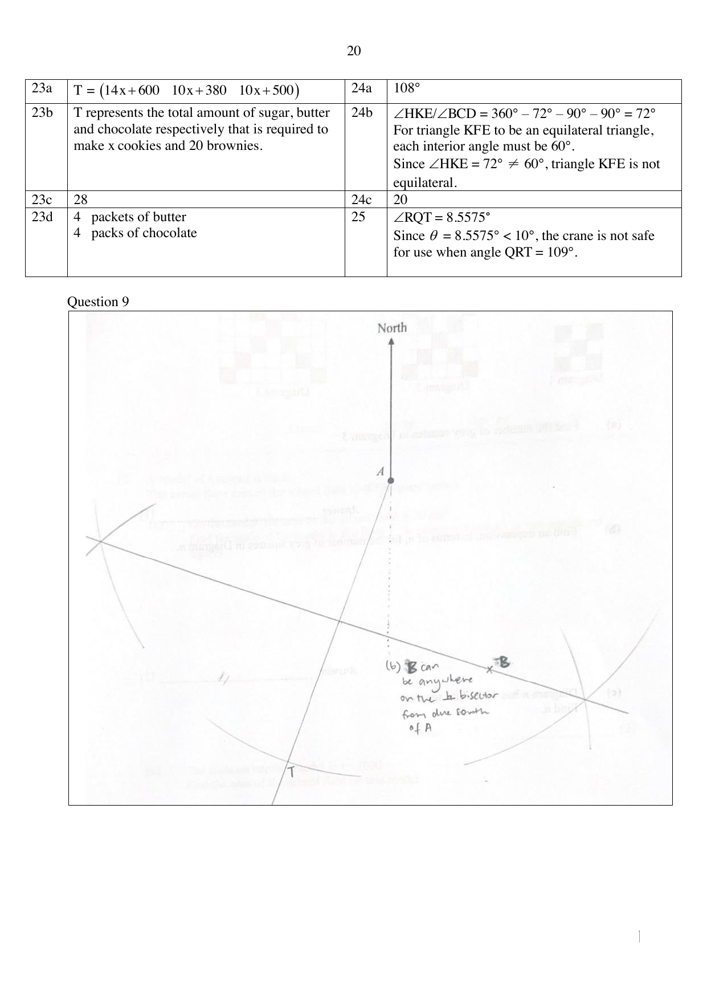

# Zhonghua Secondary School — Mathematics 4052/01 Paper 1 (cleaned)

> **Institution:** Zhonghua Secondary School
> **Exam:** Preliminary Examination 2024
> **Level:** Secondary 4 Express / 4 Normal (Academic) SBB / 5 Normal (Academic)
> **Subjects:** Elementary Mathematics
> **Paper:** 4052/01 Paper 1
> **Date:** 21 August 2024
> **Duration:** 2 hours 15 minutes
> **Total Marks:** 90
> **Source:** `Zhonghua 2024 4E4N5N EM Prelim P1 QP w Answer Key.pdf`

Setter: Ms Estee Teo. Vetter: Mr Francis Tan.

This question paper consists of 18 printed pages, including the cover page. The printed answer key is on pages 19–20 of the same PDF.

---

## Instructions

Write your name, class and register number on all the work you hand in.
Write in dark blue or black pen on both sides of the paper.
You may use an HB pencil for any diagrams or graphs.
Do not use paper clips, glue or correction fluid.

Answer all the questions.
If working is needed for any question, it must be shown with the answer.
Omission of essential working will result in loss of marks.

The use of an approved scientific calculator is expected, where appropriate.
If the degree of accuracy is not specified in the question, and if the answer is not exact, give the answer to three significant figures. Give answers in degrees to one decimal place.
For $\pi$, use either your calculator value or $3.142$.

The number of marks is given in brackets [ ] at the end of each question or part question.
The total of the marks for this paper is 90.

---

## Mathematical Formulae

*Compound interest*

$$
\text{Total amount} = P\left(1+\frac{r}{100}\right)^{n}
$$

*Mensuration*

$$
\text{Curved surface area of a cone} = \pi rl
$$

$$
\text{Surface area of a sphere} = 4\pi r^{2}
$$

$$
\text{Volume of a cone} = \frac{1}{3}\pi r^{2}h
$$

$$
\text{Volume of a sphere} = \frac{4}{3}\pi r^{3}
$$

$$
\text{Area of triangle } ABC = \frac{1}{2}ab\sin C
$$

$$
\text{Arc length} = r\theta,\text{ where }\theta\text{ is in radians}
$$

$$
\text{Sector area} = \frac{1}{2}r^{2}\theta,\text{ where }\theta\text{ is in radians}
$$

*Trigonometry*

$$
\frac{a}{\sin A} = \frac{b}{\sin B} = \frac{c}{\sin C}
$$

$$
a^{2} = b^{2}+c^{2}-2bc\cos A
$$

*Statistics*

$$
\text{Mean} = \frac{\sum fx}{\sum f}
$$

$$
\text{Standard deviation} = \sqrt{\frac{\sum fx^{2}}{\sum f}-\left(\frac{\sum fx}{\sum f}\right)^{2}}
$$

---

### Q1

> **Marks:** 3
> **Page:** 3

(a) Expand and simplify $2a-3(a+5b)$. [1]
> **Topic:** N5 Algebraic expressions and formulae
> **Sub-topic:** Algebraic expressions and formulae
> **LO:** [[context/subjects/o-level-e-maths/learning-objectives/o-level-e-maths-N5j.md|N5j]]

(b) Factorise completely $-3x^{2}+12y^{2}$. [2]
> **Topic:** N5 Algebraic expressions and formulae
> **Sub-topic:** Algebraic expressions and formulae
> **LO:** [[context/subjects/o-level-e-maths/learning-objectives/o-level-e-maths-N5h.md|N5h]]

### Q2

> **Marks:** 2
> **Page:** 3

(a) Calculate $\dfrac{5048.9^{2}-30140}{14.69+9.656}$. Write your answer correct to 5 significant figures. [1]
> **Topic:** N1 Numbers and their operations
> **Sub-topic:** Numbers and their operations
> **LO:** [[context/subjects/o-level-e-maths/learning-objectives/o-level-e-maths-N1g.md|N1g]]

(b) Write your answer to part (a) in standard form. [1]
> **Topic:** N1 Numbers and their operations
> **Sub-topic:** Numbers and their operations
> **LO:** [[context/subjects/o-level-e-maths/learning-objectives/o-level-e-maths-N1h.md|N1h]]

### Q3

> **Marks:** 2
> **Topic:** G4 Pythagoras' theorem and trigonometry
> **Sub-topic:** Pythagoras' theorem and trigonometry
> **LO:** [[context/subjects/o-level-e-maths/learning-objectives/o-level-e-maths-G4c.md|G4c]]
> **Page:** 3

Given that $\sin\theta = 0.4$, find the two possible values for angle $\theta$, where $0^{\circ}\le\theta\le 180^{\circ}$. [2]

### Q4

> **Marks:** 4
> **Page:** 4

(i) A stack of coloured paper contains green, purple and blue sheets of paper. A piece of paper is selected at random from the stack. The probability that the paper is green is $10\%$. The probability that the paper is purple is $\dfrac{7}{20}$. Find the probability that the paper is blue. [1]
> **Topic:** S2 Probability
> **Sub-topic:** Probability
> **LO:** [[context/subjects/o-level-e-maths/learning-objectives/o-level-e-maths-S2c.md|S2c]]

(ii) A few pieces of green paper were added to the stack. The probability of picking a piece of purple paper from this stack at random is now $\dfrac{1}{3}$. If there were 120 sheets of paper initially, find the new probability of picking a blue piece of paper. [3]
> **Topic:** S2 Probability
> **Sub-topic:** Probability
> **LO:** [[context/subjects/o-level-e-maths/learning-objectives/o-level-e-maths-S2c.md|S2c]]

### Q5

> **Marks:** 2
> **Page:** 4

$5.4$, $4.8$, $7.8$, $6.4$, $1.9$, $9.3$, $6.3$, $8.7$

(a) Find the median of the set of numbers. [1]
> **Topic:** S1 Data handling and analysis
> **Sub-topic:** Data handling and analysis
> **LO:** [[context/subjects/o-level-e-maths/learning-objectives/o-level-e-maths-S1f.md|S1f]]

(b) Find the range of the set of numbers. [1]
> **Topic:** S1 Data handling and analysis
> **Sub-topic:** Data handling and analysis
> **LO:** [[context/subjects/o-level-e-maths/learning-objectives/o-level-e-maths-S1f.md|S1f]]

### Q6

> **Marks:** 3
> **Topic:** N2 Ratio and proportion
> **Sub-topic:** Ratio and proportion
> **LO:** [[context/subjects/o-level-e-maths/learning-objectives/o-level-e-maths-N2b.md|N2b]]
> **Page:** 5

A picture taken on a particular handphone has dimensions in the ratio width : height $= 3:4$. On a sharing platform, the recommended dimensions for the picture are in the ratio width : height $= 9:16$. When uploaded, the picture only fills the height of the sharing platform and not the width, as shown in the diagram, with the grey areas representing the portions of the image that will not be seen on the sharing platform.

Find the fraction of the image that will not be seen on the sharing platform. Give your answer in its lowest terms. [3]

### Q7

> **Marks:** 3
> **Topic:** N1 Numbers and their operations
> **Sub-topic:** Numbers and their operations
> **LO:** [[context/subjects/o-level-e-maths/learning-objectives/o-level-e-maths-N1j.md|N1j]]
> **Page:** 6

Simplify $\dfrac{(-2q)^{4}}{6\sqrt{p^{5}}}\times\dfrac{3\sqrt{p}}{-q}$. Leave your answer in positive index notation. [3]

### Q8

> **Marks:** 3
> **Topic:** N7 Equations and inequalities
> **Sub-topic:** Equations and inequalities
> **LO:** [[context/subjects/o-level-e-maths/learning-objectives/o-level-e-maths-N7c.md|N7c]]
> **Page:** 6

The cost of a pen is ＄$a$. The cost of a marker is ＄$b$.

Amelia buys 5 pens and 3 markers for ＄11.90. Benny buys 8 pens and 2 markers for ＄14.

Form and solve two simultaneous equations to find the cost of a pen and the cost of a marker. [3]

### Q9

> **Marks:** 4
> **Page:** 7

In this scale drawing, $A$ is a house on a piece of land. Scale: $1$ cm to $10$ m.

An object is buried $100$ m from house $A$ at a bearing of $200^{\circ}$.

(a) Mark and label on the drawing the position, $T$, of the object. [2]
> **Topic:** G3 Properties of circles
> **Sub-topic:** Properties of circles
> **LO:** [[context/subjects/o-level-e-maths/learning-objectives/o-level-e-maths-G3a.md|G3a]]

(b) A house $B$ is located equidistant between house $A$ and the object $T$, and is on a bearing of between $90^{\circ}$ and $180^{\circ}$ from house $A$. Mark and label on the drawing a possible location of house $B$. [2]
> **Topic:** G3 Properties of circles
> **Sub-topic:** Properties of circles
> **LO:** [[context/subjects/o-level-e-maths/learning-objectives/o-level-e-maths-G3a.md|G3a]]

### Q10

> **Marks:** 6
> **Page:** 8

The first four diagrams in a sequence are shown below.

(a) Find the number of grey squares in Diagram 5. [1]
> **Topic:** N5 Algebraic expressions and formulae
> **Sub-topic:** Algebraic expressions and formulae
> **LO:** [[context/subjects/o-level-e-maths/learning-objectives/o-level-e-maths-N5e.md|N5e]]

(b) Find an expression, in terms of $n$, for the number of grey squares in Diagram $n$. [2]
> **Topic:** N5 Algebraic expressions and formulae
> **Sub-topic:** Algebraic expressions and formulae
> **LO:** [[context/subjects/o-level-e-maths/learning-objectives/o-level-e-maths-N5e.md|N5e]]

(c) Diagram $n$ has 400 white squares. Find $n$. [3]
> **Topic:** N5 Algebraic expressions and formulae
> **Sub-topic:** Algebraic expressions and formulae
> **LO:** [[context/subjects/o-level-e-maths/learning-objectives/o-level-e-maths-N5e.md|N5e]]

### Q11

> **Marks:** 2
> **Topic:** N1 Numbers and their operations
> **Sub-topic:** Numbers and their operations
> **LO:** [[context/subjects/o-level-e-maths/learning-objectives/o-level-e-maths-N1b.md|N1b]]
> **Page:** 9

264 one-centimetre cubes are to be arranged to form a cuboid. Only one length of the cuboid is a prime number. Find a possible set of dimensions of the cuboid. [2]

### Q12

> **Marks:** 4
> **Page:** 9

A model of a school is made. The actual floor area of the school field is $4050$ square metres.

(a) On the model, the area of the school field is $20\text{ cm}^{2}$. Find the scale of the model in the form $1:n$, where $n$ is correct to two significant figures. [2]
> **Topic:** N1 Numbers and their operations
> **Sub-topic:** Numbers and their operations
> **LO:** [[context/subjects/o-level-e-maths/learning-objectives/o-level-e-maths-N1g.md|N1g]]

(b) The scale on another model is $1:4000$. Find the area of the school field on this model. [2]
> **Topic:** N1 Numbers and their operations
> **Sub-topic:** Numbers and their operations
> **LO:** [[context/subjects/o-level-e-maths/learning-objectives/o-level-e-maths-N1g.md|N1g]]

### Q13

> **Marks:** 3
> **Page:** 10

The table shows the heights of 50 students, measured in January 2023.

| Heights, $h$ cm | Frequency |
| --- | --- |
| $130\le h < 140$ | 1 |
| $140\le h < 150$ | 4 |
| $150\le h < 160$ | 16 |
| $160\le h < 170$ | 27 |
| $170\le h < 180$ | 2 |

(a) Calculate an estimate for

(i) the mean height of the students, [1]
> **Topic:** S1 Data handling and analysis
> **Sub-topic:** Data handling and analysis
> **LO:** [[context/subjects/o-level-e-maths/learning-objectives/o-level-e-maths-S1f.md|S1f]]

(ii) the standard deviation of the heights. [1]
> **Topic:** S1 Data handling and analysis
> **Sub-topic:** Data handling and analysis
> **LO:** [[context/subjects/o-level-e-maths/learning-objectives/o-level-e-maths-S1f.md|S1f]]

(b) The heights of the same group of students were measured again in January 2024. The shortest height measured was $146$ cm. The tallest height measured was $180$ cm. State how the mean and standard deviation will change in January 2024. [1]
> **Topic:** S1 Data handling and analysis
> **Sub-topic:** Data handling and analysis
> **LO:** [[context/subjects/o-level-e-maths/learning-objectives/o-level-e-maths-S1f.md|S1f]]

### Q14

> **Marks:** 2
> **Topic:** N1 Numbers and their operations
> **Sub-topic:** Numbers and their operations
> **LO:** [[context/subjects/o-level-e-maths/learning-objectives/o-level-e-maths-N1h.md|N1h]]
> **Page:** 10

Given that $9^{2x} = 243\times 3^{x}$, find $x$. [2]

### Q15

> **Marks:** 2
> **Topic:** N5 Algebraic expressions and formulae
> **Sub-topic:** Algebraic expressions and formulae
> **LO:** [[context/subjects/o-level-e-maths/learning-objectives/o-level-e-maths-N5h.md|N5h]]
> **Page:** 11

Factorise $10x^{2}+11x-6$. [2]

### Q16

> **Marks:** 3
> **Topic:** G3 Properties of circles
> **Sub-topic:** Properties of circles
> **LO:** [[context/subjects/o-level-e-maths/learning-objectives/o-level-e-maths-G3a.md|G3a]]
> **Page:** 11

$A$, $B$, $C$ and $D$ are four points on a circle, centre $O$. Angle $OCB = 61^{\circ}$, angle $OAD = 12^{\circ}$ and reflex angle $AOC = 256^{\circ}$. $OC$ and $AD$ intersect at the point $X$.

Find angle $BAD$. Give reasons for each step of your working. [3]

### Q17

> **Marks:** 4
> **Page:** 12

Jade has a sum of money in her bank account. She gives half of it to her mother and uses ＄150. She receives ＄500 on her pay day into the bank account. She then uses $20\%$ of the amount in her bank account and is left with not more than ＄800.

(a) By using $x$ to represent the original sum of money in Jade's bank account, write down an inequality in $x$. [2]
> **Topic:** N7 Equations and inequalities
> **Sub-topic:** Equations and inequalities
> **LO:** [[context/subjects/o-level-e-maths/learning-objectives/o-level-e-maths-N7g.md|N7g]]

(b) Solve your inequality to find the largest possible value of $x$. [2]
> **Topic:** N1 Numbers and their operations
> **Sub-topic:** Numbers and their operations
> **LO:** [[context/subjects/o-level-e-maths/learning-objectives/o-level-e-maths-N1e.md|N1e]]

### Q18

> **Marks:** 4
> **Topic:** G1 Angles, triangles and polygons
> **Sub-topic:** Angles, triangles and polygons
> **LO:** [[context/subjects/o-level-e-maths/learning-objectives/o-level-e-maths-G1c.md|G1c]]
> **Page:** 12

In the diagram, $M$ and $N$ lie on $AB$ and $AC$ respectively such that $AM:MB = AN:NC = 1:3$.

Show that $MN$ is parallel to $BC$. Give a reason for each statement you make. [4]

### Q19

> **Marks:** 3
> **Topic:** N5 Algebraic expressions and formulae
> **Sub-topic:** Algebraic expressions and formulae
> **LO:** [[context/subjects/o-level-e-maths/learning-objectives/o-level-e-maths-N5k.md|N5k]]
> **Page:** 13

$2a = \dfrac{x}{3x-2y}$. Rearrange the formula to make $x$ the subject. [3]

### Q20

> **Marks:** 3
> **Topic:** N6 Functions and graphs
> **Sub-topic:** Functions and graphs
> **LO:** [[context/subjects/o-level-e-maths/learning-objectives/o-level-e-maths-N6g.md|N6g]]
> **Page:** 13

Write as a single fraction in its simplest form $\dfrac{6x}{18x-3}-\dfrac{1}{1-6x}$. [3]

### Q21

> **Marks:** 7
> **Page:** 14–15

The population of a town was tracked across a few decades. The population, $P$, after $t$ years can be modelled by the equation $P = n\times 2^{0.1t}$, where $n$ is the population in the year 1960.

(a) The initial population of the town was 310 people. Find $n$. [1]
> **Topic:** N6 Functions and graphs
> **Sub-topic:** Functions and graphs
> **LO:** [[context/subjects/o-level-e-maths/learning-objectives/o-level-e-maths-N6b.md|N6b]]

(b) Find the population of the town in the year 2000. [1]
> **Topic:** N6 Functions and graphs
> **Sub-topic:** Functions and graphs
> **LO:** [[context/subjects/o-level-e-maths/learning-objectives/o-level-e-maths-N6b.md|N6b]]

(c) From the above data, Geraldine concluded that the population in the year 2040 will be 32 times the population in the year 1960. By using calculations, explain whether Geraldine is correct. [3]
> **Topic:** N6 Functions and graphs
> **Sub-topic:** Functions and graphs
> **LO:** [[context/subjects/o-level-e-maths/learning-objectives/o-level-e-maths-N6b.md|N6b]]

(d) Sketch the graph of the function $P = n\times 2^{0.1t}$, using the information obtained in parts (a) and (b). Show the values on the axes clearly. [2]
> **Topic:** N6 Functions and graphs
> **Sub-topic:** Functions and graphs
> **LO:** [[context/subjects/o-level-e-maths/learning-objectives/o-level-e-maths-N6c.md|N6c]]

### Q22

> **Marks:** 3
> **Topic:** N5 Algebraic expressions and formulae
> **Sub-topic:** Algebraic expressions and formulae
> **LO:** [[context/subjects/o-level-e-maths/learning-objectives/o-level-e-maths-N5m.md|N5m]]
> **Page:** 15

On Monday, a car travelling from work to home at an average speed of $p$ km/h takes 30 minutes to complete the journey. On Tuesday, the car decreased its average speed by $q\%$ and took 45 minutes instead to complete the same journey. Find the value of $q$. [3]

### Q23

> **Marks:** 7
> **Page:** 16

Gwee is making cookies and brownies. A single chocolate cookie requires $14$ g of sugar, $10$ g of butter and $10$ g of chocolate. A slice of brownie requires $30$ g of sugar, $19$ g of butter and $25$ g of chocolate.

$$
A = \begin{pmatrix} 14 & 10 & 10 \\ 30 & 19 & 25 \end{pmatrix}
$$

Gwee wants to make $x$ cookies and 20 brownies. This information can be represented by the matrix $B = \begin{pmatrix} x & 20 \end{pmatrix}$.

(a) Find, in terms of $x$, the matrix $T = BA$. [2]
> **Topic:** N9 Matrices
> **Sub-topic:** Matrices
> **LO:** [[context/subjects/o-level-e-maths/learning-objectives/o-level-e-maths-N9b.md|N9b]]

(b) Explain what the elements of the matrix $T$ represent. [1]
> **Topic:** N9 Matrices
> **Sub-topic:** Matrices
> **LO:** [[context/subjects/o-level-e-maths/learning-objectives/o-level-e-maths-N9b.md|N9b]]

(c) In the supermarket, the ingredients are sold in the following quantities: 1 pack of sugar ($500$ g), 1 packet of butter ($200$ g), 1 pack of chocolate ($240$ g). If Gwee buys 2 packets of sugar, find the largest integer value of $x$. [2]
> **Topic:** N1 Numbers and their operations
> **Sub-topic:** Numbers and their operations
> **LO:** [[context/subjects/o-level-e-maths/learning-objectives/o-level-e-maths-N1e.md|N1e]]

(d) State the corresponding quantity of butter and chocolate required. [2]
> **Topic:** N9 Matrices
> **Sub-topic:** Matrices
> **LO:** [[context/subjects/o-level-e-maths/learning-objectives/o-level-e-maths-N9b.md|N9b]]

### Q24

> **Marks:** 7
> **Page:** 17

The diagram shows a regular pentagon, two squares and a triangle.

(a) Find angle $ABC$. [2]
> **Topic:** G1 Angles, triangles and polygons
> **Sub-topic:** Angles, triangles and polygons
> **LO:** [[context/subjects/o-level-e-maths/learning-objectives/o-level-e-maths-G1f.md|G1f]]

(b) Explain why the triangle $KFE$ is not an equilateral triangle. [2]
> **Topic:** G1 Angles, triangles and polygons
> **Sub-topic:** Angles, triangles and polygons
> **LO:** [[context/subjects/o-level-e-maths/learning-objectives/o-level-e-maths-G1f.md|G1f]]

(c) A polygon has interior angle $BCD$. Find the number of sides of the polygon. [3]
> **Topic:** G1 Angles, triangles and polygons
> **Sub-topic:** Angles, triangles and polygons
> **LO:** [[context/subjects/o-level-e-maths/learning-objectives/o-level-e-maths-G1f.md|G1f]]

### Q25

> **Marks:** 4
> **Topic:** G4 Pythagoras' theorem and trigonometry
> **Sub-topic:** Pythagoras' theorem and trigonometry
> **LO:** [[context/subjects/o-level-e-maths/learning-objectives/o-level-e-maths-G4c.md|G4c]]
> **Page:** 18

The diagram shows a simplified diagram of a crane with base $PQ$ lifting a load $H$. $PQ$ is perpendicular to $RQ$ and $TH$. $TQ$ is a fixed beam that moves through angle $RQT$. $PQ = 7.9$ m, $TQ = 15.2$ m, angle $RPQ = 61^{\circ}$ and angle $QRT = 109^{\circ}$.

The safe working angle for angle $RQT$ is between $10^{\circ}$ and $90^{\circ}$. Determine if the crane is safe for use when angle $QRT = 109^{\circ}$. [4]

---

## Answers

Printed answer key, PDF pages 19–20. The construction for Question 9 is on page 20.

**1(a)** $-a-15b$

**1(b)** $-3(x-2y)(x+2y)$

**2(a)** $1045800$

**2(b)** $1.0458\times 10^{6}$

**3** $23.6^{\circ}$ or $156.4^{\circ}$

**4(i)** $\dfrac{11}{20}$

**4(ii)** $\dfrac{11}{21}$

**5(a)** $6.35$

**5(b)** $7.4$

**6** $\dfrac{1}{4}$

**7** $\dfrac{8q^{3}}{-p^{2}}$

**8** Pen ＄1.30; marker ＄1.80

**9** See the construction on the answer-key page.

**10(a)** $21$

**10(b)** $2(2n+1)-1$ or $4n+1$

**10(c)** $10$

**11** $2$ cm by $6$ cm by $22$ cm, or $3$ cm by $4$ cm by $22$ cm, or $4$ cm by $6$ cm by $11$ cm

**12(a)** $1:1400$

**12(b)** $2.53125\text{ cm}^{2}$

**13(a)(i)** $160$ cm

**13(a)(ii)** $7.81$ cm

**13(b)** The mean height will increase, because the shortest height has increased and there are more taller heights. The standard deviation will decrease, because the range of values is slightly smaller and there are no more values in the smallest class interval.

**14** $\dfrac{5}{3}$

**15** $(5x-2)(2x+3)$

**16** $55^{\circ}$

**17(a)** $\left[\left(\dfrac{x}{2}-150\right)+500\right]\times 0.8\le 800$

**17(b)** $1300$

**18** $\angle MAN = \angle BAC$ (common angle). $\dfrac{AM}{AB} = \dfrac{AN}{AC} = \dfrac{1}{4}$ (given). Triangle $MAN$ is similar to triangle $BAC$ because two pairs of sides are in the same ratio and the included angle is equal (SAS similarity). $\angle AMN = \angle ABC$ (corresponding angles of similar triangles), so $MN\parallel BC$ (converse of corresponding angles).

**19** $x = \dfrac{4ay}{6a-1}$

**20** $\dfrac{2x+1}{6x-1}$

**21(a)** $310$

**21(b)** $4960$

**21(c)** Population in 2040 $= 310\times 2^{0.1(80)} = 79360$. Number of times the population increased from 1960 to 2040 $= 79360\div 310 = 256$. Geraldine is incorrect: it is 256 times, not 32 times.

**21(d)** Sketch on the answer-key page.

**22** $\dfrac{100}{3}$

**23(a)** $T = \begin{pmatrix} 14x+600 & 10x+380 & 10x+500 \end{pmatrix}$

**23(b)** $T$ represents the total amount of sugar, butter and chocolate respectively that is required to make $x$ cookies and 20 brownies.

**23(c)** $28$

**23(d)** 4 packets of butter and 4 packs of chocolate

**24(a)** $108^{\circ}$

**24(b)** $\angle HKE$ or $\angle BCD = 360^{\circ}-72^{\circ}-90^{\circ}-90^{\circ} = 72^{\circ}$. For triangle $KFE$ to be equilateral, each interior angle must be $60^{\circ}$. Since $72^{\circ}\neq 60^{\circ}$, triangle $KFE$ is not equilateral.

**24(c)** $20$

**25** $\angle RQT = 8.5575^{\circ}$. Since $8.5575^{\circ} < 10^{\circ}$, the crane is not safe for use when angle $QRT = 109^{\circ}$.
