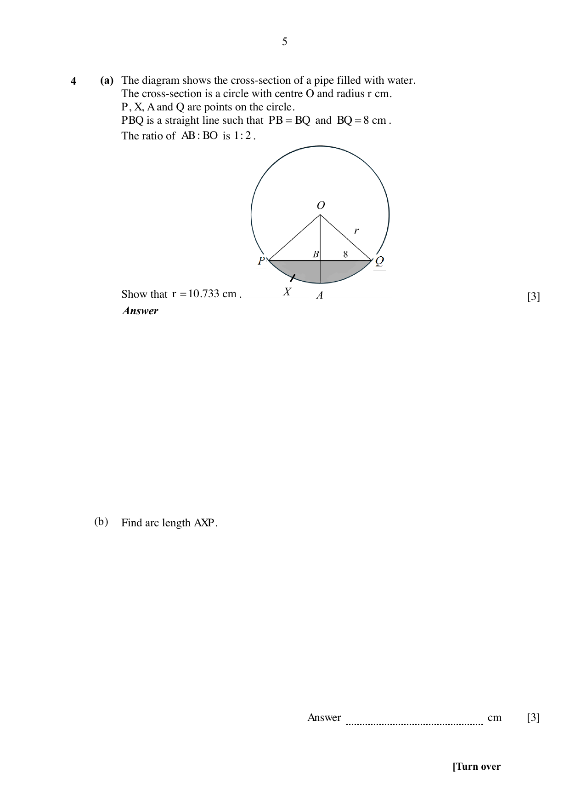
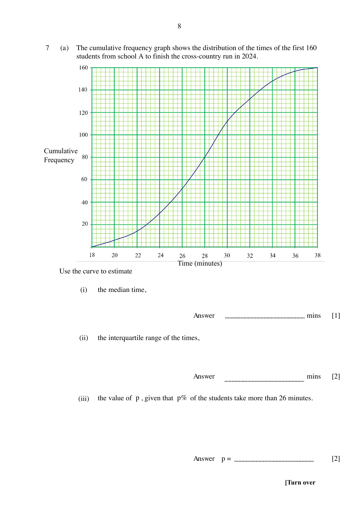
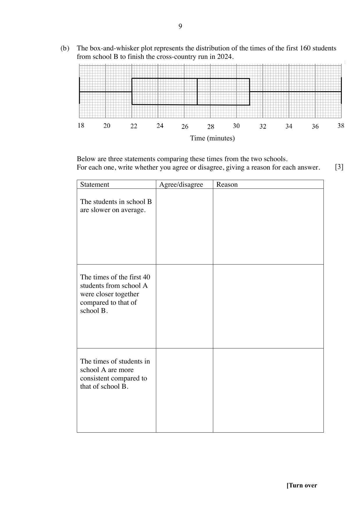
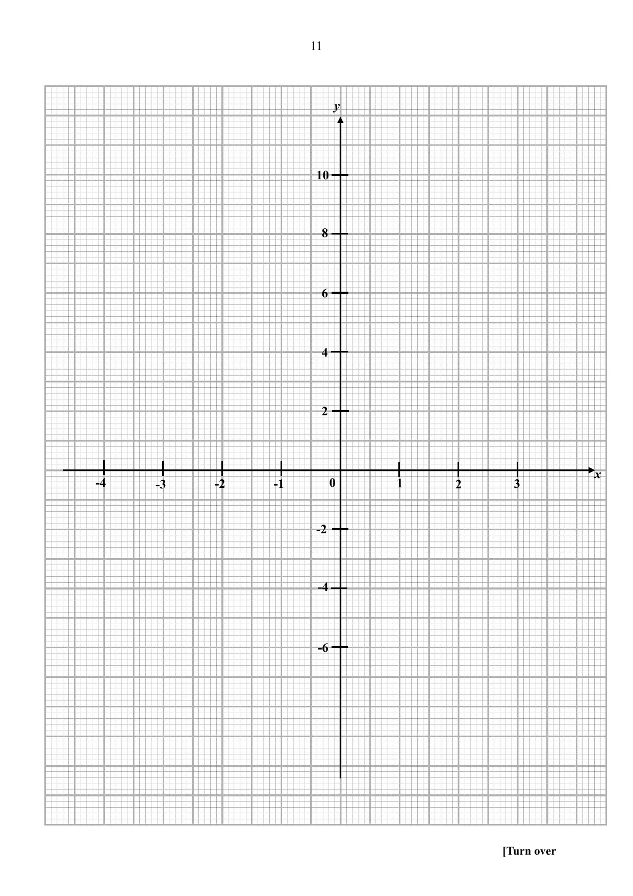
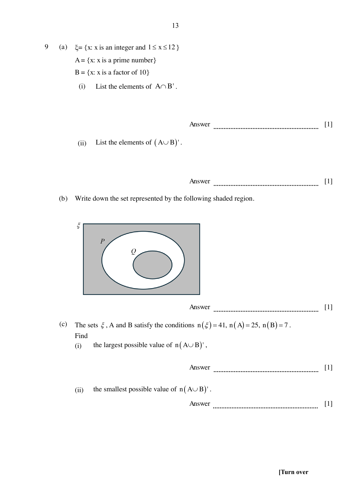
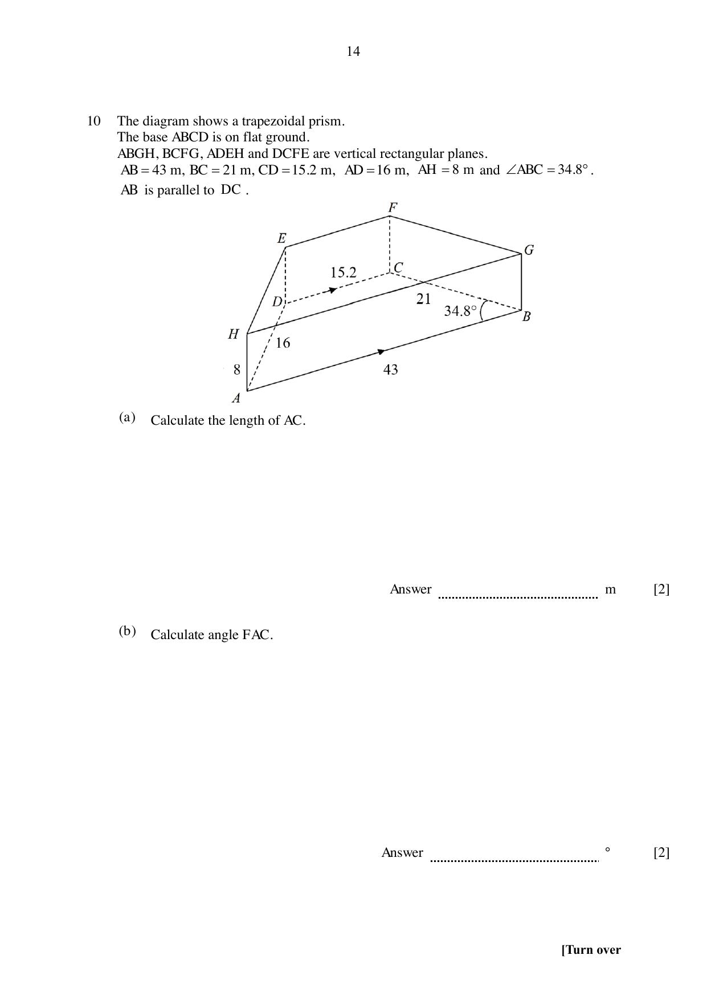
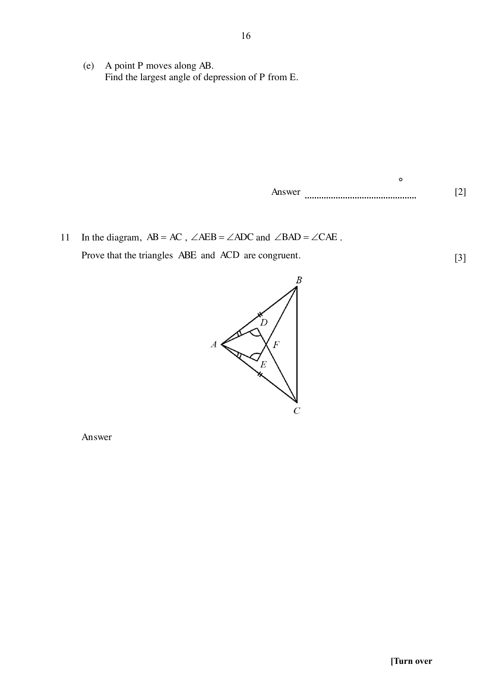
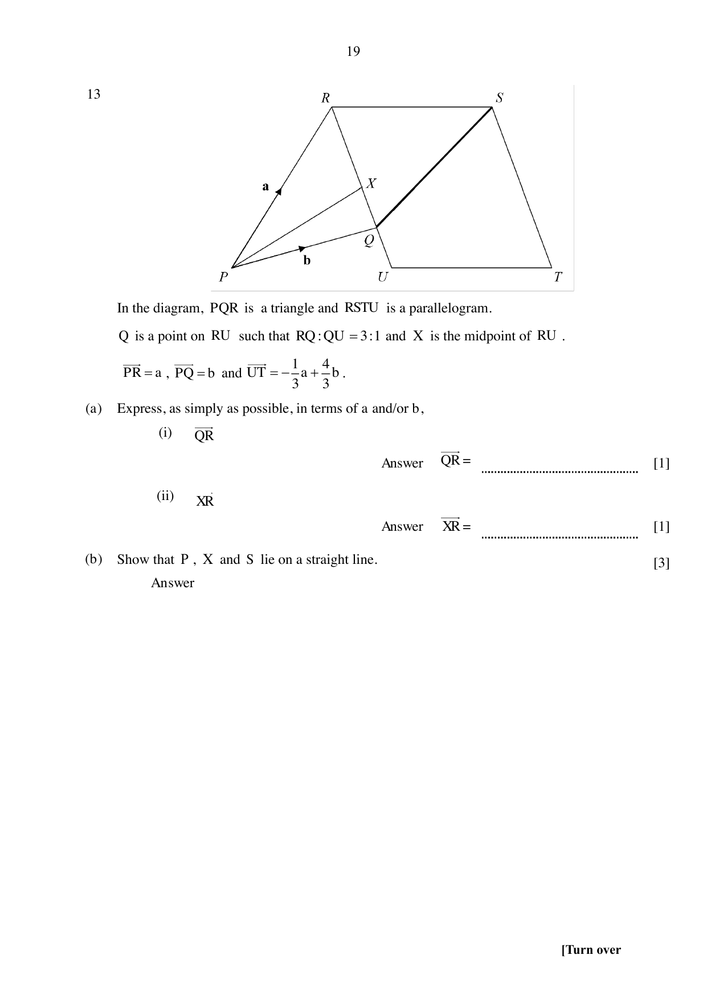

# Zhonghua Secondary School — Mathematics 4052/02 Paper 2 (cleaned)

> **Institution:** Zhonghua Secondary School
> **Exam:** Preliminary Examination 2024
> **Level:** Secondary 4 Express / 4 Normal (Academic) SBB / Secondary 5 Normal (Academic)
> **Subjects:** Elementary Mathematics
> **Paper:** 4052/02 Paper 2
> **Date:** 27 August 2024
> **Duration:** 2 hours and 15 minutes
> **Total Marks:** 90
> **Source:** `Zhonghua 2024 4E4N5N EM Prelim P2 QP w Answer Key.pdf`

Setter: Ms Lee Jie Li. Vetted by: Mr Francis Tan.

This document consists of 24 printed pages. The printed answer key is on pages 25–26 of the same PDF. That key is headed "4052/1 Mathematics Paper 2".

---

## Instructions

Write your name, class and register number in the spaces at the top of this page.
Write in dark blue or black pen.
You may use an HB pencil for any diagrams or graphs.
Do not use paper clips, glue or correction fluid.

Answer all questions.
Give non-exact numerical answers correct to 3 significant figures, or 1 decimal place in the case of angles in degree, unless a different level of accuracy is specified in the question.
The use of an approved scientific calculator is expected, where appropriate.
You are reminded of the need for clear presentation in your answers.

The number of marks is given in brackets [ ] at the end of each question or part question.
The total of the marks for this paper is 90.

---

## Mathematical Formulae

*Compound interest*

$$
\text{Total amount} = P\left(1+\frac{r}{100}\right)^{n}
$$

*Mensuration*

$$
\text{Curved surface area of a cone} = \pi rl
$$

$$
\text{Surface area of a sphere} = 4\pi r^{2}
$$

$$
\text{Volume of a cone} = \frac{1}{3}\pi r^{2}h
$$

$$
\text{Volume of a sphere} = \frac{4}{3}\pi r^{3}
$$

$$
\text{Area of triangle } ABC = \frac{1}{2}ab\sin C
$$

$$
\text{Arc length} = r\theta,\text{ where }\theta\text{ is in radians}
$$

$$
\text{Sector area} = \frac{1}{2}r^{2}\theta,\text{ where }\theta\text{ is in radians}
$$

*Trigonometry*

$$
\frac{a}{\sin A} = \frac{b}{\sin B} = \frac{c}{\sin C}
$$

$$
a^{2} = b^{2}+c^{2}-2bc\cos A
$$

*Statistics*

$$
\text{Mean} = \frac{\sum fx}{\sum f}
$$

$$
\text{Standard deviation} = \sqrt{\frac{\sum fx^{2}}{\sum f}-\left(\frac{\sum fx}{\sum f}\right)^{2}}
$$

---

### Q1

> **Marks:** 1
> **Topic:** N1 Numbers and their operations
> **Sub-topic:** Numbers and their operations
> **LO:** [[context/subjects/o-level-e-maths/learning-objectives/o-level-e-maths-N1d.md|N1d]]
> **Page:** 3

Write down the following numbers in ascending order. [1]

$$
-\dfrac{25}{37},\quad (-0.51)^{\frac{2}{3}},\quad \sqrt{0.36},\quad 0.\dot{6},\quad -\dfrac{\pi}{6}
$$

### Q2

> **Marks:** 2
> **Topic:** G5 Mensuration
> **Sub-topic:** Mensuration
> **LO:** [[context/subjects/o-level-e-maths/learning-objectives/o-level-e-maths-G5a.md|G5a]]
> **Page:** 3

The diagram shows two geometrically similar pails. The area of the base of the smaller pail is $54\text{ cm}^{2}$. The area of the base of the larger pail is $150\text{ cm}^{2}$. The height of the larger pail is $26$ cm. Calculate the height of the smaller pail. [2]

### Q3

> **Marks:** 4
> **Page:** 4

(a) Solve $\dfrac{2x}{5} = 2+\dfrac{3x-11}{15}$. [2]
> **Topic:** N1 Numbers and their operations
> **Sub-topic:** Numbers and their operations
> **LO:** [[context/subjects/o-level-e-maths/learning-objectives/o-level-e-maths-N1j.md|N1j]]

(b) Simplify $\dfrac{12p^{2}q^{2}}{7r^{3}}\div\dfrac{3p^{5}r}{14q^{3}}$, giving your answer in positive index notation. [2]
> **Topic:** N1 Numbers and their operations
> **Sub-topic:** Numbers and their operations
> **LO:** [[context/subjects/o-level-e-maths/learning-objectives/o-level-e-maths-N1j.md|N1j]]

### Q4

> **Marks:** 6
> **Page:** 5

(a) The diagram shows the cross-section of a pipe filled with water. The cross-section is a circle with centre $O$ and radius $r$ cm. $P$, $X$, $A$ and $Q$ are points on the circle. $PBQ$ is a straight line such that $PB = BQ$ and $BQ = 8$ cm. The ratio of $AB:BO$ is $1:2$. Show that $r = 10.733$ cm. [3]
> **Topic:** G5 Mensuration
> **Sub-topic:** Mensuration
> **LO:** [[context/subjects/o-level-e-maths/learning-objectives/o-level-e-maths-G5f.md|G5f]]

(b) Find arc length $AXP$. [3]
> **Topic:** G5 Mensuration
> **Sub-topic:** Mensuration
> **LO:** [[context/subjects/o-level-e-maths/learning-objectives/o-level-e-maths-G5f.md|G5f]]

### Q5

> **Marks:** 4
> **Topic:** N3 Percentage
> **Sub-topic:** Percentage
> **LO:** [[context/subjects/o-level-e-maths/learning-objectives/o-level-e-maths-N3d.md|N3d]]
> **Page:** 6

Tom requires a 7 year loan of ＄120 000 to purchase a new car. Bank M charges an interest of $4\%$ per annum compounded monthly. Bank N charges a simple interest of $4.3\%$ per annum. Determine which bank loan Tom should take. Justify your answer clearly. [4]

### Q6

> **Marks:** 4
> **Page:** 6–7

(a) The cash price of a furniture set is ＄10 850. Kate buys the sofa on hire purchase. She pays a deposit of one fifth of the cash price. She then makes 24 monthly payments of ＄$x$. Given that the total amount that Kate pays for the furniture set is ＄11 578, find the value of $x$. [2]
> **Topic:** N3 Percentage
> **Sub-topic:** Percentage
> **LO:** [[context/subjects/o-level-e-maths/learning-objectives/o-level-e-maths-N3d.md|N3d]]

(b) The exchange rate between Singapore dollars (＄) and US dollars (USD) is ＄1 = USD 0.74. The exchange rate between British pounds (£) and Singapore dollars (＄) is £1 = ＄1.72. Kate wants to buy a handbag. The same handbag costs USD 234 on online shopping platform A and £234 on online shopping platform B. By comparing the exchange rates, explain how you can tell that the handbag costs more on online shopping platform B. [2]
> **Topic:** N3 Percentage
> **Sub-topic:** Percentage
> **LO:** [[context/subjects/o-level-e-maths/learning-objectives/o-level-e-maths-N3d.md|N3d]]

### Q7

> **Marks:** 8
> **Page:** 8–9

(a) The cumulative frequency graph shows the distribution of the times of the first 160 students from school A to finish the cross-country run in 2024.

Use the curve to estimate

(i) the median time, [1]
> **Topic:** S1 Data handling and analysis
> **Sub-topic:** Data handling and analysis
> **LO:** [[context/subjects/o-level-e-maths/learning-objectives/o-level-e-maths-S1i.md|S1i]]

(ii) the interquartile range of the times, [2]
> **Topic:** S1 Data handling and analysis
> **Sub-topic:** Data handling and analysis
> **LO:** [[context/subjects/o-level-e-maths/learning-objectives/o-level-e-maths-S1i.md|S1i]]

(iii) the value of $p$, given that $p\%$ of the students take more than 26 minutes. [2]
> **Topic:** S1 Data handling and analysis
> **Sub-topic:** Data handling and analysis
> **LO:** [[context/subjects/o-level-e-maths/learning-objectives/o-level-e-maths-S1i.md|S1i]]

(b) The box-and-whisker plot represents the distribution of the times of the first 160 students from school B to finish the cross-country run in 2024.

Below are three statements comparing these times from the two schools. For each one, write whether you agree or disagree, giving a reason for each answer. [3]
> **Topic:** S1 Data handling and analysis
> **Sub-topic:** Data handling and analysis
> **LO:** [[context/subjects/o-level-e-maths/learning-objectives/o-level-e-maths-S1f.md|S1f]]

The students in school B are slower on average.

The times of the first 40 students from school A were closer together compared to that of school B.

The times of students in school A are more consistent compared to that of school B.

### Q8

> **Marks:** 10
> **Page:** 10–12

(a) Complete the table of values for $y = \dfrac{1}{2}(x^{3}+x^{2})-4x+3$. [1]
> **Topic:** G6 Coordinate geometry
> **Sub-topic:** Coordinate geometry
> **LO:** [[context/subjects/o-level-e-maths/learning-objectives/o-level-e-maths-G6c.md|G6c]]

| $x$ | $-4$ | $-3$ | $-2$ | $-1$ | $0$ | $1$ | $2$ | $3$ |
| --- | --- | --- | --- | --- | --- | --- | --- | --- |
| $y$ |  | 6 | 9 | 7 | 3 | 0 | 1 | 9 |

(b) On the grid given on page 11, draw the graph of $y = \dfrac{1}{2}(x^{3}+x^{2})-4x+3$ for $-4\le x\le 3$. [3]
> **Topic:** N6 Functions and graphs
> **Sub-topic:** Functions and graphs
> **LO:** [[context/subjects/o-level-e-maths/learning-objectives/o-level-e-maths-N6c.md|N6c]]

(c) Use your graph to write an inequality in $k$ where $\dfrac{1}{2}(x^{3}+x^{2})-4x+3 = k$ has three solutions. [2]
> **Topic:** N6 Functions and graphs
> **Sub-topic:** Functions and graphs
> **LO:** [[context/subjects/o-level-e-maths/learning-objectives/o-level-e-maths-N6c.md|N6c]]

(d) Using the graph, find the gradient of the curve at $x = -2.7$. [2]
> **Topic:** G6 Coordinate geometry
> **Sub-topic:** Coordinate geometry
> **LO:** [[context/subjects/o-level-e-maths/learning-objectives/o-level-e-maths-G6c.md|G6c]]

(e) By drawing a suitable straight line on the grid, solve the equation $\dfrac{1}{2}x^{3}+\dfrac{1}{2}x^{2}-3x-1 = 0$. [2]
> **Topic:** G6 Coordinate geometry
> **Sub-topic:** Coordinate geometry
> **LO:** [[context/subjects/o-level-e-maths/learning-objectives/o-level-e-maths-G6c.md|G6c]]

### Q9

> **Marks:** 5
> **Page:** 13

(a) $\xi = \{x: x\text{ is an integer and }1\le x\le 12\}$

$A = \{x: x\text{ is a prime number}\}$

$B = \{x: x\text{ is a factor of }10\}$

(i) List the elements of $A\cap B'$. [1]
> **Topic:** N8 Set language and notation
> **Sub-topic:** Set language and notation
> **LO:** [[context/subjects/o-level-e-maths/learning-objectives/o-level-e-maths-N8a.md|N8a]]

(ii) List the elements of $(A\cup B)'$. [1]
> **Topic:** N8 Set language and notation
> **Sub-topic:** Set language and notation
> **LO:** [[context/subjects/o-level-e-maths/learning-objectives/o-level-e-maths-N8a.md|N8a]]

(b) Write down the set represented by the shaded region on the page. [1]
> **Topic:** N8 Set language and notation
> **Sub-topic:** Set language and notation
> **LO:** [[context/subjects/o-level-e-maths/learning-objectives/o-level-e-maths-N8a.md|N8a]]

(c) The sets $\xi$, $A$ and $B$ satisfy $n(\xi) = 41$, $n(A) = 25$ and $n(B) = 7$. Find

(i) the largest possible value of $n(A\cup B)'$, [1]
> **Topic:** N8 Set language and notation
> **Sub-topic:** Set language and notation
> **LO:** [[context/subjects/o-level-e-maths/learning-objectives/o-level-e-maths-N8a.md|N8a]]

(ii) the smallest possible value of $n(A\cup B)'$. [1]
> **Topic:** N8 Set language and notation
> **Sub-topic:** Set language and notation
> **LO:** [[context/subjects/o-level-e-maths/learning-objectives/o-level-e-maths-N8a.md|N8a]]

### Q10

> **Marks:** 12
> **Page:** 14–16

The diagram shows a trapezoidal prism. The base $ABCD$ is on flat ground. $ABGH$, $BCFG$, $ADEH$ and $DCFE$ are vertical rectangular planes. $AB = 43$ m, $BC = 21$ m, $CD = 15.2$ m, $AD = 16$ m, $AH = 8$ m and $\angle ABC = 34.8^{\circ}$. $AB$ is parallel to $DC$.

(a) Calculate the length of $AC$. [2]
> **Topic:** G4 Pythagoras' theorem and trigonometry
> **Sub-topic:** Pythagoras' theorem and trigonometry
> **LO:** [[context/subjects/o-level-e-maths/learning-objectives/o-level-e-maths-G4g.md|G4g]]

(b) Calculate angle $FAC$. [2]
> **Topic:** G4 Pythagoras' theorem and trigonometry
> **Sub-topic:** Pythagoras' theorem and trigonometry
> **LO:** [[context/subjects/o-level-e-maths/learning-objectives/o-level-e-maths-G4g.md|G4g]]

(c) Calculate the area of triangle $AFB$. [4]
> **Topic:** G4 Pythagoras' theorem and trigonometry
> **Sub-topic:** Pythagoras' theorem and trigonometry
> **LO:** [[context/subjects/o-level-e-maths/learning-objectives/o-level-e-maths-G4e.md|G4e]]

(d) Calculate the perpendicular distance from point $D$ to the line $AB$. [2]
> **Topic:** G4 Pythagoras' theorem and trigonometry
> **Sub-topic:** Pythagoras' theorem and trigonometry
> **LO:** [[context/subjects/o-level-e-maths/learning-objectives/o-level-e-maths-G4g.md|G4g]]

(e) A point $P$ moves along $AB$. Find the largest angle of depression of $P$ from $E$. [2]
> **Topic:** G4 Pythagoras' theorem and trigonometry
> **Sub-topic:** Pythagoras' theorem and trigonometry
> **LO:** [[context/subjects/o-level-e-maths/learning-objectives/o-level-e-maths-G4g.md|G4g]]

### Q11

> **Marks:** 3
> **Topic:** G2 Congruence and similarity
> **Sub-topic:** Congruence and similarity
> **LO:** [[context/subjects/o-level-e-maths/learning-objectives/o-level-e-maths-G2i.md|G2i]]
> **Page:** 16

In the diagram, $AB = AC$, $\angle AEB = \angle ADC$ and $\angle BAD = \angle CAE$. Prove that the triangles $ABE$ and $ACD$ are congruent. [3]

### Q12

> **Marks:** 7
> **Page:** 17–18

$ABCD$ is a parallelogram and its diagonals intersect at point $M$.

$\overrightarrow{AB} = \begin{pmatrix} 8 \\ 2 \end{pmatrix}$ and $\overrightarrow{AM} = \begin{pmatrix} 2.5 \\ -2 \end{pmatrix}$.

The coordinates of $A$ are $(0, 4)$.

(i) Show that the position vector of $C$ is $\begin{pmatrix} 5 \\ 0 \end{pmatrix}$. [1]
> **Topic:** G7 Vectors in two dimensions
> **Sub-topic:** Vectors in two dimensions
> **LO:** [[context/subjects/o-level-e-maths/learning-objectives/o-level-e-maths-G7h.md|G7h]]

(ii) Find the coordinates of vertex $D$. [2]
> **Topic:** G7 Vectors in two dimensions
> **Sub-topic:** Vectors in two dimensions
> **LO:** [[context/subjects/o-level-e-maths/learning-objectives/o-level-e-maths-G7h.md|G7h]]

(iii) Find the length of diagonal $BD$. [4]
> **Topic:** G7 Vectors in two dimensions
> **Sub-topic:** Vectors in two dimensions
> **LO:** [[context/subjects/o-level-e-maths/learning-objectives/o-level-e-maths-G7h.md|G7h]]

### Q13

> **Marks:** 7
> **Page:** 19–20

In the diagram, $PQR$ is a triangle and $RSTU$ is a parallelogram. $Q$ is a point on $RU$ such that $RQ:QU = 3:1$ and $X$ is the midpoint of $RU$.

$\overrightarrow{PR} = \mathbf{a}$, $\overrightarrow{PQ} = \mathbf{b}$ and $\overrightarrow{UT} = -\dfrac{1}{3}\mathbf{a}+\dfrac{4}{3}\mathbf{b}$.

(a) Express, as simply as possible, in terms of $\mathbf{a}$ and/or $\mathbf{b}$,

(i) $\overrightarrow{QR}$, [1]
> **Topic:** G7 Vectors in two dimensions
> **Sub-topic:** Vectors in two dimensions
> **LO:** [[context/subjects/o-level-e-maths/learning-objectives/o-level-e-maths-G7h.md|G7h]]

(ii) $\overrightarrow{XR}$. [1]
> **Topic:** G7 Vectors in two dimensions
> **Sub-topic:** Vectors in two dimensions
> **LO:** [[context/subjects/o-level-e-maths/learning-objectives/o-level-e-maths-G7h.md|G7h]]

(b) Show that $P$, $X$ and $S$ lie on a straight line. [3]
> **Topic:** G7 Vectors in two dimensions
> **Sub-topic:** Vectors in two dimensions
> **LO:** [[context/subjects/o-level-e-maths/learning-objectives/o-level-e-maths-G7h.md|G7h]]

(c) Calculate the ratio of the area of triangle $PRS$ to the area of parallelogram $RSTU$. [2]
> **Topic:** G7 Vectors in two dimensions
> **Sub-topic:** Vectors in two dimensions
> **LO:** [[context/subjects/o-level-e-maths/learning-objectives/o-level-e-maths-G7h.md|G7h]]

### Q14

> **Marks:** 1
> **Topic:** S1 Data handling and analysis
> **Sub-topic:** Data handling and analysis
> **LO:** [[context/subjects/o-level-e-maths/learning-objectives/o-level-e-maths-S1c.md|S1c]]
> **Page:** 20

Most popular vegetables among students. The pictogram uses pictures of different sizes. Each picture represents 20 students. Explain how the pictogram may be misleading. [1]

### Q15

> **Marks:** 6
> **Page:** 21

(a) The diagram shows an inverted right circular cone with a base diameter of $16$ cm. The curved surface area of the cone is $136\pi\text{ cm}^{2}$. Find the height of the cone. [3]
> **Topic:** G5 Mensuration
> **Sub-topic:** Mensuration
> **LO:** [[context/subjects/o-level-e-maths/learning-objectives/o-level-e-maths-G5c.md|G5c]]

(b) Water is poured into the empty cone. Given that the volume of water is $163.84\pi\text{ cm}^{3}$, find the height of the water in the cone. [3]
> **Topic:** G5 Mensuration
> **Sub-topic:** Mensuration
> **LO:** [[context/subjects/o-level-e-maths/learning-objectives/o-level-e-maths-G5c.md|G5c]]

### Q16

> **Marks:** 10
> **Page:** 22–24

Mrs Tan runs a shop selling pancakes, waffles and coffee. She hires three workers, Amy, Betty and Clara. Amy makes the pancakes, Betty makes the waffles and Clara makes the coffee.

Opening hours are 10 am to 9 pm daily. Monthly figures, taking each month as 30 days: rental cost ＄7000, wage per worker ＄1920, other operating cost ＄340. Other operating cost comprises costs such as utilities, excluding ingredient cost.

| Item | Selling price per item | Ingredient cost price per item |
| --- | --- | --- |
| Pancakes | ＄5.50 | ＄2.85 |
| Waffles | ＄6.50 | ＄2.90 |
| Coffee | ＄3.00 | ＄1.70 |

(a) Calculate the total expenses per month, excluding ingredient cost. [1]
> **Topic:** S1 Data handling and analysis
> **Sub-topic:** Data handling and analysis
> **LO:** [[context/subjects/o-level-e-maths/learning-objectives/o-level-e-maths-S1i.md|S1i]]

(b) In one day, a total of 124 pancakes and waffles are made. The time taken to make a waffle is 30 seconds more than the time taken to make a pancake. On average, Amy and Betty each spend 8 hours a day making pancakes and waffles. They work every day when the shop is open. On average, the shop sells 70 cups of coffee a day. If Mrs Tan wants to raise the current price of the coffee by ＄$p$ so that she can make a profit of at least ＄3000 a month, suggest a minimum value of $p$. Justify your answers clearly with calculations. [8]
> **Topic:** S1 Data handling and analysis
> **Sub-topic:** Data handling and analysis
> **LO:** [[context/subjects/o-level-e-maths/learning-objectives/o-level-e-maths-S1f.md|S1f]]

(c) State an assumption you have made in your calculations in (b). [1]
> **Topic:** S1 Data handling and analysis
> **Sub-topic:** Data handling and analysis
> **LO:** [[context/subjects/o-level-e-maths/learning-objectives/o-level-e-maths-S1i.md|S1i]]

---

## Answers

**1** The printed key leaves this line blank.

**2** $15.6$ cm

**3(a)** $\dfrac{19}{3}$

**3(b)** $\dfrac{8q^{5}}{p^{3}r^{4}}$

**4(b)** $9.03$ cm

**5** Interest from Bank M $= 38701.66$. Interest from Bank N $= 36120$. Bank N is the better option because the interest is lower by ＄2581.66.

**6(a)** $392$

**6(b)** USD $1 = \dfrac{1}{0.74} = 1.35$ Singapore dollars (2 d.p.). Since £1 $= 1.72$ Singapore dollars, which is more than $1.35$, £234 costs more than USD 234. The handbag costs more on platform B.

**7(a)(i)** $28$ minutes

**7(a)(ii)** $5.8$ minutes

**7(a)(iii)** $p = 67.5$

**7(b)** Disagree. The median time for school B is 27 minutes, shorter than 28 minutes for school A, so school B is faster on average.

Disagree. The lower quartile for school B is 22 minutes, shorter than 25 minutes for school A, so the times of the first 40 students from school B were closer together.

Agree. The interquartile range for school A is 5.8 minutes, smaller than 9 minutes for school B, so school A is more consistent.

**8(b)** $-0.25 < k < 9$

**8(d)** Accurate answer $4.24$

**8(e)** $x = -2.85$ or $-0.35$ or $2.2$. Draw $y = -x+4$.

**9(a)(i)** $\{3, 7, 11\}$

**9(a)(ii)** $\{4, 6, 8, 9, 12\}$

**9(b)** $P'\cup Q$

**9(c)(i)** $16$

**9(c)(ii)** $9$

**10(a)** $28.4$ m

**10(b)** $15.7^{\circ}$

**10(c)** $206\text{ m}^{2}$. One method in the paper: $FA = 29.511$, $FB = 17.888$, $\angle FAB = 18.983^{\circ}$, area $= \dfrac{1}{2}(29.511)(43)\sin 18.983^{\circ} = 206$.

**10(d)** $12.0$ m

**10(e)** $33.7^{\circ}$

**11** $\angle AEB = \angle ADC$ (given). $\angle BAE = \angle BAD+\angle DAE = \angle CAE+\angle DAE = \angle CAD$, since $\angle BAD = \angle CAE$. $AB = AC$ (given). Hence triangles $ABE$ and $ACD$ are congruent (AAS).

**12(i)** $\overrightarrow{OC} = \overrightarrow{OA}+2\overrightarrow{AM} = \begin{pmatrix} 0 \\ 4 \end{pmatrix}+\begin{pmatrix} 5 \\ -4 \end{pmatrix} = \begin{pmatrix} 5 \\ 0 \end{pmatrix}$.

**12(ii)** $(-3, -2)$

**12(iii)** $13.6$

**13(a)(i)** $\mathbf{a}-\mathbf{b}$

**13(a)(ii)** $\dfrac{2}{3}(\mathbf{a}-\mathbf{b})$

**13(b)** Since $\overrightarrow{PX} = \overrightarrow{XS}$, $PX$ is parallel to $XS$ and they have a common point $X$, the points $P$, $X$ and $S$ are collinear.

**13(c)** $1:2$

**14** The pictures are different sizes, so a reader may think carrot is the most popular, but broccoli is the most popular. Or a reader may think twice as many students chose carrot as broccoli, but broccoli was chosen by $1.5$ times as many students as carrot.

**15(a)** $15$ cm

**15(b)** $12$ cm

**16(a)** $13100$

**16(b)** Let $t$ be the time in seconds to make a pancake. The working gives $t = -\dfrac{480}{31}$ (rejected) or $t = 450$. Then

$$
p = \dfrac{3000-1198}{70\times 30} = 0.8580 \approx 0.90.
$$

Minimum $p = 0.90$.

**16(c)** The rates at which the pancakes, waffles and coffee are made are constant, or the numbers of pancakes and waffles sold each day are constant.
