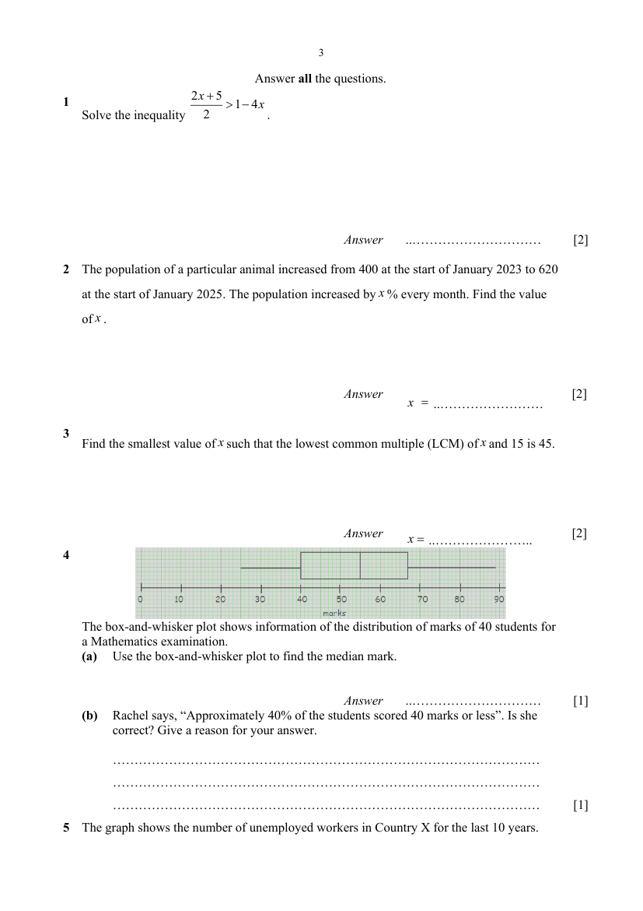
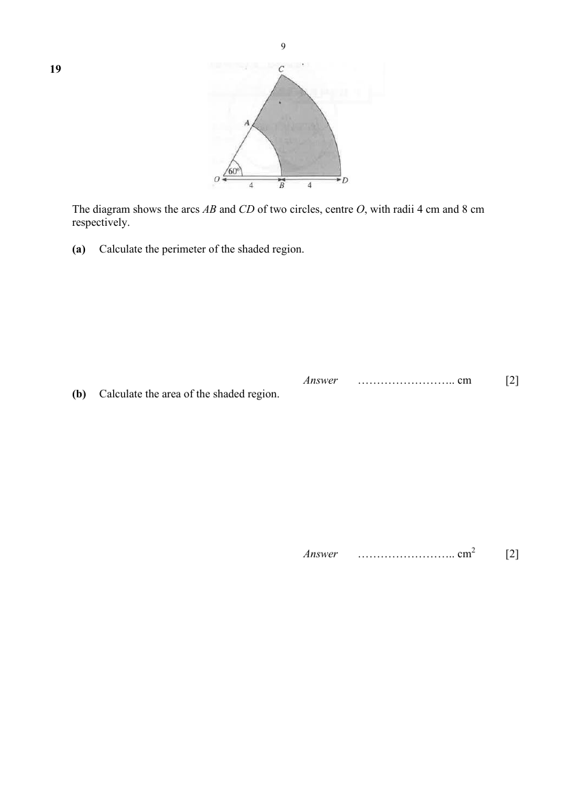
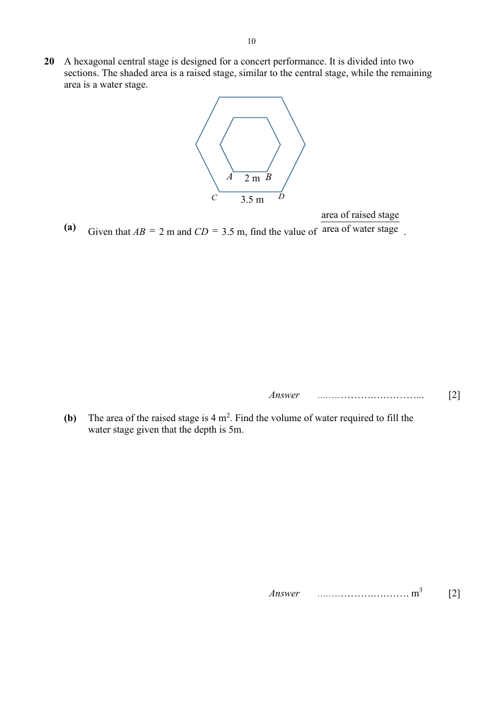
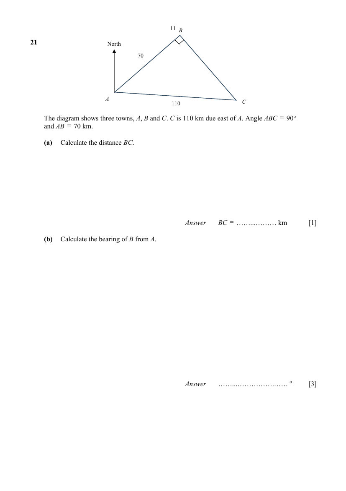
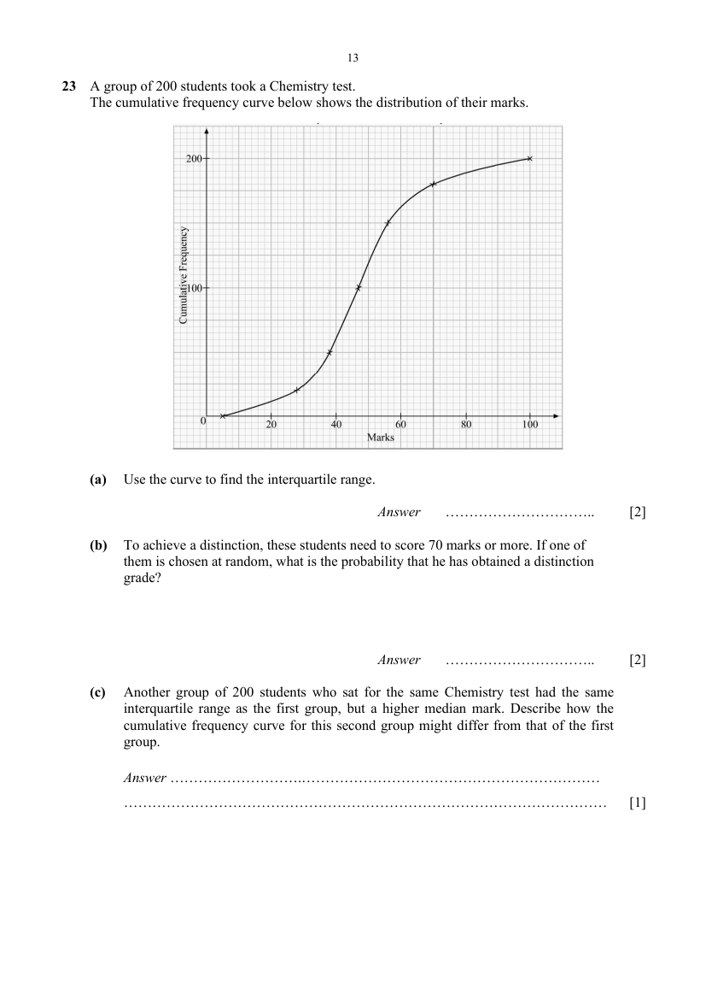
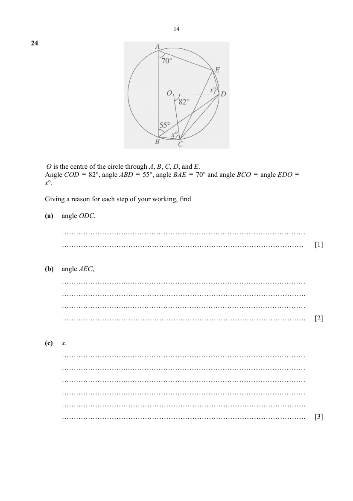

# Admiralty Secondary School — Elementary Mathematics 4052/01 Paper 1 (cleaned)

> **Institution:** Admiralty Secondary School
> **Exam:** Preliminary Examination 2025
> **Level:** Secondary 4 Express / 5 Normal (Academic)
> **Subjects:** Elementary Mathematics
> **Paper:** 4052/01 Paper 1
> **Date:** 26 August 2025
> **Duration:** 2 hours 15 minutes
> **Total Marks:** 90
> **Source:** `ADSS Prelim 2025 P1 [QP].pdf` (digital PDF — cleaned & reformatted)

---

## Instructions

1. Write your name, class and index number.
2. Answer ALL questions.
3. Calculators should be used where appropriate. If the degree of accuracy is not specified in the question, and if the answer is not exact, give the answer to three significant figures. Give answers in degrees to one decimal place. For $\pi$, use either your calculator value or $3.142$, unless the question requires the answer in terms of $\pi$.
4. Essential workings must be shown. Omission of essential workings and illegible handwriting will result in loss of marks.

This question paper consists of 19 printed pages including this cover page.

---

## Mathematical Formulae

*Compound interest*

$$
\text{Total amount} = P\left(1+\frac{r}{100}\right)^{n}
$$

*Mensuration*

$$
\text{Curved surface area of a cone} = \pi rl
$$

$$
\text{Surface area of a sphere} = 4\pi r^{2}
$$

$$
\text{Volume of a cone} = \frac{1}{3}\pi r^{2}h
$$

$$
\text{Volume of a sphere} = \frac{4}{3}\pi r^{3}
$$

$$
\text{Area of a triangle } ABC = \frac{1}{2}bc\sin A
$$

$$
\text{Arc length} = r\theta,\text{ where }\theta\text{ is in radians}
$$

$$
\text{Sector area} = \frac{1}{2}r^{2}\theta,\text{ where }\theta\text{ is in radians}
$$

*Trigonometry*

$$
\frac{a}{\sin A} = \frac{b}{\sin B} = \frac{c}{\sin C}
$$

$$
a^{2} = b^{2}+c^{2}-2bc\cos A
$$

*Statistics*

$$
\text{Mean} = \frac{\sum fx}{\sum f}
$$

$$
\text{Standard deviation} = \sqrt{\frac{\sum fx^{2}}{\sum f}-\left(\frac{\sum fx}{\sum f}\right)^{2}}
$$

---

## Answer all the questions

---

### Q1

> **Marks:** [2]
> **Topic:** N7 Equations and inequalities
> **Sub-topic:** Equations and inequalities
> **LO:** [[context/subjects/o-level-e-maths/learning-objectives/o-level-e-maths-N7g.md|N7g]]
> **Page:** 3

Solve the inequality $\dfrac{2x+5}{2} > 1-4x$. [2]

---

### Q2

> **Marks:** [2]
> **Topic:** N3 Percentage
> **Sub-topic:** Percentage
> **LO:** [[context/subjects/o-level-e-maths/learning-objectives/o-level-e-maths-N3d.md|N3d]]
> **Page:** 3

The population of a particular animal increased from 400 at the start of January 2023 to 620 at the start of January 2025. The population increased by $x\%$ every month. Find the value of $x$. [2]

---

### Q3

> **Marks:** [2]
> **Topic:** N1 Numbers and their operations
> **Sub-topic:** Numbers and their operations
> **LO:** [[context/subjects/o-level-e-maths/learning-objectives/o-level-e-maths-N1e.md|N1e]]
> **Page:** 3

Find the smallest value of $x$ such that the lowest common multiple (LCM) of $x$ and 15 is 45. [2]

---

### Q4

> **Marks:** (a) [1]; (b) [1]; total [2]
> **Page:** 3

The box-and-whisker plot shows information of the distribution of marks of 40 students for a Mathematics examination.

**(a)** Use the box-and-whisker plot to find the median mark. [1]
> **Topic:** S1 Data handling and analysis
> **Sub-topic:** Data handling and analysis
> **LO:** [[context/subjects/o-level-e-maths/learning-objectives/o-level-e-maths-S1f.md|S1f]]

**(b)** Rachel says, “Approximately 40% of the students scored 40 marks or less”. Is she correct? Give a reason for your answer. [1]
> **Topic:** S1 Data handling and analysis
> **Sub-topic:** Data handling and analysis
> **LO:** [[context/subjects/o-level-e-maths/learning-objectives/o-level-e-maths-S1f.md|S1f]]

---

### Q5

> **Marks:** (a) [1]; (b) [1]; total [2]
> **Page:** 3–4

The graph shows the number of unemployed workers in Country X for the last 10 years.

**(a)** State one feature of the graph that may be misleading. [1]
> **Topic:** N6 Functions and graphs
> **Sub-topic:** Functions and graphs
> **LO:** [[context/subjects/o-level-e-maths/learning-objectives/o-level-e-maths-N6c.md|N6c]]

**(b)** Explain how this feature affects the reader’s interpretation of the graph. [1]
> **Topic:** N6 Functions and graphs
> **Sub-topic:** Functions and graphs
> **LO:** [[context/subjects/o-level-e-maths/learning-objectives/o-level-e-maths-N6c.md|N6c]]

---

### Q6

> **Marks:** (a) [1]; (b) [1]; total [2]
> **Page:** 4

$ABC$ is a triangle in which angle $BAC = 90^{\circ}$, $AC = 40$ cm and $BC = 41$ cm. $AB$ is produced to $M$ and $AC$ is produced to $N$.

**(a)** Express sine of angle $MBC$ as a fraction. [1]
> **Topic:** N2 Ratio and proportion
> **Sub-topic:** Ratio and proportion
> **LO:** [[context/subjects/o-level-e-maths/learning-objectives/o-level-e-maths-N2a.md|N2a]]

**(b)** Express cosine of angle $BCN$ as a fraction. [1]
> **Topic:** N2 Ratio and proportion
> **Sub-topic:** Ratio and proportion
> **LO:** [[context/subjects/o-level-e-maths/learning-objectives/o-level-e-maths-N2a.md|N2a]]

---

### Q7

> **Marks:** [2]
> **Topic:** N2 Ratio and proportion
> **Sub-topic:** Ratio and proportion
> **LO:** [[context/subjects/o-level-e-maths/learning-objectives/o-level-e-maths-N2a.md|N2a]]
> **Page:** 4–5

$Q$ is 25% greater than $P$. $R$ is 30% smaller than $Q$. What is the ratio of $P : R$? [2]

---

### Q8

> **Marks:** [3]
> **Topic:** N1 Numbers and their operations
> **Sub-topic:** Numbers and their operations
> **LO:** [[context/subjects/o-level-e-maths/learning-objectives/o-level-e-maths-N1j.md|N1j]]
> **Page:** 5

Given that $8^{1-b} = 16^{b-3}$, find the value of $b$. [3]

---

### Q9

> **Marks:** [3]
> **Topic:** N7 Equations and inequalities
> **Sub-topic:** Equations and inequalities
> **LO:** [[context/subjects/o-level-e-maths/learning-objectives/o-level-e-maths-N7b.md|N7b]]
> **Page:** 5

Simplify $\dfrac{a}{(2a-1)^{2}}-\dfrac{2a}{1-2a}$. [3]

---

### Q10

> **Marks:** (a) [1]; (b) [2]; total [3]
> **Page:** 5

A map is drawn to a scale of $1 : 200\,000$.

**(a)** Find the actual distance, in km, represented by 8 cm on the map. [1]
> **Topic:** N2 Ratio and proportion
> **Sub-topic:** Ratio and proportion
> **LO:** [[context/subjects/o-level-e-maths/learning-objectives/o-level-e-maths-N2c.md|N2c]]

**(b)** A town covers an area of $600\text{ km}^{2}$. Find in, $\text{cm}^{2}$, the area representing the town on the map. [2]
> **Topic:** N2 Ratio and proportion
> **Sub-topic:** Ratio and proportion
> **LO:** [[context/subjects/o-level-e-maths/learning-objectives/o-level-e-maths-N2c.md|N2c]]

---

### Q11

> **Marks:** (a) [1]; (b) [2]; total [3]
> **Page:** 5–6

**(a)** Factorise $20ab-4b$. [1]
> **Topic:** N5 Algebraic expressions and formulae
> **Sub-topic:** Algebraic expressions and formulae
> **LO:** [[context/subjects/o-level-e-maths/learning-objectives/o-level-e-maths-N5h.md|N5h]]

**(b)** Factorise completely $3xy-2ab-ay+6xb$. [2]
> **Topic:** N5 Algebraic expressions and formulae
> **Sub-topic:** Algebraic expressions and formulae
> **LO:** [[context/subjects/o-level-e-maths/learning-objectives/o-level-e-maths-N5h.md|N5h]]

---

### Q12

> **Marks:** (a) [1]; (b) [2]; total [3]
> **Page:** 6

$$
c = \frac{k^{2}+h^{2}}{h}
$$

**(a)** Find $c$ when $k = 2.81$ and $h = 3.67$. Give your answer correct to 2 significant figures. [1]
> **Topic:** N1 Numbers and their operations
> **Sub-topic:** Numbers and their operations
> **LO:** [[context/subjects/o-level-e-maths/learning-objectives/o-level-e-maths-N1g.md|N1g]]

**(b)** Rearrange the formula to make $k$ the subject. [2]
> **Topic:** N1 Numbers and their operations
> **Sub-topic:** Numbers and their operations
> **LO:** [[context/subjects/o-level-e-maths/learning-objectives/o-level-e-maths-N1g.md|N1g]]

---

### Q13

> **Marks:** (a) [1]; (b) [2]; total [3]
> **Page:** 6

**(a)** The sum of three angles of a quadrilateral is $285^{\circ}$. Find the fourth angle. [1]
> **Topic:** G1 Angles, triangles and polygons
> **Sub-topic:** Angles, triangles and polygons
> **LO:** [[context/subjects/o-level-e-maths/learning-objectives/o-level-e-maths-G1f.md|G1f]]

**(b)** Each interior angle of a regular polygon is $165^{\circ}$. Find the number of sides of this polygon. [2]
> **Topic:** G1 Angles, triangles and polygons
> **Sub-topic:** Angles, triangles and polygons
> **LO:** [[context/subjects/o-level-e-maths/learning-objectives/o-level-e-maths-G1f.md|G1f]]

---

### Q14

> **Marks:** (a) [1]; (b) [2]; total [3]
> **Page:** 7

$\xi = \{\text{integers } x : 3 < x < 15\}$

$A = \{\text{prime numbers}\}$

$B = \{\text{multiples of } 3\}$

$C = \{\text{factors of } 20\}$

**(a)** List the elements in $(A' \cap C)'$. [1]
> **Topic:** N8 Set language and notation
> **Sub-topic:** Set language and notation
> **LO:** [[context/subjects/o-level-e-maths/learning-objectives/o-level-e-maths-N8a.md|N8a]]

**(b)** Underline the correct statements from the list below. [2]
> **Topic:** N8 Set language and notation
> **Sub-topic:** Set language and notation
> **LO:** [[context/subjects/o-level-e-maths/learning-objectives/o-level-e-maths-N8a.md|N8a]]

$A \cap B = \varnothing \qquad A \cup C = \{4, 5, 7, 11\} \qquad 8 \notin C \qquad 9 \subset B$

---

### Q15

> **Marks:** [3]
> **Topic:** N7 Equations and inequalities
> **Sub-topic:** Equations and inequalities
> **LO:** [[context/subjects/o-level-e-maths/learning-objectives/o-level-e-maths-N7b.md|N7b]]
> **Page:** 7

Simplify $\dfrac{x^{4}-81}{2x-6}$. [3]

---

### Q16

> **Marks:** (a) [2]; (b) [1]; total [3]
> **Page:** 7

**(a)** Express $y = x^{2}+5x-4$ in the form $y = (x+p)^{2}-q$. [2]
> **Topic:** N6 Functions and graphs
> **Sub-topic:** Functions and graphs
> **LO:** [[context/subjects/o-level-e-maths/learning-objectives/o-level-e-maths-N6c.md|N6c]]

**(b)** Write down the coordinates of the minimum point of the graph of $y = x^{2}+5x-4$. [1]
> **Topic:** N6 Functions and graphs
> **Sub-topic:** Functions and graphs
> **LO:** [[context/subjects/o-level-e-maths/learning-objectives/o-level-e-maths-N6c.md|N6c]]

---

### Q17

> **Marks:** (a) [2]; (b) [1]; (c) [1]; total [4]
> **Page:** 8

Each term in this sequence is found by adding the same number to the previous term.

$$
a,\quad 11,\quad b,\quad c,\quad 29,\quad \ldots
$$

**(a)** Find the values of $a$, $b$, and $c$. [2]
> **Topic:** N5 Algebraic expressions and formulae
> **Sub-topic:** Algebraic expressions and formulae
> **LO:** [[context/subjects/o-level-e-maths/learning-objectives/o-level-e-maths-N5e.md|N5e]]

**(b)** Write down an expression, in terms of $n$, for the $n$th term. [1]
> **Topic:** N5 Algebraic expressions and formulae
> **Sub-topic:** Algebraic expressions and formulae
> **LO:** [[context/subjects/o-level-e-maths/learning-objectives/o-level-e-maths-N5e.md|N5e]]

**(c)** Explain why the value of every term must be odd for all values of $n$. [1]
> **Topic:** N5 Algebraic expressions and formulae
> **Sub-topic:** Algebraic expressions and formulae
> **LO:** [[context/subjects/o-level-e-maths/learning-objectives/o-level-e-maths-N5e.md|N5e]]

---

### Q18

> **Marks:** (a) [1]; (b) [1]; (c) [2]; total [4]
> **Page:** 8

**(a)** Write $0.00024$ in standard form. [1]
> **Topic:** N1 Numbers and their operations
> **Sub-topic:** Numbers and their operations
> **LO:** [[context/subjects/o-level-e-maths/learning-objectives/o-level-e-maths-N1h.md|N1h]]

**(b)** The distance between the Sun and Mercury is about $5.4246 \times 10^{4}$ megametres. Given that $1$ megametre $= 10^{6}$, express this distance in metres. Leave your answer in standard form. [1]
> **Topic:** N1 Numbers and their operations
> **Sub-topic:** Numbers and their operations
> **LO:** [[context/subjects/o-level-e-maths/learning-objectives/o-level-e-maths-N1h.md|N1h]]

**(c)** Use the laws of indices to work out $(5.2 \times 10^{50})-(2.0 \times 10^{49})$. Show your working and give your answer in standard form. [2]
> **Topic:** N1 Numbers and their operations
> **Sub-topic:** Numbers and their operations
> **LO:** [[context/subjects/o-level-e-maths/learning-objectives/o-level-e-maths-N1h.md|N1h]]

---

### Q19

> **Marks:** (a) [2]; (b) [2]; total [4]
> **Page:** 9

The diagram shows the arcs $AB$ and $CD$ of two circles, centre $O$, with radii 4 cm and 8 cm respectively.

**(a)** Calculate the perimeter of the shaded region. [2]
> **Topic:** G5 Mensuration
> **Sub-topic:** Mensuration
> **LO:** [[context/subjects/o-level-e-maths/learning-objectives/o-level-e-maths-G5b.md|G5b]]

**(b)** Calculate the area of the shaded region. [2]
> **Topic:** G5 Mensuration
> **Sub-topic:** Mensuration
> **LO:** [[context/subjects/o-level-e-maths/learning-objectives/o-level-e-maths-G5b.md|G5b]]

---

### Q20

> **Marks:** (a) [2]; (b) [2]; total [4]
> **Page:** 10

A hexagonal central stage is designed for a concert performance. It is divided into two sections. The shaded area is a raised stage, similar to the central stage, while the remaining area is a water stage.

**(a)** Given that $AB = 2$ m and $CD = 3.5$ m, find the value of $\dfrac{\text{area of raised stage}}{\text{area of water stage}}$. [2]
> **Topic:** G2 Congruence and similarity
> **Sub-topic:** Congruence and similarity
> **LO:** [[context/subjects/o-level-e-maths/learning-objectives/o-level-e-maths-G2i.md|G2i]]

**(b)** The area of the raised stage is $4\text{ m}^{2}$. Find the volume of water required to fill the water stage given that the depth is 5m. [2]
> **Topic:** G2 Congruence and similarity
> **Sub-topic:** Congruence and similarity
> **LO:** [[context/subjects/o-level-e-maths/learning-objectives/o-level-e-maths-G2i.md|G2i]]

---

### Q21

> **Marks:** (a) [1]; (b) [3]; total [4]
> **Page:** 11

The diagram shows three towns, $A$, $B$ and $C$. $C$ is 110 km due east of $A$. Angle $ABC = 90^{\circ}$ and $AB = 70$ km.

**(a)** Calculate the distance $BC$. [1]
> **Topic:** G4 Pythagoras' theorem and trigonometry
> **Sub-topic:** Pythagoras' theorem and trigonometry
> **LO:** [[context/subjects/o-level-e-maths/learning-objectives/o-level-e-maths-G4g.md|G4g]]

**(b)** Calculate the bearing of $B$ from $A$. [3]
> **Topic:** G4 Pythagoras' theorem and trigonometry
> **Sub-topic:** Pythagoras' theorem and trigonometry
> **LO:** [[context/subjects/o-level-e-maths/learning-objectives/o-level-e-maths-G4g.md|G4g]]

---

### Q22

> **Marks:** [5]
> **Topic:** G6 Coordinate geometry
> **Sub-topic:** Coordinate geometry
> **LO:** [[context/subjects/o-level-e-maths/learning-objectives/o-level-e-maths-G6c.md|G6c]]
> **Page:** 12

The points $A$ and $B$ are $(-2, 1)$ and $(6, -5)$ respectively. The line $AB$ intersects the $x$-axis at $M$ and the $y$-axis at $N$. $M$ is the point $(p, 0)$ and $N$ is the point $(0, q)$. The line $CD$ is parallel to the line $AB$. The line $CD$ intersects the $y$-axis at $E$. $E$ is the point $(0, p+q)$. Find the equation of $CD$. [5]

---

### Q23

> **Marks:** (a) [2]; (b) [2]; (c) [1]; total [5]
> **Page:** 13

A group of 200 students took a Chemistry test. The cumulative frequency curve below shows the distribution of their marks.

**(a)** Use the curve to find the interquartile range. [2]
> **Topic:** S1 Data handling and analysis
> **Sub-topic:** Data handling and analysis
> **LO:** [[context/subjects/o-level-e-maths/learning-objectives/o-level-e-maths-S1i.md|S1i]]

**(b)** To achieve a distinction, these students need to score 70 marks or more. If one of them is chosen at random, what is the probability that he has obtained a distinction grade? [2]
> **Topic:** S2 Probability
> **Sub-topic:** Probability
> **LO:** [[context/subjects/o-level-e-maths/learning-objectives/o-level-e-maths-S2c.md|S2c]]

**(c)** Another group of 200 students who sat for the same Chemistry test had the same interquartile range as the first group, but a higher median mark. Describe how the cumulative frequency curve for this second group might differ from that of the first group. [1]
> **Topic:** S1 Data handling and analysis
> **Sub-topic:** Data handling and analysis
> **LO:** [[context/subjects/o-level-e-maths/learning-objectives/o-level-e-maths-S1i.md|S1i]]

---

### Q24

> **Marks:** (a) [1]; (b) [2]; (c) [3]; total [6]
> **Page:** 14

$O$ is the centre of the circle through $A$, $B$, $C$, $D$, and $E$. Angle $COD = 82^{\circ}$, angle $ABD = 55^{\circ}$, angle $BAE = 70^{\circ}$ and angle $BCO =$ angle $EDO = x^{\circ}$.

Giving a reason for each step of your working, find

**(a)** angle $ODC$, [1]
> **Topic:** G3 Properties of circles
> **Sub-topic:** Properties of circles
> **LO:** [[context/subjects/o-level-e-maths/learning-objectives/o-level-e-maths-G3b.md|G3b]]

**(b)** angle $AEC$, [2]
> **Topic:** G3 Properties of circles
> **Sub-topic:** Properties of circles
> **LO:** [[context/subjects/o-level-e-maths/learning-objectives/o-level-e-maths-G3b.md|G3b]]

**(c)** $x$. [3]
> **Topic:** G3 Properties of circles
> **Sub-topic:** Properties of circles
> **LO:** [[context/subjects/o-level-e-maths/learning-objectives/o-level-e-maths-G3b.md|G3b]]

---

### Q25

> **Marks:** (a) [3]; (b) [1]; (c) [2]; total [6]
> **Page:** 15

The daily amounts of money (in dollars) spent by Susan over a period of 7 days are recorded as follows:

$$
10 \quad 2x^{3} \quad 20 \quad 9 \quad 13 \quad 7 \quad 14
$$

The mean amount of Susan’s expenses is &#36;12.70.

**(a)** Find the value of $x$. [3]
> **Topic:** S1 Data handling and analysis
> **Sub-topic:** Data handling and analysis
> **LO:** [[context/subjects/o-level-e-maths/learning-objectives/o-level-e-maths-S1l.md|S1l]]

**(b)** Assuming the value of $x$ is 2.5, find the standard deviation of Susan’s expenses. [1]
> **Topic:** S1 Data handling and analysis
> **Sub-topic:** Data handling and analysis
> **LO:** [[context/subjects/o-level-e-maths/learning-objectives/o-level-e-maths-S1l.md|S1l]]

**(c)** The mean and standard deviation of Susan’s expenses for 14 days are &#36;12.07 and &#36;3.24 respectively. For the same 14 days, the mean and standard deviation of Paul’s expenses are &#36;14 and &#36;5.50 respectively. Compare the distributions for the expenses of Susan and Paul. [2]
> **Topic:** S1 Data handling and analysis
> **Sub-topic:** Data handling and analysis
> **LO:** [[context/subjects/o-level-e-maths/learning-objectives/o-level-e-maths-S1l.md|S1l]]

---

### Q26

> **Marks:** (a) [1]; (b) [3]; (c) [3]; total [7]
> **Page:** 16

It is given that $\overrightarrow{PQ} = \begin{pmatrix} 6 \\ 1 \end{pmatrix}$ and the point $Q$ is $(-5, 4)$. The point $R$ is $(a, 2)$ where $a$ is a negative number. $|\overrightarrow{RQ}| = \sqrt{148}$.

**(a)** Find the coordinates of $P$. [1]
> **Topic:** G7 Vectors in two dimensions
> **Sub-topic:** Vectors in two dimensions
> **LO:** [[context/subjects/o-level-e-maths/learning-objectives/o-level-e-maths-G7h.md|G7h]]

**(b)** Find the value of $a$. [3]
> **Topic:** G7 Vectors in two dimensions
> **Sub-topic:** Vectors in two dimensions
> **LO:** [[context/subjects/o-level-e-maths/learning-objectives/o-level-e-maths-G7h.md|G7h]]

**(c)** It is given that $\overrightarrow{RT} = \begin{pmatrix} 18 \\ 3 \end{pmatrix}$. What two facts can be deduced about $R$, $Q$ and $T$? [3]
> **Topic:** G7 Vectors in two dimensions
> **Sub-topic:** Vectors in two dimensions
> **LO:** [[context/subjects/o-level-e-maths/learning-objectives/o-level-e-maths-G7h.md|G7h]]

---

End of Paper
