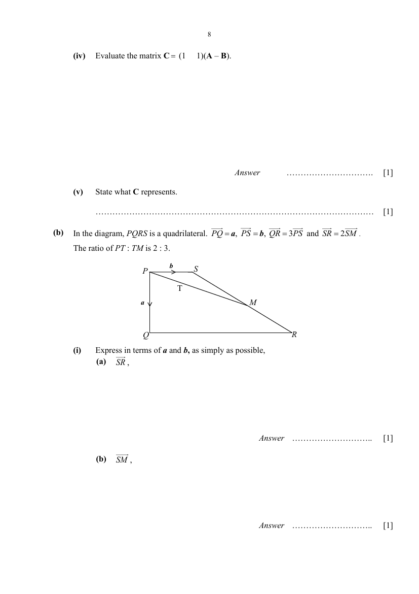
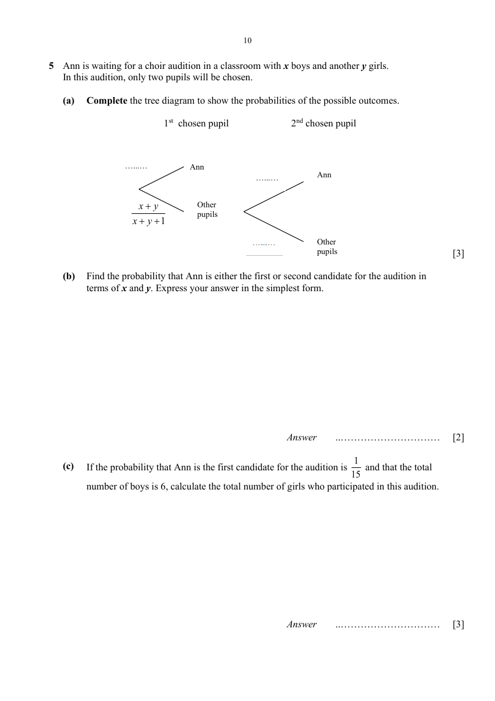
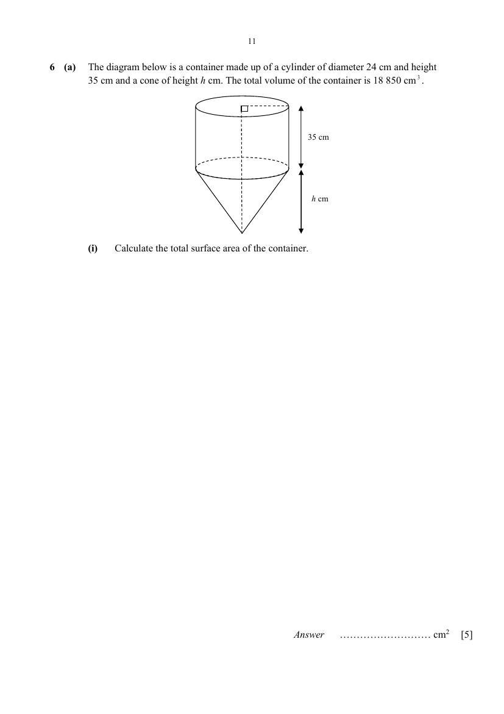
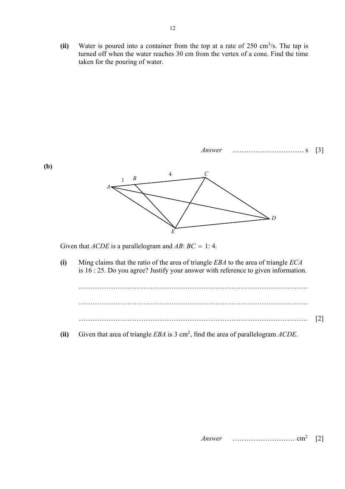
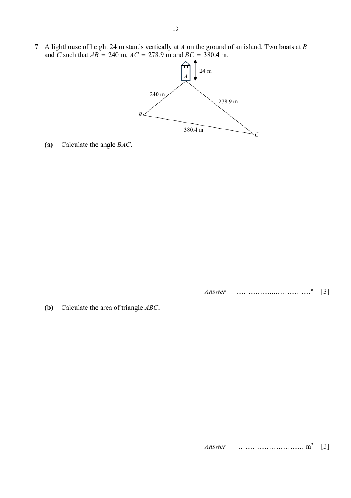
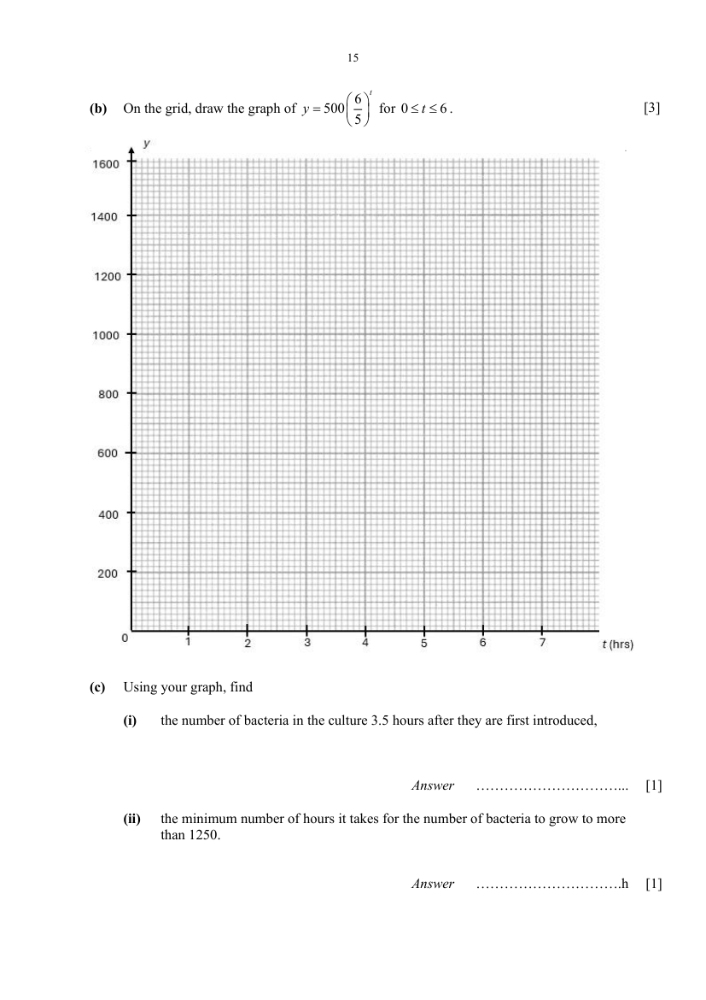

# Admiralty Secondary School — Elementary Mathematics 4052/02 Paper 2 (cleaned)

> **Institution:** Admiralty Secondary School
> **Exam:** Preliminary Examination 2025
> **Level:** Secondary 4 Express / 5 Normal (Academic)
> **Subjects:** Elementary Mathematics
> **Paper:** 4052/02 Paper 2
> **Date:** 28 August 2025
> **Duration:** 2 hours 15 minutes
> **Total Marks:** 90
> **Source:** `ADSS Prelim 2025 P2 [QP].pdf` (digital PDF — cleaned & reformatted)

---

## Instructions

1. Write your name, class and index number.
2. Answer ALL questions.
3. Calculators should be used where appropriate. If the degree of accuracy is not specified in the question, and if the answer is not exact, give the answer to three significant figures. Give answers in degrees to one decimal place. For $\pi$, use either your calculator value or $3.142$, unless the question requires the answer in terms of $\pi$.
4. Essential workings must be shown. Omission of essential workings and illegible handwriting will result in loss of marks.

This question paper consists of 19 printed pages including this cover page.

---

## Mathematical Formulae

*Compound interest*

$$
\text{Total amount} = P\left(1+\frac{r}{100}\right)^{n}
$$

*Mensuration*

$$
\text{Curved surface area of a cone} = \pi rl
$$

$$
\text{Surface area of a sphere} = 4\pi r^{2}
$$

$$
\text{Volume of a cone} = \frac{1}{3}\pi r^{2}h
$$

$$
\text{Volume of a sphere} = \frac{4}{3}\pi r^{3}
$$

$$
\text{Area of a triangle } ABC = \frac{1}{2}bc\sin A
$$

$$
\text{Arc length} = r\theta,\text{ where }\theta\text{ is in radians}
$$

$$
\text{Sector area} = \frac{1}{2}r^{2}\theta,\text{ where }\theta\text{ is in radians}
$$

*Trigonometry*

$$
\frac{a}{\sin A} = \frac{b}{\sin B} = \frac{c}{\sin C}
$$

$$
a^{2} = b^{2}+c^{2}-2bc\cos A
$$

*Statistics*

$$
\text{Mean} = \frac{\sum fx}{\sum f}
$$

$$
\text{Standard deviation} = \sqrt{\frac{\sum fx^{2}}{\sum f}-\left(\frac{\sum fx}{\sum f}\right)^{2}}
$$

---

## Answer all the questions

---

### Q1

> **Marks:** (a) [2]; (b) [2]; (c) [2]; (d) [4]; total [10]
> **Page:** 3–4

**(a)** Simplify $\dfrac{5x^{2}-20}{5x^{2}+5x-10}$. [2]
> **Topic:** N7 Equations and inequalities
> **Sub-topic:** Equations and inequalities
> **LO:** [[context/subjects/o-level-e-maths/learning-objectives/o-level-e-maths-N7b.md|N7b]]

**(b)** Simplify $\dfrac{4a^{2}b}{21c^{3}} \div \dfrac{12a}{7c}$. [2]
> **Topic:** N7 Equations and inequalities
> **Sub-topic:** Equations and inequalities
> **LO:** [[context/subjects/o-level-e-maths/learning-objectives/o-level-e-maths-N7b.md|N7b]]

**(c)** Simplify $\left(\dfrac{27a^{12}}{b^{9}}\right)^{-\frac{1}{3}}$. [2]
> **Topic:** N7 Equations and inequalities
> **Sub-topic:** Equations and inequalities
> **LO:** [[context/subjects/o-level-e-maths/learning-objectives/o-level-e-maths-N7b.md|N7b]]

**(d)** Solve the equation $\dfrac{2y(1-y)+1}{3} = 1-\left(\dfrac{8}{3}-y\right)$. [4]
> **Topic:** N7 Equations and inequalities
> **Sub-topic:** Equations and inequalities
> **LO:** [[context/subjects/o-level-e-maths/learning-objectives/o-level-e-maths-N7e.md|N7e]]

---

### Q2

> **Marks:** (a) [1]; (b) [1]; (c) [1]; (d) [3]; total [6]
> **Page:** 5

The stem-and-leaf diagram shows the time, in minutes taken by a group of 18 students to complete a survey.

| Stem | Leaves |
| --- | --- |
| 2 | 1 1 2 3 4 5 7 |
| 3 | 0 3 4 7 8 |
| 4 | 2 6 7 |
| 5 | 1 9 |
| 6 | 4 |

Key: $2 \mid 1$ means 21 minutes.

**(a)** Find the range of time taken. [1]
> **Topic:** S1 Data handling and analysis
> **Sub-topic:** Data handling and analysis
> **LO:** [[context/subjects/o-level-e-maths/learning-objectives/o-level-e-maths-S1f.md|S1f]]

**(b)** Find the median time taken. [1]
> **Topic:** S1 Data handling and analysis
> **Sub-topic:** Data handling and analysis
> **LO:** [[context/subjects/o-level-e-maths/learning-objectives/o-level-e-maths-S1f.md|S1f]]

**(c)** Calculate an estimate of the mean time taken. [1]
> **Topic:** S1 Data handling and analysis
> **Sub-topic:** Data handling and analysis
> **LO:** [[context/subjects/o-level-e-maths/learning-objectives/o-level-e-maths-S1f.md|S1f]]

**(d)** When the time taken to complete the survey by another 2 students was included, the mean time taken increased by 1.4%. If both students took the same amount of time to complete the survey, find the time that one of the students took to complete the survey, giving your answer to the nearest minutes. [3]
> **Topic:** S1 Data handling and analysis
> **Sub-topic:** Data handling and analysis
> **LO:** [[context/subjects/o-level-e-maths/learning-objectives/o-level-e-maths-S1f.md|S1f]]

---

### Q3

> **Marks:** (a) [1]; (b) [1]; (c) [3]; (d) [4]; total [9]
> **Page:** 6

Mr Lim and his family went to Genting Highland, which is 450 km from Singapore, for their family vacation. A friend drove them by his car to Genting Highland at a speed of $x$ km/h. They took a coach back at a speed of $(x-20)$ km/h.

**(a)** Write down an expression, in terms of $x$, for the time taken by car. [1]
> **Topic:** N6 Functions and graphs
> **Sub-topic:** Functions and graphs
> **LO:** [[context/subjects/o-level-e-maths/learning-objectives/o-level-e-maths-N6f.md|N6f]]

**(b)** Write down an expression, in terms of $x$, for the time taken by coach. [1]
> **Topic:** N6 Functions and graphs
> **Sub-topic:** Functions and graphs
> **LO:** [[context/subjects/o-level-e-maths/learning-objectives/o-level-e-maths-N6f.md|N6f]]

**(c)** If the difference in time was 40 mins, write down an equation in $x$ and show that it reduces to $x^{2}-20x-13500 = 0$. [3]
> **Topic:** N6 Functions and graphs
> **Sub-topic:** Functions and graphs
> **LO:** [[context/subjects/o-level-e-maths/learning-objectives/o-level-e-maths-N6f.md|N6f]]

**(d)** Solve the equation $x^{2}-20x-13500 = 0$, giving your answers correct to two decimal places. [4]
> **Topic:** N6 Functions and graphs
> **Sub-topic:** Functions and graphs
> **LO:** [[context/subjects/o-level-e-maths/learning-objectives/o-level-e-maths-N6f.md|N6f]]

---

### Q4

> **Marks:** (a)(i) [1]; (a)(ii) [1]; (a)(iii) [1]; (a)(iv) [1]; (a)(v) [1]; (b)(i) [4]; (b)(ii) [3]; total [12]
> **Page:** 7–9

**(a)** A cake shop has two stores M and N. The following table shows the quantities of cakes in the two stores.

|  | Chocolate | Strawberry | Marble |
| --- | --- | --- | --- |
| Store M | 25 | 33 | 15 |
| Store N | 19 | 17 | 37 |

The selling prices of a chocolate cake, a strawberry cake and a marble cake are &#36;45, &#36;39 and &#36;32 respectively. Their cost prices are &#36;40, &#36;34 and &#36;26 respectively.

**(i)** Evaluate the matrix

$$
A = \begin{pmatrix} 25 & 33 & 15 \\ 19 & 17 & 37 \end{pmatrix}\begin{pmatrix} 45 \\ 39 \\ 32 \end{pmatrix}.
$$

[1]
> **Topic:** G7 Vectors in two dimensions
> **Sub-topic:** Vectors in two dimensions
> **LO:** [[context/subjects/o-level-e-maths/learning-objectives/o-level-e-maths-G7h.md|G7h]]

**(ii)** State what $A$ represents. [1]
> **Topic:** G7 Vectors in two dimensions
> **Sub-topic:** Vectors in two dimensions
> **LO:** [[context/subjects/o-level-e-maths/learning-objectives/o-level-e-maths-G7h.md|G7h]]

**(iii)** Using matrix multiplication, find a matrix $B$ whose elements give the total costs for the three cakes of both stores respectively. [1]
> **Topic:** G7 Vectors in two dimensions
> **Sub-topic:** Vectors in two dimensions
> **LO:** [[context/subjects/o-level-e-maths/learning-objectives/o-level-e-maths-G7h.md|G7h]]

**(iv)** Evaluate the matrix $C = \begin{pmatrix} 1 & 1 \end{pmatrix}(A-B)$. [1]
> **Topic:** G7 Vectors in two dimensions
> **Sub-topic:** Vectors in two dimensions
> **LO:** [[context/subjects/o-level-e-maths/learning-objectives/o-level-e-maths-G7h.md|G7h]]

**(v)** State what $C$ represents. [1]
> **Topic:** G7 Vectors in two dimensions
> **Sub-topic:** Vectors in two dimensions
> **LO:** [[context/subjects/o-level-e-maths/learning-objectives/o-level-e-maths-G7h.md|G7h]]

**(b)** In the diagram, $PQRS$ is a quadrilateral. $\overrightarrow{PQ} = \mathbf{a}$, $\overrightarrow{PS} = \mathbf{b}$, $\overrightarrow{QR} = 3\overrightarrow{PS}$ and $\overrightarrow{SR} = 2\overrightarrow{SM}$. The ratio of $PT : TM$ is $2 : 3$.

**(i)** Express in terms of $\mathbf{a}$ and $\mathbf{b}$, as simply as possible,

**(a)** $\overrightarrow{SR}$, [1]
> **Topic:** G7 Vectors in two dimensions
> **Sub-topic:** Vectors in two dimensions
> **LO:** [[context/subjects/o-level-e-maths/learning-objectives/o-level-e-maths-G7h.md|G7h]]

**(b)** $\overrightarrow{SM}$, [1]
> **Topic:** G7 Vectors in two dimensions
> **Sub-topic:** Vectors in two dimensions
> **LO:** [[context/subjects/o-level-e-maths/learning-objectives/o-level-e-maths-G7h.md|G7h]]

**(c)** $\overrightarrow{PM}$, [1]
> **Topic:** G7 Vectors in two dimensions
> **Sub-topic:** Vectors in two dimensions
> **LO:** [[context/subjects/o-level-e-maths/learning-objectives/o-level-e-maths-G7h.md|G7h]]

**(d)** $\overrightarrow{PT}$. [1]
> **Topic:** G7 Vectors in two dimensions
> **Sub-topic:** Vectors in two dimensions
> **LO:** [[context/subjects/o-level-e-maths/learning-objectives/o-level-e-maths-G7h.md|G7h]]

**(ii)** Show that $\overrightarrow{QT} = k\overrightarrow{TS}$ where $k$ is a constant to be determined. [3]
> **Topic:** G7 Vectors in two dimensions
> **Sub-topic:** Vectors in two dimensions
> **LO:** [[context/subjects/o-level-e-maths/learning-objectives/o-level-e-maths-G7h.md|G7h]]

---

### Q5

> **Marks:** (a) [3]; (b) [2]; (c) [3]; total [8]
> **Page:** 10

Ann is waiting for a choir audition in a classroom with $x$ boys and another $y$ girls. In this audition, only two pupils will be chosen.

**(a)** Complete the tree diagram to show the probabilities of the possible outcomes. [3]
> **Topic:** S2 Probability
> **Sub-topic:** Probability
> **LO:** [[context/subjects/o-level-e-maths/learning-objectives/o-level-e-maths-S2c.md|S2c]]

**(b)** Find the probability that Ann is either the first or second candidate for the audition in terms of $x$ and $y$. Express your answer in the simplest form. [2]
> **Topic:** S2 Probability
> **Sub-topic:** Probability
> **LO:** [[context/subjects/o-level-e-maths/learning-objectives/o-level-e-maths-S2c.md|S2c]]

**(c)** If the probability that Ann is the first candidate for the audition is $\dfrac{1}{15}$ and that the total number of boys is 6, calculate the total number of girls who participated in this audition. [3]
> **Topic:** S2 Probability
> **Sub-topic:** Probability
> **LO:** [[context/subjects/o-level-e-maths/learning-objectives/o-level-e-maths-S2c.md|S2c]]

---

### Q6

> **Marks:** (a)(i) [5]; (a)(ii) [3]; (b)(i) [2]; (b)(ii) [2]; total [12]
> **Page:** 11–12

**(a)** The diagram below is a container made up of a cylinder of diameter 24 cm and height 35 cm and a cone of height $h$ cm. The total volume of the container is $18\,850\text{ cm}^{3}$.

**(i)** Calculate the total surface area of the container. [5]
> **Topic:** G5 Mensuration
> **Sub-topic:** Mensuration
> **LO:** [[context/subjects/o-level-e-maths/learning-objectives/o-level-e-maths-G5c.md|G5c]]

**(ii)** Water is poured into a container from the top at a rate of $250\text{ cm}^{3}/\text{s}$. The tap is turned off when the water reaches 30 cm from the vertex of a cone. Find the time taken for the pouring of water. [3]
> **Topic:** G5 Mensuration
> **Sub-topic:** Mensuration
> **LO:** [[context/subjects/o-level-e-maths/learning-objectives/o-level-e-maths-G5c.md|G5c]]

**(b)**

Given that $ACDE$ is a parallelogram and $AB : BC = 1 : 4$.

**(i)** Ming claims that the ratio of the area of triangle $EBA$ to the area of triangle $ECA$ is $16 : 25$. Do you agree? Justify your answer with reference to given information. [2]
> **Topic:** G5 Mensuration
> **Sub-topic:** Mensuration
> **LO:** [[context/subjects/o-level-e-maths/learning-objectives/o-level-e-maths-G5c.md|G5c]]

**(ii)** Given that area of triangle $EBA$ is $3\text{ cm}^{2}$, find the area of parallelogram $ACDE$. [2]
> **Topic:** G4 Pythagoras' theorem and trigonometry
> **Sub-topic:** Pythagoras' theorem and trigonometry
> **LO:** [[context/subjects/o-level-e-maths/learning-objectives/o-level-e-maths-G4e.md|G4e]]

---

### Q7

> **Marks:** (a) [3]; (b) [3]; (c) [4]; total [10]
> **Page:** 13–14

A lighthouse of height 24 m stands vertically at $A$ on the ground of an island. Two boats at $B$ and $C$ such that $AB = 240$ m, $AC = 278.9$ m and $BC = 380.4$ m.

**(a)** Calculate the angle $BAC$. [3]
> **Topic:** G4 Pythagoras' theorem and trigonometry
> **Sub-topic:** Pythagoras' theorem and trigonometry
> **LO:** [[context/subjects/o-level-e-maths/learning-objectives/o-level-e-maths-G4g.md|G4g]]

**(b)** Calculate the area of triangle $ABC$. [3]
> **Topic:** G4 Pythagoras' theorem and trigonometry
> **Sub-topic:** Pythagoras' theorem and trigonometry
> **LO:** [[context/subjects/o-level-e-maths/learning-objectives/o-level-e-maths-G4e.md|G4e]]

**(c)** The boat at $C$ sails in a straight line towards $B$. Find the greatest angle of depression of the boat from the top of the lighthouse. [4]
> **Topic:** G4 Pythagoras' theorem and trigonometry
> **Sub-topic:** Pythagoras' theorem and trigonometry
> **LO:** [[context/subjects/o-level-e-maths/learning-objectives/o-level-e-maths-G4g.md|G4g]]

---

### Q8

> **Marks:** (a) [1]; (b) [3]; (c) [2]; (d) [3]; (e) [4]; total [13]
> **Page:** 14–16

A number of bacteria are introduced to a culture. The number of bacteria, $y$, in the culture $t$ hours after they are introduced, is given by the formula $y = 500\left(\dfrac{6}{5}\right)^{t}$. Some corresponding values of $y$ and $t$ are given in the table below.

| Time ($t$ hours) | 0 | 1 | 2 | 3 | 4 | 5 | 6 |
| --- | --- | --- | --- | --- | --- | --- | --- |
| Number of bacteria ($y$) | $p$ | 600 | 720 | 864 | 1037 | 1244 | 1493 |

**(a)** Find the value of $p$. [1]
> **Topic:** G6 Coordinate geometry
> **Sub-topic:** Coordinate geometry
> **LO:** [[context/subjects/o-level-e-maths/learning-objectives/o-level-e-maths-G6c.md|G6c]]

**(b)** On the grid, draw the graph of $y = 500\left(\dfrac{6}{5}\right)^{t}$ for $0 \leq t \leq 6$. [3]
> **Topic:** G6 Coordinate geometry
> **Sub-topic:** Coordinate geometry
> **LO:** [[context/subjects/o-level-e-maths/learning-objectives/o-level-e-maths-G6c.md|G6c]]

**(c)** Using your graph, find

**(i)** the number of bacteria in the culture 3.5 hours after they are first introduced, [1]
> **Topic:** G6 Coordinate geometry
> **Sub-topic:** Coordinate geometry
> **LO:** [[context/subjects/o-level-e-maths/learning-objectives/o-level-e-maths-G6c.md|G6c]]

**(ii)** the minimum number of hours it takes for the number of bacteria to grow to more than 1250. [1]
> **Topic:** G6 Coordinate geometry
> **Sub-topic:** Coordinate geometry
> **LO:** [[context/subjects/o-level-e-maths/learning-objectives/o-level-e-maths-G6c.md|G6c]]

**(d)** **(i)** By drawing a tangent, find the gradient of the curve when $t = 4$ hours. [2]
> **Topic:** G6 Coordinate geometry
> **Sub-topic:** Coordinate geometry
> **LO:** [[context/subjects/o-level-e-maths/learning-objectives/o-level-e-maths-G6c.md|G6c]]

**(ii)** Explain briefly what the gradient represents. [1]
> **Topic:** G6 Coordinate geometry
> **Sub-topic:** Coordinate geometry
> **LO:** [[context/subjects/o-level-e-maths/learning-objectives/o-level-e-maths-G6c.md|G6c]]

**(e)** A second batch of bacteria is introduced to the same culture. The number of bacteria in the second batch, $y$, is not dependent on the first batch, is given by a suitable straight line to be drawn on the same axes. The two batches of bacteria have an equal number of bacteria at the time, $t$.

By drawing a suitable straight line on the grid, solve $t-10\left(\dfrac{6}{5}\right)^{t}+20 = 0$. [4]
> **Topic:** G6 Coordinate geometry
> **Sub-topic:** Coordinate geometry
> **LO:** [[context/subjects/o-level-e-maths/learning-objectives/o-level-e-maths-G6c.md|G6c]]

---

### Q9

> **Marks:** (a) [1]; (b) [2]; (c) [7]; total [10]
> **Page:** 17–19

Susan is organising a party for 40 people. She plans to order disposable plates, cups and cutlery set (forks and spoons) online from a Malaysian website. The information of the items can be found in the table below.

| Item | Price Per Pack / Set | Details |
| --- | --- | --- |
| Paper Plates | RM 7.52 | 10 plates per pack |
| Paper Cups | RM 4.50 | 12 cups per pack |
| Cutlery Set (forks & spoons) | RM 3.98 | 50 forks + 50 spoons per set |
| Delivery Fee | RM 10.00 for one-time delivery charge |  |

The exchange rate is 1 Singapore Dollar = RM 3.32.

**(a)** How much will it cost for 40 paper plates in Singapore dollars? [1]
> **Topic:** N3 Percentage
> **Sub-topic:** Percentage
> **LO:** [[context/subjects/o-level-e-maths/learning-objectives/o-level-e-maths-N3d.md|N3d]]

**(b)** What is the minimum total cost, including the delivery fee, in Singapore dollars, for Susan to purchase the disposable plates, cups, and cutlery sets (forks and spoons) for her party? [2]
> **Topic:** N3 Percentage
> **Sub-topic:** Percentage
> **LO:** [[context/subjects/o-level-e-maths/learning-objectives/o-level-e-maths-N3d.md|N3d]]

**(c)** Susan plans to order regular-sized pizzas and canned soft drinks in Singapore for her party. The information that Susan needs can be found in the table below.

| Pizza Outlet | Pizza Type (Regular Size) | Price | Soft Drink Price (per can, S&#36;) | Delivery Fee (S&#36;) |
| --- | --- | --- | --- | --- |
| Pizza Hut* | Super Supreme (2 to 3 persons) | &#36;34.30 | &#36;1.80 | &#36;3.50 |
| Domino’s pizza | Classified Chicken (1 to 2 persons) | &#36;22.86 | &#36;2.00 | &#36;4.00 |
| GoPizza | Bulgogi Pizza (1 person) | &#36;13.80 | &#36;1.50 | &#36;5.00 |

Best Value Pizza Meal (inclusive of 9% GST).

\* Pizza Hut’s Customers enjoy a 5% discount on their total purchase if they spend more than &#36;550.

Suggest the most cost-effective option for Susan’s party, where she can spend the least on her meal, disposable plates, cups, cutlery sets (forks and spoons), and delivery charges. Justify your choice with clear calculations and reasoning. [7]
> **Topic:** N3 Percentage
> **Sub-topic:** Percentage
> **LO:** [[context/subjects/o-level-e-maths/learning-objectives/o-level-e-maths-N3d.md|N3d]]

---

End of Paper
