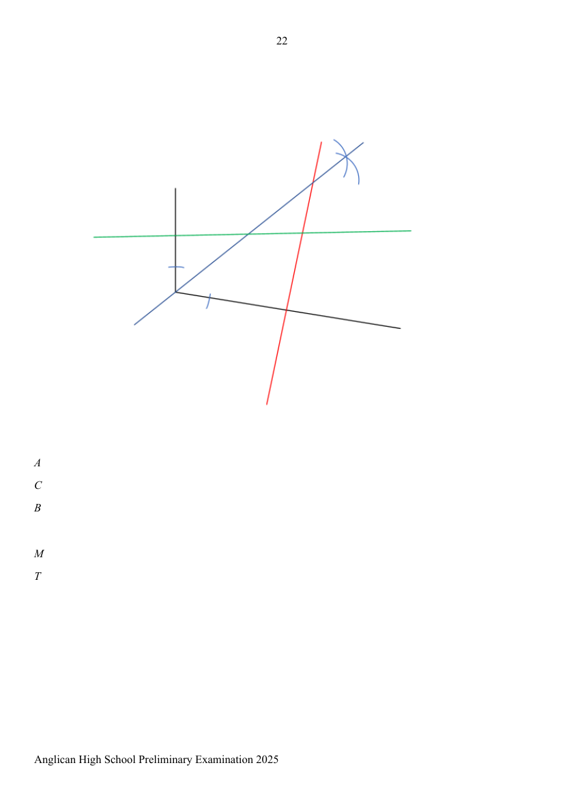

# Anglican High School — Mathematics 4052/01 Paper 1 Mark Scheme (cleaned)

> **Institution:** Anglican High School
> **Exam:** Secondary Four Preliminary Examination 2025
> **Level:** Secondary Four
> **Subjects:** Mathematics
> **Paper:** 4052/01 Paper 1 — Mark Scheme
> **Date:** 21 August 2025
> **Duration:** 2 hours 15 minutes
> **Total Marks:** 90
> **Source:** `AHS 2025 EMATH PRELIM P1 MS.pdf` (cleaned & reformatted)

---

## Answer all the questions

---

### Q1

> **Marks:** [2]
> **Sub-topic:** Indices
> **Page:** 3

Simplify $\left(\dfrac{27\sqrt{a^{3}}}{b^{-3}}\right)^{-\frac{2}{3}}$, leaving your answer in positive index form.

$$
\left(\dfrac{27\sqrt{a^{3}}}{b^{-3}}\right)^{-\frac{2}{3}}=\dfrac{3^{-2}a^{-1}}{b^{2}}=\dfrac{1}{9ab^{2}}
$$

**M1** Open Bracket. **A1**

---

### Q2

> **Marks:** [3]
> **Sub-topic:** Algebraic expansion
> **Page:** 3

Expand and simplify $(x-y)^{2}-(x+1)(x-2y)$.

$$
\begin{aligned}
(x-y)^{2}-(x+1)(x-2y)&=x^{2}-2xy+y^{2}-(x^{2}-2xy+x-2y)\\
&=x^{2}-2xy+y^{2}-x^{2}+2xy-x+2y\\
&=y^{2}-x+2y
\end{aligned}
$$

**M1** expand. **M1** correct sign when remove bracket. **A1**

---

### Q3

> **Marks:** [2]
> **Sub-topic:** Factorisation
> **Page:** 3–4

Factorise completely $ax-2cy-cx+2ay$.

$$
\begin{aligned}
ax-2cy-cx+2ay&=ax-cx-2cy+2ay\\
&=x(a-c)+2y(-c+a)\\
&=x(a-c)+2y(a-c)\\
&=(x+2y)(a-c)
\end{aligned}
$$

**M1** Factorise $x$ and $2y$. **A1**

---

### Q4

> **Marks:** (a) [2]; (b) [3]; total [5]
> **Sub-topic:** Equations
> **Page:** 4–5

**(a)** Solve the equation $39-\dfrac{3}{4}x=3-2(4-x)$.

$$
\begin{aligned}
39-\dfrac{3}{4}x&=3-8+2x\\
39+5&=2x+\dfrac{3}{4}x\\
44&=\dfrac{11}{4}x\\
x&=16
\end{aligned}
$$

**M1** expand and rearrange. **A1**

**(b)** Solve the equation $\dfrac{2x}{3-2x}-\dfrac{7}{x-3}=2$.

$$
\begin{aligned}
\dfrac{2x(x-3)}{(3-2x)(x-3)}-\dfrac{7(3-2x)}{(3-2x)(x-3)}&=2\\
\dfrac{2x^{2}-6x-21+14x}{3x-9-2x^{2}+6x}&=2\\
2x^{2}+8x-21&=18x-18-4x^{2}\\
6x^{2}-10x-3&=0\\
x&=\dfrac{-(-10)\pm\sqrt{(-10)^{2}-4(6)(-3)}}{2(6)}\\
x&=1.93\text{ or }-0.260\quad(3\text{ s.f.})
\end{aligned}
$$

**M1** to single fraction. **M1** apply formula. **A1**

---

### Q5

> **Marks:** [2]
> **Sub-topic:** Lowest common multiple
> **Page:** 5

Mr Chan is looking at Deepavali decorations. There are two lights, one green and one red, flashing at different intervals. The green light and the red light flash at intervals of 6 seconds and 8 seconds respectively. If the two lights start flashing at the same time, how long will it take for the two lights to next flash simultaneously?

$$
6=2\times 3,\qquad 8=2^{3}
$$

$$
\mathrm{LCM}=2^{3}\times 3=24
$$

It will take 24 s for the two lights to next flash simultaneously again.

**M1** prime factorisation. **A1** LCM

---

### Q6

> **Marks:** (a) [1]; (b) [1]; (c) [2]; total [4]
> **Sub-topic:** Prime factors, HCF and LCM
> **Page:** 5–6

**(a)** Express $2250$ as the product of its prime factors.

$$
2250=2\times 3^{2}\times 5^{3}
$$

**B1**

**(b)** The number $\dfrac{2250h}{k}$, where $h$ and $k$ are integers, is a perfect cube. Find the smallest positive integer values of $h$ and of $k$.

$$
h=3\text{ and }k=2
$$

**B1**

**(c)** Find two smallest possible integers, one is odd and the other is even, such that they have a lowest common multiple of $2250$ and a highest common factor of $45$.

$$
2250=2\times 3^{2}\times 5^{3},\qquad 45=3^{2}\times 5
$$

$90$ and $1125$.

**B1** each for $90$ and $1125$

---

### Q7

> **Marks:** [3]
> **Sub-topic:** Proportion
> **Page:** 6

A student makes a pendulum by tying a string to a small solid sphere and hanging it from a retort stand. The time, in seconds, taken by the pendulum to swing from one end to the other and back again is called the period, $P$ seconds. The period is directly proportional to the square root of the length of the string, $L$ cm. If the value of $P$ increases by $25\%$, what is the corresponding percentage change in the value of $L$?

$$
P=k\sqrt{L}
$$

Let $P=a$ and $L=b$.

$$
a=k\sqrt{b},\qquad k=\dfrac{a}{\sqrt{b}},\qquad P=\left(\dfrac{a}{\sqrt{b}}\right)\sqrt{L}
$$

New $P=1.25a$.

$$
\begin{aligned}
1.25a&=\left(\dfrac{a}{\sqrt{b}}\right)\sqrt{L}\\
\sqrt{L}&=1.25\sqrt{b}\\
L&=1.5625b
\end{aligned}
$$

$$
\text{Percentage change}=\dfrac{1.5625b-b}{b}\times 100=56.25\%
$$

The length of the string increased by $56.25\%$.

**M1** the equation for direct proportion is given. **M1** value of $L$. **A1** Statement must be written.

---

### Q8

> **Marks:** [4]
> **Sub-topic:** Similarity and standard form
> **Page:** 6–7

The Great Pyramid of Giza, located in Egypt, has a surface area of $8.30\times 10^{4}\ \mathrm{m}^{2}$ and a volume of $2.45\times 10^{4}\ \mathrm{m}^{3}$. A vendor is selling geometrically similar replicas of the pyramid. The replica has a volume of $9.22\times 10^{-6}\ \mathrm{m}^{3}$. Estimate the surface area of the replica, giving your answer in $\mathrm{m}^{2}$ and in standard form.

Let the height of the Great Pyramid be $H$. Let the height of the replica be $h$.

$$
\begin{aligned}
\left(\dfrac{h}{H}\right)^{3}&=\dfrac{\text{Volume of replica}}{\text{Volume of Great Pyramid}}\\
\left(\dfrac{h}{H}\right)^{3}&=\dfrac{9.22\times 10^{-6}}{2.45\times 10^{4}}\\
\dfrac{h}{H}&=\sqrt[3]{\dfrac{9.22\times 10^{-6}}{2.45\times 10^{4}}}=7.2197\times 10^{-4}
\end{aligned}
$$

Let $S$ be the surface area of the Great Pyramid and $s$ be the surface area of the replica.

$$
\begin{aligned}
\dfrac{s}{S}&=\left(\dfrac{h}{H}\right)^{2}\\
s&=\left(7.2197\times 10^{-4}\right)^{2}\times 8.30\times 10^{4}\\
&=4.33\times 10^{-2}\ \mathrm{m}^{2}
\end{aligned}
$$

**M1** $\left(\dfrac{h}{H}\right)^{3}=\dfrac{\text{Volume of replica}}{\text{Volume of Great Pyramid}}$. **M1** value of $\dfrac{h}{H}$. **M1** $\dfrac{s}{S}=\left(\dfrac{h}{H}\right)^{2}$. **A1**

---

### Q9

> **Marks:** (a) [1]; (b) [1]; (c)(i) [1]; (c)(ii) [1]; total [4]
> **Sub-topic:** Sets and Venn diagrams
> **Page:** 7–8

**(a)** On the Venn diagram, shade the region which represents $(A'\cap B')'$.

The region inside $A$ or $B$ (the union) is shaded.

**B1**

**(b)** Use set notation to describe the shaded region.

$$
A'\cap B
$$

**B1**

**(c)** $\xi=\{x:x\text{ is an integer such that }0<x<10\}$

$A=\{1,4,9\}$

$B=\{1,2,4,8\}$

**(i)** Describe the elements of Set $A$.

Perfect square, square numbers.

**B1**

**(ii)** Find the value of $n(A\cup B')$.

$$
n(A\cup B')=7
$$

**B1**

---

### Q10

> **Marks:** [2]
> **Sub-topic:** Polygons
> **Page:** 8–9

In the diagram above, $ABC$ is part of a polygon. $\angle ABC$ is $148^{\circ}$. The remaining interior angles are each equal to $139^{\circ}$. Find the number of sides of this polygon.

Let $n$ be the number of sides of the polygon.

$$
\begin{aligned}
180(n-2)&=148+139(n-1)\\
180n-360&=148+139n-139\\
180n-139n&=148-139+360\\
41n&=369\\
n&=9
\end{aligned}
$$

**M1** for forming equation. **A1**

---

### Q11

> **Marks:** (a) [1]; (b) [3]; total [4]
> **Sub-topic:** Congruence and similarity
> **Page:** 9

$ABCD$ is a trapezium where $DC$ is parallel to $AB$. Diagonals $AC$ and $BD$ intersect at $O$. $DO=CO$.

**(a)** Name a pair of similar isosceles triangles.

$\triangle AOB$ and $\triangle COD$

**B1**

**(b)** Show that triangle $ABC$ and triangle $BAD$ are congruent. Give a reason for each statement you make.

$AB$ is common length.

$\triangle ODC$ is an isosceles triangle since $DO=CO$, thus $\angle ODC=\angle OCD$.

$\angle OBA=\angle ODC$ and $\angle OAB=\angle OCD$ (alt $\angle$s, $DC\parallel AB$), hence $\angle OBA=\angle OAB$ and $AO=BO$.

$$
AC=AO+OC=BO+OD=BD
$$

Hence, by SAS property, triangle $ABC$ and triangle $BAD$ are congruent.

**B1** state common length. **B1** $AC=BD$. **B1** state test.

---

### Q12

> **Marks:** (i) [2]; (ii) [1]; (iii) [1]; (iv) [1]; total [5]
> **Sub-topic:** Stem-and-leaf diagram
> **Page:** 9–11

The test scores for a group of 24 students were recorded.

| Stem | Leaf |
| --- | --- |
| 0 | 9 |
| 1 |  |
| 2 | 1 3 |
| 3 | 1 3 4 7 7 7 8 |
| 4 | 2 5 7 9 |
| 5 | 5 6 7 7 9 9 |
| 6 |  |
| 7 | 0 7 8 8 |

Key: $7\mid 0$ means 70 marks.

**(i)** Find the interquartile range.

$$
58-35.5=22.5
$$

**B1**

**(ii)** Find the median result.

$$
\dfrac{45+47}{2}=46
$$

**B1**

**(iii)** Find the mode result.

$$
37
$$

**B1**

**(iv)** 15 students did not achieve a merit grade. Find the minimum score to achieve merit grade.

$$
56
$$

**B1**

---

### Q13

> **Marks:** (a) [2]; (b) [3]; total [5]
> **Sub-topic:** Mean and standard deviation
> **Page:** 11

The table shows the number of books read by some students last month.

| Number of books | 0 | 1 | 2 | 3 |
| --- | --- | --- | --- | --- |
| Frequency | 1 | 3 | $x$ | 5 |

**(a)** Show that the mean value of the data is 2.

$$
\begin{aligned}
\dfrac{0(1)+1(3)+2x+3(5)}{1+3+x+5}&=\dfrac{18+2x}{9+x}\\
&=\dfrac{2(9+x)}{9+x}\\
&=2
\end{aligned}
$$

**M1** forming equation. **A1**

**(b)** The standard deviation of the data is 1. Find the value of $x$.

$$
\begin{aligned}
\sqrt{\dfrac{1(0)^{2}+3(1)^{2}+x(2)^{2}+5(3)^{2}}{9+x}-2^{2}}&=1\\
\dfrac{48+4x}{9+x}-4&=1\\
\dfrac{48+4x}{9+x}&=5\\
48+4x&=45+5x\\
x&=3
\end{aligned}
$$

**M1** forming equation. **M1** simplifying. **A1**

---

### Q14

> **Marks:** (a)(i) [1]; (a)(ii) [3]; (b) [2]; total [6]
> **Sub-topic:** Trigonometry
> **Page:** 11–12

In the diagram, $PQ=25$ cm, $QR=7$ cm and $\angle SRP=90^{\circ}$. $QRST$ is a straight line.

**(a)** Given that $\sin\angle TSP=\dfrac{4}{5}$, find the exact value of

**(i)** $\cos\angle TSP$,

$$
\cos\angle TSP=-\dfrac{SR}{SP}=-\dfrac{3}{5}
$$

**B1**

**(ii)** the length of $SR$.

$$
\begin{aligned}
RP&=\sqrt{25^{2}-7^{2}}=24\ \mathrm{cm}\\
\sin\angle RSP&=\sin\angle TSP\\
\dfrac{4}{5}&=\dfrac{RP}{SP}\\
SP&=30\ \mathrm{cm}\\
SR&=\sqrt{30^{2}-24^{2}}=18\ \mathrm{cm}
\end{aligned}
$$

**M1** $RP$. **M1** $SP$. **A1**

**(b)** A triangle with vertices $ABC$ has an area of $16.9\ \mathrm{cm}^{2}$. $AB=8.9$ cm and $AC=4.7$ cm. Find the two possible values of angle $BAC$.

$$
\begin{aligned}
16.9&=\dfrac{1}{2}\times 8.9\times 4.7\times\sin\angle BAC\\
\sin\angle BAC&=\dfrac{2\times 16.9}{8.9\times 4.7}\\
\angle BAC&=53.9^{\circ}\text{ or }126.1^{\circ}\ (1\ \mathrm{d.p.})
\end{aligned}
$$

**M1** for using area of triangle. **A1** for both answers. No answer mark awarded if students only write down the acute angle.

---

### Q15

> **Marks:** (a) [1]; (b) [3]; (c) [3]; total [7]
> **Sub-topic:** Sequences and series
> **Page:** 13–14

**(a)** Write down the fraction of energy captured for the $n$th second of operation.

$$
\dfrac{1}{2}\left(\dfrac{1}{n}-\dfrac{1}{n+1}\right)
$$

**B1**

**(b)** Show that the total energy captured after $K$ seconds is $\dfrac{1}{2}\left(1-\dfrac{1}{K+1}\right)$.

$$
\begin{aligned}
&\dfrac{1}{2}\left(1-\dfrac{1}{2}\right)+\dfrac{1}{2}\left(\dfrac{1}{2}-\dfrac{1}{3}\right)+\dfrac{1}{2}\left(\dfrac{1}{3}-\dfrac{1}{4}\right)+\cdots\\
&+\dfrac{1}{2}\left(\dfrac{1}{K-1}-\dfrac{1}{K}\right)+\dfrac{1}{2}\left(\dfrac{1}{K}-\dfrac{1}{K+1}\right)\\
&=\dfrac{1}{2}\left(1-\dfrac{1}{K+1}\right)
\end{aligned}
$$

**M1** Listing. **M1** Factorise half. **A1**

**(c)** The energy harvesting device is considered a success if it is able to harvest at least $49.8\%$ of its maximum capacity. Find the minimum number of seconds for which the device is considered a success.

$$
\begin{aligned}
\dfrac{1}{2}\left(1-\dfrac{1}{K+1}\right)&\geq 0.498\\
1-\dfrac{1}{K+1}&\geq 0.996\\
0.004&\geq\dfrac{1}{K+1}\\
K+1&\geq\dfrac{1}{0.004}\\
K+1&\geq 250\\
K&\geq 249
\end{aligned}
$$

**M1** form inequality. **M1** simplify. **A1**

---

### Q16

> **Marks:** [3]
> **Sub-topic:** Map scales and area
> **Page:** 14

Map $A$ has a scale of $1:200\,000$ and map $B$ has a scale of $1:n$.

The area of a lake on map $A$ is $4\ \mathrm{cm}^{2}$ while the area of the same lake on map $B$ is $2.56\ \mathrm{cm}^{2}$.

Find $n$.

Map $A$: $1$ cm $: 2$ km, so $1\ \mathrm{cm}^{2}:4\ \mathrm{km}^{2}$ and $4\ \mathrm{cm}^{2}:16\ \mathrm{km}^{2}$. Actual area is $16\ \mathrm{km}^{2}$.

Map $B$: $1$ cm $:\dfrac{n}{100000}$ km, so

$$
2.56\ \mathrm{cm}^{2}:\dfrac{2.56n^{2}}{100000^{2}}\ \mathrm{km}^{2}
$$

$$
\begin{aligned}
\dfrac{2.56n^{2}}{100000^{2}}&=16\\
\dfrac{1.6n}{100000}&=4\\
1.6n&=400000\\
n&=250000
\end{aligned}
$$

**M1** actual area. **M1** in terms of $n$. **A1**

---

### Q17

> **Marks:** (a) [2]; (b) [1]; total [3]
> **Sub-topic:** Inequalities
> **Page:** 14–15

Solve the inequality $\dfrac{3}{2}<\dfrac{x-3}{4}\leq\dfrac{9+x}{7}$, and represent your answer on a number line.

$$
\begin{aligned}
\dfrac{3}{2}&<\dfrac{x-3}{4}\\
12&<2x-6\\
18&<2x\\
9&<x
\end{aligned}
$$

$$
\begin{aligned}
\dfrac{x-3}{4}&\leq\dfrac{9+x}{7}\\
7x-21&\leq 36+4x\\
3x&\leq 57\\
x&\leq 19
\end{aligned}
$$

$$
9<x\leq 19
$$

Number line: open circle at $9$, closed circle at $19$.

**M1** Solve both inequalities. **A1** Solve inequalities. **B1** number line.

---

### Q18

> **Marks:** (a) [2]; (b) [2]; total [4]
> **Sub-topic:** Coordinate geometry
> **Page:** 15–16

$E$ is the point $(2,-4)$ and $F$ is the point $(-1,3)$.

**(a)** Find the equation of the line $EF$ in the form $y=mx+c$.

$$
\begin{aligned}
\text{Gradient of }EF&=\dfrac{3-(-4)}{-1-2}=-\dfrac{7}{3}\\
y&=-\dfrac{7}{3}x+c
\end{aligned}
$$

Substitute $(2,-4)$:

$$
-4=-\dfrac{7}{3}\times 2+c,\qquad c=\dfrac{2}{3}
$$

Equation of $EF$ is $y=-\dfrac{7}{3}x+\dfrac{2}{3}$.

**M1** find gradient. **A1**

**(b)** The line $PQ$ has equation $2y+\dfrac{14}{3}x-1=0$. Explain why $PQ$ does not intersect the line $EF$.

$$
\begin{aligned}
2y&=-\dfrac{14}{3}x+1\\
y&=-\dfrac{7}{3}x+\dfrac{1}{2}
\end{aligned}
$$

Since gradient of $PQ$ = gradient of $AB$, $PQ$ and $AB$ are parallel and will not intersect.

**M1** find gradient. **A1**

---

### Q19

> **Marks:** (a) [2]; (b) [2]; total [4]
> **Sub-topic:** Speed-time graphs
> **Page:** 16–17

**(a)** Calculate the acceleration of the car for the first 20 minutes.

$$
\text{Acceleration}=-36\ \mathrm{km/h}\div\dfrac{20}{60}\ \mathrm{h}=-108\ \mathrm{km/h}^{2}
$$

or

$$
\text{Acceleration}=\dfrac{0-36}{\dfrac{20}{60}}=-108\ \mathrm{km/h}^{2}
$$

**M1** find gradient. **A1**

**(b)** Given that the distance travelled in the first 20 minutes is the same as the distance travelled between 20 minutes and 32 minutes, calculate the value of $V$.

Same distance means the two areas of the triangles are the same.

$$
\begin{aligned}
\dfrac{1}{2}\times\dfrac{32-20}{60}\times V&=\dfrac{1}{2}\times\dfrac{20}{60}\times 36\\
\dfrac{V}{10}&=6\\
V&=60
\end{aligned}
$$

**M1** **A1**

---

### Q20

> **Marks:** (i) [1]; (ii) [1]; (iii) [1]; (iv) [2]; total [5]
> **Sub-topic:** Circle theorems
> **Page:** 17–18

**(i)** angle $ACG$,

$$
\begin{aligned}
\angle ACD&=90^{\circ}\quad(\text{tan }\perp\text{ rad})\\
\angle ACG&=90^{\circ}-20^{\circ}=70^{\circ}
\end{aligned}
$$

**B1**

**(ii)** angle $AEX$,

$$
\begin{aligned}
\angle AEG&=\angle ACG\quad(\angle\text{ in same segment})\\
\angle AEX&=70^{\circ}-40^{\circ}=30^{\circ}
\end{aligned}
$$

**B1**

**(iii)** angle $FOA$,

$$
\angle FOA=2\times\angle AEX=60^{\circ}\quad(\angle\text{ at centre }=2\times\angle\text{ at circumference})
$$

**B1**

**(iv)** angle $GCE$.

$$
\begin{aligned}
\angle GFE&=180^{\circ}-40^{\circ}-58^{\circ}=82^{\circ}\quad(\angle\text{ sum of }\triangle)\\
\angle GCE&=180^{\circ}-82^{\circ}=98^{\circ}\quad(\angle\text{ in opposite segment})
\end{aligned}
$$

**M1** **A1**

---

### Q21

> **Marks:** (a) [2]; (b) [2]; total [4]
> **Sub-topic:** Sector and sphere
> **Page:** 19

**(a)** Find angle $POQ$ in radians.

$$
\begin{aligned}
\dfrac{1}{2}\times 20^{2}\times\angle POQ\times 50&=2000\\
\angle POQ&=\dfrac{2000\times 2}{50\times 20^{2}}=\dfrac{1}{5}
\end{aligned}
$$

**M1** form equation. **A1**

**(b)** The piece of metal is melted and recast into a sphere. Find the radius of this sphere.

$$
\begin{aligned}
\dfrac{4}{3}\pi r^{3}&=2000\\
r^{3}&=\dfrac{2000\times 3}{4\pi}\\
r&=\sqrt[3]{\dfrac{6000}{4\pi}}=7.8159\ \mathrm{cm}\\
r&=7.82\ \mathrm{cm}\ (3\text{ s.f.})
\end{aligned}
$$

**M1** form equation. **A1**

---

### Q22

> **Marks:** (a) [1]; (b) [2]; (c) [1]; (d) [1]; total [5]
> **Sub-topic:** Matrices
> **Page:** 19–20

**(a)** Represent their purchases in a $2\times 3$ matrix $\mathbf{Y}$.

$$
\mathbf{Y}=\begin{pmatrix}5&4&2\\4&7&0\end{pmatrix}
$$

**B1**

**(b)** Evaluate the matrix $\mathbf{W}=\mathbf{YX}$.

$$
\mathbf{W}=\begin{pmatrix}5&4&2\\4&7&0\end{pmatrix}\begin{pmatrix}2.5&-0.3\\2.0&0.2\\1.8&0.1\end{pmatrix}=\begin{pmatrix}24.1&-0.5\\24&0.2\end{pmatrix}
$$

**M1** form equation. **A1**

**(c)** What does the last column of $\mathbf{W}$ represent?

The last column represents the savings for Peter and extra cost for Jane if they buy from Bakery B.

**B1**

**(d)** Find the amount that Peter and Jane would spend in Bakery B.

$$
\begin{pmatrix}24.1&-0.5\\24&0.2\end{pmatrix}\begin{pmatrix}1\\1\end{pmatrix}=\begin{pmatrix}23.6\\24.2\end{pmatrix}
$$

Peter would spend &#36;23.60 buying from Bakery B. Jane would spend &#36;24.20 buying from Bakery B.

**B1**

---

### Q23

> **Marks:** (a)(i) [1]; (a)(ii) [1]; (b) [1]; (c) [1]; total [4]
> **Sub-topic:** Geometrical constructions
> **Page:** 20–22

**(a)** Construct

**(i)** the perpendicular bisector of $AB$,

**(ii)** the bisector of angle $ABC$.

**(b)** A fast-food restaurant, $M$, is located equidistant from $A$ and $B$ as well as equidistant from $BC$ and $AB$. Mark and label $M$.

**(c)** The toilet, $T$, is located equidistant from the 3 tents. Mark and label $T$.

