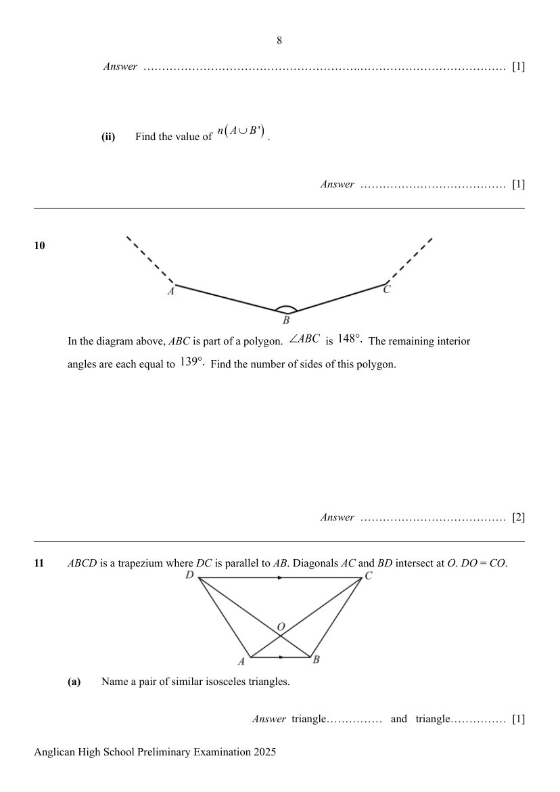
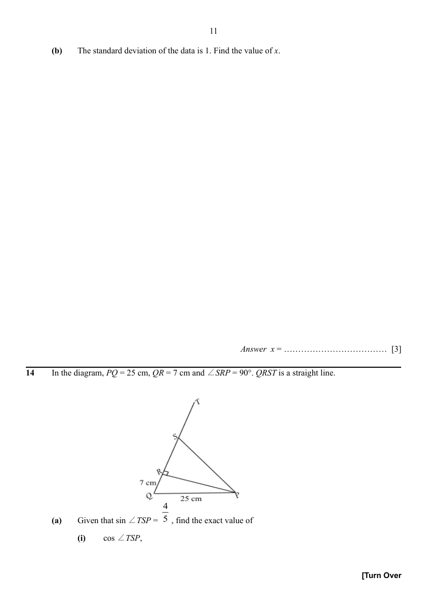
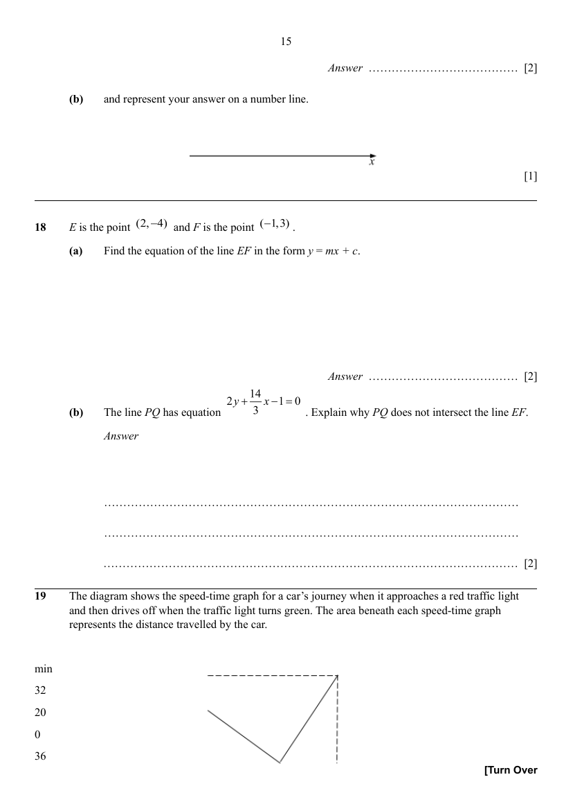
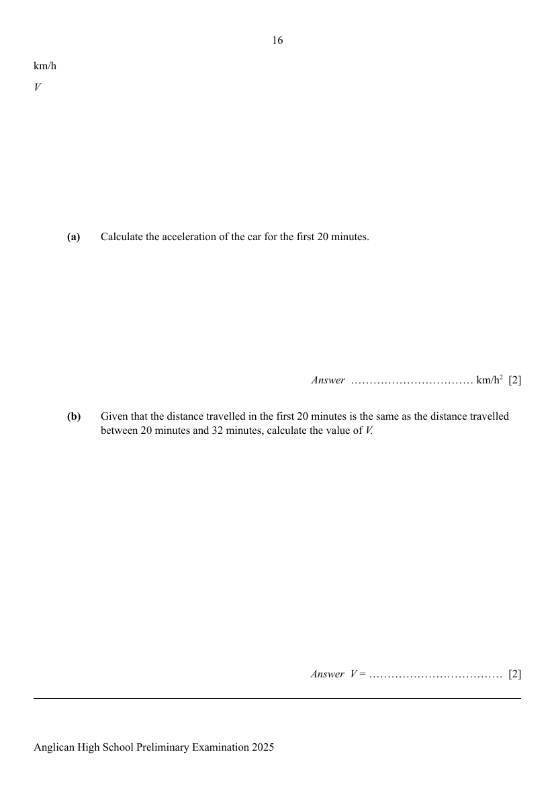
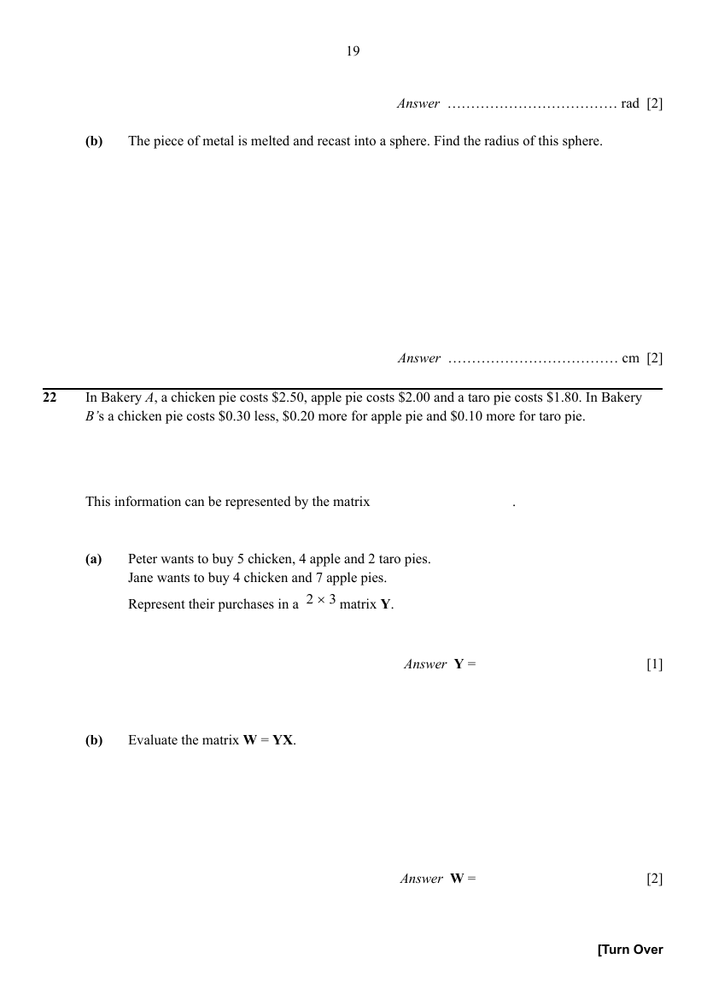
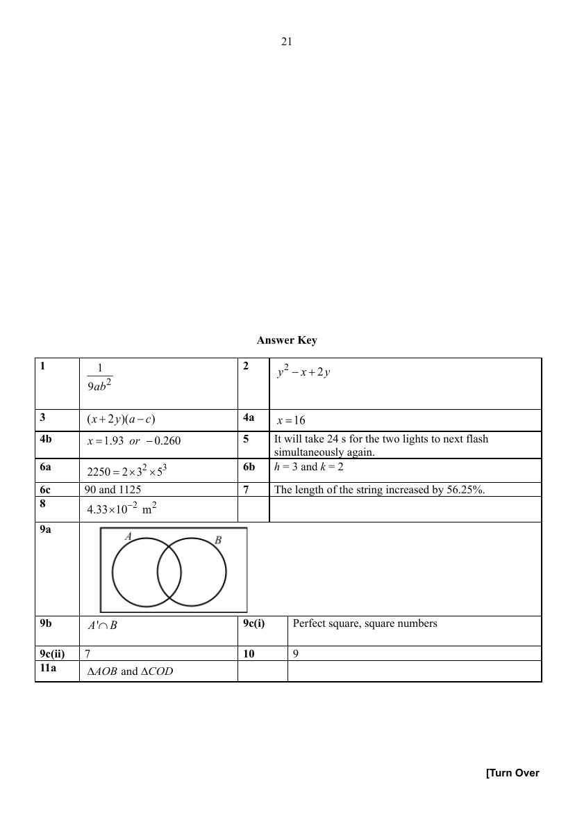
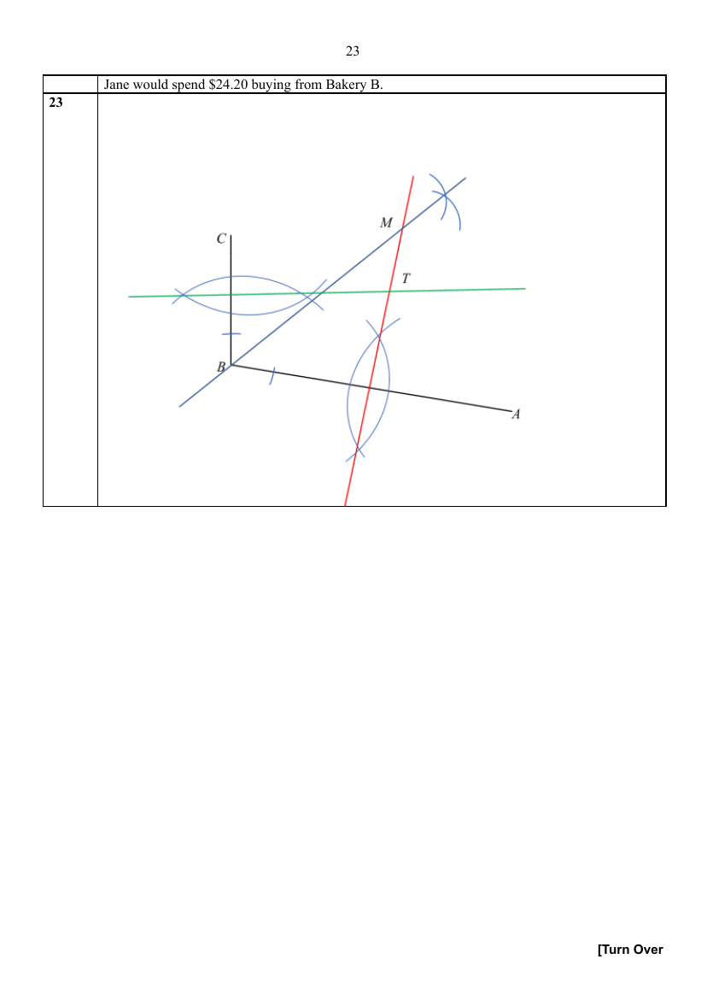

# Anglican High School — Mathematics 4052/01 Paper 1 (cleaned)

> **Institution:** Anglican High School
> **Exam:** Secondary Four Preliminary Examination 2025
> **Level:** Secondary Four
> **Subjects:** Mathematics
> **Paper:** 4052/01 Paper 1
> **Date:** 20 August 2025
> **Duration:** 2 hours 15 minutes
> **Total Marks:** 90
> **Source:** `AHS 2025 EMATH PRELIM P1 QP.pdf` (cleaned & reformatted)

---

## Instructions

Write your name, index number and class in the space at the top of this page.
Write in dark blue or black pen.
You may use an HB pencil for any diagrams or graphs.
Do not use staples, paper clips, glue or correction fluid.

Answer **all** the questions.
The number of marks is given in brackets [ ] at the end of each question or part question.

If working is needed for any question it must be shown with the answer.
Omission of essential working will result in loss of marks.
The total of marks for this paper is 90.

The use of an approved scientific calculator is expected, where appropriate.
If the degree of accuracy is not specified in the question and if the answer is not exact, give the answer to three significant figures. Give answers in degrees to one decimal place.
For $\pi$, use either your calculator value or $3.142$, unless the question requires the answer in terms of $\pi$.

---

## Mathematical Formulae

*Compound Interest*

$$
\text{Total amount} = P\left(1+\frac{r}{100}\right)^{n}
$$

*Mensuration*

$$
\text{Curved surface area of a cone} = \pi rl
$$

$$
\text{Surface area of a sphere} = 4\pi r^{2}
$$

$$
\text{Volume of a cone} = \frac{1}{3}\pi r^{2}h
$$

$$
\text{Volume of a sphere} = \frac{4}{3}\pi r^{3}
$$

$$
\text{Area of triangle } ABC = \frac{1}{2}ab\sin C
$$

$$
\text{Arc length} = r\theta,\text{ where }\theta\text{ is in radians}
$$

$$
\text{Sector area} = \frac{1}{2}r^{2}\theta,\text{ where }\theta\text{ is in radians}
$$

*Trigonometry*

$$
\frac{a}{\sin A} = \frac{b}{\sin B} = \frac{c}{\sin C}
$$

$$
a^{2} = b^{2}+c^{2}-2bc\cos A
$$

*Statistics*

$$
\text{Mean} = \frac{\sum fx}{\sum f}
$$

$$
\text{Standard deviation} = \sqrt{\frac{\sum fx^{2}}{\sum f}-\left(\frac{\sum fx}{\sum f}\right)^{2}}
$$

---

## Answer all the questions

---

### Q1

> **Marks:** 2
> **Topic:** N1 Numbers and their operations
> **Sub-topic:** Numbers and their operations
> **LO:** [[context/subjects/o-level-e-maths/learning-objectives/o-level-e-maths-N1j.md|N1j]]
> **Page:** 3

Simplify $\left(\dfrac{27\sqrt{a^{3}}}{b^{-3}}\right)^{-\frac{2}{3}}$, leaving your answer in positive index form. [2]

---

### Q2

> **Marks:** 3
> **Topic:** N5 Algebraic expressions and formulae
> **Sub-topic:** Algebraic expressions and formulae
> **LO:** [[context/subjects/o-level-e-maths/learning-objectives/o-level-e-maths-N5j.md|N5j]]
> **Page:** 3

Expand and simplify $(x-y)^{2}-(x+1)(x-2y)$. [3]

---

### Q3

> **Marks:** 2
> **Topic:** N5 Algebraic expressions and formulae
> **Sub-topic:** Algebraic expressions and formulae
> **LO:** [[context/subjects/o-level-e-maths/learning-objectives/o-level-e-maths-N5h.md|N5h]]
> **Page:** 3–4

Factorise completely $ax-2cy-cx+2ay$. [2]

---

### Q4

> **Marks:** (a) 2, (b) 3; total 5
> **Page:** 4–5

**(a)** Solve the equation $39-\dfrac{3}{4}x=3-2(4-x)$. [2]
> **Topic:** N7 Equations and inequalities
> **Sub-topic:** Equations and inequalities
> **LO:** [[context/subjects/o-level-e-maths/learning-objectives/o-level-e-maths-N7e.md|N7e]]

**(b)** Solve the equation $\dfrac{2x}{3-2x}-\dfrac{7}{x-3}=2$. [3]
> **Topic:** N7 Equations and inequalities
> **Sub-topic:** Equations and inequalities
> **LO:** [[context/subjects/o-level-e-maths/learning-objectives/o-level-e-maths-N7e.md|N7e]]

---

### Q5

> **Marks:** 2
> **Topic:** N2 Ratio and proportion
> **Sub-topic:** Ratio and proportion
> **LO:** [[context/subjects/o-level-e-maths/learning-objectives/o-level-e-maths-N2a.md|N2a]]
> **Page:** 5

Mr Chan is looking at Deepavali decorations. There are two lights, one green and one red, flashing at different intervals. The green light and the red light flash at intervals of 6 seconds and 8 seconds respectively. If the two lights start flashing at the same time, how long will it take for the two lights to next flash simultaneously? [2]

---

### Q6

> **Marks:** (a) 1, (b) 1, (c) 2; total 4
> **Page:** 5–6

**(a)** Express $2250$ as the product of its prime factors. [1]
> **Topic:** N1 Numbers and their operations
> **Sub-topic:** Numbers and their operations
> **LO:** [[context/subjects/o-level-e-maths/learning-objectives/o-level-e-maths-N1b.md|N1b]]

**(b)** The number $\dfrac{2250h}{k}$, where $h$ and $k$ are integers, is a perfect cube. Find the smallest positive integer value of $h$ and of $k$. [1]
> **Topic:** N1 Numbers and their operations
> **Sub-topic:** Numbers and their operations
> **LO:** [[context/subjects/o-level-e-maths/learning-objectives/o-level-e-maths-N1b.md|N1b]]

**(c)** Find two smallest possible integers, one is odd and the other is even, such that they have a lowest common multiple of $2250$ and a highest common factor of $45$. [2]
> **Topic:** N1 Numbers and their operations
> **Sub-topic:** Numbers and their operations
> **LO:** [[context/subjects/o-level-e-maths/learning-objectives/o-level-e-maths-N1b.md|N1b]]

---

### Q7

> **Marks:** 3
> **Topic:** N2 Ratio and proportion
> **Sub-topic:** Ratio and proportion
> **LO:** [[context/subjects/o-level-e-maths/learning-objectives/o-level-e-maths-N2d.md|N2d]]
> **Page:** 6

A student makes a pendulum by tying a string to a small solid sphere and hanging it from a retort stand. The time, in seconds, taken by the pendulum to swing from one end to the other and back again is called the period, $P$ seconds. The period is directly proportional to the square root of the length of the string, $L$ cm. If the value of $P$ increases by $25\%$, what is the corresponding percentage change in the value of $L$? [3]

---

### Q8

> **Marks:** 4
> **Topic:** G2 Congruence and similarity
> **Sub-topic:** Congruence and similarity
> **LO:** [[context/subjects/o-level-e-maths/learning-objectives/o-level-e-maths-G2i.md|G2i]]
> **Page:** 6–7

The Great Pyramid of Giza, located in Egypt, has a surface area of $8.30\times 10^{4}\ \mathrm{m}^{2}$ and a volume of $2.45\times 10^{4}\ \mathrm{m}^{3}$. A vendor is selling geometrically similar replicas of the pyramid. The replica has a volume of $9.22\times 10^{-6}\ \mathrm{m}^{3}$. Estimate the surface area of the replica, giving your answer in $\mathrm{m}^{2}$ and in standard form. [4]

---

### Q9

> **Marks:** (a) 1, (b) 1, (c)(i) 1, (c)(ii) 1; total 4
> **Page:** 7–8

**(a)** On the Venn diagram, shade the region which represents $(A'\cap B')'$. [1]
> **Topic:** N8 Set language and notation
> **Sub-topic:** Set language and notation
> **LO:** [[context/subjects/o-level-e-maths/learning-objectives/o-level-e-maths-N8c.md|N8c]]

**(b)** Use set notation to describe the shaded region. [1]
> **Topic:** N8 Set language and notation
> **Sub-topic:** Set language and notation
> **LO:** [[context/subjects/o-level-e-maths/learning-objectives/o-level-e-maths-N8c.md|N8c]]

**(c)** $\xi=\{x:x\text{ is an integer such that }0<x<10\}$

$A=\{1,4,9\}$

$B=\{1,2,4,8\}$

The Venn diagram shows the universal set and the elements in each of its subsets.

**(i)** Describe the elements of Set $A$. [1]
> **Topic:** N8 Set language and notation
> **Sub-topic:** Set language and notation
> **LO:** [[context/subjects/o-level-e-maths/learning-objectives/o-level-e-maths-N8c.md|N8c]]

**(ii)** Find the value of $n(A\cup B')$. [1]
> **Topic:** N8 Set language and notation
> **Sub-topic:** Set language and notation
> **LO:** [[context/subjects/o-level-e-maths/learning-objectives/o-level-e-maths-N8c.md|N8c]]

---

### Q10

> **Marks:** 2
> **Topic:** G1 Angles, triangles and polygons
> **Sub-topic:** Angles, triangles and polygons
> **LO:** [[context/subjects/o-level-e-maths/learning-objectives/o-level-e-maths-G1f.md|G1f]]
> **Page:** 8

In the diagram above, $ABC$ is part of a polygon. $\angle ABC$ is $148^{\circ}$. The remaining interior angles are each equal to $139^{\circ}$. Find the number of sides of this polygon. [2]

---

### Q11

> **Marks:** (a) 1, (b) 3; total 4
> **Page:** 8–9

$ABCD$ is a trapezium where $DC$ is parallel to $AB$. Diagonals $AC$ and $BD$ intersect at $O$. $DO=CO$.

**(a)** Name a pair of similar isosceles triangles. [1]
> **Topic:** G2 Congruence and similarity
> **Sub-topic:** Congruence and similarity
> **LO:** [[context/subjects/o-level-e-maths/learning-objectives/o-level-e-maths-G2i.md|G2i]]

**(b)** Show that triangle $ABC$ and triangle $BAD$ are congruent. Give a reason for each statement you make. [3]
> **Topic:** G2 Congruence and similarity
> **Sub-topic:** Congruence and similarity
> **LO:** [[context/subjects/o-level-e-maths/learning-objectives/o-level-e-maths-G2i.md|G2i]]

---

### Q12

> **Marks:** (i) 2, (ii) 1, (iii) 1, (iv) 1; total 5
> **Page:** 9–10

The test scores for a group of 24 students were recorded.

| Stem | Leaf |
| --- | --- |
| 0 | 9 |
| 1 |  |
| 2 | 1 3 |
| 3 | 1 3 4 7 7 7 8 |
| 4 | 2 5 7 9 |
| 5 | 5 6 7 7 9 9 |
| 6 |  |
| 7 | 0 7 8 8 |

Key: $7\mid 0$ means 70 marks.

The results are shown in the stem-and-leaf diagram.

**(i)** Find the interquartile range. [2]
> **Topic:** S1 Data handling and analysis
> **Sub-topic:** Data handling and analysis
> **LO:** [[context/subjects/o-level-e-maths/learning-objectives/o-level-e-maths-S1i.md|S1i]]

**(ii)** Find the median result. [1]
> **Topic:** S1 Data handling and analysis
> **Sub-topic:** Data handling and analysis
> **LO:** [[context/subjects/o-level-e-maths/learning-objectives/o-level-e-maths-S1f.md|S1f]]

**(iii)** Find the mode result. [1]
> **Topic:** S1 Data handling and analysis
> **Sub-topic:** Data handling and analysis
> **LO:** [[context/subjects/o-level-e-maths/learning-objectives/o-level-e-maths-S1f.md|S1f]]

**(iv)** 15 students did not achieve a merit grade. Find the minimum score to achieve merit grade. [1]
> **Topic:** S1 Data handling and analysis
> **Sub-topic:** Data handling and analysis
> **LO:** [[context/subjects/o-level-e-maths/learning-objectives/o-level-e-maths-S1i.md|S1i]]

---

### Q13

> **Marks:** (a) 2, (b) 3; total 5
> **Page:** 10–11

The table shows the number of books read by some students last month.

| Number of books | 0 | 1 | 2 | 3 |
| --- | --- | --- | --- | --- |
| Frequency | 1 | 3 | $x$ | 5 |

**(a)** Show that the mean value of the data is 2. [2]
> **Topic:** S1 Data handling and analysis
> **Sub-topic:** Data handling and analysis
> **LO:** [[context/subjects/o-level-e-maths/learning-objectives/o-level-e-maths-S1f.md|S1f]]

**(b)** The standard deviation of the data is 1. Find the value of $x$. [3]
> **Topic:** S1 Data handling and analysis
> **Sub-topic:** Data handling and analysis
> **LO:** [[context/subjects/o-level-e-maths/learning-objectives/o-level-e-maths-S1f.md|S1f]]

---

### Q14

> **Marks:** (a)(i) 1, (a)(ii) 3, (b) 2; total 6
> **Page:** 11–12

In the diagram, $PQ=25$ cm, $QR=7$ cm and $\angle SRP=90^{\circ}$. $QRST$ is a straight line.

**(a)** Given that $\sin\angle TSP=\dfrac{4}{5}$, find the exact value of

**(i)** $\cos\angle TSP$, [1]
> **Topic:** G4 Pythagoras' theorem and trigonometry
> **Sub-topic:** Pythagoras' theorem and trigonometry
> **LO:** [[context/subjects/o-level-e-maths/learning-objectives/o-level-e-maths-G4c.md|G4c]]

**(ii)** the length of $SR$. [3]
> **Topic:** G4 Pythagoras' theorem and trigonometry
> **Sub-topic:** Pythagoras' theorem and trigonometry
> **LO:** [[context/subjects/o-level-e-maths/learning-objectives/o-level-e-maths-G4c.md|G4c]]

**(b)** A triangle with vertices $ABC$ has an area of $16.9\ \mathrm{cm}^{2}$. $AB=8.9$ cm and $AC=4.7$ cm. Find the two possible values of angle $BAC$. [2]
> **Topic:** G4 Pythagoras' theorem and trigonometry
> **Sub-topic:** Pythagoras' theorem and trigonometry
> **LO:** [[context/subjects/o-level-e-maths/learning-objectives/o-level-e-maths-G4e.md|G4e]]

---

### Q15

> **Marks:** (a) 1, (b) 3, (c) 3; total 7
> **Page:** 12–14

A new type of energy harvesting device is being developed to capture energy from small environmental vibrations. The engineers observe that the fraction of energy captured by the device during $n$th second of continuous operation, relative to its maximum capacity, follows a specific pattern.

| Time (second) | Fraction of energy captured relative to its maximum capacity |
| --- | --- |
| 1st | $\dfrac{1}{2}\left(1-\dfrac{1}{2}\right)$ |
| 2nd | $\dfrac{1}{2}\left(\dfrac{1}{2}-\dfrac{1}{3}\right)$ |
| 3rd | $\dfrac{1}{2}\left(\dfrac{1}{3}-\dfrac{1}{4}\right)$ |
| $\ldots$ | $\ldots$ |
| $n$th | $\ldots$ |

**(a)** Write down the fraction of energy captured for the $n$th second of operation. [1]
> **Topic:** N6 Functions and graphs
> **Sub-topic:** Functions and graphs
> **LO:** [[context/subjects/o-level-e-maths/learning-objectives/o-level-e-maths-N6f.md|N6f]]

**(b)** The team needs to find the total energy captured after $K$ seconds of continuous operation. Show that the total energy captured after $K$ seconds is $\dfrac{1}{2}\left(1-\dfrac{1}{K+1}\right)$. [3]
> **Topic:** N6 Functions and graphs
> **Sub-topic:** Functions and graphs
> **LO:** [[context/subjects/o-level-e-maths/learning-objectives/o-level-e-maths-N6f.md|N6f]]

**(c)** The energy harvesting device is considered a success if it is able to harvest at least $49.8\%$ of its maximum capacity. Find the minimum number of seconds for which the device is considered a success. [3]
> **Topic:** N6 Functions and graphs
> **Sub-topic:** Functions and graphs
> **LO:** [[context/subjects/o-level-e-maths/learning-objectives/o-level-e-maths-N6f.md|N6f]]

---

### Q16

> **Marks:** 3
> **Topic:** G5 Mensuration
> **Sub-topic:** Mensuration
> **LO:** [[context/subjects/o-level-e-maths/learning-objectives/o-level-e-maths-G5b.md|G5b]]
> **Page:** 14

Map $A$ has a scale of $1:200\,000$ and map $B$ has a scale of $1:n$.

The area of a lake on map $A$ is $4\ \mathrm{cm}^{2}$ while the area of the same lake on map $B$ is $2.56\ \mathrm{cm}^{2}$.

Find $n$. [3]

---

### Q17

> **Marks:** (a) 2, (b) 1; total 3
> **Page:** 14–15

**(a)** Solve the inequality $\dfrac{3}{2}<\dfrac{x-3}{4}\leq\dfrac{9+x}{7}$, [2]
> **Topic:** N7 Equations and inequalities
> **Sub-topic:** Equations and inequalities
> **LO:** [[context/subjects/o-level-e-maths/learning-objectives/o-level-e-maths-N7g.md|N7g]]

**(b)** and represent your answer on a number line. [1]
> **Topic:** N6 Functions and graphs
> **Sub-topic:** Functions and graphs
> **LO:** [[context/subjects/o-level-e-maths/learning-objectives/o-level-e-maths-N6c.md|N6c]]

---

### Q18

> **Marks:** (a) 2, (b) 2; total 4
> **Page:** 15

$E$ is the point $(2,-4)$ and $F$ is the point $(-1,3)$.

**(a)** Find the equation of the line $EF$ in the form $y=mx+c$. [2]
> **Topic:** G6 Coordinate geometry
> **Sub-topic:** Coordinate geometry
> **LO:** [[context/subjects/o-level-e-maths/learning-objectives/o-level-e-maths-G6c.md|G6c]]

**(b)** The line $PQ$ has equation $2y+\dfrac{14}{3}x-1=0$. Explain why $PQ$ does not intersect the line $EF$. [2]
> **Topic:** G6 Coordinate geometry
> **Sub-topic:** Coordinate geometry
> **LO:** [[context/subjects/o-level-e-maths/learning-objectives/o-level-e-maths-G6c.md|G6c]]

---

### Q19

> **Marks:** (a) 2, (b) 2; total 4
> **Page:** 15–16

The diagram shows the speed-time graph for a car's journey when it approaches a red traffic light and then drives off when the traffic light turns green. The area beneath each speed-time graph represents the distance travelled by the car.

**(a)** Calculate the acceleration of the car for the first 20 minutes. [2]
> **Topic:** N6 Functions and graphs
> **Sub-topic:** Functions and graphs
> **LO:** [[context/subjects/o-level-e-maths/learning-objectives/o-level-e-maths-N6c.md|N6c]]

**(b)** Given that the distance travelled in the first 20 minutes is the same as the distance travelled between 20 minutes and 32 minutes, calculate the value of $V$. [2]
> **Topic:** N6 Functions and graphs
> **Sub-topic:** Functions and graphs
> **LO:** [[context/subjects/o-level-e-maths/learning-objectives/o-level-e-maths-N6c.md|N6c]]

---

### Q20

> **Marks:** (i) 1, (ii) 1, (iii) 1, (iv) 2; total 5
> **Page:** 17–18

In the diagram below, the points $A$, $E$, $C$, $G$ and $F$ lie on the circle with centre $O$. $BCD$ is a tangent to the circle at $C$, $AC$ is the diameter, angle $GEF=40^{\circ}$, angle $EGF=58^{\circ}$ and angle $DCG=20^{\circ}$.

Find, stating your reasons clearly,

**(i)** angle $ACG$, [1]
> **Topic:** G3 Properties of circles
> **Sub-topic:** Properties of circles
> **LO:** [[context/subjects/o-level-e-maths/learning-objectives/o-level-e-maths-G3b.md|G3b]]

**(ii)** angle $AEX$, [1]
> **Topic:** G3 Properties of circles
> **Sub-topic:** Properties of circles
> **LO:** [[context/subjects/o-level-e-maths/learning-objectives/o-level-e-maths-G3b.md|G3b]]

**(iii)** angle $FOA$, [1]
> **Topic:** G3 Properties of circles
> **Sub-topic:** Properties of circles
> **LO:** [[context/subjects/o-level-e-maths/learning-objectives/o-level-e-maths-G3b.md|G3b]]

**(iv)** angle $GCE$. [2]
> **Topic:** G3 Properties of circles
> **Sub-topic:** Properties of circles
> **LO:** [[context/subjects/o-level-e-maths/learning-objectives/o-level-e-maths-G3b.md|G3b]]

---

### Q21

> **Marks:** (a) 2, (b) 2; total 4
> **Page:** 18–19

The cross-section of a piece of metal in the shape of a sector of a circle with centre $O$ and radius $20$ cm is shown below. The piece of metal is $50$ cm thick. The volume of the piece of metal is $2000\ \mathrm{cm}^{3}$.

**(a)** Find angle $POQ$ in radians. [2]
> **Topic:** G5 Mensuration
> **Sub-topic:** Mensuration
> **LO:** [[context/subjects/o-level-e-maths/learning-objectives/o-level-e-maths-G5g.md|G5g]]

**(b)** The piece of metal is melted and recast into a sphere. Find the radius of this sphere. [2]
> **Topic:** G5 Mensuration
> **Sub-topic:** Mensuration
> **LO:** [[context/subjects/o-level-e-maths/learning-objectives/o-level-e-maths-G5g.md|G5g]]

---

### Q22

> **Marks:** (a) 1, (b) 2, (c) 1, (d) 1; total 5
> **Page:** 19–20

In Bakery $A$, a chicken pie costs \$2.50, apple pie costs \$2.00 and a taro pie costs \$1.80. In Bakery $B$'s a chicken pie costs \$0.30 less, \$0.20 more for apple pie and \$0.10 more for taro pie.

This information can be represented by the matrix $\mathbf{X}$.

**(a)** Peter wants to buy 5 chicken, 4 apple and 2 taro pies. Jane wants to buy 4 chicken and 7 apple pies. Represent their purchases in a $2\times 3$ matrix $\mathbf{Y}$. [1]
> **Topic:** N9 Matrices
> **Sub-topic:** Matrices
> **LO:** [[context/subjects/o-level-e-maths/learning-objectives/o-level-e-maths-N9b.md|N9b]]

**(b)** Evaluate the matrix $\mathbf{W}=\mathbf{YX}$. [2]
> **Topic:** N9 Matrices
> **Sub-topic:** Matrices
> **LO:** [[context/subjects/o-level-e-maths/learning-objectives/o-level-e-maths-N9b.md|N9b]]

**(c)** What does the last column of $\mathbf{W}$ represent? [1]
> **Topic:** N9 Matrices
> **Sub-topic:** Matrices
> **LO:** [[context/subjects/o-level-e-maths/learning-objectives/o-level-e-maths-N9b.md|N9b]]

**(d)** Find the amount that Peter and Jane should spend in Bakery B. [1]
> **Topic:** N9 Matrices
> **Sub-topic:** Matrices
> **LO:** [[context/subjects/o-level-e-maths/learning-objectives/o-level-e-maths-N9b.md|N9b]]

---

### Q23

> **Marks:** (a)(i) 1, (a)(ii) 1, (b) 1, (c) 1; total 4
> **Page:** 20

The drawing in the answer space below shows three tents, $A$, $B$ and $C$ pitched at East Coast Park.

**(a)** Construct

**(i)** the perpendicular bisector of $AB$, [1]
> **Topic:** G2 Congruence and similarity
> **Sub-topic:** Congruence and similarity
> **LO:** [[context/subjects/o-level-e-maths/learning-objectives/o-level-e-maths-G2e.md|G2e]]

**(ii)** the bisector of angle $ABC$. [1]
> **Topic:** G2 Congruence and similarity
> **Sub-topic:** Congruence and similarity
> **LO:** [[context/subjects/o-level-e-maths/learning-objectives/o-level-e-maths-G2e.md|G2e]]

**(b)** A fast-food restaurant, $M$, is located equidistant from $A$ and $B$ as well as equidistant from $BC$ and $AB$. Mark and label $M$. [1]
> **Topic:** G2 Congruence and similarity
> **Sub-topic:** Congruence and similarity
> **LO:** [[context/subjects/o-level-e-maths/learning-objectives/o-level-e-maths-G2e.md|G2e]]

**(c)** The toilet, $T$, is located equidistant from the 3 tents. Mark and label $T$. [1]
> **Topic:** G2 Congruence and similarity
> **Sub-topic:** Congruence and similarity
> **LO:** [[context/subjects/o-level-e-maths/learning-objectives/o-level-e-maths-G2e.md|G2e]]

---

## Answer Key

The question paper includes this answer key on physical pages 21–23.

| Question | Answer |
| --- | --- |
| 1 | $\dfrac{1}{9ab^{2}}$ |
| 2 | $y^{2}-x+2y$ |
| 3 | $(x+2y)(a-c)$ |
| 4(a) | $x=16$ |
| 4(b) | $x=1.93$ or $-0.260$ |
| 5 | It will take 24 s for the two lights to next flash simultaneously again. |
| 6(a) | $2250=2\times 3^{2}\times 5^{3}$ |
| 6(b) | $h=3$ and $k=2$ |
| 6(c) | 90 and 1125 |
| 7 | The length of the string increased by $56.25\%$. |
| 8 | $4.33\times 10^{-2}\ \mathrm{m}^{2}$ |
| 9(b) | $A'\cap B$ |
| 9(c)(i) | Perfect square, square numbers |
| 9(c)(ii) | 7 |
| 10 | 9 |
| 11(a) | $\triangle AOB$ and $\triangle COD$ |
| 12(i) | 22.5 |
| 12(ii) | 46 |
| 12(iii) | 37 |
| 12(iv) | 56 |
| 13(a) | 2 |
| 13(b) | $x=3$ |
| 14(a)(i) | $\cos\angle TSP=-\dfrac{3}{5}$ |
| 14(a)(ii) | $SR=18$ cm |
| 14(b) | $\angle BAC=53.9^{\circ}$ or $126.1^{\circ}$ |
| 15(a) | $\dfrac{1}{2}\left(\dfrac{1}{n}-\dfrac{1}{n+1}\right)$ |
| 15(c) | $K\geq 249$ |
| 16 | $250000$ |
| 18(a) | Equation of $EF$ is $y=-\dfrac{7}{3}x+\dfrac{2}{3}$ |
| 18(b) | Since gradient of $PQ$ = gradient of $AB$, $PQ$ and $AB$ are parallel and will not intersect. |
| 19(a) | Acceleration $=-108\ \mathrm{km/h}^{2}$ |
| 19(b) | $60$ |
| 20(i) | $\angle ACG=70^{\circ}$ |
| 20(ii) | $\angle AEX=30^{\circ}$ |
| 20(iii) | $\angle FOA=60^{\circ}$ |
| 20(iv) | $\angle GCE=98^{\circ}$ |
| 21(a) | $\angle POQ=\dfrac{1}{5}$ radians |
| 21(b) | $r=7.82$ cm |
| 22(c) | The last column represents the savings for Peter and extra cost for Jane if they buy from Bakery B. |
| 22(d) | Peter would spend \$23.60 buying from Bakery B. Jane would spend \$24.20 buying from Bakery B. |

11(b) $AB$ is common length. $\triangle ODC$ is an isosceles triangle since $DO=CO$, thus $\angle ODC=\angle OCD$. $\angle OBA=\angle ODC$ and $\angle OAB=\angle OCD$ (alt $\angle$s, $DC\parallel AB$), hence $\angle OBA=\angle OAB$ and $AO=BO$. $AC=AO+OC=BO+OD=BD$. Hence, by SAS property, triangle $ABC$ and triangle $BAD$ are congruent.

15(b)

$$
\begin{aligned}
&\frac{1}{2}\left(1-\frac{1}{2}\right)+\frac{1}{2}\left(\frac{1}{2}-\frac{1}{3}\right)+\frac{1}{2}\left(\frac{1}{3}-\frac{1}{4}\right)+\ldots+\frac{1}{2}\left(\frac{1}{K-1}-\frac{1}{K}\right)+\frac{1}{2}\left(\frac{1}{K}-\frac{1}{K+1}\right)\\
&=\frac{1}{2}\left(1-\frac{1}{K+1}\right)
\end{aligned}
$$

17 The number line has an open circle at $9$ and a closed circle at $19$.

$$
\mathbf{Y}=\begin{pmatrix}5&4&2\\4&7&0\end{pmatrix}
$$

$$
\mathbf{W}=\begin{pmatrix}24.1&-0.5\\24&0.2\end{pmatrix}
$$

9(a) and 23 are drawn on the answer-key pages.

