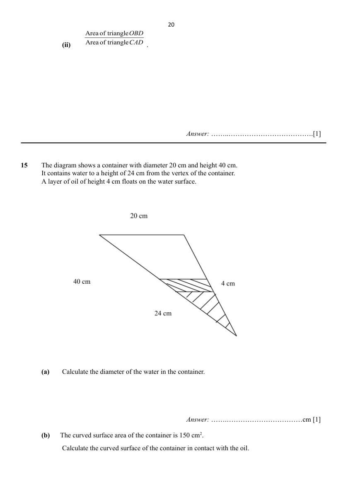

# Anglican High School — Mathematics 4052/02 Paper 2 (cleaned)

> **Institution:** Anglican High School
> **Exam:** Secondary Four Preliminary Examination 2025
> **Level:** Secondary Four
> **Subjects:** Mathematics
> **Paper:** 4052/02 Paper 2
> **Date:** 25 August 2025
> **Duration:** 2 hours 15 minutes
> **Total Marks:** 90
> **Source:** `AHS 2025 EMATH PRELIM P2 QP.pdf` (cleaned & reformatted)

---

## Instructions

Write your name, index number and class on all the work you hand in.
Write in dark blue or black pen.
You may use a HB pencil for any diagrams or graphs.
Do not use staples, paper clips, glue or correction fluid.

Answer **all** the questions.
If working is needed for any question, it must be shown with the answer.
Omission of essential working will result in loss of marks.
The use of an approved scientific calculator is expected, where appropriate.
If the degree of accuracy is not specified in the question, and if the answer is not exact, give the answer to three significant figures. Give answers in degrees to one decimal place.
For $\pi$, use either your calculator value or $3.142$, unless the question requires the answer in terms of $\pi$.

The number of marks is given in brackets [ ] at the end of each question or part question.
The total number of marks for this paper is 90.

---

## Mathematical Formulae

*Compound Interest*

$$
\text{Total amount}=P\left(1+\dfrac{r}{100}\right)^{n}
$$

*Mensuration*

$$
\text{Curved surface area of a cone}=\pi rl
$$

$$
\text{Surface area of a sphere}=4\pi r^{2}
$$

$$
\text{Volume of a cone}=\dfrac{1}{3}\pi r^{2}h
$$

$$
\text{Volume of a sphere}=\dfrac{4}{3}\pi r^{3}
$$

$$
\text{Area of triangle }ABC=\dfrac{1}{2}ab\sin C
$$

$$
\text{Arc length}=r\theta,\text{ where }\theta\text{ is in radians}
$$

$$
\text{Sector area}=\dfrac{1}{2}r^{2}\theta,\text{ where }\theta\text{ is in radians}
$$

*Trigonometry*

$$
\dfrac{a}{\sin A}=\dfrac{b}{\sin B}=\dfrac{c}{\sin C}
$$

$$
a^{2}=b^{2}+c^{2}-2bc\cos A
$$

*Statistics*

$$
\text{Mean}=\dfrac{\sum fx}{\sum f}
$$

$$
\text{Standard deviation}=\sqrt{\dfrac{\sum fx^{2}}{\sum f}-\left(\dfrac{\sum fx}{\sum f}\right)^{2}}
$$

---

## Answer all the questions

---

### Q1

> **Marks:** [3]
> **Topic:** N5 Algebraic expressions and formulae
> **Sub-topic:** Algebraic expressions and formulae
> **LO:** [[context/subjects/o-level-e-maths/learning-objectives/o-level-e-maths-N5k.md|N5k]]
> **Page:** 4

Rearrange the formula to make $c$ the subject.

$$
D=(a-c)^{2}-a^{2}
$$

[3]

---

### Q2

> **Marks:** (a) [2]; (b) [3]; (c) [3]; total [8]
> **Page:** 4–5

**(a)** A investor deposits &#36;18 000 with a finance company paying compound interest on a monthly basis at $6\%$ per annum.

Calculate the interest received at the end of 5 years, correct to 2 decimal places. [2]
> **Topic:** N2 Ratio and proportion
> **Sub-topic:** Ratio and proportion
> **LO:** [[context/subjects/o-level-e-maths/learning-objectives/o-level-e-maths-N2c.md|N2c]]

**(b)** The price of a washing machine is &#36;900 before discount. After selling the machine at a $20\%$ discount, the seller still makes a profit of $25\%$.

Calculate the cost price of the washing machine. [3]
> **Topic:** N2 Ratio and proportion
> **Sub-topic:** Ratio and proportion
> **LO:** [[context/subjects/o-level-e-maths/learning-objectives/o-level-e-maths-N2c.md|N2c]]

**(c)** The price of a gaming laptop is &#36;2 999. John buys this laptop on hire purchase after putting a down payment of &#36;600. For the remaining amount of the laptop, John has to pay the seller a monthly instalment of &#36;120 over 2 years.

Calculate the interest rate charged by the seller. [3]
> **Topic:** N2 Ratio and proportion
> **Sub-topic:** Ratio and proportion
> **LO:** [[context/subjects/o-level-e-maths/learning-objectives/o-level-e-maths-N2c.md|N2c]]

---

### Q3

> **Marks:** [3]
> **Topic:** N7 Equations and inequalities
> **Sub-topic:** Equations and inequalities
> **LO:** [[context/subjects/o-level-e-maths/learning-objectives/o-level-e-maths-N7b.md|N7b]]
> **Page:** 5–6

Write as a single fraction in its simplest form

$$
\dfrac{2}{9x^{2}-1}+\dfrac{1}{1-3x}.
$$

[3]

---

### Q4

> **Marks:** (a) [2]; (b) [1]; total [3]
> **Page:** 6

**(a)** Express $-x^{2}+4x-3$ in the form $a(x+b)^{2}+c$. [2]
> **Topic:** N6 Functions and graphs
> **Sub-topic:** Functions and graphs
> **LO:** [[context/subjects/o-level-e-maths/learning-objectives/o-level-e-maths-N6c.md|N6c]]

**(b)** Hence, write down the coordinates of the turning point of the graph $-x^{2}+4x-3$. [1]
> **Topic:** N6 Functions and graphs
> **Sub-topic:** Functions and graphs
> **LO:** [[context/subjects/o-level-e-maths/learning-objectives/o-level-e-maths-N6c.md|N6c]]

---

### Q5

> **Marks:** (a)(i) [1]; (a)(ii) [1]; (b)(i) [1]; (b)(ii) [3]; total [6]
> **Page:** 6–8

In triangle $ABC$, angle $CDE$ and angle $CEB$ are right angles. $DE=2.5$ cm, $CD=5$ cm, $AE=x$ cm and $CE=y$ cm.

**(a) (i)** Show that $\triangle ECD$ and $\triangle ACE$ are similar. [1]
> **Topic:** G4 Pythagoras' theorem and trigonometry
> **Sub-topic:** Pythagoras' theorem and trigonometry
> **LO:** [[context/subjects/o-level-e-maths/learning-objectives/o-level-e-maths-G4c.md|G4c]]

**(ii)** Express $y$ in terms of $x$. [1]
> **Topic:** G4 Pythagoras' theorem and trigonometry
> **Sub-topic:** Pythagoras' theorem and trigonometry
> **LO:** [[context/subjects/o-level-e-maths/learning-objectives/o-level-e-maths-G4c.md|G4c]]

**(b) (i)** In triangle $PQR$, angle $PQR=30^{\circ}$, $PQ=x+3$ cm and $QR=y+2$ cm.

Express the area of triangle $PQR$ in terms of $x$ and $y$. [1]
> **Topic:** G4 Pythagoras' theorem and trigonometry
> **Sub-topic:** Pythagoras' theorem and trigonometry
> **LO:** [[context/subjects/o-level-e-maths/learning-objectives/o-level-e-maths-G4e.md|G4e]]

**(ii)** The area of triangle $PQR$ is $17\dfrac{1}{2}\ \mathrm{cm}^{2}$.

Using your answer in **(a)(ii)** and **(b)(i)**, find the value of $x$ and of $y$. [3]
> **Topic:** G4 Pythagoras' theorem and trigonometry
> **Sub-topic:** Pythagoras' theorem and trigonometry
> **LO:** [[context/subjects/o-level-e-maths/learning-objectives/o-level-e-maths-G4e.md|G4e]]

---

### Q6

> **Marks:** [3]
> **Topic:** N4 Rate and speed
> **Sub-topic:** Rate and speed
> **LO:** [[context/subjects/o-level-e-maths/learning-objectives/o-level-e-maths-N4a.md|N4a]]
> **Page:** 8

In the Singapore F1 Grand Prix, the drivers must complete 62 laps around a circuit that is $4.940$ km long. One F1 driver completed 32 laps in 65 minutes.

What must be the minimum average speed, in km/h, for the remaining laps if he wants to complete the race in at most two hours? [3]

---

### Q7

> **Marks:** [3]
> **Topic:** G7 Vectors in two dimensions
> **Sub-topic:** Vectors in two dimensions
> **LO:** [[context/subjects/o-level-e-maths/learning-objectives/o-level-e-maths-G7h.md|G7h]]
> **Page:** 8–9

The position vector of point $C$ is $\begin{pmatrix}2\\-3\end{pmatrix}$. The position vector of point $D$ is $\begin{pmatrix}4\\h\end{pmatrix}$. $|\overrightarrow{CD}|=\sqrt{20}$.

Find the two possible values of $h$. [3]

---

### Q8

> **Marks:** (a) [1]; (b) [2]; (c) [1]; (d) [2]; total [6]
> **Page:** 9

There are 180 oranges in a box. The table shows the distribution of the masses of these oranges.

| Mass ($m$ g) | $90<m\leq 100$ | $100<m\leq 110$ | $110<m\leq 120$ | $120<m\leq 130$ | $130<m\leq 140$ |
| --- | --- | --- | --- | --- | --- |
| Frequency | 10 | 28 | 51 | 45 | 48 |

**(a)** Calculate an estimate of the standard deviation of the masses. [1]
> **Topic:** S1 Data handling and analysis
> **Sub-topic:** Data handling and analysis
> **LO:** [[context/subjects/o-level-e-maths/learning-objectives/o-level-e-maths-S1k.md|S1k]]

**(b)** The weighing machine was faulty and overestimated each of the oranges by 5 g.

Explain, with a reason, what will happen to the standard deviation. [2]
> **Topic:** S1 Data handling and analysis
> **Sub-topic:** Data handling and analysis
> **LO:** [[context/subjects/o-level-e-maths/learning-objectives/o-level-e-maths-S1k.md|S1k]]

**(c)** Explain why the range of the masses of oranges may not be 50 g. [1]
> **Topic:** S1 Data handling and analysis
> **Sub-topic:** Data handling and analysis
> **LO:** [[context/subjects/o-level-e-maths/learning-objectives/o-level-e-maths-S1k.md|S1k]]

**(d)** Roy says, "The modal class is the interval $110<m\leq 120$ but the modal mass may not be in the interval $110<m\leq 120$." Is he correct? Give a reason for your answer. [2]
> **Topic:** S1 Data handling and analysis
> **Sub-topic:** Data handling and analysis
> **LO:** [[context/subjects/o-level-e-maths/learning-objectives/o-level-e-maths-S1k.md|S1k]]

---

### Q9

> **Marks:** (a) [1]; (b) [2]; (c) [2]; total [5]
> **Page:** 10–11

The time taken by 120 students to travel to school $A$ was recorded. The cumulative frequency curve below shows the distribution of their commute times.

**(a)** Calculate the percentage of students who took at least 35 minutes to reach school. [1]
> **Topic:** S1 Data handling and analysis
> **Sub-topic:** Data handling and analysis
> **LO:** [[context/subjects/o-level-e-maths/learning-objectives/o-level-e-maths-S1i.md|S1i]]

The commute times of another group of 120 students from school $B$ were recorded. The box-and-whisker plot below shows the distribution of their travel times.

**(b)** Mr Chan claims that in school B, there are twice as many students who take less than 27 minutes, than those who take more than 35 minutes.

Comment, with reasons on whether the data supports the claim. [2]
> **Topic:** S1 Data handling and analysis
> **Sub-topic:** Data handling and analysis
> **LO:** [[context/subjects/o-level-e-maths/learning-objectives/o-level-e-maths-S1i.md|S1i]]

**(c)** Give two comments comparing the commute times of the two groups of students. [2]
> **Topic:** S1 Data handling and analysis
> **Sub-topic:** Data handling and analysis
> **LO:** [[context/subjects/o-level-e-maths/learning-objectives/o-level-e-maths-S1i.md|S1i]]

---

### Q10

> **Marks:** (a) [2]; (b) [4]; total [6]
> **Page:** 12–13

In the diagram, triangle $ABC$ is a right-angled triangle. $AB=9$ cm, $BC=12$ cm and $AC=15$ cm. A circle with centre $O$ and radius $3$ cm is inscribed inside triangle $ABC$. The circle touches the sides of the circle at $X$, $Y$ and $Z$ respectively.

**(a)** Show that the obtuse angle $YOZ=2.50$ radians, correct to 3 significant figures. [2]
> **Topic:** G3 Properties of circles
> **Sub-topic:** Properties of circles
> **LO:** [[context/subjects/o-level-e-maths/learning-objectives/o-level-e-maths-G3b.md|G3b]]

**(b)** Find the perimeter of the major segment $YXZ$. [4]
> **Topic:** G3 Properties of circles
> **Sub-topic:** Properties of circles
> **LO:** [[context/subjects/o-level-e-maths/learning-objectives/o-level-e-maths-G3b.md|G3b]]

---

### Q11

> **Marks:** (a) [2]; (b) [3]; total [5]
> **Page:** 13–14

A group of $N$ children are at school celebrating National Day. The children come in either red or white T-shirts. Three girls from the group wore white T-shirts.

**(a)** Two children are selected at random from the group.

The probability that both are girls wearing white T-shirts is $\dfrac{1}{70}$.

Find $N$. [2]
> **Topic:** S2 Probability
> **Sub-topic:** Probability
> **LO:** [[context/subjects/o-level-e-maths/learning-objectives/o-level-e-maths-S2c.md|S2c]]

**(b)** One child is selected at random.

The probability that it is a girl wearing a red T-shirt is $\dfrac{3}{7}$. Three children are chosen at random. The probability that one is a boy wearing a white T-shirt and two are girls wearing red T-shirts is $\dfrac{108}{665}$.

Find the value of $a$, of $b$ and of $c$ as shown in the table of information about the group of children. [3]
> **Topic:** S2 Probability
> **Sub-topic:** Probability
> **LO:** [[context/subjects/o-level-e-maths/learning-objectives/o-level-e-maths-S2c.md|S2c]]

|  | White T-shirts | Red T-shirts |
| --- | --- | --- |
| Boys | $a$ | $b$ |
| Girls | 3 | $c$ |

---

### Q12

> **Marks:** (a)(i) [1]; (a)(ii) [2]; (a)(iii) [2]; (a)(iv) [2]; (a)(v) [2]; (b) [3]; total [12]
> **Page:** 14–16

The diagram shows three points $A$, $B$ and $C$ on horizontal ground. $A$ is at a bearing of $040^{\circ}$ from $B$ and $C$ is at a bearing of $125^{\circ}$ from $A$. $AB=60$ m and $AC=50$ m.

**(a)** Find

**(i)** the bearing of $B$ from $A$, [1]
> **Topic:** G4 Pythagoras' theorem and trigonometry
> **Sub-topic:** Pythagoras' theorem and trigonometry
> **LO:** [[context/subjects/o-level-e-maths/learning-objectives/o-level-e-maths-G4g.md|G4g]]

**(ii)** the area of triangle $ABC$, [2]
> **Topic:** G4 Pythagoras' theorem and trigonometry
> **Sub-topic:** Pythagoras' theorem and trigonometry
> **LO:** [[context/subjects/o-level-e-maths/learning-objectives/o-level-e-maths-G4e.md|G4e]]

**(iii)** the distance $BC$, [2]
> **Topic:** G4 Pythagoras' theorem and trigonometry
> **Sub-topic:** Pythagoras' theorem and trigonometry
> **LO:** [[context/subjects/o-level-e-maths/learning-objectives/o-level-e-maths-G4g.md|G4g]]

**(iv)** angle $ACB$, [2]
> **Topic:** G4 Pythagoras' theorem and trigonometry
> **Sub-topic:** Pythagoras' theorem and trigonometry
> **LO:** [[context/subjects/o-level-e-maths/learning-objectives/o-level-e-maths-G4g.md|G4g]]

**(v)** the shortest distance $AX$, where $X$ is a point along $BC$. [2]
> **Topic:** G4 Pythagoras' theorem and trigonometry
> **Sub-topic:** Pythagoras' theorem and trigonometry
> **LO:** [[context/subjects/o-level-e-maths/learning-objectives/o-level-e-maths-G4g.md|G4g]]

**(b)** Point $A$ is the base of a vertical mast $AT$. The angle of depression of $C$ from the $T$ is $33^{\circ}$. Find the greatest angle of elevation of $T$ from a point along $BC$. [3]
> **Topic:** G4 Pythagoras' theorem and trigonometry
> **Sub-topic:** Pythagoras' theorem and trigonometry
> **LO:** [[context/subjects/o-level-e-maths/learning-objectives/o-level-e-maths-G4g.md|G4g]]

---

### Q13

> **Marks:** (a) [1]; (b) [2]; (c) [3]; total [6]
> **Page:** 16–17

The graph of $y=\dfrac{1}{7}x^{3}-x^{2}+\dfrac{1}{2}x+3$ is drawn on the grid.

Using your graph,

**(a)** write down the range of values of $x$ such that $y\geq 2$. [1]
> **Topic:** G6 Coordinate geometry
> **Sub-topic:** Coordinate geometry
> **LO:** [[context/subjects/o-level-e-maths/learning-objectives/o-level-e-maths-G6c.md|G6c]]

**(b)** find the gradient of the tangent to the curve where $x=-0.5$. [2]
> **Topic:** G6 Coordinate geometry
> **Sub-topic:** Coordinate geometry
> **LO:** [[context/subjects/o-level-e-maths/learning-objectives/o-level-e-maths-G6c.md|G6c]]

**(c)** by drawing a suitable straight line on the grid, solve the equation

$$
6x^{3}-42x^{2}+126=21x.
$$

[3]
> **Topic:** G6 Coordinate geometry
> **Sub-topic:** Coordinate geometry
> **LO:** [[context/subjects/o-level-e-maths/learning-objectives/o-level-e-maths-G6c.md|G6c]]

---

### Q14

> **Marks:** (a)(i) [1]; (a)(ii) [1]; (a)(iii) [1]; (b) [1]; (c) [1]; (d)(i) [1]; (d)(ii) [1]; total [7]
> **Page:** 18–20

$OACB$ is a quadrilateral.

$\overrightarrow{OA}=\mathbf{a}$, $\overrightarrow{OB}=2\mathbf{b}$ and $\overrightarrow{BC}=2\mathbf{a}+2\mathbf{b}$. $BD:DA=2:1$.

**(a)** Write each of the following in terms of $\mathbf{a}$ and $\mathbf{b}$,

**(i)** $\overrightarrow{AB}$, [1]
> **Topic:** G7 Vectors in two dimensions
> **Sub-topic:** Vectors in two dimensions
> **LO:** [[context/subjects/o-level-e-maths/learning-objectives/o-level-e-maths-G7h.md|G7h]]

**(ii)** $\overrightarrow{CA}$, [1]
> **Topic:** G7 Vectors in two dimensions
> **Sub-topic:** Vectors in two dimensions
> **LO:** [[context/subjects/o-level-e-maths/learning-objectives/o-level-e-maths-G7h.md|G7h]]

**(iii)** $\overrightarrow{DO}$. [1]
> **Topic:** G7 Vectors in two dimensions
> **Sub-topic:** Vectors in two dimensions
> **LO:** [[context/subjects/o-level-e-maths/learning-objectives/o-level-e-maths-G7h.md|G7h]]

**(b)** Explain why $\overrightarrow{DO}$ is parallel to $\overrightarrow{BC}$. [1]
> **Topic:** G7 Vectors in two dimensions
> **Sub-topic:** Vectors in two dimensions
> **LO:** [[context/subjects/o-level-e-maths/learning-objectives/o-level-e-maths-G7h.md|G7h]]

**(c)** Show that $\dfrac{\text{Area of triangle }OBD}{\text{Area of triangle }BCD}=\dfrac{1}{3}$. [1]
> **Topic:** G7 Vectors in two dimensions
> **Sub-topic:** Vectors in two dimensions
> **LO:** [[context/subjects/o-level-e-maths/learning-objectives/o-level-e-maths-G7h.md|G7h]]

**(d)** Find

**(i)** $\dfrac{\text{Area of triangle }BCD}{\text{Area of triangle }CAD}$, [1]
> **Topic:** G7 Vectors in two dimensions
> **Sub-topic:** Vectors in two dimensions
> **LO:** [[context/subjects/o-level-e-maths/learning-objectives/o-level-e-maths-G7h.md|G7h]]

**(ii)** $\dfrac{\text{Area of triangle }OBD}{\text{Area of triangle }CAD}$. [1]
> **Topic:** G7 Vectors in two dimensions
> **Sub-topic:** Vectors in two dimensions
> **LO:** [[context/subjects/o-level-e-maths/learning-objectives/o-level-e-maths-G7h.md|G7h]]

---

### Q15

> **Marks:** (a) [1]; (b) [3]; total [4]
> **Page:** 20–21

The diagram shows a container with diameter $20$ cm and height $40$ cm. It contains water to a height of $24$ cm from the vertex of the container. A layer of oil of height $4$ cm floats on the water surface.

**(a)** Calculate the diameter of the water in the container. [1]
> **Topic:** G2 Congruence and similarity
> **Sub-topic:** Congruence and similarity
> **LO:** [[context/subjects/o-level-e-maths/learning-objectives/o-level-e-maths-G2h.md|G2h]]

**(b)** The curved surface area of the container is $150\ \mathrm{cm}^{2}$.

Calculate the curved surface of the container in contact with the oil. [3]
> **Topic:** G2 Congruence and similarity
> **Sub-topic:** Congruence and similarity
> **LO:** [[context/subjects/o-level-e-maths/learning-objectives/o-level-e-maths-G2h.md|G2h]]

---

### Q16

> **Marks:** (a) [1]; (b) [1]; (c) [1]; (d) [6]; (e) [1]; total [10]
> **Page:** 21–24

The graph below shows the monthly cost and total sales of cookies by Mrs Tan.

**(a)** Explain what does point $P$ represent. [1]
> **Topic:** N6 Functions and graphs
> **Sub-topic:** Functions and graphs
> **LO:** [[context/subjects/o-level-e-maths/learning-objectives/o-level-e-maths-N6a.md|N6a]]

**(b)** Explain what does point $Q$ represent. [1]
> **Topic:** N6 Functions and graphs
> **Sub-topic:** Functions and graphs
> **LO:** [[context/subjects/o-level-e-maths/learning-objectives/o-level-e-maths-N6a.md|N6a]]

Mrs Tan bought 3 ovens costing &#36;10 950 that will be fully depreciated (means reduced to &#36;0) in 2 years.

Each oven is to be used to bake large, medium and small cookies respectively. Each large, medium and small circular cookie has a thickness of $0.4$ cm and measures $6$ cm, $4$ cm and $3$ cm in diameter respectively.

Selling price for each large cookie is &#36;1, medium cookie is &#36;0.80 and small cookie is &#36;0.50. Order for each type of cookies must be in multiples of 20.

On a particular day, she receives orders from 18 locations amounting to a total of 160 large, 100 medium and 140 small pieces of cookies. The cost of delivery to each location is &#36;3.50.

The table below shows the cost of producing and packing the cookies on a particular day.

- Electricity and water usage : &#36;6.
- Depreciation of oven : &#36;15.
- Cost of delivery.
- Cost of materials.
- Cost of packaging.

The cost of materials are shown in the table below.

| Each piece of | Cost of material |
| --- | --- |
| Large cookie | 20 cents |
| Medium cookie | 15 cents |
| Small cookie | 11 cents |

Mrs Tan wants to pack exactly 20 cookies in each container. The table below shows the dimensions and cost of the different types of containers from a supplier for her to select.

| Dimensions of circular containers available |  | Cost of each circular container |
| --- | --- | --- |
| Diameter (cm) | Height (cm) |  |
| 7 | 10 | &#36;0.60 |
| 6 | 7 | &#36;0.50 |
| 5 | 10 | &#36;0.40 |
| 4 | 7 | &#36;0.30 |

**(c)** By taking 1 year to be 365 days, show that the depreciation cost of the 3 ovens per day is &#36;15. [1]
> **Topic:** N6 Functions and graphs
> **Sub-topic:** Functions and graphs
> **LO:** [[context/subjects/o-level-e-maths/learning-objectives/o-level-e-maths-N6a.md|N6a]]

**(d)** Calculate Mrs Tan's profit from the sales of cookies on this particular day. [6]
> **Topic:** N6 Functions and graphs
> **Sub-topic:** Functions and graphs
> **LO:** [[context/subjects/o-level-e-maths/learning-objectives/o-level-e-maths-N6a.md|N6a]]

**(e)** Without raising the price of the large, medium and small cookies, suggest a way to help Mrs Tan increase the profit margin. [1]
> **Topic:** N6 Functions and graphs
> **Sub-topic:** Functions and graphs
> **LO:** [[context/subjects/o-level-e-maths/learning-objectives/o-level-e-maths-N6a.md|N6a]]
