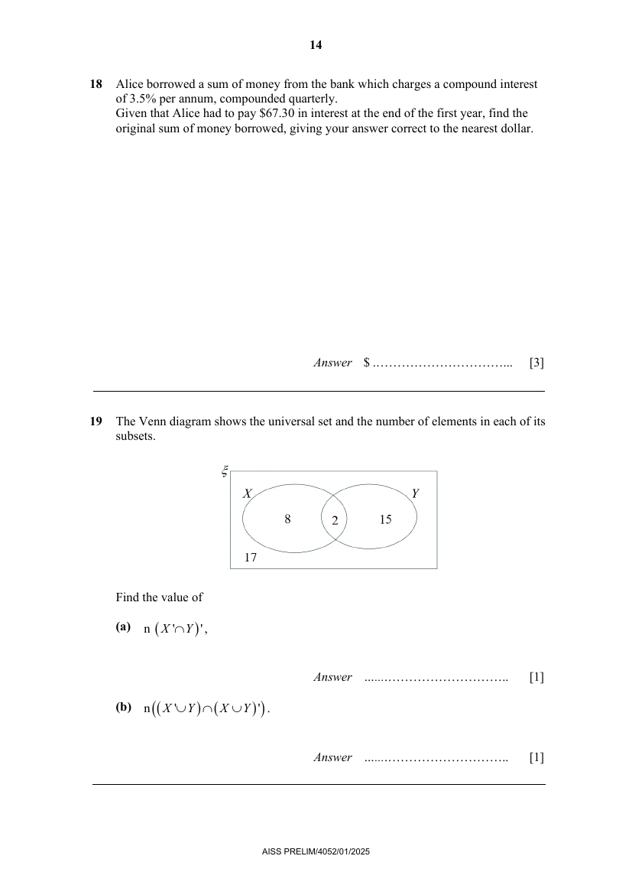

# Ahmad Ibrahim Secondary School — Mathematics 4052/01 Paper 1 (cleaned)

> **Institution:** Ahmad Ibrahim Secondary School
> **Exam:** GCE O-Level Preliminary Examination 2025
> **Level:** Secondary 4 Express / 5 Normal Academic
> **Subjects:** Mathematics
> **Paper:** 4052/01 Paper 1
> **Date:** 05 August 2025
> **Duration:** 2 hours 15 minutes
> **Total Marks:** 90
> **Source:** `AISS Prelim EMath Paper 1 QP.pdf` (cleaned & reformatted)

---

## Instructions

Candidates answer on the Question Paper.

Write your name, class and index number on all the work you hand in.
Write in dark blue or black pen.
You may use an HB pencil for any diagrams or graphs.
Do not use staples, paper clips, glue or correction fluid.

Answer all questions.
If working is needed for any questions it must be shown with the answer.
Omission of essential working will result in loss of marks.
The use of an approved scientific calculator is expected, where appropriate.
If the degree of accuracy is not specified in the question, and if the answer is not exact, give the answer to three significant figures. Give answers in degrees to one decimal place.
For $\pi$, use either your calculator value or $3.142$, unless the question requires the answer in terms of $\pi$.

At the end of the examination, fasten all your work securely together.
The number of marks is given in brackets [ ] at the end of each question or part question.
The total number of marks for this paper is 90.

---

## Mathematical Formulae

*Compound interest*

$$
\text{Total amount} = P\left(1+\frac{r}{100}\right)^{n}
$$

*Mensuration*

$$
\text{Curved surface area of a cone} = \pi rl
$$

$$
\text{Surface area of a sphere} = 4\pi r^{2}
$$

$$
\text{Volume of a cone} = \frac{1}{3}\pi r^{2}h
$$

$$
\text{Volume of a sphere} = \frac{4}{3}\pi r^{3}
$$

$$
\text{Area of triangle } ABC = \frac{1}{2}ab\sin C
$$

$$
\text{Arc length} = r\theta,\text{ where }\theta\text{ is in radians}
$$

$$
\text{Sector area} = \frac{1}{2}r^{2}\theta,\text{ where }\theta\text{ is in radians}
$$

*Trigonometry*

$$
\frac{a}{\sin A} = \frac{b}{\sin B} = \frac{c}{\sin C}
$$

$$
a^{2} = b^{2}+c^{2}-2bc\cos A
$$

*Statistics*

$$
\text{Mean} = \frac{\sum fx}{\sum f}
$$

$$
\text{Standard deviation} = \sqrt{\frac{\sum fx^{2}}{\sum f}-\left(\frac{\sum fx}{\sum f}\right)^{2}}
$$

---

## Answer all the questions

---

### Q1

> **Marks:** 2
> **Topic:** N5 Algebraic expressions and formulae
> **Sub-topic:** Algebraic expressions and formulae
> **LO:** [[context/subjects/o-level-e-maths/learning-objectives/o-level-e-maths-N5j.md|N5j]]
> **Page:** 3

Expand $(2p+5q)(3p^{2}-q+5r)$. [2]

---

### Q2

> **Marks:** 3
> **Topic:** N2 Ratio and proportion
> **Sub-topic:** Ratio and proportion
> **LO:** [[context/subjects/o-level-e-maths/learning-objectives/o-level-e-maths-N2a.md|N2a]]
> **Page:** 3

Lee has two pieces of string.
Their lengths are in the ratio $5:3$ and the total length of the two pieces of string is $8x$ cm.
Lee cuts $6$ cm from each piece of string.
The ratio of their lengths is now $9:5$.
Find the value of $x$. [3]

---

### Q3

> **Marks:** (a) 1, (b) 2; total 3
> **Page:** 3

A salesperson earns a fixed weekly salary of &#36;1000 plus $8\%$ commission on the total value of items he sells.

**(a)** In one week, he sold items worth &#36;1750.
Calculate the total amount the salesperson earned that week. [1]
> **Topic:** N3 Percentage
> **Sub-topic:** Percentage
> **LO:** [[context/subjects/o-level-e-maths/learning-objectives/o-level-e-maths-N3d.md|N3d]]

**(b)** The following week, the salesperson earned a total of &#36;1450.
Calculate the total value of items he sold that week. [2]
> **Topic:** N3 Percentage
> **Sub-topic:** Percentage
> **LO:** [[context/subjects/o-level-e-maths/learning-objectives/o-level-e-maths-N3d.md|N3d]]

---

### Q4

> **Marks:** (a) 1, (b) 1, (c) 1; total 3
> **Page:** 4

The box-and-whisker-plot gives information about the time, in hours, that 120 adults spent on social media in one week.

**(a)** State the median time. [1]
> **Topic:** S1 Data handling and analysis
> **Sub-topic:** Data handling and analysis
> **LO:** [[context/subjects/o-level-e-maths/learning-objectives/o-level-e-maths-S1f.md|S1f]]

**(b)** State the range. [1]
> **Topic:** S1 Data handling and analysis
> **Sub-topic:** Data handling and analysis
> **LO:** [[context/subjects/o-level-e-maths/learning-objectives/o-level-e-maths-S1f.md|S1f]]

**(c)** There was an error in the collection of data.
Every adult spent 2 hours less on social media in one week.
Describe the effect this change would have on the box-and-whisker plot. [1]
> **Topic:** S1 Data handling and analysis
> **Sub-topic:** Data handling and analysis
> **LO:** [[context/subjects/o-level-e-maths/learning-objectives/o-level-e-maths-S1f.md|S1f]]

---

### Q5

> **Marks:** 3
> **Topic:** N6 Functions and graphs
> **Sub-topic:** Functions and graphs
> **LO:** [[context/subjects/o-level-e-maths/learning-objectives/o-level-e-maths-N6c.md|N6c]]
> **Page:** 5

Sketch the graph of $y=-(x-8)(x+3)$ on the axes below.
Indicate clearly the values where the graph crosses the $x$- and $y$-axes and its turning point. [3]

---

### Q6

> **Marks:** 2
> **Topic:** N7 Equations and inequalities
> **Sub-topic:** Equations and inequalities
> **LO:** [[context/subjects/o-level-e-maths/learning-objectives/o-level-e-maths-N7b.md|N7b]]
> **Page:** 5

Express as a single fraction in its simplest form $\dfrac{4}{3-2y}-\dfrac{5}{y+3}$. [2]

---

### Q7

> **Marks:** (a) 2, (b) 2; total 4
> **Page:** 6

**(a)** A map has a scale of $1:2500000$.
The distance between Singapore and Phuket is $1314$ km.
Calculate the distance, in centimetres, between Singapore and Phuket on the map. [2]
> **Topic:** N2 Ratio and proportion
> **Sub-topic:** Ratio and proportion
> **LO:** [[context/subjects/o-level-e-maths/learning-objectives/o-level-e-maths-N2c.md|N2c]]

**(b)** When a ball is dropped, the distance, $d$ metres, it falls is directly proportional to the square of the time, $t$ seconds, from when the ball is released.
The distance from which the ball is dropped is increased by $44\%$.
Calculate the percentage change in the time taken for the ball to reach the ground. [2]
> **Topic:** N2 Ratio and proportion
> **Sub-topic:** Ratio and proportion
> **LO:** [[context/subjects/o-level-e-maths/learning-objectives/o-level-e-maths-N2c.md|N2c]]

---

### Q8

> **Marks:** 3
> **Topic:** N7 Equations and inequalities
> **Sub-topic:** Equations and inequalities
> **LO:** [[context/subjects/o-level-e-maths/learning-objectives/o-level-e-maths-N7b.md|N7b]]
> **Page:** 6

Simplify $\dfrac{x^{2}-9}{3x^{2}-9x}$. [3]

---

### Q9

> **Marks:** 3
> **Topic:** N5 Algebraic expressions and formulae
> **Sub-topic:** Algebraic expressions and formulae
> **LO:** [[context/subjects/o-level-e-maths/learning-objectives/o-level-e-maths-N5h.md|N5h]]
> **Page:** 7

Factorise $6x^{2}y^{2}+xy-3x^{2}y-2xy^{2}$. [3]

---

### Q10

> **Marks:** 2
> **Topic:** S1 Data handling and analysis
> **Sub-topic:** Data handling and analysis
> **LO:** [[context/subjects/o-level-e-maths/learning-objectives/o-level-e-maths-S1f.md|S1f]]
> **Page:** 7

Five positive integers have a mean of $6$, a median of $7$ and a mode of $10$.
Find the five numbers. [2]

---

### Q11

> **Marks:** 2
> **Topic:** G5 Mensuration
> **Sub-topic:** Mensuration
> **LO:** [[context/subjects/o-level-e-maths/learning-objectives/o-level-e-maths-G5b.md|G5b]]
> **Page:** 8

Calculate the perimeter of the shaded area.
All lengths are in centimetres. [2]

---

### Q12

> **Marks:** (a) 2, (b) 2; total 4
> **Page:** 9

$X$, $Y$ and $Z$ are three points on horizontal ground.
Angle $ZXY=35^{\circ}$, angle $XYZ=90^{\circ}$ and $XZ=20$ cm.

**(a)** Calculate the distance $YZ$. [2]
> **Topic:** G4 Pythagoras' theorem and trigonometry
> **Sub-topic:** Pythagoras' theorem and trigonometry
> **LO:** [[context/subjects/o-level-e-maths/learning-objectives/o-level-e-maths-G4e.md|G4e]]

**(b)** Calculate the area of triangle $XYZ$. [2]
> **Topic:** G4 Pythagoras' theorem and trigonometry
> **Sub-topic:** Pythagoras' theorem and trigonometry
> **LO:** [[context/subjects/o-level-e-maths/learning-objectives/o-level-e-maths-G4e.md|G4e]]

---

### Q13

> **Marks:** (a) 2, (b) 2; total 4
> **Page:** 10

A group of 200 people estimated the time, $t$ minutes, they spent at an exhibition.
The cumulative frequency diagram represents their estimates.

**(a)** Use the diagram to find the estimated interquartile range of the estimated times. [2]
> **Topic:** S1 Data handling and analysis
> **Sub-topic:** Data handling and analysis
> **LO:** [[context/subjects/o-level-e-maths/learning-objectives/o-level-e-maths-S1i.md|S1i]]

**(b)** One of these people is chosen at random.
The probability that the person's estimate is greater than $t$ minutes is $\dfrac{4}{5}$.
Find the value of $t$. [2]
> **Topic:** S2 Probability
> **Sub-topic:** Probability
> **LO:** [[context/subjects/o-level-e-maths/learning-objectives/o-level-e-maths-S2c.md|S2c]]

---

### Q14

> **Marks:** (a) 1, (b) 3; total 4
> **Page:** 11

$$
n=\frac{m(x-y^{2})}{p},\text{ where }p\neq 0.
$$

**(a)** Find $n$ when $m=14$, $p=9$, $x=2$ and $y=-3$. [1]
> **Topic:** N5 Algebraic expressions and formulae
> **Sub-topic:** Algebraic expressions and formulae
> **LO:** [[context/subjects/o-level-e-maths/learning-objectives/o-level-e-maths-N5l.md|N5l]]

**(b)** Rearrange the formula to make $y$ the subject. [3]
> **Topic:** N5 Algebraic expressions and formulae
> **Sub-topic:** Algebraic expressions and formulae
> **LO:** [[context/subjects/o-level-e-maths/learning-objectives/o-level-e-maths-N5k.md|N5k]]

---

### Q15

> **Marks:** (a) 2, (b) 2; total 4
> **Page:** 12

$A$, $B$ and $C$ are points on a circle, centre $O$.
$ACD$ is a straight line, angle $BDC=26^{\circ}$ and angle $BAO=42^{\circ}$.

**(a)** Find angle $OBC$.
Give a reason for each step of your working. [2]
> **Topic:** G3 Properties of circles
> **Sub-topic:** Properties of circles
> **LO:** [[context/subjects/o-level-e-maths/learning-objectives/o-level-e-maths-G3b.md|G3b]]

**(b)** Explain why $BD$ is not a tangent to the circle. [2]
> **Topic:** G3 Properties of circles
> **Sub-topic:** Properties of circles
> **LO:** [[context/subjects/o-level-e-maths/learning-objectives/o-level-e-maths-G3b.md|G3b]]

---

### Q16

> **Marks:** 3
> **Topic:** N7 Equations and inequalities
> **Sub-topic:** Equations and inequalities
> **LO:** [[context/subjects/o-level-e-maths/learning-objectives/o-level-e-maths-N7c.md|N7c]]
> **Page:** 13

Solve these simultaneous equations.

$$
3x+5y+8=0
$$

$$
4x+13y-2=0
$$

You must show your working. [3]

---

### Q17

> **Marks:** 3
> **Topic:** G1 Angles, triangles and polygons
> **Sub-topic:** Angles, triangles and polygons
> **LO:** [[context/subjects/o-level-e-maths/learning-objectives/o-level-e-maths-G1f.md|G1f]]
> **Page:** 13

$ABCD$ is a trapezium.
The ratio angle $CDA$ : angle $DCB$ : angle $CBA$ $= 18:6:2$.
Find angle $DAB$. [3]

---

### Q18

> **Marks:** 3
> **Topic:** N3 Percentage
> **Sub-topic:** Percentage
> **LO:** [[context/subjects/o-level-e-maths/learning-objectives/o-level-e-maths-N3d.md|N3d]]
> **Page:** 14

Alice borrowed a sum of money from the bank which charges a compound interest of $3.5\%$ per annum, compounded quarterly.
Given that Alice had to pay &#36;67.30 in interest at the end of the first year, find the original sum of money borrowed, giving your answer correct to the nearest dollar. [3]

---

### Q19

> **Marks:** (a) 1, (b) 1; total 2
> **Page:** 14

The Venn diagram shows the universal set and the number of elements in each of its subsets.

Find the value of

**(a)** $\mathrm{n}\left((X'\cap Y)'\right)$, [1]
> **Topic:** N8 Set language and notation
> **Sub-topic:** Set language and notation
> **LO:** [[context/subjects/o-level-e-maths/learning-objectives/o-level-e-maths-N8c.md|N8c]]

**(b)** $\mathrm{n}\left((X'\cup Y)\cap(X\cup Y)'\right)$. [1]
> **Topic:** N8 Set language and notation
> **Sub-topic:** Set language and notation
> **LO:** [[context/subjects/o-level-e-maths/learning-objectives/o-level-e-maths-N8c.md|N8c]]

---

### Q20

> **Marks:** (a) 1, (b) 1, (c) 1; total 3
> **Page:** 15

**(a)** Write $0.0000000357$ in standard form. [1]
> **Topic:** N1 Numbers and their operations
> **Sub-topic:** Numbers and their operations
> **LO:** [[context/subjects/o-level-e-maths/learning-objectives/o-level-e-maths-N1h.md|N1h]]

**(b)** Write $5.7\times 10^{97}$ in the form $A\times 10^{98}$. [1]
> **Topic:** N1 Numbers and their operations
> **Sub-topic:** Numbers and their operations
> **LO:** [[context/subjects/o-level-e-maths/learning-objectives/o-level-e-maths-N1h.md|N1h]]

**(c)** Hence work out $(100.2\times 10^{98})-(5.7\times 10^{97})$.
Give your answer in standard form. [1]
> **Topic:** N1 Numbers and their operations
> **Sub-topic:** Numbers and their operations
> **LO:** [[context/subjects/o-level-e-maths/learning-objectives/o-level-e-maths-N1h.md|N1h]]

---

### Q21

> **Marks:** 2
> **Topic:** N1 Numbers and their operations
> **Sub-topic:** Numbers and their operations
> **LO:** [[context/subjects/o-level-e-maths/learning-objectives/o-level-e-maths-N1e.md|N1e]]
> **Page:** 15

$x$ is a number between $200$ and $300$.
The highest common factor of $x$ and $126$ is $21$.
Find the smallest possible value of $x$. [2]

---

### Q22

> **Marks:** 2
> **Topic:** G4 Pythagoras' theorem and trigonometry
> **Sub-topic:** Pythagoras' theorem and trigonometry
> **LO:** [[context/subjects/o-level-e-maths/learning-objectives/o-level-e-maths-G4c.md|G4c]]
> **Page:** 15

$$
\sin\left(\frac{1}{2}x^{\circ}\right)=0.961
$$

Find two possible values of $x$ in the range $0\leq x\leq 360$. [2]

---

### Q23

> **Marks:** (a) 3, (b) 2; total 5
> **Page:** 16

$$
12\quad 24\quad 8\quad 21\quad 28\quad 17\quad 2p\quad 4p^{2}
$$

The list shows information about the number of text messages Mei received each day for 8 days.
The total number of text messages is $140$.

**(a)** Show that $p=2.5$. [3]
> **Topic:** S1 Data handling and analysis
> **Sub-topic:** Data handling and analysis
> **LO:** [[context/subjects/o-level-e-maths/learning-objectives/o-level-e-maths-S1f.md|S1f]]

**(b)** The standard deviation for Mei's data is $7.89$.

For the same 8 days, Mei's brother also received some text messages.
For his data, the mean is $19$ and the standard deviation $8.51$.

Make two comparisons between the distributions for the number of text messages received by Mei and her brother. [2]
> **Topic:** S1 Data handling and analysis
> **Sub-topic:** Data handling and analysis
> **LO:** [[context/subjects/o-level-e-maths/learning-objectives/o-level-e-maths-S1f.md|S1f]]

---

### Q24

> **Marks:** (a) 4, (b) 2; total 6
> **Page:** 17

The right-angled triangle has sides $(x+1)$, $(x+3)$ and $y$ where $x$ and $y$ are integers.

**(a)** Show that $y$ is an even number. [4]
> **Topic:** G4 Pythagoras' theorem and trigonometry
> **Sub-topic:** Pythagoras' theorem and trigonometry
> **LO:** [[context/subjects/o-level-e-maths/learning-objectives/o-level-e-maths-G4c.md|G4c]]

**(b)** Find a possible value of $y$ and the corresponding value of $x$. [2]
> **Topic:** G4 Pythagoras' theorem and trigonometry
> **Sub-topic:** Pythagoras' theorem and trigonometry
> **LO:** [[context/subjects/o-level-e-maths/learning-objectives/o-level-e-maths-G4c.md|G4c]]

---

### Q25

> **Marks:** 3
> **Topic:** N1 Numbers and their operations
> **Sub-topic:** Numbers and their operations
> **LO:** [[context/subjects/o-level-e-maths/learning-objectives/o-level-e-maths-N1g.md|N1g]]
> **Page:** 18

Solve the equation $a^{2}+17a-30=0$ by completing the square.
Give your solutions correct to 2 decimal places. [3]

---

### Q26

> **Marks:** (a) 2, (b) 4; total 6
> **Page:** 19

A glass in the shape of a cone on a stem is filled to the brim with water.
The diameter of the top of the glass is $11$ cm.
The height of the cone is $8$ cm.
The thickness of the glass is negligible.

**(a)** Calculate the curved surface area of the inside of the glass. [2]
> **Topic:** G5 Mensuration
> **Sub-topic:** Mensuration
> **LO:** [[context/subjects/o-level-e-maths/learning-objectives/o-level-e-maths-G5c.md|G5c]]

**(b)** Ethan pours $40\%$ of the water in this glass into a second glass.
The second glass is in the shape of a cylinder.
The depth of water in the cylindrical glass is $2.5$ cm.
Calculate the diameter of the cylindrical glass. [4]
> **Topic:** G5 Mensuration
> **Sub-topic:** Mensuration
> **LO:** [[context/subjects/o-level-e-maths/learning-objectives/o-level-e-maths-G5c.md|G5c]]

---

### Q27

> **Marks:** (a) 2, (b) 2, (c) 2; total 6
> **Page:** 20

$OAC$ is a triangle and $B$ is a point on $OC$.
$\overrightarrow{OA}=\mathbf{a}$, $\overrightarrow{OB}=\mathbf{b}$ and $OB:BC=2:3$.
$X$ is the point on $AB$ such that $AX:XB=1:2$.

**(a)** Express $\overrightarrow{AC}$ in terms of $\mathbf{a}$ and $\mathbf{b}$, as simply as possible. [2]
> **Topic:** G7 Vectors in two dimensions
> **Sub-topic:** Vectors in two dimensions
> **LO:** [[context/subjects/o-level-e-maths/learning-objectives/o-level-e-maths-G7h.md|G7h]]

**(b)** Express $\overrightarrow{XB}$ in terms of $\mathbf{a}$ and $\mathbf{b}$, as simply as possible. [2]
> **Topic:** G7 Vectors in two dimensions
> **Sub-topic:** Vectors in two dimensions
> **LO:** [[context/subjects/o-level-e-maths/learning-objectives/o-level-e-maths-G7h.md|G7h]]

**(c)** $Y$ is the point on $OC$ such that $AXYC$ is a trapezium.
Find, in terms of $\mathbf{a}$ and $\mathbf{b}$, $\overrightarrow{XY}$. [2]
> **Topic:** G7 Vectors in two dimensions
> **Sub-topic:** Vectors in two dimensions
> **LO:** [[context/subjects/o-level-e-maths/learning-objectives/o-level-e-maths-G7h.md|G7h]]

---

**END OF PAPER**

Setter: Low SG
