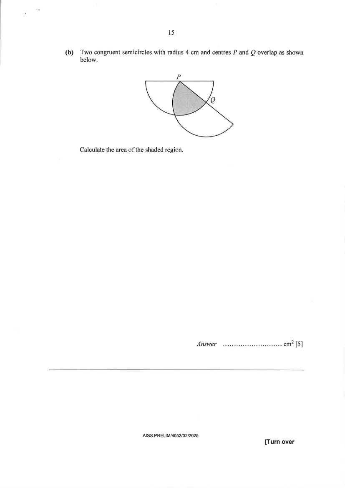
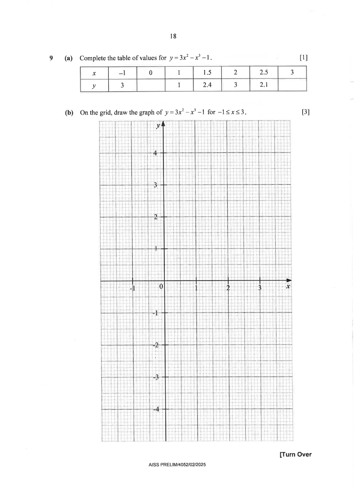

# Ahmad Ibrahim Secondary School — Mathematics 4052/02 Paper 2 (cleaned)

> **Institution:** Ahmad Ibrahim Secondary School
> **Exam:** GCE O-Level Preliminary Examination 2025
> **Level:** Secondary 4 Express / 5 Normal Academic
> **Subjects:** Mathematics
> **Paper:** 4052/02 Paper 2
> **Date:** 7 August 2025
> **Duration:** 2 hours 15 minutes
> **Total Marks:** 90
> **Source:** `AISS Prelim EMath Paper 2 QP.pdf` (scanned — transcribed from page images)

---

## Instructions

Candidates answer on the Question Paper.

Write your name, class and index number on all the work you hand in.
Write in dark blue or black pen.
You may use an HB pencil for any diagrams or graphs.
Do not use staples, paper clips, glue or correction fluid.

Answer all questions.
If working is needed for any questions it must be shown with the answer.
Omission of essential working will result in loss of marks.
The use of an approved scientific calculator is expected, where appropriate.
If the degree of accuracy is not specified in the question, and if the answer is not exact, give the answer to three significant figures. Give answers in degrees to one decimal place.
For $\pi$, use either your calculator value or $3.142$, unless the question requires the answer in terms of $\pi$.

At the end of the examination, fasten all your work securely together.
The number of marks is given in brackets [ ] at the end of each question or part question.
The total number of marks for this paper is 90.

---

## Mathematical Formulae

*Compound interest*

$$
\text{Total amount} = P\left(1+\frac{r}{100}\right)^{n}
$$

*Mensuration*

$$
\text{Curved surface area of a cone} = \pi rl
$$

$$
\text{Surface area of a sphere} = 4\pi r^{2}
$$

$$
\text{Volume of a cone} = \frac{1}{3}\pi r^{2}h
$$

$$
\text{Volume of a sphere} = \frac{4}{3}\pi r^{3}
$$

$$
\text{Area of triangle } ABC = \frac{1}{2}ab\sin C
$$

$$
\text{Arc length} = r\theta,\text{ where }\theta\text{ is in radians}
$$

$$
\text{Sector area} = \frac{1}{2}r^{2}\theta,\text{ where }\theta\text{ is in radians}
$$

*Trigonometry*

$$
\frac{a}{\sin A} = \frac{b}{\sin B} = \frac{c}{\sin C}
$$

$$
a^{2} = b^{2}+c^{2}-2bc\cos A
$$

*Statistics*

$$
\text{Mean} = \frac{\sum fx}{\sum f}
$$

$$
\text{Standard deviation} = \sqrt{\frac{\sum fx^{2}}{\sum f}-\left(\frac{\sum fx}{\sum f}\right)^{2}}
$$

---

## Answer all the questions

---

### Q1

> **Marks:** (a) 3, (b) 3, (c) 2, (d) 3; total 11
> **Page:** 3–4

**(a)** Find all the prime numbers that will satisfy the inequality $-5\leq 2x-1<x+3$. [3]
> **Topic:** N7 Equations and inequalities
> **Sub-topic:** Equations and inequalities
> **LO:** [[context/subjects/o-level-e-maths/learning-objectives/o-level-e-maths-N7g.md|N7g]]

**(b)** Simplify $\dfrac{30x^{2}y^{2}}{11z}\div\dfrac{25xz^{3}}{22y}$. [3]
> **Topic:** N7 Equations and inequalities
> **Sub-topic:** Equations and inequalities
> **LO:** [[context/subjects/o-level-e-maths/learning-objectives/o-level-e-maths-N7g.md|N7g]]

**(c)** Simplify $\left(\dfrac{p^{12}}{81q^{16}}\right)^{-\dfrac{3}{4}}$. [2]
> **Topic:** N7 Equations and inequalities
> **Sub-topic:** Equations and inequalities
> **LO:** [[context/subjects/o-level-e-maths/learning-objectives/o-level-e-maths-N7g.md|N7g]]

**(d)** Solve $\dfrac{x}{x-1}+2=\dfrac{4}{2-x}$. [3]
> **Topic:** N7 Equations and inequalities
> **Sub-topic:** Equations and inequalities
> **LO:** [[context/subjects/o-level-e-maths/learning-objectives/o-level-e-maths-N7g.md|N7g]]

---

### Q2

> **Marks:** (a)(i) 1, (a)(ii) 2, (b) 3; total 6
> **Page:** 5

**(a)** The position vector of $A$ is $\begin{pmatrix}-1\\ 4\end{pmatrix}$.

$$
\overrightarrow{AB}=\begin{pmatrix}-3\\ 5\end{pmatrix}.
$$

**(i)** Find the coordinates of $B$. [1]
> **Topic:** G7 Vectors in two dimensions
> **Sub-topic:** Vectors in two dimensions
> **LO:** [[context/subjects/o-level-e-maths/learning-objectives/o-level-e-maths-G7h.md|G7h]]

**(ii)** Find the equation of line $AB$. [2]
> **Topic:** G7 Vectors in two dimensions
> **Sub-topic:** Vectors in two dimensions
> **LO:** [[context/subjects/o-level-e-maths/learning-objectives/o-level-e-maths-G7h.md|G7h]]

**(b)** $C$ is the point $(-2,\ 5)$.
$D$ is a point that lies on the line $x=3$.
The length of $CD$ is $13$ units.
Find the two possible pairs of coordinates of $D$. [3]
> **Topic:** G7 Vectors in two dimensions
> **Sub-topic:** Vectors in two dimensions
> **LO:** [[context/subjects/o-level-e-maths/learning-objectives/o-level-e-maths-G7h.md|G7h]]

---

### Q3

> **Marks:** (a) 3, (b) 1, (c) 3, (d) 3; total 10
> **Page:** 6–7

Points $A$, $B$, $C$ and $D$ are on horizontal ground.
$AB=37$ m, $BC=50$ m, $AC=62$ m and $CD=73$ m.
Angle $ADC=52^{\circ}$.

$A$ is due west of $C$.

**(a)** Find angle $ABC$. [3]
> **Topic:** G4 Pythagoras' theorem and trigonometry
> **Sub-topic:** Pythagoras' theorem and trigonometry
> **LO:** [[context/subjects/o-level-e-maths/learning-objectives/o-level-e-maths-G4g.md|G4g]]

**(b)** The bearing of $E$ from $C$ is $124^{\circ}$.
Find the bearing of $C$ from $E$. [1]
> **Topic:** G4 Pythagoras' theorem and trigonometry
> **Sub-topic:** Pythagoras' theorem and trigonometry
> **LO:** [[context/subjects/o-level-e-maths/learning-objectives/o-level-e-maths-G4g.md|G4g]]

**(c)** Find the bearing of $D$ from $A$. [3]
> **Topic:** G4 Pythagoras' theorem and trigonometry
> **Sub-topic:** Pythagoras' theorem and trigonometry
> **LO:** [[context/subjects/o-level-e-maths/learning-objectives/o-level-e-maths-G4g.md|G4g]]

**(d)** Point $C$ is the base of a vertical flagpole $CF$.
The angle of elevation of $F$ from $B$ is $8^{\circ}$.

Calculate the angle of elevation of $F$ from $D$. [3]
> **Topic:** G4 Pythagoras' theorem and trigonometry
> **Sub-topic:** Pythagoras' theorem and trigonometry
> **LO:** [[context/subjects/o-level-e-maths/learning-objectives/o-level-e-maths-G4g.md|G4g]]

---

### Q4

> **Marks:** (a) 3, (b) 3, (c) 1, (d) 1, (e) 3; total 11
> **Page:** 8–9

Jennie travels from Town $A$ to Town $B$ at a speed of $x$ km/h.
The journey takes $1$ hour.
She then spends $30$ minutes having her lunch in Town $B$, before setting off to Town $C$, which takes $x$ minutes at $(x-20)$ km/h.

The total distance of the journey is $120$ km.

**(a)** Show that $x^{2}+40x-7200=0$. [3]
> **Topic:** N4 Rate and speed
> **Sub-topic:** Rate and speed
> **LO:** [[context/subjects/o-level-e-maths/learning-objectives/o-level-e-maths-N4a.md|N4a]]

**(b)** Solve the equation $x^{2}+40x-7200=0$.
Give your solutions correct to $2$ decimal places. [3]
> **Topic:** N4 Rate and speed
> **Sub-topic:** Rate and speed
> **LO:** [[context/subjects/o-level-e-maths/learning-objectives/o-level-e-maths-N4a.md|N4a]]

**(c)** Explain why one of the solutions in part (b) must be rejected. [1]
> **Topic:** N4 Rate and speed
> **Sub-topic:** Rate and speed
> **LO:** [[context/subjects/o-level-e-maths/learning-objectives/o-level-e-maths-N4a.md|N4a]]

**(d)** Calculate the difference between the times Jennie spent driving from Town $A$ to Town $B$ and from Town $B$ to Town $C$.
Give your answer in minutes and seconds, correct to the nearest second. [1]
> **Topic:** N4 Rate and speed
> **Sub-topic:** Rate and speed
> **LO:** [[context/subjects/o-level-e-maths/learning-objectives/o-level-e-maths-N4a.md|N4a]]

**(e)** Calculate Jennie's average speed for the entire journey. [3]
> **Topic:** N4 Rate and speed
> **Sub-topic:** Rate and speed
> **LO:** [[context/subjects/o-level-e-maths/learning-objectives/o-level-e-maths-N4a.md|N4a]]

---

### Q5

> **Marks:** (a)(i) 1, (a)(ii) 1, (a)(iii) 1, (a)(iv) 1, (a)(v) 1, (b)(i) 1, (b)(ii) 2, (b)(iii) 3; total 11
> **Page:** 10–12

**(a)** There are $25$ students in a class.
The table shows the distribution of the heights of these students.

| Height ($x$ cm) | Frequency |
| --- | --- |
| $140<x\leq 150$ | $3$ |
| $150<x\leq 160$ | $10$ |
| $160<x\leq 170$ | $7$ |
| $170<x\leq 180$ | $4$ |
| $180<x\leq 190$ | $1$ |

**(i)** Find the interval that contains the median height. [1]
> **Topic:** S2 Probability
> **Sub-topic:** Probability
> **LO:** [[context/subjects/o-level-e-maths/learning-objectives/o-level-e-maths-S2a.md|S2a]]

**(ii)** Calculate an estimate of the mean height. [1]
> **Topic:** S2 Probability
> **Sub-topic:** Probability
> **LO:** [[context/subjects/o-level-e-maths/learning-objectives/o-level-e-maths-S2a.md|S2a]]

**(iii)** State an estimate of the standard deviation of the heights. [1]
> **Topic:** S2 Probability
> **Sub-topic:** Probability
> **LO:** [[context/subjects/o-level-e-maths/learning-objectives/o-level-e-maths-S2a.md|S2a]]

**(iv)** Explain why the mean height and standard deviations in part (ii) and part (iii) are estimates. [1]
> **Topic:** S2 Probability
> **Sub-topic:** Probability
> **LO:** [[context/subjects/o-level-e-maths/learning-objectives/o-level-e-maths-S2a.md|S2a]]

**(v)** Five students have transferred out of the class.
The estimated mean height of the students in the class is now $163$ cm.

Explain what this tells you about the mean heights of the five students who transferred out. [1]
> **Topic:** S2 Probability
> **Sub-topic:** Probability
> **LO:** [[context/subjects/o-level-e-maths/learning-objectives/o-level-e-maths-S2a.md|S2a]]

**(b)** A bag contains $5$ red, $7$ blue and $3$ yellow identical balls.

**(i)** One ball is selected at random.
Find the probability that it is a yellow ball. [1]
> **Topic:** S2 Probability
> **Sub-topic:** Probability
> **LO:** [[context/subjects/o-level-e-maths/learning-objectives/o-level-e-maths-S2c.md|S2c]]

**(ii)** Two balls are selected at random without replacement.
Find the probability that both balls are of different colours. [2]
> **Topic:** S2 Probability
> **Sub-topic:** Probability
> **LO:** [[context/subjects/o-level-e-maths/learning-objectives/o-level-e-maths-S2c.md|S2c]]

**(iii)** Three balls are selected at random, with replacement.
Find the probability that two red balls and one blue ball are chosen. [3]
> **Topic:** S2 Probability
> **Sub-topic:** Probability
> **LO:** [[context/subjects/o-level-e-maths/learning-objectives/o-level-e-maths-S2c.md|S2c]]

---

### Q6

> **Marks:** (a) 1, (b) 3; total 4
> **Page:** 13

The diagram shows the speed-time graph of a train.

**(a)** Find the acceleration of the train in the first $10$ seconds. [1]
> **Topic:** N6 Functions and graphs
> **Sub-topic:** Functions and graphs
> **LO:** [[context/subjects/o-level-e-maths/learning-objectives/o-level-e-maths-N6c.md|N6c]]

**(b)** Given that the train decelerates at a rate of $2$ m/s$^{2}$, find the total distance travelled by the train. [3]
> **Topic:** N6 Functions and graphs
> **Sub-topic:** Functions and graphs
> **LO:** [[context/subjects/o-level-e-maths/learning-objectives/o-level-e-maths-N6c.md|N6c]]

---

### Q7

> **Marks:** (a)(i) 2, (a)(ii) 2, (b) 5; total 9
> **Page:** 14–15

**(a)** The diagram shows two geometrically similar bottles, containing cooking oil.
The height of the smaller bottle is $15$ cm.
The height of the larger bottle is $25$ cm.

**(i)** The diameter of the base of the larger bottle is $10$ cm.
Calculate the diameter of the base of the smaller bottle. [2]
> **Topic:** G5 Mensuration
> **Sub-topic:** Mensuration
> **LO:** [[context/subjects/o-level-e-maths/learning-objectives/o-level-e-maths-G5a.md|G5a]]

**(ii)** The smaller bottle has a capacity of $400$ ml.
The manufacturer makes another geometrically similar bottle that holds $1.2$ litres.
Calculate the height of this bottle. [2]
> **Topic:** G5 Mensuration
> **Sub-topic:** Mensuration
> **LO:** [[context/subjects/o-level-e-maths/learning-objectives/o-level-e-maths-G5a.md|G5a]]

**(b)** Two congruent semicircles with radius $4$ cm and centres $P$ and $Q$ overlap as shown below.

Calculate the area of the shaded region. [5]
> **Topic:** G5 Mensuration
> **Sub-topic:** Mensuration
> **LO:** [[context/subjects/o-level-e-maths/learning-objectives/o-level-e-maths-G5a.md|G5a]]

---

### Q8

> **Marks:** (a) 1, (b) 1, (c) 2, (d) 1, (e) 4; total 9
> **Page:** 16–17

A bakery makes cakes.
The bakery operates for $6$ days each week.
The matrix, $\mathbf{M}$, shows the number of cakes of different types that are made each day.

$$
\mathbf{M}=\begin{pmatrix} 8 & 5 & 2 \\ 6 & 4 & 3 \end{pmatrix}
\begin{matrix} \text{Chocolate} \\ \text{Blackforest} \end{matrix}
$$

Columns are Small, Medium and Large.

**(a)** Evaluate the matrix $\mathbf{P}=6\mathbf{M}$. [1]
> **Topic:** N9 Matrices
> **Sub-topic:** Matrices
> **LO:** [[context/subjects/o-level-e-maths/learning-objectives/o-level-e-maths-N9b.md|N9b]]

**(b)** Small cakes cost &#36;10 to make.
Medium cakes cost &#36;15 to make.
Large cakes cost &#36;20 to make.
Represent these amounts in a $3\times 1$ matrix $\mathbf{N}$. [1]
> **Topic:** N9 Matrices
> **Sub-topic:** Matrices
> **LO:** [[context/subjects/o-level-e-maths/learning-objectives/o-level-e-maths-N9b.md|N9b]]

**(c)** Evaluate the matrix $\mathbf{T}=\mathbf{PN}$. [2]
> **Topic:** N9 Matrices
> **Sub-topic:** Matrices
> **LO:** [[context/subjects/o-level-e-maths/learning-objectives/o-level-e-maths-N9b.md|N9b]]

**(d)** State what each of the elements of $\mathbf{T}$ represents. [1]
> **Topic:** N9 Matrices
> **Sub-topic:** Matrices
> **LO:** [[context/subjects/o-level-e-maths/learning-objectives/o-level-e-maths-N9b.md|N9b]]

**(e)** The bakery sells each cake for $70\%$ more than it costs to make.
One week they sold $\dfrac{2}{3}$ of each size of the chocolate cakes and $\dfrac{5}{6}$ of each size of the blackforest cakes made that week.
The unsold cakes were given away.

Calculate the total amount of profit the bakery made that week. [4]
> **Topic:** N3 Percentage
> **Sub-topic:** Percentage
> **LO:** [[context/subjects/o-level-e-maths/learning-objectives/o-level-e-maths-N3d.md|N3d]]

---

### Q9

> **Marks:** (a) 1, (b) 3, (c) 2, (d) 3; total 9
> **Page:** 18–19

**(a)** Complete the table of values for $y=3x^{2}-x^{3}-1$. [1]
> **Topic:** G6 Coordinate geometry
> **Sub-topic:** Coordinate geometry
> **LO:** [[context/subjects/o-level-e-maths/learning-objectives/o-level-e-maths-G6c.md|G6c]]

| $x$ | $-1$ | $0$ | $1$ | $1.5$ | $2$ | $2.5$ | $3$ |
| --- | --- | --- | --- | --- | --- | --- | --- |
| $y$ | $3$ |  | $1$ | $2.4$ | $3$ | $2.1$ |  |

**(b)** On the grid, draw the graph of $y=3x^{2}-x^{3}-1$ for $-1\leq x\leq 3$. [3]
> **Topic:** G6 Coordinate geometry
> **Sub-topic:** Coordinate geometry
> **LO:** [[context/subjects/o-level-e-maths/learning-objectives/o-level-e-maths-G6c.md|G6c]]

**(c)** By drawing a tangent, find the gradient of the graph when $x=1$. [2]
> **Topic:** G6 Coordinate geometry
> **Sub-topic:** Coordinate geometry
> **LO:** [[context/subjects/o-level-e-maths/learning-objectives/o-level-e-maths-G6c.md|G6c]]

**(d)** Using your graph, solve $3-x=\dfrac{1}{x^{2}}-\dfrac{1}{x}$. [3]
> **Topic:** G6 Coordinate geometry
> **Sub-topic:** Coordinate geometry
> **LO:** [[context/subjects/o-level-e-maths/learning-objectives/o-level-e-maths-G6c.md|G6c]]

---

### Q10

> **Marks:** (a) 2, (b) 1, (c) 7; total 10
> **Page:** 20–21

A new $52$-level private condominium, with units starting from the first level, has just been launched.

The sale price of a unit depends on the floor area and the level the unit is on.
The price of each similar unit increases by a specific amount per level.
Below is some information of the different types of units available.

| Type of unit | 2-room | 3-room | 4-room | 5-room |
| --- | --- | --- | --- | --- |
| Number of toilets | $1$ | $2$ | $2$ | $2$ |
| Floor area (m$^{2}$) | $40$ | $60$ | $90$ | $110$ |
| Price per square feet (&#36;/feet$^{2}$) | $890$ | $990$ | $1100$ | $1300$ |
| Increase in price per level (&#36;) | $13000$ | $16000$ | $19000$ | $22000$ |

**(a)** Given that $1$ m $= 3.28$ feet, show that the floor area of a $3$-room unit is $646$ square feet, correct to $3$ significant figures. [2]
> **Topic:** N3 Percentage
> **Sub-topic:** Percentage
> **LO:** [[context/subjects/o-level-e-maths/learning-objectives/o-level-e-maths-N3c.md|N3c]]

**(b)** Calculate the sale price of a $3$-room unit on the first level. [1]
> **Topic:** N3 Percentage
> **Sub-topic:** Percentage
> **LO:** [[context/subjects/o-level-e-maths/learning-objectives/o-level-e-maths-N3d.md|N3d]]

Lisa is planning to buy a $3$-room unit.
To purchase the unit, she decides to pay $45\%$ of the price of the unit and take a housing loan from the bank to pay the remaining amount by monthly instalments.
The bank charges a simple interest rate of $3\%$ per year for $25$ years.
Lisa has a gross monthly salary of &#36;7500, and she does not plan to spend more than $30\%$ of her gross monthly salary to pay for the monthly instalment.

**(c)** Suggest the maximum level that Lisa can afford to purchase.
Justify the decisions you make and show your calculations clearly. [7]
> **Topic:** N3 Percentage
> **Sub-topic:** Percentage
> **LO:** [[context/subjects/o-level-e-maths/learning-objectives/o-level-e-maths-N3c.md|N3c]]

---

**End of Paper**

Setter: Miss Melody Ho
