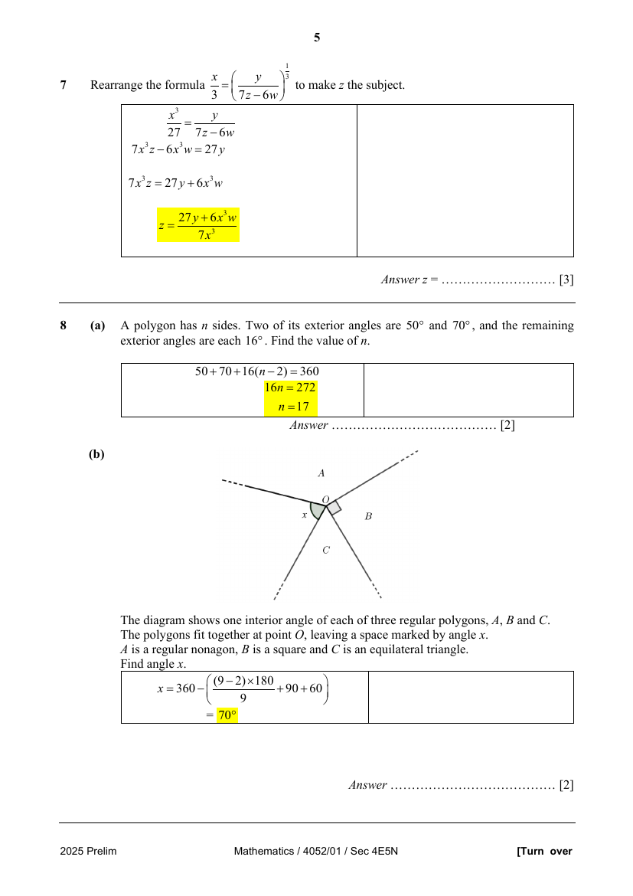
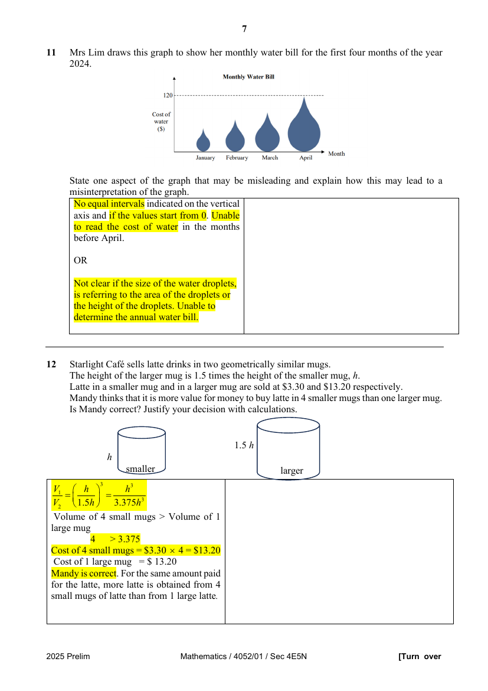
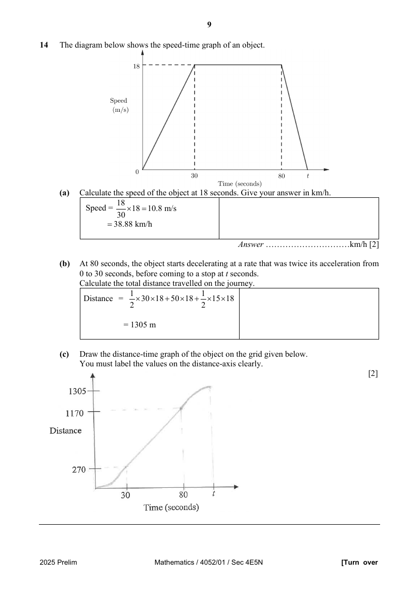
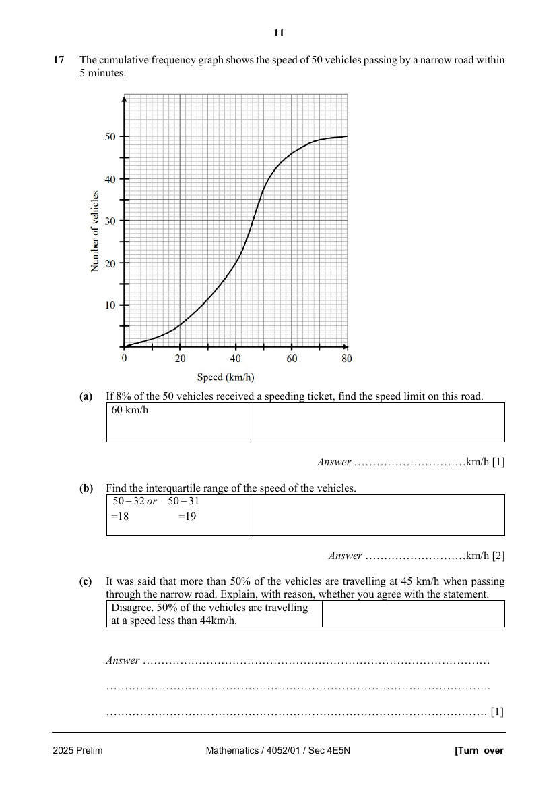
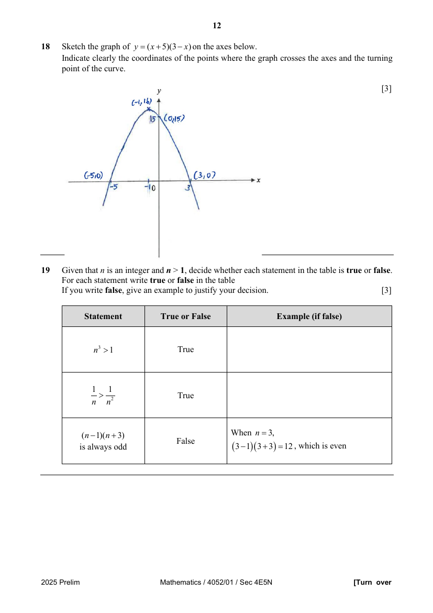
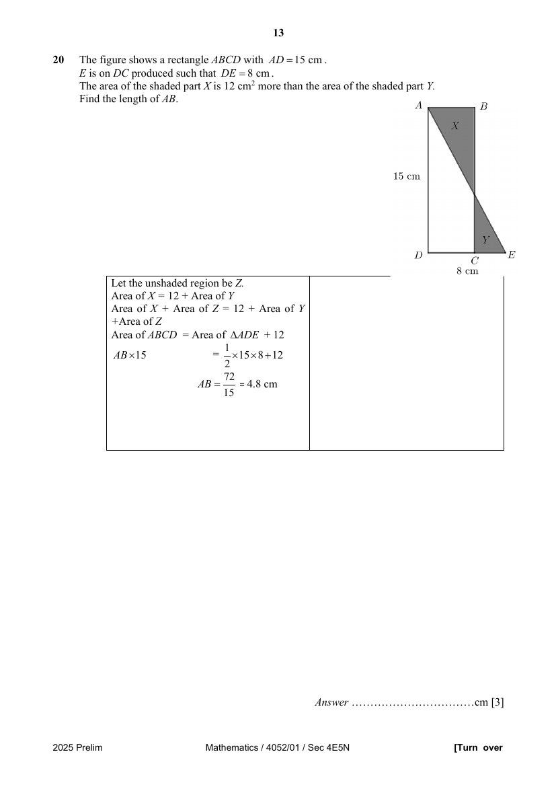
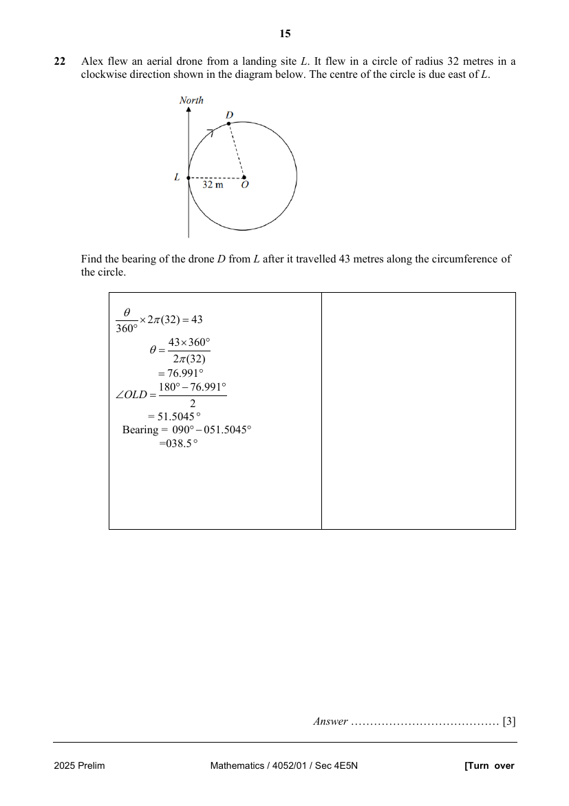
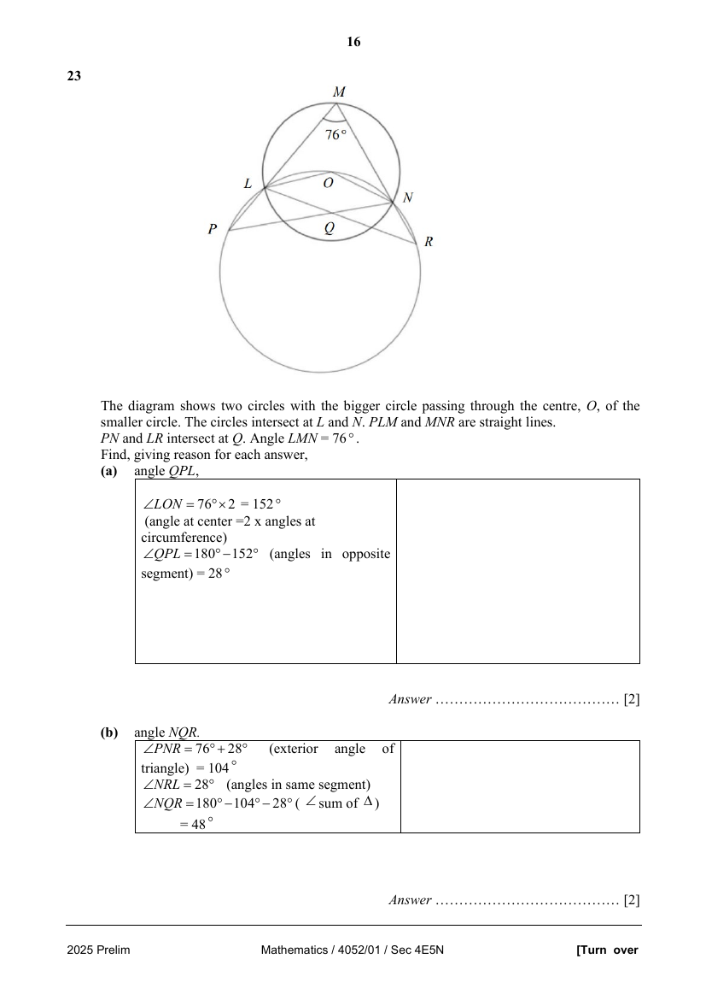
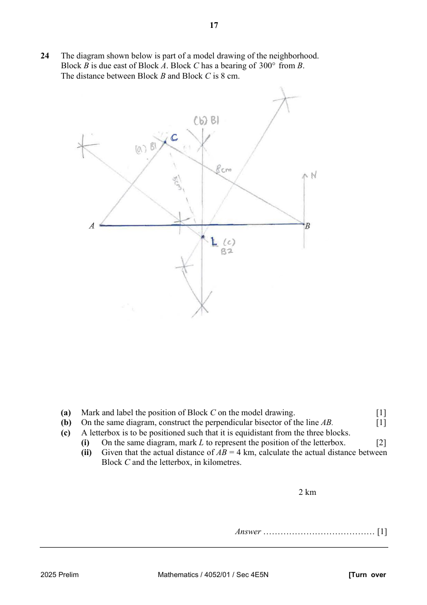
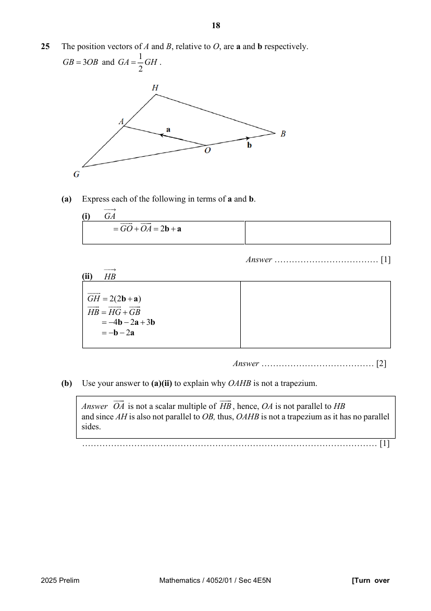

# Chung Cheng High School (Yishun) — Mathematics 4052/01 Paper 1 Solutions (cleaned)

> **Institution:** Chung Cheng High School (Yishun)
> **Exam:** 2025 Preliminary Examination
> **Level:** Secondary Four Express / Five Normal Academic
> **Subjects:** Mathematics
> **Paper:** 4052/01 Paper 1 — Solutions
> **Date:** 18 August 2025
> **Duration:** 2 hours 15 minutes
> **Total Marks:** 90
> **Source:** `2025 CCHY MA 4E5N EM Prelim P1 Sol.pdf` (cleaned & reformatted). There is no separate Paper 1 question paper in this set, so **Page** is this solutions PDF's own physical page.

Up to 2 marks may be deducted for improper presentation (cover grid: presentation deduction $-1$ or $-2$).

---

## Instructions

Candidates answer on the Question Paper.

Write your name, class and index number on the work you hand in.
Write in dark blue or black pen.
You may use an HB pencil for any diagrams or graphs.
Do not use paper clips, glue or correction fluid.

Answer all the questions.
The number of marks is given in brackets [ ] at the end of each question or part question.

If working is needed for any question it must be shown with the answer.
Omission of essential working will result in loss of marks.
You are reminded of the need for clear presentation in your answers. Up to 2 marks may be deducted for improper presentation.

The use of an approved scientific calculator is expected, where appropriate.
If the degree of accuracy is not specified in the question and if the answer is not exact, give the answer to three significant figures. Give answers in degrees to one decimal place.
For $\pi$, use either your calculator value or $3.142$.

---

## Mathematical Formulae

*Compound interest*

$$
\text{Total amount} = P\left(1+\frac{r}{100}\right)^{n}
$$

*Mensuration*

$$
\text{Curved surface area of a cone} = \pi rl
$$

$$
\text{Surface area of a sphere} = 4\pi r^{2}
$$

$$
\text{Volume of a cone} = \frac{1}{3}\pi r^{2}h
$$

$$
\text{Volume of a sphere} = \frac{4}{3}\pi r^{3}
$$

$$
\text{Area of triangle } ABC = \frac{1}{2}ab\sin C
$$

$$
\text{Arc length} = r\theta,\text{ where }\theta\text{ is in radians}
$$

$$
\text{Sector area} = \frac{1}{2}r^{2}\theta,\text{ where }\theta\text{ is in radians}
$$

*Trigonometry*

$$
\frac{a}{\sin A} = \frac{b}{\sin B} = \frac{c}{\sin C}
$$

$$
a^{2} = b^{2}+c^{2}-2bc\cos A
$$

*Statistics*

$$
\text{Mean} = \frac{\sum fx}{\sum f}
$$

$$
\text{Standard deviation} = \sqrt{\frac{\sum fx^{2}}{\sum f}-\left(\frac{\sum fx}{\sum f}\right)^{2}}
$$

---

## Answer all the questions

---

### Q1

> **Marks:** [1]
> **Sub-topic:** Calculator use
> **Page:** 3

Calculate $-\dfrac{9.26}{\sqrt{51.76-2.02^{2}}}$, giving your answer correct to 5 significant figures.

$$
-8.8362
$$

---

### Q2

> **Marks:** (a) [1]; (b) [2]; total [3]
> **Sub-topic:** HCF and LCM
> **Page:** 3

**(a)** Express $252$ as a product of its prime factors.

$$
2^{2}\times 3^{2}\times 7
$$

**(b)** The highest common factor (HCF) of two numbers is $21$. The lowest common multiple (LCM) of the two numbers is $252$. Both numbers are less than $100$. Find the two numbers.

$$
A=3^{2}\times 7,\quad B=2^{2}\times 3\times 7
$$

$$
\text{LCM}=252=2^{2}\times 3^{2}\times 7,\quad \text{HCF}=21=3\times 7
$$

The two numbers are $63$ and $84$.

---

### Q3

> **Marks:** [2]
> **Sub-topic:** Indices
> **Page:** 3

Given that $27^{n}=8\sqrt{9^{6n}}$, find the value of $3^{n}$.

$$
(3^{3})^{n}=8\times(3^{12n})^{\frac{1}{2}}
$$

$$
3^{3n}=8\times 3^{6n}
$$

$$
\frac{1}{8}=3^{6n-3n}
$$

$$
3^{3n}=\frac{1}{8}
$$

$$
3^{n}=\sqrt[3]{\frac{1}{8}}=\frac{1}{2}
$$

---

### Q4

> **Marks:** (a) [1]; (b) [2]; total [3]
> **Sub-topic:** Algebraic simplification
> **Page:** 4

**(a)** Simplify $(4n)^{2}-(4n+a)(4n-a)$.

$$
=16n^{2}-\bigl[(4n)^{2}-a^{2}\bigr]=a^{2}
$$

**(b)** Hence, without the use of a calculator, evaluate $75^{2}-(78)(72)$.

$$
=(75)^{2}-\bigl[(75+3)(75-3)\bigr]=3^{2}=9
$$

M1.

---

### Q5

> **Marks:** [3]
> **Sub-topic:** Compound and simple interest
> **Page:** 4

Cindy invested &#36;4200 in ABN Bank for 3 years. ABN Bank pays $1.8\%$ per year compound interest. She would have earned the same amount of interest if she had invested the same amount of money for 3 years and 6 months in HKSB Bank which pays $r\%$ per year simple interest. Calculate the value of $r$.

$$
\text{Interest}=4200\left(1+\frac{1.8}{100}\right)^{3}-4200=230.9068944
$$

$$
\frac{4200\times r\times 3.5}{100}=230.9068944
$$

$$
r=1.5707952=1.57
$$

---

### Q6

> **Marks:** [2]
> **Sub-topic:** Algebraic expansion
> **Page:** 4

Simplify $(4x-5)(5x^{2}+4x-7)$.

$$
=20x^{3}+16x^{2}-28x-25x^{2}-20x+35=20x^{3}-9x^{2}-48x+35
$$

---

### Q7

> **Marks:** [3]
> **Sub-topic:** Changing the subject
> **Page:** 5

Rearrange the formula $\dfrac{x}{3}=\left(\dfrac{y}{7z-6w}\right)^{\frac{1}{3}}$ to make $z$ the subject.

$$
\frac{x^{3}}{27}=\frac{y}{7z-6w}
$$

$$
7x^{3}z-6x^{3}w=27y
$$

$$
7x^{3}z=27y+6x^{3}w
$$

$$
z=\frac{27y+6x^{3}w}{7x^{3}}
$$

---

### Q8

> **Marks:** (a) [2]; (b) [2]; total [4]
> **Sub-topic:** Polygons
> **Page:** 5

**(a)** A polygon has $n$ sides. Two of its exterior angles are $50^{\circ}$ and $70^{\circ}$, and the remaining exterior angles are each $16^{\circ}$. Find the value of $n$.

$$
50+70+16(n-2)=360
$$

$$
16n=272
$$

$$
n=17
$$

**(b)** The diagram shows one interior angle of each of three regular polygons, $A$, $B$ and $C$. The polygons fit together at point $O$, leaving a space marked by angle $x$. $A$ is a regular nonagon, $B$ is a square and $C$ is an equilateral triangle. Find angle $x$.

$$
x=360-\left(\frac{(9-2)\times 180}{9}+90+60\right)=70^{\circ}
$$

---

### Q9

> **Marks:** (a) [1]; (b) [2]; total [3]
> **Sub-topic:** Map scales
> **Page:** 6

An area of $1$ km$^{2}$ is represented by $4$ cm$^{2}$ on a map.

**(a)** Calculate, in km$^{2}$, the actual area of a volcanic crater which is represented by a circle of area $0.3$ cm$^{2}$ on the map.

$$
1\text{ cm}^{2}:0.25\text{ km}^{2}
$$

$$
\text{Actual area}=0.25\times 0.3=0.075\text{ km}^{2}
$$

**(b)** Find the scale of the map in the form $1:n$.

$$
1\text{ cm}:0.5\text{ km}
$$

$$
1:50000
$$

---

### Q10

> **Marks:** [2]
> **Sub-topic:** Percentage change of area
> **Page:** 6

The base and the height of a triangle are each reduced by $40\%$ followed by an increase by $50\%$. Find the percentage reduction in the area of the triangle.

$$
\text{Original area}=\frac{1}{2}bh
$$

$$
\text{New area}=\frac{1}{2}(0.6)(1.5)b\times(0.6)(1.5)h=\frac{0.81bh}{2}
$$

$$
\text{Percentage reduction}=\frac{1-0.81}{1}\times 100\%=19\%
$$

---

### Q11

> **Marks:** [2]
> **Sub-topic:** Misleading graphs
> **Page:** 7

Mrs Lim draws this graph to show her monthly water bill for the first four months of the year 2024.

State one aspect of the graph that may be misleading and explain how this may lead to a misinterpretation of the graph.

No equal intervals indicated on the vertical axis and if the values start from $0$. Unable to read the cost of water in the months before April.

Or: not clear if the size of the water droplets is referring to the area of the droplets or the height of the droplets. Unable to determine the annual water bill.

---

### Q12

> **Marks:** [3]
> **Sub-topic:** Similar solids
> **Page:** 7

Starlight Café sells latte drinks in two geometrically similar mugs. The height of the larger mug is $1.5$ times the height of the smaller mug, $h$. Latte in a smaller mug and in a larger mug are sold at &#36;3.30 and &#36;13.20 respectively. Mandy thinks that it is more value for money to buy latte in 4 smaller mugs than one larger mug. Is Mandy correct? Justify your decision with calculations.

$$
\frac{V_{1}}{V_{2}}=\left(\frac{h}{1.5h}\right)^{3}=\frac{h^{3}}{3.375h^{3}}
$$

Volume of 4 small mugs is greater than the volume of 1 large mug because $4>3.375$.

Cost of 4 small mugs $=&#36;3.30\times 4=&#36;13.20$. Cost of 1 large mug $=&#36;13.20$.

Mandy is correct. For the same amount paid for the latte, more latte is obtained from 4 small mugs of latte than from 1 large latte.

---

### Q13

> **Marks:** (a) [2]; (b) [1]; (c) [1]; (d) [2]; total [6]
> **Sub-topic:** Sets and probability
> **Page:** 8

$\xi=\{1,\ 2,\ 3,\ 4,\ 8,\ 15,\ 27,\ 43,\ 49,\ 121\}$, $L=\{\text{prime numbers}\}$, $M=\{\text{odd numbers}\}$, $N=\{\text{square numbers}\}$.

**(a)** Complete the Venn diagram to illustrate this information. There are no elements in the shaded portion of the diagram.

Placed elements: $2$ in $L$ only; $3$ and $43$ in $L\cap M$; $1$, $49$ and $121$ in $M\cap N$; $15$ and $27$ in $M$ only; $4$ in $N$ only; $8$ in $\xi$ only.

**(b)** List the elements in $(M\cup L)'$.

$$
\{4,\ 8\}
$$

**(c)** Find the value of $\mathrm{n}\bigl((L'\cup N)\cap(L\cup N')\bigr)$.

$$
(L'\cup N)=\{1,\ 4,\ 8,\ 15,\ 27,\ 49,\ 121\}
$$

$$
(L\cup N')=\{2,\ 3,\ 8,\ 15,\ 27,\ 43\}
$$

$$
\mathrm{n}\bigl((L'\cup N)\cap(L\cup N')\bigr)=3
$$

**(d)** The numbers in $\xi$ are each printed on one card. If a card is picked at random from the ten cards, find the probability that the number printed on the card

**(i)** is a perfect cube.

$(1,\ 8,\ 27)$. Probability $=\dfrac{3}{10}$.

**(ii)** is a multiple of $3$.

$(3,\ 15,\ 27)$. Probability $=\dfrac{3}{10}$.

---

### Q14

> **Marks:** (a) [2]; (b) [2]; (c) [2]; total [6]
> **Sub-topic:** Speed-time and distance-time graphs
> **Page:** 9

The diagram below shows the speed-time graph of an object.

**(a)** Calculate the speed of the object at $18$ seconds. Give your answer in km/h.

$$
\text{Speed}=\frac{18}{30}\times 18=10.8\text{ m/s}=38.88\text{ km/h}
$$

**(b)** At $80$ seconds, the object starts decelerating at a rate that was twice its acceleration from $0$ to $30$ seconds, before coming to a stop at $t$ seconds. Calculate the total distance travelled on the journey.

$$
\text{Distance}=\frac{1}{2}\times 30\times 18+50\times 18+\frac{1}{2}\times 15\times 18=1305\text{ m}
$$

**(c)** Draw the distance-time graph of the object on the grid given below. You must label the values on the distance-axis clearly.

The solution graph is labelled $270$ at $30$ s, $1170$ at $80$ s and $1305$ at the end of the journey.

---

### Q15

> **Marks:** [3]
> **Sub-topic:** Inequalities
> **Page:** 10

Tom has $46$ blue and $29$ red balls. He wants to use all the balls to fill a ball pit. He wants at least $70\%$ of the balls to be blue. Find the smallest number of extra blue balls he needs to add to his ball collection.

$$
\frac{46+x}{46+29+x}\geq\frac{7}{10}
$$

$$
460+10x\geq 525+7x
$$

$$
3x\geq 65
$$

$$
x\geq 21.666
$$

Smallest $x=22$.

---

### Q16

> **Marks:** [3]
> **Sub-topic:** Volume of spheres and a cylinder
> **Page:** 10

Three spheres, each of radius $2r$ cm, are placed inside a cylinder. The cylinder has radius $3r$ cm and height $12r$ cm. Water is poured into the cylinder to fill it completely. The volume of water poured into the cylinder is $k\pi r^{3}$ cm$^{3}$. Find the value of $k$.

$$
3\times\frac{4}{3}\pi(2r)^{3}+k\pi r^{3}=\pi(3r)^{2}(12r)
$$

$$
32\pi r^{3}+k\pi r^{3}=108\pi r^{3}
$$

$$
k=76
$$

---

### Q17

> **Marks:** (a) [1]; (b) [2]; (c) [1]; total [4]
> **Sub-topic:** Cumulative frequency
> **Page:** 11

The cumulative frequency graph shows the speed of $50$ vehicles passing by a narrow road within $5$ minutes.

**(a)** If $8\%$ of the $50$ vehicles received a speeding ticket, find the speed limit on this road.

$60$ km/h.

**(b)** Find the interquartile range of the speed of the vehicles.

$50-32=18$ or $50-31=19$ km/h.

**(c)** It was said that more than $50\%$ of the vehicles are travelling at $45$ km/h when passing through the narrow road. Explain, with reason, whether you agree with the statement.

Disagree. $50\%$ of the vehicles are travelling at a speed less than $44$ km/h.

---

### Q18

> **Marks:** [3]
> **Sub-topic:** Quadratic graphs
> **Page:** 12

Sketch the graph of $y=(x+5)(3-x)$ on the axes below. Indicate clearly the coordinates of the points where the graph crosses the axes and the turning point of the curve.

---

### Q19

> **Marks:** [3]
> **Sub-topic:** Number statements
> **Page:** 12

Given that $n$ is an integer and $n>1$, decide whether each statement in the table is true or false. For each statement write true or false in the table. If you write false, give an example to justify your decision.

| Statement | True or false | Example (if false) |
| --- | --- | --- |
| $n^{3}>1$ | True |  |
| $\dfrac{1}{n}>\dfrac{1}{n^{2}}$ | True |  |
| $(n-1)(n+3)$ is always odd | False | When $n=3$, $(3-1)(3+3)=12$, which is even |

---

### Q20

> **Marks:** [3]
> **Sub-topic:** Area of a rectangle
> **Page:** 13

The figure shows a rectangle $ABCD$ with $AD=15$ cm. $E$ is on $DC$ produced such that $DE=8$ cm. The area of the shaded part $X$ is $12$ cm$^{2}$ more than the area of the shaded part $Y$. Find the length of $AB$.

Let the unshaded region be $Z$.

$$
\text{Area of }X=\text{area of }Y+12
$$

$$
\text{Area of }ABCD=\text{area of }\triangle ADE+12
$$

$$
AB\times 15=\frac{1}{2}\times 15\times 8+12
$$

$$
AB=\frac{72}{15}=4.8\text{ cm}
$$

---

### Q21

> **Marks:** (a)(i) [1]; (a)(ii) [1]; (b) [1]; total [3]
> **Sub-topic:** Mean, standard deviation and median
> **Page:** 14

The table shows the quiz scores for a group of $30$ students.

| Quiz score, $m$ | Frequency |
| --- | --- |
| $0<m\leq 5$ | $2$ |
| $5<m\leq 10$ | $5$ |
| $10<m\leq 15$ | $15$ |
| $15<m\leq 20$ | $8$ |

**(a)** Calculate an estimate for

**(i)** the mean scores of the students.

$$
\text{mean}=\frac{2.5\times 2+7.5\times 5+12.5\times 15+17.5\times 8}{30}=12\frac{1}{3}
$$

**(ii)** the standard deviation of the quiz scores.

$$
\text{s.d.}=\sqrt{\frac{2.5^{2}\times 2+7.5^{2}\times 5+12.5^{2}\times 15+17.5^{2}\times 8}{30}-\left(12\frac{1}{3}\right)^{2}}=4.18
$$

**(b)** A student who was sick did a make-up for the quiz. The new mean mark was $13$. Given that the original median was $12$, what can be deduced about the new median?

The new median can be either $12$ or larger than $12$. Or: the new median cannot be lower than $12$.

---

### Q22

> **Marks:** [3]
> **Sub-topic:** Arc length and bearings
> **Page:** 15

Alex flew an aerial drone from a landing site $L$. It flew in a circle of radius $32$ metres in a clockwise direction shown in the diagram below. The centre of the circle is due east of $L$.

Find the bearing of the drone $D$ from $L$ after it travelled $43$ metres along the circumference of the circle.

$$
\frac{\theta}{360^{\circ}}\times 2\pi(32)=43
$$

$$
\theta=\frac{43\times 360^{\circ}}{2\pi(32)}=76.991^{\circ}
$$

$$
\angle OLD=\frac{180^{\circ}-76.991^{\circ}}{2}=51.5045^{\circ}
$$

$$
\text{Bearing}=090^{\circ}-051.5045^{\circ}=038.5^{\circ}
$$

---

### Q23

> **Marks:** (a) [2]; (b) [2]; total [4]
> **Sub-topic:** Circle theorems
> **Page:** 16

The diagram shows two circles with the bigger circle passing through the centre, $O$, of the smaller circle. The circles intersect at $L$ and $N$. $PLM$ and $MNR$ are straight lines. $PN$ and $LR$ intersect at $Q$. Angle $LMN=76^{\circ}$.

Find, giving a reason for each answer,

**(a)** angle $QPL$.

$$
\angle LON=76^{\circ}\times 2=152^{\circ}
$$

(angle at the centre $= 2 \times$ angle at the circumference).

$$
\angle QPL=180^{\circ}-152^{\circ}=28^{\circ}
$$

(angles in opposite segments).

**(b)** angle $NQR$.

$$
\angle PNR=76^{\circ}+28^{\circ}=104^{\circ}
$$

(exterior angle of a triangle).

$$
\angle NRL=28^{\circ}
$$

(angles in the same segment).

$$
\angle NQR=180^{\circ}-104^{\circ}-28^{\circ}=48^{\circ}
$$

(angle sum of a triangle).

---

### Q24

> **Marks:** (a) [1]; (b) [1]; (c)(i) [2]; (c)(ii) [1]; total [5]
> **Sub-topic:** Constructions and scale drawing
> **Page:** 17

The diagram shown below is part of a model drawing of the neighbourhood. Block $B$ is due east of Block $A$. Block $C$ has a bearing of $300^{\circ}$ from $B$. The distance between Block $B$ and Block $C$ is $8$ cm.

**(a)** Mark and label the position of Block $C$ on the model drawing.

**(b)** On the same diagram, construct the perpendicular bisector of the line $AB$.

**(c)** A letterbox is to be positioned such that it is equidistant from the three blocks.

**(i)** On the same diagram, mark $L$ to represent the position of the letterbox.

**(ii)** Given that the actual distance of $AB=4$ km, calculate the actual distance between Block $C$ and the letterbox, in kilometres.

$2$ km.

---

### Q25

> **Marks:** (a)(i) [1]; (a)(ii) [2]; (b) [2]; (c)(i) [1]; (c)(ii) [2]; total [8]
> **Sub-topic:** Vectors
> **Page:** 18–19

The position vectors of $A$ and $B$, relative to $O$, are $\mathbf{a}$ and $\mathbf{b}$ respectively. $GB=3OB$ and $GA=\dfrac{1}{2}GH$.

**(a)** Express each of the following in terms of $\mathbf{a}$ and $\mathbf{b}$.

**(i)** $\overrightarrow{GA}$

$$
\overrightarrow{GA}=\overrightarrow{GO}+\overrightarrow{OA}=2\mathbf{b}+\mathbf{a}
$$

**(ii)** $\overrightarrow{HB}$

$$
\overrightarrow{GH}=2(2\mathbf{b}+\mathbf{a})
$$

$$
\overrightarrow{HB}=\overrightarrow{HG}+\overrightarrow{GB}=-4\mathbf{b}-2\mathbf{a}+3\mathbf{b}=-\mathbf{b}-2\mathbf{a}
$$

**(b)** Use your answer to (a)(ii) to explain why $OAHB$ is not a trapezium.

$\overrightarrow{OA}$ is not a scalar multiple of $\overrightarrow{HB}$, hence $\overrightarrow{OA}$ is not parallel to $\overrightarrow{HB}$, and since $AH$ is also not parallel to $OB$, thus $OAHB$ is not a trapezium as it has no parallel sides.

**(c)** Find the ratio of

**(i)** $\dfrac{\text{area of triangle }OHB}{\text{area of triangle }GHO}$.

$$
\frac{\frac{1}{2}\times OB\times h}{\frac{1}{2}\times GO\times h}=\frac{1}{2}
$$

**(ii)** $\dfrac{\text{area of triangle }OHA}{\text{area of }OAHB}$.

$$
\frac{\text{area of }\triangle OHB}{\text{area of }\triangle GHO}=\frac{1}{2}
$$

$$
\frac{\text{area of }\triangle OHA}{\text{area of }\triangle OHB}=1
$$

$$
\frac{\text{area of }\triangle OHA}{\text{area of }\triangle GHO}=\frac{1}{2}
$$

$$
\frac{\text{area of }\triangle OHA}{\text{area of }OAHB}=\frac{1}{2}
$$

---

### Q26

> **Marks:** (a) [3]; (b) [2]; total [5]
> **Sub-topic:** Sequences
> **Page:** 20

In sequence $A$, the first 3 terms are $a$, $ar$, $ar^{2}$, where $a$ and $r$ are constants.

In sequence $B$, the first term is $a$ and the same non-zero number is added each time to obtain the next term.

The first 3 terms of sequence $A$ are equal to the first, third and sixth term of sequence $B$ respectively.

**(a)** Show that $2r^{2}-5r+3=0$.

Let the same non-zero number be $d$. Then

$$
ar=a+2d,\quad ar^{2}=a+5d
$$

$$
d=\frac{ar-a}{2}=\frac{ar^{2}-a}{5}
$$

$$
\frac{r-1}{2}=\frac{r^{2}-1}{5}
$$

$$
5r-5=2r^{2}-2
$$

$$
2r^{2}-5r+3=0
$$

**(b)** Find the value of $r$, justifying your answer.

$$
(2r-3)(r-1)=0
$$

$$
r=\frac{3}{2}\quad\text{or}\quad r=1
$$

$r$ cannot be $1$ because the difference between consecutive terms in sequence $B$ is non-zero. Thus $r=\dfrac{3}{2}$.
