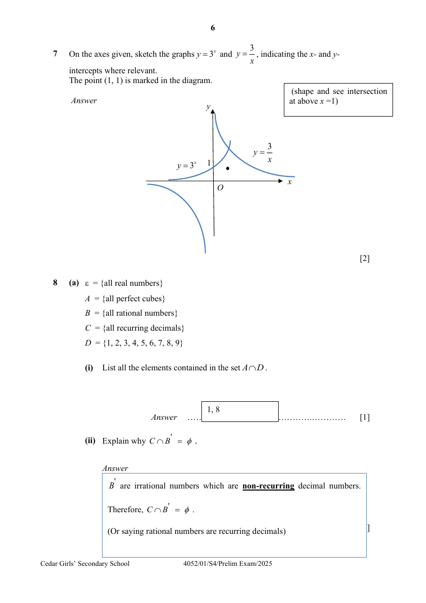
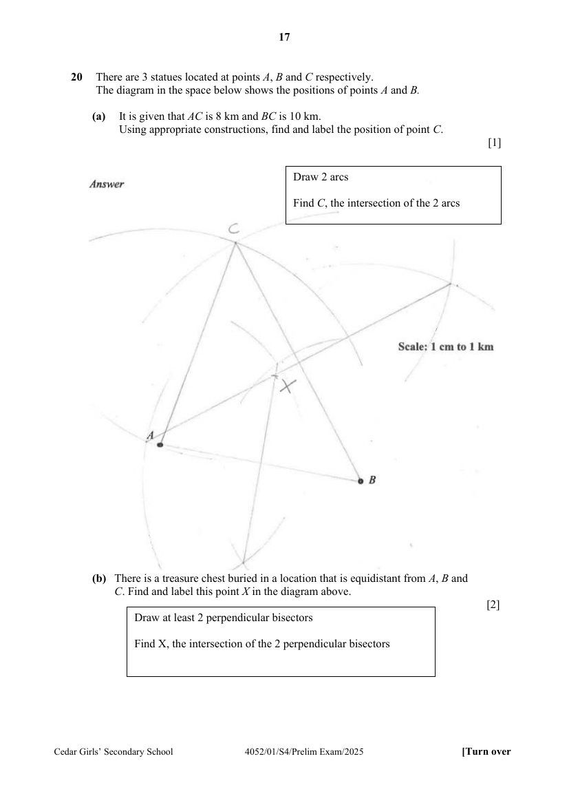

# Cedar Girls' Secondary School — Mathematics 4052/01 Paper 1 Marking Scheme (cleaned)

> **Institution:** Cedar Girls' Secondary School
> **Exam:** Preliminary Examination 2025
> **Level:** Secondary Four
> **Subjects:** Mathematics
> **Paper:** 4052/01 Paper 1 — Marking Scheme
> **Date:** 21 August 2025
> **Duration:** 2 hours 15 minutes
> **Total Marks:** 90
> **Source:** `CEDAR-2025-EMATH-PRELIM-P1-MS` (digital PDF — cleaned & reformatted)

---

## Answer all the questions

---

### Q1

> **Marks:** (a) [2]; (b) [3]; total [5]
> **Sub-topic:** Algebraic manipulation
> **Page:** 3

**(a)** Given $a = \dfrac{v^{2}-t^{2}}{2s}$, express $v$ in terms of $a$, $t$ and $s$.

$$
a = \frac{v^{2}-t^{2}}{2s}
$$

$$
2as = v^{2}-t^{2}
$$

(transform to non-fractional equation)

$$
v^{2} = 2as+t^{2}
$$

$$
v = \pm\sqrt{2as+t^{2}}
$$

**(b)** Simplify $\dfrac{xy}{x^{2}-4xy+4y^{2}}-\dfrac{2y}{4y-2x}$.

$$
= \frac{xy}{(x-2y)^{2}}-\frac{y}{y-x}
$$

(factorise into a square)

$$
= \frac{xy}{(x-2y)^{2}}+\frac{y}{x-2y}
$$

$$
= \frac{xy+xy-2y^{2}}{(x-2y)^{2}}
$$

(Attempt to change to common denominator)

$$
= \frac{2xy-2y^{2}}{(x-2y)^{2}}
$$

or $\dfrac{2y(x-y)}{(x-2y)^{2}}$ or $\dfrac{2xy-2y^{2}}{x^{2}-4xy+4y^{2}}$

---

### Q2

> **Marks:** [2]
> **Sub-topic:** Upper and lower bounds
> **Page:** 3

The diameter of a solid sphere is $7.12\text{ cm}$, measured correct to $3$ significant figures. Its density is $2.2\text{ g/cm}^{3}$. Find the smallest possible mass of the sphere.

$$
\text{Mass} = \frac{4}{3}\pi\left(\frac{7.115}{2}\right)^{3}\times 2.2
$$

(See $7.115$)

$$
= 415\text{ g}
$$

---

### Q3

> **Marks:** [2]
> **Sub-topic:** Map scales
> **Page:** 4

An area of $512\text{ km}^{2}$ is represented by $50\text{ cm}^{2}$ on a map. Find the scale of the map in the form $1 : n$.

$$
512\text{ km}^{2} : 50\text{ cm}^{2}
$$

$$
256\text{ km}^{2} : 25\text{ cm}^{2}
$$

$$
16\text{ km} : 5\text{ cm}
$$

(Square root)

$$
3.2\text{ km} : 1\text{ cm}
$$

$$
320\,000 : 1
$$

$$
1 : 320\,000
$$

---

### Q4

> **Marks:** (a) [2]; (b) [1]; total [3]
> **Sub-topic:** Factorisation
> **Page:** 4

**(a)** Factorise completely $m^{3}+30+5m+6m^{2}$.

$$
= m^{3}+6m^{2}+5m+30
$$

$$
= m^{2}(m+6)+5(m+6)
$$

(2 groups of factorisation)

$$
= (m+6)(m^{2}+5)
$$

**(b)** Given that $m$ is a positive integer, explain why $m^{3}+30+5m+6m^{2}$ is not a prime number.

Its factors $(m+6)$ and $(m^{2}+5)$ are whole numbers more than $1$. Hence, it’s not a prime number.

---

### Q5

> **Marks:** [2]
> **Sub-topic:** Speed, distance and time
> **Page:** 4

Mary cycles $2.8\text{ km}$ at an average speed of $12\text{ km/h}$ and takes a break. She then continues to cycle a further $1.4\text{ km}$ in $5$ minutes. Given that her average speed for the whole journey is $9\dfrac{1}{3}\text{ km/h}$, find the duration of her break.

$$
\text{Time taken for first part} = \frac{2.8}{12} = \frac{7}{30}\text{ h}
$$

Let $x\text{ h}$ be her break time.

$$
9\frac{1}{3} = \frac{2.8+1.4}{\dfrac{7}{30}+x+\dfrac{1}{12}}
$$

$$
\frac{19}{60}+x = \frac{4.2}{9\dfrac{1}{3}}
$$

$$
x = \frac{2}{15}
$$

(or $0.133\text{ h}$)

---

### Q6

> **Marks:** (i) [2]; (ii) [2]; total [4]
> **Sub-topic:** Trigonometry and bearings
> **Page:** 5

The diagram below shows $3$ lighthouses $A$, $B$ and $C$ at sea. $AC = 12\text{ km}$. $BC = 18\text{ km}$. $AB = 17\text{ km}$. The bearing of $B$ from $C$ is $136^{\circ}$.

**(i)** Find the bearing of $A$ from $C$.

$$
\cos\angle ACB = \frac{12^{2}+18^{2}-17^{2}}{2(12)(18)} = 0.41435
$$

($5$ s.f.)

$$
\angle ACB = 65.522^{\circ}
$$

($3$ d.p.)

$$
\text{Bearing of }A\text{ from }C = 136^{\circ}-65.522^{\circ} = 070.5^{\circ}
$$

($1$ d.p.) (with zero in front)

**(ii)** Find the area of the region enclosed by triangle $ABC$.

$$
\text{Area of }ABC = \frac{1}{2}(12)(18)\sin 65.522^{\circ} = 98.3\text{ km}^{2}
$$

---

### Q7

> **Marks:** [2]
> **Sub-topic:** Graphs of functions
> **Page:** 6

On the axes given, sketch the graphs $y = 3^{x}$ and $y = \dfrac{3}{x}$, indicating the $x$- and $y$-intercepts where relevant. The point $(1, 1)$ is marked in the diagram.

(shape and see intersection at above $x = 1$)

---

### Q8

> **Marks:** (a)(i) [1]; (a)(ii) [1]; (b) [1]; total [3]
> **Sub-topic:** Sets and Venn diagrams
> **Page:** 6–7

**(a)** $\varepsilon = \{\text{all real numbers}\}$

$A = \{\text{all perfect cubes}\}$

$B = \{\text{all rational numbers}\}$

$C = \{\text{all recurring decimals}\}$

$D = \{1, 2, 3, 4, 5, 6, 7, 8, 9\}$

**(i)** List all the elements contained in the set $A \cap D$.

$1, 8$

**(ii)** Explain why $C \cap B' = \phi$.

$B'$ are irrational numbers which are non-recurring decimal numbers.

Therefore, $C \cap B' = \phi$.

(Or saying rational numbers are recurring decimals)

**(b)** On the Venn diagram, shade the region(s) which represent $(A' \cap B') \cup (A \cap B)$.

---

### Q9

> **Marks:** [4]
> **Sub-topic:** Quadratic graphs
> **Page:** 7

A quadratic curve $y = -x^{2}+mx+3.5$ has a turning point at $(-1.5, p)$, where both $m$ and $p$ are constants. Find the value of $m$ and of $p$.

Completed square form:

$$
y = -\left(x+\frac{3}{2}\right)^{2}+p
$$

$$
= -\left(x^{2}+3x+\frac{9}{4}\right)+p
$$

or see $y = -\left(x-\dfrac{m}{2}\right)^{2}+\dfrac{m^{2}}{4}+3.5$

$$
= -x^{2}-3x-\frac{9}{4}+p
$$

Comparing coefficients with $y = -x^{2}+mx+3.5$:

$$
m = -3
$$

$$
-\frac{9}{4}+p = 3.5
$$

$$
p = \frac{23}{4}
$$

Alternative method. Completed square form:

$$
y = -\left(x-\frac{m}{2}\right)^{2}+\frac{m^{2}}{4}+3.5
$$

Comparing coefficients with the turning point:

$$
\frac{m}{2} = -1.5 \rightarrow m = -3
$$

$$
\frac{m^{2}}{4}+3.5 = p
$$

$$
p = \frac{23}{4}
$$

---

### Q10

> **Marks:** (a) [2]; (b) [2]; total [4]
> **Sub-topic:** Similarity and cones
> **Page:** 8

**(a)** Find $h$, the height of the frustum.

$$
\sqrt[3]{\frac{3}{8}} = \frac{40-h}{40}
$$

(using cube root)

$$
h = 40-40\times\sqrt[3]{\frac{3}{8}}
$$

$$
h = 11.2
$$

($3$ s.f.)

**(b)** Given that the curved surface area of the frustum is $966\text{ cm}^{2}$, find the curved surface area of the smaller cone.

$$
\frac{A_{\text{smaller cone}}}{A_{\text{larger cone}}} = \left(\sqrt[3]{\frac{3}{8}}\right)^{2}
$$

(squaring the ratio of lengths)

$$
\frac{A_{\text{smaller cone}}}{A_{\text{smaller cone}}+966} = \left(\sqrt[3]{\frac{3}{8}}\right)^{2}
$$

$$
A_{\text{smaller cone}} = \frac{\left(\sqrt[3]{\dfrac{3}{8}}\right)^{2}(966)}{1-\left(\sqrt[3]{\dfrac{3}{8}}\right)^{2}} = 1050\text{ cm}^{2}
$$

($3$ s.f.)

---

### Q11

> **Marks:** [2]
> **Sub-topic:** Income tax
> **Page:** 9

In 2022, given that David’s chargeable income is &#36;60,500, find his income tax payable for YA 2022.

$$
\text{Income tax payable} = &#36;10000\times\frac{2}{100}+&#36;10000\times\frac{3.5}{100}+&#36;20500\times\frac{7}{100} = &#36;1985
$$

---

### Q12

> **Marks:** (a) [1]; (b) [1]; (c) [1]; (d) [2]; total [5]
> **Sub-topic:** Prime factors and HCF
> **Page:** 9

**(a)** Express $630$ as a product of its prime factors.

$$
630 = 2\times 3^{2}\times 5\times 7
$$

**(b)** Find the smallest integer value of $m$ such that $630m$ is a perfect square.

$$
m = 2\times 5\times 7 = 70
$$

**(c)** Given that $588 = 2^{2}\times 3\times 7^{2}$, find the smallest integer value of $k$ such that $630k$ is a multiple of $588$.

$$
k = 2\times 7 = 14
$$

**(d)** A rectangular piece of paper measuring $588\text{ mm}$ and $630\text{ mm}$ is being cut into identical squares with no waste. Find the minimum number of squares that can be obtained.

$$
\text{HCF} = 2\times 3\times 7 = 42
$$

(find HCF)

$$
\text{No of pieces} = \frac{588\times 630}{42^{2}} = 210
$$

---

### Q13

> **Marks:** (a) [1]; (b) [2]; (c) [2]; total [5]
> **Sub-topic:** Number patterns
> **Page:** 10

**(a)** Write down $L_{n}$ of the pattern.

$$
L_{n} = (n+3)^{2}-n^{2} = 6n+9
$$

**(b)** Explain, with working, whether $3336$ is a term of the sequence $15, 21, 27, 33\ldots$.

$$
3336 = 6n+9
$$

(Finding $n$)

$$
n = 554.5
$$

No, as $n$ is not a (positive) integer / whole number.

**(c)** Find the exact value of $L_{1}+L_{4}+L_{7}+L_{10}+L_{13}+\cdots+L_{97}+L_{100}$.

$$
\begin{aligned}
&L_{1}+L_{4}+L_{7}+L_{10}+L_{13}+\cdots+L_{97}+L_{100} \\
&= 4^{2}-1^{2}+7^{2}-4^{2}+10^{2}-7^{2}+\cdots+100^{2}-97^{2}+103^{2}-100^{2} \\
&= 103^{2}-1^{2} \\
&= 10608
\end{aligned}
$$

(replacing the $L$ terms with $a^{2}-b^{2}$)

---

### Q14

> **Marks:** (a) [2]; (b) [2]; total [4]
> **Sub-topic:** Polygons
> **Page:** 11

**(a)** A polygon has three of its interior angles, measuring $150^{\circ}$, $160^{\circ}$ and $170^{\circ}$. The other interior angles are $130^{\circ}$ each. Find $n$, the number of sides of the polygon.

$$
150^{\circ}+160^{\circ}+170^{\circ}+(n-3)(130^{\circ}) = (n-2)(180^{\circ})
$$

$$
480^{\circ}+130n-390^{\circ} = 180^{\circ}n-360^{\circ}
$$

$$
450^{\circ} = 50n
$$

$$
n = 9
$$

**(b)** Explain why it is not possible for a regular polygon to have an interior angle of $145^{\circ}$.

Its exterior angle is $35^{\circ}$.

$$
n = \frac{360}{35} = 10\frac{2}{7}
$$

(finding $n$)

Since the number of sides is not a whole number / (positive) integer, it is not possible to be a regular polygon to have an interior angle of $145^{\circ}$.

---

### Q15

> **Marks:** [3]
> **Sub-topic:** Congruence and proof
> **Page:** 11

The diagram shows a rectangle $ABCD$ and an isosceles triangle $PAB$ in which $PA = PB$. $PD$ and $PC$ meet $AB$ at $Q$ and $R$ respectively. Prove that triangle $PDC$ is an isosceles triangle.

$PA = PB$ (given) (S)

$AD = BC$ (opp. sides of rectangle) (S)

$\angle PAB = \angle PBA$ (base angles of isosceles triangle)

$$
\begin{aligned}
\angle PAD &= \angle PAB+90^{\circ} \\
&= \angle PBA+90^{\circ} \\
&= \angle PBC
\end{aligned}
$$

(A) (finding $\angle PAD = \angle PBC$)

Therefore, triangle $PAD \equiv$ triangle $PBC$ (SAS)

$\therefore PD = PC$, triangle is an isosceles triangle.

---

### Q16

> **Marks:** (a) [1]; (b) [2]; (c) [2]; total [5]
> **Sub-topic:** Averages
> **Page:** 12

**(a)** If the mode is $3$, state the largest possible value of $x$.

$$
x = 20
$$

**(b)** If the mean is $3$, find the value of $x$.

$$
\frac{0+13+32+63+4x+85}{9+13+16+21+x+17} = 3
$$

$$
\frac{193+4x}{76+x} = 3
$$

$$
193+4x = 228+3x
$$

$$
x = 35
$$

**(c)** Melanie claims that it is not possible for the median to be $2$. Explain whether you agree with Melanie’s claim.

To find the smallest possible median is when $x = 0$ (the smallest possible value of $x$). (attempt to find smallest possible median)

Alternative solution: Stating that Left side has $9+13+16 = 38$ students; Right side has $21+17 = 38$ students. Hence the smallest median is $2.5$.

$$
\text{The smallest possible median} = \frac{2+3}{2} = 2.5
$$

The smallest possible median is $2.5$, and it will not be $2$. Melanie is correct. (also accept finding median to be more than $2$)

---

### Q17

> **Marks:** [4]
> **Sub-topic:** Volume of a cylinder
> **Page:** 13

Justify with mathematical workings, why the volume of the open cylinder, formed using Method 1 is larger than that formed using Method 2, for all real values of $l$ and $b$.

| | Method 1 | Method 2 |
| --- | --- | --- |
| Finding radius | $2\pi r_{1} = l$, $r_{1} = \dfrac{l}{2\pi}$ | $2\pi r_{2} = b$, $r_{2} = \dfrac{b}{2\pi}$ |
| Volume | $\pi\left(\dfrac{l}{2\pi}\right)^{2}\times b = \dfrac{bl^{2}}{4\pi}$ | $\pi\left(\dfrac{b}{2\pi}\right)^{2}\times l = \dfrac{b^{2}l}{4\pi}$ |

(Correct radii for both) (Finding volume)

Since $l > b$,

$$
\frac{bl^{2}}{4\pi} > \frac{b^{2}l}{4\pi}
$$

(follow through from above)

Alternatively,

$$
\left(\frac{bl}{4\pi}\right)l > \left(\frac{bl}{4\pi}\right)b
$$

the volume from method 1 is larger.

---

### Q18

> **Marks:** (a) [4]; (b) [2]; (c) [3]; total [9]
> **Sub-topic:** Coordinate geometry
> **Page:** 14–15

**(a)** By finding the coordinates of $R$, show that the equation of Line $L_{2}$ is $y = -x-5$.

$$
P = (4, 0)
$$

$$
R = (-5, 0)
$$

$$
\text{Gradient} = -\tan 45^{\circ} = -1
$$

(or other similar methods to find gradient)

Therefore, $y = -x+c$.

At $(-5, 0)$,

$$
0 = 5+c
$$

(connect gradient and a point to find $c$)

$$
c = -5
$$

Therefore, equation of $L_{2}$: $y = -x-5$ (Shown)

**(b)** Find the coordinates of $Q$.

$$
y = 2x-8 \quad (1)
$$

$$
y = -x-5 \quad (2)
$$

$$
(1) = (2)
$$

$$
2x-8 = -x-5
$$

$$
x = 1 \rightarrow y = -6
$$

$$
Q = (1, -6)
$$

**(c)** Find the shortest distance from $R$ to line $PQ$.

$$
\text{Area of triangle} = \frac{1}{2}\times 6\times 9 = 27\text{ units}^{2}
$$

$$
PQ = \sqrt{(4-1)^{2}+(0+6)^{2}} = \sqrt{45}\text{ units}
$$

(finding base of triangle)

$$
\text{Shortest distance} = \frac{27\times 2}{\sqrt{45}} = 8.05\text{ units}
$$

($3$ s.f.)

---

### Q19

> **Marks:** (a) [3]; (b) [2]; total [5]
> **Sub-topic:** Circle theorems
> **Page:** 16

**(a)** Find angle $PSR$, in terms of $x$. Give a reason for each step of your working

$$
\angle POR = (180-x)^{\circ}
$$

(angles in opp segments)

$$
\text{reflex }\angle POR = 360^{\circ}-(180-x)^{\circ} = (180+x)^{\circ}
$$

(angles at a pt)

$$
\angle PSR = \frac{(180+x)^{\circ}}{2}
$$

(angle at centre $= 2\times$ angle at circumference)

(also accept $\left(90+\dfrac{x}{2}\right)^{\circ}$)

**(b)** It is now given that angle $PUR$ is $105^{\circ}$, find the value of $x$.

$$
\angle PUR = \frac{(180+x)^{\circ}}{2}
$$

(angles in the same segment)

$$
105 = \frac{180+x}{2}
$$

$$
x = 30
$$

---

### Q20

> **Marks:** (a) [1]; (b) [2]; total [3]
> **Sub-topic:** Geometrical constructions
> **Page:** 17

**(a)** It is given that $AC$ is $8\text{ km}$ and $BC$ is $10\text{ km}$. Using appropriate constructions, find and label the position of point $C$.

Draw $2$ arcs. Find $C$, the intersection of the $2$ arcs.

**(b)** There is a treasure chest buried in a location that is equidistant from $A$, $B$ and $C$. Find and label this point $X$ in the diagram above.

Draw at least $2$ perpendicular bisectors. Find $X$, the intersection of the $2$ perpendicular bisectors.

---

### Q21

> **Marks:** [3]
> **Sub-topic:** Proportion
> **Page:** 18

$P$ is inversely proportional to the square of $Q$. Given that $Q$ increases by $10\%$, find the percentage decrease in $P$.

$$
P = \frac{k}{Q^{2}},\quad Q_{\text{new}} = 1.1Q
$$

$$
P_{\text{new}} = \frac{k}{(1.1Q)^{2}} = \frac{k}{1.21Q^{2}}
$$

$$
\text{Percentage change} = \frac{\dfrac{k}{1.21Q^{2}}-\dfrac{k}{Q^{2}}}{\dfrac{k}{Q^{2}}}\times 100\% = \left(\frac{1}{1.21}-1\right)\times 100\% = -17.4\%
$$

($3$ s.f.)

$$
\text{Decrease }\% = 17.4\%
$$

---

### Q22

> **Marks:** [3]
> **Sub-topic:** Rates and currency
> **Page:** 18

In Australia, a $16$-oz bottle of shampoo costs A&#36;60. The shampoo company wants to price a $500\text{ ml}$ bottle of the same shampoo at the same rate in France. €$1$ = A&#36;1.65. $1\text{ oz} = 29.5735\text{ ml}$. What should the price be in euros (€)? Leave your answer to the nearest $10$ cents.

In Australia, a $16$-oz bottle costs A&#36;60 $= €\dfrac{60}{1.65}$ (Converting to euros)

$29.5735\text{ ml}$ (also $1\text{ oz}$) of shampoo costs $= €\dfrac{60}{1.65}\div 16$.

$$
500\text{ ml of shampoo costs } = €\frac{60}{1.65}\div 16\times\frac{500}{29.5735}
$$

(Converting to ml)

$$
= €38.40
$$

(to nearest $10$ cents)

---

### Q23

> **Marks:** (a) [1]; (b) [3]; total [4]
> **Sub-topic:** Probability
> **Page:** 19

**(a)** Write down, in terms of $n$, the probability that the counter is blue.

$$
\frac{12-n}{12}
$$

**(b)** Given that the probability that both counters drawn are blue is $\dfrac{5}{22}$, form an equation in the form $n^{2}+bn+c = 0$, where $b$ and $c$ are integers.

$$
\frac{12-n}{12}\times\frac{11-n}{11} = \frac{(12-n)(11-n)}{132}
$$

$$
\frac{(12-n)(11-n)}{132} = \frac{5}{22}
$$

$$
(12-n)(11-n) = 30
$$

$$
n^{2}-23n+102 = 0
$$

---

### Q24

> **Marks:** (a) [1]; (b) [3]; total [4]
> **Sub-topic:** Speed-time and distance-time graphs
> **Page:** 20

**(a)** Find the deceleration of the car from $60\text{s}$ to $65\text{s}$.

$$
\frac{30}{5} = 6\text{ m/s}^{2}
$$

**(b)** Draw the distance-time graph to represent the journey.

The area beneath the speed-time graph represents the distance travelled by the object. The distance-time graph passes through $(10, 150)$, $(60, 1650)$ and $(65, 1725)$.

---

End of Paper
