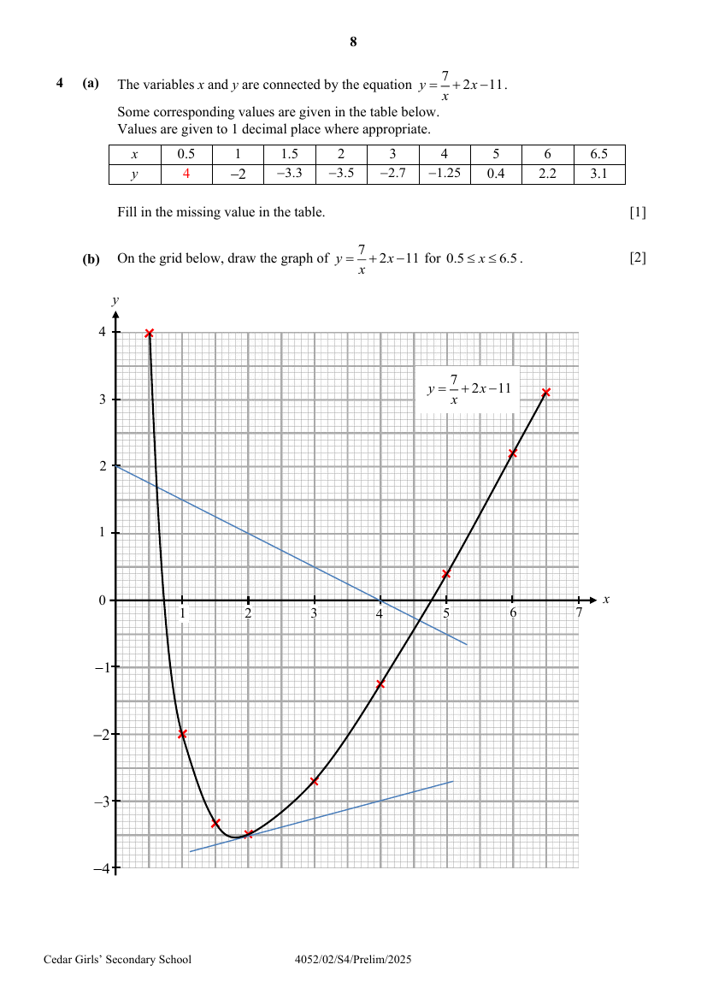

# Cedar Girls' Secondary School — Mathematics 4052/02 Paper 2 Marking Scheme (cleaned)

> **Institution:** Cedar Girls' Secondary School
> **Exam:** Preliminary Examination 2025
> **Level:** Secondary Four
> **Subjects:** Mathematics
> **Paper:** 4052/02 Paper 2 — Marking Scheme
> **Date:** 22 August 2025
> **Duration:** 2 hours 15 minutes
> **Total Marks:** 90
> **Source:** `CEDAR-2025-EMATH-PRELIM-P2-MS` (digital PDF — cleaned & reformatted)

---

## Answer all the questions

---

### Q1

> **Marks:** (a) [2]; (b) [3]; (c)(i) [2]; (c)(ii) [3]; total [10]
> **Sub-topic:** Inequalities, equations and indices
> **Page:** 3–4

**(a)** Solve the inequality $1+4y \leq \dfrac{2y-1}{2} < 0$.

$$
2+8y \leq 2y-1 < 0
$$

$$
2+8y \leq 2y-1 \quad\text{and}\quad 2y-1 < 0
$$

$$
y \leq -\frac{1}{2} \quad\text{and}\quad y < \frac{1}{2}
$$

$$
\therefore y \leq -\frac{1}{2}
$$

**(b)** Solve $-(1-x)\left(\dfrac{4}{5}x-1\right) = 3$.

$$
(x-1)\left(\frac{4}{5}x-1\right) = 3
$$

$$
\frac{4}{5}x^{2}-\frac{9}{5}x+1 = 3
$$

$$
4x^{2}-9x-10 = 0
$$

$$
x = \frac{-(-9)\pm\sqrt{(-9)^{2}-4(4)(-10)}}{2(4)}
$$

$$
x = -0.816 \text{ or } x = 3.07
$$

($3$ s.f.)

**(c) (i)** Given that $243^{p}\times 2^{5p} = 6^{6-p}$, find the value of $p$.

$$
3^{5p}\times 2^{5p} = 6^{6-p}
$$

$$
6^{5p} = 6^{6-p}
$$

$$
5p = 6-p
$$

$$
p = 1
$$

**(ii)** Simplify $\left(\dfrac{16p^{4}}{q^{8}}\right)^{-\frac{3}{2}}\div pq^{5}$.

$$
= \left(\frac{q^{8}}{16p^{4}}\right)^{\frac{3}{2}}\div pq^{5}
$$

$$
= \frac{q^{12}}{64p^{6}}\times\frac{1}{pq^{5}}
$$

$$
= \frac{q^{7}}{64p^{7}}
$$

---

### Q2

> **Marks:** (a) [1]; (b) [2]; (c) [3]; total [6]
> **Sub-topic:** Standard form and compound interest
> **Page:** 5

**(a)** $8.2\times 10^{-6}\text{ m} = 8.2\times 10^{-3}\text{ mm} = 0.0082\text{ mm}$.

**(b)**

$$
\frac{67.7\times 10^{6}}{12} = 5.6\times 10^{6}
$$

**(c)** Compounded every $3$ months:

$$
P\left(1+\frac{3\%}{4}\right)^{4n} = P(1.0075)^{4n}
$$

Compounded every month:

$$
P\left(1+\frac{3\%}{12}\right)^{12n} = P(1.0025)^{12n} = P(1.007518766)^{4n}
$$

I agree with the bank manager’s proposal, as the total earnings over the same period of time is more when the frequency of interest compounded is once every month.

---

### Q3

> **Marks:** (a) [1]; (b) [2]; (c) [1]; (d) [3]; total [7]
> **Sub-topic:** Matrices and ratio
> **Page:** 6–7

**(a)** $N = \begin{pmatrix} 0.8 & 1.75 \end{pmatrix}$

**(b)**

$$
C = 7\begin{pmatrix} 0.8 & 1.75 \end{pmatrix}\begin{pmatrix} 55 & 35 & 70 \\ 40 & 30 & 30 \end{pmatrix}
$$

$$
= 7\begin{pmatrix} 114 & 80.5 & 108.5 \end{pmatrix}
$$

$$
= \begin{pmatrix} 798 & 563.5 & 759.5 \end{pmatrix}
$$

**(c)** It represents the total cost of making apple, banana and cheese tarts respectively, in a week.

**(d)** Apple : Banana : Cheese

$$
5 : 4
$$

$$
5 : 7
$$

$$
\therefore 25 : 20 : 28
$$

$$
\text{No. of cheese tarts sold} = \frac{260-41}{25+20+28}\times 28 = \frac{219}{73}\times 28 = 84
$$

$$
\left(\frac{2}{3}\times 84\times 1.55\times 0.80\right)+\left(\frac{1}{3}\times 84\times 1.55\times 1.75\right) = &#36;145.39
$$

---

### Q4

> **Marks:** (a) [1]; (b) [2]; (c) [2]; (d)(i) [2]; (d)(ii) [2]; (d)(iii) [3]; total [12]
> **Sub-topic:** Graphs of functions
> **Page:** 8–9

**(a)** When $x = 0.5$, $y = 4$.

**(b)** Draw $y = \dfrac{7}{x}+2x-11$.

**(c)** By drawing a tangent,

$$
\text{Gradient} = \frac{-3-(-3.5)}{4-2} = 0.25
$$

($\pm 0.13$)

**(d) (i)**

$$
2x+\frac{7}{x}-11 = -4
$$

The line $y = -4$ is below the minimum point of / lies entirely below the curve $y = 2x+\dfrac{7}{x}-11$ and therefore, will not intersect the curve at any point.

**(ii)** Draw $y = -\dfrac{1}{2}x+2$.

From graph, $x$-coordinate of points $= 0.6$ and $4.6$ ($\pm 0.1$).

**(iii)**

$$
-\frac{1}{2}x+2 = 2x+\frac{7}{x}-11
$$

Multiply by $2x$:

$$
-x^{2}+4x = 4x^{2}+14-22x
$$

$$
0 = 5x^{2}-26x+14
$$

By comparing coefficients, $A = 5$ and $B = -26$.

---

### Q5

> **Marks:** (a) [2]; (b) [2]; (c) [2]; (d)(i) [2]; (d)(ii) [3]; total [11]
> **Sub-topic:** Circle geometry and radians
> **Page:** 10–11

**(a)** $\angle ADB = 90^{\circ}$ (angle in semicircle)

So, $\angle ADB = \angle OPB$.

$\angle ABD$ is a common angle.

$\therefore \triangle ABD$ is similar to $\triangle OBP$. (Angle-angle similarity)

**(b)** Since

$$
\frac{\text{area of triangle }OBP}{\text{area of triangle }OBD} = \frac{1}{2}
$$

and area of triangle $OBD =$ area of triangle $AOD$,

$$
\frac{\text{area of triangle }OBP}{\text{area of triangle }AOD} = \frac{1}{2}
$$

**(c)** $\angle BOP = 65^{\circ}$ (similar triangles)

$$
\angle BOD = (65^{\circ}\times 2)\times\frac{\pi}{180^{\circ}} = 2.268928
$$

($7$ s.f.)

$$
= 2.2689\text{ radians}
$$

($5$ s.f.) (shown)

**(d) (i)** $BC = DC = 8.58\text{ cm}$ (tangents from ext. pt.)

$$
\text{Perimeter} = (8.58\times 2)+4(2.268928) = 26.2357 = 26.2\text{ cm}
$$

($3$ s.f.)

**(ii)** $\angle OBC = 90^{\circ}$ (tangent $\perp$ radius)

$$
\text{Area} = \left(2\times\frac{1}{2}\times 4\times 8.58\right)-\frac{1}{2}(4^{2})(2.268928) = 16.169 = 16.2\text{ cm}^{2}
$$

($3$ s.f.)

---

### Q6

> **Marks:** (a)(i) [3]; (a)(ii) [3]; (b)(i) [3]; (b)(ii) [4]; total [13]
> **Sub-topic:** Vectors
> **Page:** 12–13

**(a) (i)**

$$
\overrightarrow{AB} = \begin{pmatrix} 2 \\ -2 \end{pmatrix}-\begin{pmatrix} k \\ 6 \end{pmatrix} = \begin{pmatrix} 2-k \\ -8 \end{pmatrix}
$$

$$
(2-k)^{2}+(-8)^{2} = 10^{2}
$$

$$
k^{2}-4k-32 = 0
$$

$$
(k+4)(k-8) = 0
$$

$$
k = -4,\ 8\text{ (rej)}
$$

**(ii)**

$$
\overrightarrow{BC} = \begin{pmatrix} 5 \\ -6 \end{pmatrix}-\begin{pmatrix} 2 \\ -2 \end{pmatrix} = \begin{pmatrix} 3 \\ -4 \end{pmatrix}
$$

$$
\overrightarrow{AB} = \begin{pmatrix} 6 \\ -8 \end{pmatrix} = 2\begin{pmatrix} 3 \\ -4 \end{pmatrix} = 2\overrightarrow{BC}
$$

Since $\overrightarrow{AB}\parallel\overrightarrow{BC}$ and $B$ is a common point, $A$, $B$ and $C$ must be collinear.

**(b) (i)**

$$
\overrightarrow{SR} = \overrightarrow{PQ} = -\mathbf{p}+\mathbf{q}
$$

$$
\overrightarrow{QR} = \overrightarrow{QS}+\overrightarrow{SR} = -\frac{10}{7}\mathbf{q}+(-\mathbf{p}+\mathbf{q}) = -\mathbf{p}-\frac{3}{7}\mathbf{q}
$$

**(ii)**

$$
\overrightarrow{QX} = \frac{10}{7}m\mathbf{q} \quad (1)
$$

$$
\overrightarrow{QX} = \overrightarrow{QR}+\overrightarrow{RX} = -\mathbf{p}-\frac{3}{7}\mathbf{q}+n\left(\frac{1}{5}\mathbf{p}+\frac{1}{7}\mathbf{q}\right)
$$

$$
= \left(\frac{1}{5}n-1\right)\mathbf{p}+\left(\frac{1}{7}n-\frac{3}{7}\right)\mathbf{q} \quad (2)
$$

Comparing coefficients,

$$
\frac{1}{5}n-1 = 0 \rightarrow n = 5
$$

$$
\frac{1}{7}(5)-\frac{3}{7} = \frac{10}{7}m \rightarrow m = \frac{1}{5}
$$

---

### Q7

> **Marks:** (a) [1]; (b)(i) [1]; (b)(ii) [1]; (b)(iii) [1]; (b)(iv) [1]; (c)(i) [2]; (c)(ii) [2]; (d) [2]; total [11]
> **Sub-topic:** Cumulative frequency and probability
> **Page:** 14–15

**(a)**

$$
\frac{250-70}{250}\times 100\% = 72\%
$$

**(b) (i)** Frequency for $60 \leq m < 80$ is $95$.

**(ii)** $60 \leq m < 80$

**(iii)** $68.4\text{ g}$

**(iv)** $22.6\text{ g}$

**(c) (i)**

$$
\frac{100}{250}\times\frac{99}{249} = \frac{66}{415}
$$

**(ii)**

$$
2\left(\frac{80}{250}\times\frac{20}{249}\right) = \frac{64}{1245}
$$

**(d)** On average, potatoes grown using Fertiliser X are heavier than those grown using Fertiliser Y, as they have a higher mean mass of $68.4\text{ g}$, compared to $62\text{ g}$.

The spread of the mass is comparable for both batches of potatoes, with SD being $22.6\text{ g}$ and $23\text{ g}$. / Mass of potatoes grown using Fertiliser X has a smaller spread, with a lower SD of $22.6\text{ g}$, rather than $23\text{ g}$.

---

### Q8

> **Marks:** (a) [1]; (b) [1]; (c) [2]; (d) [2]; (e) [2]; (f) [3]; total [11]
> **Sub-topic:** Algebraic formulae and rates
> **Page:** 16–17

**(a)** $\dfrac{60}{x}\text{ s}$

**(b)** $\dfrac{60}{x+4}\text{ s}$

**(c)**

$$
\frac{60}{x}-\frac{60}{x+4} = 2.5
$$

$$
60(x+4)-60x = 2.5x(x+4)
$$

$$
2.5x^{2}+10x-240 = 0
$$

$$
x^{2}+4x-96 = 0
$$

(shown)

**(d)**

$$
x = \frac{-4\pm\sqrt{(-4)^{2}-4(1)(-96)}}{2}
$$

$$
x = -12 \text{ or } 8
$$

**(e)**

$$
\text{Time taken} = \frac{3500}{8+4} = 291\frac{6}{7}\text{ min} = 4\text{ h }52\text{ min}
$$

**(f)** In $t$ seconds,

$$
\text{Amount earned from selling large bowls} = &#36;0.50\times\frac{t}{\dfrac{60}{8}} = &#36;0.067t
$$

$$
\text{Amount earned from selling small bowls} = &#36;0.35\times\frac{t}{\dfrac{60}{12}} = &#36;0.07t
$$

The factory earns more from selling small bowls, given the same production time.

---

### Q9

> **Marks:** (a) [2]; (b) [7]; total [9]
> **Sub-topic:** Trigonometry in three dimensions
> **Page:** 18–19

**(a)** Let the angle of elevation be $\theta$.

$$
\tan\theta = \frac{1.6-1.24}{1.2}
$$

$$
\theta = 16.699^{\circ} = 16.7^{\circ}
$$

($1$ d.p.)

**(b)** When $\theta = 15^{\circ}$,

$$
\tan 15^{\circ} = \frac{1.6-1.24}{d} \rightarrow d = 1.3435\text{ m}
$$

To have optimal view of television: for $\theta < 15^{\circ}$, $d > 1.3435\text{ m}$.

To have optimal audio experience: $\triangle PXT$ needs to be equilateral, so $\angle TPX = \angle PXT = \angle XTP = 60^{\circ}$.

Let the perpendicular bisector of $PT$ to $X$ be $m$.

$$
\sin 60^{\circ} = \frac{m}{3.6} \rightarrow m = 3.1177\text{ m}
$$

By Pythagoras’ Theorem,

$$
3.1177^{2} = (4-d)^{2}+(3-1.24)^{2}
$$

$$
4-d = \sqrt{3.1177^{2}-1.76^{2}}
$$

$$
d = 1.4266\text{ m} \ (> 1.3435)
$$

$\therefore$ Ryan should position the armchair at $d = 1.43\text{ m}$ because it will provide him with the best possible user experience, with both optimal view of the television and audio experience.

---

End of paper
