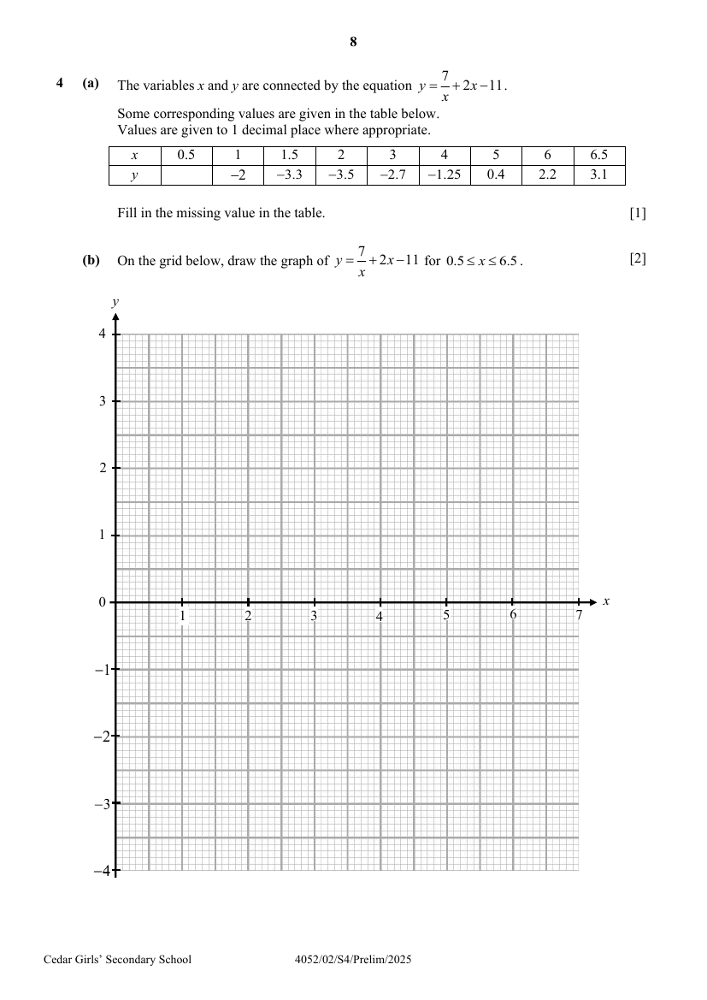
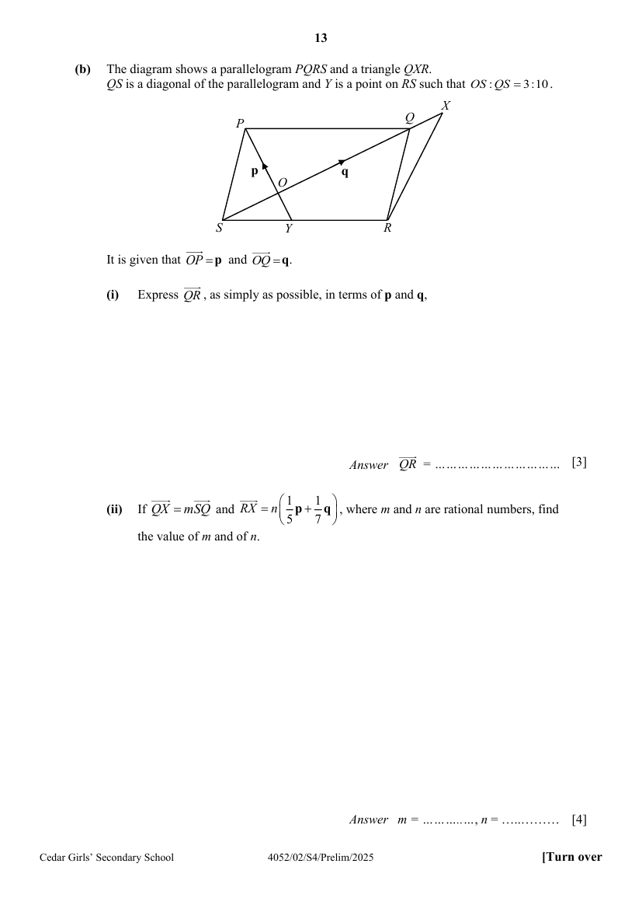
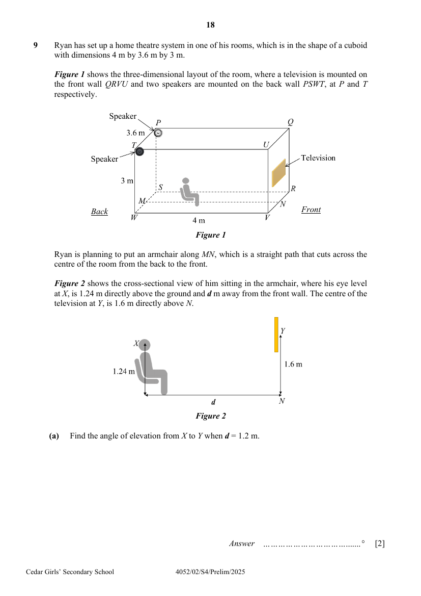

# Cedar Girls' Secondary School — Mathematics 4052/02 Paper 2 (cleaned)

> **Institution:** Cedar Girls' Secondary School
> **Exam:** Preliminary Examination 2025
> **Level:** Secondary Four
> **Subjects:** Mathematics
> **Paper:** 4052/02 Paper 2
> **Date:** 22 August 2025
> **Duration:** 2 hours 15 minutes
> **Total Marks:** 90
> **Source:** `CEDAR-2025-EMATH-PRELIM-P2-QP` (digital PDF — cleaned & reformatted)

---

## Instructions

Write your class, index number and name on all the work you hand in.
Write in dark blue or black pen.
You may use an HB pencil for any diagrams or graphs.
Do not use staples, paper clips, glue or correction fluid.

Answer all the questions.
The number of marks is given in brackets [ ] at the end of each question or part question.

If working is needed for any question it must be shown with the answer.
Omission of essential working will result in loss of marks.
The total of the marks for this paper is 90.

The use of an approved scientific calculator is expected, where appropriate.
If the degree of accuracy is not specified in the question and if the answer is not exact, give the answer to three significant figures. Gives answers in degrees to one decimal place.
For $\pi$, use either your calculator value or $3.142$.

---

## Mathematical Formulae

*Compound interest*

$$
\text{Total amount} = P\left(1+\frac{r}{100}\right)^{n}
$$

*Mensuration*

$$
\text{Curved surface area of a cone} = \pi rl
$$

$$
\text{Surface area of a sphere} = 4\pi r^{2}
$$

$$
\text{Volume of a cone} = \frac{1}{3}\pi r^{2}h
$$

$$
\text{Volume of a sphere} = \frac{4}{3}\pi r^{3}
$$

$$
\text{Area of triangle } ABC = \frac{1}{2}ab\sin C
$$

$$
\text{Arc length} = r\theta,\text{ where }\theta\text{ is in radians}
$$

$$
\text{Sector area} = \frac{1}{2}r^{2}\theta,\text{ where }\theta\text{ is in radians}
$$

*Trigonometry*

$$
\frac{a}{\sin A} = \frac{b}{\sin B} = \frac{c}{\sin C}
$$

$$
a^{2} = b^{2}+c^{2}-2bc\cos A
$$

*Statistics*

$$
\text{Mean} = \frac{\sum fx}{\sum f}
$$

$$
\text{Standard deviation} = \sqrt{\frac{\sum fx^{2}}{\sum f}-\left(\frac{\sum fx}{\sum f}\right)^{2}}
$$

---

## Answer all the questions

---

### Q1

> **Marks:** (a) 2, (b) 3, (c)(i) 2, (c)(ii) 3; total 10
> **Sub-topic:** Inequalities, equations and indices
> **Page:** 3–4

**(a)** Solve the inequality $1+4y \leq \dfrac{2y-1}{2} < 0$. [2]

**(b)** Solve $-(1-x)\left(\dfrac{4}{5}x-1\right) = 3$. [3]

**(c)** **(i)** Given that $243^{p}\times 2^{5p} = 6^{6-p}$, find the value of $p$. [2]

**(ii)** Simplify $\left(\dfrac{16p^{4}}{q^{8}}\right)^{-\frac{3}{2}}\div pq^{5}$ and leave your answer in positive index notation. [3]

---

### Q2

> **Marks:** (a) 1, (b) 2, (c) 3; total 6
> **Sub-topic:** Standard form and compound interest
> **Page:** 5

**(a)** The diameter of a red blood cell is $8.2\times 10^{-6}\text{ m}$.
Express this value as a decimal, in millimetres. [1]

**(b)** In 2024, Changi Airport handled $67.7$ million passengers.
Calculate the mean number of passengers handled by the airport each month.
Leave your answer in standard form, correct to $2$ significant figures. [2]

**(c)** LBB Bank currently charges $3\%$ per year compound interest on all loans, compounded once every three months.
The bank manager proposes to adjust the frequency of interest compounded to once every month instead, so as to increase the earnings of the bank.

Do you agree with the bank manager’s proposal?
Explain your answer with clear workings. [3]

---

### Q3

> **Marks:** (a) 1, (b) 2, (c) 1, (d) 3; total 7
> **Sub-topic:** Matrices and ratio
> **Page:** 6–7

A bakery selling assorted tarts operates for $7$ days a week.
The matrix, $T$, shows the number of tarts of different types that are made each day.

$$
T = \begin{pmatrix} 55 & 35 & 70 \\ 40 & 30 & 30 \end{pmatrix}
\begin{matrix} \text{Small} \\ \text{Large} \end{matrix}
$$

The columns are Apple, Banana and Cheese.

The cost of making a small tart is &#36;0.80.
The cost of making a large tart is &#36;1.75.

**(a)** Represent these costs in a $1\times 2$ row matrix $N$. [1]

**(b)** Evaluate the matrix $C = 7NT$. [2]

**(c)** State what each of the elements of $C$ represent. [1]

**(d)** The tarts are sold at $55\%$ more than the cost to make them.
On a particular day, the number of banana tarts to cheese tarts sold is in the ratio $5 : 7$ while the number of apple tarts to banana tarts sold is in the ratio $5 : 4$. A total of $41$ unsold tarts were given away.

If the number of small cheese tarts sold is twice the number of large cheese tarts sold, calculate the total amount earned by the bakery from selling cheese tarts on that day. [3]

---

### Q4

> **Marks:** (a) 1, (b) 2, (c) 2, (d)(i) 2, (d)(ii) 2, (d)(iii) 3; total 12
> **Sub-topic:** Graphs of functions
> **Page:** 8–9

**(a)** The variables $x$ and $y$ are connected by the equation $y = \dfrac{7}{x}+2x-11$.
Some corresponding values are given in the table below.
Values are given to $1$ decimal place where appropriate.

| $x$ | $0.5$ | $1$ | $1.5$ | $2$ | $3$ | $4$ | $5$ | $6$ | $6.5$ |
| --- | --- | --- | --- | --- | --- | --- | --- | --- | --- |
| $y$ | | $-2$ | $-3.3$ | $-3.5$ | $-2.7$ | $-1.25$ | $0.4$ | $2.2$ | $3.1$ |

Fill in the missing value in the table. [1]

**(b)** On the grid below, draw the graph of $y = \dfrac{7}{x}+2x-11$ for $0.5 \leq x \leq 6.5$. [2]

**(c)** By drawing a tangent, find the gradient of the curve at $x = 2$. [2]

**(d)** Using your graph,

**(i)** explain why the equation $2x+\dfrac{7}{x}-7 = 0$ has no solution. [2]

**(ii)** find the $x$-coordinate of the points where the line $2y = 4-x$ intersects the curve. [2]

**(iii)** These values of $x$ are the solutions of the equation $Ax^{2}+Bx+14 = 0$.

Find the value of $A$ and of $B$. [3]

---

### Q5

> **Marks:** (a) 2, (b) 2, (c) 2, (d)(i) 2, (d)(ii) 3; total 11
> **Sub-topic:** Circle geometry and radians
> **Page:** 10–11

The figure shows a semi-circle $AOBD$ with centre $O$ and $OP$ is perpendicular to $BD$.
$BC$ and $CD$ are tangents to the semi-circle at $B$ and $D$.
The diagram is marked $65^{\circ}$ at $A$.

**(a)** Show that triangles $ABD$ and $OBP$ are similar.
Give a reason for each statement you make. [2]

**(b)** Find the ratio $\dfrac{\text{area of triangle }OBP}{\text{area of triangle }AOD}$. [2]

**(c)** Show that angle $BOD = 2.2689$ radians, correct to $5$ significant figures. [2]

**(d)** It is given that the radius of the semi-circle is $4\text{ cm}$ and $BC = 8.58\text{ cm}$.

Calculate

**(i)** the perimeter of the shaded part, [2]

**(ii)** the area of the shaded part. [3]

---

### Q6

> **Marks:** (a)(i) 3, (a)(ii) 3, (b)(i) 3, (b)(ii) 4; total 13
> **Sub-topic:** Vectors
> **Page:** 12–13

**(a)** **(i)** The position vector of point $A$ and point $B$ are $\begin{pmatrix} k \\ 6 \end{pmatrix}$ and $\begin{pmatrix} 2 \\ -2 \end{pmatrix}$ respectively.
Given that $AB = 10$, find the negative value of $k$. [3]

**(ii)** $C$ is the point $(5, -6)$.
Using the value of $k$ found in part (a)(i), show that $A$, $B$ and $C$ are collinear. [3]

**(b)** The diagram shows a parallelogram $PQRS$ and a triangle $QXR$.
$QS$ is a diagonal of the parallelogram and $Y$ is a point on $RS$ such that $OS : QS = 3 : 10$.

It is given that $\overrightarrow{OP} = \mathbf{p}$ and $\overrightarrow{OQ} = \mathbf{q}$.

**(i)** Express $\overrightarrow{QR}$, as simply as possible, in terms of $\mathbf{p}$ and $\mathbf{q}$. [3]

**(ii)** If $\overrightarrow{QX} = m\overrightarrow{SQ}$ and $\overrightarrow{RX} = n\left(\dfrac{1}{5}\mathbf{p}+\dfrac{1}{7}\mathbf{q}\right)$, where $m$ and $n$ are rational numbers, find the value of $m$ and of $n$. [4]

---

### Q7

> **Marks:** (a) 1, (b)(i) 1, (b)(ii) 1, (b)(iii) 1, (b)(iv) 1, (c)(i) 2, (c)(ii) 2, (d) 2; total 11
> **Sub-topic:** Cumulative frequency and probability
> **Page:** 14–15

A farmer harvested $250$ potatoes which were grown using Fertiliser X.
The cumulative frequency curve below shows the mass distribution of the potatoes.

**(a)** The farmer only sells potatoes that weigh $56\text{ g}$ and above.

Using the curve, find the percentage of potatoes that can be sold. [1]

**(b)** **(i)** Complete the grouped frequency table for the mass of the potatoes.

| Mass ($m$ g) | $20 \leq m < 40$ | $40 \leq m < 60$ | $60 \leq m < 80$ | $80 \leq m < 100$ | $100 \leq m < 120$ |
| --- | --- | --- | --- | --- | --- |
| Frequency | $35$ | $45$ | | $55$ | $20$ |

[1]

**(ii)** Find the interval that contains the median mass. [1]

**(iii)** Calculate an estimate of the mean mass. [1]

**(iv)** Calculate an estimate of the standard deviation of the masses. [1]

**(c)** Two of the potatoes are selected at random, without replacement.

Find the probability that

**(i)** none has a mass between $60\text{ g}$ and $100\text{ g}$, [2]

**(ii)** one has a mass less than $60\text{ g}$ and the other has a mass greater than $100\text{ g}$. [2]

**(d)** The farmer harvested another $250$ potatoes that were grown using Fertiliser Y.
The estimated mean mass of this batch of potatoes is $62\text{ g}$.
The estimated standard deviation of the masses is $23\text{ g}$.

Make two comments comparing the mass of the potatoes grown using Fertiliser X and those grown using Fertiliser Y. [2]

---

### Q8

> **Marks:** (a) 1, (b) 1, (c) 2, (d) 2, (e) 2, (f) 3; total 11
> **Sub-topic:** Algebraic formulae and rates
> **Page:** 16–17

A factory produces bowls in two sizes, small size and large size.

**(a)** It is found that $x$ large bowls can be produced in a minute.
Write down an expression in terms of $x$, the time taken to produce $1$ large bowl, in seconds. [1]

**(b)** $4$ more small bowls can be produced in a minute, compared to the large bowls.
Write down an expression in terms of $x$, the time taken to produce $1$ small bowl, in seconds. [1]

**(c)** Given that it takes $2.5$ seconds longer to produce a large bowl than a small bowl, form an equation in $x$ and show that it reduces to $x^{2}+4x-96 = 0$. [2]

**(d)** Solve the equation $x^{2}+4x-96 = 0$. [2]

**(e)** Hence find the time taken to produce $3500$ small bowls.
Give your answer in hours and minutes, correct to the nearest minute. [2]

**(f)** The factory sells each small bowl at &#36;0.35 and each large bowl at &#36;0.50.

Explain, with clear workings, why it is more profitable for the factory to produce only small bowls than only large bowls. [3]

---

### Q9

> **Marks:** (a) 2, (b) 7; total 9
> **Sub-topic:** Trigonometry in three dimensions
> **Page:** 18–19

Ryan has set up a home theatre system in one of his rooms, which is in the shape of a cuboid with dimensions $4\text{ m}$ by $3.6\text{ m}$ by $3\text{ m}$.

Figure 1 shows the three-dimensional layout of the room, where a television is mounted on the front wall $QRVU$ and two speakers are mounted on the back wall $PSWT$, at $P$ and $T$ respectively.

Ryan is planning to put an armchair along $MN$, which is a straight path that cuts across the centre of the room from the back to the front.

Figure 2 shows the cross-sectional view of him sitting in the armchair, where his eye level at $X$, is $1.24\text{ m}$ directly above the ground and $d\text{ m}$ away from the front wall. The centre of the television at $Y$, is $1.6\text{ m}$ directly above $N$.

**(a)** Find the angle of elevation from $X$ to $Y$ when $d = 1.2\text{ m}$. [2]

**(b)** Ryan found out that:

- To have an optimal view of the television, the angle of elevation from $X$ to $Y$ should be less than $15^{\circ}$.
- To have an optimal audio experience, the position of the two speakers and $X$ should form an equilateral triangle.

Suggest a suitable value for $d$ such that the position of the armchair will provide Ryan with best possible user experience.
Justify the decisions you make and show your calculations clearly. [7]

---

End of paper
