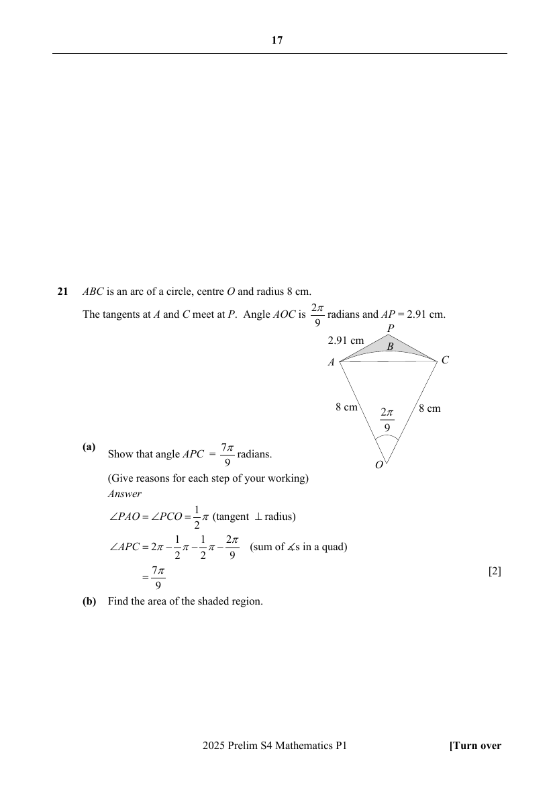

# Crescent Girls' School — Mathematics 4052/01 Paper 1 Marking Scheme (cleaned)

> **Institution:** Crescent Girls' School
> **Exam:** Preliminary Examination 2025
> **Level:** Secondary Four
> **Subjects:** Mathematics
> **Paper:** 4052/01 Paper 1 — Marking Scheme
> **Date:** 21 August 2025
> **Duration:** 2 hours 15 minutes
> **Total Marks:** 90
> **Source:** `CGS-2025-EMATH-PRELIM-P1-MS` (digital PDF — cleaned & reformatted)

---

## Answer all the questions

---

### Q1

> **Marks:** [2]
> **Sub-topic:** Compound interest
> **Page:** 3

$$
8000\left(1+\frac{2}{100\times 4}\right)^{4\times 3.5} = &#36;8578.57
$$

---

### Q2

> **Marks:** (a) [1]; (b) [2]; total [3]
> **Sub-topic:** Trigonometry
> **Page:** 3

**(a)** $AD = 4.32\sin 35^{\circ} = 2.48\text{ cm}$

**(b)**

$$
3.18 = \frac{1}{2}(5.25)(4.32)\sin\angle ACB
$$

Obtuse angle $ACB = 163.7^{\circ}$

---

### Q3

> **Marks:** (a) [2]; (b) [1]; total [3]
> **Sub-topic:** Estimation and density
> **Page:** 4

**(a)** $38\div 19 = 2.0\text{ cm}^{3}$

**(b)** Volume is found by dividing a larger mass by a smaller density. The actual volume is less than the estimated volume.

---

### Q4

> **Marks:** (a) [2]; (b) [2]; total [4]
> **Sub-topic:** Probability
> **Page:** 4

**(a)** $\dfrac{7}{22}$

**(b)** $29$

---

### Q5

> **Marks:** [3]
> **Sub-topic:** Algebraic fractions
> **Page:** 5

$$
\frac{1}{(2x+1)(x-2)}-\frac{2}{x-2} = \frac{-1-4x}{(2x+1)(x-2)}
$$

---

### Q6

> **Marks:** [2]
> **Sub-topic:** Mean, median and mode
> **Page:** 5

$3, 7, 14, 33, 33$

---

### Q7

> **Marks:** (a) [1]; (b) [2]; total [3]
> **Sub-topic:** Percentage change
> **Page:** 6

**(a)** $1.12p$

**(b)** I do not agree as there is only a drop of $21.6\%$ in revenue between 2024 and 2022 instead of $33.6\%$.

$$
1.12p\times 0.7 = 0.784p
$$

---

### Q8

> **Marks:** (a) [2]; (b) [2]; total [4]
> **Sub-topic:** Algebraic fractions
> **Page:** 6

**(a)** $x = \dfrac{5}{11}$

**(b)** $\dfrac{2x+5}{3x+1}$

---

### Q9

> **Marks:** (a) [2]; (b) [1]; total [3]
> **Sub-topic:** Polygons
> **Page:** 7

**(a)** Exterior angle $= 18^{\circ}$, number of sides $= 20$

**(b)** $3240^{\circ}$

---

### Q10

> **Marks:** (a) [1]; (b)(i) [1]; (b)(ii) [1]; (b)(iii) [1]; total [4]
> **Sub-topic:** Sets and Venn diagrams
> **Page:** 7

**(a)** $A' \cap (B' \cap C)$ or $(A \cup B)' \cap C$

**(b) (i)** $\{2\}$

**(ii)** $11$

**(iii)** All elements in Set $A$ are elements in Set $C$, $A \neq C$. Therefore $A \subset C$.

---

### Q11

> **Marks:** [2]
> **Sub-topic:** Quadratic graphs
> **Page:** 8

$$
y = (x+2)^{2}-8 = x^{2}+4x-4
$$

---

### Q12

> **Marks:** (a) [2]; (b) [2]; total [4]
> **Sub-topic:** Similar triangles
> **Page:** 8

**(a)** $\angle ABC = \angle DBA$ (common angle)

$\angle ACB = \angle DAB$ (given)

Therefore $\triangle ABC$ is similar to $\triangle DBA$.

**(b)** $4.55\text{ cm}$

---

### Q13

> **Marks:** (a)(i) [2]; (a)(ii) [2]; (b) [2]; total [6]
> **Sub-topic:** Similarity and proportion
> **Page:** 9

**(a) (i)** $16\text{ cm}$

**(ii)** As the volume of the large bowl is more than $8$ times the volume of the small bowl, the larger bowl gives better value for money.

**(b)** $36\%$

---

### Q14

> **Marks:** [2]
> **Sub-topic:** Indices
> **Page:** 10

$$
1.6x^{4}
$$

---

### Q15

> **Marks:** (a) [1]; (b) [1]; (c) [2]; total [4]
> **Sub-topic:** Map scales
> **Page:** 10

**(a)** $n = 0.25$

**(b)** $10.375\text{ km}$

**(c)** $5\text{ cm}^{2}$

---

### Q16

> **Marks:** (a) [1]; (b) [1]; total [2]
> **Sub-topic:** Expansion of algebraic expressions
> **Page:** 11

**(a)** $9x^{2}-30px+25p^{2}$

**(b)** $p = 3$

---

### Q17

> **Marks:** (a) [3]; (b) [2]; total [5]
> **Sub-topic:** Trigonometry
> **Page:** 11

**(a)**

$$
BD^{2} = 7.6^{2}+8.3^{2}-2(7.6)(8.3)\cos 75^{\circ}
$$

$$
BD = 9.70\text{ cm}
$$

**(b)** $107.9^{\circ}$

---

### Q18

> **Marks:** (a)(i) [1]; (a)(ii) [2]; (b)(i) [1]; (b)(ii) [2]; total [6]
> **Sub-topic:** Prime factors, HCF and LCM
> **Page:** 12

**(a) (i)** $2\times 3^{2}\times 5^{2}\times 7$

**(ii)** $126$ and $525$

**(b) (i)** The indices/powers of the prime factors are even integers. Therefore, $14\times 56$ is a perfect square.

**(ii)** $p = 2$, $q = 7$

---

### Q19

> **Marks:** (a) [2]; (b)(i) [1]; (b)(ii) [2]; total [5]
> **Sub-topic:** Factorisation and quadratic equations
> **Page:** 13

**(a)** $3(8x+3)(2x-1)$

**(b) (i)** $k = 17$

**(ii)** $x = -\dfrac{7}{2}$

---

### Q20

> **Marks:** (a) [1]; (b) [1]; (c) [1]; (d) [1]; (e) [2]; total [6]
> **Sub-topic:** Matrices
> **Page:** 14–15

**(a)**

$$
P = \begin{pmatrix} 210 & 40 & x \\ 325 & 65 & 32 \end{pmatrix}
$$

**(b)**

$$
Q = \begin{pmatrix} 2840+40x \\ 5700 \end{pmatrix}
$$

**(c)** The elements represent the revenue of the bicycle rental station on Saturday and Sunday respectively on that particular week.

**(d)** $x = 13$

**(e)** &#36;4200 on Saturday and &#36;8550 on Sunday

---

### Q21

> **Marks:** (a) [2]; (b) [3]; total [5]
> **Sub-topic:** Arc length, sector area and radians
> **Page:** 16

**(a)** Tangents are perpendicular to the radii, so $\angle OAP = \angle OCP = \dfrac{\pi}{2}$.

$$
\angle APC = 2\pi-\frac{\pi}{2}-\frac{\pi}{2}-\frac{2\pi}{9} = \frac{7\pi}{9}
$$

**(b)** $0.951\text{ cm}^{2}$

---

### Q22

> **Marks:** triangle [1]; (a)(i) [1]; (a)(ii) [1]; (b) [1]; total [4]
> **Sub-topic:** Geometrical constructions
> **Page:** 17

Construct triangle $ABC$ with $AB = 5.8\text{ cm}$, $BC = 7\text{ cm}$ and $AC = 9.5\text{ cm}$.

**(a)** Draw the perpendicular bisector of $AB$ and the angle bisector of angle $CAB$.

**(b)** $X$ lies on the perpendicular bisector of $AB$, inside the triangle, and on the side of the angle bisector nearer to $AC$.

---

### Q23

> **Marks:** (a) [1]; (b) [1]; (c) [1]; total [3]
> **Sub-topic:** Number patterns
> **Page:** 18

**(a)** Figure $6$

**(b)** $L_{n} = 5n+2$

**(c)** Since $n$ is not a positive integer, there is no figure with $83$ lines.

---

### Q24

> **Marks:** (a) [1]; (b) [2]; (c) [2]; total [5]
> **Sub-topic:** Speed-time graphs
> **Page:** 19

**(a)** $2\dfrac{1}{3}\text{ m/s}^{2}$

**(b)** $228\text{ m}$

**(c)** $30\text{ m/s}$
