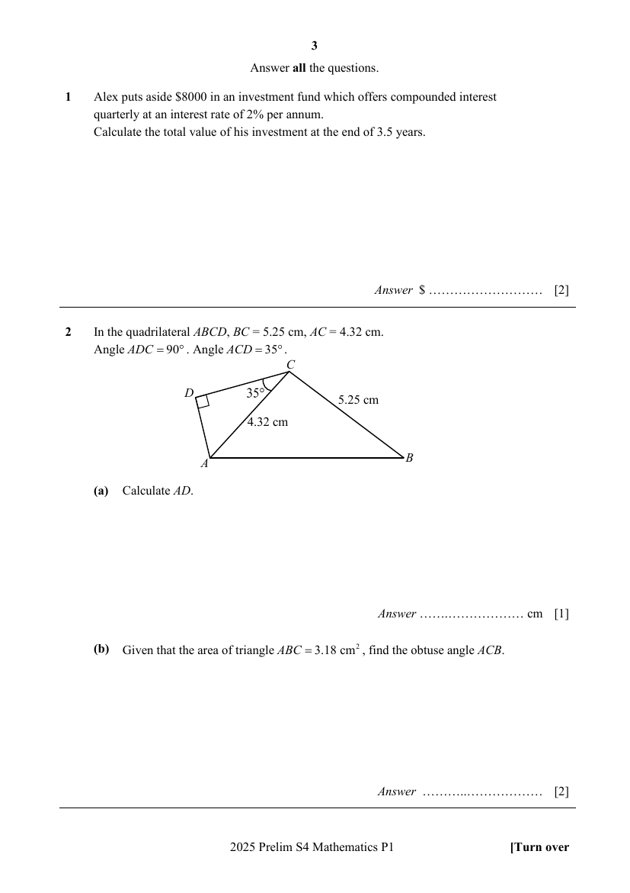
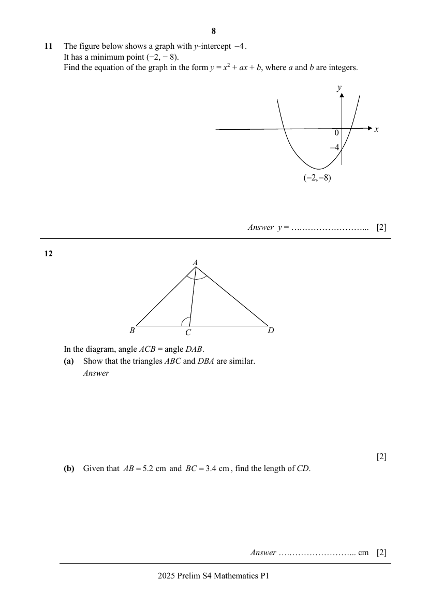
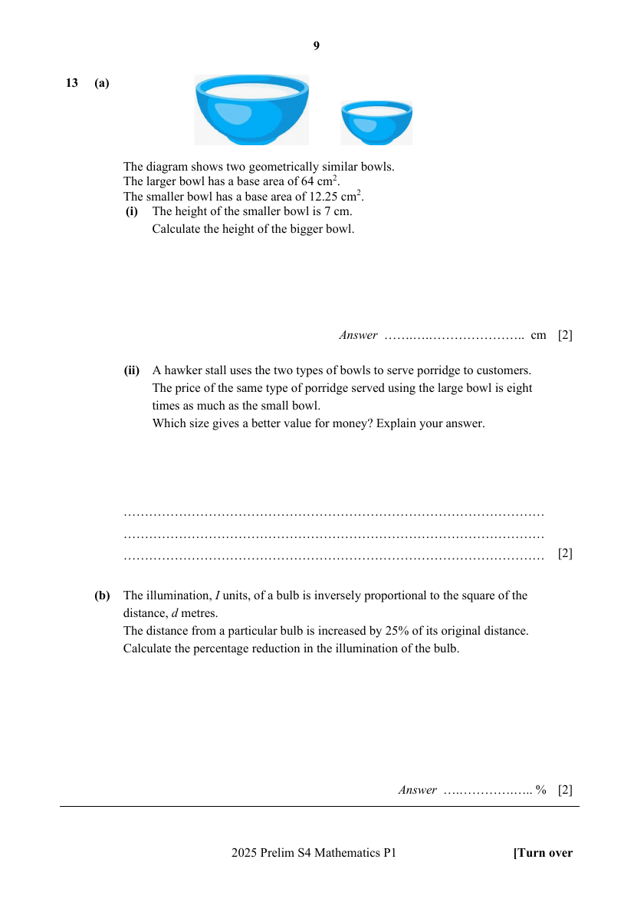
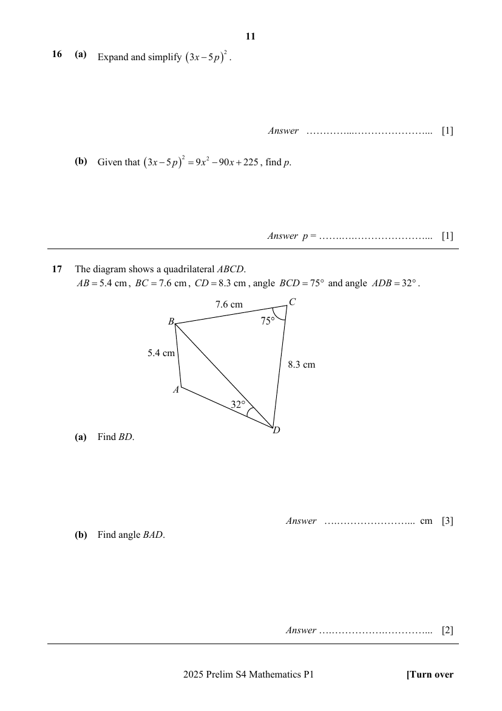
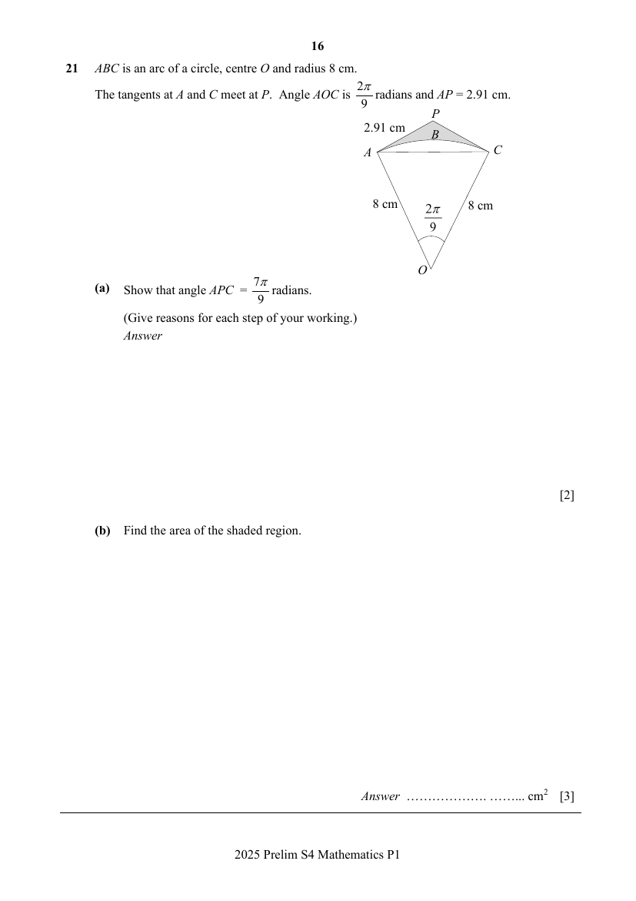
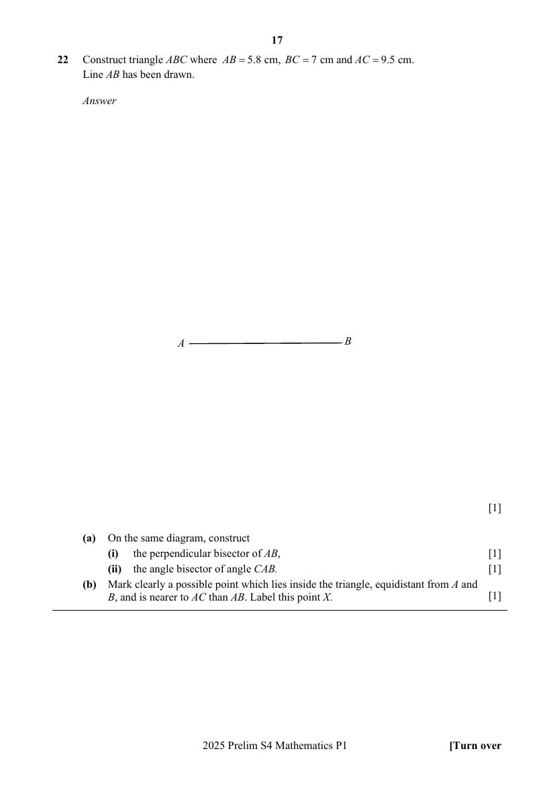
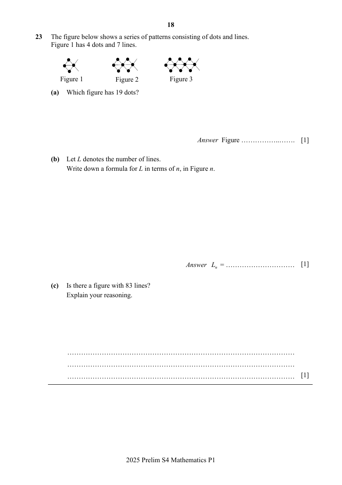
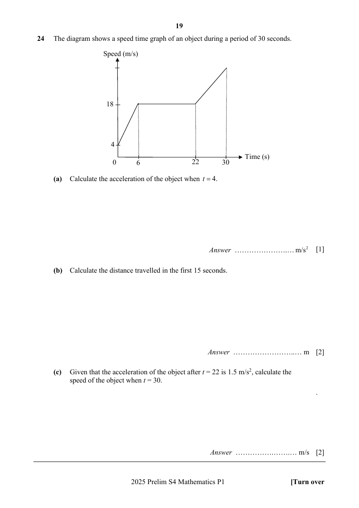

# Crescent Girls' School — Mathematics 4052/01 Paper 1 (cleaned)

> **Institution:** Crescent Girls' School
> **Exam:** Preliminary Examination 2025
> **Level:** Secondary Four
> **Subjects:** Mathematics
> **Paper:** 4052/01 Paper 1
> **Date:** 21 August 2025
> **Duration:** 2 hours 15 minutes
> **Total Marks:** 90
> **Source:** `CGS-2025-EMATH-PRELIM-P1-QP` (digital PDF — cleaned & reformatted)

---

## Instructions

Write your name, register number and class on all the work you hand in.
Write in dark blue or black pen.
You may use an HB pencil for any diagrams or graphs.
Do not use staples, paper clips, glue or correction fluid.

Answer all the questions.
The number of marks is given in brackets [ ] at the end of each question or part question.

If working is needed for any question it must be shown with the answer.
Omission of essential working will result in loss of marks.
The total of the marks for this paper is 90.

The use of an approved scientific calculator is expected, where appropriate.
If the degree of accuracy is not specified in the question, and if the answer is not exact, give the answer to three significant figures. Give answers in degrees to one decimal place.
For $\pi$, use either your calculator value or $3.142$.

---

## Mathematical Formulae

*Compound interest*

$$
\text{Total amount} = P\left(1+\frac{r}{100}\right)^{n}
$$

*Mensuration*

$$
\text{Curved surface area of a cone} = \pi rl
$$

$$
\text{Surface area of a sphere} = 4\pi r^{2}
$$

$$
\text{Volume of a cone} = \frac{1}{3}\pi r^{2}h
$$

$$
\text{Volume of a sphere} = \frac{4}{3}\pi r^{3}
$$

$$
\text{Area of triangle } ABC = \frac{1}{2}ab\sin C
$$

$$
\text{Arc length} = r\theta,\text{ where }\theta\text{ is in radians}
$$

$$
\text{Sector area} = \frac{1}{2}r^{2}\theta,\text{ where }\theta\text{ is in radians}
$$

*Trigonometry*

$$
\frac{a}{\sin A} = \frac{b}{\sin B} = \frac{c}{\sin C}
$$

$$
a^{2} = b^{2}+c^{2}-2bc\cos A
$$

*Statistics*

$$
\text{Mean} = \frac{\sum fx}{\sum f}
$$

$$
\text{Standard deviation} = \sqrt{\frac{\sum fx^{2}}{\sum f}-\left(\frac{\sum fx}{\sum f}\right)^{2}}
$$

---

## Answer all the questions

---

### Q1

> **Marks:** 2
> **Topic:** N3 Percentage
> **Sub-topic:** Percentage
> **LO:** [[context/subjects/o-level-e-maths/learning-objectives/o-level-e-maths-N3d.md|N3d]]
> **Page:** 3

Alex puts aside &#36;8000 in an investment fund which offers compounded interest quarterly at an interest rate of $2\%$ per annum.
Calculate the total value of his investment at the end of $3.5$ years. [2]

---

### Q2

> **Marks:** (a) 1, (b) 2; total 3
> **Page:** 3

In the quadrilateral $ABCD$, $BC = 5.25\text{ cm}$, $AC = 4.32\text{ cm}$.
Angle $ADC = 90^{\circ}$. Angle $ACD = 35^{\circ}$.

**(a)** Calculate $AD$. [1]
> **Topic:** G4 Pythagoras' theorem and trigonometry
> **Sub-topic:** Pythagoras' theorem and trigonometry
> **LO:** [[context/subjects/o-level-e-maths/learning-objectives/o-level-e-maths-G4e.md|G4e]]

**(b)** Given that the area of triangle $ABC = 3.18\text{ cm}^{2}$, find the obtuse angle $ACB$. [2]
> **Topic:** G4 Pythagoras' theorem and trigonometry
> **Sub-topic:** Pythagoras' theorem and trigonometry
> **LO:** [[context/subjects/o-level-e-maths/learning-objectives/o-level-e-maths-G4e.md|G4e]]

---

### Q3

> **Marks:** (a) 2, (b) 1; total 3
> **Page:** 4

The density of gold is $19.32\text{ g/cm}^{3}$.
The mass of a gold bracelet is $37.51\text{ g}$.

**(a)** By rounding these numbers correct to $2$ significant figures, find an estimate of the volume of the gold bracelet.
Show the numbers you use. [2]
> **Topic:** G5 Mensuration
> **Sub-topic:** Mensuration
> **LO:** [[context/subjects/o-level-e-maths/learning-objectives/o-level-e-maths-G5c.md|G5c]]

**(b)** Without doing any further calculation, explain why the actual volume of the gold bracelet is less than the answer to part (a). [1]
> **Topic:** G5 Mensuration
> **Sub-topic:** Mensuration
> **LO:** [[context/subjects/o-level-e-maths/learning-objectives/o-level-e-maths-G5c.md|G5c]]

---

### Q4

> **Marks:** (a) 2, (b) 2; total 4
> **Page:** 4

A box contains $10$ blue water bottles, $7$ green water bottles and $5$ red water bottles.

**(a)** Two water bottles are drawn from the box.
In the first draw, a water bottle is randomly drawn from the box with no replacement.
What is the probability that a green bottle will be drawn on the second draw? [2]
> **Topic:** S2 Probability
> **Sub-topic:** Probability
> **LO:** [[context/subjects/o-level-e-maths/learning-objectives/o-level-e-maths-S2c.md|S2c]]

**(b)** How many red water bottles should be added into the bag such that the probability of drawing a red water bottle on the first draw is $\dfrac{2}{3}$? [2]
> **Topic:** S2 Probability
> **Sub-topic:** Probability
> **LO:** [[context/subjects/o-level-e-maths/learning-objectives/o-level-e-maths-S2c.md|S2c]]

---

### Q5

> **Marks:** 3
> **Topic:** N7 Equations and inequalities
> **Sub-topic:** Equations and inequalities
> **LO:** [[context/subjects/o-level-e-maths/learning-objectives/o-level-e-maths-N7b.md|N7b]]
> **Page:** 5

Express $\dfrac{1}{2x^{2}-3x-2}-\dfrac{2}{x-2}$ as a single fraction in its simplest form. [3]

---

### Q6

> **Marks:** 2
> **Topic:** S1 Data handling and analysis
> **Sub-topic:** Data handling and analysis
> **LO:** [[context/subjects/o-level-e-maths/learning-objectives/o-level-e-maths-S1f.md|S1f]]
> **Page:** 5

Five positive integers have a mean of $18$, a median of $14$ and a mode of $33$.
Given that the two smallest integers are prime numbers, find the five numbers. [2]

---

### Q7

> **Marks:** (a) 1, (b) 2; total 3
> **Page:** 6

In 2023, the revenue of a company was $12\%$ more than in 2022.
In 2024, it was $30\%$ less than in 2023.

**(a)** Given that $p$ represents the revenue of the company in 2022, express the revenue in 2023 in terms of $p$. [1]
> **Topic:** N3 Percentage
> **Sub-topic:** Percentage
> **LO:** [[context/subjects/o-level-e-maths/learning-objectives/o-level-e-maths-N3d.md|N3d]]

**(b)** Ben said that in 2024, the revenue of the company was $33.6\%$ less than in 2022.
Do you agree?
You must show your calculations. [2]
> **Topic:** N3 Percentage
> **Sub-topic:** Percentage
> **LO:** [[context/subjects/o-level-e-maths/learning-objectives/o-level-e-maths-N3d.md|N3d]]

---

### Q8

> **Marks:** (a) 2, (b) 2; total 4
> **Page:** 6

**(a)** Solve $\dfrac{3}{1-x}-\dfrac{2}{3x-1} = 0$. [2]
> **Topic:** N7 Equations and inequalities
> **Sub-topic:** Equations and inequalities
> **LO:** [[context/subjects/o-level-e-maths/learning-objectives/o-level-e-maths-N7b.md|N7b]]

**(b)** Simplify $\dfrac{4x^{2}-25}{6x^{2}-13x-5}$. [2]
> **Topic:** N7 Equations and inequalities
> **Sub-topic:** Equations and inequalities
> **LO:** [[context/subjects/o-level-e-maths/learning-objectives/o-level-e-maths-N7b.md|N7b]]

---

### Q9

> **Marks:** (a) 2, (b) 1; total 3
> **Page:** 7

The ratio of exterior angle : interior angle of a regular polygon is $1 : 9$.
Calculate

**(a)** the number of sides of the polygon, [2]
> **Topic:** G1 Angles, triangles and polygons
> **Sub-topic:** Angles, triangles and polygons
> **LO:** [[context/subjects/o-level-e-maths/learning-objectives/o-level-e-maths-G1f.md|G1f]]

**(b)** the sum of the interior angles of the polygon. [1]
> **Topic:** G1 Angles, triangles and polygons
> **Sub-topic:** Angles, triangles and polygons
> **LO:** [[context/subjects/o-level-e-maths/learning-objectives/o-level-e-maths-G1f.md|G1f]]

---

### Q10

> **Marks:** (a) 1, (b)(i) 1, (b)(ii) 1, (b)(iii) 1; total 4
> **Page:** 7

**(a)** Write down the set represented by the following shaded region. [1]
> **Topic:** N8 Set language and notation
> **Sub-topic:** Set language and notation
> **LO:** [[context/subjects/o-level-e-maths/learning-objectives/o-level-e-maths-N8c.md|N8c]]

**(b)** Given that $\varepsilon = \{x : x\text{ is an integer, }1 \leq x < 13\}$, and its subsets $A$, $B$ and $C$ are

$A = \{x : x\text{ is a factor of }16\}$

$B = \{x : x\text{ is a prime number}\}$

$C = \{x : 9-x \geq 1\}$

**(i)** List the elements in the set $A \cap B$. [1]
> **Topic:** N8 Set language and notation
> **Sub-topic:** Set language and notation
> **LO:** [[context/subjects/o-level-e-maths/learning-objectives/o-level-e-maths-N8c.md|N8c]]

**(ii)** Find $n(B' \cup C)$. [1]
> **Topic:** N8 Set language and notation
> **Sub-topic:** Set language and notation
> **LO:** [[context/subjects/o-level-e-maths/learning-objectives/o-level-e-maths-N8c.md|N8c]]

**(iii)** Explain clearly if $A \subset C$. [1]
> **Topic:** N8 Set language and notation
> **Sub-topic:** Set language and notation
> **LO:** [[context/subjects/o-level-e-maths/learning-objectives/o-level-e-maths-N8c.md|N8c]]

---

### Q11

> **Marks:** 2
> **Topic:** N6 Functions and graphs
> **Sub-topic:** Functions and graphs
> **LO:** [[context/subjects/o-level-e-maths/learning-objectives/o-level-e-maths-N6c.md|N6c]]
> **Page:** 8

The figure below shows a graph with $y$-intercept $-4$.
It has a minimum point $(-2, -8)$.
Find the equation of the graph in the form $y = x^{2}+ax+b$, where $a$ and $b$ are integers. [2]

---

### Q12

> **Marks:** (a) 2, (b) 2; total 4
> **Page:** 8

In the diagram, angle $ACB =$ angle $DAB$.

**(a)** Show that the triangles $ABC$ and $DBA$ are similar. [2]
> **Topic:** G2 Congruence and similarity
> **Sub-topic:** Congruence and similarity
> **LO:** [[context/subjects/o-level-e-maths/learning-objectives/o-level-e-maths-G2i.md|G2i]]

**(b)** Given that $AB = 5.2\text{ cm}$ and $BC = 3.4\text{ cm}$, find the length of $CD$. [2]
> **Topic:** G2 Congruence and similarity
> **Sub-topic:** Congruence and similarity
> **LO:** [[context/subjects/o-level-e-maths/learning-objectives/o-level-e-maths-G2i.md|G2i]]

---

### Q13

> **Marks:** (a)(i) 2, (a)(ii) 2, (b) 2; total 6
> **Page:** 9

**(a)** The diagram shows two geometrically similar bowls.
The larger bowl has a base area of $64\text{ cm}^{2}$.
The smaller bowl has a base area of $12.25\text{ cm}^{2}$.

**(i)** The height of the smaller bowl is $7\text{ cm}$.
Calculate the height of the bigger bowl. [2]
> **Topic:** G2 Congruence and similarity
> **Sub-topic:** Congruence and similarity
> **LO:** [[context/subjects/o-level-e-maths/learning-objectives/o-level-e-maths-G2i.md|G2i]]

**(ii)** A hawker stall uses the two types of bowls to serve porridge to customers.
The price of the same type of porridge served using the large bowl is eight times as much as the small bowl.
Which size gives a better value for money? Explain your answer. [2]
> **Topic:** G2 Congruence and similarity
> **Sub-topic:** Congruence and similarity
> **LO:** [[context/subjects/o-level-e-maths/learning-objectives/o-level-e-maths-G2i.md|G2i]]

**(b)** The illumination, $I$ units, of a bulb is inversely proportional to the square of the distance, $d$ metres.
The distance from a particular bulb is increased by $25\%$ of its original distance.
Calculate the percentage reduction in the illumination of the bulb. [2]
> **Topic:** G2 Congruence and similarity
> **Sub-topic:** Congruence and similarity
> **LO:** [[context/subjects/o-level-e-maths/learning-objectives/o-level-e-maths-G2i.md|G2i]]

---

### Q14

> **Marks:** 2
> **Topic:** N1 Numbers and their operations
> **Sub-topic:** Numbers and their operations
> **LO:** [[context/subjects/o-level-e-maths/learning-objectives/o-level-e-maths-N1j.md|N1j]]
> **Page:** 10

Simplify $\left(\dfrac{x^{4}}{100}\right)^{\frac{1}{2}}\div\left(64x^{3}\right)^{-\frac{2}{3}}$. [2]

---

### Q15

> **Marks:** (a) 1, (b) 1, (c) 2; total 4
> **Page:** 10

A map is drawn to a scale of $1 : 25\,000$.

**(a)** This scale can be expressed as $1$ centimetre represents $n$ kilometres.
Find $n$. [1]
> **Topic:** N2 Ratio and proportion
> **Sub-topic:** Ratio and proportion
> **LO:** [[context/subjects/o-level-e-maths/learning-objectives/o-level-e-maths-N2c.md|N2c]]

**(b)** The distance between two points on the map is $41.5$ centimetres.
Find the actual distance, in kilometres, between the two points. [1]
> **Topic:** N2 Ratio and proportion
> **Sub-topic:** Ratio and proportion
> **LO:** [[context/subjects/o-level-e-maths/learning-objectives/o-level-e-maths-N2c.md|N2c]]

**(c)** A farm has an area of $51.2$ square centimetres on this map.
Find the area of the farm, in square centimetres, on a second map which is drawn to a scale of $1 : 80\,000$. [2]
> **Topic:** N2 Ratio and proportion
> **Sub-topic:** Ratio and proportion
> **LO:** [[context/subjects/o-level-e-maths/learning-objectives/o-level-e-maths-N2c.md|N2c]]

---

### Q16

> **Marks:** (a) 1, (b) 1; total 2
> **Page:** 11

**(a)** Expand and simplify $(3x-5p)^{2}$. [1]
> **Topic:** N5 Algebraic expressions and formulae
> **Sub-topic:** Algebraic expressions and formulae
> **LO:** [[context/subjects/o-level-e-maths/learning-objectives/o-level-e-maths-N5j.md|N5j]]

**(b)** Given that $(3x-5p)^{2} = 9x^{2}-90x+225$, find $p$. [1]
> **Topic:** N5 Algebraic expressions and formulae
> **Sub-topic:** Algebraic expressions and formulae
> **LO:** [[context/subjects/o-level-e-maths/learning-objectives/o-level-e-maths-N5j.md|N5j]]

---

### Q17

> **Marks:** (a) 3, (b) 2; total 5
> **Page:** 11

The diagram shows a quadrilateral $ABCD$.
$AB = 5.4\text{ cm}$, $BC = 7.6\text{ cm}$, $CD = 8.3\text{ cm}$, angle $BCD = 75^{\circ}$ and angle $ADB = 32^{\circ}$.

**(a)** Find $BD$. [3]
> **Topic:** G4 Pythagoras' theorem and trigonometry
> **Sub-topic:** Pythagoras' theorem and trigonometry
> **LO:** [[context/subjects/o-level-e-maths/learning-objectives/o-level-e-maths-G4a.md|G4a]]

**(b)** Find angle $BAD$. [2]
> **Topic:** G4 Pythagoras' theorem and trigonometry
> **Sub-topic:** Pythagoras' theorem and trigonometry
> **LO:** [[context/subjects/o-level-e-maths/learning-objectives/o-level-e-maths-G4a.md|G4a]]

---

### Q18

> **Marks:** (a)(i) 1, (a)(ii) 2, (b)(i) 1, (b)(ii) 2; total 6
> **Page:** 12

**(a)** **(i)** Write $3150$ as a product of its prime factors. [1]
> **Topic:** N1 Numbers and their operations
> **Sub-topic:** Numbers and their operations
> **LO:** [[context/subjects/o-level-e-maths/learning-objectives/o-level-e-maths-N1b.md|N1b]]

**(ii)** The highest common factor (HCF) of two numbers is $21$.
The lower common multiple (LCM) of the two numbers is $3150$.
Both numbers are greater than $70$. Find the two numbers. [2]
> **Topic:** N1 Numbers and their operations
> **Sub-topic:** Numbers and their operations
> **LO:** [[context/subjects/o-level-e-maths/learning-objectives/o-level-e-maths-N1b.md|N1b]]

**(b)** **(i)** Use prime factors to explain why $14\times 56$ is a perfect square. [1]
> **Topic:** N1 Numbers and their operations
> **Sub-topic:** Numbers and their operations
> **LO:** [[context/subjects/o-level-e-maths/learning-objectives/o-level-e-maths-N1b.md|N1b]]

**(ii)** $p$ and $q$ are both prime numbers.
Find the values of $p$ and $q$ so that $14\times 56\div\dfrac{p}{q}$ is a perfect cube. [2]
> **Topic:** N1 Numbers and their operations
> **Sub-topic:** Numbers and their operations
> **LO:** [[context/subjects/o-level-e-maths/learning-objectives/o-level-e-maths-N1b.md|N1b]]

---

### Q19

> **Marks:** (a) 2, (b)(i) 1, (b)(ii) 2; total 5
> **Page:** 13

**(a)** Factorise completely $49x^{2}-(x+3)^{2}$. [2]
> **Topic:** N5 Algebraic expressions and formulae
> **Sub-topic:** Algebraic expressions and formulae
> **LO:** [[context/subjects/o-level-e-maths/learning-objectives/o-level-e-maths-N5h.md|N5h]]

**(b)** One solution of the equation $6x^{2}+kx-14 = 0$, where $k$ is an integer, is $x = \dfrac{2}{3}$.

Find

**(i)** the value of $k$, [1]
> **Topic:** N5 Algebraic expressions and formulae
> **Sub-topic:** Algebraic expressions and formulae
> **LO:** [[context/subjects/o-level-e-maths/learning-objectives/o-level-e-maths-N5h.md|N5h]]

**(ii)** the other solution to the equation. [2]
> **Topic:** N5 Algebraic expressions and formulae
> **Sub-topic:** Algebraic expressions and formulae
> **LO:** [[context/subjects/o-level-e-maths/learning-objectives/o-level-e-maths-N5h.md|N5h]]

---

### Q20

> **Marks:** (a) 1, (b) 1, (c) 1, (d) 1, (e) 2; total 6
> **Page:** 14–15

A bicycle rental station charges by hour for the rental of its bicycles.
On a particular week, the normal bicycles, children bicycles, and family bicycles were rented for $210$ hours, $40$ hours and $x$ hours respectively on Saturday.
On Sunday, the normal bicycles, children bicycles, and family bicycles were rented for $325$ hours, $65$ hours and $32$ hours, respectively.

**(a)** Represent the above information in a $2\times 3$ matrix $P$. [1]
> **Topic:** N9 Matrices
> **Sub-topic:** Matrices
> **LO:** [[context/subjects/o-level-e-maths/learning-objectives/o-level-e-maths-N9b.md|N9b]]

**(b)** The charges for one hour’s rental is &#36;12 for normal bicycle, &#36;8 for children bicycle and &#36;40 for family bicycle.
Find, in terms of $x$, the matrix $Q = P\begin{pmatrix} 12 \\ 8 \\ 40 \end{pmatrix}$. [1]
> **Topic:** N9 Matrices
> **Sub-topic:** Matrices
> **LO:** [[context/subjects/o-level-e-maths/learning-objectives/o-level-e-maths-N9b.md|N9b]]

**(c)** Explain what each element in $Q$ represents. [1]
> **Topic:** N9 Matrices
> **Sub-topic:** Matrices
> **LO:** [[context/subjects/o-level-e-maths/learning-objectives/o-level-e-maths-N9b.md|N9b]]

**(d)** The revenue from rental of family bicycles on that Saturday is equivalent to the revenue from the rental of children bicycles on that Sunday.
Calculate the value of $x$. [1]
> **Topic:** N9 Matrices
> **Sub-topic:** Matrices
> **LO:** [[context/subjects/o-level-e-maths/learning-objectives/o-level-e-maths-N9b.md|N9b]]

**(e)** In the following week, a special event was held near the bicycle rental station.
The rental revenue increased by $25\%$ and $50\%$ compared to the previous Saturday and Sunday respectively.
Using your answer in (d) and matrix multiplication only, calculate the revenue on Saturday and Sunday, respectively. [2]
> **Topic:** N9 Matrices
> **Sub-topic:** Matrices
> **LO:** [[context/subjects/o-level-e-maths/learning-objectives/o-level-e-maths-N9b.md|N9b]]

---

### Q21

> **Marks:** (a) 2, (b) 3; total 5
> **Page:** 16

$ABC$ is an arc of a circle, centre $O$ and radius $8\text{ cm}$.
The tangents at $A$ and $C$ meet at $P$. Angle $AOC$ is $\dfrac{2\pi}{9}$ radians and $AP = 2.91\text{ cm}$.

**(a)** Show that angle $APC = \dfrac{7\pi}{9}$ radians.
(Give reasons for each step of your working.) [2]
> **Topic:** G5 Mensuration
> **Sub-topic:** Mensuration
> **LO:** [[context/subjects/o-level-e-maths/learning-objectives/o-level-e-maths-G5g.md|G5g]]

**(b)** Find the area of the shaded region. [3]
> **Topic:** G5 Mensuration
> **Sub-topic:** Mensuration
> **LO:** [[context/subjects/o-level-e-maths/learning-objectives/o-level-e-maths-G5b.md|G5b]]

---

### Q22

> **Marks:** triangle 1, (a)(i) 1, (a)(ii) 1, (b) 1; total 4
> **Page:** 17

Construct triangle $ABC$ where $AB = 5.8\text{ cm}$, $BC = 7\text{ cm}$ and $AC = 9.5\text{ cm}$.
Line $AB$ has been drawn. [1]

**(a)** On the same diagram, construct

**(i)** the perpendicular bisector of $AB$, [1]
> **Topic:** G2 Congruence and similarity
> **Sub-topic:** Congruence and similarity
> **LO:** [[context/subjects/o-level-e-maths/learning-objectives/o-level-e-maths-G2e.md|G2e]]

**(ii)** the angle bisector of angle $CAB$. [1]
> **Topic:** G2 Congruence and similarity
> **Sub-topic:** Congruence and similarity
> **LO:** [[context/subjects/o-level-e-maths/learning-objectives/o-level-e-maths-G2e.md|G2e]]

**(b)** Mark clearly a possible point which lies inside the triangle, equidistant from $A$ and $B$, and is nearer to $AC$ than $AB$. Label this point $X$. [1]
> **Topic:** G2 Congruence and similarity
> **Sub-topic:** Congruence and similarity
> **LO:** [[context/subjects/o-level-e-maths/learning-objectives/o-level-e-maths-G2e.md|G2e]]

---

### Q23

> **Marks:** (a) 1, (b) 1, (c) 1; total 3
> **Page:** 18

The figure below shows a series of patterns consisting of dots and lines.
Figure 1 has $4$ dots and $7$ lines.

**(a)** Which figure has $19$ dots? [1]
> **Topic:** N3 Percentage
> **Sub-topic:** Percentage
> **LO:** [[context/subjects/o-level-e-maths/learning-objectives/o-level-e-maths-N3e.md|N3e]]

**(b)** Let $L$ denotes the number of lines.
Write down a formula for $L$ in terms of $n$, in Figure $n$. [1]
> **Topic:** N3 Percentage
> **Sub-topic:** Percentage
> **LO:** [[context/subjects/o-level-e-maths/learning-objectives/o-level-e-maths-N3e.md|N3e]]

**(c)** Is there a figure with $83$ lines?
Explain your reasoning. [1]
> **Topic:** N3 Percentage
> **Sub-topic:** Percentage
> **LO:** [[context/subjects/o-level-e-maths/learning-objectives/o-level-e-maths-N3e.md|N3e]]

---

### Q24

> **Marks:** (a) 1, (b) 2, (c) 2; total 5
> **Page:** 19

The diagram shows a speed time graph of an object during a period of $30$ seconds.

**(a)** Calculate the acceleration of the object when $t = 4$. [1]
> **Topic:** N6 Functions and graphs
> **Sub-topic:** Functions and graphs
> **LO:** [[context/subjects/o-level-e-maths/learning-objectives/o-level-e-maths-N6c.md|N6c]]

**(b)** Calculate the distance travelled in the first $15$ seconds. [2]
> **Topic:** N6 Functions and graphs
> **Sub-topic:** Functions and graphs
> **LO:** [[context/subjects/o-level-e-maths/learning-objectives/o-level-e-maths-N6c.md|N6c]]

**(c)** Given that the acceleration of the object after $t = 22$ is $1.5\text{ m/s}^{2}$, calculate the speed of the object when $t = 30$. [2]
> **Topic:** N6 Functions and graphs
> **Sub-topic:** Functions and graphs
> **LO:** [[context/subjects/o-level-e-maths/learning-objectives/o-level-e-maths-N6c.md|N6c]]
