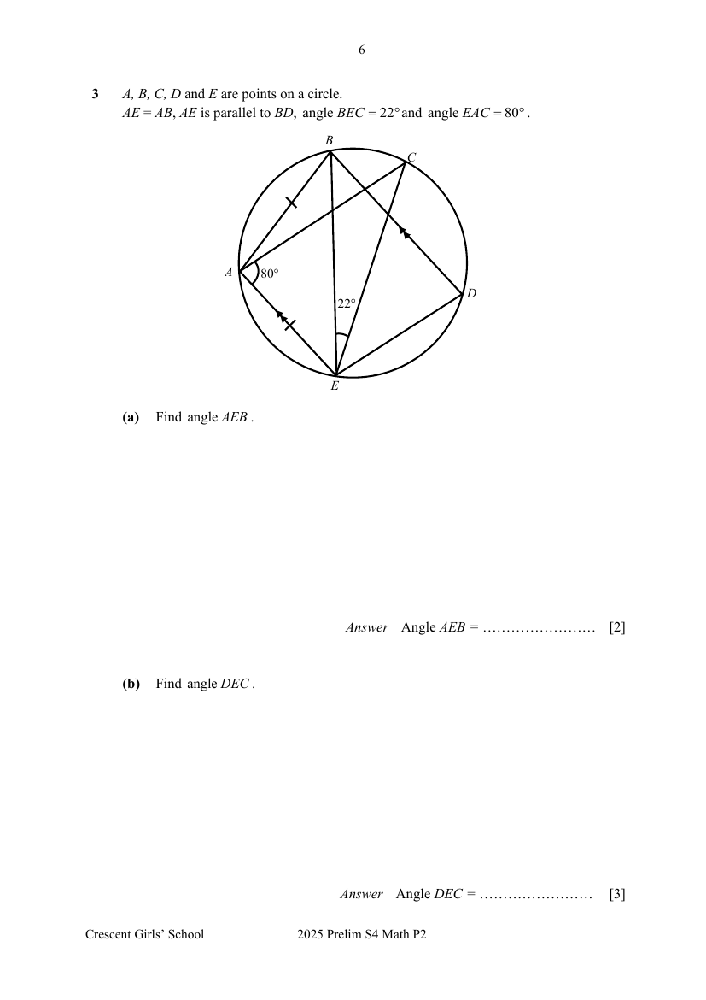
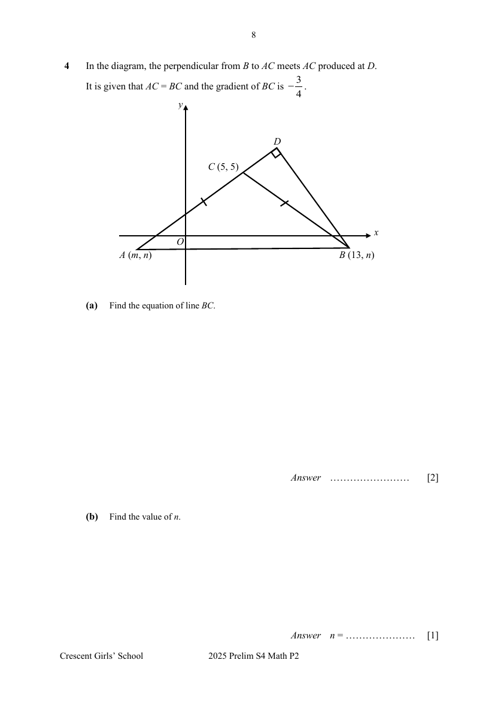
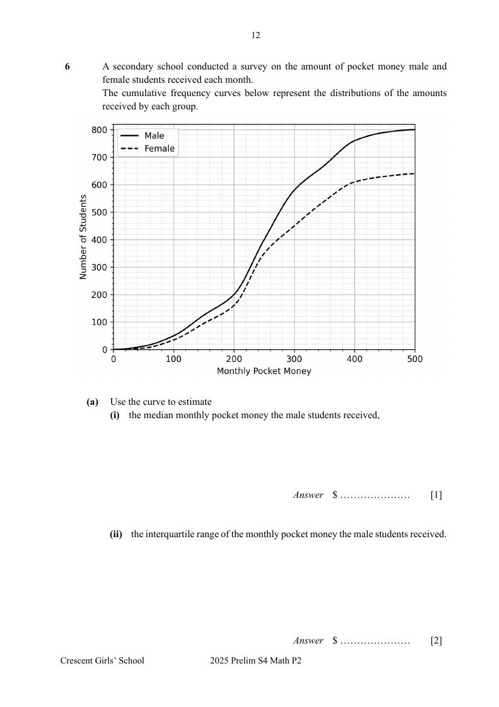
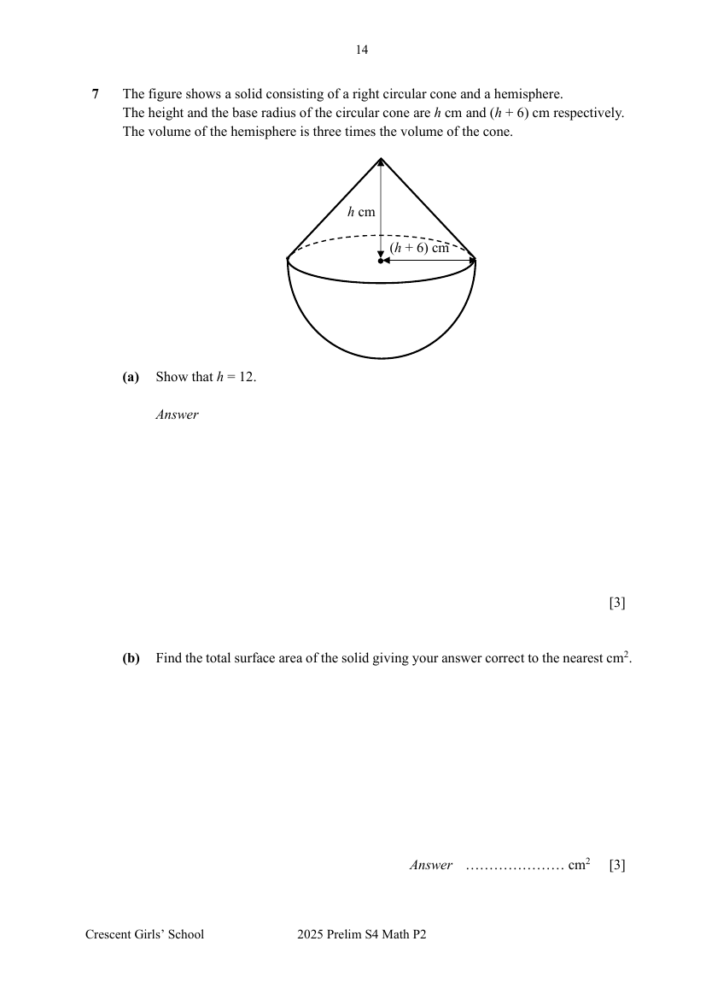
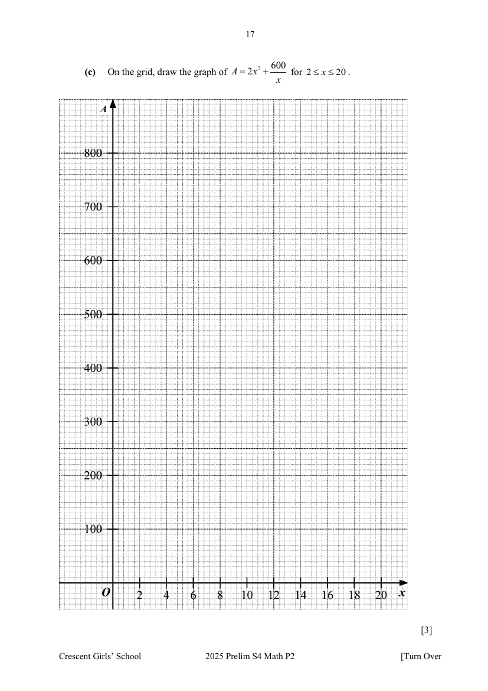
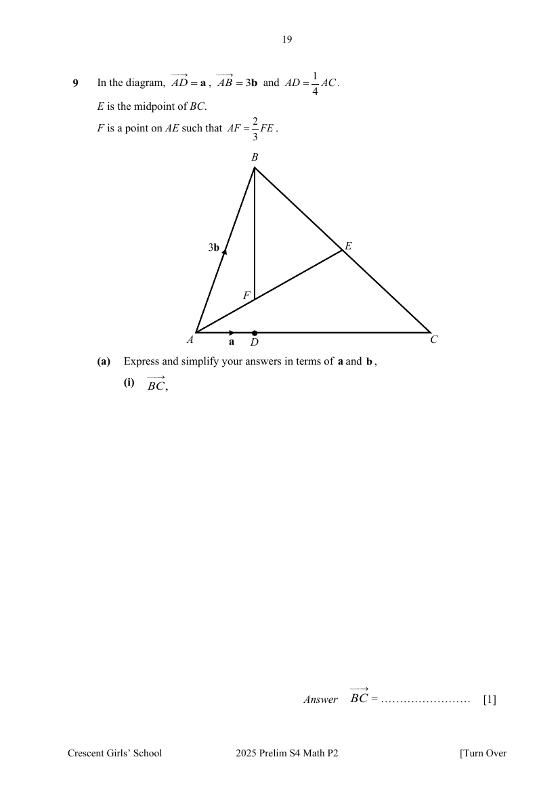

# Crescent Girls' School — Mathematics 4052/02 Paper 2 (cleaned)

> **Institution:** Crescent Girls' School
> **Exam:** Preliminary Examination 2025
> **Level:** Secondary Four
> **Subjects:** Mathematics
> **Paper:** 4052/02 Paper 2
> **Date:** 26 August 2025
> **Duration:** 2 hours 15 minutes
> **Total Marks:** 90
> **Source:** `CGS-2025-EMATH-PRELIM-P2-QP` (digital PDF — cleaned & reformatted)

---

## Instructions

Write your name, register number and class on all the work you hand in.
Write in dark blue or black pen.
You may use an HB pencil for any diagrams or graphs.
Do not use staples, paper clips, glue or correction fluid.

Answer all the questions.
The number of marks is given in brackets [ ] at the end of each question or part question.

If working is needed for any question it must be shown with the answer.
Omission of essential working will result in loss of marks.
The total of the marks for this paper is 90.

The use of an approved scientific calculator is expected, where appropriate.
If the degree of accuracy is not specified in the question, and if the answer is not exact, give the answer to three significant figures. Give answers in degrees to one decimal place.
For $\pi$, use either your calculator value or $3.142$.

---

## Mathematical Formulae

*Compound interest*

$$
\text{Total amount} = P\left(1+\frac{r}{100}\right)^{n}
$$

*Mensuration*

$$
\text{Curved surface area of a cone} = \pi rl
$$

$$
\text{Surface area of a sphere} = 4\pi r^{2}
$$

$$
\text{Volume of a cone} = \frac{1}{3}\pi r^{2}h
$$

$$
\text{Volume of a sphere} = \frac{4}{3}\pi r^{3}
$$

$$
\text{Area of triangle } ABC = \frac{1}{2}ab\sin C
$$

$$
\text{Arc length} = r\theta,\text{ where }\theta\text{ is in radians}
$$

$$
\text{Sector area} = \frac{1}{2}r^{2}\theta,\text{ where }\theta\text{ is in radians}
$$

*Trigonometry*

$$
\frac{a}{\sin A} = \frac{b}{\sin B} = \frac{c}{\sin C}
$$

$$
a^{2} = b^{2}+c^{2}-2bc\cos A
$$

*Statistics*

$$
\text{Mean} = \frac{\sum fx}{\sum f}
$$

$$
\text{Standard deviation} = \sqrt{\frac{\sum fx^{2}}{\sum f}-\left(\frac{\sum fx}{\sum f}\right)^{2}}
$$

---

## Answer all the questions

---

### Q1

> **Marks:** (a) 3, (b)(i) 1, (b)(ii) 2, (c) 4; total 10
> **Page:** 3–4

**(a)** Solve the inequality $2-x < \dfrac{3x+4}{2} < 5x-3$. [3]
> **Topic:** N7 Equations and inequalities
> **Sub-topic:** Equations and inequalities
> **LO:** [[context/subjects/o-level-e-maths/learning-objectives/o-level-e-maths-N7g.md|N7g]]

**(b)** It is given that $F = \dfrac{m(7a-2x^{2})}{3a}$, where $m \neq 0$ and $a \neq 0$.

**(i)** Find, in terms of $a$, the value of $F$ when $x = -a$ and $m = 3$. [1]
> **Topic:** N7 Equations and inequalities
> **Sub-topic:** Equations and inequalities
> **LO:** [[context/subjects/o-level-e-maths/learning-objectives/o-level-e-maths-N7g.md|N7g]]

**(ii)** Express $x$ in terms of $F$, $a$ and $m$. [2]
> **Topic:** N7 Equations and inequalities
> **Sub-topic:** Equations and inequalities
> **LO:** [[context/subjects/o-level-e-maths/learning-objectives/o-level-e-maths-N7g.md|N7g]]

**(c)** Solve the equation $\dfrac{x+2}{x+5}+\dfrac{3x}{x-2} = 7$. [4]
> **Topic:** N7 Equations and inequalities
> **Sub-topic:** Equations and inequalities
> **LO:** [[context/subjects/o-level-e-maths/learning-objectives/o-level-e-maths-N7e.md|N7e]]

---

### Q2

> **Marks:** (a) 2, (b) 2, (c)(i) 2, (c)(ii) 2; total 8
> **Page:** 5

A company conducted a survey in a girl’s school and found that a user’s likelihood of logging into a particular app each day depends on whether she logged in the previous day.

If the user logs in on a particular day, the probability that she logs in again the following day is $0.7$.
If the user does not log in on a particular day, the probability that she continues not logging in the next day is $0.8$.

It is given that Emily logs in on Monday.

**(a)** Find the probability that Emily logs in on Tuesday, Wednesday and Thursday. [2]
> **Topic:** S2 Probability
> **Sub-topic:** Probability
> **LO:** [[context/subjects/o-level-e-maths/learning-objectives/o-level-e-maths-S2c.md|S2c]]

**(b)** Find the probability that Emily does not log in on Wednesday. [2]
> **Topic:** S2 Probability
> **Sub-topic:** Probability
> **LO:** [[context/subjects/o-level-e-maths/learning-objectives/o-level-e-maths-S2c.md|S2c]]

**(c)** Each time the user logs in, she will earn $10$ reward points.
If the user does not log in, no reward points will be given.

**(i)** Find the probability that Emily earns exactly $20$ points by Wednesday. [2]
> **Topic:** S2 Probability
> **Sub-topic:** Probability
> **LO:** [[context/subjects/o-level-e-maths/learning-objectives/o-level-e-maths-S2c.md|S2c]]

**(ii)** Find the probability that Emily earns more than $10$ points by Wednesday. [2]
> **Topic:** S2 Probability
> **Sub-topic:** Probability
> **LO:** [[context/subjects/o-level-e-maths/learning-objectives/o-level-e-maths-S2c.md|S2c]]

---

### Q3

> **Marks:** (a) 2, (b) 3, (c) 2; total 7
> **Page:** 6–7

$A$, $B$, $C$, $D$ and $E$ are points on a circle.
$AE = AB$, $AE$ is parallel to $BD$, angle $BEC = 22^{\circ}$ and angle $EAC = 80^{\circ}$.

**(a)** Find angle $AEB$. [2]
> **Topic:** G3 Properties of circles
> **Sub-topic:** Properties of circles
> **LO:** [[context/subjects/o-level-e-maths/learning-objectives/o-level-e-maths-G3b.md|G3b]]

**(b)** Find angle $DEC$. [3]
> **Topic:** G3 Properties of circles
> **Sub-topic:** Properties of circles
> **LO:** [[context/subjects/o-level-e-maths/learning-objectives/o-level-e-maths-G3b.md|G3b]]

**(c)** Angle $AFE = 78^{\circ}$.
Determine the position of point $F$.
Justify your answer. [2]
> **Topic:** G3 Properties of circles
> **Sub-topic:** Properties of circles
> **LO:** [[context/subjects/o-level-e-maths/learning-objectives/o-level-e-maths-G3b.md|G3b]]

---

### Q4

> **Marks:** (a) 2, (b) 1, (c) 1, (d) 2, (e) 3; total 9
> **Page:** 8–9

In the diagram, the perpendicular from $B$ to $AC$ meets $AC$ produced at $D$.
It is given that $AC = BC$ and the gradient of $BC$ is $-\dfrac{3}{4}$.

**(a)** Find the equation of line $BC$. [2]
> **Topic:** G6 Coordinate geometry
> **Sub-topic:** Coordinate geometry
> **LO:** [[context/subjects/o-level-e-maths/learning-objectives/o-level-e-maths-G6c.md|G6c]]

**(b)** Find the value of $n$. [1]
> **Topic:** G6 Coordinate geometry
> **Sub-topic:** Coordinate geometry
> **LO:** [[context/subjects/o-level-e-maths/learning-objectives/o-level-e-maths-G6c.md|G6c]]

**(c)** Show that $m = -3$. [1]
> **Topic:** G6 Coordinate geometry
> **Sub-topic:** Coordinate geometry
> **LO:** [[context/subjects/o-level-e-maths/learning-objectives/o-level-e-maths-G6c.md|G6c]]

**(d)** Find the area of triangle $ABC$. [2]
> **Topic:** G6 Coordinate geometry
> **Sub-topic:** Coordinate geometry
> **LO:** [[context/subjects/o-level-e-maths/learning-objectives/o-level-e-maths-G6c.md|G6c]]

**(e)** Hence, find the length of $BD$. [3]
> **Topic:** G6 Coordinate geometry
> **Sub-topic:** Coordinate geometry
> **LO:** [[context/subjects/o-level-e-maths/learning-objectives/o-level-e-maths-G6c.md|G6c]]

---

### Q5

> **Marks:** (a) 2, (b) 2, (c) 2, (d) 3; total 9
> **Page:** 10–11

$A$, $B$ and $C$ are points on the horizontal ground.
$B$ is at a bearing of $290^{\circ}$ and $800\text{ m}$ away from $A$.
$C$ is due north of $A$ and at a bearing of $60^{\circ}$ from $B$.

**(a)** Find $BC$. [2]
> **Topic:** G4 Pythagoras' theorem and trigonometry
> **Sub-topic:** Pythagoras' theorem and trigonometry
> **LO:** [[context/subjects/o-level-e-maths/learning-objectives/o-level-e-maths-G4g.md|G4g]]

**(b)** Show that $AC$ is approximately $707.64\text{ m}$. [2]
> **Topic:** G4 Pythagoras' theorem and trigonometry
> **Sub-topic:** Pythagoras' theorem and trigonometry
> **LO:** [[context/subjects/o-level-e-maths/learning-objectives/o-level-e-maths-G4g.md|G4g]]

$CT$ is a vertical tower at $C$.
When Betty is at $A$, the angle of elevation of the top of the tower, $T$, is $20^{\circ}$.

**(c)** Find $CT$. [2]
> **Topic:** G4 Pythagoras' theorem and trigonometry
> **Sub-topic:** Pythagoras' theorem and trigonometry
> **LO:** [[context/subjects/o-level-e-maths/learning-objectives/o-level-e-maths-G4g.md|G4g]]

**(d)** Find the largest angle of elevation of $T$ as Betty walks from $A$ to $B$. [3]
> **Topic:** G4 Pythagoras' theorem and trigonometry
> **Sub-topic:** Pythagoras' theorem and trigonometry
> **LO:** [[context/subjects/o-level-e-maths/learning-objectives/o-level-e-maths-G4g.md|G4g]]

---

### Q6

> **Marks:** (a)(i) 1, (a)(ii) 2, (b) 2, (c) 2, (d) 1; total 8
> **Page:** 12–13

A secondary school conducted a survey on the amount of pocket money male and female students received each month.
The cumulative frequency curves below represent the distributions of the amounts received by each group.

**(a)** Use the curve to estimate

**(i)** the median monthly pocket money the male students received, [1]
> **Topic:** S1 Data handling and analysis
> **Sub-topic:** Data handling and analysis
> **LO:** [[context/subjects/o-level-e-maths/learning-objectives/o-level-e-maths-S1f.md|S1f]]

**(ii)** the interquartile range of the monthly pocket money the male students received. [2]
> **Topic:** S1 Data handling and analysis
> **Sub-topic:** Data handling and analysis
> **LO:** [[context/subjects/o-level-e-maths/learning-objectives/o-level-e-maths-S1f.md|S1f]]

**(b)** Find the number of students who received more than &#36;300 of pocket money each month. [2]
> **Topic:** S1 Data handling and analysis
> **Sub-topic:** Data handling and analysis
> **LO:** [[context/subjects/o-level-e-maths/learning-objectives/o-level-e-maths-S1f.md|S1f]]

**(c)** Amy said, “In this survey, the percentage of male students who received above &#36;300 of pocket money each month is higher than the percentage of female students who received above &#36;300 of pocket money each month.”
Do you agree with this statement?
Justify your answer. [2]
> **Topic:** N3 Percentage
> **Sub-topic:** Percentage
> **LO:** [[context/subjects/o-level-e-maths/learning-objectives/o-level-e-maths-N3d.md|N3d]]

**(d)** The school realised that there is a mistake in the data.
One of the male student’s monthly pocket money should be &#36;300 instead of &#36;250.
How does this affect the accuracy of the interquartile range of the male students’ monthly pocket money? [1]
> **Topic:** S1 Data handling and analysis
> **Sub-topic:** Data handling and analysis
> **LO:** [[context/subjects/o-level-e-maths/learning-objectives/o-level-e-maths-S1f.md|S1f]]

---

### Q7

> **Marks:** (a) 3, (b) 3, (c) 3; total 9
> **Page:** 14–15

The figure shows a solid consisting of a right circular cone and a hemisphere.
The height and the base radius of the circular cone are $h\text{ cm}$ and $(h+6)\text{ cm}$ respectively.
The volume of the hemisphere is three times the volume of the cone.

**(a)** Show that $h = 12$. [3]
> **Topic:** G5 Mensuration
> **Sub-topic:** Mensuration
> **LO:** [[context/subjects/o-level-e-maths/learning-objectives/o-level-e-maths-G5c.md|G5c]]

**(b)** Find the total surface area of the solid giving your answer correct to the nearest $\text{cm}^{2}$. [3]
> **Topic:** G5 Mensuration
> **Sub-topic:** Mensuration
> **LO:** [[context/subjects/o-level-e-maths/learning-objectives/o-level-e-maths-G5c.md|G5c]]

**(c)** Cathy buys a tin of paint that can cover a surface area of $0.5\text{ m}^{2}$.
She cuts the solid into $2$ identical parts and plans to paint all surfaces of the two parts with the can of paint.
Does she have enough paint?
Explain your answer. [3]
> **Topic:** G5 Mensuration
> **Sub-topic:** Mensuration
> **LO:** [[context/subjects/o-level-e-maths/learning-objectives/o-level-e-maths-G5c.md|G5c]]

---

### Q8

> **Marks:** (a) 2, (b) 1, (c) 3, (d) 1, (e)(i) 1, (e)(ii) 2; total 10
> **Page:** 16–18

A cuboid has a square base of sides $x\text{ cm}$.
Its height is $h\text{ cm}$ and its volume is $150\text{ cm}^{3}$.

**(a)** Show that the total surface area of the cuboid, $A = 2x^{2}+\dfrac{600}{x}$. [2]
> **Topic:** N6 Functions and graphs
> **Sub-topic:** Functions and graphs
> **LO:** [[context/subjects/o-level-e-maths/learning-objectives/o-level-e-maths-N6c.md|N6c]]

**(b)** Complete the table of values for $A = 2x^{2}+\dfrac{600}{x}$. [1]
> **Topic:** N6 Functions and graphs
> **Sub-topic:** Functions and graphs
> **LO:** [[context/subjects/o-level-e-maths/learning-objectives/o-level-e-maths-N6c.md|N6c]]

| $x$ | $2$ | $4$ | $6$ | $8$ | $10$ | $12$ | $14$ | $16$ | $18$ | $20$ |
| --- | --- | --- | --- | --- | --- | --- | --- | --- | --- | --- |
| $A$ | $308$ | $182$ | $172$ | $203$ | $260$ | $338$ | | $550$ | $681$ | $830$ |

**(c)** On the grid, draw the graph of $A = 2x^{2}+\dfrac{600}{x}$ for $2 \leq x \leq 20$. [3]
> **Topic:** N6 Functions and graphs
> **Sub-topic:** Functions and graphs
> **LO:** [[context/subjects/o-level-e-maths/learning-objectives/o-level-e-maths-N6c.md|N6c]]

**(d)** Can the total surface area of the cuboid be $150\text{ cm}^{2}$?
Explain your answer. [1]
> **Topic:** N6 Functions and graphs
> **Sub-topic:** Functions and graphs
> **LO:** [[context/subjects/o-level-e-maths/learning-objectives/o-level-e-maths-N6c.md|N6c]]

**(e)** A manufacturer designs cuboid packaging boxes with square bases. The total surface area must not exceed the material cost limit which is given by $A = 25x+150$.

**(i)** On the same grid, draw the straight line $A = 25x+150$ for $2 \leq x \leq 20$. [1]
> **Topic:** N6 Functions and graphs
> **Sub-topic:** Functions and graphs
> **LO:** [[context/subjects/o-level-e-maths/learning-objectives/o-level-e-maths-N6c.md|N6c]]

**(ii)** Use the graph to find the possible lengths of the sides of the cuboid where the material cost is maximised. [2]
> **Topic:** N6 Functions and graphs
> **Sub-topic:** Functions and graphs
> **LO:** [[context/subjects/o-level-e-maths/learning-objectives/o-level-e-maths-N6c.md|N6c]]

---

### Q9

> **Marks:** (a)(i) 1, (a)(ii) 2, (a)(iii) 1, (b) 3, (c)(i) 1, (c)(ii) 2; total 10
> **Page:** 19–21

In the diagram, $\overrightarrow{AD} = \mathbf{a}$, $\overrightarrow{AB} = 3\mathbf{b}$ and $\overrightarrow{AD} = \dfrac{1}{4}\overrightarrow{AC}$.
$E$ is the midpoint of $BC$.
$F$ is a point on $AE$ such that $AF = \dfrac{2}{3}FE$.

**(a)** Express and simplify your answers in terms of $\mathbf{a}$ and $\mathbf{b}$,

**(i)** $\overrightarrow{BC}$, [1]
> **Topic:** G7 Vectors in two dimensions
> **Sub-topic:** Vectors in two dimensions
> **LO:** [[context/subjects/o-level-e-maths/learning-objectives/o-level-e-maths-G7h.md|G7h]]

**(ii)** $\overrightarrow{AF}$, [2]
> **Topic:** G7 Vectors in two dimensions
> **Sub-topic:** Vectors in two dimensions
> **LO:** [[context/subjects/o-level-e-maths/learning-objectives/o-level-e-maths-G7h.md|G7h]]

**(iii)** $\overrightarrow{BF}$. [1]
> **Topic:** G7 Vectors in two dimensions
> **Sub-topic:** Vectors in two dimensions
> **LO:** [[context/subjects/o-level-e-maths/learning-objectives/o-level-e-maths-G7h.md|G7h]]

**(b)** Explain if $BF$ produced will meet $AC$ at $D$. [3]
> **Topic:** G7 Vectors in two dimensions
> **Sub-topic:** Vectors in two dimensions
> **LO:** [[context/subjects/o-level-e-maths/learning-objectives/o-level-e-maths-G7h.md|G7h]]

**(c)** Find the value of

**(i)** $\dfrac{\text{area of }\triangle ABF}{\text{area of }\triangle ABE}$, [1]
> **Topic:** G7 Vectors in two dimensions
> **Sub-topic:** Vectors in two dimensions
> **LO:** [[context/subjects/o-level-e-maths/learning-objectives/o-level-e-maths-G7h.md|G7h]]

**(ii)** $\dfrac{\text{area of }\triangle BEF}{\text{area of }\triangle ABC}$. [2]
> **Topic:** G7 Vectors in two dimensions
> **Sub-topic:** Vectors in two dimensions
> **LO:** [[context/subjects/o-level-e-maths/learning-objectives/o-level-e-maths-G7h.md|G7h]]

---

### Q10

> **Marks:** (a) 2, (b) 2, (c) 5, (d) 1; total 10
> **Page:** 22–24

A secondary school is planning a major upgrade by setting up a solar panel system.
The goal is to choose the system that offers the best financial value over its entire lifespan.
The school is evaluating two solar panel providers, SolarSmart and EcoSun.

School’s current electricity usage:

- School uses an average of $17\,000$ kilowatt hours (kWh) of electricity per year.
- The cost of electricity is &#36;0.30 per kWh.

Information on the solar panel providers:

| Company | Number of panels | Type of panel | Total installation cost | Annual maintenance cost |
| --- | --- | --- | --- | --- |
| SolarSmart | 50 | Fixed tilt at $25^{\circ}$ | &#36;66 000 | &#36;340 |
| EcoSun | 45 | Adjustable tilt | &#36;64 000 | &#36;360 |

- Each panel’s wattage is $320$ Watts (W) at $100\%$ efficiency.
- The average sun angle at the school's location is $30^{\circ}$.
- For every $1^{\circ}$ difference between the panel tilt and the sun angle, the panel’s efficiency drops by $1\%$.
- Both solar panel systems are guaranteed to last for $25$ years.

Additional information:

- Singapore gets an average of $4.2$ hours of peak sunlight per day.
- Solar panel output in daily watt hours = solar panel wattage × peak sunlight hours × $75\%$.
- The school can sell any extra energy it does not use back to the grid for &#36;0.20 per kWh.

**(a)** Calculate, in watt hours, the daily power output per panel for SolarSmart. [2]
> **Topic:** N3 Percentage
> **Sub-topic:** Percentage
> **LO:** [[context/subjects/o-level-e-maths/learning-objectives/o-level-e-maths-N3b.md|N3b]]

**(b)** Find the total daily power output from each company, leaving your answer in kilowatt hours (kWh). [2]
> **Topic:** N3 Percentage
> **Sub-topic:** Percentage
> **LO:** [[context/subjects/o-level-e-maths/learning-objectives/o-level-e-maths-N3b.md|N3b]]

**(c)** Recommend which company the school should choose.
Justify your decision and show your calculations clearly. [5]
> **Topic:** N3 Percentage
> **Sub-topic:** Percentage
> **LO:** [[context/subjects/o-level-e-maths/learning-objectives/o-level-e-maths-N3b.md|N3b]]

**(d)** State one assumption made in your calculation in (c). [1]
> **Topic:** N3 Percentage
> **Sub-topic:** Percentage
> **LO:** [[context/subjects/o-level-e-maths/learning-objectives/o-level-e-maths-N3b.md|N3b]]

---

END OF PAPER
