# Catholic High School — Mathematics 4052/01 Paper 1 (cleaned)

> **Institution:** Catholic High School
> **Exam:** Preliminary Examination 2025
> **Level:** Secondary 4 (O-Level Programme)
> **Subjects:** Mathematics
> **Paper:** 4052/01 Paper 1
> **Date:** 25 August 2025
> **Duration:** 2 hours 15 minutes
> **Total Marks:** 90
> **Source:** `CAT HIGH 2025 EMATH PRELIM P1 QP.pdf` (cleaned & reformatted)

---

## Instructions

Write your name, index number and class on all the work you hand in.
Write in dark blue or black pen.
You may use a soft pencil for any diagrams or graphs.
Do not use staples, paper clips, highlighters, glue or correction fluid.

Answer all questions in the space provided.
If working is needed for any question, it must be shown with the answer.
Omission of essential working will result in loss of marks.
The use of an approved scientific calculator is expected, where appropriate.
If the degree of accuracy is not specified in the question, and if the answer is not exact, give the answer to three significant figures. Give answers in degrees to one decimal place.
For $\pi$, use either your calculator value or $3.142$, unless the question requires the answer in terms of $\pi$.
The number of marks is given in brackets [ ] at the end of each question or part question.
The total of the marks for this paper is 90.

Additional Materials: Booklets A and B.
Candidates answer in the space provided on the Question Paper.

---

## Mathematical Formulae

*Compound interest*

$$
\text{Total amount} = P\left(1+\frac{r}{100}\right)^{n}
$$

*Mensuration*

$$
\text{Curved surface area of a cone} = \pi rl
$$

$$
\text{Surface area of a sphere} = 4\pi r^{2}
$$

$$
\text{Volume of a cone} = \frac{1}{3}\pi r^{2}h
$$

$$
\text{Volume of a sphere} = \frac{4}{3}\pi r^{3}
$$

$$
\text{Area of triangle } ABC = \frac{1}{2}ab\sin C
$$

$$
\text{Arc length} = r\theta,\text{ where }\theta\text{ is in radians}
$$

$$
\text{Sector area} = \frac{1}{2}r^{2}\theta,\text{ where }\theta\text{ is in radians}
$$

*Trigonometry*

$$
\frac{a}{\sin A} = \frac{b}{\sin B} = \frac{c}{\sin C}
$$

$$
a^{2} = b^{2}+c^{2}-2bc\cos A
$$

*Statistics*

$$
\text{Mean} = \frac{\sum fx}{\sum f}
$$

$$
\text{Standard deviation} = \sqrt{\frac{\sum fx^{2}}{\sum f}-\left(\frac{\sum fx}{\sum f}\right)^{2}}
$$

---

## Section A — Answer all questions

### Q1

> **Marks:** 3
> **Topic:** N7 Equations and inequalities
> **Sub-topic:** Equations and inequalities
> **LO:** [[context/subjects/o-level-e-maths/learning-objectives/o-level-e-maths-N7b.md|N7b]]
> **Page:** 3

Simplify $\dfrac{5}{2-x}+\dfrac{4x-8}{(x-2)^{2}}$. [3]

---

### Q2

> **Marks:** 2
> **Topic:** N5 Algebraic expressions and formulae
> **Sub-topic:** Algebraic expressions and formulae
> **LO:** [[context/subjects/o-level-e-maths/learning-objectives/o-level-e-maths-N5k.md|N5k]]
> **Page:** 3

Rearrange the formula to make $p$ the subject.

$$
pr = \frac{6p^{2}-1}{p}
$$

[2]

---

### Q3

> **Marks:** (a) 2, (b) 2; total 4
> **Page:** 4

Factorise the following expressions completely.

**(a)** $5m+2n-mn-10$ [2]
> **Topic:** N5 Algebraic expressions and formulae
> **Sub-topic:** Algebraic expressions and formulae
> **LO:** [[context/subjects/o-level-e-maths/learning-objectives/o-level-e-maths-N5h.md|N5h]]

**(b)** $x^{2}+4xy-9+4y^{2}$ [2]
> **Topic:** N5 Algebraic expressions and formulae
> **Sub-topic:** Algebraic expressions and formulae
> **LO:** [[context/subjects/o-level-e-maths/learning-objectives/o-level-e-maths-N5h.md|N5h]]

---

### Q4

> **Marks:** 2
> **Topic:** N5 Algebraic expressions and formulae
> **Sub-topic:** Algebraic expressions and formulae
> **LO:** [[context/subjects/o-level-e-maths/learning-objectives/o-level-e-maths-N5h.md|N5h]]
> **Page:** 5

The product of two numbers, $x$ and $y$, is $6300$ and their highest common factor is $6$. Given $6 < x < y$, find the value of $x$ and the value of $y$. [2]

---

### Q5

> **Marks:** 2
> **Topic:** N1 Numbers and their operations
> **Sub-topic:** Numbers and their operations
> **LO:** [[context/subjects/o-level-e-maths/learning-objectives/o-level-e-maths-N1j.md|N1j]]
> **Page:** 5

Simplify $\left(\dfrac{49x^{4}}{y^{16}}\right)^{-\frac{3}{2}}$, leaving your answer in positive indices. [2]

---

### Q6

> **Marks:** (a) 2, (b) 2; total 4
> **Page:** 6

**(a)** Express $-x^{2}-8x-19$ in the form of $-(x+p)^{2}+q$. [2]
> **Topic:** N6 Functions and graphs
> **Sub-topic:** Functions and graphs
> **LO:** [[context/subjects/o-level-e-maths/learning-objectives/o-level-e-maths-N6c.md|N6c]]

**(b)** Hence, sketch the graph of $y=-x^{2}-8x-19$ on the axes below.

Indicate clearly the turning point and axes intercept(s). [2]
> **Topic:** N6 Functions and graphs
> **Sub-topic:** Functions and graphs
> **LO:** [[context/subjects/o-level-e-maths/learning-objectives/o-level-e-maths-N6c.md|N6c]]

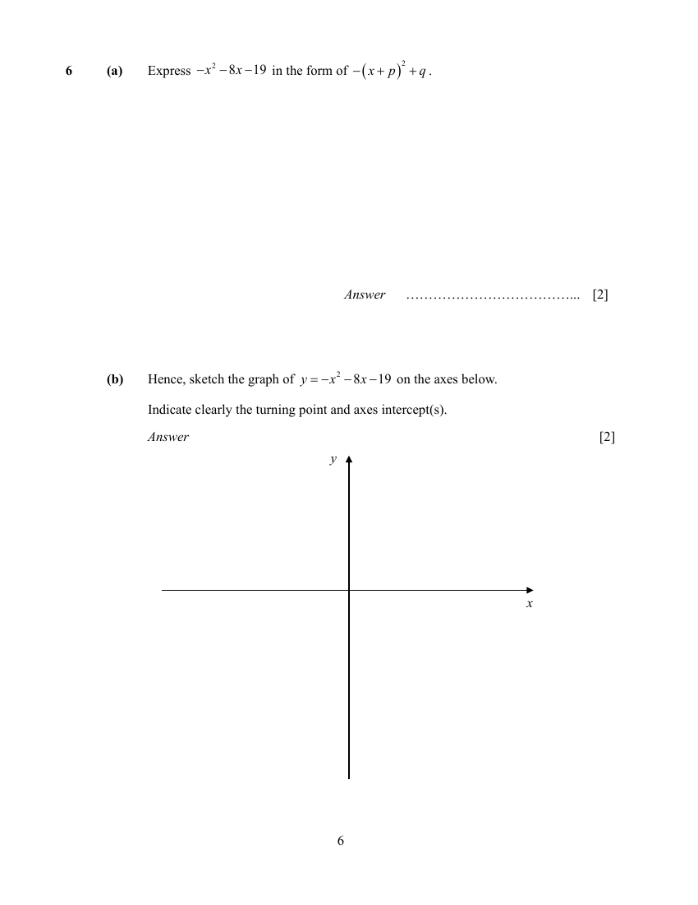

---

### Q7

> **Marks:** 2
> **Topic:** N2 Ratio and proportion
> **Sub-topic:** Ratio and proportion
> **LO:** [[context/subjects/o-level-e-maths/learning-objectives/o-level-e-maths-N2a.md|N2a]]
> **Page:** 7

Andy places an order for some polo shirts that come in three sizes $S$, $M$ and $L$.

The ratio of the number of polo shirts $S:M = 3:8$.

The ratio of the number of polo shirts $S:L = 5:2$.

There are $306$ more polo shirts in size $M$ than $L$.

Find the total number of polo shirts ordered. [2]

---

### Q8

> **Marks:** 2
> **Topic:** N1 Numbers and their operations
> **Sub-topic:** Numbers and their operations
> **LO:** [[context/subjects/o-level-e-maths/learning-objectives/o-level-e-maths-N1j.md|N1j]]
> **Page:** 7

Solve $2^{p}\times 6 = 96$. [2]

---

### Q9

> **Marks:** inequality 2, number line 1; total 3
> **Topic:** N7 Equations and inequalities
> **Sub-topic:** Equations and inequalities
> **LO:** [[context/subjects/o-level-e-maths/learning-objectives/o-level-e-maths-N7g.md|N7g]]
> **Page:** 8

Solve the inequality $x-6 \leq 3x-17 < 32-4x$.

Show your solution on the number line below. [2]

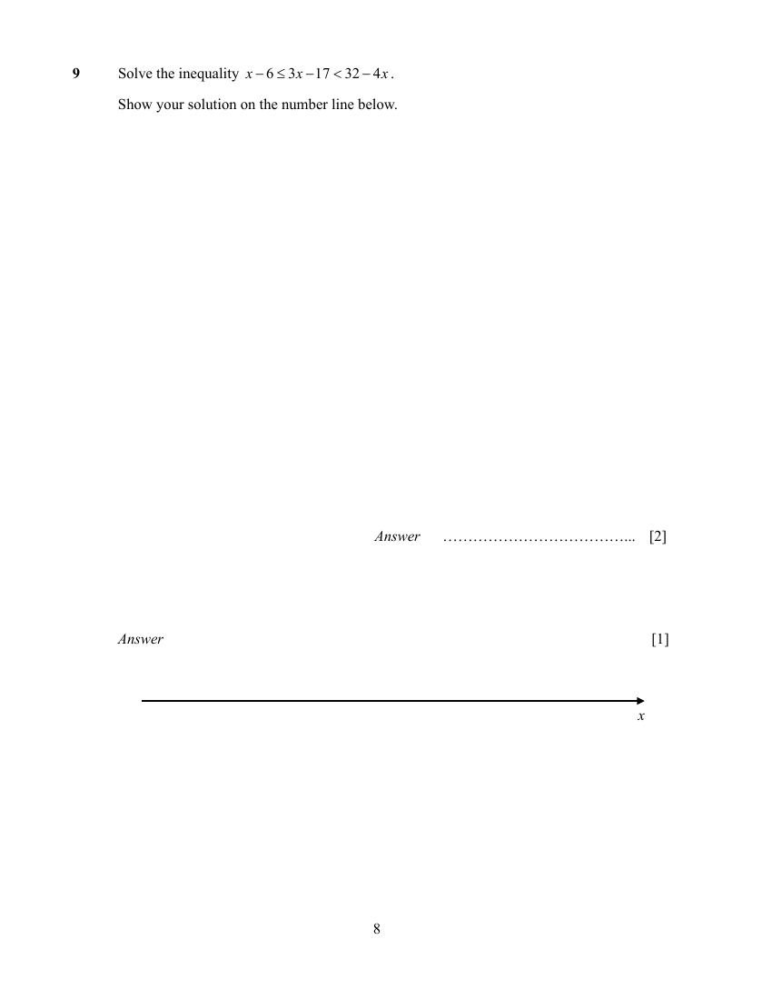

[1]

---

### Q10

> **Marks:** 2
> **Topic:** N3 Percentage
> **Sub-topic:** Percentage
> **LO:** [[context/subjects/o-level-e-maths/learning-objectives/o-level-e-maths-N3d.md|N3d]]
> **Page:** 9

The cash price of a refrigerator is &#36;2499.

The hire-purchase price of the refrigerator is &#36;2999.

The hire-purchase price is a deposit of $25\%$ of the cash price plus $24$ equal monthly payments.

Calculate one monthly payment. [2]

---

### Q11

> **Marks:** (a) 2, (b) 2; total 4
> **Page:** 10

Michael deposited some money into bank A which pays a simple interest rate of $3\%$ per annum for $18$ months.

If he had deposited the same amount of money with bank B, which pays a simple interest rate of $2.5\%$ per annum for $24$ months, he would receive &#36;500 more in interest.

**(a)** Find the amount of money he deposited. [2]
> **Topic:** N3 Percentage
> **Sub-topic:** Percentage
> **LO:** [[context/subjects/o-level-e-maths/learning-objectives/o-level-e-maths-N3d.md|N3d]]

**(b)** Find the amount of interest Michael would receive if he were to deposit his money into bank C, which pays a compound interest of $1.9\%$ per annum compounded every $6$ months for $24$ months. [2]
> **Topic:** N3 Percentage
> **Sub-topic:** Percentage
> **LO:** [[context/subjects/o-level-e-maths/learning-objectives/o-level-e-maths-N3d.md|N3d]]

---

### Q12

> **Marks:** 2
> **Topic:** S1 Data handling and analysis
> **Sub-topic:** Data handling and analysis
> **LO:** [[context/subjects/o-level-e-maths/learning-objectives/o-level-e-maths-S1b.md|S1b]]
> **Page:** 11

The number of university graduates for the year $2000$ and year $2020$ are represented by the chart below. Statistics have shown that the number of university graduates in year $2020$ is doubled the number of university graduates in year $2000$.

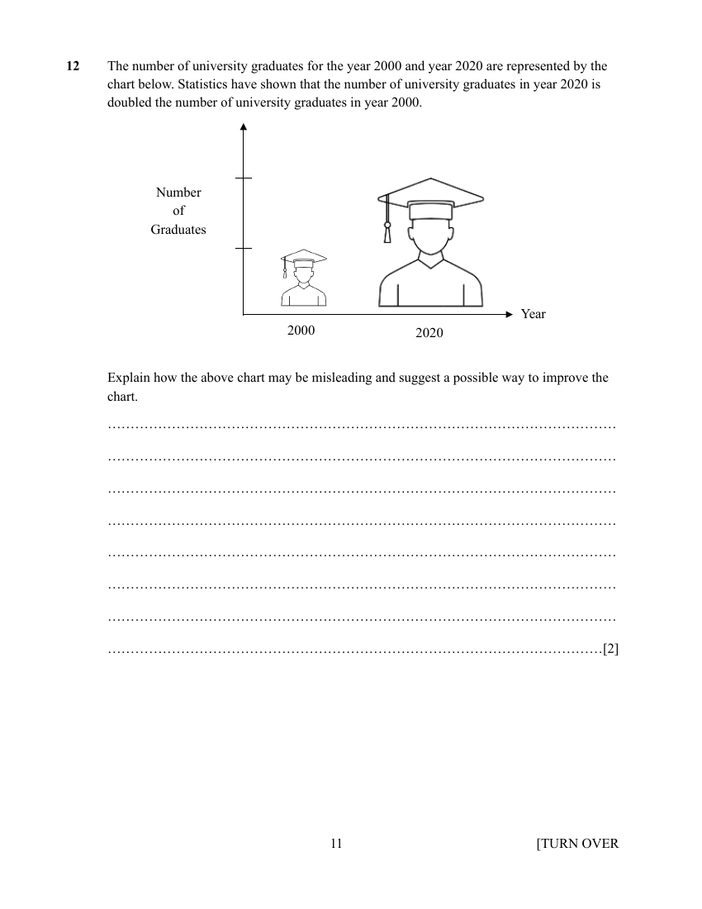

Explain how the above chart may be misleading and suggest a possible way to improve the chart. [2]

---

### Q13

> **Marks:** (a) 2, (b) 2; total 4
> **Page:** 12

The vertices of $A$ and $B$ are $(-3,8)$ and $(7,2)$.

The line $BC$ is parallel to the $x$-axis.

The area of triangle $ABC$ is $12$ square units.

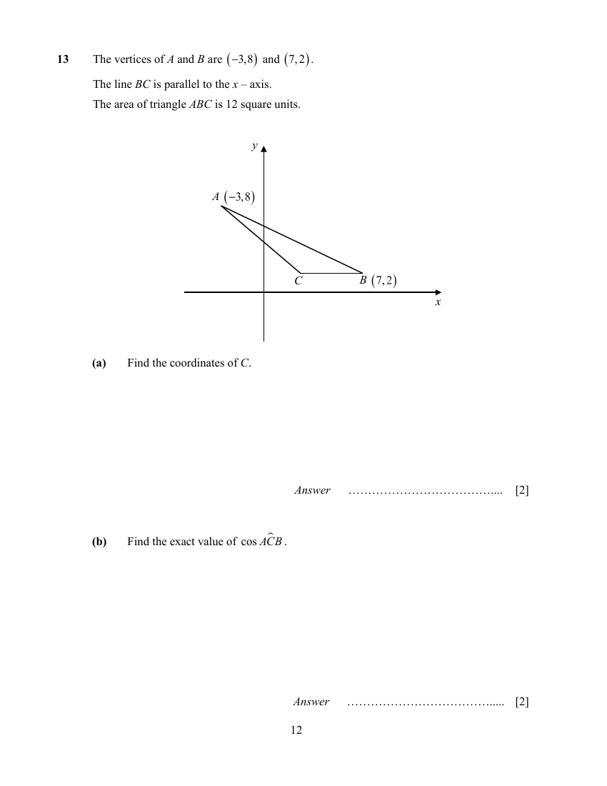

**(a)** Find the coordinates of $C$. [2]
> **Topic:** G6 Coordinate geometry
> **Sub-topic:** Coordinate geometry
> **LO:** [[context/subjects/o-level-e-maths/learning-objectives/o-level-e-maths-G6c.md|G6c]]

**(b)** Find the exact value of $\cos \angle ACB$. [2]
> **Topic:** G6 Coordinate geometry
> **Sub-topic:** Coordinate geometry
> **LO:** [[context/subjects/o-level-e-maths/learning-objectives/o-level-e-maths-G6c.md|G6c]]

---

### Q14

> **Marks:** 2
> **Topic:** G3 Properties of circles
> **Sub-topic:** Properties of circles
> **LO:** [[context/subjects/o-level-e-maths/learning-objectives/o-level-e-maths-G3b.md|G3b]]
> **Page:** 13

Find $\angle a + \angle b + \angle c + \angle d$.

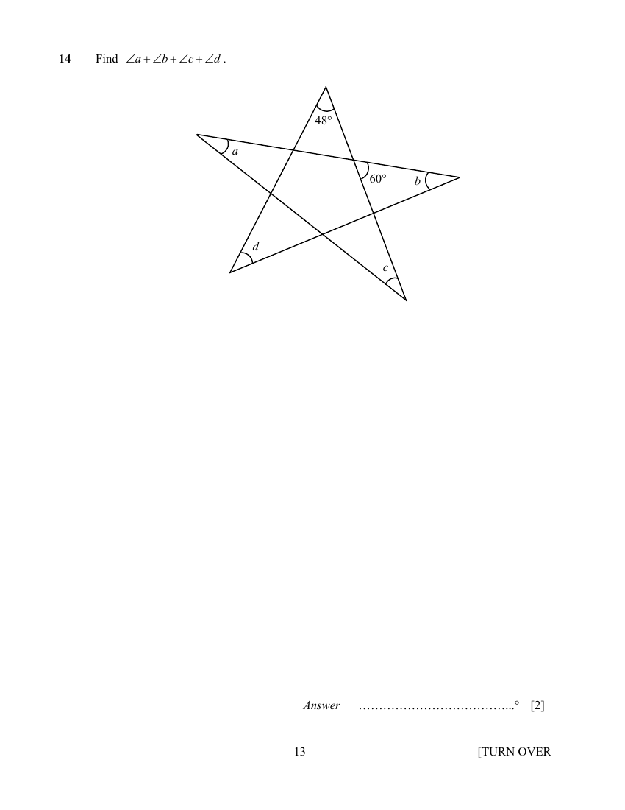

[2]

---

### Q15

> **Marks:** 3
> **Topic:** G5 Mensuration
> **Sub-topic:** Mensuration
> **LO:** [[context/subjects/o-level-e-maths/learning-objectives/o-level-e-maths-G5b.md|G5b]]
> **Page:** 14

$PQRS$ is a parallelogram. $PM$ is perpendicular to $QR$ and $M$ is the midpoint of $QR$.

$PS = 8.8\text{ cm}$ and angle $PSR = 67^{\circ}$.

Find the area of $PQRS$.

[3]

---

### Q16

> **Marks:** (a) 1, (b) 1, (c) 2; total 4
> **Page:** 15

The first four terms of a sequence are $1$, $5$, $9$ and $13$.

**(a)** Find an expression, in terms of $n$, for the $n$th term of the sequence. [1]
> **Topic:** N5 Algebraic expressions and formulae
> **Sub-topic:** Algebraic expressions and formulae
> **LO:** [[context/subjects/o-level-e-maths/learning-objectives/o-level-e-maths-N5e.md|N5e]]

**(b)** Find an expression, in terms of $n$, for the $(n+1)$th term of the sequence. [1]
> **Topic:** N5 Algebraic expressions and formulae
> **Sub-topic:** Algebraic expressions and formulae
> **LO:** [[context/subjects/o-level-e-maths/learning-objectives/o-level-e-maths-N5e.md|N5e]]

**(c)** Explain why the difference between the squares of two consecutive terms is always a multiple of $8$. [2]
> **Topic:** N5 Algebraic expressions and formulae
> **Sub-topic:** Algebraic expressions and formulae
> **LO:** [[context/subjects/o-level-e-maths/learning-objectives/o-level-e-maths-N5e.md|N5e]]

---

### Q17

> **Marks:** (a) 3, (b) 2; total 5
> **Page:** 16

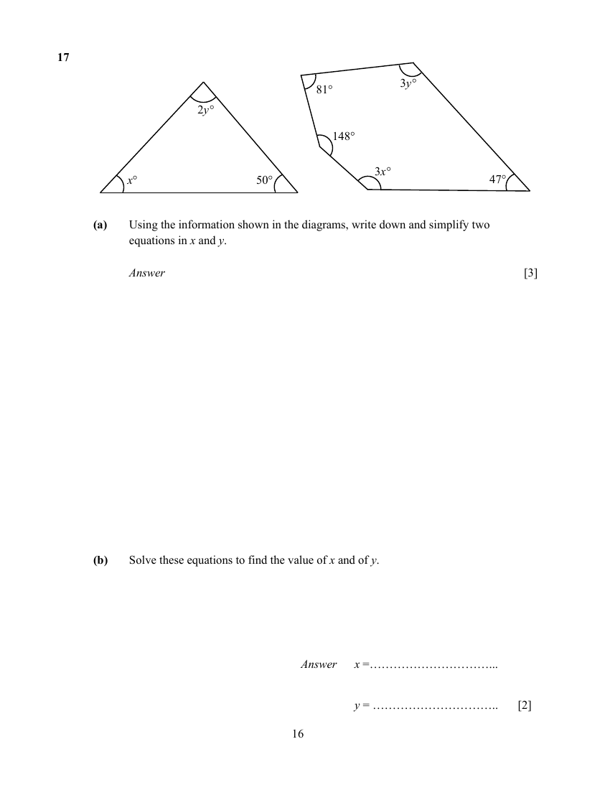

**(a)** Using the information shown in the diagrams, write down and simplify two equations in $x$ and $y$. [3]
> **Topic:** G3 Properties of circles
> **Sub-topic:** Properties of circles
> **LO:** [[context/subjects/o-level-e-maths/learning-objectives/o-level-e-maths-G3b.md|G3b]]

**(b)** Solve these equations to find the value of $x$ and of $y$. [2]
> **Topic:** G3 Properties of circles
> **Sub-topic:** Properties of circles
> **LO:** [[context/subjects/o-level-e-maths/learning-objectives/o-level-e-maths-G3b.md|G3b]]

---

### Q18

> **Marks:** (a) 2, (b) 1; total 3
> **Page:** 17

**(a)** In a company of $120$ workers, the ratio of female worker to male workers is $2:3$.

| | Female | Male |
|---|---|---|
| Full time | $p$ | $q$ |
| Part time | $9$ | $r$ |

$20\%$ of the workers work part time.

Find the value of $p$, of $q$ and of $r$. [2]
> **Topic:** N2 Ratio and proportion
> **Sub-topic:** Ratio and proportion
> **LO:** [[context/subjects/o-level-e-maths/learning-objectives/o-level-e-maths-N2a.md|N2a]]

**(b)** The annual salary of a particular male worker is &#36;85000 in $2023$. His salary in $2023$ was $12\%$ higher than in $2021$. Find his annual salary in $2021$. [1]
> **Topic:** N2 Ratio and proportion
> **Sub-topic:** Ratio and proportion
> **LO:** [[context/subjects/o-level-e-maths/learning-objectives/o-level-e-maths-N2a.md|N2a]]

---

### Q19

> **Marks:** (a) 3, (b) 3; total 6
> **Page:** 18–19

The diagram shows two sectors $OAB$ and $OCD$ with centre at $O$. $OB$ is $15\text{ cm}$ and $CD$ has an arc length of $5\text{ cm}$. The ratio of area of sector $OCD$ : area of $ABDC$ is $16:65$.

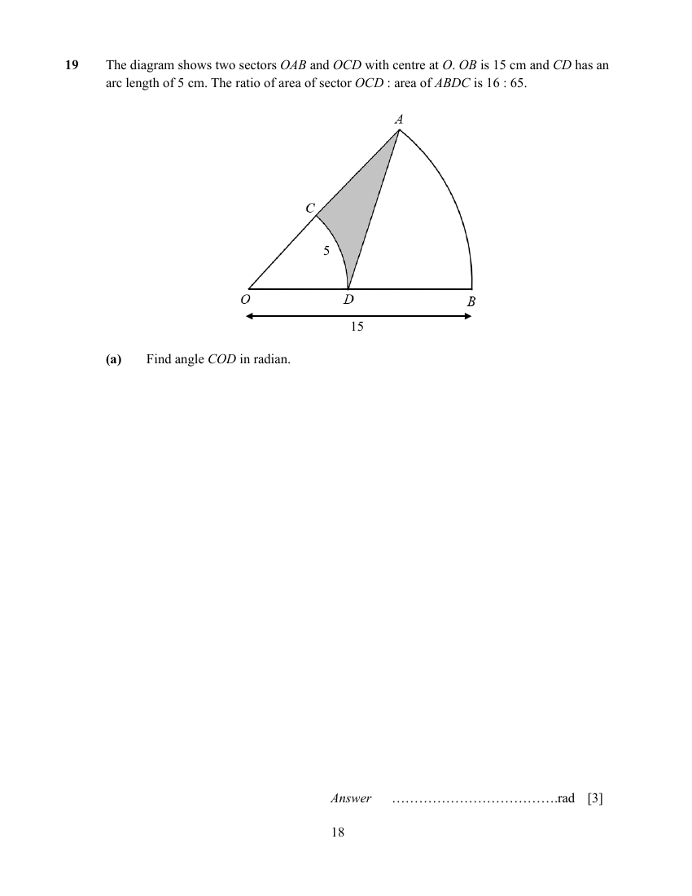

**(a)** Find angle $COD$ in radian. [3]
> **Topic:** G5 Mensuration
> **Sub-topic:** Mensuration
> **LO:** [[context/subjects/o-level-e-maths/learning-objectives/o-level-e-maths-G5g.md|G5g]]

**(b)** Find the area of the shaded region. [3]
> **Topic:** G5 Mensuration
> **Sub-topic:** Mensuration
> **LO:** [[context/subjects/o-level-e-maths/learning-objectives/o-level-e-maths-G5b.md|G5b]]

---

### Q20

> **Marks:** 3
> **Topic:** N2 Ratio and proportion
> **Sub-topic:** Ratio and proportion
> **LO:** [[context/subjects/o-level-e-maths/learning-objectives/o-level-e-maths-N2a.md|N2a]]
> **Page:** 19

In this table, $p$ is inversely proportional to $q^{2}$.

| $p$ | $0.08$ | $0.5$ | $b$ |
|---|---|---|---|
| $q$ | $a$ | $4$ | $2$ |

Calculate the value of $a$ and of $b$. [3]

---

### Q21

> **Marks:** (a) 1, (b) 2; total 3
> **Page:** 20

**(a)** A river with an actual length of $1\text{ km}$ is represented on a map with a length of $8\text{ cm}$.

Find the map scale in the form $1:n$. [1]
> **Topic:** N2 Ratio and proportion
> **Sub-topic:** Ratio and proportion
> **LO:** [[context/subjects/o-level-e-maths/learning-objectives/o-level-e-maths-N2a.md|N2a]]

**(b)** A forest is represented by an area of $200\text{ cm}^{2}$ on the map. Calculate the actual area of forest in square metres, giving your answer in standard form. [2]
> **Topic:** N2 Ratio and proportion
> **Sub-topic:** Ratio and proportion
> **LO:** [[context/subjects/o-level-e-maths/learning-objectives/o-level-e-maths-N2a.md|N2a]]

---

### Q22

> **Marks:** (a)(i) 1, (a)(ii) 1, (b) 1, (c) 2; total 5
> **Page:** 21

A triangle $XYZ$ is shown below.

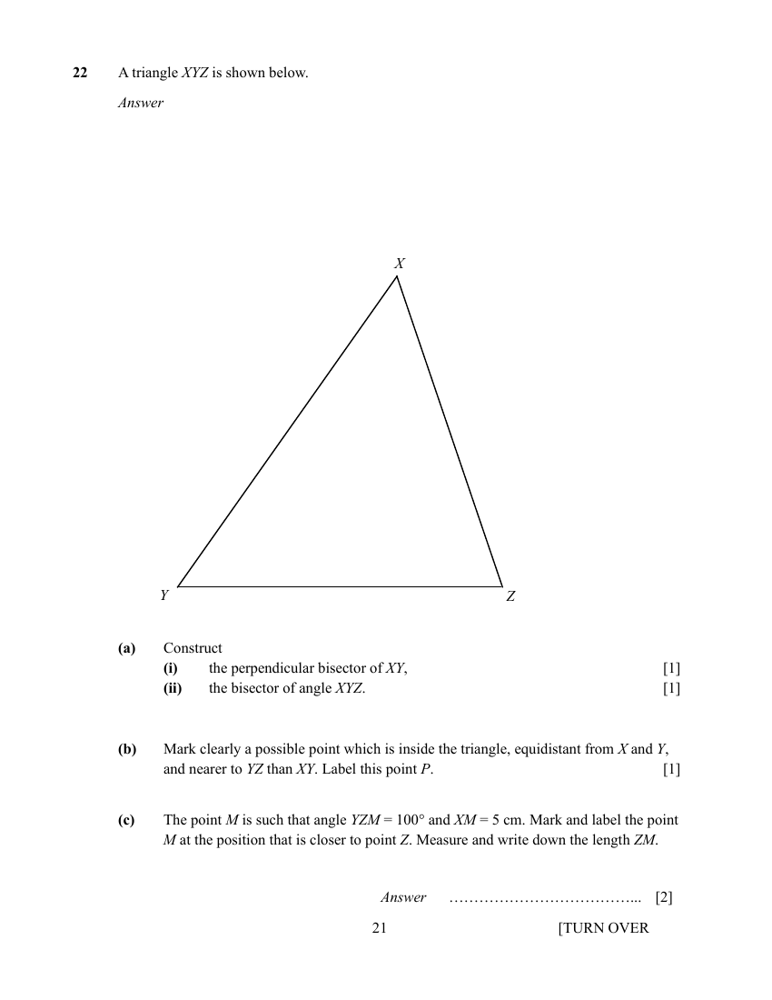

**(a)** Construct

**(i)** the perpendicular bisector of $XY$, [1]
> **Topic:** G2 Congruence and similarity
> **Sub-topic:** Congruence and similarity
> **LO:** [[context/subjects/o-level-e-maths/learning-objectives/o-level-e-maths-G2e.md|G2e]]

**(ii)** the bisector of angle $XYZ$. [1]
> **Topic:** G2 Congruence and similarity
> **Sub-topic:** Congruence and similarity
> **LO:** [[context/subjects/o-level-e-maths/learning-objectives/o-level-e-maths-G2e.md|G2e]]

**(b)** Mark clearly a possible point which is inside the triangle, equidistant from $X$ and $Y$, and nearer to $YZ$ than $XY$. Label this point $P$. [1]
> **Topic:** G2 Congruence and similarity
> **Sub-topic:** Congruence and similarity
> **LO:** [[context/subjects/o-level-e-maths/learning-objectives/o-level-e-maths-G2e.md|G2e]]

**(c)** The point $M$ is such that angle $YZM = 100^{\circ}$ and $XM = 5\text{ cm}$. Mark and label the point $M$ at the position that is closer to point $Z$. Measure and write down the length $ZM$. [2]
> **Topic:** G2 Congruence and similarity
> **Sub-topic:** Congruence and similarity
> **LO:** [[context/subjects/o-level-e-maths/learning-objectives/o-level-e-maths-G2e.md|G2e]]

---

### Q23

> **Marks:** 4
> **Topic:** G2 Congruence and similarity
> **Sub-topic:** Congruence and similarity
> **LO:** [[context/subjects/o-level-e-maths/learning-objectives/o-level-e-maths-G2i.md|G2i]]
> **Page:** 22

$ABCD$ is a square and angle $EDC =$ angle $ECD = 55^{\circ}$.

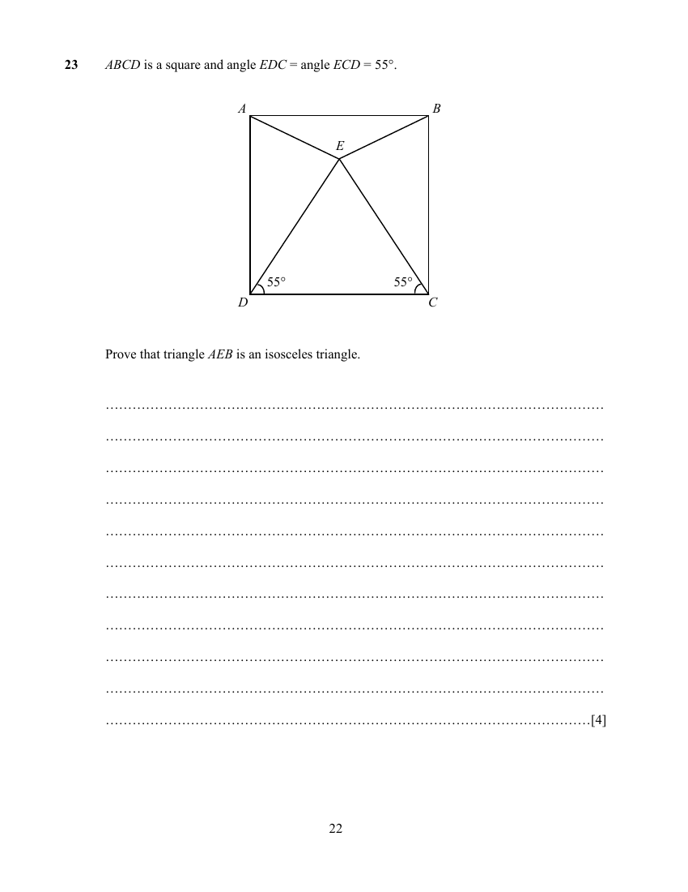

Prove that triangle $AEB$ is an isosceles triangle. [4]

---

### Q24

> **Marks:** (a) 4, (b) 4; total 8
> **Page:** 23–24

**(a)** A container is made from a hemisphere and cylinder.

The container has a diameter of $12\text{ cm}$.

The container is filled with water such that the total surface area of water in contact with the container is $120\pi$.

Find the volume of water in the container, leaving your answer in terms of $\pi$. [4]
> **Topic:** G5 Mensuration
> **Sub-topic:** Mensuration
> **LO:** [[context/subjects/o-level-e-maths/learning-objectives/o-level-e-maths-G5c.md|G5c]]

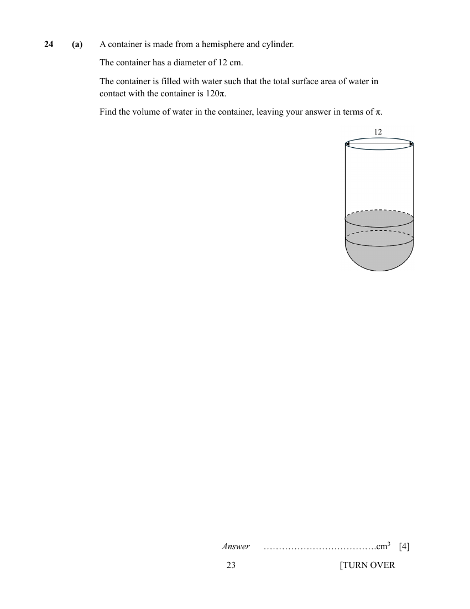

**(b)** All the water in the container was poured into a cone with diameter $24\text{ cm}$ and a slant height of $20\text{ cm}$. The cone was covered and inverted as shown in the diagram below. Calculate the depth, $d$, of the empty space. [4]
> **Topic:** G5 Mensuration
> **Sub-topic:** Mensuration
> **LO:** [[context/subjects/o-level-e-maths/learning-objectives/o-level-e-maths-G5c.md|G5c]]

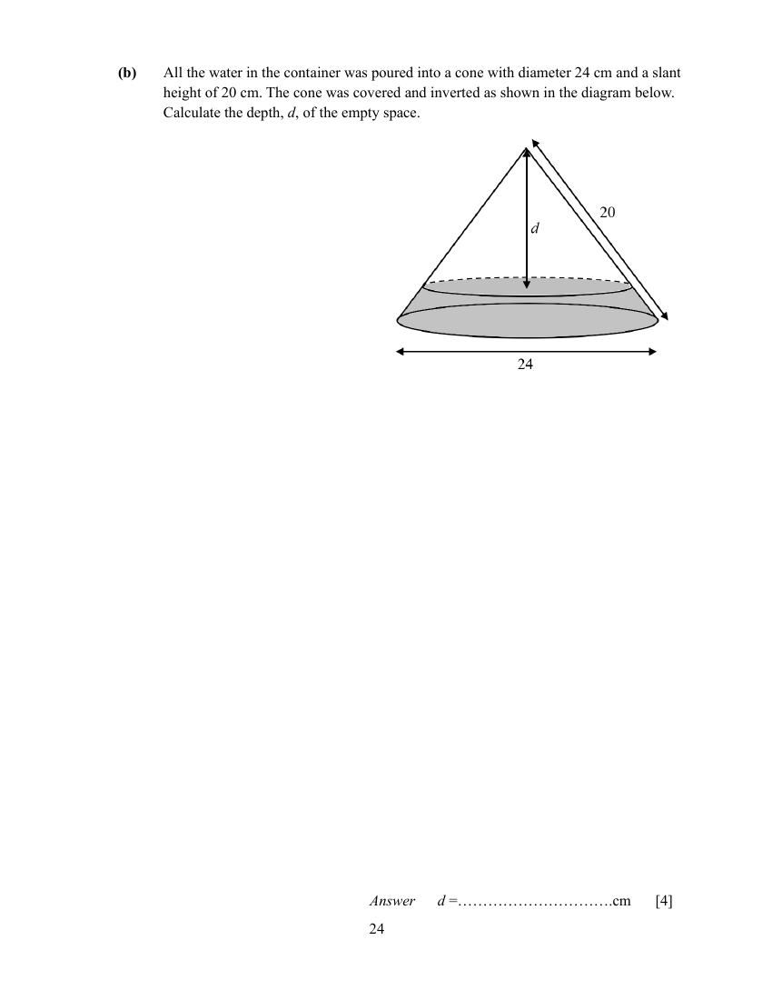

---

### Q25

> **Marks:** (a) 2, (b) 2, (c) 4; total 8
> **Page:** 25–26

The diagram shows the speed-time graphs of a car and lorry traveling along the same road in the same direction. Both vehicles begin their journey from the same starting point.

The lorry accelerates for $30$ seconds and then travels at a constant speed of $20\text{ m/s}$.

The car accelerates at a uniform rate of $0.5\text{ m/s}^{2}$ from rest.

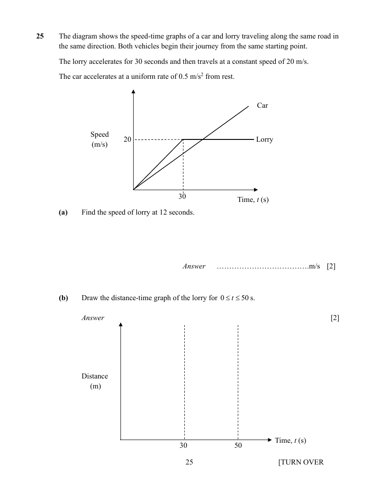

**(a)** Find the speed of lorry at $12$ seconds. [2]
> **Topic:** N6 Functions and graphs
> **Sub-topic:** Functions and graphs
> **LO:** [[context/subjects/o-level-e-maths/learning-objectives/o-level-e-maths-N6c.md|N6c]]

**(b)** Draw the distance-time graph of the lorry for $0 \leq t \leq 50\text{ s}$. [2]
> **Topic:** N6 Functions and graphs
> **Sub-topic:** Functions and graphs
> **LO:** [[context/subjects/o-level-e-maths/learning-objectives/o-level-e-maths-N6c.md|N6c]]

**(c)** Find the time taken for the car to meet the lorry. [4]
> **Topic:** N6 Functions and graphs
> **Sub-topic:** Functions and graphs
> **LO:** [[context/subjects/o-level-e-maths/learning-objectives/o-level-e-maths-N6c.md|N6c]]
