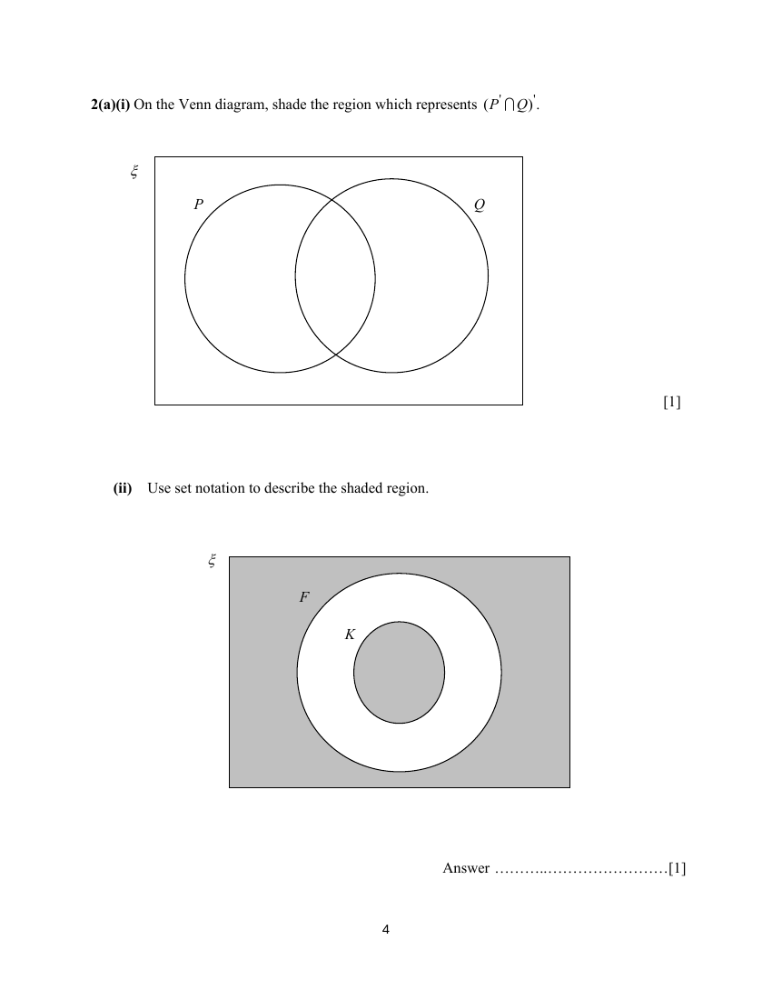
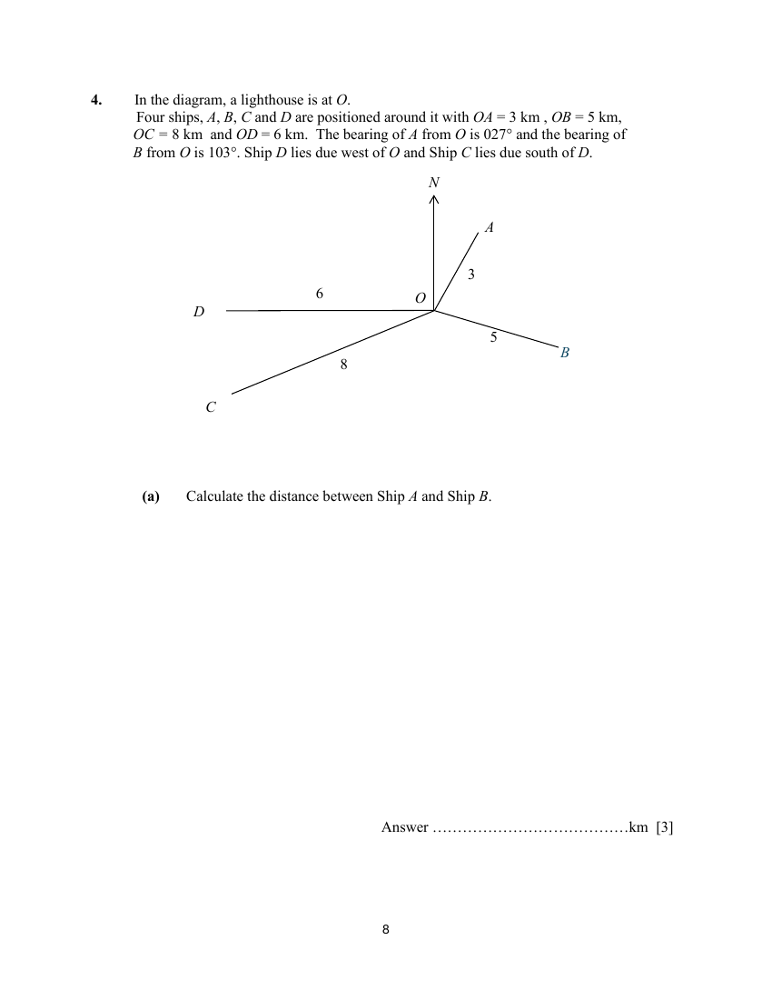
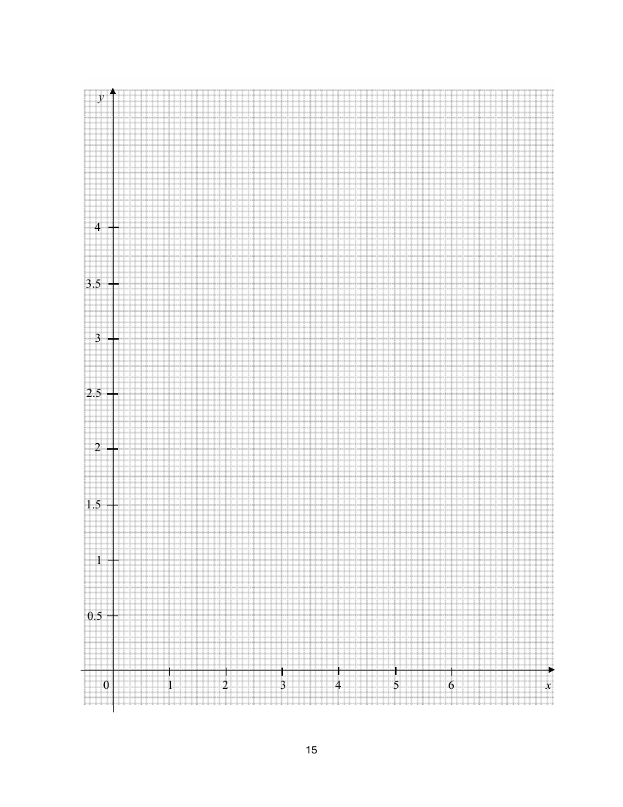
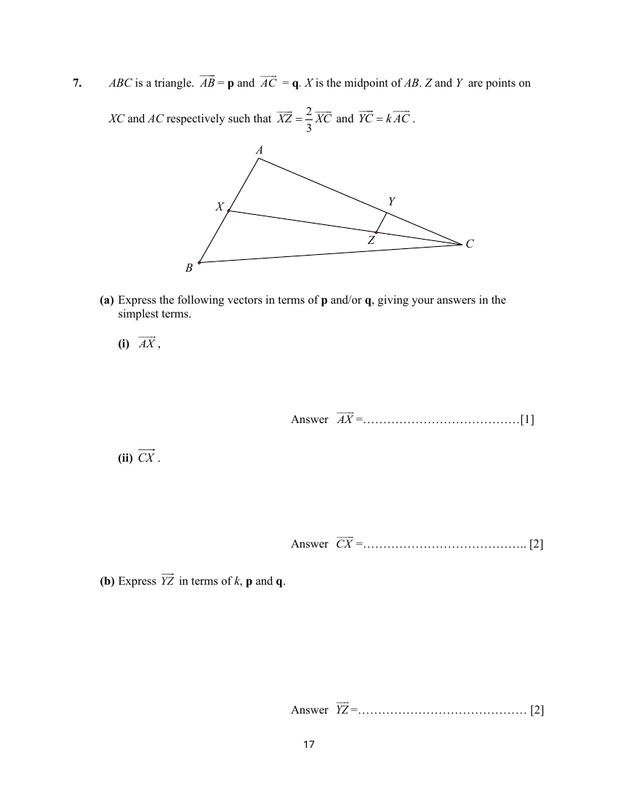
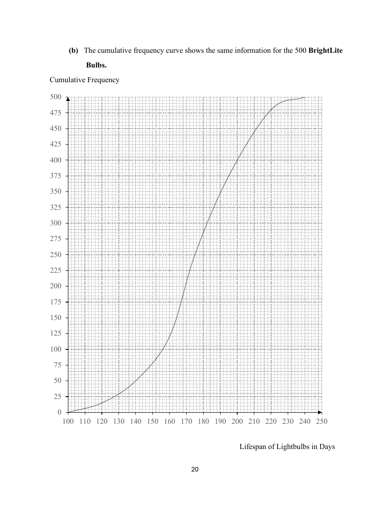

# Catholic High School — Mathematics 4052/02 Paper 2 (cleaned)

> **Institution:** Catholic High School
> **Exam:** Preliminary Examination 2025
> **Level:** Secondary 4 (O-Level Programme)
> **Subjects:** Mathematics
> **Paper:** 4052/02 Paper 2
> **Date:** 27 August 2025
> **Duration:** 2 hours 15 minutes
> **Total Marks:** 90
> **Source:** `CAT HIGH 2025 EMATH PRELIM P2 QP.pdf` (cleaned & reformatted)

---

## Instructions

Write your name, index number and class on all the work you hand in.
Write in dark blue or black pen.
You may use a soft pencil for any diagrams or graphs.
Do not use staples, paper clips, highlighters, glue or correction fluid.

Answer all questions in the space provided.
If working is needed for any question, it must be shown with the answer.
Omission of essential working will result in loss of marks.
Calculators should be used where appropriate.
If the degree of accuracy is not specified in the question, and if the answer is not exact, give the answer to three significant figures.
Give answers in degrees to one decimal place.
For $\pi$, use either your calculator value or $3.142$, unless the question requires the answer in terms of $\pi$.
The number of marks is given in brackets [ ] at the end of each question or part question.
The total mark for this paper is 90.

Booklet A is worth 40 marks. Booklet B is worth 50 marks.

---

## Mathematical Formulae

*Compound interest*

$$
\text{Total amount} = P\left(1+\frac{r}{100}\right)^{n}
$$

*Mensuration*

$$
\text{Curved surface area of a cone} = \pi rl
$$

$$
\text{Surface area of a sphere} = 4\pi r^{2}
$$

$$
\text{Volume of a cone} = \frac{1}{3}\pi r^{2}h
$$

$$
\text{Volume of a sphere} = \frac{4}{3}\pi r^{3}
$$

$$
\text{Area of triangle } ABC = \frac{1}{2}ab\sin C
$$

$$
\text{Arc length} = r\theta,\text{ where }\theta\text{ is in radians}
$$

$$
\text{Sector area} = \frac{1}{2}r^{2}\theta,\text{ where }\theta\text{ is in radians}
$$

*Trigonometry*

$$
\frac{a}{\sin A} = \frac{b}{\sin B} = \frac{c}{\sin C}
$$

$$
a^{2} = b^{2}+c^{2}-2bc\cos A
$$

*Statistics*

$$
\text{Mean} = \frac{\sum fx}{\sum f}
$$

$$
\text{Standard deviation} = \sqrt{\frac{\sum fx^{2}}{\sum f}-\left(\frac{\sum fx}{\sum f}\right)^{2}}
$$

---

## Booklet A

### Q1

> **Marks:** (i) 1, (ii) 2, (iii) 2; total 5
> **Page:** 3

Every evening Juline and Evangeline play a game of tic-tac-toe. When they play against each other, Juline has a $\dfrac{2}{5}$ chance of winning and Evangeline has a $\dfrac{1}{6}$ chance of winning. Find, as a fraction in its simplest form, the probability that

**(i)** Juline will win on both Monday and Tuesday next week. [1]
> **Topic:** S2 Probability
> **Sub-topic:** Probability
> **LO:** [[context/subjects/o-level-e-maths/learning-objectives/o-level-e-maths-S2c.md|S2c]]

**(ii)** Juline will win on either Wednesday or Thursday next week but not on both days. [2]
> **Topic:** S2 Probability
> **Sub-topic:** Probability
> **LO:** [[context/subjects/o-level-e-maths/learning-objectives/o-level-e-maths-S2c.md|S2c]]

**(iii)** it will be a draw on Friday next week. [2]
> **Topic:** S2 Probability
> **Sub-topic:** Probability
> **LO:** [[context/subjects/o-level-e-maths/learning-objectives/o-level-e-maths-S2c.md|S2c]]

---

### Q2

> **Marks:** (a)(i) 1, (a)(ii) 1, (b)(i) 1, (b)(ii) 1, (b)(iii) 2; total 6
> **Page:** 4–5

**(a)(i)** On the Venn diagram, shade the region which represents $(P' \cap Q)'$. [1]

**(a)(ii)** Use set notation to describe the shaded region. [1]

**(b)**

$$
\xi = \{\text{integers } x : 20 \leq x \leq 50\}
$$

$$
A = \{\text{perfect squares}\},\quad B = \{\text{prime numbers}\},\quad C = \{\text{multiples of } 7\}
$$

**(i)** List the elements in $A \cap C'$. [1]
> **Topic:** N8 Set language and notation
> **Sub-topic:** Set language and notation
> **LO:** [[context/subjects/o-level-e-maths/learning-objectives/o-level-e-maths-N8c.md|N8c]]

**(ii)** Find the value of $n(B \cap C)$. [1]
> **Topic:** N8 Set language and notation
> **Sub-topic:** Set language and notation
> **LO:** [[context/subjects/o-level-e-maths/learning-objectives/o-level-e-maths-N8c.md|N8c]]

**(iii)** A number, $p$, is chosen at random from the set $(B \cup C)$. Find the probability that $p \in A$. [2]
> **Topic:** N8 Set language and notation
> **Sub-topic:** Set language and notation
> **LO:** [[context/subjects/o-level-e-maths/learning-objectives/o-level-e-maths-N8c.md|N8c]]

---

### Q3

> **Marks:** (a)(i) 2, (a)(ii) 2, (b) 1, (c) 1, (d) 2; total 8
> **Page:** 6–7

$O$ is the centre of the circle $ABCDE$. $XY$ is a tangent to the circle at $E$ and $EC$ intersects $BD$ at $F$. $OZ$ is a straight line that passes through $A$ and is parallel to $XY$. The lines $CB$ produced and $EA$ produced meet at $W$. $\angle BCE = 71^{\circ}$ and $\angle OBC = 64^{\circ}$.

**(a)** Complete the following statements.

**(i)** $\angle BDE = \ldots{}^{\circ}$ because $\ldots$ [2]
> **Topic:** G3 Properties of circles
> **Sub-topic:** Properties of circles
> **LO:** [[context/subjects/o-level-e-maths/learning-objectives/o-level-e-maths-G3b.md|G3b]]

**(ii)** $\angle AOE = \ldots{}^{\circ}$ because $\ldots$ [2]
> **Topic:** G3 Properties of circles
> **Sub-topic:** Properties of circles
> **LO:** [[context/subjects/o-level-e-maths/learning-objectives/o-level-e-maths-G3b.md|G3b]]

**(b)** Find $\angle BOE$. [1]
> **Topic:** G3 Properties of circles
> **Sub-topic:** Properties of circles
> **LO:** [[context/subjects/o-level-e-maths/learning-objectives/o-level-e-maths-G3b.md|G3b]]

**(c)** Find $\angle OCE$. [1]
> **Topic:** G3 Properties of circles
> **Sub-topic:** Properties of circles
> **LO:** [[context/subjects/o-level-e-maths/learning-objectives/o-level-e-maths-G3b.md|G3b]]

**(d)** Find $\angle ABW$. [2]
> **Topic:** G3 Properties of circles
> **Sub-topic:** Properties of circles
> **LO:** [[context/subjects/o-level-e-maths/learning-objectives/o-level-e-maths-G3b.md|G3b]]

---

### Q4

> **Marks:** (a) 3, (b) 2, (c) 2, (d) 2, (e) 2; total 11
> **Page:** 8–10

In the diagram, a lighthouse is at $O$. Four ships, $A$, $B$, $C$ and $D$ are positioned around it with $OA = 3\text{ km}$, $OB = 5\text{ km}$, $OC = 8\text{ km}$ and $OD = 6\text{ km}$. The bearing of $A$ from $O$ is $027^{\circ}$ and the bearing of $B$ from $O$ is $103^{\circ}$. Ship $D$ lies due west of $O$ and Ship $C$ lies due south of $D$.

**(a)** Calculate the distance between Ship $A$ and Ship $B$. [3]
> **Topic:** G4 Pythagoras' theorem and trigonometry
> **Sub-topic:** Pythagoras' theorem and trigonometry
> **LO:** [[context/subjects/o-level-e-maths/learning-objectives/o-level-e-maths-G4g.md|G4g]]

**(b)** The keeper of the lighthouse is standing on top of the lighthouse, which is $20\text{ m}$ tall. Calculate the angle of depression, from where he is standing to Ship $A$. [2]
> **Topic:** G4 Pythagoras' theorem and trigonometry
> **Sub-topic:** Pythagoras' theorem and trigonometry
> **LO:** [[context/subjects/o-level-e-maths/learning-objectives/o-level-e-maths-G4g.md|G4g]]

**(c)** Calculate the bearing of Ship $C$ from $O$. [2]
> **Topic:** G4 Pythagoras' theorem and trigonometry
> **Sub-topic:** Pythagoras' theorem and trigonometry
> **LO:** [[context/subjects/o-level-e-maths/learning-objectives/o-level-e-maths-G4g.md|G4g]]

**(d)** A speedboat travels directly from Ship $A$ to Ship $B$. Calculate the shortest distance between the speedboat and the lighthouse during its journey. [2]
> **Topic:** G4 Pythagoras' theorem and trigonometry
> **Sub-topic:** Pythagoras' theorem and trigonometry
> **LO:** [[context/subjects/o-level-e-maths/learning-objectives/o-level-e-maths-G4g.md|G4g]]

**(e)** It is suggested that Ships $A$, $B$ and the lighthouse at $O$ form a right-angled triangle. Showing your working clearly, determine whether this is true. [2]
> **Topic:** G4 Pythagoras' theorem and trigonometry
> **Sub-topic:** Pythagoras' theorem and trigonometry
> **LO:** [[context/subjects/o-level-e-maths/learning-objectives/o-level-e-maths-G4c.md|G4c]]

---

### Q5

> **Marks:** (a)(i) 1, (a)(ii) 1, (b) 3, (c) 3, (d) 2; total 10
> **Page:** 11–12

**(a)** As part of a school fundraising event, Jamie buys $x$ boxes of snacks for a total of &#36;180. She plans to sell each box at a profit of $80$ cents.

**(i)** Write, in terms of $x$, an expression for the price, in dollars, Jamie paid for one box. [1]
> **Topic:** N7 Equations and inequalities
> **Sub-topic:** Equations and inequalities
> **LO:** [[context/subjects/o-level-e-maths/learning-objectives/o-level-e-maths-N7f.md|N7f]]

**(ii)** Hence, write an expression for her selling price, in dollars, of one box. [1]
> **Topic:** N7 Equations and inequalities
> **Sub-topic:** Equations and inequalities
> **LO:** [[context/subjects/o-level-e-maths/learning-objectives/o-level-e-maths-N7f.md|N7f]]

**(b)** Jamie managed to sell all except $15$ of the boxes and collected &#36;171 from his sales. Form an equation in $x$, and show that it simplifies to $4x^{2}-15x-13500 = 0$. [3]
> **Topic:** N7 Equations and inequalities
> **Sub-topic:** Equations and inequalities
> **LO:** [[context/subjects/o-level-e-maths/learning-objectives/o-level-e-maths-N7a.md|N7a]]

**(c)** Showing your working clearly, solve the equation in (b) and calculate the selling price of $1$ box of snacks. [3]
> **Topic:** N7 Equations and inequalities
> **Sub-topic:** Equations and inequalities
> **LO:** [[context/subjects/o-level-e-maths/learning-objectives/o-level-e-maths-N7a.md|N7a]]

**(d)** Jamie considers increasing her selling price by &#36;0.25 per box for the remaining $15$ boxes. Would this allow her to make a profit overall? Justify your conclusion with mathematical calculations. [2]
> **Topic:** N7 Equations and inequalities
> **Sub-topic:** Equations and inequalities
> **LO:** [[context/subjects/o-level-e-maths/learning-objectives/o-level-e-maths-N7f.md|N7f]]

---

## Booklet B

### Q6

> **Marks:** (a) 1, (b) 3, (c) 2, (d)(i) 1, (d)(ii) 2, (d)(iii) 3, (e) 2; total 14
> **Page:** 14–16

**(a)** Complete the table of values for $y = \dfrac{1}{10}\left(x^{2}+\dfrac{7}{x}\right)$. Values are given to one decimal place where appropriate. [1]
> **Topic:** G6 Coordinate geometry
> **Sub-topic:** Coordinate geometry
> **LO:** [[context/subjects/o-level-e-maths/learning-objectives/o-level-e-maths-G6c.md|G6c]]

| $x$ | $0.6$ | $1$ | $1.5$ | $2.2$ | $3.1$ | $4$ | $5.1$ | $5.8$ |
|---|---|---|---|---|---|---|---|---|
| $y$ | $1.2$ | $0.8$ | $0.7$ | $0.8$ | | $1.8$ | $2.7$ | $3.5$ |

**(b)** On the grid, draw the graph of $y = \dfrac{1}{10}\left(x^{2}+\dfrac{7}{x}\right)$ for $0.6 \leq x \leq 5.8$. [3]
> **Topic:** G6 Coordinate geometry
> **Sub-topic:** Coordinate geometry
> **LO:** [[context/subjects/o-level-e-maths/learning-objectives/o-level-e-maths-G6c.md|G6c]]

**(c)** Using your graph, estimate the value(s) of $x$ for which $x^{2}+\dfrac{7}{x} = 20$, where $0.6 \leq x \leq 5.8$. [2]

**(d)(i)** On the same grid, draw the graph of $3y = x+3$ for $0.6 \leq x \leq 5.8$. [1]
> **Topic:** G6 Coordinate geometry
> **Sub-topic:** Coordinate geometry
> **LO:** [[context/subjects/o-level-e-maths/learning-objectives/o-level-e-maths-G6c.md|G6c]]

**(ii)** Write down the $x$-coordinates of the points where the line intersects the curve. [2]
> **Topic:** G6 Coordinate geometry
> **Sub-topic:** Coordinate geometry
> **LO:** [[context/subjects/o-level-e-maths/learning-objectives/o-level-e-maths-G6c.md|G6c]]

**(iii)** These values of $x$ are solutions of the equation $3x^{3}+Ax^{2}+Bx+21 = 0$. Find the value of $A$ and of $B$. [3]
> **Topic:** G6 Coordinate geometry
> **Sub-topic:** Coordinate geometry
> **LO:** [[context/subjects/o-level-e-maths/learning-objectives/o-level-e-maths-G6c.md|G6c]]

**(e)** By drawing a tangent, find the gradient of the curve where $x = 2.2$. [2]
> **Topic:** G6 Coordinate geometry
> **Sub-topic:** Coordinate geometry
> **LO:** [[context/subjects/o-level-e-maths/learning-objectives/o-level-e-maths-G6c.md|G6c]]

---

### Q7

> **Marks:** (a)(i) 1, (a)(ii) 2, (b) 2, (c)(i) 1, (c)(ii) 1, (c)(iii) 1; total 8
> **Page:** 17–18

$ABC$ is a triangle. $\overrightarrow{AB} = \mathbf{p}$ and $\overrightarrow{AC} = \mathbf{q}$. $X$ is the midpoint of $AB$. $Z$ and $Y$ are points on $XC$ and $AC$ respectively such that $\overrightarrow{XZ} = \dfrac{2}{3}\overrightarrow{XC}$ and $\overrightarrow{YC} = k\overrightarrow{AC}$.

**(a)** Express the following vectors in terms of $\mathbf{p}$ and/or $\mathbf{q}$, giving your answers in the simplest terms.

**(i)** $\overrightarrow{AX}$ [1]
> **Topic:** G7 Vectors in two dimensions
> **Sub-topic:** Vectors in two dimensions
> **LO:** [[context/subjects/o-level-e-maths/learning-objectives/o-level-e-maths-G7h.md|G7h]]

**(ii)** $\overrightarrow{CX}$ [2]
> **Topic:** G7 Vectors in two dimensions
> **Sub-topic:** Vectors in two dimensions
> **LO:** [[context/subjects/o-level-e-maths/learning-objectives/o-level-e-maths-G7h.md|G7h]]

**(b)** Express $\overrightarrow{YZ}$ in terms of $k$, $\mathbf{p}$ and $\mathbf{q}$. [2]
> **Topic:** G7 Vectors in two dimensions
> **Sub-topic:** Vectors in two dimensions
> **LO:** [[context/subjects/o-level-e-maths/learning-objectives/o-level-e-maths-G7h.md|G7h]]

**(c)** Given that $YZ$ is parallel to $AX$, find the numerical value of

**(i)** $k$, [1]
> **Topic:** G7 Vectors in two dimensions
> **Sub-topic:** Vectors in two dimensions
> **LO:** [[context/subjects/o-level-e-maths/learning-objectives/o-level-e-maths-G7h.md|G7h]]

**(ii)** $\dfrac{YZ}{AB}$, [1]
> **Topic:** G7 Vectors in two dimensions
> **Sub-topic:** Vectors in two dimensions
> **LO:** [[context/subjects/o-level-e-maths/learning-objectives/o-level-e-maths-G7h.md|G7h]]

**(iii)** $\dfrac{\text{Area of }\triangle XYC}{\text{Area of }\triangle ABC}$. [1]
> **Topic:** G7 Vectors in two dimensions
> **Sub-topic:** Vectors in two dimensions
> **LO:** [[context/subjects/o-level-e-maths/learning-objectives/o-level-e-maths-G7h.md|G7h]]

---

### Q8

> **Marks:** (a)(i) 1, (a)(ii) 1, (b)(i) 1, (b)(ii) 2, (b)(iii) 2, (b)(iv) 1, (b)(v) 2, (c) 1; total 11
> **Page:** 19–22

A manufacturer sells lightbulbs under two different brands, BrightLite and EcoGlow. The lifespan, in days, of $500$ BrightLite lightbulbs is summarised in the table below.

| Length of life ($x$ days) | Number of bulbs |
|---|---|
| $100 < x \leq 120$ | $15$ |
| $120 < x \leq 140$ | $35$ |
| $140 < x \leq 160$ | $70$ |
| $160 < x \leq 180$ | $130$ |
| $180 < x \leq 200$ | $150$ |
| $200 < x \leq 220$ | $80$ |
| $220 < x \leq 240$ | $20$ |

**(a)(i)** Calculate an estimate of the mean lifespan of the BrightLite bulbs in days. [1]

**(ii)** Calculate an estimate of the standard deviation. [1]
> **Topic:** S1 Data handling and analysis
> **Sub-topic:** Data handling and analysis
> **LO:** [[context/subjects/o-level-e-maths/learning-objectives/o-level-e-maths-S1k.md|S1k]]

**(b)** The cumulative frequency curve shows the same information for the $500$ BrightLite bulbs.

Use the curve to estimate

**(i)** the median lifespan of the bulbs, [1]
> **Topic:** S1 Data handling and analysis
> **Sub-topic:** Data handling and analysis
> **LO:** [[context/subjects/o-level-e-maths/learning-objectives/o-level-e-maths-S1i.md|S1i]]

**(ii)** the interquartile range of the lifespans, [2]
> **Topic:** S1 Data handling and analysis
> **Sub-topic:** Data handling and analysis
> **LO:** [[context/subjects/o-level-e-maths/learning-objectives/o-level-e-maths-S1i.md|S1i]]

**(iii)** If a bulb is selected, find the probability that its lifespan is more than $160$ days. [2]
> **Topic:** S1 Data handling and analysis
> **Sub-topic:** Data handling and analysis
> **LO:** [[context/subjects/o-level-e-maths/learning-objectives/o-level-e-maths-S1i.md|S1i]]

**(iv)** $90\%$ of the bulbs have lifespan more than $n$ days. Find $n$. [1]
> **Topic:** S1 Data handling and analysis
> **Sub-topic:** Data handling and analysis
> **LO:** [[context/subjects/o-level-e-maths/learning-objectives/o-level-e-maths-S1i.md|S1i]]

**(v)** If two bulbs are randomly chosen, find the probability that one bulb has a lifespan of more than $160$ days while the other has a lifespan of less than $140$ days. [2]
> **Topic:** S1 Data handling and analysis
> **Sub-topic:** Data handling and analysis
> **LO:** [[context/subjects/o-level-e-maths/learning-objectives/o-level-e-maths-S1i.md|S1i]]

**(c)** The manufacturer also tested $500$ EcoGlow bulbs. These bulbs had a smaller interquartile range as the BrightLite bulbs, but the same median lifespan. Describe how the cumulative frequency curve for the EcoGlow bulbs may differ from that of the BrightLite bulbs. [1]
> **Topic:** S1 Data handling and analysis
> **Sub-topic:** Data handling and analysis
> **LO:** [[context/subjects/o-level-e-maths/learning-objectives/o-level-e-maths-S1i.md|S1i]]

---

### Q9

> **Marks:** (a) 1, (b) 1, (c) 2, (d) 1, (e)(i) 1, (e)(ii) 1; total 7
> **Page:** 23–25

A company produces four types of healthy snacks — granola bars, fruit juices, protein shakes, and yoghurt cups. The quantities delivered daily to three health stores are shown in the table below.

| Snack type | Granola bars | Fruit juices | Protein shakes | Yoghurt cups |
|---|---|---|---|---|
| Store A | $45$ | $30$ | $25$ | $20$ |
| Store B | $50$ | $25$ | $30$ | $35$ |
| Store C | $60$ | $40$ | $20$ | $25$ |

**(a)** Write down a $3 \times 4$ matrix $\mathbf{P}$ to show the number of each type of snack delivered to each store. [1]
> **Topic:** N9 Matrices
> **Sub-topic:** Matrices
> **LO:** [[context/subjects/o-level-e-maths/learning-objectives/o-level-e-maths-N9b.md|N9b]]

**(b)** The cost of each granola bar, fruit juice, protein shake, and yoghurt cup is &#36;1.50, &#36;2.00, &#36;3.20 and &#36;1.80 respectively. Represent these prices in a $4 \times 1$ column matrix $\mathbf{Q}$. [1]
> **Topic:** N9 Matrices
> **Sub-topic:** Matrices
> **LO:** [[context/subjects/o-level-e-maths/learning-objectives/o-level-e-maths-N9b.md|N9b]]

**(c)** Evaluate the matrix $\mathbf{T} = \mathbf{PQ}$. [2]
> **Topic:** N9 Matrices
> **Sub-topic:** Matrices
> **LO:** [[context/subjects/o-level-e-maths/learning-objectives/o-level-e-maths-N9b.md|N9b]]

**(d)** State what each of the elements in matrix $\mathbf{T}$ represents. [1]

**(e)(i)** Find the matrix $(1\ 1\ 1)\mathbf{P}$. [1]
> **Topic:** N9 Matrices
> **Sub-topic:** Matrices
> **LO:** [[context/subjects/o-level-e-maths/learning-objectives/o-level-e-maths-N9b.md|N9b]]

**(ii)** Explain what each element in $(1\ 1\ 1)\mathbf{P}$ represents. [1]
> **Topic:** N9 Matrices
> **Sub-topic:** Matrices
> **LO:** [[context/subjects/o-level-e-maths/learning-objectives/o-level-e-maths-N9b.md|N9b]]

---

### Q10

> **Marks:** (a) 3, (b) 1, (c) 6; total 10
> **Page:** 26–29

Alex is starting a vertical farming business in Singapore, using hydroponics to grow leafy vegetables in an indoor warehouse space of floor area $50\text{ m}^{2}$ with a ceiling height of $2.5$ metres. The current setup consists of $8$ vertical hydroponic shelves arranged within the space.

Fixed overheads and costs:

- Electricity: &#36;0.25 per kWh
- Water: &#36;2.50 per m$^{3}$
- Nutrients: &#36;0.30 per kg of vegetables grown

The business rents a government-subsidised commercial unit at a special rate of &#36;500/month, under a national initiative to support sustainable urban agriculture and small business growth.

| Month | Monthly production (kg) | Price (&#36;/kg) | Electricity (kWh) | Water (m$^{3}$) |
|---|---|---|---|---|
| Jan | $240$ | $6.00$ | $800$ | $15$ |
| Feb | $260$ | $6.10$ | $820$ | $16$ |
| Mar | $280$ | $6.20$ | $840$ | $17$ |
| Apr | $300$ | $6.30$ | $860$ | $18$ |
| May | $320$ | $6.40$ | $880$ | $19$ |
| Jun | $340$ | $6.50$ | $900$ | $20$ |

**(a)** Calculate the profit for the month of June. [3]
> **Topic:** N3 Percentage
> **Sub-topic:** Percentage
> **LO:** [[context/subjects/o-level-e-maths/learning-objectives/o-level-e-maths-N3d.md|N3d]]

**(b)** Suggest a possible reason for the increase in crop prices from January to June. [1]
> **Topic:** N3 Percentage
> **Sub-topic:** Percentage
> **LO:** [[context/subjects/o-level-e-maths/learning-objectives/o-level-e-maths-N3d.md|N3d]]

**(c)** The vertical farming system uses hydroponic shelves, each measuring $2.0\text{ m}$ (length) $\times$ $0.5\text{ m}$ (width) $\times$ $1.8\text{ m}$ (height), with $5$ levels of planting trays per shelf. Each level grows $10\text{ kg}$ of vegetables per month. There are currently $8$ such shelves arranged in the warehouse. Safety guidelines require a minimum clearance of $0.2\text{ m}$ from the ground and $0.5\text{ m}$ from the ceiling.

The maximum number of shelves that can be installed is limited by both walking and maintenance space requirements. Each shelf occupies $2.0\text{ m} \times 0.5\text{ m}$ of floor space, and minimum clear walking space of $0.5\text{ m}$ must be provided around each shelf. This clearance applies to the warehouse walls and between shelves.

The warehouse has a total floor area of $50\text{ m}^{2}$ ($10\text{ m} \times 5\text{ m}$). Due to airflow and light distribution limits, the maximum number of shelves that can physically fit in the warehouse is limited.

- For $10$ shelves or fewer, each shelf operates at $100\%$ of its production capacity.
- When $11$ or more shelves are installed, airflow saturation occurs, reducing the production of all shelves to $85\%$ of their monthly production.
- In addition, each shelf beyond the $10$th operates at only $70\%$ of its monthly production due to poor light and air mixing at the edges.

Alex’s goal is to maximise revenue for the month of July. Assume that the unit price and resource usage for July is the same as June.

Determine the number of shelves Alex should install. Justify your answer clearly with mathematical calculations that consider both space constraints and the productivity limitations. You may wish to draw diagrams to aid in your understanding. [6]
> **Topic:** N3 Percentage
> **Sub-topic:** Percentage
> **LO:** [[context/subjects/o-level-e-maths/learning-objectives/o-level-e-maths-N3d.md|N3d]]
