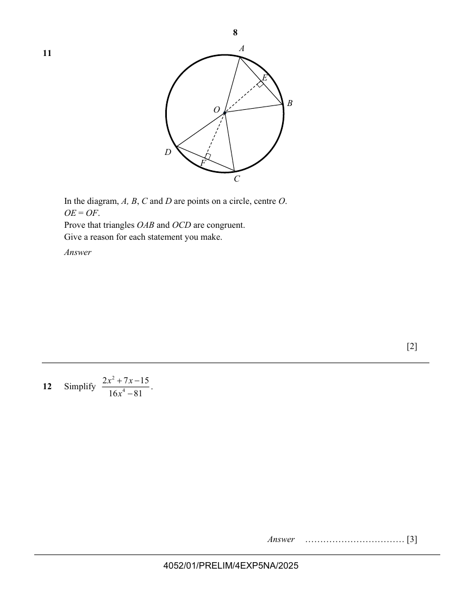
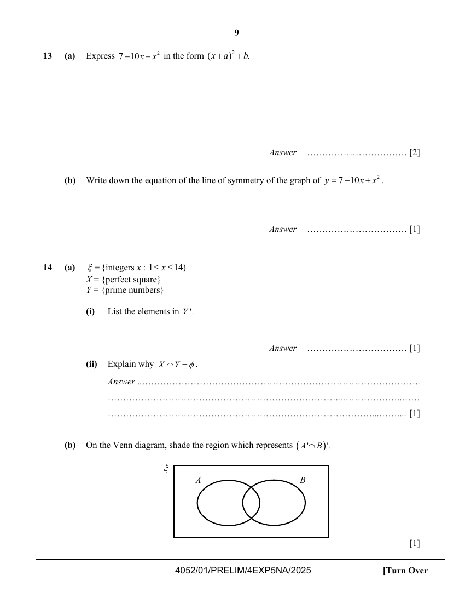
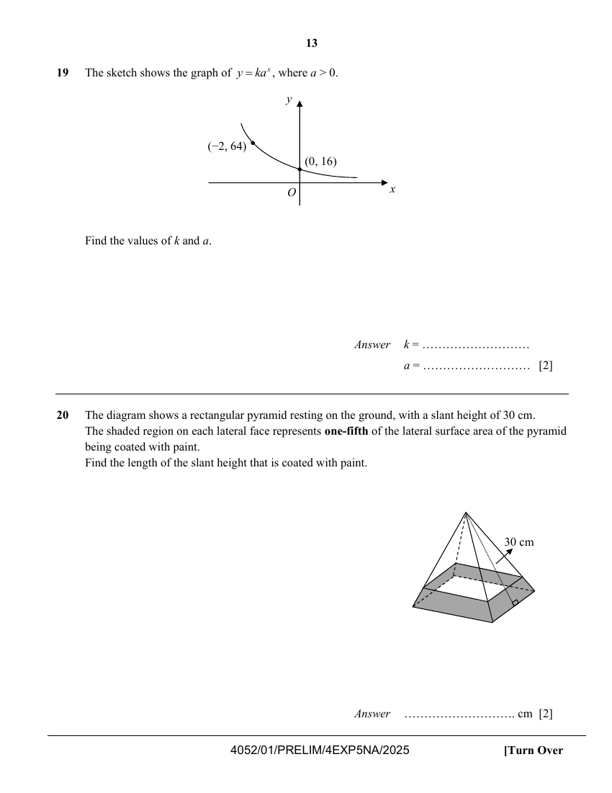
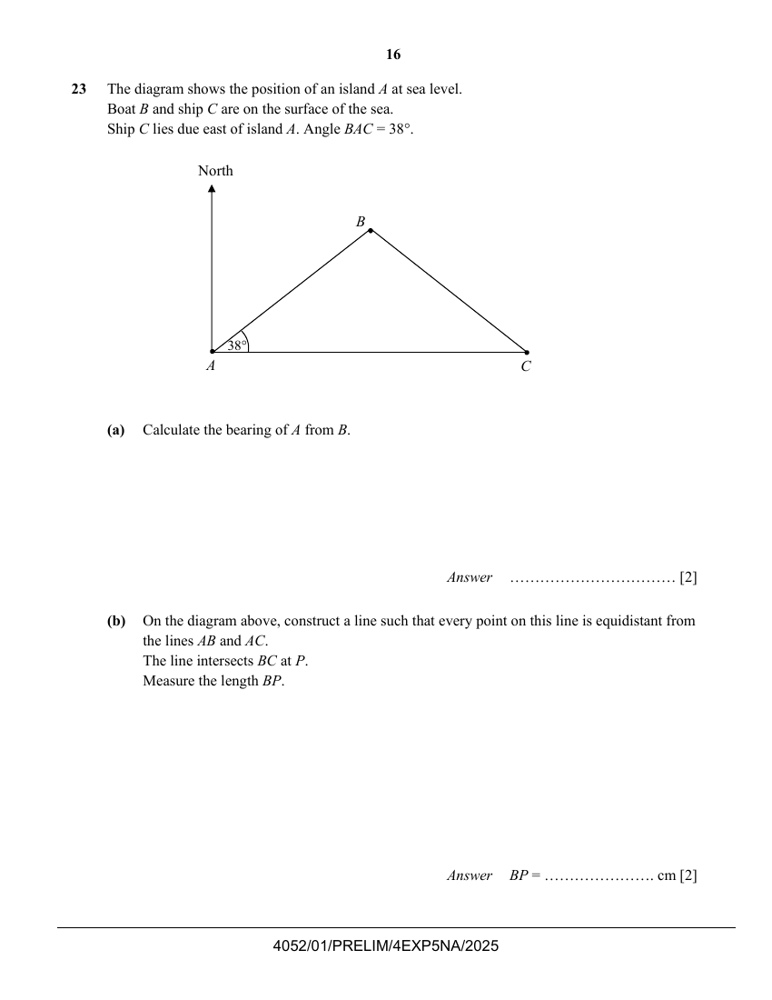
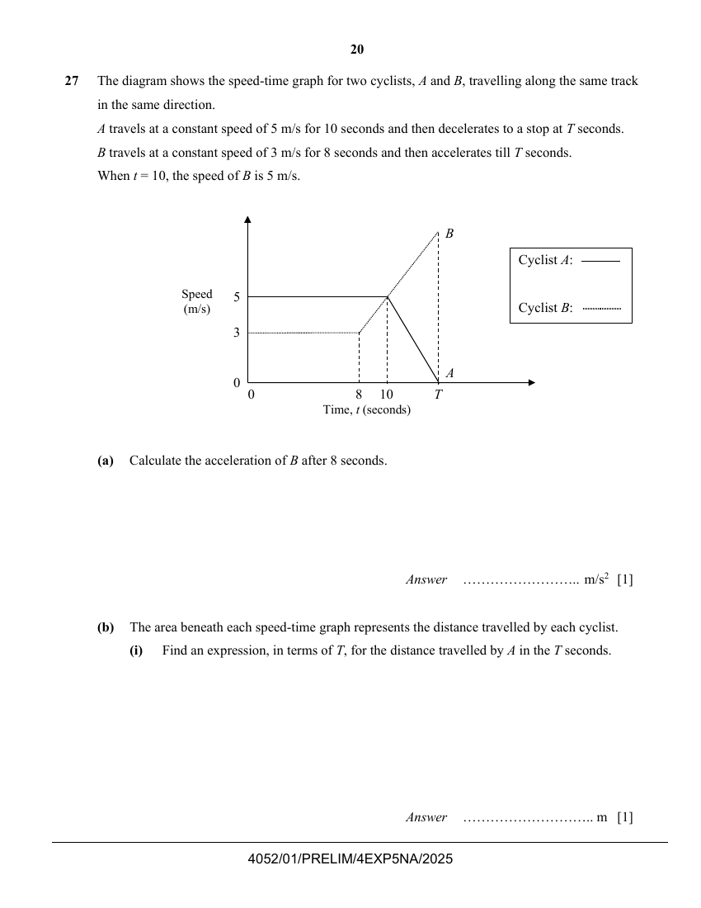

# Dunman Secondary School — Mathematics 4052/01 Paper 1 (cleaned)

> **Institution:** Dunman Secondary School
> **Exam:** Preliminary Examination 2025
> **Level:** Secondary 4 Express / 5 Normal Academic
> **Subjects:** Mathematics
> **Paper:** 4052/01 Paper 1
> **Date:** 19 August 2025
> **Duration:** 2 hours 15 minutes
> **Total Marks:** 90
> **Source:** `Dunman Sec_2025 Prelims 4EXP Math Paper 1 QP.pdf` (cleaned & reformatted)

---

## Instructions

Candidates answer on the Question Paper.

Write your name, class and index number on all the work you hand in.
Write in dark blue or black pen.
You may use an HB pencil for any diagrams or graphs.
Do not use staples, paper clips, highlighters, glue or correction fluid.

Answer all questions.
If working is needed for any question it must be shown with the answer.
Omission of essential working will result in loss of marks.
The use of an approved scientific calculator is expected, where appropriate.
If the degree of accuracy is not specified in the question, and if the answer is not exact, give the answer to three significant figures. Give answers in degrees to one decimal place.
For $\pi$, use either your calculator or $3.142$, unless the question requires the answer in terms of $\pi$.

The number of marks is given in brackets [ ] at the end of each question or part question.
The total number of marks for this paper is 90.

This document consists of 22 printed pages.

---

## Mathematical Formulae

*Compound interest*

$$
\text{Total Amount} = P\left(1+\frac{r}{100}\right)^{n}
$$

*Mensuration*

$$
\text{Curved surface area of a cone} = \pi rl
$$

$$
\text{Surface area of a sphere} = 4\pi r^{2}
$$

$$
\text{Volume of a cone} = \frac{1}{3}\pi r^{2}h
$$

$$
\text{Volume of a sphere} = \frac{4}{3}\pi r^{3}
$$

$$
\text{Area of triangle } ABC = \frac{1}{2}ab\sin C
$$

$$
\text{Arc length} = r\theta,\text{ where }\theta\text{ is in radians}
$$

$$
\text{Sector area} = \frac{1}{2}r^{2}\theta,\text{ where }\theta\text{ is in radians}
$$

*Trigonometry*

$$
\frac{a}{\sin A} = \frac{b}{\sin B} = \frac{c}{\sin C}
$$

$$
a^{2} = b^{2}+c^{2}-2bc\cos A
$$

*Statistics*

$$
\text{Mean} = \frac{\sum fx}{\sum f}
$$

$$
\text{Standard deviation} = \sqrt{\frac{\sum fx^{2}}{\sum f}-\left(\frac{\sum fx}{\sum f}\right)^{2}}
$$

---

### Q1

> **Marks:** (a) 1, (b) 1; total 2
> **Page:** 3

The graph below shows a company's yearly revenue from 2020 to 2024.

**(a)** State one misleading feature of the graph. [1]
> **Topic:** N6 Functions and graphs
> **Sub-topic:** Functions and graphs
> **LO:** [[context/subjects/o-level-e-maths/learning-objectives/o-level-e-maths-N6c.md|N6c]]

**(b)** Explain how this feature affects the reader's interpretation of the graph. [1]
> **Topic:** N6 Functions and graphs
> **Sub-topic:** Functions and graphs
> **LO:** [[context/subjects/o-level-e-maths/learning-objectives/o-level-e-maths-N6c.md|N6c]]

---

### Q2

> **Marks:** 2
> **Topic:** N4 Rate and speed
> **Sub-topic:** Rate and speed
> **LO:** [[context/subjects/o-level-e-maths/learning-objectives/o-level-e-maths-N4a.md|N4a]]
> **Page:** 3

Sammi is travelling back to Singapore from Italy.
She wants to change 830 euros (€) into Singapore dollars (&#36;).

The exchange rate in Italy is €1 = &#36;1.4893.
The exchange rate in Singapore is &#36;1 = €0.6747.

How many more Singapore dollars will she get by changing her money in Italy? [2]

---

### Q3

> **Marks:** (a) 2, (b) 1; total 3
> **Page:** 4

**(a)** Given that $3\sin x=1$, find the two possible values for angle $x$, where $0^{\circ}\leq x\leq 180^{\circ}$. [2]
> **Topic:** G4 Pythagoras' theorem and trigonometry
> **Sub-topic:** Pythagoras' theorem and trigonometry
> **LO:** [[context/subjects/o-level-e-maths/learning-objectives/o-level-e-maths-G4c.md|G4c]]

**(b)** Convert $26^{\circ}$ into radians. [1]
> **Topic:** G4 Pythagoras' theorem and trigonometry
> **Sub-topic:** Pythagoras' theorem and trigonometry
> **LO:** [[context/subjects/o-level-e-maths/learning-objectives/o-level-e-maths-G4c.md|G4c]]

---

### Q4

> **Marks:** 2
> **Topic:** N2 Ratio and proportion
> **Sub-topic:** Ratio and proportion
> **LO:** [[context/subjects/o-level-e-maths/learning-objectives/o-level-e-maths-N2a.md|N2a]]
> **Page:** 4

300 ml of liquid is poured into bottles A, B and C in the ratio $2:8:5$.
$n$ ml of liquid is spilled from bottle A.
The ratio of the amounts of liquid in A, B and C becomes $7:40:25$.
Find the value of $n$. [2]

---

### Q5

> **Marks:** (a) 2, (b) 2; total 4
> **Page:** 5

**(a)** Simplify $\left(\dfrac{27a^{12}}{b^{3}}\right)^{-\frac{2}{3}}$. [2]
> **Topic:** N1 Numbers and their operations
> **Sub-topic:** Numbers and their operations
> **LO:** [[context/subjects/o-level-e-maths/learning-objectives/o-level-e-maths-N1j.md|N1j]]

**(b)** $13\times 9^{2}-4\times 3^{4}=3^{p}$

Use the laws of indices to find the value of $p$.
Show your working. [2]
> **Topic:** N1 Numbers and their operations
> **Sub-topic:** Numbers and their operations
> **LO:** [[context/subjects/o-level-e-maths/learning-objectives/o-level-e-maths-N1j.md|N1j]]

---

### Q6

> **Marks:** 2
> **Topic:** N2 Ratio and proportion
> **Sub-topic:** Ratio and proportion
> **LO:** [[context/subjects/o-level-e-maths/learning-objectives/o-level-e-maths-N2a.md|N2a]]
> **Page:** 5

The gravitational force $F$ (in newtons) is inversely proportional to the square of the distance $r$ (in metres) between two objects.

John says: "If I tripled the distance between the two objects, the gravitational force they experience will be one-third as strong."

Is he correct? Explain your answer. [2]

---

### Q7

> **Marks:** (a) 1, (b) 1, (c) 1; total 3
> **Page:** 6

The bullet train in Japan takes 1.55 hours to travel 341 kilometres from Tokyo to Nagoya.

**(a)** By rounding these numbers correct to 1 significant figure, find an estimate of the speed of the bullet train. Show the numbers you use. [1]
> **Topic:** N1 Numbers and their operations
> **Sub-topic:** Numbers and their operations
> **LO:** [[context/subjects/o-level-e-maths/learning-objectives/o-level-e-maths-N1g.md|N1g]]

**(b)** Without doing any further calculation, explain why the actual speed is faster than the answer to part (a). [1]
> **Topic:** N1 Numbers and their operations
> **Sub-topic:** Numbers and their operations
> **LO:** [[context/subjects/o-level-e-maths/learning-objectives/o-level-e-maths-N1g.md|N1g]]

**(c)** The actual speed of a bullet train is 227 km/h.
Change 227 km/h into metres per second. [1]
> **Topic:** N1 Numbers and their operations
> **Sub-topic:** Numbers and their operations
> **LO:** [[context/subjects/o-level-e-maths/learning-objectives/o-level-e-maths-N1g.md|N1g]]

---

### Q8

> **Marks:** (a) 1, (b) 2; total 3
> **Page:** 6

Factorise completely.

**(a)** $16a^{2}b-8ab^{2}$ [1]
> **Topic:** N5 Algebraic expressions and formulae
> **Sub-topic:** Algebraic expressions and formulae
> **LO:** [[context/subjects/o-level-e-maths/learning-objectives/o-level-e-maths-N5h.md|N5h]]

**(b)** $3c-4d+3cd-4$ [2]
> **Topic:** N5 Algebraic expressions and formulae
> **Sub-topic:** Algebraic expressions and formulae
> **LO:** [[context/subjects/o-level-e-maths/learning-objectives/o-level-e-maths-N5h.md|N5h]]

---

### Q9

> **Marks:** 3
> **Topic:** N2 Ratio and proportion
> **Sub-topic:** Ratio and proportion
> **LO:** [[context/subjects/o-level-e-maths/learning-objectives/o-level-e-maths-N2c.md|N2c]]
> **Page:** 7

A map of a city has a scale of $1:n$.
The actual area of the city is $728.6\text{ km}^{2}$.
The area of the city on the map is $29\text{ cm}^{2}$.
Express the value of $n$ in standard form, correct to 1 significant figure. [3]

---

### Q10

> **Marks:** 3
> **Topic:** N7 Equations and inequalities
> **Sub-topic:** Equations and inequalities
> **LO:** [[context/subjects/o-level-e-maths/learning-objectives/o-level-e-maths-N7b.md|N7b]]
> **Page:** 7

Express as a single fraction in its simplest form $\dfrac{5x}{18}-\dfrac{5x+12}{54}-\dfrac{2(x-1)}{27}$. [3]

---

### Q11

> **Marks:** 2
> **Topic:** G2 Congruence and similarity
> **Sub-topic:** Congruence and similarity
> **LO:** [[context/subjects/o-level-e-maths/learning-objectives/o-level-e-maths-G2i.md|G2i]]
> **Page:** 8

In the diagram, $A$, $B$, $C$ and $D$ are points on a circle, centre $O$.
$OE=OF$.
Prove that triangles $OAB$ and $OCD$ are congruent.
Give a reason for each statement you make. [2]

---

### Q12

> **Marks:** 3
> **Topic:** N7 Equations and inequalities
> **Sub-topic:** Equations and inequalities
> **LO:** [[context/subjects/o-level-e-maths/learning-objectives/o-level-e-maths-N7b.md|N7b]]
> **Page:** 8

Simplify $\dfrac{2x^{2}+7x-15}{16x^{4}-81}$. [3]

---

### Q13

> **Marks:** (a) 2, (b) 1; total 3
> **Page:** 9

**(a)** Express $7-10x+x^{2}$ in the form $(x+a)^{2}+b$. [2]
> **Topic:** G6 Coordinate geometry
> **Sub-topic:** Coordinate geometry
> **LO:** [[context/subjects/o-level-e-maths/learning-objectives/o-level-e-maths-G6c.md|G6c]]

**(b)** Write down the equation of the line of symmetry of the graph of $y=7-10x+x^{2}$. [1]
> **Topic:** G6 Coordinate geometry
> **Sub-topic:** Coordinate geometry
> **LO:** [[context/subjects/o-level-e-maths/learning-objectives/o-level-e-maths-G6c.md|G6c]]

---

### Q14

> **Marks:** (a)(i) 1, (a)(ii) 1, (b) 1; total 3
> **Page:** 9

**(a)** $\xi=\{\text{integers }x:1\leq x\leq 14\}$

$X=\{\text{perfect square}\}$

$Y=\{\text{prime numbers}\}$

**(i)** List the elements in $Y'$. [1]
> **Topic:** N8 Set language and notation
> **Sub-topic:** Set language and notation
> **LO:** [[context/subjects/o-level-e-maths/learning-objectives/o-level-e-maths-N8c.md|N8c]]

**(ii)** Explain why $X\cap Y=\emptyset$. [1]
> **Topic:** N8 Set language and notation
> **Sub-topic:** Set language and notation
> **LO:** [[context/subjects/o-level-e-maths/learning-objectives/o-level-e-maths-N8c.md|N8c]]

**(b)** On the Venn diagram, shade the region which represents $(A'\cap B)'$. [1]
> **Topic:** N8 Set language and notation
> **Sub-topic:** Set language and notation
> **LO:** [[context/subjects/o-level-e-maths/learning-objectives/o-level-e-maths-N8c.md|N8c]]

---

### Q15

> **Marks:** 2
> **Topic:** N6 Functions and graphs
> **Sub-topic:** Functions and graphs
> **LO:** [[context/subjects/o-level-e-maths/learning-objectives/o-level-e-maths-N6c.md|N6c]]
> **Page:** 10

Sketch the graph of $y=-(x+2)(x-7)$ on the axes below.
Indicate clearly the points where the graph crosses the $x$-axis. [2]

---

### Q16

> **Marks:** 3
> **Topic:** G5 Mensuration
> **Sub-topic:** Mensuration
> **LO:** [[context/subjects/o-level-e-maths/learning-objectives/o-level-e-maths-G5c.md|G5c]]
> **Page:** 10

A sphere has radius $2r$ cm.
A cone has a radius equal to one-third of the radius of the sphere, and a height of $10h$ cm.
The volume of the sphere is twice the volume of the cone.
Express the ratio $h:r$ in its simplest form. [3]

---

### Q17

> **Marks:** 3
> **Topic:** G1 Angles, triangles and polygons
> **Sub-topic:** Angles, triangles and polygons
> **LO:** [[context/subjects/o-level-e-maths/learning-objectives/o-level-e-maths-G1f.md|G1f]]
> **Page:** 11

The diagram shows a regular pentagon, $ABCDE$, and three of the sides, $GC$, $CB$ and $BF$, of a second polygon.
Angle $ABF=100^{\circ}$ and angle $CDE=108^{\circ}$.

Explain why the second polygon is not a regular polygon. [3]

---

### Q18

> **Marks:** (a) 1, (b) 3, (c) 2; total 6
> **Page:** 12

$P$ is the point $(2,-5)$.

$$
\overrightarrow{QP}=\begin{pmatrix}-4\\-3\end{pmatrix}
$$

**(a)** Find the length of $PQ$. [1]
> **Topic:** G6 Coordinate geometry
> **Sub-topic:** Coordinate geometry
> **LO:** [[context/subjects/o-level-e-maths/learning-objectives/o-level-e-maths-G6b.md|G6b]]

**(b)** Find the equation of $PQ$. [3]
> **Topic:** G6 Coordinate geometry
> **Sub-topic:** Coordinate geometry
> **LO:** [[context/subjects/o-level-e-maths/learning-objectives/o-level-e-maths-G6b.md|G6b]]

**(c)** Another point, $R$, lies between $P$ and $Q$ on the line $PQ$ such that $PQ:PR=4:3$.
Find the coordinates of $R$. [2]
> **Topic:** G6 Coordinate geometry
> **Sub-topic:** Coordinate geometry
> **LO:** [[context/subjects/o-level-e-maths/learning-objectives/o-level-e-maths-G6b.md|G6b]]

---

### Q19

> **Marks:** 2
> **Topic:** N6 Functions and graphs
> **Sub-topic:** Functions and graphs
> **LO:** [[context/subjects/o-level-e-maths/learning-objectives/o-level-e-maths-N6c.md|N6c]]
> **Page:** 13

The sketch shows the graph of $y=ka^{x}$, where $a>0$.

Find the values of $k$ and $a$. [2]

---

### Q20

> **Marks:** 2
> **Topic:** G5 Mensuration
> **Sub-topic:** Mensuration
> **LO:** [[context/subjects/o-level-e-maths/learning-objectives/o-level-e-maths-G5c.md|G5c]]
> **Page:** 13

The diagram shows a rectangular pyramid resting on the ground, with a slant height of 30 cm.
The shaded region on each lateral face represents one-fifth of the lateral surface area of the pyramid being coated with paint.
Find the length of the slant height that is coated with paint. [2]

---

### Q21

> **Marks:** (a) 2, (b) 2; total 4
> **Page:** 14

A fridge contains 5 bottles of pineapple juice and 4 bottles of orange juice.
John takes a bottle, selected at random, from the fridge and drinks it.
Peter then takes a bottle, selected at random, from the fridge.

Find, as a fraction in its simplest form, the probability that

**(a)** Peter chooses orange juice, [2]
> **Topic:** S2 Probability
> **Sub-topic:** Probability
> **LO:** [[context/subjects/o-level-e-maths/learning-objectives/o-level-e-maths-S2c.md|S2c]]

**(b)** one of them chooses pineapple juice and the other chooses orange juice. [2]
> **Topic:** S2 Probability
> **Sub-topic:** Probability
> **LO:** [[context/subjects/o-level-e-maths/learning-objectives/o-level-e-maths-S2c.md|S2c]]

---

### Q22

> **Marks:** (a) 1, (b) 1, (c) 2; total 4
> **Page:** 15

The table below summarises the monthly salary of 100 workers in a company.

| Monthly Salary ($m$ thousand dollars) | $4\leq m<4.5$ | $4.5\leq m<5$ | $5\leq m<5.5$ | $5.5\leq m<6$ | $6\leq m<6.5$ |
| --- | --- | --- | --- | --- | --- |
| Frequency | 15 | 29 | 12 | 34 | 10 |

**(a)** Calculate an estimate of the mean monthly salary. [1]
> **Topic:** S1 Data handling and analysis
> **Sub-topic:** Data handling and analysis
> **LO:** [[context/subjects/o-level-e-maths/learning-objectives/o-level-e-maths-S1f.md|S1f]]

**(b)** Calculate an estimate of the standard deviation of the monthly salary. [1]
> **Topic:** S1 Data handling and analysis
> **Sub-topic:** Data handling and analysis
> **LO:** [[context/subjects/o-level-e-maths/learning-objectives/o-level-e-maths-S1k.md|S1k]]

**(c)** A financial crisis occurred and there was a rebalancing of salaries to support some workers.
The rebalancing is as follows:

- Workers earning less than &#36;5000 will receive an increment of &#36;300.
- Workers earning between &#36;5000 (inclusive) and &#36;5500 (exclusive) will keep their current salary.
- Workers earning &#36;5500 or more will receive a pay cut of &#36;300.

Explain how this rebalancing affects the mean and the standard deviation of the salaries. [2]
> **Topic:** S1 Data handling and analysis
> **Sub-topic:** Data handling and analysis
> **LO:** [[context/subjects/o-level-e-maths/learning-objectives/o-level-e-maths-S1f.md|S1f]]

---

### Q23

> **Marks:** (a) 2, (b) 2; total 4
> **Page:** 16

The diagram shows the position of an island $A$ at sea level.
Boat $B$ and ship $C$ are on the surface of the sea.
Ship $C$ lies due east of island $A$. Angle $BAC=38^{\circ}$.

**(a)** Calculate the bearing of $A$ from $B$. [2]
> **Topic:** G4 Pythagoras' theorem and trigonometry
> **Sub-topic:** Pythagoras' theorem and trigonometry
> **LO:** [[context/subjects/o-level-e-maths/learning-objectives/o-level-e-maths-G4g.md|G4g]]

**(b)** On the diagram above, construct a line such that every point on this line is equidistant from the lines $AB$ and $AC$.
The line intersects $BC$ at $P$.
Measure the length $BP$. [2]
> **Topic:** G4 Pythagoras' theorem and trigonometry
> **Sub-topic:** Pythagoras' theorem and trigonometry
> **LO:** [[context/subjects/o-level-e-maths/learning-objectives/o-level-e-maths-G4g.md|G4g]]

---

### Q24

> **Marks:** (a) 3, (b) 3; total 6
> **Page:** 17

The equation of line $l_{1}$ is $5y=6x-2$.

The equation of line $l_{2}$ is $2y=5x-6$.

**(a)** Find the coordinates of the point of intersection of line $l_{1}$ and line $l_{2}$. [3]
> **Topic:** G6 Coordinate geometry
> **Sub-topic:** Coordinate geometry
> **LO:** [[context/subjects/o-level-e-maths/learning-objectives/o-level-e-maths-G6a.md|G6a]]

**(b)** The equation of another line $l_{3}$ is $py=3x-1$, where $p$ is a constant.

Explain why it is not possible to find a value of $p$ such that lines $l_{1}$ and $l_{3}$ do not intersect. [3]
> **Topic:** G6 Coordinate geometry
> **Sub-topic:** Coordinate geometry
> **LO:** [[context/subjects/o-level-e-maths/learning-objectives/o-level-e-maths-G6a.md|G6a]]

---

### Q25

> **Marks:** (a) 1, (b) 2, (c) 1, (d) 1; total 5
> **Page:** 18

At a school carnival, two different classes sold ice cream to raise funds.
They sold in three different flavours: almond, blueberry and chocolate.
Class A sold 60 almond ice cream, 80 blueberry and 50 chocolate.
Class B sold 50 almond ice cream, 90 blueberry and 70 chocolate.

This information can be represented by the matrix

$$
P=\begin{pmatrix}60&80&50\\50&90&70\end{pmatrix}
$$

**(a)** The almond ice cream is sold at &#36;1.20.
The blueberry ice cream is sold at &#36;1.50.
The chocolate ice cream is sold at &#36;1.80.
Represent these amounts in a $3\times 1$ column matrix $Q$. [1]
> **Topic:** N9 Matrices
> **Sub-topic:** Matrices
> **LO:** [[context/subjects/o-level-e-maths/learning-objectives/o-level-e-maths-N9b.md|N9b]]

**(b)** Evaluate the matrix $T=PQ$. [2]
> **Topic:** N9 Matrices
> **Sub-topic:** Matrices
> **LO:** [[context/subjects/o-level-e-maths/learning-objectives/o-level-e-maths-N9b.md|N9b]]

**(c)** State what each of the elements of $T$ represents. [1]
> **Topic:** N9 Matrices
> **Sub-topic:** Matrices
> **LO:** [[context/subjects/o-level-e-maths/learning-objectives/o-level-e-maths-N9b.md|N9b]]

**(d)** Class A decides to donate $80\%$ of their amount raise to an elderly home.
Class B decides to donate $90\%$ of their amount to the same elderly home.
Write a matrix $D$ such that the product $DT$ will give the total amount donated. [1]
> **Topic:** N9 Matrices
> **Sub-topic:** Matrices
> **LO:** [[context/subjects/o-level-e-maths/learning-objectives/o-level-e-maths-N9b.md|N9b]]

---

### Q26

> **Marks:** (a) 2, (b)(i) 1, (b)(ii) 1; total 4
> **Page:** 19

**(a)** The highest common factor (HCF) of two numbers is 18.
The lowest common multiple (LCM) of the two numbers is 216.
Written as a product of its prime factors, $216=2^{3}\times 3^{3}$.
Both numbers are greater than 25.
Find the two numbers. [2]
> **Topic:** N1 Numbers and their operations
> **Sub-topic:** Numbers and their operations
> **LO:** [[context/subjects/o-level-e-maths/learning-objectives/o-level-e-maths-N1b.md|N1b]]

**(b)** Written as a product of its prime factors, $11664=2^{4}\times 3^{6}$.

**(i)** Explain why 11664 is a perfect square. [1]
> **Topic:** N1 Numbers and their operations
> **Sub-topic:** Numbers and their operations
> **LO:** [[context/subjects/o-level-e-maths/learning-objectives/o-level-e-maths-N1b.md|N1b]]

**(ii)** The number $11664\div m^{6}$ is a perfect cube where $m$ is a prime number.
Find the value of $m$. [1]
> **Topic:** N1 Numbers and their operations
> **Sub-topic:** Numbers and their operations
> **LO:** [[context/subjects/o-level-e-maths/learning-objectives/o-level-e-maths-N1b.md|N1b]]

---

### Q27

> **Marks:** (a) 1, (b)(i) 1, (b)(ii) 3, (b)(iii) 2; total 7
> **Page:** 20–21

The diagram shows the speed-time graph for two cyclists, A and B, travelling along the same track in the same direction.
A travels at a constant speed of 5 m/s for 10 seconds and then decelerates to a stop at $T$ seconds.
B travels at a constant speed of 3 m/s for 8 seconds and then accelerates till $T$ seconds.
When $t=10$, the speed of B is 5 m/s.

**(a)** Calculate the acceleration of B after 8 seconds. [1]
> **Topic:** N6 Functions and graphs
> **Sub-topic:** Functions and graphs
> **LO:** [[context/subjects/o-level-e-maths/learning-objectives/o-level-e-maths-N6c.md|N6c]]

**(b)** The area beneath each speed-time graph represents the distance travelled by each cyclist.

**(i)** Find an expression, in terms of $T$, for the distance travelled by A in the $T$ seconds. [1]
> **Topic:** N6 Functions and graphs
> **Sub-topic:** Functions and graphs
> **LO:** [[context/subjects/o-level-e-maths/learning-objectives/o-level-e-maths-N6c.md|N6c]]

**(ii)** When $t=0$, both A and B start at the same position.
When $t=T$, both A and B meet again.
Form an equation to represent this information and show that it simplifies to

$$
T^{2}-15T+14=0.
$$

[3]
> **Topic:** N6 Functions and graphs
> **Sub-topic:** Functions and graphs
> **LO:** [[context/subjects/o-level-e-maths/learning-objectives/o-level-e-maths-N6c.md|N6c]]

**(iii)** Solve the equation and find the value of $T$. [2]
> **Topic:** N6 Functions and graphs
> **Sub-topic:** Functions and graphs
> **LO:** [[context/subjects/o-level-e-maths/learning-objectives/o-level-e-maths-N6c.md|N6c]]
