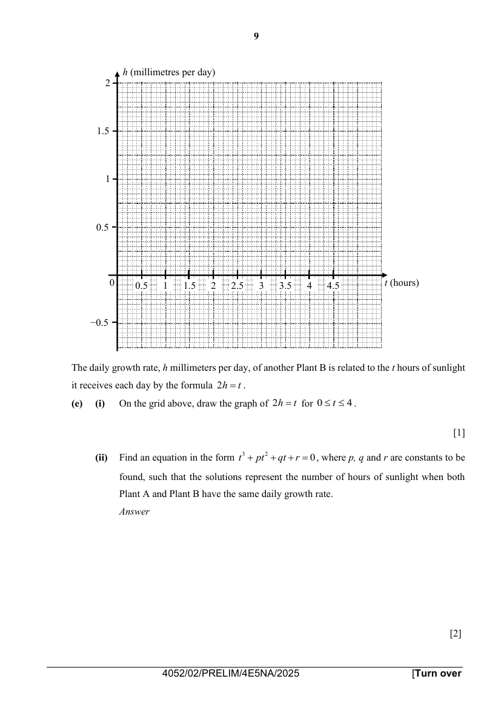
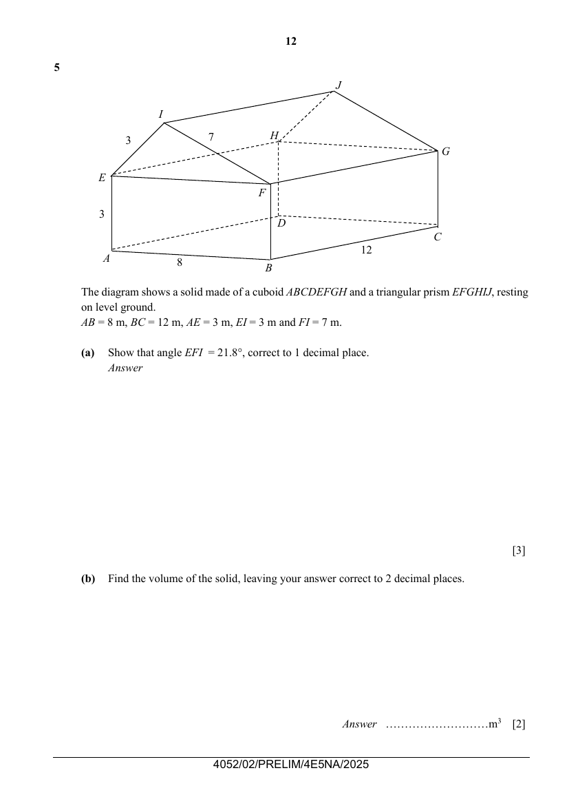
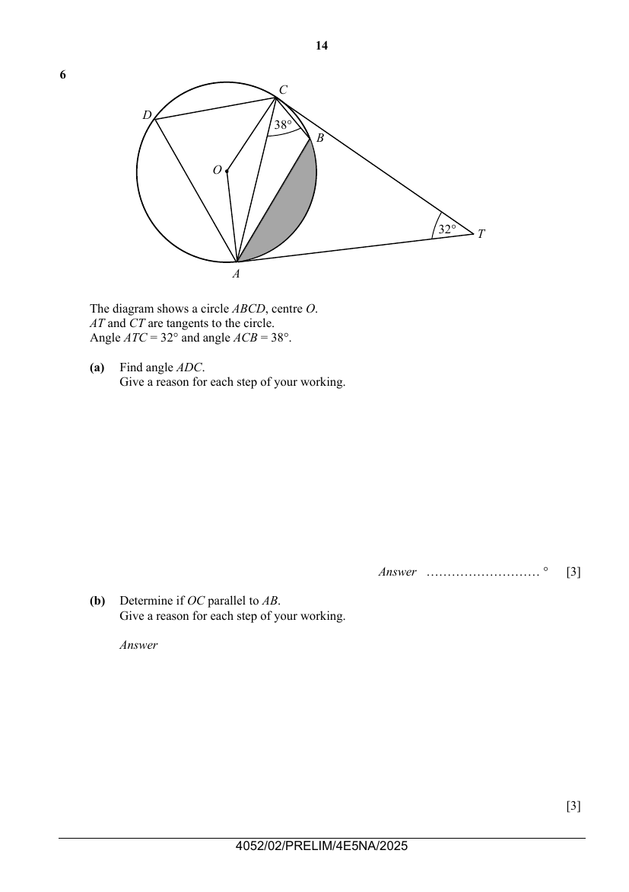
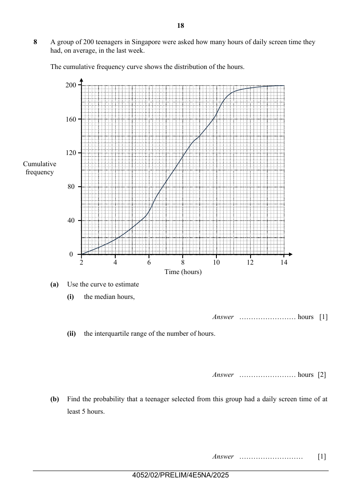
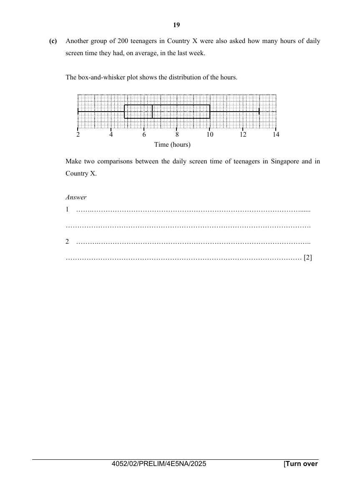
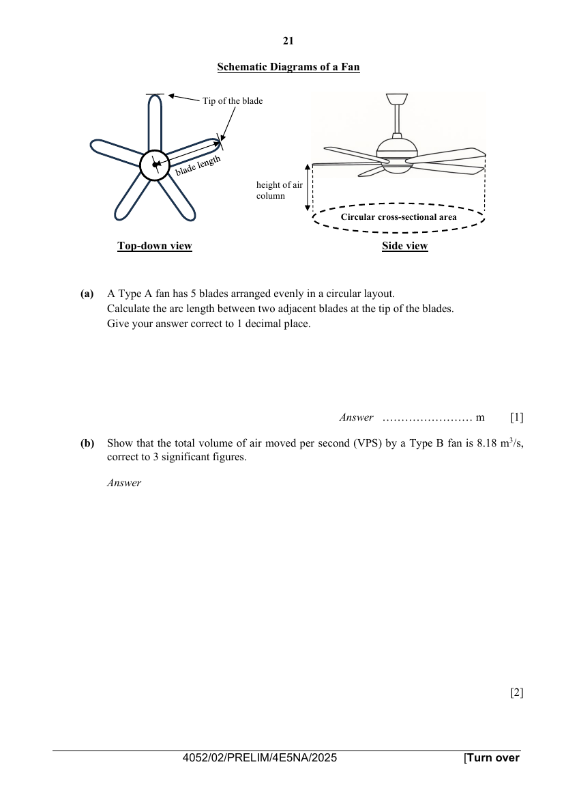

# Dunman Secondary School — Mathematics 4052/02 Paper 2 (cleaned)

> **Institution:** Dunman Secondary School
> **Exam:** Preliminary Examination 2025
> **Level:** Secondary 4 Express / 5 Normal Academic
> **Subjects:** Mathematics
> **Paper:** 4052/02 Paper 2
> **Date:** 26 August 2025
> **Duration:** 2 hours 15 minutes
> **Total Marks:** 90
> **Source:** `Dunman Sec_2025 Prelims 4EXP Math Paper 2 QP.pdf` (cleaned & reformatted)

---

## Instructions

Candidates answer on the Question Paper.

Write your name, class and index number on all the work you hand in.
Write in dark blue or black pen.
You may use a pencil for any diagrams or graphs.
Do not use staples, paper clips, glue or correction fluid.

Answer all questions.
If working is needed for any question it must be shown with the answer.
Omission of essential working will result in loss of marks.
The total of the marks for this paper is 90.

The use of an approved scientific calculator is expected, where appropriate.
If the degree of accuracy is not specified in the question, and if the answer is not exact, give the answer to three significant figures. Give answers in degrees to one decimal place.
For $\pi$, use either your calculator value or $3.142$, unless the question requires the answer in terms of $\pi$.

This document consists of 21 printed pages and 1 blank page.

---

## Mathematical Formulae

Standard 4052 formulae for compound interest, mensuration, trigonometry and statistics are printed on page 2 of the question paper. They are the same set as Paper 1.

---

### Q1

> **Marks:** (a) 2, (b)(i) 1, (b)(ii) 3, (c) 5; total 11
> **Page:** 4–5

**(a)** Solve the inequality $2x-1<\dfrac{5+9x}{2}$. [2]
> **Topic:** N7 Equations and inequalities
> **Sub-topic:** Equations and inequalities
> **LO:** [[context/subjects/o-level-e-maths/learning-objectives/o-level-e-maths-N7g.md|N7g]]

**(b)** It is given that $b=\dfrac{2(n-5p^{2})}{n-p^{2}}$.

**(i)** Find $b$ when $n=1$ and $p=-2$. [1]
> **Topic:** N5 Algebraic expressions and formulae
> **Sub-topic:** Algebraic expressions and formulae
> **LO:** [[context/subjects/o-level-e-maths/learning-objectives/o-level-e-maths-N5l.md|N5l]]

**(ii)** Express $p$ in terms of $b$ and $n$. [3]
> **Topic:** N7 Equations and inequalities
> **Sub-topic:** Equations and inequalities
> **LO:** [[context/subjects/o-level-e-maths/learning-objectives/o-level-e-maths-N7g.md|N7g]]

**(c)** Solve the equation $\dfrac{3x}{2x-1}-\dfrac{2}{5-x}=7$. [5]
> **Topic:** N7 Equations and inequalities
> **Sub-topic:** Equations and inequalities
> **LO:** [[context/subjects/o-level-e-maths/learning-objectives/o-level-e-maths-N7e.md|N7e]]

---

### Q2

> **Marks:** (a)(i) 2, (a)(ii) 2, (a)(iii) 2, (b)(i) 2, (b)(ii) 2; total 10
> **Page:** 6–7

**(a)** In 2023, the amount of waste recycled in Singapore was 3.553 million tonnes.
The amount of waste disposed in Singapore was 3.3064 million tonnes.

**(i)** How much more waste (in tonnes) was recycled than disposed in Singapore in 2023?
Write the difference (in tonnes) in standard form, correct to three significant figures. [2]
> **Topic:** N3 Percentage
> **Sub-topic:** Percentage
> **LO:** [[context/subjects/o-level-e-maths/learning-objectives/o-level-e-maths-N3c.md|N3c]]

**(ii)** The amount of waste recycled in Singapore in 2020 was 3.040 million tonnes.
Calculate the percentage increase in the amount of waste recycled from 2020 to 2023. [2]
> **Topic:** N3 Percentage
> **Sub-topic:** Percentage
> **LO:** [[context/subjects/o-level-e-maths/learning-objectives/o-level-e-maths-N3d.md|N3d]]

**(iii)** From 2022 to 2023, the amount of waste recycled in Singapore decreased by $15.2\%$.
Calculate the amount of waste recycled (in tonnes) in 2022. [2]
> **Topic:** N3 Percentage
> **Sub-topic:** Percentage
> **LO:** [[context/subjects/o-level-e-maths/learning-objectives/o-level-e-maths-N3c.md|N3c]]

**(b)** The cash price of a new car is &#36;120 000.

**(i)** Jason buys the car on hire purchase.
He pays a deposit of $20\%$ of the cash price.
He then makes 84 monthly payments of &#36;1400.

What is the total amount that Jason pays for the car? [2]
> **Topic:** N3 Percentage
> **Sub-topic:** Percentage
> **LO:** [[context/subjects/o-level-e-maths/learning-objectives/o-level-e-maths-N3d.md|N3d]]

**(ii)** The original value of the car is its cash price of &#36;120 000.
Each year, the value of the car decreases by $15\%$ of its value at the start of the year.

Calculate the overall percentage decrease in the value of the car compared with its original value after 5 years. [2]
> **Topic:** N3 Percentage
> **Sub-topic:** Percentage
> **LO:** [[context/subjects/o-level-e-maths/learning-objectives/o-level-e-maths-N3d.md|N3d]]

---

### Q3

> **Marks:** (a) 1, (b) 3, (c) 1, (d)(i) 2, (d)(ii) 1, (e)(i) 1, (e)(ii) 2; total 11
> **Page:** 8–9

The daily growth rate, $h$ millimeters per day, of Plant A is related to the number of hours of sunlight it receives each day, $t$, by the formula $h=\dfrac{1}{6}t^{2}(4-t)$.

**(a)** Complete the table of values for $h=\dfrac{1}{6}t^{2}(4-t)$.
Values are given to 2 decimal places where appropriate. [1]
> **Topic:** G6 Coordinate geometry
> **Sub-topic:** Coordinate geometry
> **LO:** [[context/subjects/o-level-e-maths/learning-objectives/o-level-e-maths-G6c.md|G6c]]

| $t$ | $0.5$ | $1$ | $1.5$ | $2$ | $2.5$ | $3$ | $3.5$ | $4$ |
| --- | --- | --- | --- | --- | --- | --- | --- | --- |
| $h$ |  | $0.5$ | $0.94$ | $1.33$ | $1.56$ | $1.5$ | $1.02$ | $0$ |

**(b)** On the grid opposite, draw the graph of $h=\dfrac{1}{6}t^{2}(4-t)$ for $0\leq t\leq 4$. [3]
> **Topic:** G6 Coordinate geometry
> **Sub-topic:** Coordinate geometry
> **LO:** [[context/subjects/o-level-e-maths/learning-objectives/o-level-e-maths-G6c.md|G6c]]

**(c)** Use your graph to find the maximum number of hours of sunlight Plant A can receive to achieve a daily growth rate of 1 millimetre per day. [1]
> **Topic:** G6 Coordinate geometry
> **Sub-topic:** Coordinate geometry
> **LO:** [[context/subjects/o-level-e-maths/learning-objectives/o-level-e-maths-G6c.md|G6c]]

**(d)**

**(i)** By drawing a tangent, find the gradient of the curve at $(3,1.5)$. [2]
> **Topic:** G6 Coordinate geometry
> **Sub-topic:** Coordinate geometry
> **LO:** [[context/subjects/o-level-e-maths/learning-objectives/o-level-e-maths-G6c.md|G6c]]

**(ii)** What does the gradient in part (i) tell us about the effect of additional sunlight on the daily growth rate of plant A at this point? Explain your answer. [1]
> **Topic:** G6 Coordinate geometry
> **Sub-topic:** Coordinate geometry
> **LO:** [[context/subjects/o-level-e-maths/learning-objectives/o-level-e-maths-G6c.md|G6c]]

The daily growth rate, $h$ millimeters per day, of another Plant B is related to the $t$ hours of sunlight it receives each day by the formula $2h=t$.

**(e)**

**(i)** On the grid above, draw the graph of $2h=t$ for $0\leq t\leq 4$. [1]
> **Topic:** G6 Coordinate geometry
> **Sub-topic:** Coordinate geometry
> **LO:** [[context/subjects/o-level-e-maths/learning-objectives/o-level-e-maths-G6c.md|G6c]]

**(ii)** Find an equation in the form $t^{3}+pt^{2}+qt+r=0$, where $p$, $q$ and $r$ are constants to be found, such that the solutions represent the number of hours of sunlight when both Plant A and Plant B have the same daily growth rate. [2]
> **Topic:** G6 Coordinate geometry
> **Sub-topic:** Coordinate geometry
> **LO:** [[context/subjects/o-level-e-maths/learning-objectives/o-level-e-maths-G6c.md|G6c]]

---

### Q4

> **Marks:** (a)(i) 2, (a)(ii) 1, (b) 2, (c) 2, (d) 2, (e) 2; total 11
> **Page:** 10–11

$OACB$ is a trapezium.
$\overrightarrow{OA}=2\mathbf{a}$, $\overrightarrow{OB}=3\mathbf{b}$ and $\overrightarrow{OA}=\dfrac{2}{3}\overrightarrow{BC}$.
$X$ is the point on $AB$ such that $AX:XB=1:3$.

**(a)** Express, as simply as possible, in terms of $\mathbf{a}$ and/or $\mathbf{b}$,

**(i)** $\overrightarrow{AX}$, [2]
> **Topic:** G7 Vectors in two dimensions
> **Sub-topic:** Vectors in two dimensions
> **LO:** [[context/subjects/o-level-e-maths/learning-objectives/o-level-e-maths-G7h.md|G7h]]

**(ii)** $\overrightarrow{OX}$. [1]
> **Topic:** G7 Vectors in two dimensions
> **Sub-topic:** Vectors in two dimensions
> **LO:** [[context/subjects/o-level-e-maths/learning-objectives/o-level-e-maths-G7h.md|G7h]]

**(b)** $Y$ is the point on $BC$ produced such that $\overrightarrow{BY}=3\overrightarrow{OA}$.
Find, in terms of $\mathbf{a}$ and/or $\mathbf{b}$, $\overrightarrow{XY}$. [2]
> **Topic:** G7 Vectors in two dimensions
> **Sub-topic:** Vectors in two dimensions
> **LO:** [[context/subjects/o-level-e-maths/learning-objectives/o-level-e-maths-G7h.md|G7h]]

**(c)** Explain why $O$, $X$ and $Y$ lie on a straight line. [2]
> **Topic:** G7 Vectors in two dimensions
> **Sub-topic:** Vectors in two dimensions
> **LO:** [[context/subjects/o-level-e-maths/learning-objectives/o-level-e-maths-G7h.md|G7h]]

**(d)** Find the ratio of the area of triangle $OBX$ to the area of quadrilateral $OACB$. [2]
> **Topic:** G7 Vectors in two dimensions
> **Sub-topic:** Vectors in two dimensions
> **LO:** [[context/subjects/o-level-e-maths/learning-objectives/o-level-e-maths-G7h.md|G7h]]

**(e)** $W$ is the point on $AB$ such that triangle $OAW$ is similar to triangle $CBW$.
Find, in terms of $\mathbf{a}$ and/or $\mathbf{b}$, $\overrightarrow{OW}$. [2]
> **Topic:** G7 Vectors in two dimensions
> **Sub-topic:** Vectors in two dimensions
> **LO:** [[context/subjects/o-level-e-maths/learning-objectives/o-level-e-maths-G7h.md|G7h]]

---

### Q5

> **Marks:** (a) 3, (b) 2, (c) 2, (d) 4; total 11
> **Page:** 12–13

The diagram shows a solid made of a cuboid $ABCDEFGH$ and a triangular prism $EFGHIJ$, resting on level ground.
$AB=8$ m, $BC=12$ m, $AE=3$ m, $EI=3$ m and $FI=7$ m.

**(a)** Show that angle $EFI=21.8^{\circ}$, correct to 1 decimal place. [3]
> **Topic:** G4 Pythagoras' theorem and trigonometry
> **Sub-topic:** Pythagoras' theorem and trigonometry
> **LO:** [[context/subjects/o-level-e-maths/learning-objectives/o-level-e-maths-G4g.md|G4g]]

**(b)** Find the volume of the solid, leaving your answer correct to 2 decimal places. [2]
> **Topic:** G4 Pythagoras' theorem and trigonometry
> **Sub-topic:** Pythagoras' theorem and trigonometry
> **LO:** [[context/subjects/o-level-e-maths/learning-objectives/o-level-e-maths-G4g.md|G4g]]

**(c)** Find the vertical height of $I$ above the ground. [2]
> **Topic:** G4 Pythagoras' theorem and trigonometry
> **Sub-topic:** Pythagoras' theorem and trigonometry
> **LO:** [[context/subjects/o-level-e-maths/learning-objectives/o-level-e-maths-G4g.md|G4g]]

**(d)** Find the angle of elevation of $J$ from $B$. [4]
> **Topic:** G4 Pythagoras' theorem and trigonometry
> **Sub-topic:** Pythagoras' theorem and trigonometry
> **LO:** [[context/subjects/o-level-e-maths/learning-objectives/o-level-e-maths-G4g.md|G4g]]

---

### Q6

> **Marks:** (a) 3, (b) 3, (c) 4; total 10
> **Page:** 14–15

The diagram shows a circle $ABCD$, centre $O$.
$AT$ and $CT$ are tangents to the circle.
Angle $ATC=32^{\circ}$ and angle $ACB=38^{\circ}$.

**(a)** Find angle $ADC$.
Give a reason for each step of your working. [3]
> **Topic:** G3 Properties of circles
> **Sub-topic:** Properties of circles
> **LO:** [[context/subjects/o-level-e-maths/learning-objectives/o-level-e-maths-G3b.md|G3b]]

**(b)** Determine if $OC$ parallel to $AB$.
Give a reason for each step of your working. [3]
> **Topic:** G3 Properties of circles
> **Sub-topic:** Properties of circles
> **LO:** [[context/subjects/o-level-e-maths/learning-objectives/o-level-e-maths-G3b.md|G3b]]

**(c)** The radius of the circle is 10 cm.

Calculate the area of the shaded region. [4]
> **Topic:** G3 Properties of circles
> **Sub-topic:** Properties of circles
> **LO:** [[context/subjects/o-level-e-maths/learning-objectives/o-level-e-maths-G3b.md|G3b]]

---

### Q7

> **Marks:** (a)(i) 1, (a)(ii) 2, (a)(iii) 3, (b)(i) 1, (b)(ii) 2, (b)(iii) 1; total 10
> **Page:** 16–17

**(a)** The diagram shows part of a number grid.

A cross outlining five numbers, as shown, can be placed anywhere on the grid.

**(i)** If $n$ represents the number in the top left corner of the cross, write down an expression, in terms of $n$, for the number in the bottom right corner of the cross. [1]
> **Topic:** N1 Numbers and their operations
> **Sub-topic:** Numbers and their operations
> **LO:** [[context/subjects/o-level-e-maths/learning-objectives/o-level-e-maths-N1h.md|N1h]]

**(ii)** Show that the difference between the products of the numbers in the opposite corners of the cross is always 36. [2]
> **Topic:** N1 Numbers and their operations
> **Sub-topic:** Numbers and their operations
> **LO:** [[context/subjects/o-level-e-maths/learning-objectives/o-level-e-maths-N1h.md|N1h]]

**(iii)** Show that the sum of the five numbers in the cross cannot be 1715. [3]
> **Topic:** N1 Numbers and their operations
> **Sub-topic:** Numbers and their operations
> **LO:** [[context/subjects/o-level-e-maths/learning-objectives/o-level-e-maths-N1h.md|N1h]]

**(b)** The $n$th term of a sequence is given by $T_{n}=2n^{2}-n+3$.

**(i)** Find the value of $T_{10}$. [1]
> **Topic:** N1 Numbers and their operations
> **Sub-topic:** Numbers and their operations
> **LO:** [[context/subjects/o-level-e-maths/learning-objectives/o-level-e-maths-N1h.md|N1h]]

**(ii)** The difference, $D$, between two consecutive terms of the sequence is $T_{n+1}-T_{n}$.
Show that $D=kn+1$, where $k$ is an integer to be found. [2]
> **Topic:** N1 Numbers and their operations
> **Sub-topic:** Numbers and their operations
> **LO:** [[context/subjects/o-level-e-maths/learning-objectives/o-level-e-maths-N1h.md|N1h]]

**(iii)** Using the expression from part (ii), explain, without doing any further calculation, how the difference between two consecutive terms of the sequence changes as $n$ increases by 1 each time. [1]
> **Topic:** N1 Numbers and their operations
> **Sub-topic:** Numbers and their operations
> **LO:** [[context/subjects/o-level-e-maths/learning-objectives/o-level-e-maths-N1h.md|N1h]]

---

### Q8

> **Marks:** (a)(i) 1, (a)(ii) 2, (b) 1, (c) 2; total 6
> **Page:** 18–19

A group of 200 teenagers in Singapore were asked how many hours of daily screen time they had, on average, in the last week.

The cumulative frequency curve shows the distribution of the hours.

**(a)** Use the curve to estimate

**(i)** the median hours, [1]
> **Topic:** S1 Data handling and analysis
> **Sub-topic:** Data handling and analysis
> **LO:** [[context/subjects/o-level-e-maths/learning-objectives/o-level-e-maths-S1f.md|S1f]]

**(ii)** the interquartile range of the number of hours. [2]
> **Topic:** S1 Data handling and analysis
> **Sub-topic:** Data handling and analysis
> **LO:** [[context/subjects/o-level-e-maths/learning-objectives/o-level-e-maths-S1f.md|S1f]]

**(b)** Find the probability that a teenager selected from this group had a daily screen time of at least 5 hours. [1]
> **Topic:** S2 Probability
> **Sub-topic:** Probability
> **LO:** [[context/subjects/o-level-e-maths/learning-objectives/o-level-e-maths-S2c.md|S2c]]

**(c)** Another group of 200 teenagers in Country X were also asked how many hours of daily screen time they had, on average, in the last week.

The box-and-whisker plot shows the distribution of the hours.

Make two comparisons between the daily screen time of teenagers in Singapore and in Country X. [2]
> **Topic:** S1 Data handling and analysis
> **Sub-topic:** Data handling and analysis
> **LO:** [[context/subjects/o-level-e-maths/learning-objectives/o-level-e-maths-S1f.md|S1f]]

---

### Q9

> **Marks:** (a) 1, (b) 2, (c) 7; total 10
> **Page:** 20–22

Mr Tan is engaging a contractor to install large ceiling fans in the school hall.
The hall is a large rectangular space, 30 metres long, 20 metres wide and 8 metres high.

There are two requirements:

1. Good air circulation. The fans together must meet the minimum airflow requirement.
2. Comfortable cooling environment. Each fan must produce an air velocity of at least 0.3 m/s.

Formulas related to the requirements are provided by the vendor.

Volume of air moved by fan

- Volume of air moved by fan for 1 full rotation (VFR) = circular cross-sectional area of the fan $\times$ height of air column
- Volume of air moved by fan per second (VPS) = VFR $\times$ number of full rotations per minute (RPM) $\div 60$

Minimum airflow requirement

- Minimum airflow requirement (m$^{3}$/min) = total volume of school hall (m$^{3}$) $\div 5$
- Total airflow generated per minute of fans (m$^{3}$/min) = VFR $\times 70 \times$ number of fans

Air velocity requirement

- Air velocity = VPS $\div$ circular cross-sectional area of the fan

| Type | Blade length (m) | Number of blades | Motor Power (W) | Height of air column (m) | Number of full rotations per minute (RPM) | Weight (kg) |
| --- | --- | --- | --- | --- | --- | --- |
| A | 2.0 | 5 | 75 | 0.5 | 60 | 32.0 |
| B | 2.5 | 5 | 90 | 0.5 | 50 | 35.0 |
| C | 3.0 | 6 | 120 | 0.6 | 45 | 38.0 |

**(a)** A Type A fan has 5 blades arranged evenly in a circular layout.
Calculate the arc length between two adjacent blades at the tip of the blades.
Give your answer correct to 1 decimal place. [1]
> **Topic:** G5 Mensuration
> **Sub-topic:** Mensuration
> **LO:** [[context/subjects/o-level-e-maths/learning-objectives/o-level-e-maths-G5f.md|G5f]]

**(b)** Show that the total volume of air moved per second (VPS) by a Type B fan is $8.18\text{ m}^{3}\text{/s}$, correct to 3 significant figures. [2]
> **Topic:** G5 Mensuration
> **Sub-topic:** Mensuration
> **LO:** [[context/subjects/o-level-e-maths/learning-objectives/o-level-e-maths-G5f.md|G5f]]

**(c)** The contractor recommended Mr Tan to install two Type C fans in the school hall.

Based on the requirements for good air circulation and comfortable cooling, determine if the recommendation is suitable. Justify your decision. [7]
> **Topic:** G4 Pythagoras' theorem and trigonometry
> **Sub-topic:** Pythagoras' theorem and trigonometry
> **LO:** [[context/subjects/o-level-e-maths/learning-objectives/o-level-e-maths-G4c.md|G4c]]
