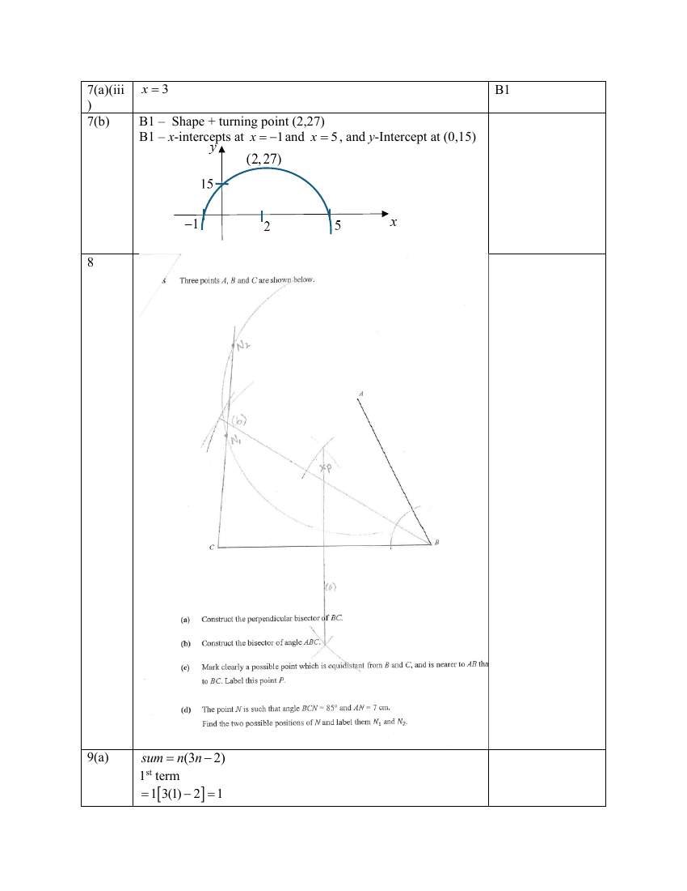

# Gan Eng Seng School — Mathematics 4052/01 Paper 1 Mark Scheme (cleaned)

> **Institution:** Gan Eng Seng School
> **Exam:** Preliminary Exam 2025
> **Level:** Sec 4 Express / 5 Normal Academic
> **Subjects:** Mathematics
> **Paper:** 4052/01 Paper 1 Mark Scheme
> **Date:** 28 Aug 2025
> **Duration:** 2 hours 15 minutes
> **Total Marks:** 90
> **Source:** `GESS-2025-EM-P1-MS` (cleaned & reformatted)

---

## Answer all the questions

---

### Q1

> **Marks:** (a) B1, (b) B1; total 2
> **Sub-topic:** Numbers and standard form
> **Page:** 3

**(a)**

$$
\frac{33.17\times 55.2^{\frac{1}{3}}}{-(-1)+\sqrt[3]{647.9}}=13.08359745=10
$$

**(b)**

$$
\frac{3\text{ m}}{\text{s}}=\frac{0.003\text{ km}}{\frac{1}{3600}\text{ h}}=10.8\text{ km/h}
$$

---

### Q2

> **Marks:** (a) B1, (b) M1 A1; total 3
> **Sub-topic:** Indices
> **Page:** 3

**(a)**

$$
10^{2m-n}=(10^{m})^{2}\div 10^{n}=2^{2}\div 11=\frac{4}{11}
$$

**(b)** M1 for either simplifying or change of sign.

$$
\frac{7mn^{-1}}{m^{2}}\div\frac{(mn^{2})^{3}}{7}=\frac{7m}{m^{2}n}\div\frac{m^{3}n^{6}}{7}=\frac{7m}{m^{2}n}\times\frac{7}{m^{3}n^{6}}=\frac{49}{m^{4}n^{7}}
$$

---

### Q3

> **Marks:** M1 A1; total 2
> **Sub-topic:** Proportion
> **Page:** 4

$$
T=k\sqrt{L}
$$

$$
1.25T=k\sqrt{L_{\text{New}}}
$$

$$
1.25k\sqrt{L}=k\sqrt{L_{\text{New}}}
$$

$$
1.25\sqrt{L}=\sqrt{L_{\text{New}}}
$$

$$
(1.25)^{2}L=L_{\text{New}}
$$

$$
\%\text{ change}=\frac{L_{\text{New}}-L}{L}\times 100\%=\frac{(1.25)^{2}L-L}{L}\times 100\%=0.5625\times 100\%=56.25\%
$$

A1 includes $\times 100\%$.

---

### Q4

> **Marks:** (a) B1, (b) A1; total 2
> **Sub-topic:** Stem-and-leaf diagram
> **Page:** 4

**(a)** $37$ min

**(b)**

$$
25\%\text{ of }28=\frac{25}{100}\times 28=7
$$

From the stem and leaf diagram, 7 workers took less than 19 minutes to assemble a toy.

$p=19$ min.

---

### Q5

> **Marks:** M2,1,0 A1; total 3
> **Sub-topic:** Compound interest
> **Page:** 5

$P=&#36;12000$, $R=\dfrac{7}{2}=3.5\%$, $n=4$

$$
A=P\left(1+\frac{R}{100}\right)^{n}=12000\left(1+\frac{3.5}{100}\right)^{4}=13770.27601=&#36;13770.28
$$

Compound interest

$$
=13770.27601-&#36;12000=&#36;1770.27601=&#36;1770.28\ (2\text{ d.p.})
$$

---

### Q6

> **Marks:** M1 A1; total 2
> **Sub-topic:** Changing the subject
> **Page:** 5

$$
z=\frac{x^{2}+y}{2}
$$

$$
2z=x^{2}+y
$$

$$
4z^{2}=x^{2}+y
$$

$$
x^{2}=4z^{2}-y
$$

$$
x=\pm\sqrt{4z^{2}-y}
$$

Minus 1 mark if no $\pm$.

---

### Q7

> **Marks:** (a)(i) B2, (a)(ii) B1, (a)(iii) B1, (b) B1 B1; total 6
> **Sub-topic:** Quadratic graphs
> **Page:** 6

**(a)(i)**

$$
x^{2}-6x-16=(x-3)^{2}-16-(-3)^{2}=(x-3)^{2}-16-9=(x-3)^{2}-25
$$

**(a)(ii)** $(3,-25)$

**(a)(iii)** $x=3$

**(b)** B1 — shape and turning point $(2,27)$. B1 — $x$-intercepts at $x=-1$ and $x=5$, and $y$-intercept at $(0,15)$.

---

### Q8

> **Marks:** (a) 1, (b) 1, (c) 1, (d) 2; total 5
> **Sub-topic:** Geometrical constructions
> **Page:** 7

The written scheme is the construction diagram: perpendicular bisector of $BC$, angle bisector of $\angle ABC$, point $P$, and the two positions $N_{1}$ and $N_{2}$.

---

### Q9

> **Marks:** (a) B2,1,0, (b) B1; total 3
> **Sub-topic:** Sequences
> **Page:** 8

**(a)** $\text{sum}=n(3n-2)$

1st term $=1[3(1)-2]=1$

Sum of 2 terms $=2[3(2)-2]=8$

2nd term $=8-1=7$

Sum of 3 terms $=3[3(3)-2]=21$

3rd term $=21-8=13$

First 3 terms: $1$, $7$, $13$

**(b)** $6n-5$

---

### Q10

> **Marks:** (a) M1 A1, (b) M1 A1; total 4
> **Sub-topic:** Polygons
> **Page:** 8–9

**(a)**

$$
(5-2)\times 180^{\circ}=90^{\circ}+90^{\circ}+3y
$$

$$
540^{\circ}=180^{\circ}+3y
$$

$$
3y=360^{\circ},\quad y=120^{\circ}
$$

$$
x=360^{\circ}-120^{\circ}=240^{\circ}
$$

$$
\frac{y}{x}=\frac{120^{\circ}}{240^{\circ}}=\frac{1}{2}
$$

**(b)**

$$
(12-2)\times 180^{\circ}=1800^{\circ}
$$

$$
\frac{1800^{\circ}}{12}=150^{\circ}
$$

$$
360^{\circ}-150^{\circ}-90^{\circ}=120^{\circ}
$$

$$
180^{\circ}-120^{\circ}=60^{\circ}
$$

$$
\frac{360^{\circ}}{60^{\circ}}=6\text{ sides}
$$

---

### Q11

> **Marks:** B1; total 1
> **Sub-topic:** Statistical diagrams
> **Page:** 10

B1 for a misleading feature and the effect of that feature on interpretation of the data.

1. The title is biased. It does not allow the reader to make his/her own judgement.

OR

2. The vertical axis does not start from zero. This exaggerates the differences between the data.

---

### Q12

> **Marks:** (a) B1, (b) M1 A1; total 3
> **Sub-topic:** Vectors
> **Page:** 10

**(a)**

$$
\overrightarrow{CD}=\overrightarrow{OD}-\overrightarrow{OC}=\begin{pmatrix}3\\ -1\end{pmatrix}-\begin{pmatrix}-2\\ 5\end{pmatrix}=\begin{pmatrix}5\\ -6\end{pmatrix}
$$

**(b)**

$$
\overrightarrow{CE}=n\overrightarrow{CD}=n\begin{pmatrix}5\\ -6\end{pmatrix}
$$

$$
\left|\overrightarrow{CE}\right|=n\times\sqrt{5^{2}+(-6)^{2}}=n\times\sqrt{61}=2\sqrt{61}
$$

M1 for $n\times\sqrt{61}=2\sqrt{61}$ seen.

Since the $x$-coordinate of $C$ is greater than the $x$-coordinate of $E$,

$$
\overrightarrow{CE}=n\times\sqrt{61}=-2\times\sqrt{61},\quad n=-2
$$

$$
\overrightarrow{CE}=\begin{pmatrix}-10\\ 12\end{pmatrix}
$$

---

### Q13

> **Marks:** (a) M1 A1, (b) M1 A1, (c) M1 A1, (d) M1 A1, (e) M1 A1; total 10
> **Sub-topic:** Coordinate geometry
> **Page:** 11–12

**(a)** $(-6,5)$ and $(-3,-2)$

$$
\text{Gradient}=\frac{5-(-2)}{-6-(-3)}=\frac{7}{-3}
$$

$$
y=\frac{7}{-3}x+c
$$

Sub $(-6,5)$:

$$
5=\frac{7}{-3}(-6)+c,\quad c=-9
$$

$$
y=\frac{7}{-3}x-9
$$

**(b)**

$$
y=\frac{7}{-3}x+c
$$

Sub $(9,5)$:

$$
5=\frac{7}{-3}(9)+c,\quad c=26
$$

$$
y=\frac{7}{-3}x+26
$$

**(c)**

$$
9-(-6)=15,\quad 5-(-2)=7
$$

$$
\text{Area}=\frac{1}{2}\times 15\times 7=52.5
$$

**(d)** $(9,5)$, $(-3,-2)$

$$
BC=\sqrt{(9-(-3))^{2}+(5-(-2))^{2}}=\sqrt{144+49}=\sqrt{193}
$$

$$
\text{Area}=\frac{1}{2}\times d\times\sqrt{193}=52.5
$$

$$
d=\frac{52.5}{\frac{1}{2}\times\sqrt{193}}=7.558065=7.56\ (3\text{ s.f.})
$$

**(e)**

$$
y=\frac{7}{-3}x-9
$$

Sub $y=0$:

$$
\frac{7}{3}x=-9,\quad x=\frac{-27}{7}
$$

$$
P\left(\frac{-27}{7},0\right)
$$

---

### Q14

> **Marks:** (a) M1 A1, (b) B1; total 3
> **Sub-topic:** Trigonometry and circle theorems
> **Page:** 13

**(a)**

$$
AC=\sqrt{12^{2}+5^{2}}=13
$$

$$
\cos\angle ACD=-\cos\angle ACB=-\frac{5}{13}
$$

**(b)** Using angles in a semicircle, $AC$ is the diameter.

$$
\text{Radius}=\frac{13}{2}=6.5
$$

---

### Q15

> **Marks:** (a) A1, (b) M1 A1, (c) A1; total 4
> **Sub-topic:** Exponential growth
> **Page:** 13–14

**(a)** $500$

**(b)**

$$
\frac{500(4)^{2}-500}{500}\times 100\%=1500\%
$$

**(c)** $t=3.5$

---

### Q16

> **Marks:** (a) M1 A1, (b) M1 A1; total 4
> **Sub-topic:** Algebraic fractions and factorisation
> **Page:** 14

**(a)**

$$
\frac{x^{2}+xy}{x^{2}+2xy+y^{2}}=\frac{x(x+y)}{(x+y)^{2}}=\frac{x}{x+y}
$$

**(b)**

$$
10yz-5y^{2}-2xz+xy=5y(2z-y)-x(2z-y)=(5y-x)(2z-y)
$$

---

### Q17

> **Marks:** (a) B1, (b)(i) M1 A1, (b)(ii) M1 A1; total 5
> **Sub-topic:** Probability
> **Page:** 15

**(a)** $\dfrac{3}{5}$, $\dfrac{4}{9}$

**(b)(i)**

$$
\frac{3}{5}\times\frac{4}{9}+\frac{2}{5}\times\frac{2}{3}=\frac{8}{15}
$$

**(b)(ii)**

$$
1-\frac{3}{5}\times\frac{5}{9}=\frac{2}{3}
$$

---

### Q18

> **Marks:** (a) M1 A1, (b)(i) B1, (b)(ii) B1; total 4
> **Sub-topic:** Hire purchase and sets
> **Page:** 16

**(a)**

$$
\text{Deposit}=\frac{20}{100}\times&#36;1200=&#36;240
$$

Remaining amount $=&#36;1200-&#36;240=&#36;960$

$$
\text{Monthly payment}=\frac{1.5}{100}\times&#36;960\times 12=&#36;172.80
$$

Total amount paid $=&#36;172.80+&#36;1200=&#36;1372.80$

**(b)(i)** $3$

**(b)(ii)** Shade the region outside both $A$ and $B$ only if that is the region required by $(A'\cup B)\cap(A\cup B)'$. The scheme mark is B1 on the diagram.

---

### Q19

> **Marks:** (a) M1 A1, (b) M1 A1; total 4
> **Sub-topic:** Map scales
> **Page:** 17

**(a)** $1\text{ cm}:10\text{ km}$

$1\text{ cm}^{2}:100\text{ km}^{2}$

$$
\text{Area (map)}=\frac{225}{100}=2.25\text{ cm}^{2}
$$

**(b)**

$$
36\text{ cm}^{2}:225\text{ km}^{2}
$$

$$
6\text{ cm}:15\text{ km}
$$

$$
1\text{ cm}:2.5\text{ km}
$$

$$
1\text{ cm}:250000\text{ cm}
$$

Map scale is $1:250000$.

---

### Q20

> **Marks:** (a)(i) B1, (a)(ii) B1, (b) B2; total 5
> **Sub-topic:** Prime factors and averages
> **Page:** 17–18

**(a)(i)** $4624=2^{4}\times 17^{2}$

**(a)(ii)**

$$
4624\times\frac{p}{q}=2^{4}\times 17^{2}\times\frac{p}{q}
$$

$p=17$, $q=2$

**(b)** $a=27$, $b=29$, $c=32$

---

### Q21

> **Marks:** (a) M1 A1, (b) M1 A1, (c) M1 A1; total 6
> **Sub-topic:** Circle theorems and similarity
> **Page:** 18–19

**(a)** M1 for one pair of correct corresponding angles with reasons.

$\angle AED=\angle BEC$ (vert. opp. $\angle$s)

$\angle EAD=\angle EBC=24^{\circ}$ ($\angle$s in the same segment)

$\angle EDA=\angle ECB=67^{\circ}$ ($\angle$s in the same segment)

$\triangle AED$ is similar to $\triangle BEC$ (AA similarity test)

**(b)**

$$
\frac{2}{4}=\frac{3.5}{EB}
$$

$$
EB=7
$$

Alternative solution:

$$
\frac{4}{\sin 24^{\circ}}=\frac{EB}{\sin 67^{\circ}}
$$

$$
EB=\frac{4\sin 67^{\circ}}{\sin 24^{\circ}}=9.05\text{ cm}\ (3\text{ s.f.})
$$

**(c)**

$$
\angle AOD=180^{\circ}-67^{\circ}-67^{\circ}=46^{\circ}
$$

$$
\angle BOC=180^{\circ}-24^{\circ}-24^{\circ}=132^{\circ}
$$

$$
\frac{\dfrac{46}{360}\times 2\pi r}{\dfrac{132}{360}\times 2\pi r}=\frac{46}{132}=\frac{23}{66}
$$

---

### Q22

> **Marks:** (a) M1 A1, (b)(i) A1, (b)(ii) M1 A1; total 5
> **Sub-topic:** Similarity
> **Page:** 20

**(a)**

$$
\frac{\text{Base area of Vase }B}{\text{Base area of Vase }A}=\left(\frac{\text{Base radius of Vase }B}{\text{Base radius of Vase }A}\right)^{2}
$$

$$
\frac{\text{Base area of Vase }B}{50}=\left(\frac{3}{1}\right)^{2}
$$

$$
\text{Base area of Vase }B=\frac{9}{1}\times 50=450\text{ cm}^{2}
$$

**(b)(i)**

$$
\frac{\text{Curved surface area of Vase }C}{\text{Curved surface area of Vase }A}=\frac{\text{Base area of Vase }C}{\text{Base area of Vase }A}=\frac{800}{50}=\frac{16}{1}
$$

The required ratio is $16:1$.

**(b)(ii)**

$$
\frac{\text{Base area of Vase }C}{\text{Base area of Vase }A}=\frac{16}{1}
$$

$$
\frac{\text{height of Vase }C}{\text{height of Vase }A}=\sqrt{\frac{16}{1}}=\frac{4}{1}
$$

$$
\frac{\text{Volume of Vase }C}{\text{Volume of Vase }A}=\left(\frac{4}{1}\right)^{3}=\frac{64}{1}
$$

$$
\frac{\text{Volume of Vase }C}{400}=\frac{64}{1}
$$

$$
\text{Volume of Vase }C=\frac{64}{1}\times 400=25600\text{ cm}^{3}
$$

---

### Q23

> **Marks:** (a) M1 A1, (b) B1 B1; total 4
> **Sub-topic:** Speed-time graphs
> **Page:** 21

**(a)**

$$
\text{gradient (acceleration)}=\frac{\text{speed}}{\text{time}}=\frac{6-0}{60-100}=-0.15
$$

$$
\frac{v-0}{70-100}=-0.15
$$

$$
\frac{v}{-30}=-0.15
$$

$$
v=4.5\text{ m/s}
$$

**(b)** B1 — correct values for distance and time (must be proportionate). B1 — correct shape.

