# Gan Eng Seng School — Mathematics 4052/01 Paper 1 (cleaned)

> **Institution:** Gan Eng Seng School
> **Exam:** Preliminary Exam 2025
> **Level:** Sec 4 Express / 5 Normal Academic
> **Subjects:** Mathematics
> **Paper:** 4052/01 Paper 1
> **Date:** 28 Aug 2025
> **Duration:** 2 hours 15 minutes
> **Total Marks:** 90
> **Source:** `GESS-2025-EM-PRELIM-P1` (cleaned & reformatted)

---

## Instructions

Write your class, index number and name on all the work you hand in.
Write in dark blue or black pen on both sides of the paper.
You may use a soft pencil for any diagrams or graphs.
Do not use staples, paper clips, highlighters, glue or correction fluid.

Answer all questions.
If working is needed for any question it must be shown with the answer.
Omission of essential working will result in loss of marks.
Calculators should be used where appropriate.
If the degree of accuracy is not specified in the question, and if the answer is not exact, give the answer to three significant figures. Give answers in degrees to one decimal place.
For $\pi$ use either your calculator value or $3.142$, unless the question requires the answer in terms of $\pi$.

The number of marks is given in brackets [ ] at the end of each question or part question.
The total of the marks for this paper is 90.

Candidates answer on the Question Paper.
No Additional Materials are required.

---

## Mathematical Formulae

*Compound interest*

$$
\text{Total amount} = P\left(1+\frac{r}{100}\right)^{n}
$$

*Mensuration*

$$
\text{Curved surface area of a cone} = \pi rl
$$

$$
\text{Surface area of a sphere} = 4\pi r^{2}
$$

$$
\text{Volume of a cone} = \frac{1}{3}\pi r^{2}h
$$

$$
\text{Volume of a sphere} = \frac{4}{3}\pi r^{3}
$$

$$
\text{Area of triangle } ABC = \frac{1}{2}ab\sin C
$$

$$
\text{Arc length} = r\theta,\text{ where }\theta\text{ is in radians}
$$

$$
\text{Sector area} = \frac{1}{2}r^{2}\theta,\text{ where }\theta\text{ is in radians}
$$

*Trigonometry*

$$
\frac{a}{\sin A} = \frac{b}{\sin B} = \frac{c}{\sin C}
$$

$$
a^{2} = b^{2}+c^{2}-2bc\cos A
$$

*Statistics*

$$
\text{Mean} = \frac{\sum fx}{\sum f}
$$

$$
\text{Standard deviation} = \sqrt{\frac{\sum fx^{2}}{\sum f}-\left(\frac{\sum fx}{\sum f}\right)^{2}}
$$

---

## Answer all the questions.

---

### Q1

> **Marks:** (a) 1, (b) 1; total 2
> **Page:** 3

**(a)** Calculate $\dfrac{33.17\times 55.2^{\frac{1}{3}}}{-(-1)+\sqrt[3]{647.9}}$, giving your answer correct to 1 significant figure. [1]
> **Topic:** N1 Numbers and their operations
> **Sub-topic:** Numbers and their operations
> **LO:** [[context/subjects/o-level-e-maths/learning-objectives/o-level-e-maths-N1g.md|N1g]]

**(b)** Convert $3\text{ m/s}$ to km/h. [1]
> **Topic:** N1 Numbers and their operations
> **Sub-topic:** Numbers and their operations
> **LO:** [[context/subjects/o-level-e-maths/learning-objectives/o-level-e-maths-N1g.md|N1g]]

---

### Q2

> **Marks:** (a) 1, (b) 2; total 3
> **Page:** 3

**(a)** If $10^{m}=2$ and $10^{n}=11$, find the value of $10^{2m-n}$. [1]
> **Topic:** N1 Numbers and their operations
> **Sub-topic:** Numbers and their operations
> **LO:** [[context/subjects/o-level-e-maths/learning-objectives/o-level-e-maths-N1j.md|N1j]]

**(b)** Simplify $\dfrac{7mn^{-1}}{m^{2}}\div\dfrac{(mn^{2})^{3}}{7}$. [2]
> **Topic:** N1 Numbers and their operations
> **Sub-topic:** Numbers and their operations
> **LO:** [[context/subjects/o-level-e-maths/learning-objectives/o-level-e-maths-N1j.md|N1j]]

---

### Q3

> **Marks:** 2
> **Topic:** N2 Ratio and proportion
> **Sub-topic:** Ratio and proportion
> **LO:** [[context/subjects/o-level-e-maths/learning-objectives/o-level-e-maths-N2b.md|N2b]]
> **Page:** 4

The period, $T$, of a pendulum is proportional to the square root of its length, $L$.
If the period is increased by $25\%$, calculate the percentage change in the length. [2]

---

### Q4

> **Marks:** (a) 1, (b) 1; total 2
> **Page:** 4

The stem and leaf diagram below shows the times, in minutes, taken by a group of students in a school to assemble a toy car for a charity event.

| Stem | Leaf |
| --- | --- |
| 1 | 0 2 4 5 5 8 8 9 |
| 2 | 1 1 3 3 4 5 6 6 6 7 7 8 9 |
| 3 | 0 0 0 1 1 3 7 |

Key: $2\mid 0$ represents 20 minutes

**(a)** Find the time taken by the slowest student to assemble a toy car. [1]
> **Topic:** S1 Data handling and analysis
> **Sub-topic:** Data handling and analysis
> **LO:** [[context/subjects/o-level-e-maths/learning-objectives/o-level-e-maths-S1b.md|S1b]]

**(b)** $25\%$ of the students took less than $p$ minutes to assemble a toy car.
Find the value of $p$. [1]
> **Topic:** S1 Data handling and analysis
> **Sub-topic:** Data handling and analysis
> **LO:** [[context/subjects/o-level-e-maths/learning-objectives/o-level-e-maths-S1b.md|S1b]]

---

### Q5

> **Marks:** 3
> **Topic:** N3 Percentage
> **Sub-topic:** Percentage
> **LO:** [[context/subjects/o-level-e-maths/learning-objectives/o-level-e-maths-N3d.md|N3d]]
> **Page:** 5

Mdm Siti took a bank loan of &#36;12 000 where the bank charges an annual compound interest of $7\%$ compounded half-yearly.
Find the interest earned at the end of 2 years. [3]

---

### Q6

> **Marks:** 2
> **Topic:** N5 Algebraic expressions and formulae
> **Sub-topic:** Algebraic expressions and formulae
> **LO:** [[context/subjects/o-level-e-maths/learning-objectives/o-level-e-maths-N5k.md|N5k]]
> **Page:** 5

Given that $z=\dfrac{x^{2}+y}{2}$, express $x$ in terms of $z$ and $y$. [2]

---

### Q7

> **Marks:** (a)(i) 2, (a)(ii) 1, (a)(iii) 1, (b) 2; total 6
> **Page:** 6

**(a)**

**(i)** Express $x^{2}-6x-16$ in the form $(x+a)^{2}+b$. [2]
> **Topic:** G6 Coordinate geometry
> **Sub-topic:** Coordinate geometry
> **LO:** [[context/subjects/o-level-e-maths/learning-objectives/o-level-e-maths-G6c.md|G6c]]

**(ii)** Write down the coordinates of the turning point of the graph $y=x^{2}-6x-16$. [1]
> **Topic:** G6 Coordinate geometry
> **Sub-topic:** Coordinate geometry
> **LO:** [[context/subjects/o-level-e-maths/learning-objectives/o-level-e-maths-G6c.md|G6c]]

**(iii)** Write down the equation of line of symmetry. [1]
> **Topic:** G6 Coordinate geometry
> **Sub-topic:** Coordinate geometry
> **LO:** [[context/subjects/o-level-e-maths/learning-objectives/o-level-e-maths-G6c.md|G6c]]

**(b)** Sketch the graph of $y=-3(x+1)(x-5)$ on the axes below. Indicate clearly the points where the graph crosses the axes and the turning point. [2]
> **Topic:** G6 Coordinate geometry
> **Sub-topic:** Coordinate geometry
> **LO:** [[context/subjects/o-level-e-maths/learning-objectives/o-level-e-maths-G6c.md|G6c]]

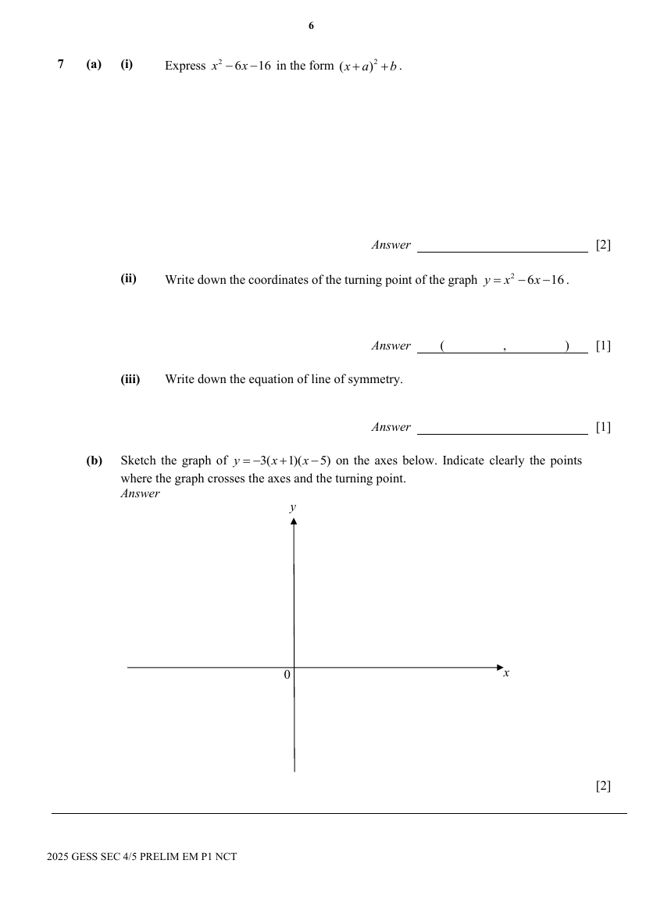

---

### Q8

> **Marks:** (a) 1, (b) 1, (c) 1, (d) 2; total 5
> **Page:** 7

Three points $A$, $B$ and $C$ are shown below.

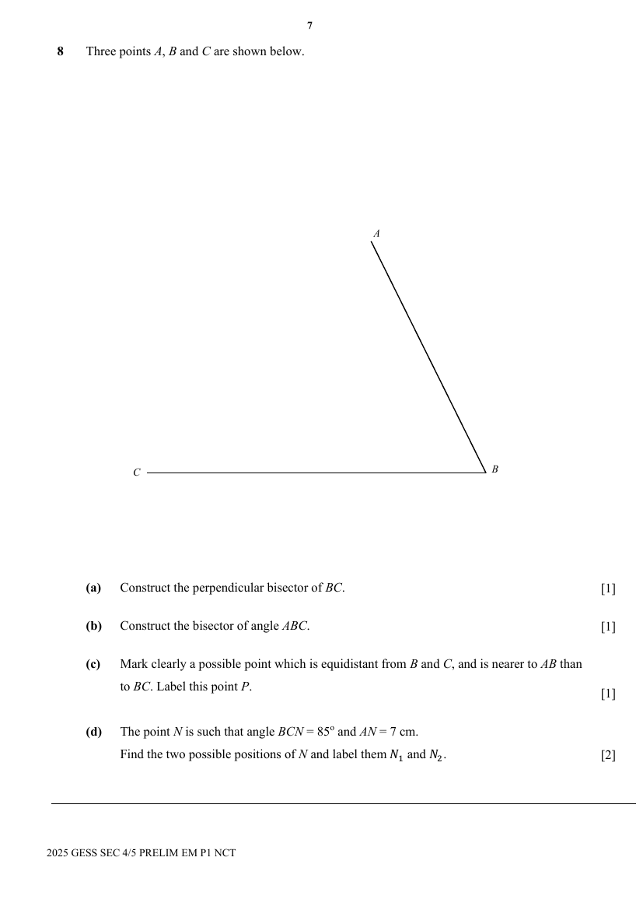

**(a)** Construct the perpendicular bisector of $BC$. [1]
> **Topic:** G2 Congruence and similarity
> **Sub-topic:** Congruence and similarity
> **LO:** [[context/subjects/o-level-e-maths/learning-objectives/o-level-e-maths-G2e.md|G2e]]

**(b)** Construct the bisector of angle $ABC$. [1]
> **Topic:** G2 Congruence and similarity
> **Sub-topic:** Congruence and similarity
> **LO:** [[context/subjects/o-level-e-maths/learning-objectives/o-level-e-maths-G2e.md|G2e]]

**(c)** Mark clearly a possible point which is equidistant from $B$ and $C$, and is nearer to $AB$ than to $BC$. Label this point $P$. [1]
> **Topic:** G2 Congruence and similarity
> **Sub-topic:** Congruence and similarity
> **LO:** [[context/subjects/o-level-e-maths/learning-objectives/o-level-e-maths-G2e.md|G2e]]

**(d)** The point $N$ is such that angle $BCN=85^{\circ}$ and $AN=7\text{ cm}$.
Find the two possible positions of $N$ and label them $N_{1}$ and $N_{2}$. [2]
> **Topic:** G2 Congruence and similarity
> **Sub-topic:** Congruence and similarity
> **LO:** [[context/subjects/o-level-e-maths/learning-objectives/o-level-e-maths-G2e.md|G2e]]

---

### Q9

> **Marks:** (a) 2, (b) 1; total 3
> **Page:** 8

The sum of the first $n$ terms of a sequence is $n(3n-2)$.

**(a)** Find the first 3 terms of the sequence. [2]
> **Topic:** N5 Algebraic expressions and formulae
> **Sub-topic:** Algebraic expressions and formulae
> **LO:** [[context/subjects/o-level-e-maths/learning-objectives/o-level-e-maths-N5e.md|N5e]]

**(b)** Find, in terms of $n$, and expression for the $n$th term of this sequence. [1]
> **Topic:** N5 Algebraic expressions and formulae
> **Sub-topic:** Algebraic expressions and formulae
> **LO:** [[context/subjects/o-level-e-maths/learning-objectives/o-level-e-maths-N5e.md|N5e]]

---

### Q10

> **Marks:** (a) 2, (b) 2; total 4
> **Page:** 8–9

**(a)** The diagram below shows a pentagon with two of its interior angles as right angles, and the remaining interior angles are equal.
Find the value of $\dfrac{y}{x}$. [2]
> **Topic:** G1 Angles, triangles and polygons
> **Sub-topic:** Angles, triangles and polygons
> **LO:** [[context/subjects/o-level-e-maths/learning-objectives/o-level-e-maths-G1f.md|G1f]]

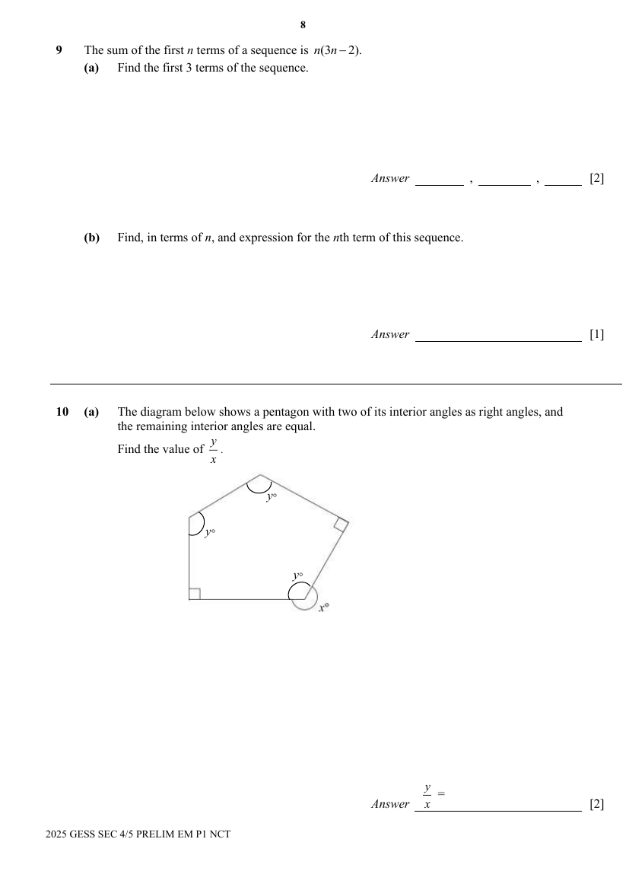

**(b)** The diagram shows three regular polygons, $A$, $B$ and $C$, joined together.
Polygon $A$ has 12 sides and polygon $B$ has 4 sides.
Find the number of sides in polygon $C$. [2]
> **Topic:** G1 Angles, triangles and polygons
> **Sub-topic:** Angles, triangles and polygons
> **LO:** [[context/subjects/o-level-e-maths/learning-objectives/o-level-e-maths-G1f.md|G1f]]

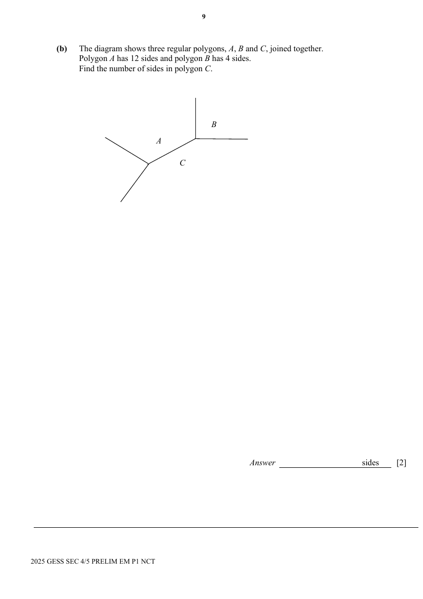

---

### Q11

> **Marks:** 1
> **Topic:** N6 Functions and graphs
> **Sub-topic:** Functions and graphs
> **LO:** [[context/subjects/o-level-e-maths/learning-objectives/o-level-e-maths-N6c.md|N6c]]
> **Page:** 10

Charles drew the bar graph below for his Element of Business Studies project.

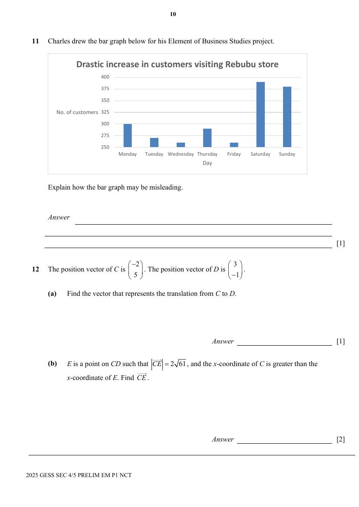

Explain how the bar graph may be misleading. [1]

---

### Q12

> **Marks:** (a) 1, (b) 2; total 3
> **Page:** 10

The position vector of $C$ is $\begin{pmatrix}-2\\ 5\end{pmatrix}$. The position vector of $D$ is $\begin{pmatrix}3\\ -1\end{pmatrix}$.

**(a)** Find the vector that represents the translation from $C$ to $D$. [1]
> **Topic:** G7 Vectors in two dimensions
> **Sub-topic:** Vectors in two dimensions
> **LO:** [[context/subjects/o-level-e-maths/learning-objectives/o-level-e-maths-G7h.md|G7h]]

**(b)** $E$ is a point on $CD$ such that $\left|\overrightarrow{CE}\right|=2\sqrt{61}$, and the $x$-coordinate of $C$ is greater than the $x$-coordinate of $E$. Find $\overrightarrow{CE}$. [2]
> **Topic:** G7 Vectors in two dimensions
> **Sub-topic:** Vectors in two dimensions
> **LO:** [[context/subjects/o-level-e-maths/learning-objectives/o-level-e-maths-G7h.md|G7h]]

---

### Q13

> **Marks:** (a) 2, (b) 2, (c) 2, (d) 2, (e) 2; total 10
> **Page:** 11–12

$A$, $B$ and $C$ are the points $A(-6,5)$, $B(9,5)$ and $C(-3,-2)$.

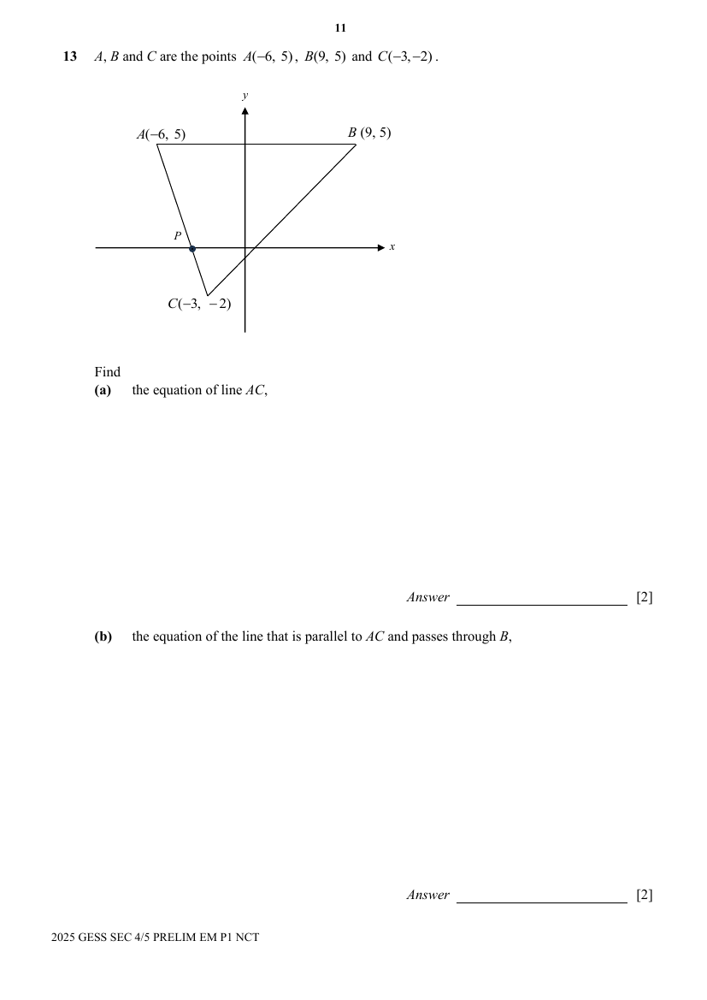

Find

**(a)** the equation of line $AC$, [2]
> **Topic:** G6 Coordinate geometry
> **Sub-topic:** Coordinate geometry
> **LO:** [[context/subjects/o-level-e-maths/learning-objectives/o-level-e-maths-G6c.md|G6c]]

**(b)** the equation of the line that is parallel to $AC$ and passes through $B$, [2]
> **Topic:** G6 Coordinate geometry
> **Sub-topic:** Coordinate geometry
> **LO:** [[context/subjects/o-level-e-maths/learning-objectives/o-level-e-maths-G6c.md|G6c]]

**(c)** area of triangle $ABC$, [2]
> **Topic:** G6 Coordinate geometry
> **Sub-topic:** Coordinate geometry
> **LO:** [[context/subjects/o-level-e-maths/learning-objectives/o-level-e-maths-G6c.md|G6c]]

**(d)** the shortest distance from $A$ to $BC$, [2]
> **Topic:** G6 Coordinate geometry
> **Sub-topic:** Coordinate geometry
> **LO:** [[context/subjects/o-level-e-maths/learning-objectives/o-level-e-maths-G6c.md|G6c]]

**(e)** the coordinate of point $P$ as the line $AC$ intersects the $x$-axis at $P$. [2]
> **Topic:** G6 Coordinate geometry
> **Sub-topic:** Coordinate geometry
> **LO:** [[context/subjects/o-level-e-maths/learning-objectives/o-level-e-maths-G6c.md|G6c]]

---

### Q14

> **Marks:** (a) 2, (b) 1; total 3
> **Page:** 13

In the figure, $AB=12\text{ cm}$, $BC=5\text{ cm}$ and $\angle ABC=90^{\circ}$.

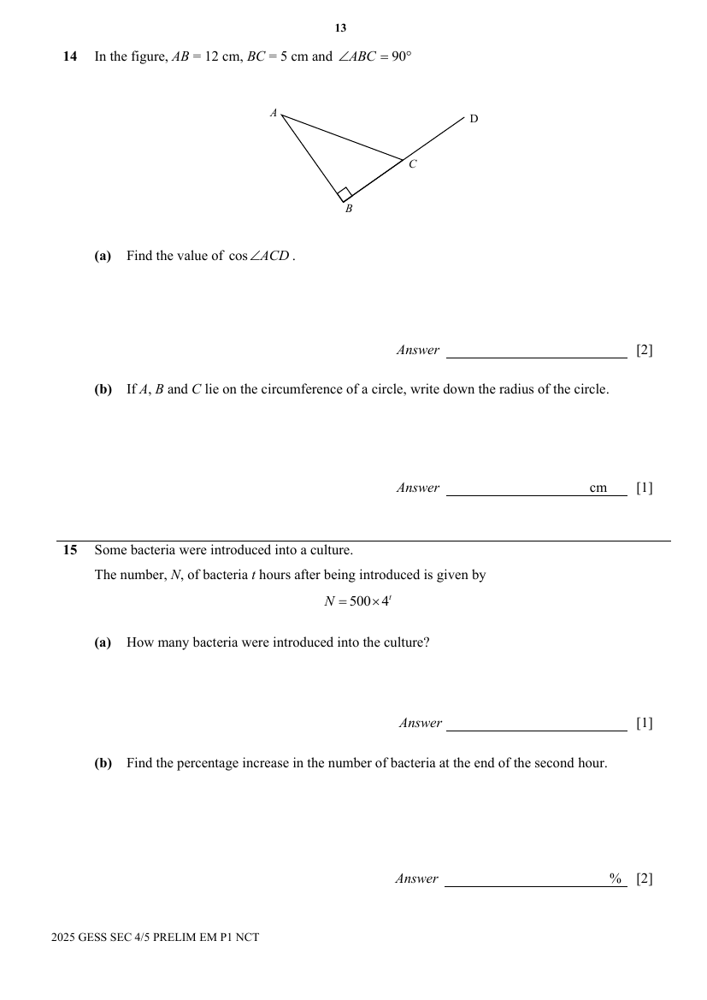

**(a)** Find the value of $\cos\angle ACD$. [2]
> **Topic:** G4 Pythagoras' theorem and trigonometry
> **Sub-topic:** Pythagoras' theorem and trigonometry
> **LO:** [[context/subjects/o-level-e-maths/learning-objectives/o-level-e-maths-G4c.md|G4c]]

**(b)** If $A$, $B$ and $C$ lie on the circumference of a circle, write down the radius of the circle. [1]
> **Topic:** G4 Pythagoras' theorem and trigonometry
> **Sub-topic:** Pythagoras' theorem and trigonometry
> **LO:** [[context/subjects/o-level-e-maths/learning-objectives/o-level-e-maths-G4c.md|G4c]]

---

### Q15

> **Marks:** (a) 1, (b) 2, (c) 1; total 4
> **Page:** 13–14

Some bacteria were introduced into a culture.
The number, $N$, of bacteria $t$ hours after being introduced is given by

$$
N=500\times 4^{t}
$$

**(a)** How many bacteria were introduced into the culture? [1]
> **Topic:** N3 Percentage
> **Sub-topic:** Percentage
> **LO:** [[context/subjects/o-level-e-maths/learning-objectives/o-level-e-maths-N3d.md|N3d]]

**(b)** Find the percentage increase in the number of bacteria at the end of the second hour. [2]
> **Topic:** N3 Percentage
> **Sub-topic:** Percentage
> **LO:** [[context/subjects/o-level-e-maths/learning-objectives/o-level-e-maths-N3d.md|N3d]]

**(c)** Find the time taken for the number of bacteria to reach $64\,000$. [1]
> **Topic:** N3 Percentage
> **Sub-topic:** Percentage
> **LO:** [[context/subjects/o-level-e-maths/learning-objectives/o-level-e-maths-N3d.md|N3d]]

---

### Q16

> **Marks:** (a) 2, (b) 2; total 4
> **Page:** 14

**(a)** Simplify $\dfrac{x^{2}+xy}{x^{2}+2xy+y^{2}}$. [2]
> **Topic:** N7 Equations and inequalities
> **Sub-topic:** Equations and inequalities
> **LO:** [[context/subjects/o-level-e-maths/learning-objectives/o-level-e-maths-N7b.md|N7b]]

**(b)** Factorise completely $10yz-5y^{2}-2xz+xy$. [2]
> **Topic:** N5 Algebraic expressions and formulae
> **Sub-topic:** Algebraic expressions and formulae
> **LO:** [[context/subjects/o-level-e-maths/learning-objectives/o-level-e-maths-N5h.md|N5h]]

---

### Q17

> **Marks:** (a) 1, (b)(i) 2, (b)(ii) 2; total 5
> **Page:** 15

Mrs Chan has four 50-cent coins and six 10-cent coins in her purse. She takes out two coins at random from her purse, one after another.

**(a)** Complete the tree diagram below. [1]
> **Topic:** S2 Probability
> **Sub-topic:** Probability
> **LO:** [[context/subjects/o-level-e-maths/learning-objectives/o-level-e-maths-S2c.md|S2c]]

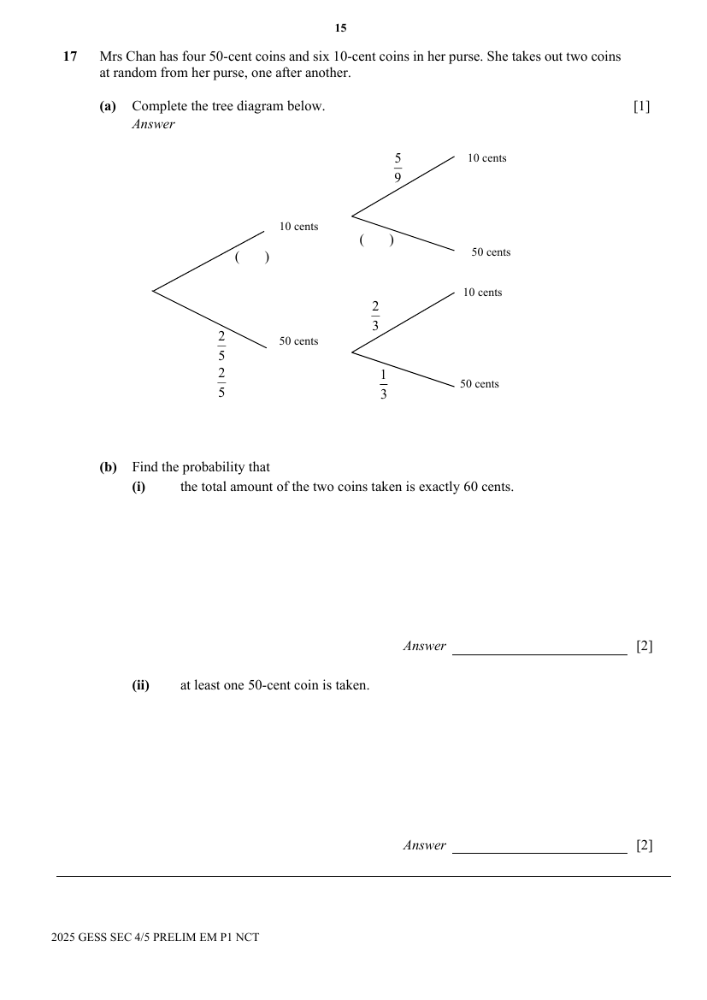

**(b)** Find the probability that

**(i)** the total amount of the two coins taken is exactly 60 cents. [2]
> **Topic:** S2 Probability
> **Sub-topic:** Probability
> **LO:** [[context/subjects/o-level-e-maths/learning-objectives/o-level-e-maths-S2c.md|S2c]]

**(ii)** at least one 50-cent coin is taken. [2]
> **Topic:** S2 Probability
> **Sub-topic:** Probability
> **LO:** [[context/subjects/o-level-e-maths/learning-objectives/o-level-e-maths-S2c.md|S2c]]

---

### Q18

> **Marks:** (a) 2, (b)(i) 1, (b)(ii) 1; total 4
> **Page:** 16

**(a)** Mr Lim bought a refrigerator on hire purchase. The cash price of the refrigerator is &#36;1,200. He paid a $20\%$ deposit and agreed to pay the balance in 12 equal monthly instalments. Each instalment included an interest of $1.5\%$ per month on the unpaid balance.
Calculate the total amount paid for the refrigerator under hire purchase. [2]
> **Topic:** N8 Set language and notation
> **Sub-topic:** Set language and notation
> **LO:** [[context/subjects/o-level-e-maths/learning-objectives/o-level-e-maths-N8c.md|N8c]]

**(b)**

**(i)** The Venn diagram shows the universal set and the number of elements in each of its subsets.
Find the number of element in the set $(A\cap B)\cup(A\cup B)'$. [1]
> **Topic:** N8 Set language and notation
> **Sub-topic:** Set language and notation
> **LO:** [[context/subjects/o-level-e-maths/learning-objectives/o-level-e-maths-N8c.md|N8c]]

**(ii)** On the Venn diagram, shade the region which represents $(A'\cup B)\cap(A\cup B)'$. [1]
> **Topic:** N8 Set language and notation
> **Sub-topic:** Set language and notation
> **LO:** [[context/subjects/o-level-e-maths/learning-objectives/o-level-e-maths-N8c.md|N8c]]

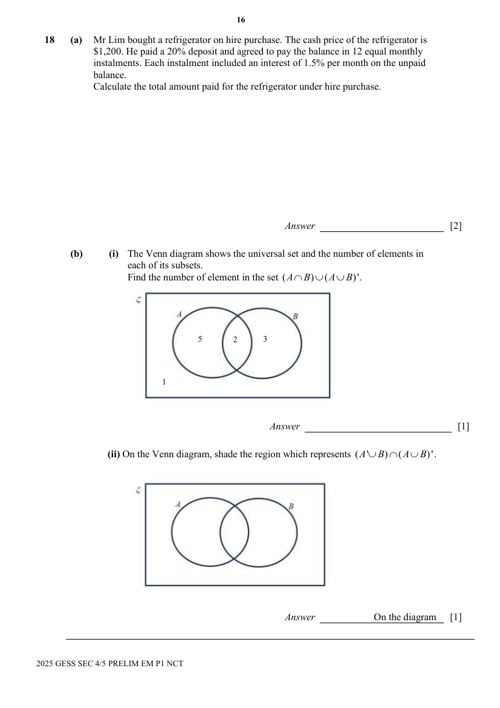

---

### Q19

> **Marks:** (a) 2, (b) 2; total 4
> **Page:** 17

A nature reserve has a land area of $225\text{ km}^{2}$.

**(a)** Find the area of the nature reserve on a map with a scale of $1:1\,000\,000$. [2]
> **Topic:** N2 Ratio and proportion
> **Sub-topic:** Ratio and proportion
> **LO:** [[context/subjects/o-level-e-maths/learning-objectives/o-level-e-maths-N2c.md|N2c]]

**(b)** The same nature reserve is represented by an area of $36\text{ cm}^{2}$ on another map.
Express the scale of this map in $1:n$. [2]
> **Topic:** N2 Ratio and proportion
> **Sub-topic:** Ratio and proportion
> **LO:** [[context/subjects/o-level-e-maths/learning-objectives/o-level-e-maths-N2c.md|N2c]]

---

### Q20

> **Marks:** (a)(i) 1, (a)(ii) 2, (b) 2; total 5
> **Page:** 17–18

**(a)**

**(i)** Express $4624$ as a product of its prime factors. [1]
> **Topic:** N1 Numbers and their operations
> **Sub-topic:** Numbers and their operations
> **LO:** [[context/subjects/o-level-e-maths/learning-objectives/o-level-e-maths-N1b.md|N1b]]

**(ii)** Given that $p$ and $q$ are prime numbers, find the value of $p$ and of $q$ so that $4624\times\dfrac{p}{q}$ is a perfect cube. [2]
> **Topic:** N1 Numbers and their operations
> **Sub-topic:** Numbers and their operations
> **LO:** [[context/subjects/o-level-e-maths/learning-objectives/o-level-e-maths-N1b.md|N1b]]

**(b)** Javen’s test marks are listed below.

$$
26\quad a\quad 29\quad 25\quad b\quad c
$$

The mean mark is $28$.
The median mark is $28$.
The modal mark is $29$.

Given that $a<b<c$, find the values of $a$, $b$, and $c$. [2]
> **Topic:** N1 Numbers and their operations
> **Sub-topic:** Numbers and their operations
> **LO:** [[context/subjects/o-level-e-maths/learning-objectives/o-level-e-maths-N1b.md|N1b]]

---

### Q21

> **Marks:** (a) 2, (b) 2, (c) 2; total 6
> **Page:** 18–19

The diagram shows a circle $ABCD$ with centre $O$ and $BD$ passing through $O$.
$AC$ intersects $BD$ at $E$. Angle $ACB=67^{\circ}$ and angle $DAC=24^{\circ}$.

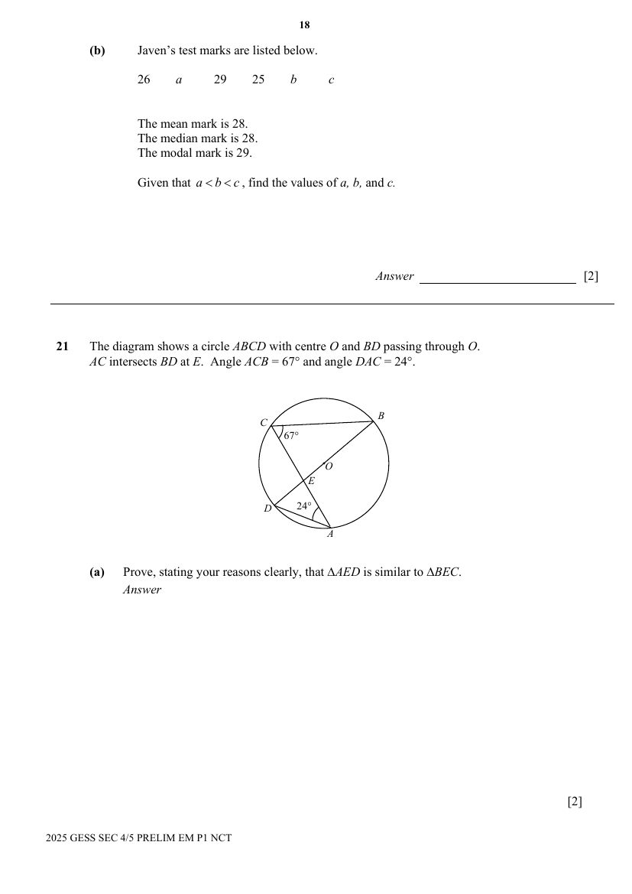

**(a)** Prove, stating your reasons clearly, that $\triangle AED$ is similar to $\triangle BEC$. [2]
> **Topic:** G3 Properties of circles
> **Sub-topic:** Properties of circles
> **LO:** [[context/subjects/o-level-e-maths/learning-objectives/o-level-e-maths-G3b.md|G3b]]

**(b)** Given that $AE=3.5\text{ cm}$, $CE=4\text{ cm}$, $DE=2\text{ cm}$, calculate the length of $EB$. [2]
> **Topic:** G3 Properties of circles
> **Sub-topic:** Properties of circles
> **LO:** [[context/subjects/o-level-e-maths/learning-objectives/o-level-e-maths-G3b.md|G3b]]

**(c)** Calculate, as a fraction, the numerical value of the ratio $\dfrac{\text{minor arc length }AD}{\text{minor arc length }BC}$. [2]
> **Topic:** G3 Properties of circles
> **Sub-topic:** Properties of circles
> **LO:** [[context/subjects/o-level-e-maths/learning-objectives/o-level-e-maths-G3b.md|G3b]]

---

### Q22

> **Marks:** (a) 2, (b)(i) 1, (b)(ii) 2; total 5
> **Page:** 20

The diagram shows three geometrically similar vases, $A$, $B$ and $C$.
The volume of Vase $A$ is $400\text{ cm}^{3}$ and its base area is $50\text{ cm}^{2}$.

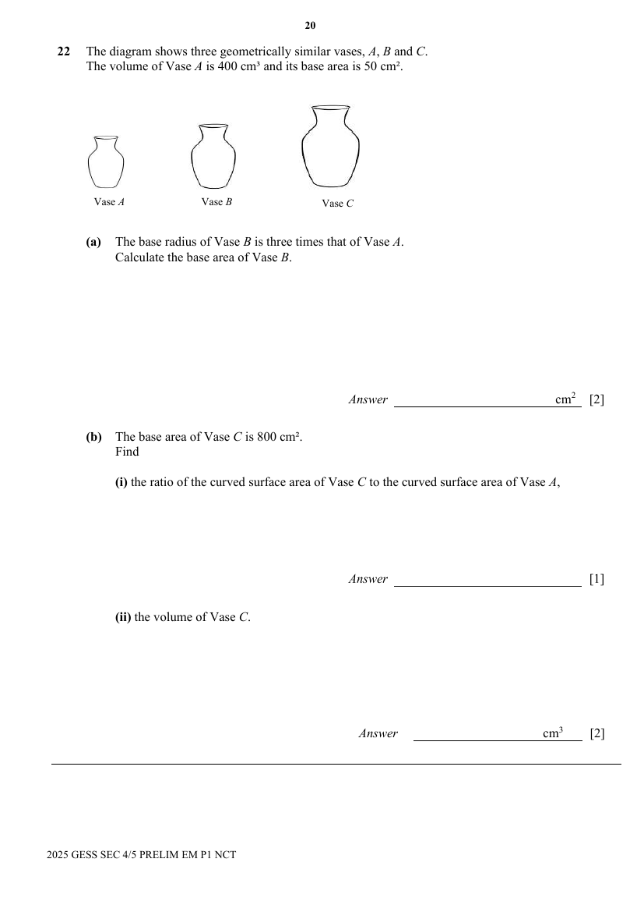

**(a)** The base radius of Vase $B$ is three times that of Vase $A$.
Calculate the base area of Vase $B$. [2]
> **Topic:** G2 Congruence and similarity
> **Sub-topic:** Congruence and similarity
> **LO:** [[context/subjects/o-level-e-maths/learning-objectives/o-level-e-maths-G2h.md|G2h]]

**(b)** The base area of Vase $C$ is $800\text{ cm}^{2}$.
Find

**(i)** the ratio of the curved surface area of Vase $C$ to the curved surface area of Vase $A$, [1]
> **Topic:** G2 Congruence and similarity
> **Sub-topic:** Congruence and similarity
> **LO:** [[context/subjects/o-level-e-maths/learning-objectives/o-level-e-maths-G2h.md|G2h]]

**(ii)** the volume of Vase $C$. [2]
> **Topic:** G2 Congruence and similarity
> **Sub-topic:** Congruence and similarity
> **LO:** [[context/subjects/o-level-e-maths/learning-objectives/o-level-e-maths-G2h.md|G2h]]

---

### Q23

> **Marks:** (a) 2, (b) 2; total 4
> **Page:** 21

The diagram below shows part of the speed-time graph of Javier’s cycle journey. Javier travelled from the starting point to point $A$ in 100 seconds.

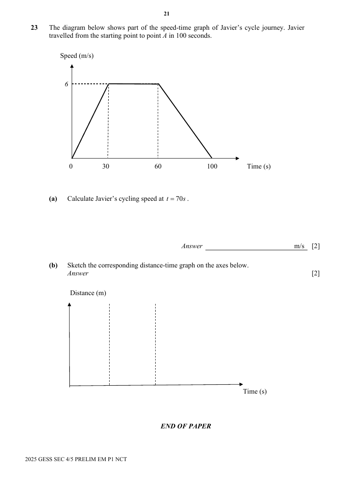

**(a)** Calculate Javier’s cycling speed at $t=70\text{s}$. [2]
> **Topic:** N6 Functions and graphs
> **Sub-topic:** Functions and graphs
> **LO:** [[context/subjects/o-level-e-maths/learning-objectives/o-level-e-maths-N6c.md|N6c]]

**(b)** Sketch the corresponding distance-time graph on the axes below. [2]
> **Topic:** N6 Functions and graphs
> **Sub-topic:** Functions and graphs
> **LO:** [[context/subjects/o-level-e-maths/learning-objectives/o-level-e-maths-N6c.md|N6c]]

---

**END OF PAPER**
