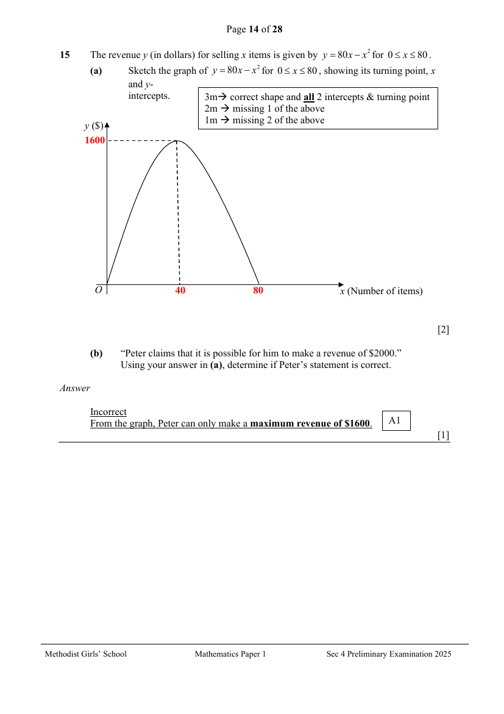
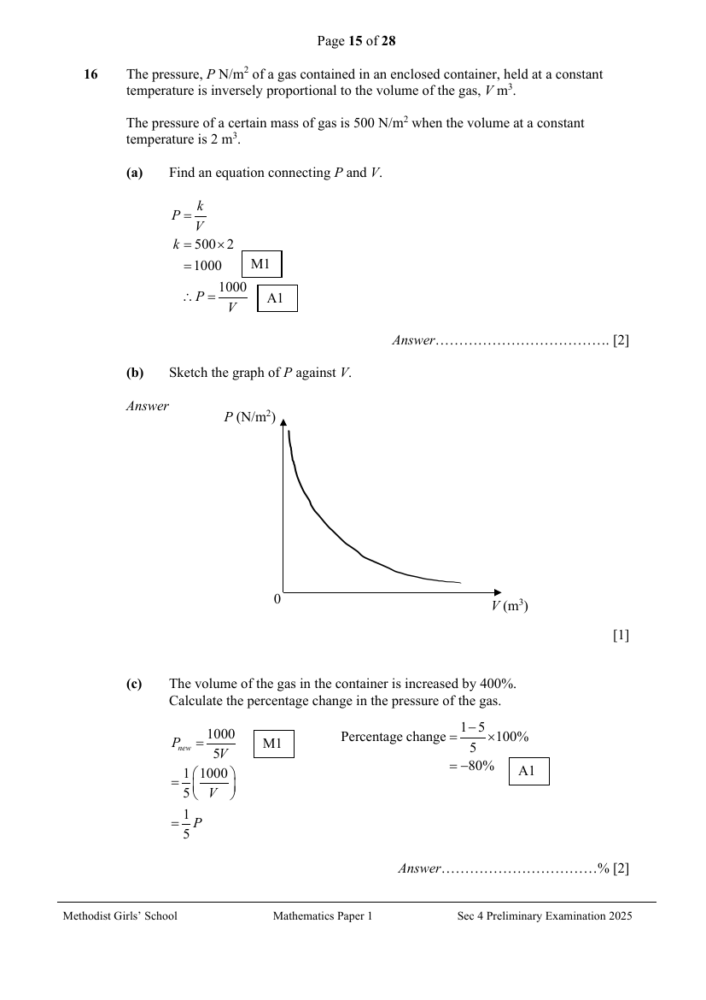
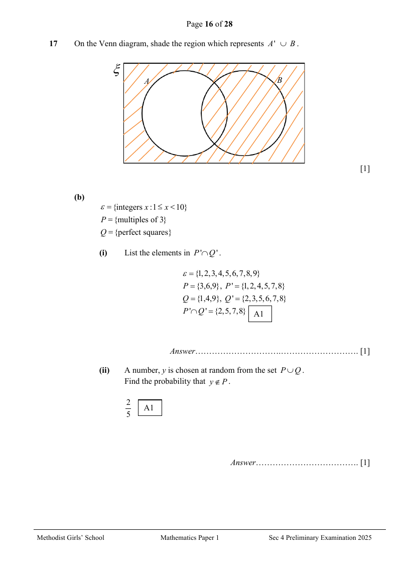
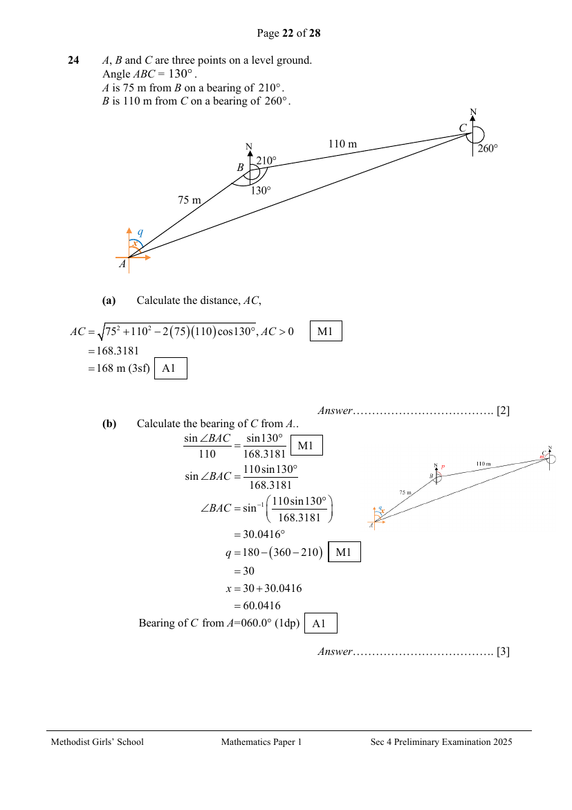

# Methodist Girls' School — Mathematics 4052/01 Paper 1 Mark Scheme (cleaned)

> **Institution:** Methodist Girls' School
> **Exam:** Preliminary Examination 2025
> **Level:** Secondary 4
> **Subjects:** Mathematics
> **Paper:** 4052/01 Paper 1 Mark Scheme
> **Date:** 20 August 2025
> **Duration:** 2 hours 15 minutes
> **Total Marks:** 90
> **Source:** `MGS 2025 EMATH PRELIM P1 MS.pdf` (cleaned & reformatted)

---

## Instructions

Name: Mark Scheme.

Candidates answer on the Question Paper.

Answer all the questions.
If working is needed for any question it must be shown with the answer.
Omission of essential working will result in loss of marks.
The use of an approved scientific calculator is expected, where appropriate.
If the degree of accuracy is not specified in the question, and if the answer is not exact, give the answer to three significant figures. Give answers in degrees to one decimal place.
For $\pi$, use either your calculator value or $3.142$, unless the question requires the answer in terms of $\pi$.

The number of marks is given in brackets [ ] at the end of each question or part question.
The total of the marks for this paper is 90.

Mark codes in the scheme: M1 method mark, A1 accuracy mark.

---

### Q1

> **Marks:** [2]
> **Sub-topic:** Indices
> **Page:** 3

Simplify $\dfrac{4a^{-2}}{3r}\div\dfrac{\left(27a^{6}\right)^{\frac{1}{3}}}{r^{3}}$, giving your answer in positive index.

$$
\frac{4a^{-2}}{3r}\div\frac{\left(27a^{6}\right)^{\frac{1}{3}}}{r^{3}}=\frac{4a^{-2}}{3r}\div\frac{3a^{2}}{r^{3}}
$$

M1 for $3a^{2}$

$$
=\frac{4a^{-2}}{3r}\times\frac{r^{3}}{3a^{2}}=\frac{4r^{2}}{9a^{4}}
$$

A1

---

### Q2

> **Marks:** [2]
> **Sub-topic:** Indices
> **Page:** 3

$4^{m-3}\times 8^{3m-1}=4$

Use the laws of indices to find the value of $m$. Show your working.

$$
\begin{aligned}
4^{m-3}\times 8^{3m-1}&=4\\
2^{2(m-3)}\times 2^{3(3m-1)}&=2^{2}
\end{aligned}
$$

M1 for expressing terms in base 2

$$
\begin{aligned}
2^{2m-6+9m-3}&=2^{2}\\
2^{11m-9}&=2^{2}\\
11m-9&=2\\
11m&=11\\
m&=1
\end{aligned}
$$

A1

---

### Q3

> **Marks:** [2]
> **Sub-topic:** Ratio
> **Page:** 4

Two identical containers are filled with a mixture of rose syrup and evaporated milk in the ratio of $5:3$ and $4:7$.
The contents of the containers are poured into a big bowl and mixed thoroughly.
Find the ratio of the rose syrup to the evaporated milk in the big bowl.

| 1st container | 2nd container |
| --- | --- |
| $5:3$ | $4:7$ |
| $55:33$ | $32:56$ |

M1 for both ratios

Rose syrup : evaporated milk $=87:89$ A1

---

### Q4

> **Marks:** [2]
> **Sub-topic:** Algebraic fractions
> **Page:** 4

Simplify $\dfrac{(3m-1)(2m+3)}{3}+\dfrac{5m-2}{6}$.

$$
\frac{(3m-1)(2m+3)}{3}+\frac{5m-2}{6}=\frac{2(6m^{2}+9m-2m-3)+5m-2}{6}
$$

M1 for expansion of $(3m-1)(2m+3)$

$$
=\frac{12m^{2}+14m-6+5m-2}{6}=\frac{12m^{2}+19m-8}{6}
$$

A1

---

### Q5

> **Marks:** (a) [1]; (b) [1]; total [2]
> **Sub-topic:** Map scales
> **Page:** 5

A map is drawn to a scale of $1:400\,000$.

**(a)** Find the actual distance, in km, represented by $10.5$ cm on the map.

$1\text{ cm}:4\text{ km}$

$10.5\text{ cm}:42\text{ km}$ A1

**(b)** A forest covers an area of $64\text{ km}^{2}$.
Find, in $\text{cm}^{2}$, the area representing the forest on the map.

$1\text{ cm}:4\text{ km}$

$1\text{ cm}^{2}:16\text{ km}^{2}$

$4\text{ cm}^{2}:64\text{ km}^{2}$ A1

---

### Q6

> **Marks:** (a)(i) [2]; (a)(ii) [1]; (b) [1]; total [4]
> **Sub-topic:** Prime factors
> **Page:** 6

**(a)** Written as a product of its prime factors, $240=2^{4}\times 3\times 5$ and $2750=2\times 5^{3}\times 11$.

**(i)** Find the smallest positive integer $n$ for which $\sqrt{2750n}$ is a whole number.

$$
2750n=2^{2}\times 5^{4}\times 11^{2}
$$

M1 for perfect square

$$
2\times 5^{3}\times 11\times n=2^{2}\times 5^{4}\times 11^{2}
$$

$$
n=\frac{2^{2}\times 5^{4}\times 11^{2}}{2\times 5^{3}\times 11}=2\times 5\times 11=110
$$

A1

**(ii)** Find the smallest positive integer $k$ for which $240k$ is a multiple of $2750$.

LCM of $240$ and $2750=2^{4}\times 3\times 5^{3}\times 11$

$$
240k=2^{4}\times 3\times 5^{3}\times 11
$$

$$
k=\frac{2^{4}\times 3\times 5^{3}\times 11}{2^{4}\times 3\times 5}=5^{2}\times 11=275
$$

A1

**(b)** $Y=a^{18}\times b^{12}\times c^{36}$ where $a$, $b$ and $c$ are prime numbers.
Explain why $Y$ is a perfect cube.

The indices of the prime factors $a$, $b$ and $c$ are multiples of 3. [1]

---

### Q7

> **Marks:** [2]
> **Sub-topic:** Statistical graphs
> **Page:** 7

The graph shows the Category A Certificate of Entitlement (COE) price for cars up to 1600cc for the months of April, May and June in 2025.

State one aspect of the graph that maybe misleading and explain how this may lead to a misinterpretation of the graph.

By starting the vertical axis at &#36;90000 and not at zero, it exaggerates small differences in COE prices, making the COE price of May look dramatically more expensive than April or June, even though the actual difference is relatively small. [2]

---

### Q8

> **Marks:** [2]
> **Sub-topic:** Polygons
> **Page:** 8

The interior angles of a hexagon are in the ratio $3:5:6:7:7:8$.
Find the smallest exterior angle of the hexagon.

$$
\text{size of largest interior angle}=180^{\circ}(6-2)\times\frac{8}{36}=160^{\circ}
$$

M1

$$
\text{smallest exterior angle}=180^{\circ}-160^{\circ}=20^{\circ}
$$

A1

---

### Q9

> **Marks:** (a) [1]; (b) [2]; total [3]
> **Sub-topic:** Similarity
> **Page:** 9

$P$ and $Q$ are similar pentagonal pyramids.
The ratio of surface areas of the two pyramids, $P$ and $Q$, is $81:121$.

**(a)** Find the ratio of the height of pyramid $P$ to that of pyramid $Q$.

$$
\text{Height }P:\text{Height }Q=\sqrt{81}:\sqrt{121}=9:11
$$

A1

**(b)** Both pyramids are completely filled with sand. Find the mass of the sand, in kg, in pyramid $Q$ if the mass of sand in the pyramid $P$ is $192$ g.

$$
\frac{0.192}{M_{Q}}=\frac{9^{3}}{11^{3}}
$$

M1

$$
M_{Q}=\frac{11^{3}\times 0.192}{9^{3}}=0.35055=0.351\text{ kg (3 s.f.)}
$$

A1

---

### Q10

> **Marks:** (a) [2]; (b) [2]; total [4]
> **Sub-topic:** Factorisation
> **Page:** 9

Factorise completely.

**(a)**

$$
5-5x^{2}=5(1-x^{2})=5(1-x)(1+x)
$$

M1, A1

**(b)**

$$
2xq-2yq-yp+xp=2q(x-y)+p(x-y)=(2q+p)(x-y)
$$

M1, A1

---

### Q11

> **Marks:** [4]
> **Sub-topic:** Algebraic fractions
> **Page:** 10

Simplify $\dfrac{3}{x+1}-\dfrac{x+4}{x^{2}+3x+2}$.

$$
\frac{3}{x+1}-\frac{x+4}{x^{2}+3x+2}=\frac{3}{x+1}-\frac{x+4}{(x+1)(x+2)}
$$

M1 for factorisation of $x^{2}+3x+2$

$$
=\frac{3(x+2)-(x+4)}{(x+1)(x+2)}=\frac{3x+6-x-4}{(x+1)(x+2)}
$$

M1 for making single fraction

$$
=\frac{2x+2}{(x+1)(x+2)}
$$

M1 for simplifying numerator

$$
=\frac{2(x+1)}{(x+1)(x+2)}=\frac{2}{x+2}
$$

A1

---

### Q12

> **Marks:** (a) [2]; (b)(i) [1]; (b)(ii) [1]; total [4]
> **Sub-topic:** Quadratic graphs
> **Page:** 11

**(a)** Express $x^{2}-6x+8$ in the form of $a(x+b)^{2}+c$.

$$
x^{2}-6x+8=x^{2}-6x+(-3)^{2}+8-(-3)^{2}
$$

M1

$$
=(x-3)^{2}+8-9=(x-3)^{2}-1
$$

A1

**(b)** The curve $y=x^{2}-6x+8$ is drawn.
Using your answer in (a), write down

**(i)** the coordinates of the turning point.

$(3,-1)$ A1

**(ii)** the equation of the line of symmetry of the curve.

$x=3$ A1

---

### Q13

> **Marks:** (a) [2]; (b)(i) [1]; (b)(ii) [2]; total [5]
> **Sub-topic:** Compound interest and exchange rates
> **Page:** 11–12

**(a)** Derek invested a sum of money in an account paying compound interest at $3.4\%$ per annum. After six years, he earned a total interest of &#36;2665.76.
Calculate the sum of money Derek invested in the account to the nearest dollar.

$$
P+2665.76=P\left(1+\frac{3.4}{100}\right)^{6}
$$

M1

$$
P\left(1+\frac{3.4}{100}\right)^{6}-P=2665.76
$$

$$
P=\frac{2665.76}{\left(1+\dfrac{3.4}{100}\right)^{6}-1}=12000.014=12000\text{ (nearest dollar)}
$$

A1

**(b)** Cathy is going on a holiday to Australia. She changes 3500 Singapore dollars (SGD) into 4172 Australian dollars (AUD) at a bank.

**(i)** Calculate the exchange rate between SGD and AUD to the nearest cents.

$$
3500\text{ SGD}=4172\text{ AUD}
$$

$$
1\text{ SGD}=\frac{4172}{3500}\text{ AUD}=1.192\text{ AUD}=1.19\text{ AUD (nearest cents)}
$$

A1

**(ii)** At the end of Cathy's holiday in Australia, she has some AUD left. If she converts this amount back to SGD at a money changer.
The exchange rate between AUD and SGD is 1 AUD = 0.91 SGD.

Determine, when changing AUD back to SGD, if the exchange rate offered by the money changer is of better value for Cathy than the bank's exchange rate found in (b)(i).

From (a)(i), $1.192$ AUD $=1$ SGD

$$
1\text{ AUD}=\frac{1}{1.192}\text{ SGD}=0.83892\text{ SGD}=0.84\text{ SGD (nearest cents)}
$$

M1

Cathy will receive 0.07 SGD more for every 1 AUD at the exchange rate of 1 AUD = 0.91 SGD, hence it is a better value than the bank's exchange rate found in (a)(i). A1

---

### Q14

> **Marks:** (a) [2]; (b)(i) [1]; (b)(ii) [1]; total [4]
> **Sub-topic:** Similar triangles
> **Page:** 13

The diagram shows a trapezium $ABCD$ such that $AB$ is parallel to $DC$.
$AC$ and $BD$ are diagonals of the trapezium $ABCD$.
$E$ is a point on $BD$ such that $5DE=4EB$.

**(a)** Show that triangle $ABE$ and triangle $CDE$ are similar.

In $\triangle ABE$ and $\triangle CDE$,

$\angle EAB=\angle ECD$ (alt. $\angle$s)

$\angle AEB=\angle CED$ (vert. opp. $\angle$s)

$\therefore\triangle ABE$ is similar to $\triangle CDE$. (AA similarity test) [2]

**(b)**

**(i)**

$$
\frac{\text{area of }\triangle ABE}{\text{area of }\triangle CDE}=\left(\frac{5}{4}\right)^{2}=\frac{25}{16}
$$

A1

**(ii)**

$$
\frac{\text{area of }\triangle ABE}{\text{area of }\triangle ABC}=\frac{5}{9}
$$

A1

---

### Q15

> **Marks:** (a) [2]; (b) [1]; total [3]
> **Sub-topic:** Quadratic graphs
> **Page:** 14

The revenue $y$ (in dollars) for selling $x$ items is given by $y=80x-x^{2}$ for $0\leq x\leq 80$.

**(a)** Sketch the graph of $y=80x-x^{2}$ for $0\leq x\leq 80$, showing its turning point, $x$ and $y$-intercepts.

3 m for correct shape and all 2 intercepts and turning point.
2 m for missing 1 of the above.
1 m for missing 2 of the above.

**(b)** "Peter claims that it is possible for him to make a revenue of &#36;2000."
Using your answer in (a), determine if Peter's statement is correct.

Incorrect.

From the graph, Peter can only make a maximum revenue of &#36;1600. A1

---

### Q16

> **Marks:** (a) [2]; (b) [1]; (c) [2]; total [5]
> **Sub-topic:** Inverse proportion
> **Page:** 15

The pressure, $P\text{ N/m}^{2}$ of a gas contained in an enclosed container, held at a constant temperature is inversely proportional to the volume of the gas, $V\text{ m}^{3}$.

The pressure of a certain mass of gas is $500\text{ N/m}^{2}$ when the volume at a constant temperature is $2\text{ m}^{3}$.

**(a)** Find an equation connecting $P$ and $V$.

$$
P=\frac{k}{V}
$$

$$
k=500\times 2=1000
$$

M1

$$
\therefore P=\frac{1000}{V}
$$

A1

**(b)** Sketch the graph of $P$ against $V$.

**(c)** The volume of the gas in the container is increased by $400\%$.
Calculate the percentage change in the pressure of the gas.

$$
P_{\text{new}}=\frac{1000}{5V}=\frac{1}{5}\left(\frac{1000}{V}\right)=\frac{1}{5}P
$$

M1

$$
\text{Percentage change}=\frac{\dfrac{1}{5}-1}{1}\times 100\%=-80\%
$$

A1

---

### Q17

> **Marks:** (a) [1]; (b)(i) [1]; (b)(ii) [1]; total [3]
> **Sub-topic:** Sets and probability
> **Page:** 16

**(a)** On the Venn diagram, shade the region which represents $A'\cup B$.

**(b)**

$\varepsilon=\{\text{integers }x:1\leq x<10\}$

$P=\{\text{multiples of }3\}$

$Q=\{\text{perfect squares}\}$

**(i)** List the elements in $P'\cap Q'$.

$$
\begin{aligned}
\varepsilon&=\{1,2,3,4,5,6,7,8,9\}\\
P&=\{3,6,9\},\quad P'=\{1,2,4,5,7,8\}\\
Q&=\{1,4,9\},\quad Q'=\{2,3,5,6,7,8\}\\
P'\cap Q'&=\{2,5,7,8\}
\end{aligned}
$$

A1

**(ii)** A number, $y$ is chosen at random from the set $P\cup Q$.
Find the probability that $y\notin P$.

$$
\frac{2}{5}
$$

A1

---

### Q18

> **Marks:** (a) [2]; (b) [2]; total [4]
> **Sub-topic:** Speed-time graphs
> **Page:** 17

The diagram shows the speed-time graph of a particle during a period of 16 seconds.

**(a)** Calculate the speed of the car after 6 seconds.

$$
\frac{v-22}{4}=\frac{40-22}{8}
$$

M1

$$
v-22=\frac{9}{4}\times 4,\quad v=9+22=31
$$

A1

Alternative:

$$
\frac{40-v}{10-6}=\frac{40-22}{10-2}
$$

$$
40-v=9,\quad v=40-9=31
$$

**(b)** Calculate the average speed of the particle during the 16 seconds.

$$
\text{Total distance}=\frac{1}{2}(2)(22)+\frac{1}{2}(22+40)(8)+\frac{1}{2}(40)(6)=22+248+120=390\text{ cm}
$$

M1 for total distance

$$
\text{Average speed}=\frac{390}{16}=24.375\text{ cm/s}
$$

A1

---

### Q19

> **Marks:** [2]
> **Sub-topic:** Probability
> **Page:** 18

There are 85 cookies and 25 packets of Ribena in a snack box. After $x$ cookies have been consumed, the probability that a packet of Ribena is picked to be consumed is $\dfrac{5}{18}$.
Calculate the number of cookies, $x$, that have been consumed.

$$
P(\text{packet of drink is consumed})=\frac{5}{18}
$$

$$
\frac{25}{85+25-x}=\frac{5}{18}
$$

M1

$$
5(110)-5x=25(18)
$$

$$
5x=550-450
$$

$$
x=\frac{100}{5}=20
$$

A1

---

### Q20

> **Marks:** [3]
> **Sub-topic:** Trigonometry
> **Page:** 18

In the diagram, $PQRS$ is a quadrilateral.
Angle $SPQ=$ Angle $QRS=90^{\circ}$.

Show that $\sin\angle RSP=\sin\angle PQR$.

Sum of angles of a quadrilateral $=360^{\circ}$. M1 for sum of angles of quadrilateral

$$
\angle RSP+\angle PQR=360^{\circ}-90^{\circ}-90^{\circ}=180^{\circ}
$$

M1 for supplementary angles

$\therefore\angle RSP$ and $\angle PQR$ are supplementary angles.

$$
\angle PQR=180^{\circ}-\angle RSP
$$

$$
\sin\angle RSP=\sin(180^{\circ}-\angle RSP)
$$

M1

$$
\sin\angle PQR=\sin\angle RSP
$$

(shown)

---

### Q21

> **Marks:** (a) [1]; (b) [1]; (c) [1]; total [3]
> **Sub-topic:** Mean and standard deviation
> **Page:** 19

In a fuel economy test conducted for 100 cars, the average distance travelled per litre of fuel (km/l) were recorded and given in the table below.

| Distance travelled per litre ($d$ km/l) | Frequency |
| --- | --- |
| $10<d\leq 11$ | 14 |
| $11<d\leq 12$ | 20 |
| $12<d\leq 13$ | 38 |
| $13<d\leq 14$ | 16 |
| $14<d\leq 15$ | 12 |

**(a)** Calculate an estimate for the mean distance travelled per litre of fuel.

$12.42$ km/l A1

**(b)** Explain why the value of the mean in part (a) is an estimate of the mean distance travelled per litre of fuel.

The mean of a set of grouped data is an estimate because grouped data does not give the exact individual values. Since individual data points are not available, we cannot compute the actual mean, only an estimated mean using the class midpoints. [1]

**(c)** Find the standard deviation.

$1.18050=1.18$ km/l (3 s.f.) A1

---

### Q22

> **Marks:** (a) [1]; (b) [1]; (c) [2]; total [4]
> **Sub-topic:** Vectors
> **Page:** 20

$S$ is the point $(1,-3)$ and $T$ is the point $(5,w)$.

$\overrightarrow{PQ}=\begin{pmatrix}1\\4\end{pmatrix}$ and $\overrightarrow{QR}=\begin{pmatrix}8\\6\end{pmatrix}$.

**(a)** Find $\left|\overrightarrow{QR}\right|$.

$$
\left|\overrightarrow{QR}\right|=\sqrt{8^{2}+6^{2}}=\sqrt{100}=10\text{ units}
$$

A1

**(b)** Express $\overrightarrow{ST}$ as a column vector, in terms of $w$.

$$
\overrightarrow{ST}=\overrightarrow{SO}+\overrightarrow{OT}=\begin{pmatrix}-1\\3\end{pmatrix}+\begin{pmatrix}5\\w\end{pmatrix}=\begin{pmatrix}4\\3+w\end{pmatrix}
$$

A1

**(c)** Find the value of $w$ given that $\overrightarrow{ST}$ is parallel to $\overrightarrow{PQ}$.

$$
\begin{pmatrix}4\\3+w\end{pmatrix}=k\begin{pmatrix}1\\4\end{pmatrix}=\begin{pmatrix}k\\4k\end{pmatrix}
$$

M1

$$
k=4
$$

$$
3+w=4(4)=16
$$

$$
w=16-3=13
$$

A1

---

### Q23

> **Marks:** (a) [1]; (b) [1]; (c) [1]; (d) [1]; total [4]
> **Sub-topic:** Number sequences
> **Page:** 21

The first four terms in a sequence of numbers are given below.

$$
\begin{aligned}
T_{1}&=1\times 3=3\times 1=3\\
T_{2}&=1\times 3+3\times 3=3\times(1+3)=3\times 4=12\\
T_{3}&=1\times 3+3\times 3+5\times 3=3\times(1+3+5)=3\times 9=27\\
T_{4}&=1\times 3+3\times 3+5\times 3+7\times 3=3\times(1+3+5+7)=3\times 16=48
\end{aligned}
$$

**(a)** Find an expression, in terms of $n$, for $T_{n}$.

$$
T_{n}=3n^{2}
$$

A1

**(b)** $T_{p}$ and $T_{p+1}$ are consecutive terms in the sequence.
Find and simplify an expression, in terms, of $p$, for $T_{p+1}-T_{p}$.

$$
T_{p+1}-T_{p}=3(p+1)^{2}-3p^{2}=3(p^{2}+2p+1)-3p^{2}=3(2p+1)=6p+3
$$

A1

**(c)** Explain why two consecutive terms of the sequence cannot have a difference of 4.

When $6p+3=4$,

$$
p=\frac{1}{6}
$$

$p$ is not an integer. A1

**(d)** The first three terms of a second sequence are 12, 27 and 48.
By using (a) or otherwise, write down an expression, in terms of $n$, for the $n$th term, $S_{n}$ of this second sequence.

$$
3(n+1)^{2}
$$

A1

---

### Q24

> **Marks:** (a) [2]; (b) [3]; (c) [4]; total [9]
> **Sub-topic:** Bearings and trigonometry
> **Page:** 22–23

$A$, $B$ and $C$ are three points on a level ground.
Angle $ABC=130^{\circ}$.
$A$ is $75$ m from $B$ on a bearing of $210^{\circ}$.
$B$ is $110$ m from $C$ on a bearing of $260^{\circ}$.

**(a)** Calculate the distance, $AC$.

$$
AC=\sqrt{75^{2}+110^{2}-2(75)(110)\cos 130^{\circ}},\quad AC>0
$$

M1

$$
=168.3181=168\text{ m (3 s.f.)}
$$

A1

**(b)** Calculate the bearing of $C$ from $A$.

$$
\frac{\sin\angle BAC}{110}=\frac{\sin 130^{\circ}}{168.3181}
$$

M1

$$
\sin\angle BAC=\frac{110\sin 130^{\circ}}{168.3181}
$$

$$
\angle BAC=\sin^{-1}\left(\frac{110\sin 130^{\circ}}{168.3181}\right)=30.0416^{\circ}
$$

$$
q=180-(360-210)=30
$$

M1

$$
x=30+30.0416=60.0416
$$

Bearing of $C$ from $A=060.0^{\circ}$ (1 d.p.) A1

**(c)** A kite was seen flying $55$ m vertically above point $B$.
Find the greatest angle of elevation of the kite observed by a person walking in a straight path from $A$ to $C$.

$$
\sin 30.0416^{\circ}=\frac{BW}{75}
$$

M1 for $BW$

or

$$
\frac{1}{2}(75)(110)\sin 130^{\circ}=\frac{1}{2}(168.3181)\,BW
$$

$$
BW=\frac{\dfrac{1}{2}(75)(110)\sin 130^{\circ}\times 2}{168.3181}=37.5471\text{ m}
$$

M1 for $BW=37.5471$ m

$$
\tan\angle KWB=\frac{55}{37.5471}
$$

M1

$$
\angle KWB=\tan^{-1}\left(\frac{55}{37.5471}\right)=55.6796^{\circ}=55.7^{\circ}\text{ (1 d.p.)}
$$

A1

Greatest angle of elevation of the kite $=55.7^{\circ}$.

---

### Q25

> **Marks:** (a) [1]; (b)(i) [1]; (b)(ii) [1]; (c) [2]; total [5]
> **Sub-topic:** Matrices
> **Page:** 24–25

An enrichment centre offers Basic and Advanced programming lessons on weekdays and weekends.
Each student attends 4 weekly lessons per month.
The table shows the number of students who attend weekly Basic and Advanced programming lessons in a particular month.

|  | Basic | Advanced |
| --- | --- | --- |
| Weekday | 18 | 9 |
| Weekend | 15 | 13 |

$$
T=\begin{pmatrix}18&9\\15&13\end{pmatrix}
$$

**(a)** Evaluate the matrix $W=4T$.

$$
W=\begin{pmatrix}72&36\\60&52\end{pmatrix}
$$

**(b)** The enrichment centre charges &#36;60 per lesson for Basic Programming and &#36;110 per lesson for Advanced Programming.

$$
N=\begin{pmatrix}60\\110\end{pmatrix}
$$

**(i)** Find $WN$.

$$
WN=\begin{pmatrix}72&36\\60&52\end{pmatrix}\begin{pmatrix}60\\110\end{pmatrix}=\begin{pmatrix}8280\\9320\end{pmatrix}
$$

**(ii)** Explain what the elements in $WN$ represent.

The elements represent the total amount of money the enrichment centre collects monthly for lessons on weekdays and weekends respectively. [1]

**(c)** The charges for both Basic Programming and Advanced Programming lessons are increased by $7\%$, and the attendance remains the same.
Calculate the total amount of money collected monthly after the increase in charges.

$$
\text{total amount collected}=\frac{107}{100}\times(8280+9320)=\frac{107}{100}\times 17600=&#36;18832
$$

M1, A1

---

### Q26

> **Marks:** [3]
> **Sub-topic:** Congruent triangles
> **Page:** 26

In the diagram, $D$ and $E$ are points on $BC$ such that $BD=DC=AC$.
Triangle $ADE$ is congruent to triangle $FCE$ and angle $ADE=\theta$.

Show that triangle $ABD$ is congruent to triangle $FAC$.
Give a reason for each statement you make.

$BD=AC$ (Given)

Since $\triangle ADE\equiv\triangle FCE$, $AD=FC$ and $\angle ADE=\angle FCE=\theta$. M1 for $AD=FC$

Since $DC=AC$, $\triangle ADC$ is an isosceles triangle.

$\angle CAD=\theta$ (base $\angle$s of isosceles $\triangle$). M1 for angle $CAD$

Since $\angle ADE=\angle FCE=\theta$, $AD\parallel CF$.

$\angle ACF=(180-\theta)^{\circ}$ (int. $\angle$s). For finding angle $ACF$ on the condition that $AD\parallel CF$ is stated.

$\angle BDA=(180-\theta)^{\circ}$ (supp. $\angle$)

$\angle ACF=\angle BDA$. M1 for finding angle $BDA$

$\therefore\triangle ABD\equiv\triangle FAC$ (SAS) [3]
