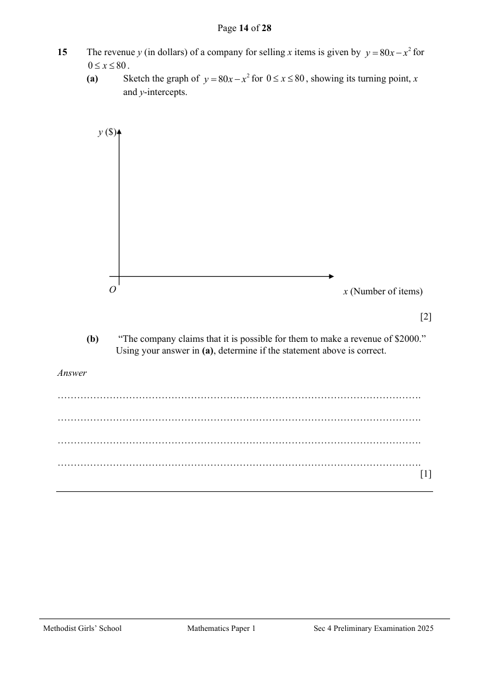
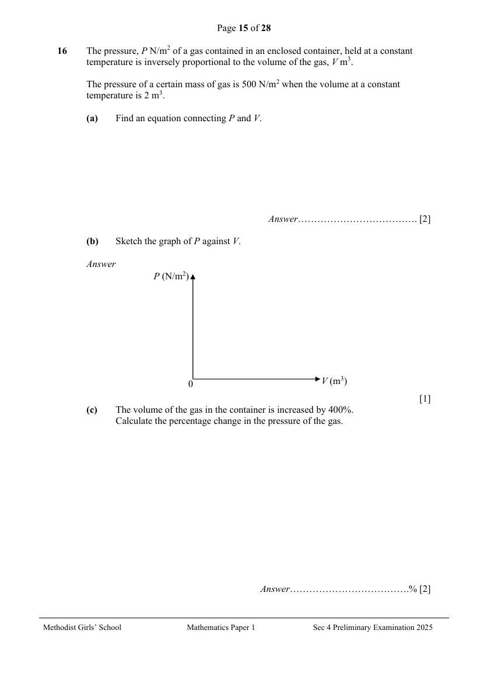
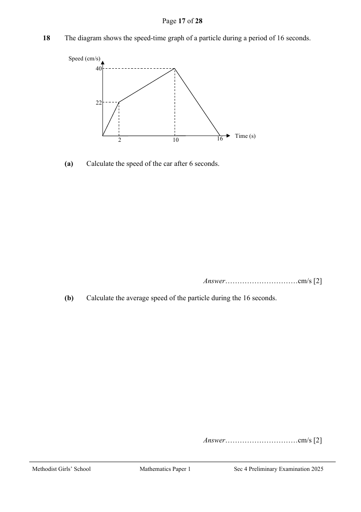
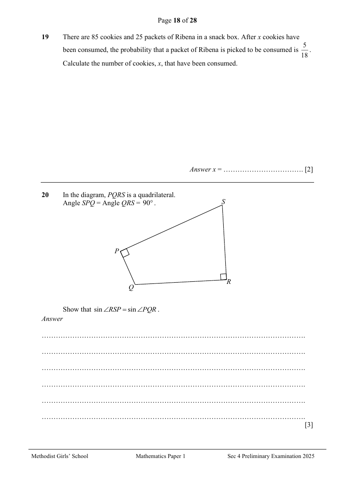
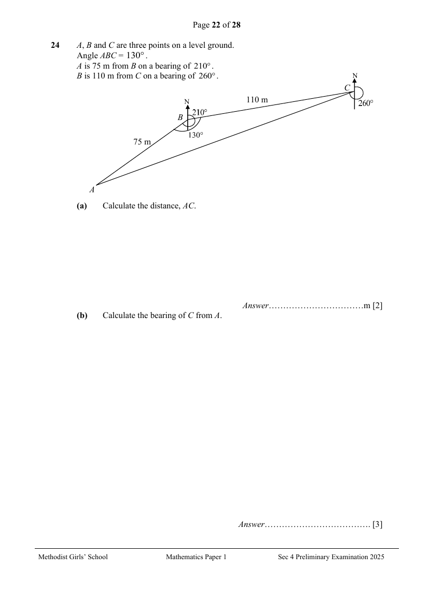
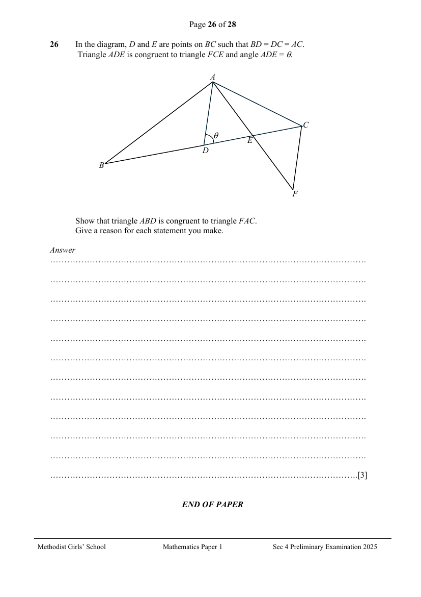

# Methodist Girls' School — Mathematics 4052/01 Paper 1 (cleaned)

> **Institution:** Methodist Girls' School
> **Exam:** Preliminary Examination 2025
> **Level:** Secondary 4
> **Subjects:** Mathematics
> **Paper:** 4052/01 Paper 1
> **Date:** 20 August 2025
> **Duration:** 2 hours 15 minutes
> **Total Marks:** 90
> **Source:** `MGS Prelim  2025 P1 .pdf` (cleaned & reformatted)

---

## Instructions

Candidates answer on the Question Paper.

Write your name, class and index number in the spaces at the top of this page.
Write in dark blue or black pen.
You may use an HB pencil for any diagrams or graphs.
Do not use staples, paper clips, glue or correction fluid.

Answer all the questions.
If working is needed for any question it must be shown with the answer.
Omission of essential working will result in loss of marks.
The use of an approved scientific calculator is expected, where appropriate.
If the degree of accuracy is not specified in the question, and if the answer is not exact, give the answer to three significant figures. Give answers in degrees to one decimal place.
For $\pi$, use either your calculator value or $3.142$, unless the question requires the answer in terms of $\pi$.

The number of marks is given in brackets [ ] at the end of each question or part question.
The total of the marks for this paper is 90.

This question paper consists of 26 printed pages and 2 blank pages.

---

## Mathematical Formulae

*Compound interest*

$$
\text{Total amount} = P\left(1+\frac{r}{100}\right)^{n}
$$

*Mensuration*

$$
\text{Curved surface area of a cone} = \pi rl
$$

$$
\text{Surface area of a sphere} = 4\pi r^{2}
$$

$$
\text{Volume of a cone} = \frac{1}{3}\pi r^{2}h
$$

$$
\text{Volume of a sphere} = \frac{4}{3}\pi r^{3}
$$

$$
\text{Area of a triangle} = \frac{1}{2}ab\sin C
$$

$$
\text{Arc length} = r\theta,\text{ where }\theta\text{ is in radians}
$$

$$
\text{Sector area} = \frac{1}{2}r^{2}\theta,\text{ where }\theta\text{ is in radians}
$$

*Trigonometry*

$$
\frac{a}{\sin A} = \frac{b}{\sin B} = \frac{c}{\sin C}
$$

$$
a^{2} = b^{2}+c^{2}-2bc\cos A
$$

*Statistics*

$$
\text{Mean} = \frac{\sum fx}{\sum f}
$$

$$
\text{Standard deviation} = \sqrt{\frac{\sum fx^{2}}{\sum f}-\left(\frac{\sum fx}{\sum f}\right)^{2}}
$$

---

### Q1

> **Marks:** 2
> **Topic:** N1 Numbers and their operations
> **Sub-topic:** Numbers and their operations
> **LO:** [[context/subjects/o-level-e-maths/learning-objectives/o-level-e-maths-N1j.md|N1j]]
> **Page:** 3

Simplify $\dfrac{4a^{-2}}{3r}\div\dfrac{\left(27a^{6}\right)^{\frac{1}{3}}}{r^{3}}$, giving your answer in positive index. [2]

---

### Q2

> **Marks:** 2
> **Topic:** N1 Numbers and their operations
> **Sub-topic:** Numbers and their operations
> **LO:** [[context/subjects/o-level-e-maths/learning-objectives/o-level-e-maths-N1j.md|N1j]]
> **Page:** 3

$4^{m-3}\times 8^{3m-1}=4$

Use the laws of indices to find the value of $m$. Show your working. [2]

---

### Q3

> **Marks:** 2
> **Topic:** N2 Ratio and proportion
> **Sub-topic:** Ratio and proportion
> **LO:** [[context/subjects/o-level-e-maths/learning-objectives/o-level-e-maths-N2a.md|N2a]]
> **Page:** 4

Two identical containers are filled with a mixture of rose syrup and evaporated milk in the ratio of $5:3$ and $4:7$.
The contents of the containers are poured into a big bowl and mixed thoroughly.
Find the ratio of the rose syrup to the evaporated milk in the big bowl. [2]

---

### Q4

> **Marks:** 2
> **Topic:** N7 Equations and inequalities
> **Sub-topic:** Equations and inequalities
> **LO:** [[context/subjects/o-level-e-maths/learning-objectives/o-level-e-maths-N7b.md|N7b]]
> **Page:** 4

Simplify $\dfrac{(3m-1)(2m+3)}{3}+\dfrac{5m-2}{6}$. [2]

---

### Q5

> **Marks:** (a) 1, (b) 1; total 2
> **Page:** 5

A map is drawn to a scale of $1:400\,000$.

**(a)** Find the actual distance, in km, represented by $10.5$ cm on the map. [1]
> **Topic:** N2 Ratio and proportion
> **Sub-topic:** Ratio and proportion
> **LO:** [[context/subjects/o-level-e-maths/learning-objectives/o-level-e-maths-N2c.md|N2c]]

**(b)** A forest covers an area of $64\text{ km}^{2}$.
Find, in $\text{cm}^{2}$, the area representing the forest on the map. [1]
> **Topic:** N2 Ratio and proportion
> **Sub-topic:** Ratio and proportion
> **LO:** [[context/subjects/o-level-e-maths/learning-objectives/o-level-e-maths-N2c.md|N2c]]

---

### Q6

> **Marks:** (a)(i) 2, (a)(ii) 1, (b) 1; total 4
> **Page:** 6

**(a)** Written as a product of its prime factors, $240=2^{4}\times 3\times 5$ and $2750=2\times 5^{3}\times 11$.

**(i)** Find the smallest positive integer $n$ for which $\sqrt{2750n}$ is a whole number. [2]
> **Topic:** N1 Numbers and their operations
> **Sub-topic:** Numbers and their operations
> **LO:** [[context/subjects/o-level-e-maths/learning-objectives/o-level-e-maths-N1e.md|N1e]]

**(ii)** Find the smallest positive integer $k$ for which $240k$ is a multiple of $2750$. [1]
> **Topic:** N1 Numbers and their operations
> **Sub-topic:** Numbers and their operations
> **LO:** [[context/subjects/o-level-e-maths/learning-objectives/o-level-e-maths-N1e.md|N1e]]

**(b)** $Y=a^{18}\times b^{12}\times c^{36}$ where $a$, $b$ and $c$ are prime numbers.
Explain why $Y$ is a perfect cube. [1]
> **Topic:** N1 Numbers and their operations
> **Sub-topic:** Numbers and their operations
> **LO:** [[context/subjects/o-level-e-maths/learning-objectives/o-level-e-maths-N1e.md|N1e]]

---

### Q7

> **Marks:** 2
> **Topic:** N6 Functions and graphs
> **Sub-topic:** Functions and graphs
> **LO:** [[context/subjects/o-level-e-maths/learning-objectives/o-level-e-maths-N6c.md|N6c]]
> **Page:** 7

The graph shows the Category A Certificate of Entitlement (COE) price for cars up to 1600cc for the months of April, May and June in 2025.

State one aspect of the graph that may be misleading and explain how this may lead to a misinterpretation of the graph. [2]

---

### Q8

> **Marks:** 2
> **Topic:** G1 Angles, triangles and polygons
> **Sub-topic:** Angles, triangles and polygons
> **LO:** [[context/subjects/o-level-e-maths/learning-objectives/o-level-e-maths-G1f.md|G1f]]
> **Page:** 8

The interior angles of a hexagon are in the ratio $3:5:6:7:7:8$.
Find the smallest exterior angle of the hexagon. [2]

---

### Q9

> **Marks:** (a) 1, (b) 2; total 3
> **Page:** 9

$P$ and $Q$ are similar pentagonal pyramids.
The ratio of surface areas of the two pyramids, $P$ and $Q$, is $81:121$.

**(a)** Find the ratio of the height of pyramid $P$ to that of pyramid $Q$. [1]
> **Topic:** G2 Congruence and similarity
> **Sub-topic:** Congruence and similarity
> **LO:** [[context/subjects/o-level-e-maths/learning-objectives/o-level-e-maths-G2i.md|G2i]]

**(b)** Both pyramids are completely filled with sand. Find the mass of the sand, in kg, in pyramid $Q$ if the mass of sand in the pyramid $P$ is $192$ g. [2]
> **Topic:** G2 Congruence and similarity
> **Sub-topic:** Congruence and similarity
> **LO:** [[context/subjects/o-level-e-maths/learning-objectives/o-level-e-maths-G2i.md|G2i]]

---

### Q10

> **Marks:** (a) 2, (b) 2; total 4
> **Page:** 9

Factorise completely.

**(a)** $5-5x^{2}$ [2]
> **Topic:** N5 Algebraic expressions and formulae
> **Sub-topic:** Algebraic expressions and formulae
> **LO:** [[context/subjects/o-level-e-maths/learning-objectives/o-level-e-maths-N5h.md|N5h]]

**(b)** $2xq-2yq-yp+xp$ [2]
> **Topic:** N5 Algebraic expressions and formulae
> **Sub-topic:** Algebraic expressions and formulae
> **LO:** [[context/subjects/o-level-e-maths/learning-objectives/o-level-e-maths-N5h.md|N5h]]

---

### Q11

> **Marks:** 4
> **Topic:** N7 Equations and inequalities
> **Sub-topic:** Equations and inequalities
> **LO:** [[context/subjects/o-level-e-maths/learning-objectives/o-level-e-maths-N7b.md|N7b]]
> **Page:** 10

Simplify $\dfrac{3}{x+1}-\dfrac{x+4}{x^{2}+3x+2}$. [4]

---

### Q12

> **Marks:** (a) 2, (b)(i) 1, (b)(ii) 1; total 4
> **Page:** 11

**(a)** Express $x^{2}-6x+8$ in the form of $a(x+b)^{2}+c$. [2]
> **Topic:** G6 Coordinate geometry
> **Sub-topic:** Coordinate geometry
> **LO:** [[context/subjects/o-level-e-maths/learning-objectives/o-level-e-maths-G6c.md|G6c]]

**(b)** The curve $y=x^{2}-6x+8$ is drawn.
Using your answer in (a), write down

**(i)** the coordinates of the turning point, [1]
> **Topic:** G6 Coordinate geometry
> **Sub-topic:** Coordinate geometry
> **LO:** [[context/subjects/o-level-e-maths/learning-objectives/o-level-e-maths-G6c.md|G6c]]

**(ii)** the equation of the line of symmetry of the curve. [1]
> **Topic:** G6 Coordinate geometry
> **Sub-topic:** Coordinate geometry
> **LO:** [[context/subjects/o-level-e-maths/learning-objectives/o-level-e-maths-G6c.md|G6c]]

---

### Q13

> **Marks:** (a) 2, (b)(i) 1, (b)(ii) 2; total 5
> **Page:** 11–12

**(a)** Derek invested a sum of money in an account paying compound interest at $3.4\%$ per annum. After six years, he earned a total interest of &#36;2665.76.
Calculate the sum of money Derek invested in the account to the nearest dollar. [2]
> **Topic:** N3 Percentage
> **Sub-topic:** Percentage
> **LO:** [[context/subjects/o-level-e-maths/learning-objectives/o-level-e-maths-N3d.md|N3d]]

**(b)** Cathy is going on a holiday to Australia. She changes 3500 Singapore dollars (SGD) into 4172 Australian dollars (AUD) at a bank.

**(i)** Calculate the exchange rate between SGD and AUD to the nearest cents. [1]
> **Topic:** N3 Percentage
> **Sub-topic:** Percentage
> **LO:** [[context/subjects/o-level-e-maths/learning-objectives/o-level-e-maths-N3d.md|N3d]]

**(ii)** At the end of Cathy's holiday in Australia, she has some AUD left. If she converts this amount back to SGD at a money changer.

The exchange rate between AUD and SGD is 1 AUD = 0.91 SGD.

Determine, when changing AUD back to SGD, if the exchange rate offered by the money changer is of better value for Cathy than the bank's exchange rate found in (b)(i). [2]
> **Topic:** N3 Percentage
> **Sub-topic:** Percentage
> **LO:** [[context/subjects/o-level-e-maths/learning-objectives/o-level-e-maths-N3d.md|N3d]]

---

### Q14

> **Marks:** (a) 2, (b)(i) 1, (b)(ii) 1; total 4
> **Page:** 13

The diagram shows a trapezium $ABCD$ such that $AB$ is parallel to $DC$.
$AC$ and $BD$ are diagonals of the trapezium $ABCD$.
$E$ is a point on $BD$ such that $5DE=4EB$.

**(a)** Show that triangle $ABE$ and triangle $CDE$ are similar. [2]
> **Topic:** G2 Congruence and similarity
> **Sub-topic:** Congruence and similarity
> **LO:** [[context/subjects/o-level-e-maths/learning-objectives/o-level-e-maths-G2i.md|G2i]]

**(b)** Calculate the value of

**(i)** $\dfrac{\text{area of }\triangle ABE}{\text{area of }\triangle CDE}$, [1]
> **Topic:** G2 Congruence and similarity
> **Sub-topic:** Congruence and similarity
> **LO:** [[context/subjects/o-level-e-maths/learning-objectives/o-level-e-maths-G2i.md|G2i]]

**(ii)** $\dfrac{\text{area of }\triangle ABE}{\text{area of }\triangle ABC}$. [1]
> **Topic:** G2 Congruence and similarity
> **Sub-topic:** Congruence and similarity
> **LO:** [[context/subjects/o-level-e-maths/learning-objectives/o-level-e-maths-G2i.md|G2i]]

---

### Q15

> **Marks:** (a) 2, (b) 1; total 3
> **Page:** 14

The revenue $y$ (in dollars) of a company for selling $x$ items is given by $y=80x-x^{2}$ for $0\leq x\leq 80$.

**(a)** Sketch the graph of $y=80x-x^{2}$ for $0\leq x\leq 80$, showing its turning point, $x$ and $y$-intercepts. [2]
> **Topic:** N6 Functions and graphs
> **Sub-topic:** Functions and graphs
> **LO:** [[context/subjects/o-level-e-maths/learning-objectives/o-level-e-maths-N6c.md|N6c]]

**(b)** "The company claims that it is possible for them to make a revenue of &#36;2000."
Using your answer in (a), determine if the statement above is correct. [1]
> **Topic:** N6 Functions and graphs
> **Sub-topic:** Functions and graphs
> **LO:** [[context/subjects/o-level-e-maths/learning-objectives/o-level-e-maths-N6c.md|N6c]]

---

### Q16

> **Marks:** (a) 2, (b) 1, (c) 2; total 5
> **Page:** 15

The pressure, $P\text{ N/m}^{2}$ of a gas contained in an enclosed container, held at a constant temperature is inversely proportional to the volume of the gas, $V\text{ m}^{3}$.

The pressure of a certain mass of gas is $500\text{ N/m}^{2}$ when the volume at a constant temperature is $2\text{ m}^{3}$.

**(a)** Find an equation connecting $P$ and $V$. [2]
> **Topic:** N2 Ratio and proportion
> **Sub-topic:** Ratio and proportion
> **LO:** [[context/subjects/o-level-e-maths/learning-objectives/o-level-e-maths-N2d.md|N2d]]

**(b)** Sketch the graph of $P$ against $V$. [1]
> **Topic:** N2 Ratio and proportion
> **Sub-topic:** Ratio and proportion
> **LO:** [[context/subjects/o-level-e-maths/learning-objectives/o-level-e-maths-N2d.md|N2d]]

**(c)** The volume of the gas in the container is increased by $400\%$.
Calculate the percentage change in the pressure of the gas. [2]
> **Topic:** N2 Ratio and proportion
> **Sub-topic:** Ratio and proportion
> **LO:** [[context/subjects/o-level-e-maths/learning-objectives/o-level-e-maths-N2d.md|N2d]]

---

### Q17

> **Marks:** (a) 1, (b)(i) 1, (b)(ii) 1; total 3
> **Page:** 16

**(a)** On the Venn diagram, shade the region which represents $A'\cup B$. [1]
> **Topic:** N8 Set language and notation
> **Sub-topic:** Set language and notation
> **LO:** [[context/subjects/o-level-e-maths/learning-objectives/o-level-e-maths-N8c.md|N8c]]

**(b)**

$\varepsilon=\{\text{integers }x:1\leq x<10\}$

$P=\{\text{multiples of }3\}$

$Q=\{\text{perfect squares}\}$

**(i)** List the elements in $P'\cap Q'$. [1]
> **Topic:** N8 Set language and notation
> **Sub-topic:** Set language and notation
> **LO:** [[context/subjects/o-level-e-maths/learning-objectives/o-level-e-maths-N8c.md|N8c]]

**(ii)** A number, $y$ is chosen at random from the set $P\cup Q$.
Find the probability that $y\notin P$. [1]
> **Topic:** N8 Set language and notation
> **Sub-topic:** Set language and notation
> **LO:** [[context/subjects/o-level-e-maths/learning-objectives/o-level-e-maths-N8c.md|N8c]]

---

### Q18

> **Marks:** (a) 2, (b) 2; total 4
> **Page:** 17

The diagram shows the speed-time graph of a particle during a period of 16 seconds.

**(a)** Calculate the speed of the car after 6 seconds. [2]
> **Topic:** N6 Functions and graphs
> **Sub-topic:** Functions and graphs
> **LO:** [[context/subjects/o-level-e-maths/learning-objectives/o-level-e-maths-N6b.md|N6b]]

**(b)** Calculate the average speed of the particle during the 16 seconds. [2]
> **Topic:** N6 Functions and graphs
> **Sub-topic:** Functions and graphs
> **LO:** [[context/subjects/o-level-e-maths/learning-objectives/o-level-e-maths-N6b.md|N6b]]

---

### Q19

> **Marks:** 2
> **Topic:** S2 Probability
> **Sub-topic:** Probability
> **LO:** [[context/subjects/o-level-e-maths/learning-objectives/o-level-e-maths-S2c.md|S2c]]
> **Page:** 18

There are 85 cookies and 25 packets of Ribena in a snack box. After $x$ cookies have been consumed, the probability that a packet of Ribena is picked to be consumed is $\dfrac{5}{18}$.
Calculate the number of cookies, $x$, that have been consumed. [2]

---

### Q20

> **Marks:** 3
> **Topic:** G4 Pythagoras' theorem and trigonometry
> **Sub-topic:** Pythagoras' theorem and trigonometry
> **LO:** [[context/subjects/o-level-e-maths/learning-objectives/o-level-e-maths-G4c.md|G4c]]
> **Page:** 18

In the diagram, $PQRS$ is a quadrilateral.
Angle $SPQ=$ Angle $QRS=90^{\circ}$.

Show that $\sin\angle RSP=\sin\angle PQR$. [3]

---

### Q21

> **Marks:** (a) 1, (b) 1, (c) 1; total 3
> **Page:** 19

In a fuel economy test conducted for 100 cars, the average distance travelled per litre of fuel (km/l) were recorded and given in the table below.

| Distance travelled per litre ($d$ km/l) | Frequency |
| --- | --- |
| $10<d\leq 11$ | 14 |
| $11<d\leq 12$ | 20 |
| $12<d\leq 13$ | 38 |
| $13<d\leq 14$ | 16 |
| $14<d\leq 15$ | 12 |

**(a)** Calculate an estimate for the mean distance travelled per litre of fuel. [1]
> **Topic:** S1 Data handling and analysis
> **Sub-topic:** Data handling and analysis
> **LO:** [[context/subjects/o-level-e-maths/learning-objectives/o-level-e-maths-S1f.md|S1f]]

**(b)** Explain why the value of the mean in part (a) is an estimate of the mean distance travelled per litre of fuel. [1]
> **Topic:** S1 Data handling and analysis
> **Sub-topic:** Data handling and analysis
> **LO:** [[context/subjects/o-level-e-maths/learning-objectives/o-level-e-maths-S1f.md|S1f]]

**(c)** Find the standard deviation. [1]
> **Topic:** S1 Data handling and analysis
> **Sub-topic:** Data handling and analysis
> **LO:** [[context/subjects/o-level-e-maths/learning-objectives/o-level-e-maths-S1f.md|S1f]]

---

### Q22

> **Marks:** (a) 1, (b) 1, (c) 2; total 4
> **Page:** 20

$S$ is the point $(1,-3)$ and $T$ is the point $(5,w)$.

$\overrightarrow{PQ}=\begin{pmatrix}1\\4\end{pmatrix}$ and $\overrightarrow{QR}=\begin{pmatrix}8\\6\end{pmatrix}$.

**(a)** Find $\left|\overrightarrow{QR}\right|$. [1]
> **Topic:** G7 Vectors in two dimensions
> **Sub-topic:** Vectors in two dimensions
> **LO:** [[context/subjects/o-level-e-maths/learning-objectives/o-level-e-maths-G7h.md|G7h]]

**(b)** Express $\overrightarrow{ST}$ as a column vector, in terms of $w$. [1]
> **Topic:** G7 Vectors in two dimensions
> **Sub-topic:** Vectors in two dimensions
> **LO:** [[context/subjects/o-level-e-maths/learning-objectives/o-level-e-maths-G7h.md|G7h]]

**(c)** Find the value of $w$ given that $\overrightarrow{ST}$ is parallel to $\overrightarrow{PQ}$. [2]
> **Topic:** G7 Vectors in two dimensions
> **Sub-topic:** Vectors in two dimensions
> **LO:** [[context/subjects/o-level-e-maths/learning-objectives/o-level-e-maths-G7h.md|G7h]]

---

### Q23

> **Marks:** (a) 1, (b) 1, (c) 1, (d) 1; total 4
> **Page:** 21

The first four terms in a sequence of numbers are given below.

$$
\begin{aligned}
T_{1}&=1\times 3&&=3\times 1&&=3\times 1&&=3\\
T_{2}&=1\times 3+3\times 3&&=3\times(1+3)&&=3\times 4&&=12\\
T_{3}&=1\times 3+3\times 3+5\times 3&&=3\times(1+3+5)&&=3\times 9&&=27\\
T_{4}&=1\times 3+3\times 3+5\times 3+7\times 3&&=3\times(1+3+5+7)&&=3\times 16&&=48
\end{aligned}
$$

**(a)** Find an expression, in terms of $n$, for $T_{n}$. [1]
> **Topic:** N5 Algebraic expressions and formulae
> **Sub-topic:** Algebraic expressions and formulae
> **LO:** [[context/subjects/o-level-e-maths/learning-objectives/o-level-e-maths-N5e.md|N5e]]

**(b)** $T_{p}$ and $T_{p+1}$ are consecutive terms in the sequence.
Find and simplify an expression, in terms, of $p$, for $T_{p+1}-T_{p}$. [1]
> **Topic:** N5 Algebraic expressions and formulae
> **Sub-topic:** Algebraic expressions and formulae
> **LO:** [[context/subjects/o-level-e-maths/learning-objectives/o-level-e-maths-N5e.md|N5e]]

**(c)** Explain why two consecutive terms of the sequence cannot have a difference of 4. [1]
> **Topic:** N5 Algebraic expressions and formulae
> **Sub-topic:** Algebraic expressions and formulae
> **LO:** [[context/subjects/o-level-e-maths/learning-objectives/o-level-e-maths-N5e.md|N5e]]

**(d)** The first three terms of a second sequence are 12, 27 and 48.
By using (a) or otherwise, write down an expression, in terms of $n$, for the $n$th term, $S_{n}$ of this second sequence. [1]
> **Topic:** N5 Algebraic expressions and formulae
> **Sub-topic:** Algebraic expressions and formulae
> **LO:** [[context/subjects/o-level-e-maths/learning-objectives/o-level-e-maths-N5e.md|N5e]]

---

### Q24

> **Marks:** (a) 2, (b) 3, (c) 4; total 9
> **Page:** 22–23

$A$, $B$ and $C$ are three points on a level ground.
Angle $ABC=130^{\circ}$.
$A$ is $75$ m from $B$ on a bearing of $210^{\circ}$.
$B$ is $110$ m from $C$ on a bearing of $260^{\circ}$.

**(a)** Calculate the distance, $AC$. [2]
> **Topic:** G4 Pythagoras' theorem and trigonometry
> **Sub-topic:** Pythagoras' theorem and trigonometry
> **LO:** [[context/subjects/o-level-e-maths/learning-objectives/o-level-e-maths-G4g.md|G4g]]

**(b)** Calculate the bearing of $C$ from $A$. [3]
> **Topic:** G4 Pythagoras' theorem and trigonometry
> **Sub-topic:** Pythagoras' theorem and trigonometry
> **LO:** [[context/subjects/o-level-e-maths/learning-objectives/o-level-e-maths-G4g.md|G4g]]

**(c)** A kite was seen flying $55$ m vertically above point $B$.
Find the greatest angle of elevation of the kite observed by a person walking in a straight path from $A$ to $C$. [4]
> **Topic:** G4 Pythagoras' theorem and trigonometry
> **Sub-topic:** Pythagoras' theorem and trigonometry
> **LO:** [[context/subjects/o-level-e-maths/learning-objectives/o-level-e-maths-G4g.md|G4g]]

---

### Q25

> **Marks:** (a) 1, (b)(i) 1, (b)(ii) 1, (c) 2; total 5
> **Page:** 24–25

An enrichment centre offers Basic and Advanced programming lessons on weekdays and weekends.
Each student attends 4 weekly lessons per month.
The table shows the number of students who attend weekly Basic and Advanced programming lessons in a particular month.

|  | Basic | Advanced |
| --- | --- | --- |
| Weekday | 18 | 9 |
| Weekend | 15 | 13 |

This information can be represented by the matrix $T$.

$$
T=\begin{pmatrix}18&9\\15&13\end{pmatrix}
$$

**(a)** Evaluate the matrix $W=4T$. [1]
> **Topic:** N9 Matrices
> **Sub-topic:** Matrices
> **LO:** [[context/subjects/o-level-e-maths/learning-objectives/o-level-e-maths-N9b.md|N9b]]

**(b)** The enrichment centre charges &#36;60 per lesson for Basic Programming and &#36;110 per lesson for Advanced Programming.
The lesson charges can be represented by a $2\times 1$ matrix $N$ where $N=\begin{pmatrix}60\\110\end{pmatrix}$.

**(i)** Find $WN$. [1]
> **Topic:** N9 Matrices
> **Sub-topic:** Matrices
> **LO:** [[context/subjects/o-level-e-maths/learning-objectives/o-level-e-maths-N9b.md|N9b]]

**(ii)** Explain what the elements in $WN$ represent. [1]
> **Topic:** N9 Matrices
> **Sub-topic:** Matrices
> **LO:** [[context/subjects/o-level-e-maths/learning-objectives/o-level-e-maths-N9b.md|N9b]]

**(c)** The charges for both Basic Programming and Advanced Programming lessons are increased by $7\%$, and the attendance remains the same.
Calculate the total amount of money collected monthly after the increase in charges. [2]
> **Topic:** N9 Matrices
> **Sub-topic:** Matrices
> **LO:** [[context/subjects/o-level-e-maths/learning-objectives/o-level-e-maths-N9b.md|N9b]]

---

### Q26

> **Marks:** 3
> **Topic:** G2 Congruence and similarity
> **Sub-topic:** Congruence and similarity
> **LO:** [[context/subjects/o-level-e-maths/learning-objectives/o-level-e-maths-G2i.md|G2i]]
> **Page:** 26

In the diagram, $D$ and $E$ are points on $BC$ such that $BD=DC=AC$.
Triangle $ADE$ is congruent to triangle $FCE$ and angle $ADE=\theta$.

Show that triangle $ABD$ is congruent to triangle $FAC$.
Give a reason for each statement you make. [3]

---

## Answers

2025 MGS Preliminary Examination Mathematics Paper 1 – Answer Key. Printed on page 28; the key stops at Question 14.

| Question | Answer |
| --- | --- |
| 1 | $\dfrac{4r^{2}}{9a^{4}}$ |
| 2 | $m=2$ |
| 3 | $87:89$ |
| 4 | $\dfrac{12m^{2}+19m-8}{6}$ |
| 5(a) | $42$ km |
| 5(b) | $4\text{ cm}^{2}$ |
| 6(a)(i) | $n=110$ |
| 6(a)(ii) | $k=275$ |
| 6(b) | The indices of the prime factors $a$, $b$ and $c$ are multiples of 3. |
| 7 | By starting the vertical axis at &#36;90000 and not at zero, it exaggerates small differences in COE prices, making the COE price of May look dramatically more expensive than April or June, even though the actual difference is relatively small. |
| 8 | $20^{\circ}$ |
| 9(a) | $9:11$ |
| 9(b) | $0.351$ kg |
| 10(a) | $5(1-x)(1+x)$ |
| 10(b) | $(2q+p)(x-y)$ |
| 11 | $\dfrac{2}{x+2}$ |
| 12(a) | $(x-3)^{2}-1$ |
| 12(b)(i) | $(3,-1)$ |
| 12(b)(ii) | $x=3$ |
| 13(a) | &#36;12 000 |
| 13(b)(i) | $1.19$ AUD |
| 13(b)(ii) | 1 AUD = 0.84 SGD (nearest cents). Cathy will receive 0.07 SGD more for every 1 AUD at the exchange rate of 1 AUD = 0.91 SGD, hence it is a better value than the bank's exchange rate found in (a)(i). |
| 14(a) | In $\triangle ABE$ and $\triangle CDE$. $\angle EAB=\angle ECD$ (alt. $\angle$s). $\angle AEB=\angle CED$ (vert. opp. $\angle$s). $\therefore\triangle ABE$ is similar to $\triangle CDE$. (AA similarity test) |
| 14(b)(i) | $\dfrac{25}{16}$ |
| 14(b)(ii) | $\dfrac{5}{9}$ |
