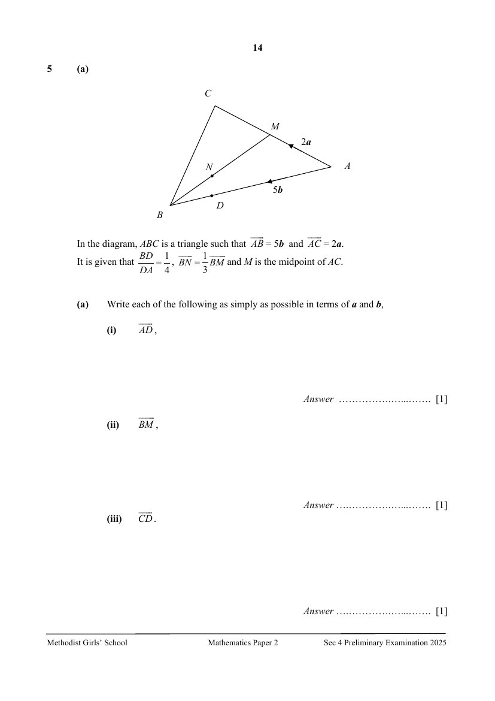
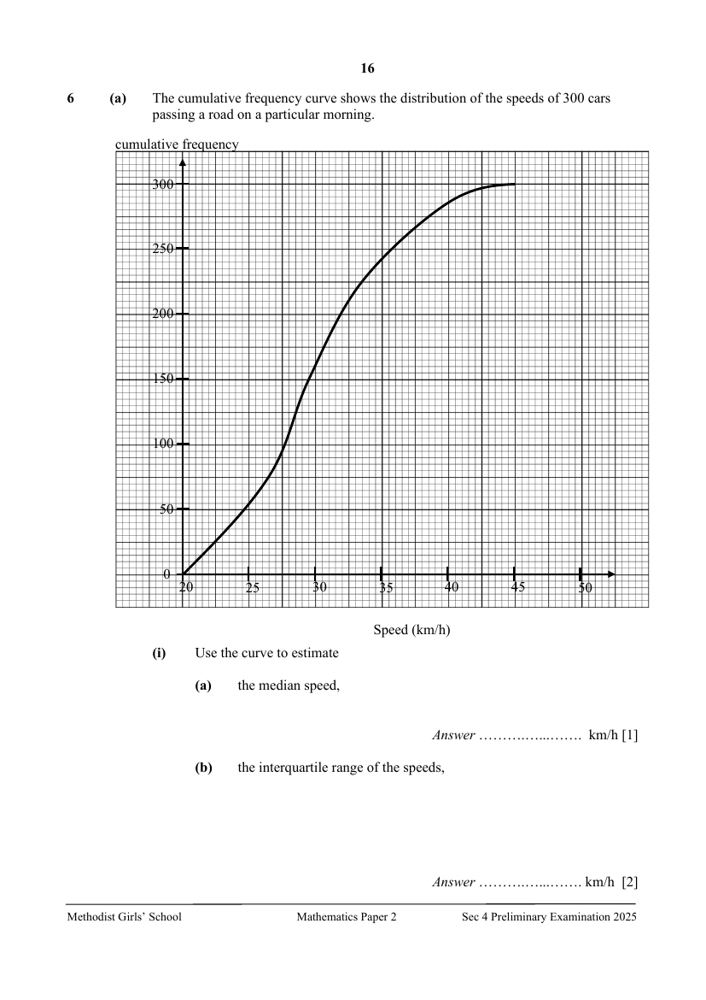
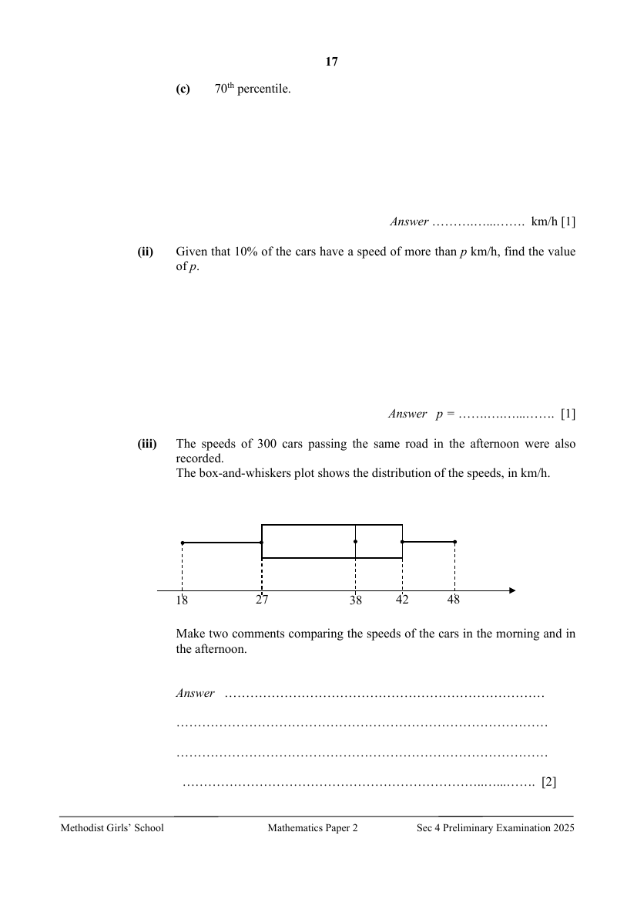
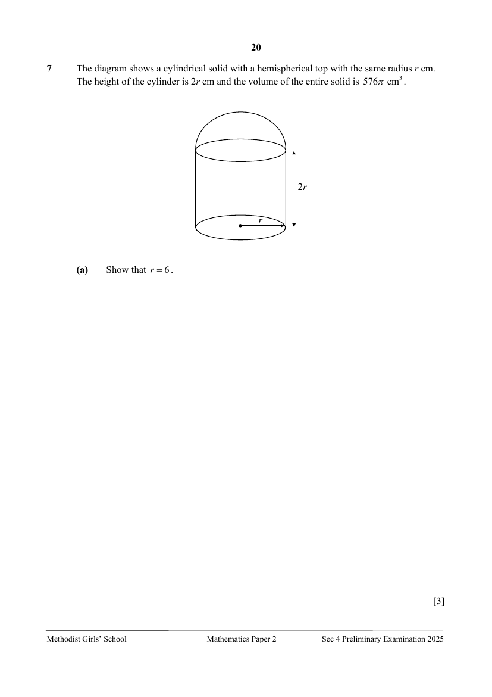

# Methodist Girls' School — Mathematics 4052/02 Paper 2 (cleaned)

> **Institution:** Methodist Girls' School
> **Exam:** Preliminary Examination 2025
> **Level:** Secondary 4
> **Subjects:** Mathematics
> **Paper:** 4052/02 Paper 2
> **Date:** 22 August 2025
> **Duration:** 2 hours 15 minutes
> **Total Marks:** 90
> **Source:** `MGS 2025 EMATH PRELIM P2 QP.pdf` (cleaned & reformatted)

---

## Instructions

Candidates answer on the Question Paper.

Write your name, class and index number in the spaces at the top of this page.
Write in dark blue or black pen.
You may use an HB pencil for any diagrams or graphs.
Do not use staples, paper clips, glue or correction fluid.

Answer all the questions.
If working is needed for any question it must be shown with the answer.
Omission of essential working will result in loss of marks.
The use of an approved scientific calculator is expected, where appropriate.
If the degree of accuracy is not specified in the question, and if the answer is not exact, give the answer to three significant figures. Give answers in degrees to one decimal place.
For $\pi$, use either your calculator value or $3.142$, unless the question requires the answer in terms of $\pi$.

The number of marks is given in brackets [ ] at the end of each question or part question.
The total of the marks for this paper is 90.

This question paper consists of 26 printed pages and 2 blank pages.

---

## Mathematical Formulae

*Compound interest*

$$
\text{Total amount} = P\left(1+\frac{r}{100}\right)^{n}
$$

*Mensuration*

$$
\text{Curved surface area of a cone} = \pi rl
$$

$$
\text{Surface area of a sphere} = 4\pi r^{2}
$$

$$
\text{Volume of a cone} = \frac{1}{3}\pi r^{2}h
$$

$$
\text{Volume of a sphere} = \frac{4}{3}\pi r^{3}
$$

$$
\text{Area of triangle } ABC = \frac{1}{2}ab\sin C
$$

$$
\text{Arc length} = r\theta,\text{ where }\theta\text{ is in radians}
$$

$$
\text{Sector area} = \frac{1}{2}r^{2}\theta,\text{ where }\theta\text{ is in radians}
$$

*Trigonometry*

$$
\frac{a}{\sin A} = \frac{b}{\sin B} = \frac{c}{\sin C}
$$

$$
a^{2} = b^{2}+c^{2}-2bc\cos A
$$

*Statistics*

$$
\text{Mean} = \frac{\sum fx}{\sum f}
$$

$$
\text{Standard deviation} = \sqrt{\frac{\sum fx^{2}}{\sum f}-\left(\frac{\sum fx}{\sum f}\right)^{2}}
$$

---

### Q1

> **Marks:** (a)(i) 1, (a)(ii) 1, (a)(iii) 1, (b)(i) 1, (b)(ii) 1, (c) 2; total 7
> **Page:** 3–4

**(a)** There are 2 500 sheets of paper of the same thickness in a stack of paper.

**(i)** Given that the height of the stack of paper is 25 cm, write down the thickness of a single sheet of paper in metres in standard form. [1]
> **Topic:** N3 Percentage
> **Sub-topic:** Percentage
> **LO:** [[context/subjects/o-level-e-maths/learning-objectives/o-level-e-maths-N3c.md|N3c]]

**(ii)** The stack of paper weighs 13.1 kg, correct to one decimal place.
Find the minimum mass of the stack of paper. [1]
> **Topic:** N3 Percentage
> **Sub-topic:** Percentage
> **LO:** [[context/subjects/o-level-e-maths/learning-objectives/o-level-e-maths-N3c.md|N3c]]

**(iii)** The number 2500 is correct to $k$ significant figures.
State a possible value of $k$. [1]
> **Topic:** N3 Percentage
> **Sub-topic:** Percentage
> **LO:** [[context/subjects/o-level-e-maths/learning-objectives/o-level-e-maths-N3c.md|N3c]]

**(b)** Jim is climbing a mountain that is 4 500 metres high. The temperature at the base of the mountain is $7^{\circ}\mathrm{C}$, and as he climbs, the temperature drops at a constant rate.

The temperature at the top of the mountain is $15^{\circ}\mathrm{C}$ lower than at the base of the mountain.

**(i)** Find the temperature at the top of the mountain. [1]
> **Topic:** N3 Percentage
> **Sub-topic:** Percentage
> **LO:** [[context/subjects/o-level-e-maths/learning-objectives/o-level-e-maths-N3c.md|N3c]]

**(ii)** At what height during his climb does the temperature reach $-2^{\circ}\mathrm{C}$? [1]
> **Topic:** N3 Percentage
> **Sub-topic:** Percentage
> **LO:** [[context/subjects/o-level-e-maths/learning-objectives/o-level-e-maths-N3c.md|N3c]]

**(c)** In 2023, Sandra earned $20\%$ less than what she earned in 2022.
In 2024, she earned $15\%$ more than what she earned in 2023.
If she earned &#36;49 680 in 2024, how much did she earn in 2022? [2]
> **Topic:** N3 Percentage
> **Sub-topic:** Percentage
> **LO:** [[context/subjects/o-level-e-maths/learning-objectives/o-level-e-maths-N3c.md|N3c]]

---

### Q2

> **Marks:** (a)(i) 2, (a)(ii) 1, (b)(i) 1, (b)(ii) 3; total 7
> **Page:** 5–6

**(a)**

**(i)** Solve the inequality $x-4<5x+1\leq\dfrac{7}{2}-2x$. [2]
> **Topic:** N7 Equations and inequalities
> **Sub-topic:** Equations and inequalities
> **LO:** [[context/subjects/o-level-e-maths/learning-objectives/o-level-e-maths-N7g.md|N7g]]

**(ii)** List all the integers that satisfy $x-4<5x+1\leq\dfrac{7}{2}-2x$. [1]
> **Topic:** N7 Equations and inequalities
> **Sub-topic:** Equations and inequalities
> **LO:** [[context/subjects/o-level-e-maths/learning-objectives/o-level-e-maths-N7g.md|N7g]]

**(b)** $a=\dfrac{(b+1)^{3}}{4}-c^{2}$

**(i)** Find $a$ when $b=2$ and $c=-1$. [1]
> **Topic:** N5 Algebraic expressions and formulae
> **Sub-topic:** Algebraic expressions and formulae
> **LO:** [[context/subjects/o-level-e-maths/learning-objectives/o-level-e-maths-N5l.md|N5l]]

**(ii)** Arrange the formula to make $b$ the subject. [3]
> **Topic:** N7 Equations and inequalities
> **Sub-topic:** Equations and inequalities
> **LO:** [[context/subjects/o-level-e-maths/learning-objectives/o-level-e-maths-N7g.md|N7g]]

---

### Q3

> **Marks:** (a)(i) 3, (a)(ii) 2, (a)(iii) 1, (b) 4, (c)(i) 1, (c)(ii) 3; total 14
> **Page:** 8–11

**(a)** $A$, $B$, $C$ and $D$ are points on a circle, centre $O$.
$EB$ and $ED$ are tangents to the circle.
Angle $DOC=50^{\circ}$.

Find, giving reasons for each answer,

**(i)** angle $OEB$, [3]
> **Topic:** N6 Functions and graphs
> **Sub-topic:** Functions and graphs
> **LO:** [[context/subjects/o-level-e-maths/learning-objectives/o-level-e-maths-N6c.md|N6c]]

**(ii)** angle $DAB$, [2]
> **Topic:** N6 Functions and graphs
> **Sub-topic:** Functions and graphs
> **LO:** [[context/subjects/o-level-e-maths/learning-objectives/o-level-e-maths-N6c.md|N6c]]

**(iii)** angle $EBC$. [1]
> **Topic:** N6 Functions and graphs
> **Sub-topic:** Functions and graphs
> **LO:** [[context/subjects/o-level-e-maths/learning-objectives/o-level-e-maths-N6c.md|N6c]]

**(b)** The diagram shows the graphs of $y-48x-4=0$ and $y=ka^{x}$.
They intersect at the points $A$ and $B$. $A$ is a point on the $y$-axis.
Find the values of $k$ and of $a$. [4]
> **Topic:** N6 Functions and graphs
> **Sub-topic:** Functions and graphs
> **LO:** [[context/subjects/o-level-e-maths/learning-objectives/o-level-e-maths-N6c.md|N6c]]

**(c)** The diagram shows a rhombus $ABCD$ such that $AB=BD=18$ cm.
$ABFD$ and $CBED$ are sectors of circles with centre $A$ and $C$ respectively.

**(i)** Explain why angle $BCD=\dfrac{\pi}{3}$ radians. [1]
> **Topic:** N6 Functions and graphs
> **Sub-topic:** Functions and graphs
> **LO:** [[context/subjects/o-level-e-maths/learning-objectives/o-level-e-maths-N6c.md|N6c]]

**(ii)** Calculate the area of the shaded region. [3]
> **Topic:** N6 Functions and graphs
> **Sub-topic:** Functions and graphs
> **LO:** [[context/subjects/o-level-e-maths/learning-objectives/o-level-e-maths-N6c.md|N6c]]

---

### Q4

> **Marks:** (a) 1, (b) 3, (c) 2, (d)(i) 2, (d)(ii) 1, (d)(iii) 3; total 12
> **Page:** 12–13

**(a)** Complete the table of values for $y=\dfrac{x^{2}}{3}+\dfrac{3}{x}-4$.
Values are given to two decimal places where appropriate. [1]
> **Topic:** N6 Functions and graphs
> **Sub-topic:** Functions and graphs
> **LO:** [[context/subjects/o-level-e-maths/learning-objectives/o-level-e-maths-N6j.md|N6j]]

| $x$ | $0.5$ | $1$ | $1.5$ | $2$ | $3$ | $4$ | $5$ | $6$ |
| --- | --- | --- | --- | --- | --- | --- | --- | --- |
| $y$ | $2.08$ | $-0.67$ | $-1.25$ |  | $0$ | $2.08$ | $4.93$ | $8.5$ |

**(b)** On the grid opposite, draw the graph of $y=\dfrac{x^{2}}{3}+\dfrac{3}{x}-4$ for $0.5\leq x\leq 6$. [3]
> **Topic:** N6 Functions and graphs
> **Sub-topic:** Functions and graphs
> **LO:** [[context/subjects/o-level-e-maths/learning-objectives/o-level-e-maths-N6j.md|N6j]]

**(c)** By drawing a tangent, find the gradient of the curve at $(3,0)$. [2]
> **Topic:** G6 Coordinate geometry
> **Sub-topic:** Coordinate geometry
> **LO:** [[context/subjects/o-level-e-maths/learning-objectives/o-level-e-maths-G6c.md|G6c]]

**(d)**

**(i)** On the same axes, draw the line with gradient $\dfrac{4}{3}$ that passes through $(3,2)$. [2]
> **Topic:** G6 Coordinate geometry
> **Sub-topic:** Coordinate geometry
> **LO:** [[context/subjects/o-level-e-maths/learning-objectives/o-level-e-maths-G6c.md|G6c]]

**(ii)** Write down the $x$-coordinate(s) of the point(s) where the line intersects the curve. [1]
> **Topic:** N6 Functions and graphs
> **Sub-topic:** Functions and graphs
> **LO:** [[context/subjects/o-level-e-maths/learning-objectives/o-level-e-maths-N6j.md|N6j]]

**(iii)** The $x$-coordinate(s) of the point(s) of intersection satisfy the equation $x^{3}+Ax^{2}+Bx+C=0$.
Find the values of $A$, $B$ and $C$. [3]
> **Topic:** N6 Functions and graphs
> **Sub-topic:** Functions and graphs
> **LO:** [[context/subjects/o-level-e-maths/learning-objectives/o-level-e-maths-N6j.md|N6j]]

---

### Q5

> **Marks:** (a)(i) 1, (a)(ii) 1, (a)(iii) 1, (b) 2, (c) 2; total 7
> **Page:** 14–15

In the diagram, $ABC$ is a triangle such that $\overrightarrow{AB}=5\mathbf{b}$ and $\overrightarrow{AC}=2\mathbf{a}$.
It is given that $\dfrac{BD}{DA}=\dfrac{1}{4}$, $\overrightarrow{BN}=\dfrac{1}{3}\overrightarrow{BM}$ and $M$ is the midpoint of $AC$.

**(a)** Write each of the following as simply as possible in terms of $\mathbf{a}$ and $\mathbf{b}$,

**(i)** $\overrightarrow{AD}$, [1]
> **Topic:** G7 Vectors in two dimensions
> **Sub-topic:** Vectors in two dimensions
> **LO:** [[context/subjects/o-level-e-maths/learning-objectives/o-level-e-maths-G7h.md|G7h]]

**(ii)** $\overrightarrow{BM}$, [1]
> **Topic:** G7 Vectors in two dimensions
> **Sub-topic:** Vectors in two dimensions
> **LO:** [[context/subjects/o-level-e-maths/learning-objectives/o-level-e-maths-G7h.md|G7h]]

**(iii)** $\overrightarrow{CD}$. [1]
> **Topic:** G7 Vectors in two dimensions
> **Sub-topic:** Vectors in two dimensions
> **LO:** [[context/subjects/o-level-e-maths/learning-objectives/o-level-e-maths-G7h.md|G7h]]

**(b)** Show that $\overrightarrow{CN}=\dfrac{5}{3}(2\mathbf{b}-\mathbf{a})$. [2]
> **Topic:** G7 Vectors in two dimensions
> **Sub-topic:** Vectors in two dimensions
> **LO:** [[context/subjects/o-level-e-maths/learning-objectives/o-level-e-maths-G7h.md|G7h]]

**(c)** Explain why $C$, $N$ and $D$ lie in a straight line. [2]
> **Topic:** G7 Vectors in two dimensions
> **Sub-topic:** Vectors in two dimensions
> **LO:** [[context/subjects/o-level-e-maths/learning-objectives/o-level-e-maths-G7h.md|G7h]]

---

### Q6

> **Marks:** (a)(i)(a) 1, (a)(i)(b) 2, (a)(i)(c) 1, (a)(ii) 1, (a)(iii) 2, (b)(i) 1, (b)(ii) 2, (b)(iii) 1; total 11
> **Page:** 16–18

**(a)** The cumulative frequency curve shows the distribution of the speeds of 300 cars passing a road on a particular morning.

**(i)** Use the curve to estimate

**(a)** the median speed, [1]
> **Topic:** S2 Probability
> **Sub-topic:** Probability
> **LO:** [[context/subjects/o-level-e-maths/learning-objectives/o-level-e-maths-S2a.md|S2a]]

**(b)** the interquartile range of the speeds, [2]
> **Topic:** S2 Probability
> **Sub-topic:** Probability
> **LO:** [[context/subjects/o-level-e-maths/learning-objectives/o-level-e-maths-S2a.md|S2a]]

**(c)** 70th percentile. [1]
> **Topic:** S2 Probability
> **Sub-topic:** Probability
> **LO:** [[context/subjects/o-level-e-maths/learning-objectives/o-level-e-maths-S2a.md|S2a]]

**(ii)** Given that $10\%$ of the cars have a speed of more than $p$ km/h, find the value of $p$. [1]
> **Topic:** S2 Probability
> **Sub-topic:** Probability
> **LO:** [[context/subjects/o-level-e-maths/learning-objectives/o-level-e-maths-S2a.md|S2a]]

**(iii)** The speeds of 300 cars passing the same road in the afternoon were also recorded.
The box-and-whiskers plot shows the distribution of the speeds, in km/h.

Make two comments comparing the speeds of the cars in the morning and in the afternoon. [2]
> **Topic:** S2 Probability
> **Sub-topic:** Probability
> **LO:** [[context/subjects/o-level-e-maths/learning-objectives/o-level-e-maths-S2a.md|S2a]]

**(b)** Ten identical cards are labelled 1, 2, 3, 4, 5, 6, 7, 8, 9 and 10 respectively.
Two cards are drawn at random, one after the other, without replacement.
Find the probability that

**(i)** both cards picked have a number that is odd, [1]
> **Topic:** S2 Probability
> **Sub-topic:** Probability
> **LO:** [[context/subjects/o-level-e-maths/learning-objectives/o-level-e-maths-S2c.md|S2c]]

**(ii)** one card picked has a number that is odd and the other card has a number that is even, [2]
> **Topic:** S2 Probability
> **Sub-topic:** Probability
> **LO:** [[context/subjects/o-level-e-maths/learning-objectives/o-level-e-maths-S2c.md|S2c]]

**(iii)** the product of the numbers on both cards is even. [1]
> **Topic:** S2 Probability
> **Sub-topic:** Probability
> **LO:** [[context/subjects/o-level-e-maths/learning-objectives/o-level-e-maths-S2c.md|S2c]]

---

### Q7

> **Marks:** (a) 3, (b) 4; total 7
> **Page:** 20–21

The diagram shows a cylindrical solid with a hemispherical top with the same radius $r$ cm.
The height of the cylinder is $2r$ cm and the volume of the entire solid is $576\pi\text{ cm}^{3}$.

**(a)** Show that $r=6$. [3]
> **Topic:** G5 Mensuration
> **Sub-topic:** Mensuration
> **LO:** [[context/subjects/o-level-e-maths/learning-objectives/o-level-e-maths-G5c.md|G5c]]

**(b)** If the entire solid is melted to form a solid cone such that its radius and height are the same, find the total surface area of the cone. [4]
> **Topic:** G5 Mensuration
> **Sub-topic:** Mensuration
> **LO:** [[context/subjects/o-level-e-maths/learning-objectives/o-level-e-maths-G5c.md|G5c]]

---

### Q8

> **Marks:** (a) 1, (b) 1, (c) 3, (d) 3, (e) 1; total 9
> **Page:** 22–23

A water heater is programmed to heat up water in a tank to a temperature of $38^{\circ}\mathrm{C}$.

**(a)** In the morning, the temperature of the water before heating is $25^{\circ}\mathrm{C}$.
The water heater heats up water at an average rate of $x^{\circ}\mathrm{C}$ per minute.

Write down an expression, in terms of $x$, for the time taken to heat up the water. [1]
> **Topic:** N7 Equations and inequalities
> **Sub-topic:** Equations and inequalities
> **LO:** [[context/subjects/o-level-e-maths/learning-objectives/o-level-e-maths-N7f.md|N7f]]

**(b)** In the afternoon, the temperature of the water before heating is $28^{\circ}\mathrm{C}$.
The water heater heats up water at an average rate of $(x+2)^{\circ}\mathrm{C}$ per minute.

Write down an expression, in terms of $x$, for the time taken to heat up the water. [1]
> **Topic:** N7 Equations and inequalities
> **Sub-topic:** Equations and inequalities
> **LO:** [[context/subjects/o-level-e-maths/learning-objectives/o-level-e-maths-N7f.md|N7f]]

**(c)** The difference between the time taken to heat up the water in the morning and in the afternoon is 2 minutes.

Write down an equation in $x$ to represent this information, and show that it reduces to

$$
2x^{2}+x-26=0.
$$

[3]
> **Topic:** N7 Equations and inequalities
> **Sub-topic:** Equations and inequalities
> **LO:** [[context/subjects/o-level-e-maths/learning-objectives/o-level-e-maths-N7f.md|N7f]]

**(d)** Solve the equation $2x^{2}+x-26=0$, giving your answers to two decimal places. [3]
> **Topic:** N1 Numbers and their operations
> **Sub-topic:** Numbers and their operations
> **LO:** [[context/subjects/o-level-e-maths/learning-objectives/o-level-e-maths-N1g.md|N1g]]

**(e)** Find the time taken to heat up the water in the morning.
Give your answer in minutes and seconds, correct to the nearest second. [1]
> **Topic:** N7 Equations and inequalities
> **Sub-topic:** Equations and inequalities
> **LO:** [[context/subjects/o-level-e-maths/learning-objectives/o-level-e-maths-N7f.md|N7f]]

---

### Q9

> **Marks:** (a) 2, (b) 2, (c) 2; total 6
> **Page:** 24–25

$A$ is the point $(-3,-1)$ and $B$ is the point $(5,-7)$.

Find

**(a)** the equation of the line $AB$, [2]
> **Topic:** G6 Coordinate geometry
> **Sub-topic:** Coordinate geometry
> **LO:** [[context/subjects/o-level-e-maths/learning-objectives/o-level-e-maths-G6c.md|G6c]]

**(b)** the value of $k$ if the point $(k,3k)$ lies on the line $AB$, [2]
> **Topic:** G6 Coordinate geometry
> **Sub-topic:** Coordinate geometry
> **LO:** [[context/subjects/o-level-e-maths/learning-objectives/o-level-e-maths-G6c.md|G6c]]

**(c)** the value of $a$ if the line $4y=3ax+4$ is parallel to the line $AB$. [2]
> **Topic:** G6 Coordinate geometry
> **Sub-topic:** Coordinate geometry
> **LO:** [[context/subjects/o-level-e-maths/learning-objectives/o-level-e-maths-G6c.md|G6c]]

---

### Q10

> **Marks:** (a) 1, (b) 2, (c) 7; total 10
> **Page:** 26–28

Caroline is interested to buy a new car.
She has shortlisted 2 cars, which she intends to drive for 10 years.
The following tables show the details of the specifications, car loans, applicable road taxes and expenditure of owning the cars.

| Car | Model A | Model B |
| --- | --- | --- |
| Engine Capacity (EC)/ cc | 1598 | 1798 |
| Power Rating (PR)/ kW | 96 | 72 |
| Fuel Type | Petrol | Petrol-Electric |
| Fuel consumption (km/L) | 15.6 | 27 |
| Cost | &#36;180 888 | &#36;189 300 |
| Annual maintenance fee | &#36;463 | &#36;389 |
| Car loan: Simple interest rate per annum | 1.88% | 2.18% |

Road Tax (For Petrol Cars)

| Engine Capacity (EC) in cc | Annual Road Tax Formula |
| --- | --- |
| EC $<$ 600 | S&#36;400 $\times$ 0.782 |
| 600 $<$ EC $<$ 1,000 | [S&#36;400 + S&#36;0.25(EC $-$ 600)] $\times$ 0.782 |
| 1,000 $<$ EC $<$ 1,600 | [S&#36;500 + S&#36;0.75(EC $-$ 1,000)] $\times$ 0.782 |
| 1,600 $<$ EC $<$ 3,000 | [S&#36;950 + S&#36;1.5(EC $-$ 1,600)] $\times$ 0.782 |

Road Tax (For Electric Cars)

| Power Rating (PR) in kW | Annual Road Tax Formula |
| --- | --- |
| PR $<$ 7.5 | S&#36;400 $\times$ 0.782 |
| 7.5 $<$ PR $<$ 30 | [S&#36;400 + S&#36;4(PR $-$ 7.5)] $\times$ 0.782 |
| 30 $<$ PR $<$ 230 | [S&#36;500 + S&#36;7.5(PR $-$ 30)] $\times$ 0.782 |

Road Tax (For Petrol-Electric Cars)

To find out your road tax, calculate road tax twice: first based on your car's engine capacity, then based on its Power Rating (PR). The higher amount will be the road tax you have to pay.

**(a)** Calculate the annual road tax payable for Model A. [1]
> **Topic:** S1 Data handling and analysis
> **Sub-topic:** Data handling and analysis
> **LO:** [[context/subjects/o-level-e-maths/learning-objectives/o-level-e-maths-S1f.md|S1f]]

**(b)** Show that annual road tax payable for Model B is &#36;975.15 correct to two decimal places. [2]
> **Topic:** S1 Data handling and analysis
> **Sub-topic:** Data handling and analysis
> **LO:** [[context/subjects/o-level-e-maths/learning-objectives/o-level-e-maths-S1f.md|S1f]]

**(c)** Caroline estimates that she will travel approximately 20 000 km per year and petrol prices are at &#36;2.57 per litre.

Caroline owns a credit card which gives her a discount of $21\%$ off petrol prices.
She will pay &#36;60 000 cash for the downpayment for the car and take a car loan for 7 years.

Assuming both car models offer comparable performance over 10 years, which car model offers better value? Justify your answer with clear working. [7]
> **Topic:** S1 Data handling and analysis
> **Sub-topic:** Data handling and analysis
> **LO:** [[context/subjects/o-level-e-maths/learning-objectives/o-level-e-maths-S1f.md|S1f]]
