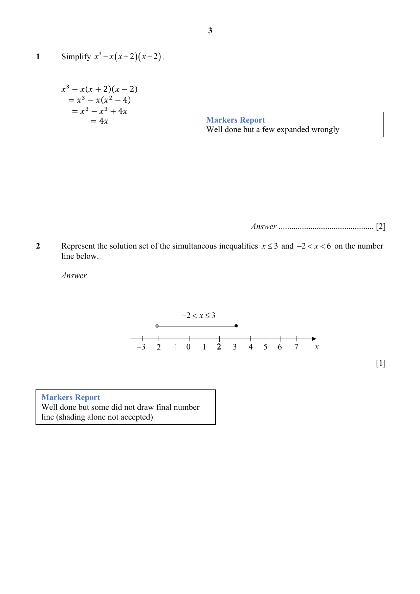
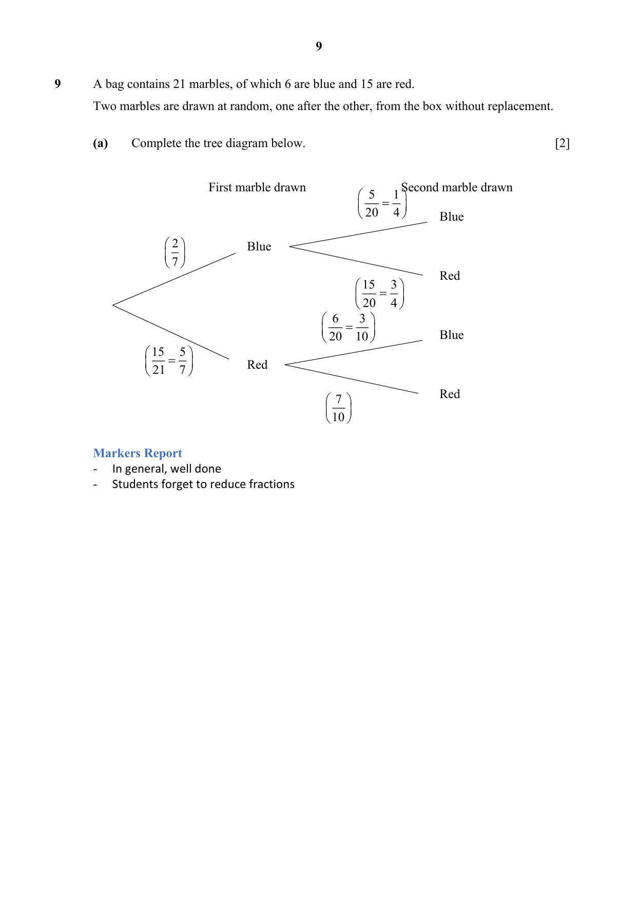
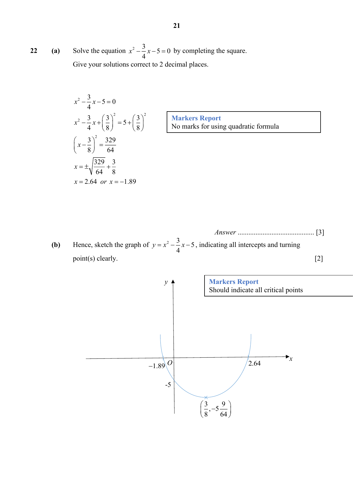
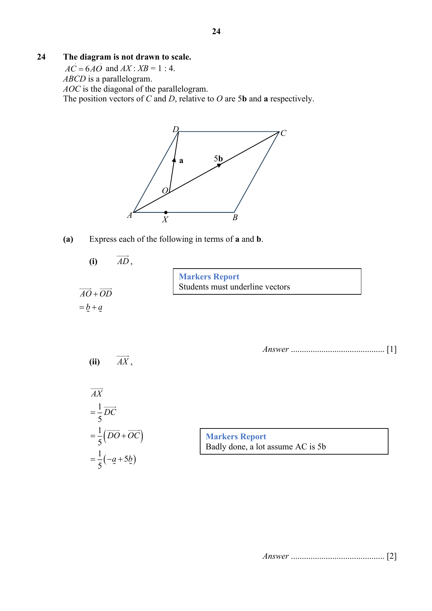

# Maris Stella High School — Mathematics Paper 1 Markers' Report (cleaned)

> **Institution:** Maris Stella High School
> **Exam:** Preliminary Examination 2025
> **Level:** Secondary 4 Express
> **Subjects:** Elementary Mathematics
> **Paper:** Paper 1 — 4052/1 Markers' Report
> **Date:** 18 August 2025
> **Duration:** 2 hours 15 minutes
> **Total Marks:** 90
> **Source:** `MSHS Prelim P1 EM Markers Report 2025.pdf` (digital PDF — cleaned & reformatted)

---

## Answer all the questions

---

### Q1

> **Marks:** [2]
> **Sub-topic:** Algebraic simplification
> **Page:** 3

Simplify $x^{3}-x(x+2)(x-2)$.

$$x^{3}-x(x+2)(x-2)$$

$$=x^{3}-x(x^{2}-4)$$

$$=x^{3}-x^{3}+4x$$

$$=4x$$

> **Markers Report:** Well done but a few expanded wrongly

---

### Q2

> **Marks:** [1]
> **Sub-topic:** Inequalities
> **Page:** 3

Represent the solution set of the simultaneous inequalities $x\leq 3$ and $-2<x<6$ on the number line below.

$$-2<x\leq 3$$

> **Markers Report:** Well done but some did not draw final number line (shading alone not accepted)

---

### Q3

> **Marks:** (a) [4]; (b) [1]; total [5]
> **Sub-topic:** Simple interest and hire purchase
> **Page:** 4

The cash price for a car was &#36;150 000. Sally paid a downpayment of &#36;90 000 and paid the remaining amount by monthly instalments for 5 years. A simple interest of $x\%$ per annum was charged and that her monthly instalment was &#36;1090.

**(a)** Find the value of $x$.

$$150000-90000=60000$$

$$1090\times 5\times 12=65400$$

$$\text{Interest}=65400-60000=5400$$

$$5400=\frac{60000(x)(5)}{100}$$

$$x=1.8$$

**(b)** Calculate the extra cost of using hire purchase as a percentage of the cash price.

$$\frac{5400}{150000}\times 100\%=3.6\%$$

> **Markers Report:** (a) A handle used percentage change formula resulting in 9% (wrong concept). (b) Generally well done

---

### Q4

> **Marks:** (a) [1]; (b) [1]; (c) [1]; total [3]
> **Sub-topic:** Geometrical construction
> **Page:** 5

The diagram shows a segment of a circle, $PQR$.

**(a)** A point $X$ on the perimeter of the segment is such that $PX=RX$. Find and label the position of $X$. [1]

**(b)** On the diagram, construct the angle bisector of angle $XPR$. [1]

**(c)** On the diagram, shade a region inside $PQR$ that is closer to $PR$ than $PX$, and closer to $P$ than $R$. [1]

> **Markers Report:** Generally well done but some students have missing arcs.

---

### Q5

> **Marks:** (a) [3]; (b) [1]; total [4]
> **Sub-topic:** Polygons
> **Page:** 6

**(a)** An interior angle of a regular $n$-sided polygon is 1.5 times larger than its exterior angle. Find $n$.

$$x+1.5x=180^{\circ}$$

$$2.5x=180^{\circ}$$

$$x=72^{\circ}$$

$$n=\frac{360^{\circ}}{72^{\circ}}$$

$$n=5$$

> **Markers Report:** Generally well done, other methods accepted.

**(b)** What is the name of the $n$-sided polygon given in part (a)?

Pentagon

> **Markers Report:** Generally well done.

---

### Q6

> **Marks:** (a) [2]; (b) [2]; total [4]
> **Sub-topic:** Map scales
> **Page:** 7

The scale of Map A is given as $1:200\,000$.

**(a)** The length of a road on the map is $6$ cm. Calculate the actual distance, in kilometres, of the road.

$$1:200000$$

$$1\text{ cm}:2\text{ km}$$

$$6\text{ cm}:12\text{ km}$$

> **Markers Report:** Generally well done

**(b)** The scale of Map B is $1:250\,000$ and the size of an island on Map B is $3.6\text{ cm}^{2}$. Calculate the area of the same island, in square centimetres, on Map A.

$$1:250000$$

$$1\text{ cm}:2.5\text{ km}$$

$$1\text{ cm}^{2}:6.25\text{ km}^{2}$$

$$3.6\times 6.25=22.5\text{ km}^{2}$$

$$1\text{ cm}^{2}:4\text{ km}^{2}$$

$$\frac{22.5}{4}=5.625\text{ cm}^{2}$$

> **Markers Report:** Generally well done.

---

### Q7

> **Marks:** (a) [2]; (b) [2]; total [4]
> **Sub-topic:** Factorisation
> **Page:** 8

Factorise

**(a)** $2+5x-3x^{2}$,

$$2+5x-3x^{2}=(3x+1)(-x+2)$$

> **Markers Report:** Generally well done, accept other forms eg. $-(3x+1)(x-2)$, $(-3x-1)(x-2)$

**(b)** $3x^{2}-24y+4x-18xy$.

$$3x^{2}-24y+4x-18xy$$

$$=x(3x+4)-6y(4+3x)$$

$$=(x-6y)(3x+4)$$

> **Markers Report:** Generally well done

---

### Q8

> **Marks:** (a) [1]; (b) [1]; total [2]
> **Sub-topic:** Sequences
> **Page:** 8

The first four terms in a sequence are $2$, $6$, $18$, $54$.

**(a)** Find an expression, in terms of $n$, for the $n$th term of the sequence.

$$2(3)^{n-1}$$

> **Markers Report:** Not well done, many cannot deduce the general term. Accept other simplified expressions.

**(b)** Explain why the number $98415$ is not a term of the sequence.

Because the number if not even.

> **Markers Report:** Not well done. Accept actual finding of $n$ and explain that $n$ is not whole number. No ecf if $n$ is found from wrong expression in part (a).

---

### Q9

> **Marks:** (a) [2]; (b)(i) [1]; (b)(ii) [2]; total [5]
> **Sub-topic:** Probability
> **Page:** 9

A bag contains 21 marbles, of which 6 are blue and 15 are red. Two marbles are drawn at random, one after the other, from the box without replacement.

**(a)** Complete the tree diagram below. [2]

First marble blue $\dfrac{2}{7}$, then second blue $\dfrac{5}{20}=\dfrac{1}{4}$, second red $\dfrac{15}{20}=\dfrac{3}{4}$.

First marble red $\dfrac{15}{21}=\dfrac{5}{7}$, then second blue $\dfrac{6}{20}=\dfrac{3}{10}$, second red $\dfrac{7}{10}$.

> **Markers Report:** In general, well done. Students forget to reduce fractions.

**(b)** Find the probability that

**(i)** both marbles drawn are blue.

$$\frac{2}{7}\times\frac{1}{4}=\frac{1}{14}$$

**(ii)** at most one of the marbles drawn is red.

$$1-\left(\frac{5}{7}\times\frac{7}{10}\right)=\frac{1}{2}$$

or

$$\left(\frac{5}{7}\times\frac{3}{10}\right)+\left(\frac{2}{7}\times\frac{3}{4}\right)+\left(\frac{2}{7}\times\frac{1}{4}\right)=\frac{1}{2}$$

> **Markers Report:** (b)(i) In general, well done. (b)(ii) Students did not interpret correctly and included the case where both are red.

---

### Q10

> **Marks:** (a) [3]; (b) [2]; total [5]
> **Sub-topic:** Pythagoras and trigonometry
> **Page:** 10

In the diagram, $PXR$ is a straight line, $\angle PRQ=90^{\circ}$, $PQ=17$ cm, $QR=8$ cm and area of $\triangle PXQ=36\text{ cm}^{2}$.

**(a)** Calculate $RX$,

$$\frac{1}{2}(PX)(8)=36$$

$$PX=9$$

$$RP=\sqrt{17^{2}-8^{2}}$$

$$RP=15$$

$$RX=15-9$$

$$RX=6\text{ cm}$$

> **Markers Report:** Well done

**(b)** $\cos\angle QXP$.

$$\cos\angle QXP=-\frac{6}{\sqrt{8^{2}+6^{2}}}=-\frac{6}{10}=-\frac{3}{5}$$

> **Markers Report:** Many omitted the negative sign

---

### Q11

> **Marks:** (a) [3]; (b) [2]; total [5]
> **Sub-topic:** Proportion and percentage change
> **Page:** 11

**(a)** 6 workers can paint a building in 44 days. Find the additional number of workers needed if the building is to be painted in 11 days.

$$6\text{ Workers}:44\text{ days}$$

$$6\times 4\text{ workers}:11\text{ days}$$

$$\text{Additional workers}=24-6=18$$

> **Markers Report:** The question ask for additional workers. There is a need to subtract from the original number.

**(b)** $A$ is inversely proportional to $B^{2}$. If $B$ increases by $20\%$, find the percentage decrease in $A$.

$$A=\frac{k}{B^{2}}$$

$$k=AB^{2}$$

$$B_{\text{new}}=1.2B$$

$$A_{\text{new}}=\frac{AB^{2}}{(1.2B)^{2}}$$

$$A_{\text{new}}=\frac{25}{36}A$$

Percentage decrease

$$\frac{A-\dfrac{25}{36}A}{A}\times 100\%=30\frac{5}{9}\%$$

> **Markers Report:** Badly done. $\leftarrow$ No marks awarded at this point. Students need to show correct method of percentage decrease.

---

### Q12

> **Marks:** (a) [2]; (b) [2]; total [4]
> **Sub-topic:** Substitution and changing the subject
> **Page:** 12

It is given that $a=\dfrac{b+2cd}{b-cd}$.

**(a)** Evaluate $a$ when $b=-8$, $c=0.873$ and $d=-2$. Give your answer correct to 2 significant figures.

$$a=\frac{-8+2(0.873)(-2)}{-8-(0.873)(-2)}$$

$$a=1.83754$$

$$a=1.8\text{ (2 sf)}$$

> **Markers Report:** Well done but still a few not rounding off to 2 sf

**(b)** Express $b$ in terms of $a$, $c$ and $d$.

$$a=\frac{b+2cd}{b-cd}$$

$$a(b-cd)=b+2cd$$

$$ab-acd=b+2cd$$

$$ab-b=2cd+acd$$

$$b(a-1)=cd(2+a)$$

$$b=\frac{cd(2+a)}{a-1}$$

> **Markers Report:** Well done. Variations of answers were accepted.

---

### Q13

> **Marks:** (a) [3]; (b) [2]; total [5]
> **Sub-topic:** Circle theorems
> **Page:** 13

The diagram shows four points $A$, $B$, $C$ and $D$ which lie on the circumference of a circle with centre $O$. $BD$ is the diameter of the circle. Angle $BDC=30^{\circ}$ and angle $BCA=20^{\circ}$.

Find, giving reasons for each answer,

**(a)** angle $ABD$,

$$\angle BAD=90^{\circ}\text{ (rt angle in semi-circle)}$$

$$\angle BDA=20^{\circ}\text{ (angles in same segment)}$$

$$\angle ABD=180^{\circ}-90^{\circ}-20^{\circ}\text{ (angle sum of triangle)}=70^{\circ}$$

> **Markers Report:** It was noted that a lot of students do not memorize the correct angle property.

**(b)** angle $ABC$.

$$\angle ABC=180^{\circ}-30^{\circ}-20^{\circ}\text{ (angles in opposite segment)}=130^{\circ}$$

> **Markers Report:** All other methods also accepted.

---

### Q14

> **Marks:** [3]
> **Sub-topic:** Simultaneous equations
> **Page:** 14

Solve these simultaneous equations.

$$3y+\frac{1}{2}=15x$$

$$3x-2y=5$$

You must show your working.

$$3y=15x-\frac{1}{2}$$

$$y=5x-\frac{1}{6}$$

Subt into $3x-2y=5$

$$3x-2\left(5x-\frac{1}{6}\right)=5$$

$$3x-10x-\frac{1}{3}=5$$

$$-7x=4\frac{2}{3}$$

$$x=-\frac{2}{3}$$

$$y=5\left(-\frac{2}{3}\right)-\frac{1}{6}$$

$$y=-3.5$$

> **Markers Report:** It was noted that students who did elimination method often make careless mistakes. Other than that, well done.

---

### Q15

> **Marks:** [3]
> **Sub-topic:** Compound interest
> **Page:** 15

Bank A pays a compound interest of $2\%$ per annum compounded half-yearly. Matthew will be making a deposit of &#36;10 000.

Calculate how much interest Matthew will earn after 3 years.

$$A=10000\left(1+\frac{\dfrac{2}{2}}{100}\right)^{6}-10000$$

$$=10615.20151-10000$$

$$=615.20$$

> **Markers Report:** Many left $r$ as 2 instead of 2/2. Also the question is asking for interest. Student forget to subtract to find the difference.

---

### Q16

> **Marks:** (a)(i) [1]; (a)(ii) [1]; (b) [2]; total [4]
> **Sub-topic:** Sets
> **Page:** 15

$$\varepsilon=\{x:x\text{ is an integer and }0<x<11\}$$

$$A=\{x:x\text{ is a factor of }20\}$$

$$B=\{x:x\text{ is a prime number}\}$$

**(a)** List the elements of

**(i)** $A$,

$$\{1,2,4,5,10\}$$

**(ii)** $A\cup B$.

$$B=\{2,3,5,7\}$$

$$A\cup B=\{1,2,3,4,5,7,10\}$$

> **Markers Report:** Well done for (i). Many did not include number 10 for (aii). (b) many gave answers is the elements 3 and 7.

**(b)** Find $n(A'\cap B)$.

$$A'=\{3,6,7,8,9\}$$

$$A'\cap B=\{3,7\}$$

$$n(A'\cap B)=2$$

---

### Q17

> **Marks:** (a) [1]; (b) [1]; total [2]
> **Sub-topic:** Standard form
> **Page:** 16

**(a)** Write $2574$ in standard form.

$$2.574\times 10^{3}$$

> **Markers Report:** don't round off to 2.57. it is exact.

**(b)** Find the difference between $3.7\times 10^{105}$ and $4.6\times 10^{106}$. Give your answer in standard form.

$$4.6\times 10^{106}-3.7\times 10^{105}$$

$$=46\times 10^{105}-3.7\times 10^{105}$$

$$=(46-3.7)\times 10^{105}$$

$$=42.3\times 10^{105}$$

$$=4.23\times 10^{106}$$

> **Markers Report:** Many gave answer as 4.23

---

### Q18

> **Marks:** (a) [1]; (b) [1]; total [2]
> **Sub-topic:** Prime factors and HCF
> **Page:** 16

Written as a product of prime factors,

$$588=2^{2}\times 3\times 7^{2}\text{ and }1400=2^{3}\times 5^{2}\times 7.$$

Find

**(a)** the smallest integer, $m$, such that $1400m$ is a perfect cube.

$$1400m=2^{3}\times 5^{2}\times 7\times m$$

$$m=5\times 7^{2}$$

$$m=245$$

> **Markers Report:** Answer should be given as an integer and not in factor form,

**(b)** the greatest integer that will divide both $1400$ and $588$ exactly.

$$\text{HCF}=2^{2}\times 7$$

$$\text{HCF}=28$$

> **Markers Report:** Well done

---

### Q19

> **Marks:** (a)(i) [1]; (a)(ii) [2]; (b) [2]; total [5]
> **Sub-topic:** Mean and standard deviation
> **Page:** 17

For the month of January, the amount of money, in dollar, saved individually by 13 students are shown below.

January: $58$, $43$, $64$, $68$, $60$, $92$, $79$, $94$, $88$, $67$, $80$, $41$, $24$ (in dollars)

**(a)** Find

**(i)** the mean savings of the 13 students for the month of January,

$$\frac{858}{13}=66$$

> **Markers Report:** Well done

**(ii)** the standard deviation of the savings in January.

$$\sqrt{\frac{61964}{13}-\left(\frac{858}{13}\right)^{2}}=20.26$$

> **Markers Report:** Students should show the value they substitute into the formula

**(b)** The amount of money, in dollar, saved by the same group of students were calculated again in March 2024 as shown below.

March: $58$, $43$, $64$, $68$, $60$, $92$, $79$, $94$, $88$, $67$, $80$, $41$, $10$ (in dollars)

Given that only the lowest amount saved by a student in March was changed to &#36;10. State how the mean and standard deviation will change in March 2024 as compared January 2024.

The Mean will be lower but the standard deviation will increase.

> **Markers Report:** Generall Well done

---

### Q20

> **Marks:** [3]
> **Sub-topic:** Percentage change of area
> **Page:** 18

The base and the height of a triangle are each reduced by $40\%$ followed by an increase of $50\%$. Find the percentage reduction of the area of the final triangle compared to the original triangle.

$$\frac{1}{2}(0.6b\times 1.5)(0.6h\times 1.5)$$

$$=\frac{1}{2}\left(\frac{81}{100}\right)bh$$

Reduction

$$=1-\frac{81}{100}=\frac{19}{100}$$

Percentage reduction

$$=\frac{19}{100}\times 100\%=19\%$$

> **Markers Report:** Badly done. Students interpret it as the base reduce by 40% and the height by 50% however questions says clearly it is for each base and height.

---

### Q21

> **Marks:** [3]
> **Sub-topic:** Algebraic fractions
> **Page:** 18

Solve the equation $\dfrac{x}{4}-\dfrac{3x-2}{5}=-1$.

$$\frac{x}{4}-\frac{3x-2}{5}=-1$$

$$5x-12x+8=-20$$

$$-7x=-28$$

$$x=4$$

> **Markers Report:** Well done except for some careless mistake of -8 instead of +8

---

### Q22

> **Marks:** (a) [3]; (b) [2]; total [5]
> **Sub-topic:** Quadratic equations and graphs
> **Page:** 19

**(a)** Solve the equation $x^{2}-\dfrac{3}{4}x-5=0$ by completing the square. Give your solutions correct to 2 decimal places.

$$x^{2}-\frac{3}{4}x-5=0$$

$$x^{2}-\frac{3}{4}x+\left(\frac{3}{8}\right)^{2}=5+\left(\frac{3}{8}\right)^{2}$$

$$\left(x-\frac{3}{8}\right)^{2}=\frac{329}{64}$$

$$x=\pm\sqrt{\frac{329}{64}}+\frac{3}{8}$$

$$x=2.64\text{ or }x=-1.89$$

> **Markers Report:** No marks for using quadratic formula

**(b)** Hence, sketch the graph of $y=x^{2}-\dfrac{3}{4}x-5$, indicating all intercepts and turning point(s) clearly. [2]

Intercepts labelled $-1.89$, $2.64$ and $-5$. Turning point $\left(\dfrac{3}{8},-5\dfrac{9}{64}\right)$.

> **Markers Report:** Should indicate all critical points

---

### Q23

> **Marks:** (a) [2]; (b) [2]; (c) [2]; total [6]
> **Sub-topic:** Mensuration
> **Page:** 20–21

A hollow container is made by joining a hemisphere of radius $r$ cm to an open cylinder of radius $r$ cm and height $h$ cm.

**(a)** If the ratio of the capacity of the hemisphere to the capacity of the cylinder is $1:4$, show that $h=\dfrac{8}{3}r$.

$$\frac{\dfrac{2}{3}\pi r^{3}}{\pi r^{2}h}=\frac{1}{4}$$

$$\frac{\dfrac{2}{3}\pi r}{h}=\frac{1}{4}$$

$$\frac{2}{3}r=\frac{1}{4}h$$

$$h=\frac{8r}{3}\text{ (shown)}$$

> **Markers Report:** Well done

**(b)** If the total capacity of the container is $\dfrac{80\pi}{3}\text{ cm}^{3}$, find the radius.

$$\frac{2}{3}\pi r^{3}+\pi r^{2}h=\frac{80\pi}{3}$$

$$\frac{2}{3}\pi r^{3}+\pi r^{2}\left(\frac{8r}{3}\right)=\frac{80\pi}{3}$$

$$2r^{3}+8r^{3}=80$$

$$10r^{3}=80$$

$$r^{3}=8$$

$$r=2$$

> **Markers Report:** Generally well done though some used area instead.

**(c)** Find the area of the metal sheet used to make the container. Leave your answer in terms of $\pi$.

$$2\pi r^{2}+2\pi rh$$

Subt $r=2$

$$2\pi(2)^{2}+2\pi(2)h$$

$$=8\pi+\pi(4)\times\frac{16}{3}$$

$$=29\frac{1}{3}\pi$$

> **Markers Report:** Answer must be exact.

---

### Q24

> **Marks:** (a)(i) [1]; (a)(ii) [2]; (a)(iii) [2]; total [5]
> **Sub-topic:** Vectors
> **Page:** 22–23

The diagram is not drawn to scale. $AC=6\,AO$ and $AX:XB=1:4$. $ABCD$ is a parallelogram. $AOC$ is the diagonal of the parallelogram. The position vectors of $C$ and $D$, relative to $O$ are $5\mathbf{b}$ and $\mathbf{a}$ respectively.

**(a)** Express each of the following in terms of $\mathbf{a}$ and $\mathbf{b}$.

**(i)** $\overrightarrow{AD}$,

$$\overrightarrow{AO}+\overrightarrow{OD}=\mathbf{b}+\mathbf{a}$$

> **Markers Report:** Students must underline vectors

**(ii)** $\overrightarrow{AX}$,

$$\overrightarrow{AX}=\frac{1}{5}\overrightarrow{DC}$$

$$=\frac{1}{5}\left(\overrightarrow{DO}+\overrightarrow{OC}\right)$$

$$=\frac{1}{5}(-\mathbf{a}+5\mathbf{b})$$

> **Markers Report:** Badly done, a lot assume $AC$ is $5b$

**(iii)** position vector of $X$.

$$\overrightarrow{AX}=\overrightarrow{OX}-\overrightarrow{OA}$$

$$-\frac{1}{5}\mathbf{a}+\mathbf{b}=\overrightarrow{OX}-(-\mathbf{b})$$

$$\overrightarrow{OX}=-\frac{1}{5}\mathbf{a}$$

> **Markers Report:** Many do not know what the question is asking for. Some gave answers in column vector which is wrong.
