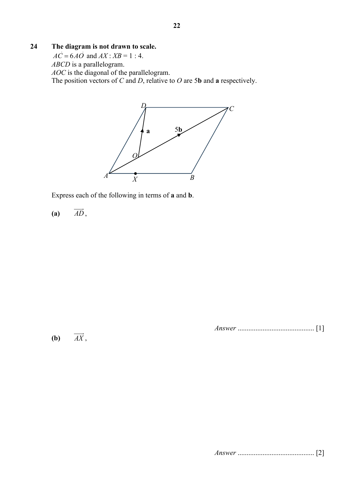

# Maris Stella High School — Mathematics 4052/1 Paper 1 (cleaned)

> **Institution:** Maris Stella High School
> **Exam:** Preliminary Examination 2025
> **Level:** Secondary Four
> **Subjects:** Mathematics
> **Paper:** 4052/1 Paper 1
> **Date:** 18 August 2025
> **Duration:** 2 hours 15 minutes
> **Total Marks:** 90
> **Source:** `2025 MSHS Math Prelim P1 Question.pdf` (cleaned & reformatted)

---

## Instructions

Write your class, index number and name on all the work you hand in.
Write in dark blue or black pen.
You may use an HB pencil for any diagrams or graphs.
Do not use staples, paper clips, glue or correction fluid.

Answer all the questions.
The number of marks is given in brackets [ ] at the end of each question or part question.

If working is needed for any question it must be shown with the answer.
Omission of essential working will result in loss of marks.
The total of the marks for this paper is 90.

The use of an approved scientific calculator is expected, where appropriate.
If the degree of accuracy is not specified in the question and if the answer is not exact, give the answer to three significant figures. Give answers in degrees to one decimal place.
For $\pi$, use either your calculator value or $3.142$.

---

## Mathematical Formulae

*Compound interest*

$$
\text{Total amount} = P\left(1+\frac{r}{100}\right)^{n}
$$

*Mensuration*

$$
\text{Curved surface area of a cone} = \pi rl
$$

$$
\text{Surface area of a sphere} = 4\pi r^{2}
$$

$$
\text{Volume of a cone} = \frac{1}{3}\pi r^{2}h
$$

$$
\text{Volume of a sphere} = \frac{4}{3}\pi r^{3}
$$

$$
\text{Area of triangle } ABC = \frac{1}{2}ab\sin C
$$

$$
\text{Arc length} = r\theta,\text{ where }\theta\text{ is in radians}
$$

$$
\text{Sector area} = \frac{1}{2}r^{2}\theta,\text{ where }\theta\text{ is in radians}
$$

*Trigonometry*

$$
\frac{a}{\sin A} = \frac{b}{\sin B} = \frac{c}{\sin C}
$$

$$
a^{2} = b^{2}+c^{2}-2bc\cos A
$$

*Statistics*

$$
\text{Mean} = \frac{\sum fx}{\sum f}
$$

$$
\text{Standard deviation} = \sqrt{\frac{\sum fx^{2}}{\sum f}-\left(\frac{\sum fx}{\sum f}\right)^{2}}
$$

---

### Q1

> **Marks:** 2
> **Sub-topic:** Algebraic expressions and formulae
> **Page:** 3

Simplify $x^{3}-x(x+2)(x-2)$. [2]

---

### Q2

> **Marks:** 1
> **Sub-topic:** Equations and inequalities
> **Page:** 3

Represent the solution set of the simultaneous inequalities $x \leq 3$ and $-2 < x < 6$ on the number line below. [1]

---

### Q3

> **Marks:** (a) 4, (b) 1; total 5
> **Sub-topic:** Numbers and their operations
> **Page:** 4

The cash price for a car was \$150000.
Sally paid a downpayment of \$90000 and paid the remaining amount by monthly instalments for 5 years.
A simple interest of $x\%$ per annum was charged and that her monthly instalment was \$1090.

**(a)** Find the value of $x$. [4]

**(b)** Calculate the extra cost of using hire purchase as a percentage of the cash price. [1]

---

### Q4

> **Marks:** (a) 1, (b) 1, (c) 1; total 3
> **Sub-topic:** Geometrical constructions
> **Page:** 5

The diagram shows a segment of a circle, $PQR$.

**(a)** A point $X$ on the perimeter of the segment is such that $PX = RX$.
Find and label the position of $X$. [1]

**(b)** On the diagram, construct the angle bisector of angle $XPR$. [1]

**(c)** On the diagram, shade a region inside $PQR$ that is closer to $PR$ than $PX$, and closer to $P$ than $R$. [1]

---

### Q5

> **Marks:** (a) 3, (b) 1; total 4
> **Sub-topic:** Angles, triangles and polygons
> **Page:** 6

**(a)** An interior angle of a regular $n$-sided polygon is $1.5$ times its exterior angle. Find the value of $n$. [3]

**(b)** What is the name of the $n$-sided polygon given in part (a)? [1]

---

### Q6

> **Marks:** (a) 2, (b) 2; total 4
> **Sub-topic:** Ratio and proportion
> **Page:** 7

The scale of Map A is given as $1:200\,000$.

**(a)** The length of a road on the map is $6\text{ cm}$.
Calculate the actual distance, in kilometres, of the road. [2]

**(b)** The scale of Map B is $1:250\,000$ and the size of an island on Map B is $3.6\text{ cm}^{2}$.
Calculate the area of the same island, in square centimetres, on Map A. [2]

---

### Q7

> **Marks:** (a) 2, (b) 2; total 4
> **Sub-topic:** Algebraic expressions and formulae
> **Page:** 8

Factorise

**(a)** $2+5x-3x^{2}$, [2]

**(b)** $3x^{2}-24y+4x-18xy$. [2]

---

### Q8

> **Marks:** (a) 1, (b) 1; total 2
> **Sub-topic:** Number sequences
> **Page:** 8

The first four terms in a sequence are $2$, $6$, $18$, $54$.

**(a)** Find an expression, in terms of $n$, for the $n$th term of the sequence. [1]

**(b)** Explain why the number $98415$ is not a term of the sequence. [1]

---

### Q9

> **Marks:** (a) 2, (b)(i) 1, (b)(ii) 2; total 5
> **Sub-topic:** Probability
> **Page:** 9

A bag contains 21 marbles, of which 6 are blue and 15 are red.
Two marbles are drawn at random, one after the other, from the box without replacement.

**(a)** Complete the tree diagram below. [2]

**(b)** Find the probability that

**(i)** both marbles drawn are blue, [1]

**(ii)** at most one of the marbles drawn is red. [2]

---

### Q10

> **Marks:** (a) 3, (b) 2; total 5
> **Sub-topic:** Trigonometry
> **Page:** 10

In the diagram, $PXR$ is a straight line,
$\angle PRQ = 90^{\circ}$, $PQ = 17\text{ cm}$, $QR = 8\text{ cm}$ and area of $\triangle PXQ = 36\text{ cm}^{2}$.

Calculate

**(a)** $RX$, [3]

**(b)** $\cos\angle QXP$. [2]

---

### Q11

> **Marks:** (a) 3, (b) 2; total 5
> **Sub-topic:** Ratio and proportion
> **Page:** 11

**(a)** 6 workers can paint a building in 44 days.
Find the additional number of workers needed if the building is to be painted in 11 days. [3]

**(b)** $A$ is inversely proportional to $B^{2}$.
If $B$ increases by $20\%$, find the percentage decrease in $A$. [2]

---

### Q12

> **Marks:** (a) 2, (b) 2; total 4
> **Sub-topic:** Algebraic expressions and formulae
> **Page:** 12

It is given that

$$
a = \frac{b+2cd}{b-cd}.
$$

**(a)** Evaluate $a$ when $b = -8$, $c = 0.873$ and $d = -2$.
Give your answer correct to 2 significant figures. [2]

**(b)** Express $b$ in terms of $a$, $c$ and $d$. [2]

---

### Q13

> **Marks:** (a) 3, (b) 2; total 5
> **Sub-topic:** Properties of circles
> **Page:** 13

The diagram shows four points $A$, $B$, $C$ and $D$ which lie on the circumference of a circle with centre $O$.
$BD$ is the diameter of the circle.
Angle $BDC = 30^{\circ}$ and angle $BCA = 20^{\circ}$.

Find, giving reasons for each answer,

**(a)** angle $ABD$, [3]

**(b)** angle $ABC$. [2]

---

### Q14

> **Marks:** 3
> **Sub-topic:** Equations and inequalities
> **Page:** 14

Solve these simultaneous equations.

$$
3y+\frac{1}{2} = 15x
$$

$$
3x-2y = 5
$$

You must show your working. [3]

---

### Q15

> **Marks:** 3
> **Sub-topic:** Numbers and their operations
> **Page:** 15

Bank A pays a compound interest of $2\%$ per annum compounded half-yearly.
Matthew will be making a deposit of \$10 000.

Calculate how much interest Matthew will earn after 3 years. [3]

---

### Q16

> **Marks:** (a)(i) 1, (a)(ii) 1, (b) 2; total 4
> **Sub-topic:** Set language and notation
> **Page:** 15

$$
\varepsilon = \{x : x\text{ is an integer and }0 < x < 11\}
$$

$$
A = \{x : x\text{ is a factor of }20\}
$$

$$
B = \{x : x\text{ is a prime number}\}
$$

**(a)** List the elements of

**(i)** $A$, [1]

**(ii)** $A \cup B$. [1]

**(b)** Find $n(A' \cap B)$. [2]

---

### Q17

> **Marks:** (a) 1, (b) 1; total 2
> **Sub-topic:** Numbers and their operations
> **Page:** 16

**(a)** Write $2574$ in standard form. [1]

**(b)** Find the difference between $3.7 \times 10^{105}$ and $4.6 \times 10^{106}$.
Give your answer in standard form. [1]

---

### Q18

> **Marks:** (a) 1, (b) 1; total 2
> **Sub-topic:** Numbers and their operations
> **Page:** 16

Written as a product of prime factors,

$$
588 = 2^{2} \times 3 \times 7^{2}\text{ and }1400 = 2^{3} \times 5^{2} \times 7.
$$

Find

**(a)** the smallest integer, $m$, such that $1400m$ is a perfect cube. [1]

**(b)** the greatest integer that will divide both $1400$ and $588$ exactly. [1]

---

### Q19

> **Marks:** (a)(i) 1, (a)(ii) 2, (b) 2; total 5
> **Sub-topic:** Data analysis
> **Page:** 17

For the month of January, the amount of money, in dollar, saved individually by 13 students are shown below.

**January** $58$, $43$, $64$, $68$, $60$, $92$, $79$, $94$, $88$, $67$, $80$, $41$, $24$ (in dollars)

**(a)** Find

**(i)** the mean savings of the 13 students for the month of January, [1]

**(ii)** the standard deviation of the savings in January. [2]

**(b)** The amount of money, in dollar, saved by the same group of students were calculated again in February as shown below.

**February** $58$, $43$, $64$, $68$, $60$, $92$, $79$, $94$, $88$, $67$, $80$, $41$, **\$10** (in dollars)

Given that only the lowest amount saved by a student in February was changed to \$10, state how the mean and standard deviation will change in February as compared January. [2]

---

### Q20

> **Marks:** 3
> **Sub-topic:** Numbers and their operations
> **Page:** 18

The base and the height of a triangle are each reduced by $40\%$ followed by an increase of $50\%$.
Find the percentage reduction of the area of the final triangle compared to the original triangle. [3]

---

### Q21

> **Marks:** 3
> **Sub-topic:** Equations and inequalities
> **Page:** 18

Solve the equation

$$
\frac{x}{4}-\frac{3x-2}{5} = -1.
$$

[3]

---

### Q22

> **Marks:** (a) 3, (b) 2; total 5
> **Sub-topic:** Functions and graphs
> **Page:** 19

**(a)** Solve the equation $x^{2}-\dfrac{3}{4}x-5 = 0$ by completing the square.
Give your solutions correct to 2 decimal places. [3]

**(b)** Hence, sketch the graph of $y = x^{2}-\dfrac{3}{4}x-5$, indicating all intercepts and turning point(s) clearly. [2]

---

### Q23

> **Marks:** (a) 2, (b) 2, (c) 2; total 6
> **Sub-topic:** Mensuration
> **Page:** 20–21

A hollow container is made by joining a hemisphere of radius $r$ cm to an open cylinder of radius $r$ cm and height $h$ cm.

**(a)** If the ratio of the capacity of the hemisphere to the capacity of the cylinder is $1:4$, show that $h = \dfrac{8}{3}r$. [2]

**(b)** If the total capacity of the container is $\dfrac{80\pi}{3}\text{ cm}^{3}$, find the radius. [2]

**(c)** Find the area of the metal sheet used to make the container.
Leave your answer in terms of $\pi$. [2]

---

### Q24

> **Marks:** (a) 1, (b) 2, (c) 2; total 5
> **Sub-topic:** Vectors in two dimensions
> **Page:** 22–23

**The diagram is not drawn to scale.**
$\overrightarrow{AC} = 6\overrightarrow{AO}$ and $AX:XB = 1:4$.
$ABCD$ is a parallelogram.
$AOC$ is the diagonal of the parallelogram.
The position vectors of $C$ and $D$, relative to $O$ are $5\mathbf{b}$ and $\mathbf{a}$ respectively.

Express each of the following in terms of $\mathbf{a}$ and $\mathbf{b}$.

**(a)** $\overrightarrow{AD}$, [1]

**(b)** $\overrightarrow{AX}$, [2]

**(c)** position vector of $X$. [2]

---

**End of Paper**
