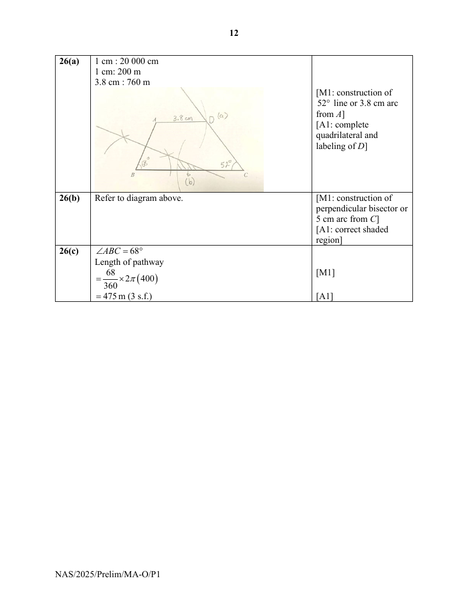

# Ngee Ann Secondary School — Mathematics Paper 1 Marking Scheme (cleaned)

> **Institution:** Ngee Ann Secondary School
> **Exam:** Preliminary Examination 2025
> **Level:** Secondary 4 and 5
> **Subjects:** Mathematics
> **Paper:** 4052/01 Paper 1 Marking Scheme
> **Date:** 27 August 2025
> **Duration:** 2 hours 15 minutes
> **Total Marks:** 90
> **Source:** `NASS 2025 EMATH PRELIM P1 MS.pdf` (digital PDF — cleaned & reformatted)

---

## Answer all the questions

### Q1

> **Marks:** [B1]; total 1
> **Sub-topic:** Inequalities
> **Page:** 3

Number line showing $-2.5\leq x<6$. [B1]

---

### Q2

> **Marks:** [B1; no mark for $-1.88$]; total 1
> **Sub-topic:** Linear equations
> **Page:** 3

$$
-8x-9=6
$$

$$
-8x=15
$$

$$
x=-\frac{15}{8}\text{ or }-1\frac{7}{8}\text{ or }-1.875
$$

---

### Q3

> **Marks:** [M1], [A1]; total 2
> **Sub-topic:** Compound percentage
> **Page:** 3

$$
2410\left(1+\frac{r}{100}\right)^{6}=2660
$$

$$
\left(1+\frac{r}{100}\right)^{6}=\frac{2660}{2410}
$$

$$
1+\frac{r}{100}=\left(\frac{2660}{2410}\right)^{\frac{1}{6}}
$$

$$
\frac{r}{100}=\left(\frac{2660}{2410}\right)^{\frac{1}{6}}-1
$$

$$
r=100\times\left[\left(\frac{2660}{2410}\right)^{\frac{1}{6}}-1\right]
$$

$$
=1.66\text{ (3 s.f.)}
$$

---

### Q4

> **Marks:** (a) [B1]; (b) [B1; accept $5.05\times 10^{-3}$ and allow for ecf]; total 2
> **Sub-topic:** Significant figures and standard form
> **Page:** 4

**(a)** $0.0050500$ (5 s.f.)

**(b)** $5.0500\times 10^{-3}$

---

### Q5

> **Marks:** [M1], [A1]; total 2
> **Sub-topic:** Factors and cuboids
> **Page:** 4

$$
600=2^{3}\times 3\times 5^{2}
$$

For the base area to be a square, possible dimensions are $2\times 2\times 150$, $5\times 5\times 24$ or $(2\times 5)\times(2\times 5)\times 6$.

Smallest possible height is 6 cm.

---

### Q6

> **Marks:** (a) [M1; for $72^{\circ}\pm 1^{\circ}$], [A1]; (b) [B1; for underlined response. Accept any reasonable response]; total 3
> **Sub-topic:** Pie charts
> **Page:** 5

**(a)**

$$
\frac{72}{360}\times 160000=&#36;32000
$$

**(b)** The family’s annual income in 2024 might be less than that in 2023, such that even though they spent a great proportion of their income on food in 2024 ($25\%$ compared to $\dfrac{72}{360}\times 100\%=20\%$), the total amount spent on food in 2024 might be less than that in 2023.

---

### Q7

> **Marks:** (a) [M1], [A1]; (b) [M1], [A1]; total 4
> **Sub-topic:** Algebraic expansion and factorisation
> **Page:** 6

**(a)**

$$
-(5x-2y)(-3x+4y)
$$

$$
=(-5x+2y)(-3x+4y)\text{ or }-(-15x^{2}+20xy+6xy-8y^{2})
$$

$$
=15x^{2}-20xy-6xy+8y^{2}
$$

$$
=15x^{2}-26xy+8y^{2}
$$

**(b)**

$$
9ab-12ac+28bc-21b^{2}
$$

$$
=3a(3b-4c)-7b(3b-4c)\text{ or }3a(3b-4c)+7b(4c-3b)
$$

$$
=(3b-4c)(3a-7b)
$$

---

### Q8

> **Marks:** (a) [B1]; (b) [B1], [B1; must explain that $(0, 1)$ does not lie on the line in part (a). Accept any reasonable response]; total 3
> **Sub-topic:** Straight-line graphs
> **Page:** 6

**(a)**

$$
2y=3-6x
$$

$$
y=-3x+\frac{3}{2}
$$

Gradient is $-3$.

**(b)** The line in part (a) is parallel to the line in part (b) since they have the same gradient.

Also, for the line in part (a), when $x=0$, $y=\dfrac{3}{2}$.

The point $(0, 1)$ does not lie on the line in part (a).

Therefore, the two lines will not intersect.

---

### Q9

> **Marks:** (a) [M1], [A1]; (b) [B1; alternative method: use Cosine Rule to find angle $BDC$ exactly $90^{\circ}$. Must be two separate lines of working]; total 3
> **Sub-topic:** Pythagoras’ theorem
> **Page:** 7

**(a)**

$$
BC=\sqrt{4^{2}-3^{2}}
$$

$$
=\sqrt{7}
$$

$$
=2.65\text{ cm (3 s.f.)}
$$

**(b)**

$$
BC^{2}=(\sqrt{7})^{2}=7
$$

$$
BD^{2}+CD^{2}=(2)^{2}+(\sqrt{3})^{2}=7
$$

Since $BC^{2}=BD^{2}+CD^{2}$, by the Converse of Pythagoras’ Theorem, triangle $BCD$ is right-angled.

---

### Q10

> **Marks:** [B1: for numerator], [B1: for denominator], [B1]; total 3
> **Sub-topic:** Algebraic fractions
> **Page:** 8

$$
\frac{4x^{2}+19x-30}{32x^{3}-50x}
$$

$$
=\frac{(4x-5)(x+6)}{2x(4x-5)(4x+5)}\text{ or }\frac{(4x-5)(x+6)}{x(4x-5)(8x+10)}
$$

$$
=\frac{x+6}{2x(4x+5)}
$$

---

### Q11

> **Marks:** [M1: removing denominator], [M1: expand $(x-3)(2-3x)$ correctly], [A1]; total 3
> **Sub-topic:** Algebraic fractions
> **Page:** 8

$$
\frac{x-3}{3}-\frac{1-x^{2}}{2-3x}=1
$$

$$
(x-3)(2-3x)-3(1-x^{2})=3(2-3x)
$$

$$
2x-3x^{2}-6+9x-3+3x^{2}=6-9x
$$

$$
11x-9=6-9x
$$

$$
20x=15
$$

$$
x=\frac{3}{4}\text{ or }0.75
$$

---

### Q12

> **Marks:** [M1], [M1], [A1]; total 3
> **Sub-topic:** Interior angles of polygons
> **Page:** 9

Each interior angle of pentagon

$$
=\frac{(5-2)\times 180}{5}=108^{\circ}
$$

Each interior angle of octagon

$$
=\frac{(8-2)\times 180}{8}=135^{\circ}
$$

Sum of angles of $a$, $b$ and $c$

$$
=(360-108)+2(360-108-135)
$$

$$
=486^{\circ}
$$

---

### Q13

> **Marks:** [M1], [A1]; total 2
> **Sub-topic:** Direct proportion
> **Page:** 10

$$
d=kt^{2}
$$

$$
320=k(8)^{2}
$$

$$
k=\frac{320}{64}=5
$$

$$
80=5t^{2}
$$

$$
t^{2}=\frac{80}{5}=16
$$

$$
t=\pm 4
$$

$$
t=4\text{ or }-4\text{ (N.A.)}
$$

$$
t=4
$$

---

### Q14

> **Marks:** [M1], [M1], [M1], [A1]; total 4
> **Sub-topic:** Ratio
> **Page:** 11

Let the amount of money shared by $&#36;x$.

Amy’s original share: $\dfrac{2}{9}x$

Amy’s final share: $\dfrac{3}{4}\left(\dfrac{2}{9}x\right)=\dfrac{1}{6}x$

Amy’s transferred share: $\dfrac{1}{4}\left(\dfrac{2}{9}x\right)=\dfrac{1}{18}x$

Ben’s original share: $\dfrac{3}{9}x=\dfrac{1}{3}x$

Ben’s final share: $\dfrac{2}{3}\left(\dfrac{1}{3}x+\dfrac{1}{18}x\right)=\dfrac{7}{27}x$

Ben’s transferred share: $\dfrac{1}{3}\left(\dfrac{1}{3}x+\dfrac{1}{18}x\right)=\dfrac{7}{54}x$

Cal’s original share: $\dfrac{4}{9}x$

Cal’s final share: $\dfrac{4}{9}x+\dfrac{7}{54}x=\dfrac{31}{54}x$

Final ratio

$$
=\frac{1}{6}x:\frac{7}{27}x:\frac{31}{54}x
$$

$$
=9:14:31
$$

---

### Q15

> **Marks:** (a) [M1], [A1]; (b) [B1: must mention outlier of 50 points. Accept any reasonable response]; total 3
> **Sub-topic:** Mean and median
> **Page:** 12

**(a)**

$$
15\times 5.8=5\times 14.4+10x
$$

$$
10x=15
$$

$$
x=1.5
$$

**(b)** Median would be more appropriate because the mean would be affected by the outlier of 50 points.
The player who scored 50 points contributed about $69\%$ of all points scored by starting players.

---

### Q16

> **Marks:** (a) [B1]; (b) [M1], [A1]; total 3
> **Sub-topic:** Area of rhombus and kite
> **Page:** 13

**(a)** $AC=2a$

$BD=2d$

Area of rhombus

$$
=\frac{1}{2}(2a\times 2d)=2ad
$$

**(b)** Area of triangle $PQS$

$$
=\frac{1}{2}(x\times 2y)=xy
$$

$MR=3x$

Area of triangle $RQS$

$$
=\frac{1}{2}(3x\times 2y)=3xy
$$

Area of kite

$$
=xy+3xy=4xy
$$

---

### Q17

> **Marks:** (a) [M1: for either $\frac{1}{5}$, $x^{-1}$, $y^{-2}$], [A1]; (b) [M1: for getting $3^{5a}$ or $3^{9}$], [A1]; total 4
> **Sub-topic:** Indices
> **Page:** 14

**(a)**

$$
\left(\frac{625x^{4}}{y^{8}}\right)^{-\frac{1}{4}}
$$

$$
=5^{-1}x^{-1}y^{2}
$$

$$
=\frac{y^{2}}{5x}
$$

**(b)**

$$
243^{a}=3^{8}+3^{8}+3^{8}
$$

$$
3^{5a}=3^{8}(1+1+1)
$$

$$
3^{5a}=3^{8}(3)
$$

$$
3^{5a}=3^{9}
$$

By comparing indices,

$$
5a=9
$$

$$
a=\frac{9}{5}\text{ or }1\frac{4}{5}\text{ or }1.8
$$

---

### Q18

> **Marks:** (a) [B1: for highlighted part]; (b) [B1]; (c) [B1]; (d) [C1: correct shape], [P1: correct coordinates for $x$-intercepts and min pt; must be coordinates]; total 5
> **Sub-topic:** Quadratic graphs
> **Page:** 15

**(a)** When $x\neq h$, $(x-h)^{2}>0$ and $y=(x-h)^{2}+k>k$.

When $x=h$, $(x-h)^{2}=0$ and $y=(x-h)^{2}+k=k$. (Or mention that coeff of $x^{2}$ is positive)

So, $y$ has its minimum value of $k$ when $x=h$.

**(b)** Since the graph of $y=(x-h)^{2}+k$ is symmetrical about the vertical line passing through its minimum point,

$$
h=\frac{-2+4}{2}
$$

$$
h=1\text{ (shown)}
$$

**(c)** Sub $x=4$, $y=0$, $h=1$,

$$
0=(4-1)^{2}+k
$$

$$
k=-9
$$

Min. value of $y$ is $-9$.

**(d)**

---

### Q19

> **Marks:** (a) [B1: one correct term], [B1: all terms correct]; (b) [B1]; (c) [B1: must show factorization]; total 4
> **Sub-topic:** Linear sequences
> **Page:** 16

**(a)** When $n=1$, $\dfrac{3}{2}(1)(1-3)=-3$

So, $T_{1}=-3$

When $n=2$, $\dfrac{3}{2}(2)(2-3)=-3$

So, $T_{1}+T_{2}=-3$

$$
-3+T_{2}=-3
$$

$$
T_{2}=0
$$

When $n=3$, $\dfrac{3}{2}(3)(3-3)=0$

So, $T_{1}+T_{2}+T_{3}=0$

$$
-3+0+T_{3}=0
$$

$$
T_{3}=3
$$

First 3 terms: $-3$, $0$, $3$

**(b)** $T_{1}=-3$

Common difference $=3$

$$
T_{n}=-6+3n
$$

**(c)** Since $T_{n}=-6+3n=3(n-2)$, each term in the sequence is a multiple of 3.

---

### Q20

> **Marks:** [B1: with reason], [B1: with reason for tan $\perp$ rad], [A1]; total 4
> **Sub-topic:** Circle theorems
> **Page:** 17

$$
\angle CDA=180^{\circ}-119^{\circ}\text{ ($\angle$s in opp. segments)}
$$

$$
=61^{\circ}
$$

$$
\angle OAT=90^{\circ}\text{ (tan $\perp$ rad)}
$$

$$
\angle OAD=29^{\circ}\text{ (base $\angle$s of isos. $\triangle$)}
$$

So, $\angle DAT=90^{\circ}-29^{\circ}$

$$
=61^{\circ}
$$

Since $\angle CDA=\angle DAT$, they are alternate angles and lines $CD$ and $ST$ are parallel.

---

### Q21

> **Marks:** (a)(i) [B1]; (a)(ii) [B1]; (b)(i) [B1: do not accept $\{12, 16\}$]; (b)(ii) [B1]; total 4
> **Sub-topic:** Sets and Venn diagrams
> **Page:** 18

**(a)(i)** $A'\cap B'=\{0, 4, 6, 8, 10\}$

**(a)(ii)**

**(b)(i)** $12$, $16$

**(b)(ii)** $P=\{16\}$

$Q=\phi$

$R=\{12, 16\}$

So, $(P\cup Q)\cap R'=\phi$

$$
\therefore \mathrm{n}\left[(P\cup Q)\cap R'\right]=0
$$

---

### Q22

> **Marks:** Method 1 [M1], [M1], [M1], [A1]; Method 2 [M1], [M1], [M1], [A1]; total 4
> **Sub-topic:** Angles of elevation
> **Page:** 19

**Method 1**

Let distance $QF$ be $x$ m.

$$
\tan 20.8^{\circ}=\frac{TF}{20+x}
$$

$$
(20+x)\tan 20.8^{\circ}=TF
$$

$$
x=\frac{TF-20\tan 20.8^{\circ}}{\tan 20.8^{\circ}}
$$

$$
\tan 21.7^{\circ}=\frac{TF}{x}
$$

$$
x=\frac{TF}{\tan 21.7^{\circ}}
$$

So,

$$
\frac{TF-20\tan 20.8^{\circ}}{\tan 20.8^{\circ}}=\frac{TF}{\tan 21.7^{\circ}}
$$

$$
TF\tan 21.7^{\circ}-20\tan 20.8^{\circ}\tan 21.7^{\circ}=TF\tan 20.8^{\circ}
$$

$$
TF\tan 21.7^{\circ}-TF\tan 20.8^{\circ}=20\tan 20.8^{\circ}\tan 21.7^{\circ}
$$

$$
TF(\tan 21.7^{\circ}-\tan 20.8^{\circ})=20\tan 20.8^{\circ}\tan 21.7^{\circ}
$$

$$
TF=\frac{20\tan 20.8^{\circ}\tan 21.7^{\circ}}{\tan 21.7^{\circ}-\tan 20.8^{\circ}}
$$

$$
=167\text{ m (3 s.f.)}
$$

**Method 2**

$$
\angle PQT=180^{\circ}-21.7^{\circ}\text{ (adj $\angle$s on a st. line)}
$$

$$
=158.3^{\circ}
$$

$$
\angle PTQ=180^{\circ}-158.3^{\circ}-20.8^{\circ}\text{ ($\angle$ sum of $\triangle$)}
$$

$$
=0.9^{\circ}
$$

By Sine Rule,

$$
\frac{PT}{\sin 158.3^{\circ}}=\frac{20}{\sin 0.9^{\circ}}
$$

$$
PT=\frac{20\sin 158.3^{\circ}}{\sin 0.9^{\circ}}
$$

$$
=470.79555
$$

$$
\sin 20.8^{\circ}=\frac{TF}{470.79555}
$$

$$
TF=470.79555\sin 20.8^{\circ}
$$

$$
=167\text{ m (3 s.f.)}
$$

---

### Q23

> **Marks:** (a) [B1]; (b) [B2: B1 for each of the element]; (c) [B1: not necessary to state the values of the elements; do not accept the term “earnings”]; (d) [B1]; total 5
> **Sub-topic:** Matrices
> **Page:** 20

**(a)**

$$
P=\begin{pmatrix}5&4&6\\ 8&7&9\end{pmatrix}
$$

**(b)**

$$
T=\begin{pmatrix}5&4&6\\ 8&7&9\end{pmatrix}\begin{pmatrix}120\\ 80\\ 100\end{pmatrix}
$$

$$
=\begin{pmatrix}1520\\ 2420\end{pmatrix}
$$

**(c)** The elements in $T$ represent the total cost (&#36;1520) and the total revenue (&#36;2420; or selling price) respectively of the cakes sold by the shop in July.

**(d)** $Q=(-1\quad 1)$

---

### Q24

> **Marks:** (a) [B1]; (b) [M1], [A1]; (c) [M1], [M1], [M1], [A1]; total 7
> **Sub-topic:** Volume of cone and frustum
> **Page:** 22–23

**(a)** Volume of one cup

$$
=\frac{1}{3}\pi\left(\frac{6.9}{2}\right)^{2}(9.1)
$$

$$
=113.4248
$$

$$
=113\text{ cm}^{3}\text{ (3 s.f.)}
$$

**(b)** $18.9\text{ l}=18\,900\text{ cm}^{3}$

Max number of cups

$$
=\frac{18900}{113.4248}
$$

$$
=166.63
$$

$=166$ cups that are completely filled

**(c)** Let the curved surface area of smaller cone (i.e. cup) be $A_{1}$, $t$ and that of larger cone (i.e. cup + frustrum) be $A_{2}$.

By similar cones,

$$
\left(\frac{d_{2}}{d_{1}}\right)^{2}=\frac{A_{2}}{A_{1}}=2
$$

$$
\frac{d_{2}}{d_{1}}=\sqrt{2}
$$

$$
\frac{V_{2}}{V_{1}}=\left(\frac{d_{2}}{d_{1}}\right)^{3}
$$

$$
=(\sqrt{2})^{3}
$$

$$
V_{2}=(\sqrt{2})^{3}\times 113.4248
$$

$$
=320.81378
$$

Volume of frustrum shaped cup

$$
=320.81378-113.4248
$$

$$
=207\text{ cm}^{3}\text{ (3 s.f.)}
$$

---

### Q25

> **Marks:** (a) [B1]; (b) [B1: student must provide an example where the mode is 0 or 1]; (c)(i) [B1]; (c)(ii) [B1]; (c)(iii) [B1]; total 5
> **Sub-topic:** Dot diagram and probability
> **Page:** 24–25

**(a)** Position of median

$$
=\frac{22+1}{2}=11.5
$$

$$
\text{Median}=\frac{2+3}{2}=2.5
$$

**(b)** The student’s claim is true because there are 6 missing data in the dot diagram. If all the 6 students scored 0 goal (or 1 goal), the modal number of goals scored would be 0 (or 1) instead of 2.

**(c)(i)** $0$

**(c)(ii)** $\dfrac{4}{22}=\dfrac{2}{11}$

**(c)(iii)** $\dfrac{11}{22}=\dfrac{1}{2}$

---

### Q26

> **Marks:** (a) [M1: construction of $52^{\circ}$ line or 3.8 cm arc from $A$], [A1: complete quadrilateral and labeling of $D$]; (b) [M1: construction of perpendicular bisector or 5 cm arc from $C$], [A1: correct shaded region]; (c) [M1], [A1]; total 6
> **Sub-topic:** Scale drawing and loci
> **Page:** 26

**(a)** $1\text{ cm}:20\,000\text{ cm}$

$1\text{ cm}:200\text{ m}$

$3.8\text{ cm}:760\text{ m}$

**(b)** Refer to diagram above.

**(c)** $\angle ABC=68^{\circ}$

Length of pathway

$$
=\frac{68}{360}\times 2\pi(400)
$$

$$
=475\text{ m (3 s.f.)}
$$
