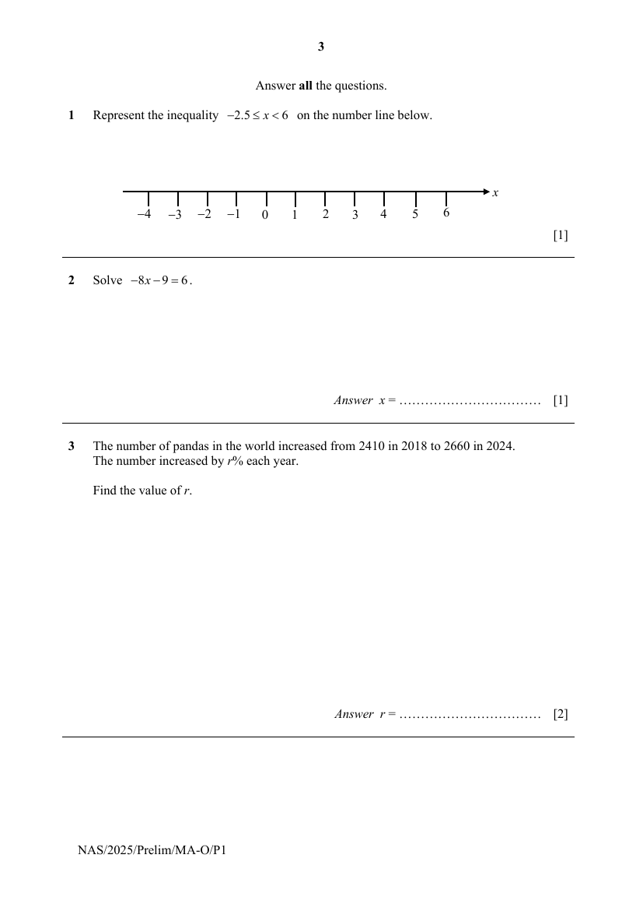
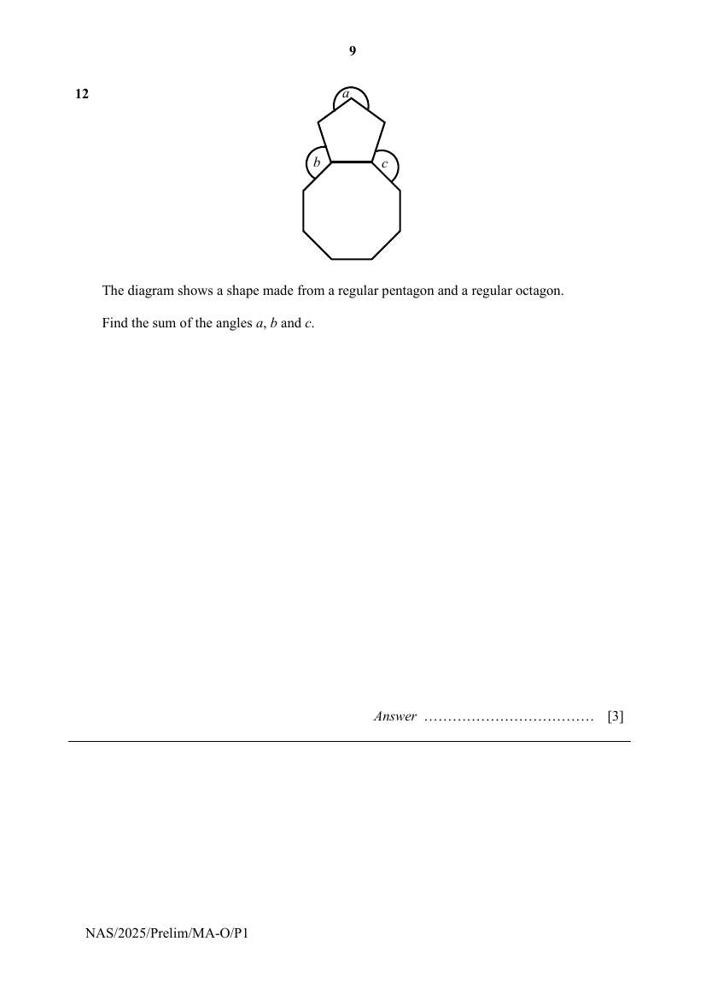

# Ngee Ann Secondary School — Mathematics 4052/01 Paper 1 (cleaned)

> **Institution:** Ngee Ann Secondary School
> **Exam:** Preliminary Examination 2025
> **Level:** Secondary 4 and 5
> **Subjects:** Mathematics
> **Paper:** 4052/01 Paper 1
> **Date:** 27 August 2025
> **Duration:** 2 hours 15 minutes
> **Total Marks:** 90
> **Source:** `NASS 2025 EMATH PRELIM P1 QP.pdf` (digital PDF — cleaned & reformatted)

---

## Instructions

Write your name, register number and class at the top of this page.
Write in dark blue or black pen.
You may use an HB pencil for any diagrams or graphs.
Do not use staples, paper clips, glue or correction fluid.

Answer all the questions.
The number of marks is given in brackets [ ] at the end of each question or part question.

If working is needed for any question it must be shown with the answer.
Omission of essential working will result in loss of marks.
The total of the marks for this paper is 90.

The use of an approved scientific calculator is expected, where appropriate.
If the degree of accuracy is not specified in the question, and if the answer is not exact, give the answer to three significant figures. Give answers in degrees to one decimal place.
For $\pi$, use either your calculator value or $3.142$.

---

## Mathematical Formulae

*Compound interest*

$$
\text{Total amount} = P\left(1+\frac{r}{100}\right)^{n}
$$

*Geometry and Measurement*

$$
\text{Curved surface area of a cone} = \pi rl
$$

$$
\text{Surface area of a sphere} = 4\pi r^{2}
$$

$$
\text{Volume of a cone} = \frac{1}{3}\pi r^{2}h
$$

$$
\text{Volume of a sphere} = \frac{4}{3}\pi r^{3}
$$

$$
\text{Area of a triangle } ABC = \frac{1}{2}ab\sin C
$$

$$
\text{Arc length} = r\theta,\text{ where }\theta\text{ is in radians}
$$

$$
\text{Sector area} = \frac{1}{2}r^{2}\theta,\text{ where }\theta\text{ is in radians}
$$

*Trigonometry*

$$
\frac{a}{\sin A} = \frac{b}{\sin B} = \frac{c}{\sin C}
$$

$$
a^{2} = b^{2}+c^{2}-2bc\cos A
$$

*Statistics*

$$
\text{Mean} = \frac{\sum fx}{\sum f}
$$

$$
\text{Standard deviation} = \sqrt{\frac{\sum fx^{2}}{\sum f}-\left(\frac{\sum fx}{\sum f}\right)^{2}}
$$

---

## Answer all the questions

### Q1

> **Marks:** 1
> **Topic:** N7 Equations and inequalities
> **Sub-topic:** Equations and inequalities
> **LO:** [[context/subjects/o-level-e-maths/learning-objectives/o-level-e-maths-N7g.md|N7g]]
> **Page:** 3

Represent the inequality $-2.5 \leq x < 6$ on the number line below. [1]

---

### Q2

> **Marks:** 1
> **Topic:** N7 Equations and inequalities
> **Sub-topic:** Equations and inequalities
> **LO:** [[context/subjects/o-level-e-maths/learning-objectives/o-level-e-maths-N7f.md|N7f]]
> **Page:** 3

Solve $-8x-9=6$. [1]

---

### Q3

> **Marks:** 2
> **Topic:** N3 Percentage
> **Sub-topic:** Percentage
> **LO:** [[context/subjects/o-level-e-maths/learning-objectives/o-level-e-maths-N3d.md|N3d]]
> **Page:** 3

The number of pandas in the world increased from 2410 in 2018 to 2660 in 2024.
The number increased by $r\%$ each year.

Find the value of $r$. [2]

---

### Q4

> **Marks:** (a) 1, (b) 1; total 2
> **Page:** 4

**(a)** Calculate $\dfrac{18.73-9.85}{12.07^{3}}$.
Write your answer correct to 5 significant figures. [1]
> **Topic:** N1 Numbers and their operations
> **Sub-topic:** Numbers and their operations
> **LO:** [[context/subjects/o-level-e-maths/learning-objectives/o-level-e-maths-N1g.md|N1g]]

**(b)** Write your answer to part (a) in standard form. [1]
> **Topic:** N1 Numbers and their operations
> **Sub-topic:** Numbers and their operations
> **LO:** [[context/subjects/o-level-e-maths/learning-objectives/o-level-e-maths-N1g.md|N1g]]

---

### Q5

> **Marks:** 2
> **Topic:** G5 Mensuration
> **Sub-topic:** Mensuration
> **LO:** [[context/subjects/o-level-e-maths/learning-objectives/o-level-e-maths-G5b.md|G5b]]
> **Page:** 4

James has 600 one-centimetre cubes.
He arranges all the cubes into a cuboid such that the base area of the cuboid is a square.

Find the smallest possible height of the cuboid. [2]

---

### Q6

> **Marks:** (a) 2, (b) 1; total 3
> **Page:** 5

The accurate pie charts show how a family spent their annual income in 2023 and 2024.

**(a)** The family’s annual income in 2023 was &#36;160 000.

Find the amount of money the family spent on food in 2023. [2]
> **Topic:** S1 Data handling and analysis
> **Sub-topic:** Data handling and analysis
> **LO:** [[context/subjects/o-level-e-maths/learning-objectives/o-level-e-maths-S1b.md|S1b]]

**(b)** ‘The family spent more money on food in 2024 than in 2023.’

Explain why this statement might be false. [1]
> **Topic:** S1 Data handling and analysis
> **Sub-topic:** Data handling and analysis
> **LO:** [[context/subjects/o-level-e-maths/learning-objectives/o-level-e-maths-S1b.md|S1b]]

---

### Q7

> **Marks:** (a) 2, (b) 2; total 4
> **Page:** 6

**(a)** Expand and simplify $-(5x-2y)(-3x+4y)$. [2]
> **Topic:** N5 Algebraic expressions and formulae
> **Sub-topic:** Algebraic expressions and formulae
> **LO:** [[context/subjects/o-level-e-maths/learning-objectives/o-level-e-maths-N5j.md|N5j]]

**(b)** Factorise completely $9ab-12ac+28bc-21b^{2}$. [2]
> **Topic:** N5 Algebraic expressions and formulae
> **Sub-topic:** Algebraic expressions and formulae
> **LO:** [[context/subjects/o-level-e-maths/learning-objectives/o-level-e-maths-N5h.md|N5h]]

---

### Q8

> **Marks:** (a) 1, (b) 2; total 3
> **Page:** 6

**(a)** The equation of a straight line is $2y=3-6x$.

Find the gradient of the line. [1]
> **Topic:** G6 Coordinate geometry
> **Sub-topic:** Coordinate geometry
> **LO:** [[context/subjects/o-level-e-maths/learning-objectives/o-level-e-maths-G6c.md|G6c]]

**(b)** Another line has gradient $-3$ and passes through the point $(0, 1)$.

Explain why this line will not intersect the line in part (a). [2]
> **Topic:** G6 Coordinate geometry
> **Sub-topic:** Coordinate geometry
> **LO:** [[context/subjects/o-level-e-maths/learning-objectives/o-level-e-maths-G6c.md|G6c]]

---

### Q9

> **Marks:** (a) 2, (b) 1; total 3
> **Page:** 7

The quadrilateral $ABCD$ is made up of two triangles, triangle $ABC$ and triangle $BCD$.
$AB = 3$ cm, $AC = 4$ cm, $BD = 2$ cm, $CD = \sqrt{3}$ cm and angle $ABC = 90^{\circ}$.

**(a)** Find the length of $BC$. [2]
> **Topic:** G4 Pythagoras' theorem and trigonometry
> **Sub-topic:** Pythagoras' theorem and trigonometry
> **LO:** [[context/subjects/o-level-e-maths/learning-objectives/o-level-e-maths-G4a.md|G4a]]

**(b)** Is triangle $BCD$ right-angled?
Show your working clearly. [1]
> **Topic:** G4 Pythagoras' theorem and trigonometry
> **Sub-topic:** Pythagoras' theorem and trigonometry
> **LO:** [[context/subjects/o-level-e-maths/learning-objectives/o-level-e-maths-G4a.md|G4a]]

---

### Q10

> **Marks:** 3
> **Topic:** N7 Equations and inequalities
> **Sub-topic:** Equations and inequalities
> **LO:** [[context/subjects/o-level-e-maths/learning-objectives/o-level-e-maths-N7b.md|N7b]]
> **Page:** 8

Simplify $\dfrac{4x^{2}+19x-30}{32x^{3}-50x}$. [3]

---

### Q11

> **Marks:** 3
> **Topic:** N7 Equations and inequalities
> **Sub-topic:** Equations and inequalities
> **LO:** [[context/subjects/o-level-e-maths/learning-objectives/o-level-e-maths-N7b.md|N7b]]
> **Page:** 8

Solve $\dfrac{x-3}{3}-\dfrac{1-x^{2}}{2-3x}=1$. [3]

---

### Q12

> **Marks:** 3
> **Topic:** G1 Angles, triangles and polygons
> **Sub-topic:** Angles, triangles and polygons
> **LO:** [[context/subjects/o-level-e-maths/learning-objectives/o-level-e-maths-G1f.md|G1f]]
> **Page:** 9

The diagram shows a shape made from a regular pentagon and a regular octagon.

Find the sum of the angles $a$, $b$ and $c$. [3]

---

### Q13

> **Marks:** 2
> **Topic:** N2 Ratio and proportion
> **Sub-topic:** Ratio and proportion
> **LO:** [[context/subjects/o-level-e-maths/learning-objectives/o-level-e-maths-N2a.md|N2a]]
> **Page:** 10

When a ball is dropped, the distance, $d$ metres, it falls is directly proportional to the square of the time, $t$ seconds, from when the ball is released.
A ball falls 320 metres in the first 8 seconds.

How long does it take for the ball to fall 80 metres? [2]

---

### Q14

> **Marks:** 4
> **Topic:** N2 Ratio and proportion
> **Sub-topic:** Ratio and proportion
> **LO:** [[context/subjects/o-level-e-maths/learning-objectives/o-level-e-maths-N2a.md|N2a]]
> **Page:** 11

Amy, Ben and Cal share some money in the ratio $2:3:4$.
Amy gives $\dfrac{1}{4}$ of her share to Ben.
Ben then gives $\dfrac{1}{3}$ of his new amount to Cal.

Find the final ratio of the share of money between Amy, Ben and Cal. [4]

---

### Q15

> **Marks:** (a) 2, (b) 1; total 3
> **Page:** 12

The table shows data from a basketball match for a team of 15 players.

| Players | No. of Players | Mean Points Scored Per Player |
|---|---|---|
| Starting Players | 5 | 14.4 |
| Non-Starting Players | 10 | $x$ |
| All Players | 15 | 5.8 |

**(a)** Find the mean number of points, $x$, scored by each non-starting player. [2]
> **Topic:** S1 Data handling and analysis
> **Sub-topic:** Data handling and analysis
> **LO:** [[context/subjects/o-level-e-maths/learning-objectives/o-level-e-maths-S1f.md|S1f]]

**(b)** One of the starting players scored 50 points in the match.

State, with explanation, whether mean or median would be more appropriate to represent a typical starting player's scoring contribution. [1]
> **Topic:** S1 Data handling and analysis
> **Sub-topic:** Data handling and analysis
> **LO:** [[context/subjects/o-level-e-maths/learning-objectives/o-level-e-maths-S1f.md|S1f]]

---

### Q16

> **Marks:** (a) 1, (b) 2; total 3
> **Page:** 13

**(a)** The diagram shows a rhombus $ABCD$.
The diagonals of the rhombus intersect at the point $O$.
$OA = a$ cm and $OD = d$ cm.

Find the area of the rhombus in terms of $a$ and $d$. [1]
> **Topic:** G5 Mensuration
> **Sub-topic:** Mensuration
> **LO:** [[context/subjects/o-level-e-maths/learning-objectives/o-level-e-maths-G5b.md|G5b]]

**(b)** The diagram shows a kite $PQRS$.
The diagonals of the kite intersect at the point $M$.
$PM = x$ cm and $QM = y$ cm.
$PM:PR = 1:4$.

Find the area of the kite in terms of $x$ and $y$. [2]
> **Topic:** G5 Mensuration
> **Sub-topic:** Mensuration
> **LO:** [[context/subjects/o-level-e-maths/learning-objectives/o-level-e-maths-G5b.md|G5b]]

---

### Q17

> **Marks:** (a) 2, (b) 2; total 4
> **Page:** 14

**(a)** Simplify $\left(\dfrac{625x^{4}}{y^{8}}\right)^{-\frac{1}{4}}$. [2]
> **Topic:** N1 Numbers and their operations
> **Sub-topic:** Numbers and their operations
> **LO:** [[context/subjects/o-level-e-maths/learning-objectives/o-level-e-maths-N1j.md|N1j]]

**(b)** $243^{a}=3^{8}+3^{8}+3^{8}$

Find the value of $a$. [2]
> **Topic:** N1 Numbers and their operations
> **Sub-topic:** Numbers and their operations
> **LO:** [[context/subjects/o-level-e-maths/learning-objectives/o-level-e-maths-N1j.md|N1j]]

---

### Q18

> **Marks:** (a) 1, (b) 1, (c) 1, (d) 2; total 5
> **Page:** 15

$$
y=(x-h)^{2}+k
$$

**(a)** Explain why $y$ has its minimum value when $x=h$. [1]
> **Topic:** N6 Functions and graphs
> **Sub-topic:** Functions and graphs
> **LO:** [[context/subjects/o-level-e-maths/learning-objectives/o-level-e-maths-N6c.md|N6c]]

**(b)** The roots of the equation $(x-h)^{2}+k=0$ are $-2$ and $4$.

Explain why the value of $h$ is $1$. [1]
> **Topic:** N6 Functions and graphs
> **Sub-topic:** Functions and graphs
> **LO:** [[context/subjects/o-level-e-maths/learning-objectives/o-level-e-maths-N6c.md|N6c]]

**(c)** Find the minimum value of $y$. [1]
> **Topic:** N6 Functions and graphs
> **Sub-topic:** Functions and graphs
> **LO:** [[context/subjects/o-level-e-maths/learning-objectives/o-level-e-maths-N6c.md|N6c]]

**(d)** Sketch the graph of $y$ on the axes below.
Indicate clearly the coordinates where the graph crosses the $x$-axis and the minimum point on the curve. [2]
> **Topic:** N6 Functions and graphs
> **Sub-topic:** Functions and graphs
> **LO:** [[context/subjects/o-level-e-maths/learning-objectives/o-level-e-maths-N6c.md|N6c]]

---

### Q19

> **Marks:** (a) 2, (b) 1, (c) 1; total 4
> **Page:** 16

The sum of the first $n$ terms of a linear sequence is $\dfrac{3}{2}n(n-3)$.

**(a)** Find the first 3 terms of the sequence. [2]
> **Topic:** N5 Algebraic expressions and formulae
> **Sub-topic:** Algebraic expressions and formulae
> **LO:** [[context/subjects/o-level-e-maths/learning-objectives/o-level-e-maths-N5e.md|N5e]]

**(b)** Find, in terms of $n$, an expression for the $n$th term of the sequence. [1]
> **Topic:** N5 Algebraic expressions and formulae
> **Sub-topic:** Algebraic expressions and formulae
> **LO:** [[context/subjects/o-level-e-maths/learning-objectives/o-level-e-maths-N5e.md|N5e]]

**(c)** Hence, explain why each term in the sequence is a multiple of 3. [1]
> **Topic:** N5 Algebraic expressions and formulae
> **Sub-topic:** Algebraic expressions and formulae
> **LO:** [[context/subjects/o-level-e-maths/learning-objectives/o-level-e-maths-N5e.md|N5e]]

---

### Q20

> **Marks:** 4
> **Topic:** G3 Properties of circles
> **Sub-topic:** Properties of circles
> **LO:** [[context/subjects/o-level-e-maths/learning-objectives/o-level-e-maths-G3b.md|G3b]]
> **Page:** 17

$A$, $B$, $C$ and $D$ are points on a circle, centre $O$.
$ST$ is a tangent to the circle at $A$.
Angle $ABC = 119^{\circ}$ and angle $ODA = 29^{\circ}$.

Determine if the lines $CD$ and $ST$ are parallel.
Give a reason for each step of your answer. [4]

---

### Q21

> **Marks:** (a)(i) 1, (a)(ii) 1, (b)(i) 1, (b)(ii) 1; total 4
> **Page:** 18

**(a)** The Venn diagram shows the elements of $\xi=\{\text{integers }x:0\leq x\leq 10\}$.

**(i)** Underline the correct statement from the list below.

$\mathrm{n}(\xi)=10$

$A\cup B=\{3, 5, 7\}$

$A'\cap B'=\{0, 4, 6, 8, 10\}$

$1\notin A\cap B'$

$(A\cap B)'=\{0, 4, 6, 8, 10\}$ [1]
> **Topic:** N8 Set language and notation
> **Sub-topic:** Set language and notation
> **LO:** [[context/subjects/o-level-e-maths/learning-objectives/o-level-e-maths-N8c.md|N8c]]

**(ii)** On the Venn diagram, shade the region which represents $(A\cup B)\cap(A\cap B)'$. [1]
> **Topic:** N8 Set language and notation
> **Sub-topic:** Set language and notation
> **LO:** [[context/subjects/o-level-e-maths/learning-objectives/o-level-e-maths-N8c.md|N8c]]

**(b)** $\xi=\{\text{integers }x:10<x\leq 20\}$.

$P=\{\text{perfect squares}\}$

$Q=\{\text{perfect cubes}\}$

$R=\{\text{factors of }48\}$

**(i)** List the elements in $R$. [1]
> **Topic:** N8 Set language and notation
> **Sub-topic:** Set language and notation
> **LO:** [[context/subjects/o-level-e-maths/learning-objectives/o-level-e-maths-N8c.md|N8c]]

**(ii)** Find the value of $\mathrm{n}\left[(P\cup Q)\cap R'\right]$. [1]
> **Topic:** N8 Set language and notation
> **Sub-topic:** Set language and notation
> **LO:** [[context/subjects/o-level-e-maths/learning-objectives/o-level-e-maths-N8c.md|N8c]]

---

### Q22

> **Marks:** 4
> **Topic:** G4 Pythagoras' theorem and trigonometry
> **Sub-topic:** Pythagoras' theorem and trigonometry
> **LO:** [[context/subjects/o-level-e-maths/learning-objectives/o-level-e-maths-G4g.md|G4g]]
> **Page:** 19

Florian wants to find the height of a hill.
He found that the angle of elevation of the peak of the hill, $T$, from a point $P$ on horizontal ground is $20.8^{\circ}$ and that from another point $Q$ is $21.7^{\circ}$.
$Q$ is 20 m closer to the hill than $P$.

Find the height of the hill in metres. [4]

---

### Q23

> **Marks:** (a) 1, (b) 2, (c) 1, (d) 1; total 5
> **Page:** 20

A shop sells three types of cakes: chocolate (C), lemon (L) and vanilla (V).
In July, they sold 120 chocolate cakes, 80 lemon cakes and 100 vanilla cakes.
Each chocolate cake costs &#36;5 to make and sells for &#36;8.
Each lemon cake costs &#36;4 to make and sells for &#36;7.
Each vanilla cake costs &#36;6 to make and sells for &#36;9.

**(a)** Represent this information in a $2\times 3$ matrix, $P$. [1]
> **Topic:** N9 Matrices
> **Sub-topic:** Matrices
> **LO:** [[context/subjects/o-level-e-maths/learning-objectives/o-level-e-maths-N9b.md|N9b]]

**(b)** Find the matrix $T=P\begin{pmatrix}120\\ 80\\ 100\end{pmatrix}$. [2]
> **Topic:** N9 Matrices
> **Sub-topic:** Matrices
> **LO:** [[context/subjects/o-level-e-maths/learning-objectives/o-level-e-maths-N9b.md|N9b]]

**(c)** State what each element of matrix $T$ represents. [1]
> **Topic:** N9 Matrices
> **Sub-topic:** Matrices
> **LO:** [[context/subjects/o-level-e-maths/learning-objectives/o-level-e-maths-N9b.md|N9b]]

**(d)** The element of the matrix $V$, where $V=QT$, represents the shop’s profit.

Write down the matrix $Q$. [1]
> **Topic:** N9 Matrices
> **Sub-topic:** Matrices
> **LO:** [[context/subjects/o-level-e-maths/learning-objectives/o-level-e-maths-N9b.md|N9b]]

---

### Q24

> **Marks:** (a) 1, (b) 2, (c) 4; total 7
> **Page:** 22–23

A company provides conical paper cups for its water dispenser.
Each cup has top diameter 6.9 cm and height 9.1 cm.

**(a)** Find the volume of one cup. [1]
> **Topic:** G5 Mensuration
> **Sub-topic:** Mensuration
> **LO:** [[context/subjects/o-level-e-maths/learning-objectives/o-level-e-maths-G5c.md|G5c]]

**(b)** The water dispenser has a capacity of 18.9 litres.

Find the maximum number of cups that can be completely filled with one full dispenser. [2]
> **Topic:** G5 Mensuration
> **Sub-topic:** Mensuration
> **LO:** [[context/subjects/o-level-e-maths/learning-objectives/o-level-e-maths-G5c.md|G5c]]

**(c)** The company considers replacing the conical cups with frustum-shaped cups.

The frustum will be formed by cutting off the top portion of a similar cone, such that its base diameter is 6.9 cm, same as the top diameter of the original cone.
The frustum-shaped cups will have the same curved surface area as the conical cups.

Find the volume of a frustum-shaped cup. [4]
> **Topic:** G5 Mensuration
> **Sub-topic:** Mensuration
> **LO:** [[context/subjects/o-level-e-maths/learning-objectives/o-level-e-maths-G5c.md|G5c]]

---

### Q25

> **Marks:** (a) 1, (b) 1, (c)(i) 1, (c)(ii) 1, (c)(iii) 1; total 5
> **Page:** 24–25

The number of goals scored by a team of 22 football players in a competition are shown in a dot diagram.
The number of goals ranges from 0 to 8.
The diagram below shows the dot diagram with a portion of it torn off.

**(a)** Find the median number of goals scored. [1]
> **Topic:** S2 Probability
> **Sub-topic:** Probability
> **LO:** [[context/subjects/o-level-e-maths/learning-objectives/o-level-e-maths-S2a.md|S2a]]

**(b)** A student claimed that the modal number of goals scored cannot be determined.

State whether the student’s claim is true or false.
Justify your answer clearly with reason. [1]
> **Topic:** S2 Probability
> **Sub-topic:** Probability
> **LO:** [[context/subjects/o-level-e-maths/learning-objectives/o-level-e-maths-S2a.md|S2a]]

**(c)** A player is randomly selected from the 22 players.

**(i)** Find the probability that the student scored 7 goals. [1]
> **Topic:** S2 Probability
> **Sub-topic:** Probability
> **LO:** [[context/subjects/o-level-e-maths/learning-objectives/o-level-e-maths-S2c.md|S2c]]

**(ii)** Find the probability that the player scored at least 5 goals. [1]
> **Topic:** S2 Probability
> **Sub-topic:** Probability
> **LO:** [[context/subjects/o-level-e-maths/learning-objectives/o-level-e-maths-S2c.md|S2c]]

**(iii)** Find the probability that the player scored at most 2 goals. [1]
> **Topic:** S2 Probability
> **Sub-topic:** Probability
> **LO:** [[context/subjects/o-level-e-maths/learning-objectives/o-level-e-maths-S2c.md|S2c]]

---

### Q26

> **Marks:** (a) 2, (b) 2, (c) 2; total 6
> **Page:** 26

A plot of land, $ABCD$, is to be used for a park.
$AD = 760$ m and angle $BCD = 52^{\circ}$.
The sides $AB$ and $BC$ are given below, based on a map scale of $1:20\,000$.

**(a)** On the diagram, construct the plot of land, $ABCD$. [2]
> **Topic:** N2 Ratio and proportion
> **Sub-topic:** Ratio and proportion
> **LO:** [[context/subjects/o-level-e-maths/learning-objectives/o-level-e-maths-N2c.md|N2c]]

**(b)** A café is to be built in the park such that it is nearer to point $B$ than $A$, and at most 1 km from $C$.

Using appropriate constructions, shade the region inside $ABCD$ where the café can be built. [2]
> **Topic:** N2 Ratio and proportion
> **Sub-topic:** Ratio and proportion
> **LO:** [[context/subjects/o-level-e-maths/learning-objectives/o-level-e-maths-N2c.md|N2c]]

**(c)** A pebbled pathway in the shape of a circular arc is to be built in the park such that every point along the pathway is 400 m from $B$.

Calculate the length of the pathway in metres. [2]
> **Topic:** N2 Ratio and proportion
> **Sub-topic:** Ratio and proportion
> **LO:** [[context/subjects/o-level-e-maths/learning-objectives/o-level-e-maths-N2c.md|N2c]]

---

End of Paper
