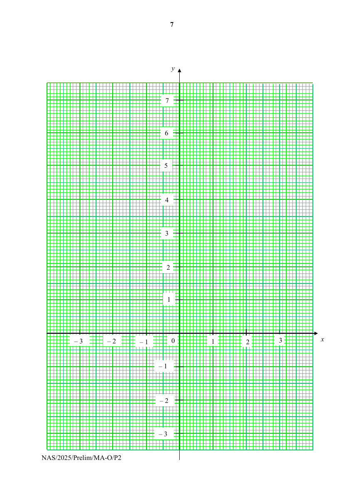
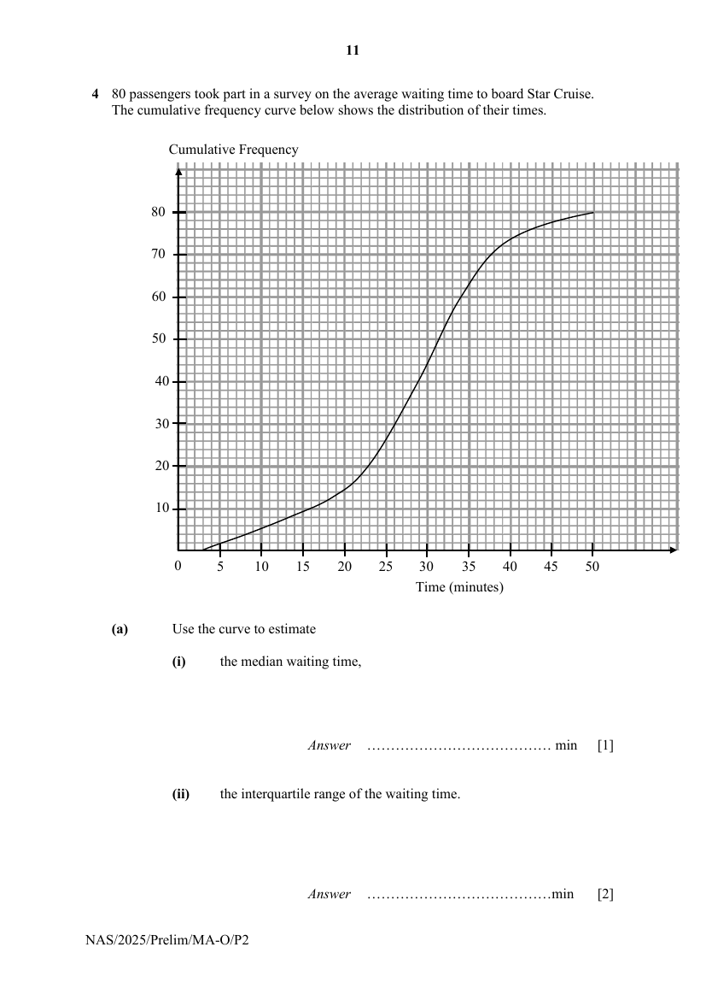
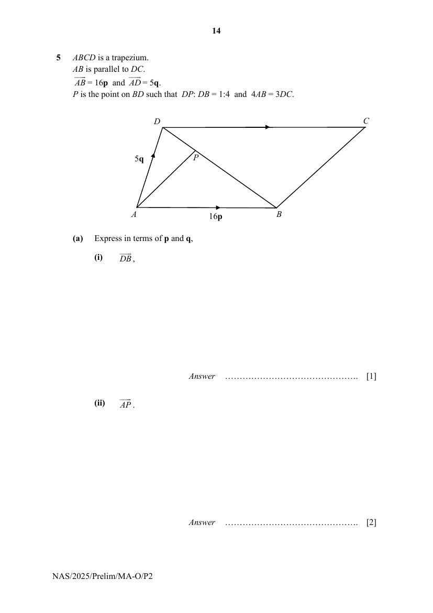
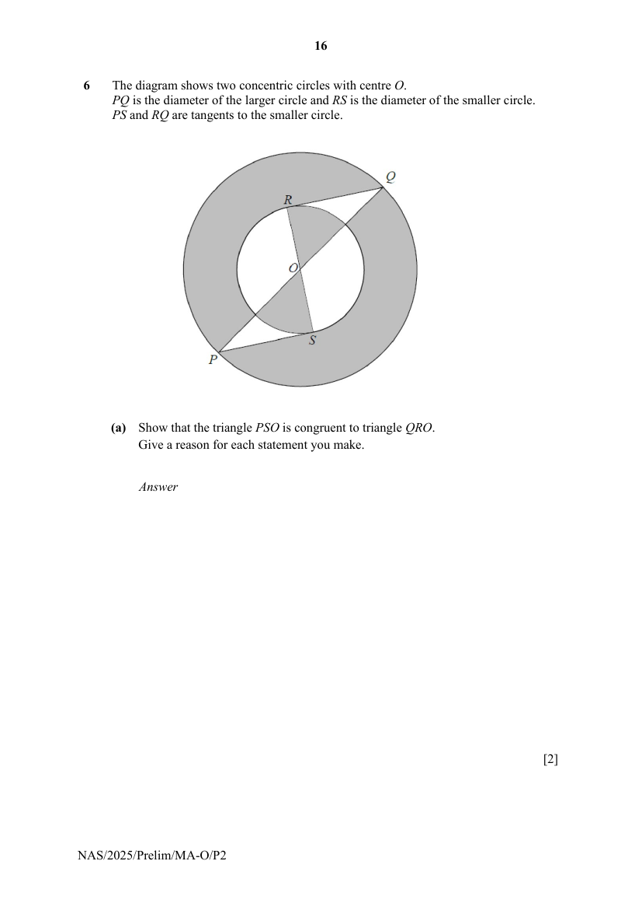
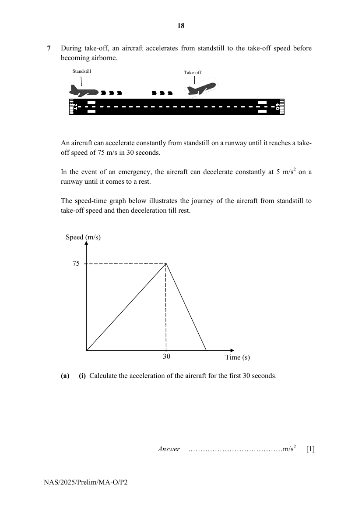
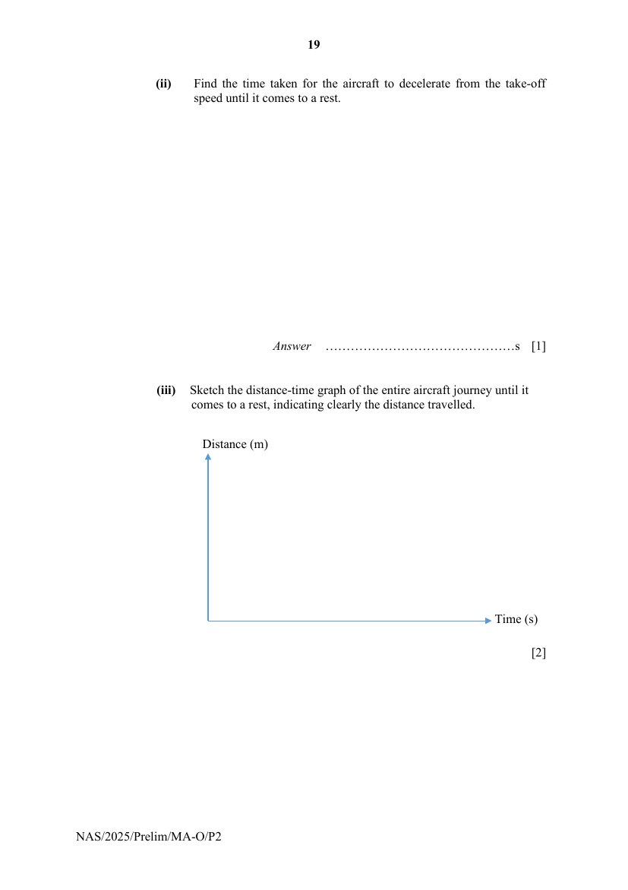
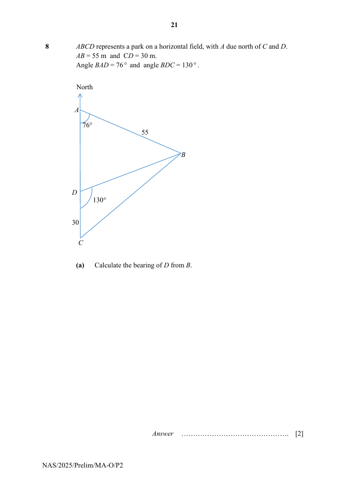
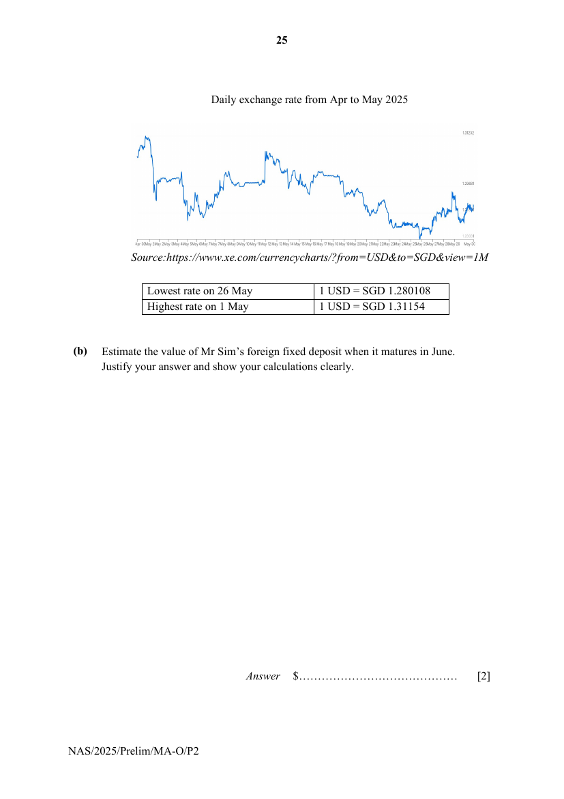

# Ngee Ann Secondary School — Mathematics 4052/02 Paper 2 (cleaned)

> **Institution:** Ngee Ann Secondary School
> **Exam:** Preliminary Examination 2025
> **Level:** Secondary 4 and 5
> **Subjects:** Mathematics
> **Paper:** 4052/02 Paper 2
> **Date:** 29 August 2025
> **Duration:** 2 hour 15 minutes
> **Total Marks:** 90
> **Source:** `NASS 2025 EMATH PRELIM P2 QP.pdf` (digital PDF — cleaned & reformatted)

---

## Instructions

Write your name, register number and class at the top of this page.
Write in dark blue or black pen.
You may use an HB pencil for any diagrams or graphs.
Do not use staples, paper clips, glue or correction fluid.

Answer all the questions.
Give non-exact numerical answers correct to 3 significant figures, or 1 decimal place in the case of angles in degrees, unless a different level of accuracy is specified in the question.
The use of an approved scientific calculator is expected, where appropriate.
You are reminded of the need for clear presentation in your answers.

The number of marks is given in brackets [ ] at the end of each question or part question.

The total number of marks for this paper is 90.

---

## Mathematical Formulae

*Compound Interest*

$$
\text{Total amount} = P\left(1+\frac{r}{100}\right)^{n}
$$

*Mensuration*

$$
\text{Curved surface area of a cone} = \pi rl
$$

$$
\text{Surface area of a sphere} = 4\pi r^{2}
$$

$$
\text{Volume of a cone} = \frac{1}{3}\pi r^{2}h
$$

$$
\text{Volume of a sphere} = \frac{4}{3}\pi r^{3}
$$

$$
\text{Area of triangle } ABC = \frac{1}{2}ab\sin C
$$

$$
\text{Arc length} = r\theta,\text{ where }\theta\text{ is in radians}
$$

$$
\text{Sector area} = \frac{1}{2}r^{2}\theta,\text{ where }\theta\text{ is in radians}
$$

*Trigonometry*

$$
\frac{a}{\sin A} = \frac{b}{\sin B} = \frac{c}{\sin C}
$$

$$
a^{2} = b^{2}+c^{2}-2bc\cos A
$$

*Statistics*

$$
\text{Mean} = \frac{\sum fx}{\sum f}
$$

$$
\text{Standard deviation} = \sqrt{\frac{\sum fx^{2}}{\sum f}-\left(\frac{\sum fx}{\sum f}\right)^{2}}
$$

---

## Answer all the questions

### Q1

> **Marks:** (a)(i) 2, (a)(ii) 3, (b) 3, (c) 3; total 11
> **Page:** 3–5

**(a)**

$$
x=\frac{3h^{2}(y+b)}{b}-1
$$

**(i)** Find $h$ when $b=5$, $x=2$ and $y=0$. [2]
> **Topic:** N1 Numbers and their operations
> **Sub-topic:** Numbers and their operations
> **LO:** [[context/subjects/o-level-e-maths/learning-objectives/o-level-e-maths-N1g.md|N1g]]

**(ii)** Rearrange the formula to make $b$ the subject. [3]
> **Topic:** N1 Numbers and their operations
> **Sub-topic:** Numbers and their operations
> **LO:** [[context/subjects/o-level-e-maths/learning-objectives/o-level-e-maths-N1g.md|N1g]]

**(b)** Solve these simultaneous equations.

$$
6x-3y=16
$$

$$
9x+2y=11
$$

[3]
> **Topic:** N1 Numbers and their operations
> **Sub-topic:** Numbers and their operations
> **LO:** [[context/subjects/o-level-e-maths/learning-objectives/o-level-e-maths-N1g.md|N1g]]

**(c)** Solve $\dfrac{19x+3}{2x^{2}-5x-3}+\dfrac{2}{x-3}=7$.
Give your solutions correct to two decimal places. [3]
> **Topic:** N1 Numbers and their operations
> **Sub-topic:** Numbers and their operations
> **LO:** [[context/subjects/o-level-e-maths/learning-objectives/o-level-e-maths-N1g.md|N1g]]

---

### Q2

> **Marks:** (a) 1, (b) 3, (c) 2, (d) 2, (e) 2; total 10
> **Page:** 6–8

**(a)** Complete the table of values for $y=2+\dfrac{5}{x}$. [1]
> **Topic:** N6 Functions and graphs
> **Sub-topic:** Functions and graphs
> **LO:** [[context/subjects/o-level-e-maths/learning-objectives/o-level-e-maths-N6j.md|N6j]]

| $x$ | $-3$ | $-2$ | $-1$ | $1$ | $1.5$ | $2$ | $3$ |
|---|---|---|---|---|---|---|---|
| $y$ | $0.3$ | $-0.5$ | $-3$ | $7$ |  | $4.5$ | $3.7$ |

**(b)** On the grid opposite, draw the graph of $y=2+\dfrac{5}{x}$ for $-3\leq x\leq 3$. [3]
> **Topic:** N6 Functions and graphs
> **Sub-topic:** Functions and graphs
> **LO:** [[context/subjects/o-level-e-maths/learning-objectives/o-level-e-maths-N6j.md|N6j]]

**(c)** The equation $2+\dfrac{5}{x}=t$ has no solution for $-3\leq x\leq 3$.
Given that $a<t<b$, use your graph to find the possible values of $a$ and $b$. [2]
> **Topic:** N6 Functions and graphs
> **Sub-topic:** Functions and graphs
> **LO:** [[context/subjects/o-level-e-maths/learning-objectives/o-level-e-maths-N6j.md|N6j]]

**(d)** By drawing a tangent, find the gradient of the curve at $x=2$. [2]
> **Topic:** G6 Coordinate geometry
> **Sub-topic:** Coordinate geometry
> **LO:** [[context/subjects/o-level-e-maths/learning-objectives/o-level-e-maths-G6c.md|G6c]]

**(e)** The points of intersection of the line $4y=5-x$ and the curve give the solutions of the equation $Ax^{2}-Bx+20=0$.

Find the value of $A$ and $B$. [2]
> **Topic:** N6 Functions and graphs
> **Sub-topic:** Functions and graphs
> **LO:** [[context/subjects/o-level-e-maths/learning-objectives/o-level-e-maths-N6j.md|N6j]]

---

### Q3

> **Marks:** (a) 1, (b) 1, (c) 2, (d) 3, (e) 1; total 8
> **Page:** 9–10

The front wheel of a tricycle has a circumference of $x$ cm.
The two rear wheels of the tricycle each has a circumference of 50 cm lesser than the front wheel. The tricycle travels 15 m.

**(a)** Write down an expression, in terms of $x$, for the number of revolutions that the front wheel makes. [1]
> **Topic:** N7 Equations and inequalities
> **Sub-topic:** Equations and inequalities
> **LO:** [[context/subjects/o-level-e-maths/learning-objectives/o-level-e-maths-N7d.md|N7d]]

**(b)** Write down an expression, in terms of $x$, for the number of revolutions that each rear wheel makes. [1]
> **Topic:** N7 Equations and inequalities
> **Sub-topic:** Equations and inequalities
> **LO:** [[context/subjects/o-level-e-maths/learning-objectives/o-level-e-maths-N7d.md|N7d]]

**(c)** Each rear wheel makes 2.5 more revolutions than the front wheel.

Form an equation, in terms of $x$, and show that it simplifies to

$$
x^{2}-50x-30000=0.
$$

[2]
> **Topic:** N7 Equations and inequalities
> **Sub-topic:** Equations and inequalities
> **LO:** [[context/subjects/o-level-e-maths/learning-objectives/o-level-e-maths-N7a.md|N7a]]

**(d)** Solve the equation $x^{2}-50x-30000=0$. [3]
> **Topic:** N7 Equations and inequalities
> **Sub-topic:** Equations and inequalities
> **LO:** [[context/subjects/o-level-e-maths/learning-objectives/o-level-e-maths-N7a.md|N7a]]

**(e)** Find the diameter of the front wheel of the tricycle. [1]
> **Topic:** N7 Equations and inequalities
> **Sub-topic:** Equations and inequalities
> **LO:** [[context/subjects/o-level-e-maths/learning-objectives/o-level-e-maths-N7d.md|N7d]]

---

### Q4

> **Marks:** (a)(i) 1, (a)(ii) 2, (a)(iii) 2, (b) 1, (c)(i) 1, (c)(ii) 2; total 9
> **Page:** 11–13

80 passengers took part in a survey on the average waiting time to board Star Cruise.
The cumulative frequency curve below shows the distribution of their times.

**(a)** Use the curve to estimate

**(i)** the median waiting time, [1]
> **Topic:** S2 Probability
> **Sub-topic:** Probability
> **LO:** [[context/subjects/o-level-e-maths/learning-objectives/o-level-e-maths-S2a.md|S2a]]

**(ii)** the interquartile range of the waiting time. [2]
> **Topic:** S2 Probability
> **Sub-topic:** Probability
> **LO:** [[context/subjects/o-level-e-maths/learning-objectives/o-level-e-maths-S2a.md|S2a]]

**(iii)** the percentage of the passengers who took at least 30 minutes to board Star Cruise. [2]
> **Topic:** S2 Probability
> **Sub-topic:** Probability
> **LO:** [[context/subjects/o-level-e-maths/learning-objectives/o-level-e-maths-S2a.md|S2a]]

**(b)** In another survey, the times taken by another 80 passengers to board Diamond Cruise had the same median but higher interquartile range as compared to Star Cruise.

Describe how the cumulative frequency curve for Diamond Cruise will differ compared to the curve shown above. [1]
> **Topic:** S2 Probability
> **Sub-topic:** Probability
> **LO:** [[context/subjects/o-level-e-maths/learning-objectives/o-level-e-maths-S2a.md|S2a]]

**(c)** Two passengers are selected at random among all the passengers from Star Cruise.

Calculate the probability that

**(i)** both passengers waited less than 25 minutes, [1]
> **Topic:** S2 Probability
> **Sub-topic:** Probability
> **LO:** [[context/subjects/o-level-e-maths/learning-objectives/o-level-e-maths-S2c.md|S2c]]

**(ii)** one passenger waited less than 25 minutes and another passenger waited at least 36 minutes. [2]
> **Topic:** S2 Probability
> **Sub-topic:** Probability
> **LO:** [[context/subjects/o-level-e-maths/learning-objectives/o-level-e-maths-S2c.md|S2c]]

---

### Q5

> **Marks:** (a)(i) 1, (a)(ii) 2, (b) 2, (c) 3, (d) 2; total 10
> **Page:** 14–15

$ABCD$ is a trapezium.
$AB$ is parallel to $DC$.
$\overrightarrow{AB}=16\mathbf{p}$ and $\overrightarrow{AD}=5\mathbf{q}$.
$P$ is the point on $BD$ such that $DP:DB=1:4$ and $4AB=3DC$.

**(a)** Express in terms of $\mathbf{p}$ and $\mathbf{q}$,

**(i)** $\overrightarrow{DB}$, [1]
> **Topic:** G7 Vectors in two dimensions
> **Sub-topic:** Vectors in two dimensions
> **LO:** [[context/subjects/o-level-e-maths/learning-objectives/o-level-e-maths-G7h.md|G7h]]

**(ii)** $\overrightarrow{AP}$. [2]
> **Topic:** G7 Vectors in two dimensions
> **Sub-topic:** Vectors in two dimensions
> **LO:** [[context/subjects/o-level-e-maths/learning-objectives/o-level-e-maths-G7h.md|G7h]]

**(b)** Show that line $BC$ is parallel to line $AP$. [2]
> **Topic:** G7 Vectors in two dimensions
> **Sub-topic:** Vectors in two dimensions
> **LO:** [[context/subjects/o-level-e-maths/learning-objectives/o-level-e-maths-G7h.md|G7h]]

**(c)** Find the ratio area triangle $APB$ : area triangle $BCD$. [3]
> **Topic:** G7 Vectors in two dimensions
> **Sub-topic:** Vectors in two dimensions
> **LO:** [[context/subjects/o-level-e-maths/learning-objectives/o-level-e-maths-G7h.md|G7h]]

**(d)** Find the ratio area triangle $APD$ : area trapezium $ABCD$. [2]
> **Topic:** G7 Vectors in two dimensions
> **Sub-topic:** Vectors in two dimensions
> **LO:** [[context/subjects/o-level-e-maths/learning-objectives/o-level-e-maths-G7h.md|G7h]]

---

### Q6

> **Marks:** (a) 2, (b)(i) 3, (b)(ii) 4; total 9
> **Page:** 16–17

The diagram shows two concentric circles with centre $O$.
$PQ$ is the diameter of the larger circle and $RS$ is the diameter of the smaller circle.
$PS$ and $RQ$ are tangents to the smaller circle.

**(a)** Show that the triangle $PSO$ is congruent to triangle $QRO$.
Give a reason for each statement you make. [2]
> **Topic:** G5 Mensuration
> **Sub-topic:** Mensuration
> **LO:** [[context/subjects/o-level-e-maths/learning-objectives/o-level-e-maths-G5f.md|G5f]]

**(b)** The radius of the larger circle is 8 cm and the radius of the smaller circle is 4.36 cm.

**(i)** Calculate the area of triangle $QRO$. [3]
> **Topic:** G4 Pythagoras' theorem and trigonometry
> **Sub-topic:** Pythagoras' theorem and trigonometry
> **LO:** [[context/subjects/o-level-e-maths/learning-objectives/o-level-e-maths-G4e.md|G4e]]

**(ii)** Calculate the shaded area. [4]
> **Topic:** G5 Mensuration
> **Sub-topic:** Mensuration
> **LO:** [[context/subjects/o-level-e-maths/learning-objectives/o-level-e-maths-G5f.md|G5f]]

---

### Q7

> **Marks:** (a)(i) 1, (a)(ii) 1, (a)(iii) 2, (b)(i) 4, (b)(ii) 1; total 9
> **Page:** 18–20

During take-off, an aircraft accelerates from standstill to the take-off speed before becoming airborne.

An aircraft can accelerate constantly from standstill on a runway until it reaches a take-off speed of 75 m/s in 30 seconds.

In the event of an emergency, the aircraft can decelerate constantly at 5 m/s$^{2}$ on a runway until it comes to a rest.

The speed-time graph below illustrates the journey of the aircraft from standstill to take-off speed and then deceleration till rest.

**(a)(i)** Calculate the acceleration of the aircraft for the first 30 seconds. [1]

**(ii)** Find the time taken for the aircraft to decelerate from the take-off speed until it comes to a rest. [1]
> **Topic:** N6 Functions and graphs
> **Sub-topic:** Functions and graphs
> **LO:** [[context/subjects/o-level-e-maths/learning-objectives/o-level-e-maths-N6c.md|N6c]]

**(iii)** Sketch the distance-time graph of the entire aircraft journey until it comes to a rest, indicating clearly the distance travelled. [2]
> **Topic:** N6 Functions and graphs
> **Sub-topic:** Functions and graphs
> **LO:** [[context/subjects/o-level-e-maths/learning-objectives/o-level-e-maths-N6c.md|N6c]]

**(b)** For safety reasons, the pilot needs to determine the take-off decision speed ($V_{1}$) before a take-off.

$V_{1}$ is the maximum speed which the aircraft can reach before it starts decelerating in case of an emergency.
It will not be safe for the aircraft to decelerate after $V_{1}$ as the runway will not be long enough.

**(i)** If the speed of an aircraft is 70 m/s, determine if the aircraft can decelerate safely in case of an emergency for a runway length of 1600 m.
Assume that the acceleration and deceleration of the aircraft are the same as the values found or given in (a). [4]
> **Topic:** N6 Functions and graphs
> **Sub-topic:** Functions and graphs
> **LO:** [[context/subjects/o-level-e-maths/learning-objectives/o-level-e-maths-N6c.md|N6c]]

**(ii)** If the runway is wet, explain what will happen to $V_{1}$. [1]
> **Topic:** N6 Functions and graphs
> **Sub-topic:** Functions and graphs
> **LO:** [[context/subjects/o-level-e-maths/learning-objectives/o-level-e-maths-N6c.md|N6c]]

---

### Q8

> **Marks:** (a) 2, (b) 3, (c) 4, (d) 3; total 12
> **Page:** 21–23

$ABCD$ represents a park on a horizontal field, with $A$ due north of $C$ and $D$.
$AB = 55$ m and $CD = 30$ m.
Angle $BAD = 76^{\circ}$ and angle $BDC = 130^{\circ}$.

**(a)** Calculate the bearing of $D$ from $B$. [2]
> **Topic:** G4 Pythagoras' theorem and trigonometry
> **Sub-topic:** Pythagoras' theorem and trigonometry
> **LO:** [[context/subjects/o-level-e-maths/learning-objectives/o-level-e-maths-G4g.md|G4g]]

**(b)** A snake was spotted among the bushes at $B$ and it glided along the path $BD$ towards $D$.
A pest control at the top of a 10-metre building at $A$ fired a shot from the tranquilizer gun which hit the snake when it is closest to the building.

Find the angle of depression of the snake from the pest control when the shot was fired. [3]
> **Topic:** G4 Pythagoras' theorem and trigonometry
> **Sub-topic:** Pythagoras' theorem and trigonometry
> **LO:** [[context/subjects/o-level-e-maths/learning-objectives/o-level-e-maths-G4g.md|G4g]]

**(c)** Find the total area of the park. [4]
> **Topic:** G4 Pythagoras' theorem and trigonometry
> **Sub-topic:** Pythagoras' theorem and trigonometry
> **LO:** [[context/subjects/o-level-e-maths/learning-objectives/o-level-e-maths-G4g.md|G4g]]

**(d)** Tony claimed that the perimeter of the park is greater than 240 m.

Do you agree with this claim?
Show all your workings. [3]
> **Topic:** G4 Pythagoras' theorem and trigonometry
> **Sub-topic:** Pythagoras' theorem and trigonometry
> **LO:** [[context/subjects/o-level-e-maths/learning-objectives/o-level-e-maths-G4g.md|G4g]]

---

### Q9

> **Marks:** (a) 1, (b) 2, (c) 3, (d) 6; total 12
> **Page:** 24–28

Mr Sim, a Singaporean aged 43, decides to invest in a private condominium that costs &#36;1.3 million.
He does not own any property under his name.
Mr Sim has &#36;100 000 in his current account, &#36;350 000 in his Central Provident Fund (CPF) and a foreign fixed deposit that will mature in June with a value of USD 54 000.

His monthly car instalment is &#36;500.

Mr Sim’s latest pay advice shows the following details:

| Earnings | Amount | Deductions | Amount |
|---|---|---|---|
| Basic Salary | &#36;9880.00 | Employee CPF | &#36;1480.00 |
|  |  | Community Chest donation | &#36;10.00 |
|  |  | CDAC donation | &#36;5.00 |
| Statutory Contributions |  |  |  |
| Employer CPF | &#36;1258.00 | Employee CPF | &#36;1480.00 |

Net Pay is Basic Salary excluding employee CPF and any donations.

**(a)** Find Mr Sim’s net pay. [1]
> **Topic:** N3 Percentage
> **Sub-topic:** Percentage
> **LO:** [[context/subjects/o-level-e-maths/learning-objectives/o-level-e-maths-N3d.md|N3d]]

Daily exchange rate from Apr to May 2025

Source: https://www.xe.com/currencycharts/?from=USD&to=SGD&view=1M

| | |
|---|---|
| Lowest rate on 26 May | 1 USD = SGD 1.280108 |
| Highest rate on 1 May | 1 USD = SGD 1.31154 |

**(b)** Estimate the value of Mr Sim’s foreign fixed deposit when it matures in June.
Justify your answer and show your calculations clearly. [2]
> **Topic:** N3 Percentage
> **Sub-topic:** Percentage
> **LO:** [[context/subjects/o-level-e-maths/learning-objectives/o-level-e-maths-N3d.md|N3d]]

The table below shows the payment schedule, applicable to Mr Sim, for the purchase of a private condominium in Singapore that is launched in July.

| Fee payable | Percentage of cost price of condominium | Source of funds |
|---|---|---|
| Booking Fee | 5% | Cash |
| Signing of agreement to purchase the condominium | 15% | CPF |
| Stamp duty to be paid by the buyer | Refer below | Cash |
| Valuation report fee that buyer needs to pay | - | Fixed at &#36;500 (cash) |
| Legal fees | - | Fixed at &#36;3000 (cash) |
| First payment to be made once construction commenced | 5% | Cash/ CPF |
| Second payment to be paid before completion of condominium | 25% | Cash/ CPF/ Bank loan |
| Balance payment once condominium is completed | 50% | Bank loan |

Buyer Stamp Duty Rates

| Purchase price or market value of the property | Buyer Stamp Duty rates for residential properties |
|---|---|
| First &#36;180,000 | 1% |
| Next &#36;180,000 | 2% |
| Next &#36;640,000 | 3% |
| Next &#36;500,000 | 4% |
| Next &#36;1,500,000 | 5% |
| Remaining amount | 6% |

**(c)** Determine the total amount that needs to be paid in cash for the purchase of the &#36;1.3 million condominium. [3]
> **Topic:** N3 Percentage
> **Sub-topic:** Percentage
> **LO:** [[context/subjects/o-level-e-maths/learning-objectives/o-level-e-maths-N3d.md|N3d]]

**(d)** Mr Sim wishes to deplete his CPF and cash before using loan for all payments.

To qualify for the bank loan, Mr Sim needs to meet the two criteria.
(1) He can only borrow up to 75% of the property value from the bank.
(2) He may only use up to 55% of his basic salary to service both car loan and housing loan.

Assume that the instalment is calculated based on simple interest at the rate of 3.30% p.a. and the loan duration is 20 years, determine if Mr Sim would be able to secure the bank loan.
Justify any decision you make and show your calculation clearly. [6]
> **Topic:** N3 Percentage
> **Sub-topic:** Percentage
> **LO:** [[context/subjects/o-level-e-maths/learning-objectives/o-level-e-maths-N3d.md|N3d]]

---

End of Paper
