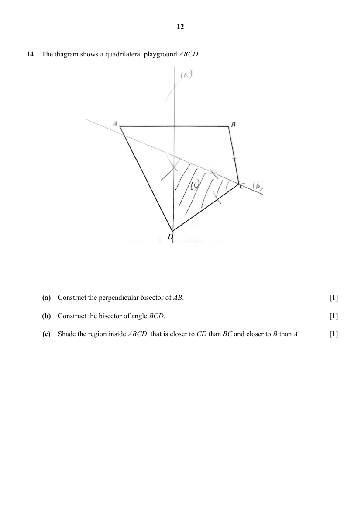
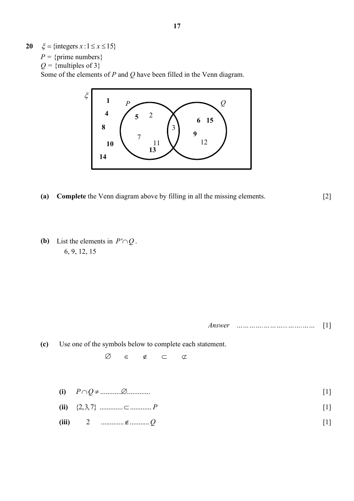

# Presbyterian High School — Mathematics 4052/01 Paper 1 Solutions (cleaned)

> **Institution:** Presbyterian High School
> **Exam:** 2025 Secondary Four Express / Five Normal Preliminary Examination
> **Level:** Secondary Four Express / Five Normal
> **Subjects:** Mathematics
> **Paper:** 4052/01 Paper 1 — Solutions
> **Date:** 19 August 2025
> **Duration:** 2 hours 15 minutes
> **Total Marks:** 90
> **Source:** Suggested answers inside `2025 Presbyterian HS MA Prelim P1 QP + MS.pdf`. **Page** is the question’s physical page in that combined PDF, not the solutions-copy page. The extract `2025-Prelim-4E5N-Presbyterian-HS-P1-Solutions.md` is Additional Mathematics 4049/01 and is not this mark scheme.

---

## Answers

Worked solutions are the suggested-answers copy in this PDF (physical pages 28–48). The short key on physical pages 24–25 agrees with that copy except where noted.

### Q1

> **Marks:** 1
> **Sub-topic:** Numbers and their operations
> **Page:** 3

$7.20$

---

### Q2

> **Marks:** (a) 1, (b) 1; total 2
> **Sub-topic:** Indices and algebra
> **Page:** 3

**(a)** The suggested answer prints $4y^{5}$. The working written in the solutions copy is $4y^{5}\times y^{-1}=4y^{5}$.

**(b)** $-x-9$

---

### Q3

> **Marks:** (a) 2, (b) 2; total 4
> **Sub-topic:** Algebraic expressions
> **Page:** 4

**(a)** $(p+2)\left(1+3p-p^{2}\right)=2+7p+p^{2}-p^{3}$

**(b)** $\dfrac{2x-2}{(5-2x)^{2}}$

---

### Q4

> **Marks:** (a) 1, (b) 1, (c) 2; total 4
> **Sub-topic:** Prime factors, HCF and LCM
> **Page:** 5

**(a)** $504=2^{3}\times 3^{2}\times 7$

**(b)** $k=3\times 7^{2}=147$

**(c)** $168$ and $252$

---

### Q5

> **Marks:** (a) 1, (b) 1; total 2
> **Sub-topic:** Rate and proportion
> **Page:** 6

**(a)** $\dfrac{100y+4}{x}$ cents

**(b)** $\dfrac{100tx}{100y+4}$

---

### Q6

> **Marks:** 2
> **Sub-topic:** Ratio
> **Page:** 6

$A:B=5:6$, so $A:C=5:14$.

---

### Q7

> **Marks:** 2
> **Sub-topic:** Inequalities
> **Page:** 7

$6y>20$, so $y>\dfrac{20}{6}$. Smallest integer $y=4$.

---

### Q8

> **Marks:** 2
> **Sub-topic:** Proportion
> **Page:** 7

$F=\dfrac{k}{r^{2}}$ and $64=\dfrac{k}{r^{2}}$. When the distance is $0.8r$,

$$
F=\frac{k}{(0.8r)^{2}}=\frac{64}{0.64}=100\text{ units}.
$$

---

### Q9

> **Marks:** (a) 1, (b)(i) 1, (b)(ii) 2; total 4
> **Sub-topic:** Standard form and rates
> **Page:** 8

**(a)** $1.504\times 10^{8}\text{ km}$

**(b)** **(i)** $27000\text{ km/h}$

**(ii)** $232$ days

---

### Q10

> **Marks:** 3
> **Sub-topic:** Changing the subject
> **Page:** 9

$$
c=\frac{3-6ab}{10b+1}
$$

---

### Q11

> **Marks:** (a) 1, (b) 2; total 3
> **Sub-topic:** Maps and scales
> **Page:** 9

**(a)** $8\text{ km}$

**(b)** $160\text{ cm}^{2}$

---

### Q12

> **Marks:** (a) 1, (b) 1, (c) 1; total 3
> **Sub-topic:** Statistics
> **Page:** 10

**(a)** Mean $=46.4\text{ kg}$, using mid-values $25$, $35$, $45$, $55$ and $65$.

**(b)** Standard deviation $=10.0\text{ kg}$.

**(c)** The exact/actual mass of each student is not known.

---

### Q13

> **Marks:** (a) 2, (b) 2; total 4
> **Sub-topic:** Similar triangles
> **Page:** 11

**(a)** $\angle ABX=\angle CDX$ (alt. $\angle$s, $AB\parallel CD$). $\angle AXB=\angle CXD$ (vert. opp. $\angle$s). $\triangle ABX$ is similar to $\triangle CDX$ (AA similarity). The solutions copy notes $-1$ mark if the test is not stated.

**(b)** $BX=11.2\text{ cm}$

---

### Q14

> **Marks:** (a) 1, (b) 1, (c) 1; total 3
> **Sub-topic:** Geometrical construction
> **Page:** 12

Construction is on the solutions page. Perpendicular bisector of $AB$, angle bisector of $\angle BCD$, and the region closer to $CD$ than to $BC$ and closer to $B$ than to $A$.

---

### Q15

> **Marks:** (a) 2, (b) 1; total 3
> **Sub-topic:** Graphs of quadratic functions
> **Page:** 13

**(a)** The graph crosses the $x$-axis at $-4$ and $8$, and the $y$-axis at $-32$.

**(b)** The $y$-intercept of $y=(x+4)(x-8)$ is $-32$, therefore the $y$-intercept of $y=(x+4)(x-8)+26$ is $-6$, which is below the $x$-axis, therefore $y$ cuts the $x$-axis at two points.

Or: the minimum value of $y=(x+4)(x-8)$ is $-36$, therefore the minimum value of $y=(x+4)(x-8)+26$ is $-10$, which is below the $x$-axis, therefore $y$ cuts the $x$-axis at two points because its vertex lies below the $x$-axis.

---

### Q16

> **Marks:** (a) 2, (b) 2; total 4
> **Sub-topic:** Coordinate geometry
> **Page:** 14

**(a)** $AB=7.81$ units

**(b)** $y=-0.25x+9.25$

---

### Q17

> **Marks:** 2
> **Sub-topic:** Algebraic identities
> **Page:** 15

$$
(2x-y)^{2}=64 \Rightarrow 4x^{2}+y^{2}=64+4xy=80
$$

---

### Q18

> **Marks:** 2
> **Sub-topic:** Factorisation
> **Page:** 15

$$
18ac-8c+27ab-12b=(9a-4)(2c+3b)
$$

The short key’s factor $(9a-c)$ does not match this working. The worked copy is used.

---

### Q19

> **Marks:** (a) 1, (b) 2, (c) 2; total 5
> **Sub-topic:** Number sequences
> **Page:** 16

**(a)** $T_{5}=2^{4}+9$

**(b)** $T_{n}=2^{n-1}+2n-1$

**(c)**

$$
T_{n}-T_{n-1}=2^{n-1}+2n-1-\left(2^{n-2}+2(n-1)-1\right)=2^{n-2}+2
$$

---

### Q20

> **Marks:** (a) 2, (b) 1, (c) 3; total 6
> **Sub-topic:** Sets
> **Page:** 17

**(a)** Completed diagram: outside both sets $1$, $4$, $8$, $10$, $14$; only in $P$: $2$, $5$, $7$, $11$, $13$; only in $Q$: $6$, $9$, $12$, $15$; in $P\cap Q$: $3$.

**(b)** $6$, $9$, $12$, $15$

**(c)** **(i)** $P\cap Q \neq \varnothing$

**(ii)** $\{2,3,7\}\subset P$

**(iii)** $2\notin Q$

---

### Q21

> **Marks:** (a) 1, (b) 2, (c) 1, (d) 2; total 6
> **Sub-topic:** Matrices
> **Page:** 18

**(a)** $J=\begin{pmatrix} x \\ x-8 \\ x-3 \end{pmatrix}$

**(b)** $K=\begin{pmatrix} 49x-202 \\ 40x-174 \end{pmatrix}$

**(c)** It represents the total amount collected from the sales of cheesecake, fruit cakes and red velvet cakes sold om Saturday and Sunday respectively.

**(d)** $x=68$

---

### Q22

> **Marks:** (a) 2, (b) 1, (c) 2; total 5
> **Sub-topic:** Probability
> **Page:** 19

**(a)**

| $+$ | 1 | 3 | 5 | 6 |
| --- | --- | --- | --- | --- |
| 1 | 2 | 4 | 6 | 7 |
| 2 | 3 | 5 | 7 | 8 |
| 3 | 4 | 6 | 8 | 9 |
| 4 | 5 | 7 | 9 | 10 |

**(b)** $\dfrac{1}{8}$

**(c)** $\dfrac{3}{32}$

---

### Q23

> **Marks:** (a) 1, (b)(i) 1, (b)(ii) 1, (c) 2; total 5
> **Sub-topic:** Pythagoras and trigonometry
> **Page:** 20

**(a)** $AP^{2}+BP^{2}=24^{2}+32^{2}=1600$ and $AB^{2}=40^{2}=1600$. Since $AB^{2}=AP^{2}+PB^{2}$, by the converse of Pythagoras’ theorem, $\angle APB$ is a right angle. The extract prints $20^{2}$ beside $1600$; $40^{2}=1600$ is the length given in the question.

**(b)** **(i)** $\dfrac{3}{4}$

**(ii)** $-\dfrac{5}{13}$

**(c)** No. The diameter is $AB$ as it is a right angle in a semicircle, and the radius is $20\text{ cm}$.

---

### Q24

> **Marks:** (a)(i) 1, (a)(ii) 1, (b) 1, (c) 2; total 5
> **Sub-topic:** Statistics
> **Page:** 21

**(a)** **(i)** $17$

**(ii)** $p=4$

**(b)** $\theta=80^{\circ}$

**(c)** $a=11$, $b=19$

---

### Q25

> **Marks:** (a) 1, (b) 2; total 3
> **Sub-topic:** Speed-time graphs
> **Page:** 22

**(a)** $v=20$

**(b)** $T=70$

---

### Q26

> **Marks:** (a) 1, (b) 1, (c) 3; total 5
> **Sub-topic:** Circular measure
> **Page:** 23

**(a)** $\angle PRQ=2\pi-\dfrac{\pi}{2}-\dfrac{\pi}{2}-\dfrac{7\pi}{18}=\dfrac{11\pi}{18}$ (shown).

**(b)** $11.0\text{ cm}$

**(c)** $7.24\text{ cm}^{2}$
