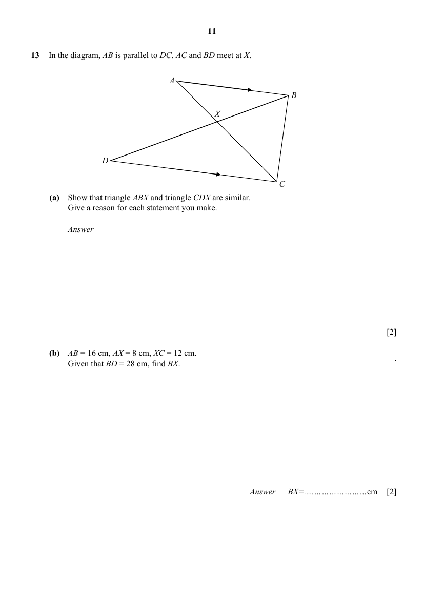
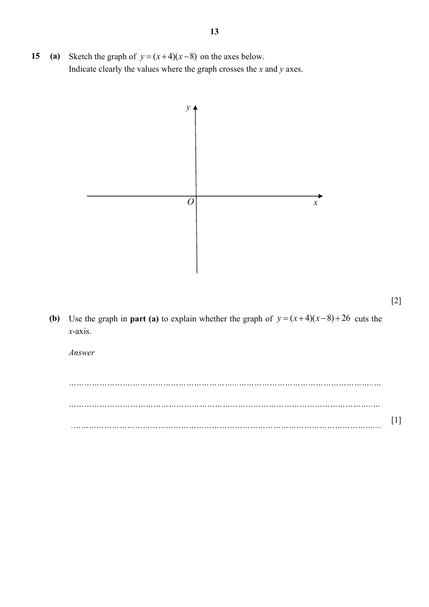
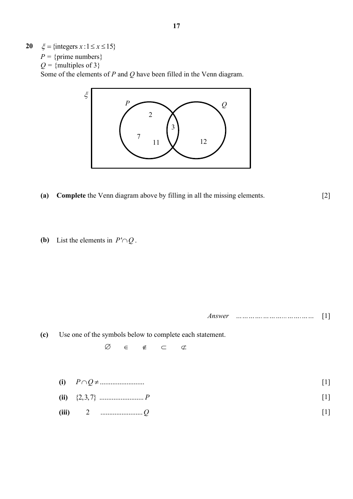
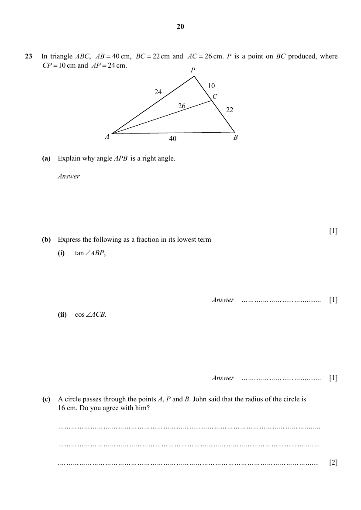
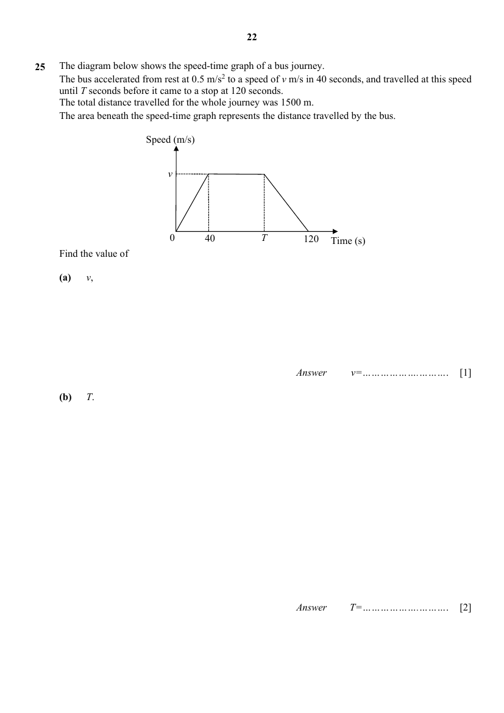
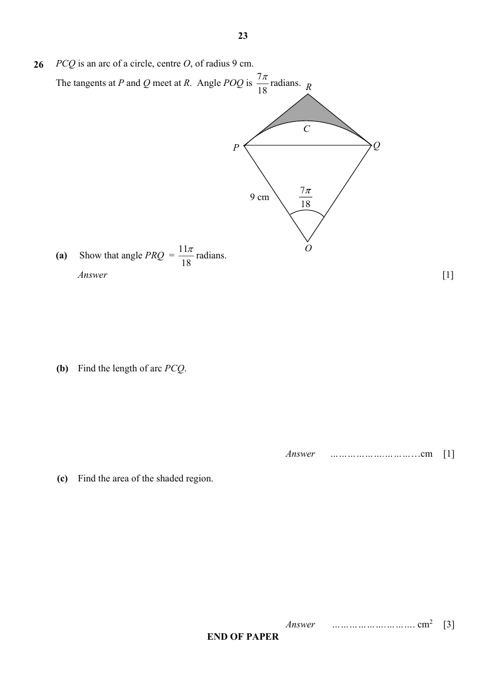

# Presbyterian High School — Mathematics 4052/01 Paper 1 (cleaned)

> **Institution:** Presbyterian High School
> **Exam:** 2025 Secondary Four Express / Five Normal Preliminary Examination
> **Level:** Secondary Four Express / Five Normal
> **Subjects:** Mathematics
> **Paper:** 4052/01 Paper 1
> **Date:** 19 August 2025
> **Duration:** 2 hours 15 minutes
> **Total Marks:** 90
> **Source:** `2025 Presbyterian HS MA Prelim P1 QP + MS.pdf` (cleaned & reformatted). Questions are the first copy. **Page** is this PDF’s own physical page. Setter: Mr Tan Chee Wee. Vetter: Ms Ong Bi Ru.

The file named as Presbyterian High School Paper 1 Solutions in the extract set is Additional Mathematics 4049/01 (25 August 2025), not this paper. It is not used here.

This question paper consists of 23 printed pages (including this cover page) and 1 blank page.

---

## Instructions

Do not open this question paper until you are told to do so.

Write your name, index number and class on the spaces provided above.
Write in dark blue or black pen. You may use an HB pencil for any diagrams or graphs.
Do not use staples, paper clips, glue or correction fluid.

Answer all the questions.
If working is needed for any question, it must be shown with the answer.
Omission of essential working will result in loss of marks.
The use of an approved scientific calculator is expected, where appropriate.
If the degree of accuracy is not specified in the question, and if the answer is not exact, give the answer to three significant figures. Give answers in degrees to one decimal place.
For $\pi$, use either your calculator value or $3.142$, unless the question requires the answer in terms of $\pi$.
Note that all the diagrams in this paper are not drawn to scale.

The number of marks is given in brackets [ ] at the end of each question or part question.
The total of the marks for this paper is 90.

---

## Mathematical Formulae

*Compound interest*

$$
\text{Total amount} = P\left(1+\frac{r}{100}\right)^{n}
$$

*Mensuration*

$$
\text{Curved surface area of a cone} = \pi rl
$$

$$
\text{Surface area of a sphere} = 4\pi r^{2}
$$

$$
\text{Volume of a cone} = \frac{1}{3}\pi r^{2}h
$$

$$
\text{Volume of a sphere} = \frac{4}{3}\pi r^{3}
$$

$$
\text{Area of triangle } ABC = \frac{1}{2}ab\sin C
$$

$$
\text{Arc length} = r\theta,\text{ where }\theta\text{ is in radians}
$$

$$
\text{Sector area} = \frac{1}{2}r^{2}\theta,\text{ where }\theta\text{ is in radians}
$$

*Trigonometry*

$$
\frac{a}{\sin A} = \frac{b}{\sin B} = \frac{c}{\sin C}
$$

$$
a^{2} = b^{2}+c^{2}-2bc\cos A
$$

*Statistics*

$$
\text{Mean} = \frac{\sum fx}{\sum f}
$$

$$
\text{Standard deviation} = \sqrt{\frac{\sum fx^{2}}{\sum f}-\left(\frac{\sum fx}{\sum f}\right)^{2}}
$$

---

## Section A — Answer all the questions

### Q1

> **Marks:** 1
> **Topic:** N2 Ratio and proportion
> **Sub-topic:** Ratio and proportion
> **LO:** [[context/subjects/o-level-e-maths/learning-objectives/o-level-e-maths-N2a.md|N2a]]
> **Page:** 3

Calculate $\sqrt[3]{27.38^{2}-\dfrac{7.9}{0.021}}$. [1]

---

### Q2

> **Marks:** (a) 1, (b) 1; total 2
> **Page:** 3

Simplify

**(a)** $4\sqrt[5]{y^{6}}\times y^{-1}$, [1]
> **Topic:** N1 Numbers and their operations
> **Sub-topic:** Numbers and their operations
> **LO:** [[context/subjects/o-level-e-maths/learning-objectives/o-level-e-maths-N1j.md|N1j]]

**(b)** $5x-7-9x+3x-2$. [1]
> **Topic:** N1 Numbers and their operations
> **Sub-topic:** Numbers and their operations
> **LO:** [[context/subjects/o-level-e-maths/learning-objectives/o-level-e-maths-N1j.md|N1j]]

---

### Q3

> **Marks:** (a) 2, (b) 2; total 4
> **Page:** 4

**(a)** Expand and simplify $(p+2)\left(1+3p-p^{2}\right)$. [2]
> **Topic:** N5 Algebraic expressions and formulae
> **Sub-topic:** Algebraic expressions and formulae
> **LO:** [[context/subjects/o-level-e-maths/learning-objectives/o-level-e-maths-N5j.md|N5j]]

**(b)** Write as a single fraction in its simplest form $\dfrac{3}{(5-2x)^{2}}-\dfrac{1}{5-2x}$. [2]
> **Topic:** N5 Algebraic expressions and formulae
> **Sub-topic:** Algebraic expressions and formulae
> **LO:** [[context/subjects/o-level-e-maths/learning-objectives/o-level-e-maths-N5j.md|N5j]]

---

### Q4

> **Marks:** (a) 1, (b) 1, (c) 2; total 4
> **Page:** 5

**(a)** Express $504$ as a product of its prime factors. [1]
> **Topic:** N1 Numbers and their operations
> **Sub-topic:** Numbers and their operations
> **LO:** [[context/subjects/o-level-e-maths/learning-objectives/o-level-e-maths-N1b.md|N1b]]

**(b)** Find the smallest positive integer value of $k$ such that $\sqrt[3]{504k}$ is an integer. [1]
> **Topic:** N1 Numbers and their operations
> **Sub-topic:** Numbers and their operations
> **LO:** [[context/subjects/o-level-e-maths/learning-objectives/o-level-e-maths-N1e.md|N1e]]

**(c)** The highest common factor (HCF) of two numbers is $84$. The lowest common multiple (LCM) of the two numbers is $504$. Both numbers are more than $100$. Find the two numbers. [2]
> **Topic:** N1 Numbers and their operations
> **Sub-topic:** Numbers and their operations
> **LO:** [[context/subjects/o-level-e-maths/learning-objectives/o-level-e-maths-N1b.md|N1b]]

---

### Q5

> **Marks:** (a) 1, (b) 1; total 2
> **Page:** 6

It is given that $x$ pencils cost $y$ dollars and $4$ cents.

**(a)** Find the cost of one pencil in cents. [1]
> **Topic:** N2 Ratio and proportion
> **Sub-topic:** Ratio and proportion
> **LO:** [[context/subjects/o-level-e-maths/learning-objectives/o-level-e-maths-N2a.md|N2a]]

**(b)** Write down an expression for the number of pencils that could be bought for $t$ dollars. [1]
> **Topic:** N2 Ratio and proportion
> **Sub-topic:** Ratio and proportion
> **LO:** [[context/subjects/o-level-e-maths/learning-objectives/o-level-e-maths-N2a.md|N2a]]

---

### Q6

> **Marks:** 2
> **Topic:** N2 Ratio and proportion
> **Sub-topic:** Ratio and proportion
> **LO:** [[context/subjects/o-level-e-maths/learning-objectives/o-level-e-maths-N2a.md|N2a]]
> **Page:** 6

Given that $A:B=\dfrac{1}{6}:\dfrac{1}{5}$ and $B:C=3:7$, find $A:C$ as a ratio of two integers. [2]

---

### Q7

> **Marks:** 2
> **Topic:** N1 Numbers and their operations
> **Sub-topic:** Numbers and their operations
> **LO:** [[context/subjects/o-level-e-maths/learning-objectives/o-level-e-maths-N1e.md|N1e]]
> **Page:** 7

Find the smallest integer that satisfies $6y-3>17$. [2]

---

### Q8

> **Marks:** 2
> **Topic:** N2 Ratio and proportion
> **Sub-topic:** Ratio and proportion
> **LO:** [[context/subjects/o-level-e-maths/learning-objectives/o-level-e-maths-N2a.md|N2a]]
> **Page:** 7

The force $F$, between two particles is inversely proportional to the square of the distance between them. The force is $64$ units when the distance between the particles is $r$ metres. Find the force when the distance between the particles is reduced by $20\%$. [2]

---

### Q9

> **Marks:** (a) 1, (b)(i) 1, (b)(ii) 2; total 4
> **Page:** 8

The distance between Earth and Venus is $150.4$ million kilometres.

**(a)** Express $150.4$ million in standard form. [1]
> **Topic:** N4 Rate and speed
> **Sub-topic:** Rate and speed
> **LO:** [[context/subjects/o-level-e-maths/learning-objectives/o-level-e-maths-N4a.md|N4a]]

**(b)** A space shuttle can travel $7500$ metres in $1$ second.

**(i)** Find the speed, in kilometres per hour, of the space shuttle. [1]
> **Topic:** N4 Rate and speed
> **Sub-topic:** Rate and speed
> **LO:** [[context/subjects/o-level-e-maths/learning-objectives/o-level-e-maths-N4a.md|N4a]]

**(ii)** Find the number of days the space shuttle will take to travel from Earth to Venus. Give your answer to the nearest whole number. [2]
> **Topic:** N4 Rate and speed
> **Sub-topic:** Rate and speed
> **LO:** [[context/subjects/o-level-e-maths/learning-objectives/o-level-e-maths-N4a.md|N4a]]

---

### Q10

> **Marks:** 3
> **Topic:** N5 Algebraic expressions and formulae
> **Sub-topic:** Algebraic expressions and formulae
> **LO:** [[context/subjects/o-level-e-maths/learning-objectives/o-level-e-maths-N5k.md|N5k]]
> **Page:** 9

Given that $3a+5c=\dfrac{3-c}{2b}$, make $c$ the subject of the equation. [3]

---

### Q11

> **Marks:** (a) 1, (b) 2; total 3
> **Page:** 9

The scale of a map is given as $1:50000$.

**(a)** A road on the map is $16\text{ cm}$ long. Find the actual length of a road in kilometres. [1]
> **Topic:** N2 Ratio and proportion
> **Sub-topic:** Ratio and proportion
> **LO:** [[context/subjects/o-level-e-maths/learning-objectives/o-level-e-maths-N2c.md|N2c]]

**(b)** A lake has an area of $40\text{ km}^{2}$. Find the area of the lake on the map in square centimetres. [2]
> **Topic:** N2 Ratio and proportion
> **Sub-topic:** Ratio and proportion
> **LO:** [[context/subjects/o-level-e-maths/learning-objectives/o-level-e-maths-N2c.md|N2c]]

---

### Q12

> **Marks:** (a) 1, (b) 1, (c) 1; total 3
> **Page:** 10

The frequency table shows the masses of $50$ students from Class A.

| Mass ($m$ kg) | $20 < m \leq 30$ | $30 < m \leq 40$ | $40 < m \leq 50$ | $50 < m \leq 60$ | $60 < m \leq 70$ |
| --- | --- | --- | --- | --- | --- |
| Frequency | 2 | 11 | 20 | 12 | 5 |

**(a)** Calculate the mean mass of the students from Class A. [1]
> **Topic:** S1 Data handling and analysis
> **Sub-topic:** Data handling and analysis
> **LO:** [[context/subjects/o-level-e-maths/learning-objectives/o-level-e-maths-S1f.md|S1f]]

**(b)** Calculate the standard deviation for the mass of students in class A. [1]
> **Topic:** S1 Data handling and analysis
> **Sub-topic:** Data handling and analysis
> **LO:** [[context/subjects/o-level-e-maths/learning-objectives/o-level-e-maths-S1k.md|S1k]]

**(c)** Explain why the value of the mean calculated in part (a) is only an estimate. [1]
> **Topic:** S1 Data handling and analysis
> **Sub-topic:** Data handling and analysis
> **LO:** [[context/subjects/o-level-e-maths/learning-objectives/o-level-e-maths-S1f.md|S1f]]

---

### Q13

> **Marks:** (a) 2, (b) 2; total 4
> **Page:** 11

In the diagram, $AB$ is parallel to $DC$. $AC$ and $BD$ meet at $X$.

**(a)** Show that triangle $ABX$ and triangle $CDX$ are similar. Give a reason for each statement you make. [2]
> **Topic:** G2 Congruence and similarity
> **Sub-topic:** Congruence and similarity
> **LO:** [[context/subjects/o-level-e-maths/learning-objectives/o-level-e-maths-G2i.md|G2i]]

**(b)** $AB=16\text{ cm}$, $AX=8\text{ cm}$, $XC=12\text{ cm}$. Given that $BD=28\text{ cm}$, find $BX$. [2]
> **Topic:** G2 Congruence and similarity
> **Sub-topic:** Congruence and similarity
> **LO:** [[context/subjects/o-level-e-maths/learning-objectives/o-level-e-maths-G2i.md|G2i]]

---

### Q14

> **Marks:** (a) 1, (b) 1, (c) 1; total 3
> **Page:** 12

The diagram shows a quadrilateral playground $ABCD$.

**(a)** Construct the perpendicular bisector of $AB$. [1]
> **Topic:** G2 Congruence and similarity
> **Sub-topic:** Congruence and similarity
> **LO:** [[context/subjects/o-level-e-maths/learning-objectives/o-level-e-maths-G2e.md|G2e]]

**(b)** Construct the bisector of angle $BCD$. [1]
> **Topic:** G2 Congruence and similarity
> **Sub-topic:** Congruence and similarity
> **LO:** [[context/subjects/o-level-e-maths/learning-objectives/o-level-e-maths-G2e.md|G2e]]

**(c)** Shade the region inside $ABCD$ that is closer to $CD$ than $BC$ and closer to $B$ than $A$. [1]
> **Topic:** G2 Congruence and similarity
> **Sub-topic:** Congruence and similarity
> **LO:** [[context/subjects/o-level-e-maths/learning-objectives/o-level-e-maths-G2e.md|G2e]]

---

### Q15

> **Marks:** (a) 2, (b) 1; total 3
> **Page:** 13

**(a)** Sketch the graph of $y=(x+4)(x-8)$ on the axes below. Indicate clearly the values where the graph crosses the $x$ and $y$ axes. [2]
> **Topic:** N6 Functions and graphs
> **Sub-topic:** Functions and graphs
> **LO:** [[context/subjects/o-level-e-maths/learning-objectives/o-level-e-maths-N6c.md|N6c]]

**(b)** Use the graph in part (a) to explain whether the graph of $y=(x+4)(x-8)+26$ cuts the $x$-axis. [1]
> **Topic:** N6 Functions and graphs
> **Sub-topic:** Functions and graphs
> **LO:** [[context/subjects/o-level-e-maths/learning-objectives/o-level-e-maths-N6c.md|N6c]]

---

### Q16

> **Marks:** (a) 2, (b) 2; total 4
> **Page:** 14

$A$, $B$ and $C$ are points $(-4,3)$, $(1,9)$ and $(0,2)$ respectively.

**(a)** Find the length of $AB$. [2]
> **Topic:** G6 Coordinate geometry
> **Sub-topic:** Coordinate geometry
> **LO:** [[context/subjects/o-level-e-maths/learning-objectives/o-level-e-maths-G6c.md|G6c]]

**(b)** Find the equation of the line that passes through $B$ and has the same gradient as $AC$. [2]
> **Topic:** G6 Coordinate geometry
> **Sub-topic:** Coordinate geometry
> **LO:** [[context/subjects/o-level-e-maths/learning-objectives/o-level-e-maths-G6c.md|G6c]]

---

### Q17

> **Marks:** 2
> **Topic:** N5 Algebraic expressions and formulae
> **Sub-topic:** Algebraic expressions and formulae
> **LO:** [[context/subjects/o-level-e-maths/learning-objectives/o-level-e-maths-N5m.md|N5m]]
> **Page:** 15

Given that $2x-y=8$ and $xy=4$, without solving for $x$ and $y$, find the value of $4x^{2}+y^{2}$. [2]

---

### Q18

> **Marks:** 2
> **Topic:** N5 Algebraic expressions and formulae
> **Sub-topic:** Algebraic expressions and formulae
> **LO:** [[context/subjects/o-level-e-maths/learning-objectives/o-level-e-maths-N5h.md|N5h]]
> **Page:** 15

Factorise completely $18ac-8c+27ab-12b$. [2]

---

### Q19

> **Marks:** (a) 1, (b) 2, (c) 2; total 5
> **Page:** 16

The first four terms in a sequence of numbers, $T_{1}$, $T_{2}$, $T_{3}$, $T_{4}$ ... are given below.

$$
T_{1}=2^{0}+1
$$

$$
T_{2}=2^{1}+3
$$

$$
T_{3}=2^{2}+5
$$

$$
T_{4}=2^{3}+7
$$

**(a)** Write down $T_{5}$. [1]
> **Topic:** N5 Algebraic expressions and formulae
> **Sub-topic:** Algebraic expressions and formulae
> **LO:** [[context/subjects/o-level-e-maths/learning-objectives/o-level-e-maths-N5e.md|N5e]]

**(b)** Express $T_{n}$ in terms of $n$. [2]
> **Topic:** N5 Algebraic expressions and formulae
> **Sub-topic:** Algebraic expressions and formulae
> **LO:** [[context/subjects/o-level-e-maths/learning-objectives/o-level-e-maths-N5e.md|N5e]]

**(c)** Hence show that $T_{n}-T_{n-1}=2^{n-2}+2$. [2]
> **Topic:** N5 Algebraic expressions and formulae
> **Sub-topic:** Algebraic expressions and formulae
> **LO:** [[context/subjects/o-level-e-maths/learning-objectives/o-level-e-maths-N5e.md|N5e]]

---

### Q20

> **Marks:** (a) 2, (b) 1, (c) 3; total 6
> **Page:** 17

$\xi=\{\text{integers }x:1\leq x\leq 15\}$

$P=\{\text{prime numbers}\}$

$Q=\{\text{multiples of }3\}$

Some of the elements of $P$ and $Q$ have been filled in the Venn diagram.

**(a)** Complete the Venn diagram above by filling in all the missing elements. [2]
> **Topic:** N8 Set language and notation
> **Sub-topic:** Set language and notation
> **LO:** [[context/subjects/o-level-e-maths/learning-objectives/o-level-e-maths-N8c.md|N8c]]

**(b)** List the elements in $P'\cap Q$. [1]
> **Topic:** N8 Set language and notation
> **Sub-topic:** Set language and notation
> **LO:** [[context/subjects/o-level-e-maths/learning-objectives/o-level-e-maths-N8c.md|N8c]]

**(c)** Use one of the symbols below to complete each statement.

$\varnothing \quad \in \quad \notin \quad \subset \quad \not\subset$

**(i)** $P\cap Q \neq \text{.........................}$ [1]
> **Topic:** N8 Set language and notation
> **Sub-topic:** Set language and notation
> **LO:** [[context/subjects/o-level-e-maths/learning-objectives/o-level-e-maths-N8c.md|N8c]]

**(ii)** $\{2,3,7\}\text{ ......................... }P$ [1]
> **Topic:** N8 Set language and notation
> **Sub-topic:** Set language and notation
> **LO:** [[context/subjects/o-level-e-maths/learning-objectives/o-level-e-maths-N8c.md|N8c]]

**(iii)** $2\text{ ......................... }Q$ [1]
> **Topic:** N8 Set language and notation
> **Sub-topic:** Set language and notation
> **LO:** [[context/subjects/o-level-e-maths/learning-objectives/o-level-e-maths-N8c.md|N8c]]

---

### Q21

> **Marks:** (a) 1, (b) 2, (c) 1, (d) 2; total 6
> **Page:** 18

A bakery produces cheesecakes, fruit cakes and red velvet cakes The number of cakes sold on a particular weekend is given by the matrix $G$.

$$
G=\begin{pmatrix} 15 & 20 & 14 \\ 12 & 18 & 10 \end{pmatrix}
\begin{matrix} \text{Saturday} \\ \text{Sunday} \end{matrix}
$$

Columns are cheese, fruit and red velvet, in that order.

A cheesecake is sold for SGD x, a fruit cake is sold for SGD (x-8) and a red velvet cake is sold for SGD (x-3).

**(a)** Represent this information in a $3\times 1$ matrix, $J$. [1]
> **Topic:** N9 Matrices
> **Sub-topic:** Matrices
> **LO:** [[context/subjects/o-level-e-maths/learning-objectives/o-level-e-maths-N9b.md|N9b]]

**(b)** Find in terms of $x$, the matrix $K=GJ$. [2]
> **Topic:** N9 Matrices
> **Sub-topic:** Matrices
> **LO:** [[context/subjects/o-level-e-maths/learning-objectives/o-level-e-maths-N9b.md|N9b]]

**(c)** State what the elements of $K$ represent. [1]
> **Topic:** N9 Matrices
> **Sub-topic:** Matrices
> **LO:** [[context/subjects/o-level-e-maths/learning-objectives/o-level-e-maths-N9b.md|N9b]]

**(d)** The total amount of money collected by the bakery from the sales of all the cakes on this particular weekend is SGD 5676, find the value of $x$. [2]
> **Topic:** N9 Matrices
> **Sub-topic:** Matrices
> **LO:** [[context/subjects/o-level-e-maths/learning-objectives/o-level-e-maths-N9b.md|N9b]]

---

### Q22

> **Marks:** (a) 2, (b) 1, (c) 2; total 5
> **Page:** 19

Box $X$ contains $4$ balls numbered $1$, $2$, $3$ and $4$.
Box $Y$ contains another $4$ balls numbered $1$, $3$, $5$ and $6$.
In a game, May drew a ball at random from each box, and the sum of both numbers is obtained.

**(a)** Complete the possibility diagram below. [2]
> **Topic:** S2 Probability
> **Sub-topic:** Probability
> **LO:** [[context/subjects/o-level-e-maths/learning-objectives/o-level-e-maths-S2c.md|S2c]]

| $+$ | 1 | 3 | 5 | 6 |
| --- | --- | --- | --- | --- |
| 1 | 2 |  |  | 7 |
| 2 |  | 5 |  |  |
| 3 |  |  | 8 |  |
| 4 |  | 7 |  | 10 |

**(b)** Find the probability that the sum obtained is $6$. [1]
> **Topic:** S2 Probability
> **Sub-topic:** Probability
> **LO:** [[context/subjects/o-level-e-maths/learning-objectives/o-level-e-maths-S2c.md|S2c]]

**(c)** Box $Z$ contains $4$ balls numbered $10$, $20$, $30$ and $40$. Albert drew a ball at random from each of the boxes $X$, $Y$ and $Z$, and the sum of all three numbers is obtained. Find the probability that the sum obtained is more than $30$ but less than $36$. [2]
> **Topic:** S2 Probability
> **Sub-topic:** Probability
> **LO:** [[context/subjects/o-level-e-maths/learning-objectives/o-level-e-maths-S2c.md|S2c]]

---

### Q23

> **Marks:** (a) 1, (b)(i) 1, (b)(ii) 1, (c) 2; total 5
> **Page:** 20

In triangle $ABC$, $AB=40\text{ cm}$, $BC=22\text{ cm}$ and $AC=26\text{ cm}$. $P$ is a point on $BC$ produced, where $CP=10\text{ cm}$ and $AP=24\text{ cm}$.

**(a)** Explain why angle $APB$ is a right angle. [1]
> **Topic:** G4 Pythagoras' theorem and trigonometry
> **Sub-topic:** Pythagoras' theorem and trigonometry
> **LO:** [[context/subjects/o-level-e-maths/learning-objectives/o-level-e-maths-G4c.md|G4c]]

**(b)** Express the following as a fraction in its lowest term

**(i)** $\tan\angle ABP$, [1]
> **Topic:** G4 Pythagoras' theorem and trigonometry
> **Sub-topic:** Pythagoras' theorem and trigonometry
> **LO:** [[context/subjects/o-level-e-maths/learning-objectives/o-level-e-maths-G4c.md|G4c]]

**(ii)** $\cos\angle ACB$. [1]
> **Topic:** G4 Pythagoras' theorem and trigonometry
> **Sub-topic:** Pythagoras' theorem and trigonometry
> **LO:** [[context/subjects/o-level-e-maths/learning-objectives/o-level-e-maths-G4c.md|G4c]]

**(c)** A circle passes through the points $A$, $P$ and $B$. John said that the radius of the circle is $16\text{ cm}$. Do you agree with him? [2]
> **Topic:** G4 Pythagoras' theorem and trigonometry
> **Sub-topic:** Pythagoras' theorem and trigonometry
> **LO:** [[context/subjects/o-level-e-maths/learning-objectives/o-level-e-maths-G4c.md|G4c]]

---

### Q24

> **Marks:** (a)(i) 1, (a)(ii) 1, (b) 1, (c) 2; total 5
> **Page:** 21

Eighteen students took a test. Their scores are shown in the stem-and-leaf diagram below.

| Stem | Leaf |
| --- | --- |
| 0 | 3 5 8 |
| 1 | 0 1 2 2 3 $p$ 6 7 7 7 9 |
| 2 | 1 8 8 9 |

Key: $1\mid 3$ means $13$.

**(a)** Given that the median score is $15$, find

**(i)** the modal score, [1]
> **Topic:** S1 Data handling and analysis
> **Sub-topic:** Data handling and analysis
> **LO:** [[context/subjects/o-level-e-maths/learning-objectives/o-level-e-maths-S1f.md|S1f]]

**(ii)** the value of $p$. [1]
> **Topic:** S1 Data handling and analysis
> **Sub-topic:** Data handling and analysis
> **LO:** [[context/subjects/o-level-e-maths/learning-objectives/o-level-e-maths-S1f.md|S1f]]

**(b)** These students are grouped into three groups based on their scores, $x$. This is represented on the pie chart below. Find the value of $\theta$. [1]
> **Topic:** S1 Data handling and analysis
> **Sub-topic:** Data handling and analysis
> **LO:** [[context/subjects/o-level-e-maths/learning-objectives/o-level-e-maths-S1i.md|S1i]]

**(c)** The above data is represented on a box-and-whisker plot shown below. Find the value of $a$ and of $b$. [2]
> **Topic:** S1 Data handling and analysis
> **Sub-topic:** Data handling and analysis
> **LO:** [[context/subjects/o-level-e-maths/learning-objectives/o-level-e-maths-S1i.md|S1i]]

---

### Q25

> **Marks:** (a) 1, (b) 2; total 3
> **Page:** 22

The diagram below shows the speed-time graph of a bus journey. The bus accelerated from rest at $0.5\text{ m/s}^{2}$ to a speed of $v\text{ m/s}$ in $40$ seconds, and travelled at this speed until $T$ seconds before it came to a stop at $120$ seconds. The total distance travelled for the whole journey was $1500\text{ m}$. The area beneath the speed-time graph represents the distance travelled by the bus.

Find the value of

**(a)** $v$, [1]
> **Topic:** N6 Functions and graphs
> **Sub-topic:** Functions and graphs
> **LO:** [[context/subjects/o-level-e-maths/learning-objectives/o-level-e-maths-N6c.md|N6c]]

**(b)** $T$. [2]
> **Topic:** N6 Functions and graphs
> **Sub-topic:** Functions and graphs
> **LO:** [[context/subjects/o-level-e-maths/learning-objectives/o-level-e-maths-N6c.md|N6c]]

---

### Q26

> **Marks:** (a) 1, (b) 1, (c) 3; total 5
> **Page:** 23

$PCQ$ is an arc of a circle, centre $O$, of radius $9\text{ cm}$. The tangents at $P$ and $Q$ meet at $R$. Angle $POQ$ is $\dfrac{7\pi}{18}$ radians.

**(a)** Show that angle $PRQ=\dfrac{11\pi}{18}$ radians. [1]
> **Topic:** G5 Mensuration
> **Sub-topic:** Mensuration
> **LO:** [[context/subjects/o-level-e-maths/learning-objectives/o-level-e-maths-G5g.md|G5g]]

**(b)** Find the length of arc $PCQ$. [1]
> **Topic:** G5 Mensuration
> **Sub-topic:** Mensuration
> **LO:** [[context/subjects/o-level-e-maths/learning-objectives/o-level-e-maths-G5g.md|G5g]]

**(c)** Find the area of the shaded region. [3]
> **Topic:** G5 Mensuration
> **Sub-topic:** Mensuration
> **LO:** [[context/subjects/o-level-e-maths/learning-objectives/o-level-e-maths-G5b.md|G5b]]

---

## Answers

Worked solutions are the suggested-answers copy in this PDF (physical pages 28–48). The short key on physical pages 24–25 agrees with that copy except where noted.

### Q1

> **Marks:** 1
> **Page:** 28

$7.20$

---

### Q2

> **Marks:** (a) 1, (b) 1; total 2
> **Page:** 28

**(a)** The suggested answer prints $4y^{5}$. The working written in the solutions copy is $4y^{5}\times y^{-1}=4y^{5}$.

**(b)** $-x-9$

---

### Q3

> **Marks:** (a) 2, (b) 2; total 4
> **Page:** 29

**(a)** $(p+2)\left(1+3p-p^{2}\right)=2+7p+p^{2}-p^{3}$

**(b)** $\dfrac{2x-2}{(5-2x)^{2}}$

---

### Q4

> **Marks:** (a) 1, (b) 1, (c) 2; total 4
> **Page:** 30

**(a)** $504=2^{3}\times 3^{2}\times 7$

**(b)** $k=3\times 7^{2}=147$

**(c)** $168$ and $252$

---

### Q5

> **Marks:** (a) 1, (b) 1; total 2
> **Page:** 31

**(a)** $\dfrac{100y+4}{x}$ cents

**(b)** $\dfrac{100tx}{100y+4}$

---

### Q6

> **Marks:** 2
> **Page:** 31

$A:B=5:6$, so $A:C=5:14$.

---

### Q7

> **Marks:** 2
> **Page:** 32

$6y>20$, so $y>\dfrac{20}{6}$. Smallest integer $y=4$.

---

### Q8

> **Marks:** 2
> **Page:** 32

$F=\dfrac{k}{r^{2}}$ and $64=\dfrac{k}{r^{2}}$. When the distance is $0.8r$,

$$
F=\frac{k}{(0.8r)^{2}}=\frac{64}{0.64}=100\text{ units}.
$$

---

### Q9

> **Marks:** (a) 1, (b)(i) 1, (b)(ii) 2; total 4
> **Page:** 33

**(a)** $1.504\times 10^{8}\text{ km}$

**(b)** **(i)** $27000\text{ km/h}$

**(ii)** $232$ days

---

### Q10

> **Marks:** 3
> **Page:** 34

$$
c=\frac{3-6ab}{10b+1}
$$

---

### Q11

> **Marks:** (a) 1, (b) 2; total 3
> **Page:** 34

**(a)** $8\text{ km}$

**(b)** $160\text{ cm}^{2}$

---

### Q12

> **Marks:** (a) 1, (b) 1, (c) 1; total 3
> **Page:** 35

**(a)** Mean $=46.4\text{ kg}$, using mid-values $25$, $35$, $45$, $55$ and $65$.

**(b)** Standard deviation $=10.0\text{ kg}$.

**(c)** The exact/actual mass of each student is not known.

---

### Q13

> **Marks:** (a) 2, (b) 2; total 4
> **Page:** 36

**(a)** $\angle ABX=\angle CDX$ (alt. $\angle$s, $AB\parallel CD$). $\angle AXB=\angle CXD$ (vert. opp. $\angle$s). $\triangle ABX$ is similar to $\triangle CDX$ (AA similarity). The solutions copy notes $-1$ mark if the test is not stated.

**(b)** $BX=11.2\text{ cm}$

---

### Q14

> **Marks:** (a) 1, (b) 1, (c) 1; total 3
> **Page:** 37

Construction is on the solutions page. Perpendicular bisector of $AB$, angle bisector of $\angle BCD$, and the region closer to $CD$ than to $BC$ and closer to $B$ than to $A$.

---

### Q15

> **Marks:** (a) 2, (b) 1; total 3
> **Page:** 38

**(a)** The graph crosses the $x$-axis at $-4$ and $8$, and the $y$-axis at $-32$.

**(b)** The $y$-intercept of $y=(x+4)(x-8)$ is $-32$, therefore the $y$-intercept of $y=(x+4)(x-8)+26$ is $-6$, which is below the $x$-axis, therefore $y$ cuts the $x$-axis at two points.

Or: the minimum value of $y=(x+4)(x-8)$ is $-36$, therefore the minimum value of $y=(x+4)(x-8)+26$ is $-10$, which is below the $x$-axis, therefore $y$ cuts the $x$-axis at two points because its vertex lies below the $x$-axis.

---

### Q16

> **Marks:** (a) 2, (b) 2; total 4
> **Page:** 39

**(a)** $AB=7.81$ units

**(b)** $y=-0.25x+9.25$

---

### Q17

> **Marks:** 2
> **Page:** 40

$$
(2x-y)^{2}=64 \Rightarrow 4x^{2}+y^{2}=64+4xy=80
$$

---

### Q18

> **Marks:** 2
> **Page:** 40

$$
18ac-8c+27ab-12b=(9a-4)(2c+3b)
$$

The short key’s factor $(9a-c)$ does not match this working. The worked copy is used.

---

### Q19

> **Marks:** (a) 1, (b) 2, (c) 2; total 5
> **Page:** 41

**(a)** $T_{5}=2^{4}+9$

**(b)** $T_{n}=2^{n-1}+2n-1$

**(c)**

$$
T_{n}-T_{n-1}=2^{n-1}+2n-1-\left(2^{n-2}+2(n-1)-1\right)=2^{n-2}+2
$$

---

### Q20

> **Marks:** (a) 2, (b) 1, (c) 3; total 6
> **Page:** 42

**(a)** Completed diagram: outside both sets $1$, $4$, $8$, $10$, $14$; only in $P$: $2$, $5$, $7$, $11$, $13$; only in $Q$: $6$, $9$, $12$, $15$; in $P\cap Q$: $3$.

**(b)** $6$, $9$, $12$, $15$

**(c)** **(i)** $P\cap Q \neq \varnothing$

**(ii)** $\{2,3,7\}\subset P$

**(iii)** $2\notin Q$

---

### Q21

> **Marks:** (a) 1, (b) 2, (c) 1, (d) 2; total 6
> **Page:** 43

**(a)** $J=\begin{pmatrix} x \\ x-8 \\ x-3 \end{pmatrix}$

**(b)** $K=\begin{pmatrix} 49x-202 \\ 40x-174 \end{pmatrix}$

**(c)** It represents the total amount collected from the sales of cheesecake, fruit cakes and red velvet cakes sold om Saturday and Sunday respectively.

**(d)** $x=68$

---

### Q22

> **Marks:** (a) 2, (b) 1, (c) 2; total 5
> **Page:** 44

**(a)**

| $+$ | 1 | 3 | 5 | 6 |
| --- | --- | --- | --- | --- |
| 1 | 2 | 4 | 6 | 7 |
| 2 | 3 | 5 | 7 | 8 |
| 3 | 4 | 6 | 8 | 9 |
| 4 | 5 | 7 | 9 | 10 |

**(b)** $\dfrac{1}{8}$

**(c)** $\dfrac{3}{32}$

---

### Q23

> **Marks:** (a) 1, (b)(i) 1, (b)(ii) 1, (c) 2; total 5
> **Page:** 45

**(a)** $AP^{2}+BP^{2}=24^{2}+32^{2}=1600$ and $AB^{2}=40^{2}=1600$. Since $AB^{2}=AP^{2}+PB^{2}$, by the converse of Pythagoras’ theorem, $\angle APB$ is a right angle. The extract prints $20^{2}$ beside $1600$; $40^{2}=1600$ is the length given in the question.

**(b)** **(i)** $\dfrac{3}{4}$

**(ii)** $-\dfrac{5}{13}$

**(c)** No. The diameter is $AB$ as it is a right angle in a semicircle, and the radius is $20\text{ cm}$.

---

### Q24

> **Marks:** (a)(i) 1, (a)(ii) 1, (b) 1, (c) 2; total 5
> **Page:** 46

**(a)** **(i)** $17$

**(ii)** $p=4$

**(b)** $\theta=80^{\circ}$

**(c)** $a=11$, $b=19$

---

### Q25

> **Marks:** (a) 1, (b) 2; total 3
> **Page:** 47

**(a)** $v=20$

**(b)** $T=70$

---

### Q26

> **Marks:** (a) 1, (b) 1, (c) 3; total 5
> **Page:** 48

**(a)** $\angle PRQ=2\pi-\dfrac{\pi}{2}-\dfrac{\pi}{2}-\dfrac{7\pi}{18}=\dfrac{11\pi}{18}$ (shown).

**(b)** $11.0\text{ cm}$

**(c)** $7.24\text{ cm}^{2}$
