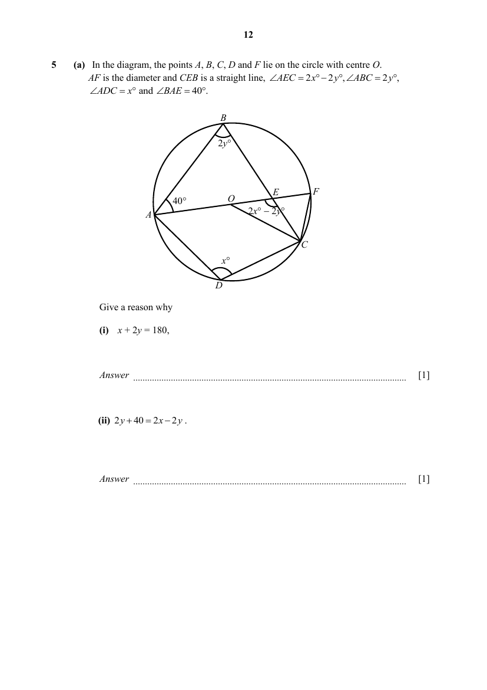
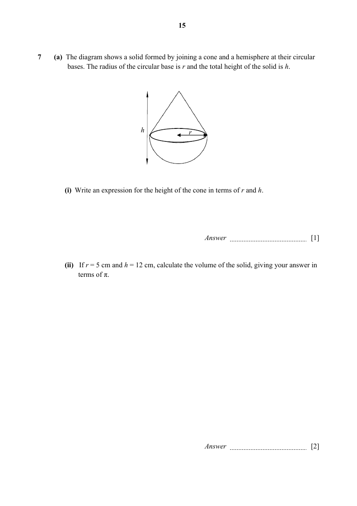
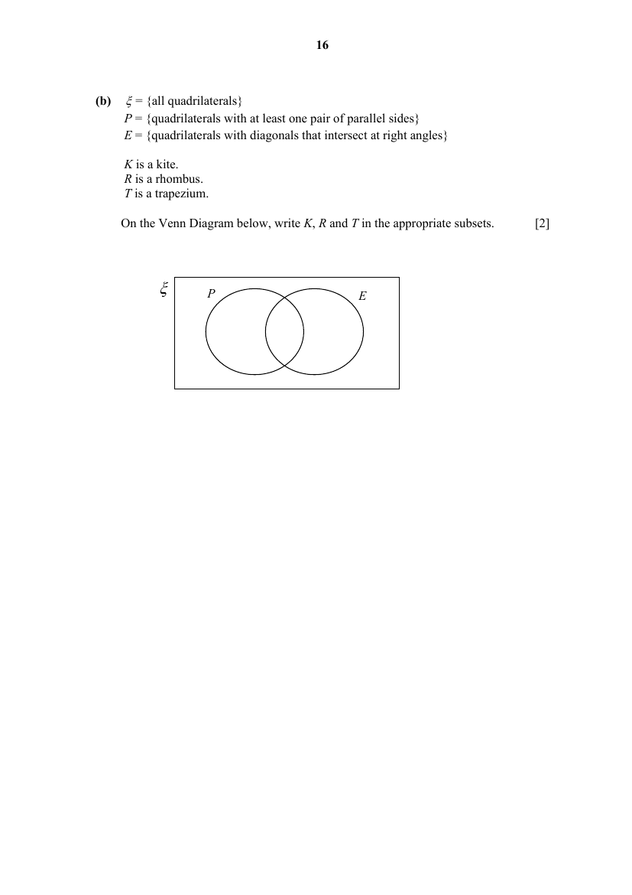
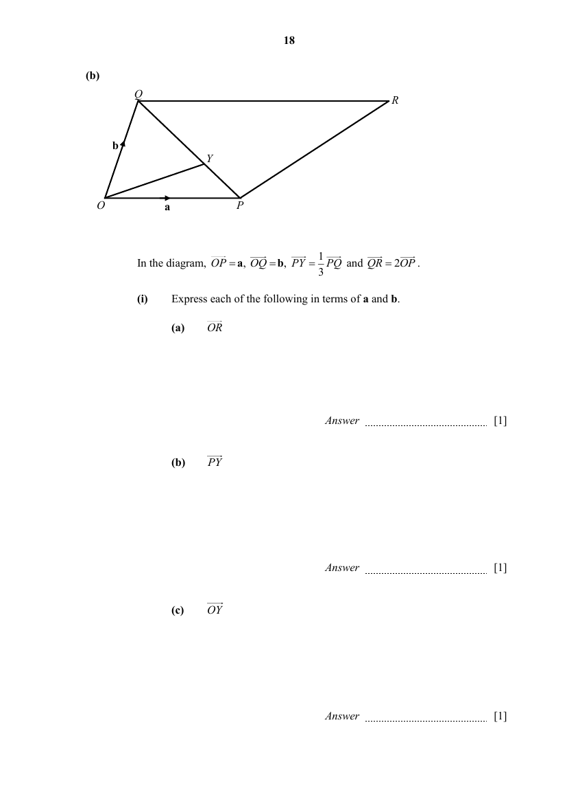
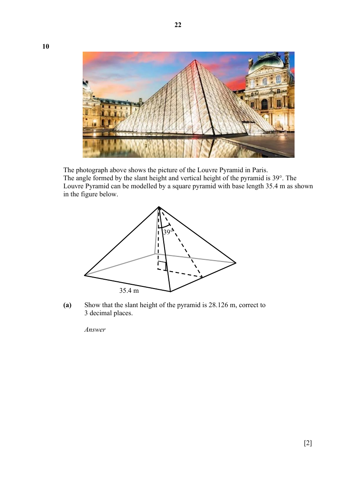
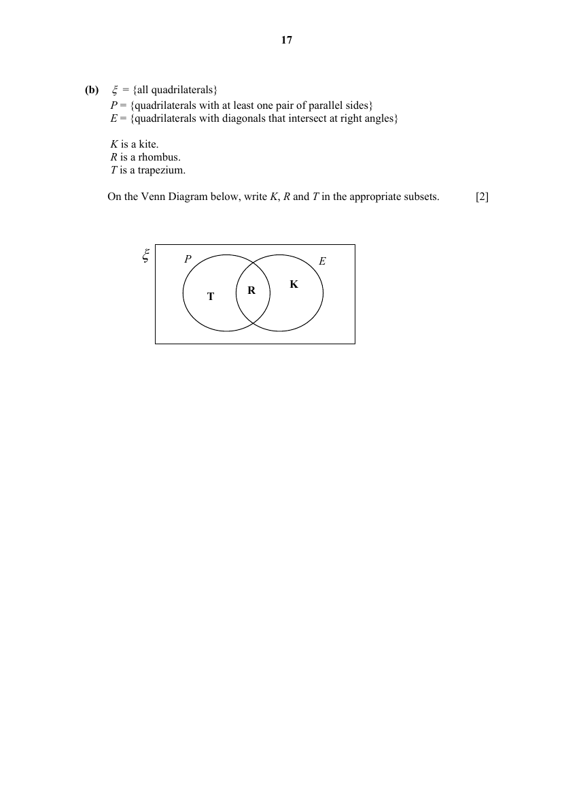

# Presbyterian High School — Mathematics 4052/02 Paper 2 (cleaned)

> **Institution:** Presbyterian High School
> **Exam:** 2025 Secondary Four Express / Five Normal Preliminary Examination
> **Level:** Secondary Four Express / Five Normal
> **Subjects:** Mathematics
> **Paper:** 4052/02 Paper 2
> **Date:** 21 August 2025
> **Duration:** 2 hours 15 minutes
> **Total Marks:** 90
> **Source:** `2025 Presbyterian HS MA Prelim P2 QP + MS.pdf` (cleaned & reformatted). Questions are the first copy. **Page** is this PDF’s own physical page.

The file named as Presbyterian High School Paper 2 Solutions in the extract set is Additional Mathematics 4049/02 (26 August 2025), not this paper. It is not used here. Worked answers below are the suggested-answers copy in this PDF (physical pages 32–52), with the short key on physical pages 26–27.

---

## Instructions

Answer all the questions.
Write your answers in the spaces provided.
If working is needed for any question it must be shown with the answer.
Omission of essential working will result in loss of marks.
The use of an approved scientific calculator is expected, where appropriate.
If the degree of accuracy is not specified in the question, and if the answer is not exact, give the answer to three significant figures. Give answers in degrees to one decimal place.
For $\pi$, use either your calculator value or $3.142$, unless the question requires the answer in terms of $\pi$.

---

## Mathematical Formulae

*Compound interest*

$$
\text{Total amount} = P\left(1+\frac{r}{100}\right)^{n}
$$

*Mensuration*

$$
\text{Curved surface area of a cone} = \pi rl
$$

$$
\text{Surface area of a sphere} = 4\pi r^{2}
$$

$$
\text{Volume of a cone} = \frac{1}{3}\pi r^{2}h
$$

$$
\text{Volume of a sphere} = \frac{4}{3}\pi r^{3}
$$

$$
\text{Area of triangle } ABC = \frac{1}{2}ab\sin C
$$

$$
\text{Arc length} = r\theta,\text{ where }\theta\text{ is in radians}
$$

$$
\text{Sector area} = \frac{1}{2}r^{2}\theta,\text{ where }\theta\text{ is in radians}
$$

*Trigonometry*

$$
\frac{a}{\sin A} = \frac{b}{\sin B} = \frac{c}{\sin C}
$$

$$
a^{2} = b^{2}+c^{2}-2bc\cos A
$$

*Statistics*

$$
\text{Mean} = \frac{\sum fx}{\sum f}
$$

$$
\text{Standard deviation} = \sqrt{\frac{\sum fx^{2}}{\sum f}-\left(\frac{\sum fx}{\sum f}\right)^{2}}
$$

---

## Section A — Answer all the questions

### Q1

> **Marks:** (a) 2, (b) 1, (c) 3, (d)(i) 2, (d)(ii) 2; total 10
> **Page:** 4–5

**(a)** Solve $\dfrac{x-3}{5}+\dfrac{x}{7}-1=0$. [2]
> **Topic:** N1 Numbers and their operations
> **Sub-topic:** Numbers and their operations
> **LO:** [[context/subjects/o-level-e-maths/learning-objectives/o-level-e-maths-N1g.md|N1g]]

**(b)** Simplify $\dfrac{10x^{2}}{y}\div\dfrac{2y^{3}}{x^{2}y}$. [1]
> **Topic:** N1 Numbers and their operations
> **Sub-topic:** Numbers and their operations
> **LO:** [[context/subjects/o-level-e-maths/learning-objectives/o-level-e-maths-N1g.md|N1g]]

**(c)** Simplify $\dfrac{18a^{2}-2}{15a^{2}+7a-4}$. [3]
> **Topic:** N1 Numbers and their operations
> **Sub-topic:** Numbers and their operations
> **LO:** [[context/subjects/o-level-e-maths/learning-objectives/o-level-e-maths-N1g.md|N1g]]

**(d)** Given the equation $q^{2}+6q-20=0$.

**(i)** Express $q^{2}+6q-20=0$ in the form $(q+m)^{2}+n=0$. [2]
> **Topic:** N1 Numbers and their operations
> **Sub-topic:** Numbers and their operations
> **LO:** [[context/subjects/o-level-e-maths/learning-objectives/o-level-e-maths-N1g.md|N1g]]

**(ii)** Hence, solve for $q$, giving your answers correct to 2 decimal places. [2]
> **Topic:** N1 Numbers and their operations
> **Sub-topic:** Numbers and their operations
> **LO:** [[context/subjects/o-level-e-maths/learning-objectives/o-level-e-maths-N1g.md|N1g]]

---

### Q2

> **Marks:** (a) 3, (b) 3, (c) 3; total 9
> **Page:** 6–7

**(a)** Linus invests a sum of money at $7\%$ per annum simple interest. At the end of $n$ years, the amount is more than twice the initial sum of money. Find the minimum integer value of $n$. [3]
> **Topic:** N3 Percentage
> **Sub-topic:** Percentage
> **LO:** [[context/subjects/o-level-e-maths/learning-objectives/o-level-e-maths-N3d.md|N3d]]

**(b)** Marcus wants to invest SGD 12000 for $4$ years and is exploring two investment options with different compounding frequencies.

| Option A | Option B |
| --- | --- |
| $6.5\%$ annual interest compounded monthly | $6.8\%$ annual interest compounded half yearly |

Determine which option Marcus should choose. Justify your reasons with calculations. [3]
> **Topic:** N3 Percentage
> **Sub-topic:** Percentage
> **LO:** [[context/subjects/o-level-e-maths/learning-objectives/o-level-e-maths-N3d.md|N3d]]

**(c)** A group of students travelled to Malaysia. They exchanged Singapore dollars (SGD) to Malaysian ringgit (MYR) at a rate of SGD $1$ = MYR $3.20$. They spent MYR $2525$ on accommodation and food. They also bought $80$ litres of fuel at MYR $2.50$ per litre. They exchanged the remaining MYR at a rate of SGD $1$ = MYR $3.25$ and received SGD $60$. Calculate the amount of SGD they exchanged at the start of their trip. [3]
> **Topic:** N3 Percentage
> **Sub-topic:** Percentage
> **LO:** [[context/subjects/o-level-e-maths/learning-objectives/o-level-e-maths-N3d.md|N3d]]

---

### Q3

> **Marks:** (a)(i) 1, (a)(ii) 1, (a)(iii) 2, (b)(i) 2, (b)(ii) 2, (c) 1; total 9
> **Page:** 8–9

The cumulative frequency curve below shows the distribution of masses of adults before a weight loss programme. The programme has $40$ adults.

**(a)** Using the graph,

**(i)** find the number of adults who had a mass between $115\text{ kg}$ and $125\text{ kg}$, [1]
> **Topic:** S2 Probability
> **Sub-topic:** Probability
> **LO:** [[context/subjects/o-level-e-maths/learning-objectives/o-level-e-maths-S2a.md|S2a]]

**(ii)** estimate the 90th percentile, [1]
> **Topic:** S2 Probability
> **Sub-topic:** Probability
> **LO:** [[context/subjects/o-level-e-maths/learning-objectives/o-level-e-maths-S2a.md|S2a]]

**(iii)** calculate the interquartile range. [2]
> **Topic:** S2 Probability
> **Sub-topic:** Probability
> **LO:** [[context/subjects/o-level-e-maths/learning-objectives/o-level-e-maths-S2a.md|S2a]]

**(b)** Two adults were selected at random before the programme. Find the probability that

**(i)** at least one of the two adults was heavier than $135\text{ kg}$, [2]
> **Topic:** S2 Probability
> **Sub-topic:** Probability
> **LO:** [[context/subjects/o-level-e-maths/learning-objectives/o-level-e-maths-S2c.md|S2c]]

**(ii)** one of the two adults was heavier than $120\text{ kg}$ and the other was not. [2]
> **Topic:** S2 Probability
> **Sub-topic:** Probability
> **LO:** [[context/subjects/o-level-e-maths/learning-objectives/o-level-e-maths-S2c.md|S2c]]

**(c)** The weight of these $40$ adults are taken again after the weight loss programme. The details are shown below:

| Median | 25th percentile | 75th percentile |
| --- | --- | --- |
| $115\text{ kg}$ | $110\text{ kg}$ | $119\text{ kg}$ |

Make a comparison between the before and after programme to determine if the programme is effective. [1]
> **Topic:** S2 Probability
> **Sub-topic:** Probability
> **LO:** [[context/subjects/o-level-e-maths/learning-objectives/o-level-e-maths-S2a.md|S2a]]

---

### Q4

> **Marks:** (a) 1, (b) 3, (c) 1, (d) 2, (e) 3; total 10
> **Page:** 10–11

**(a)** Complete the table of values for $y=\dfrac{3x^{3}}{10}-x+1$. [1]
> **Topic:** G6 Coordinate geometry
> **Sub-topic:** Coordinate geometry
> **LO:** [[context/subjects/o-level-e-maths/learning-objectives/o-level-e-maths-G6c.md|G6c]]

| $x$ | $-3$ | $-2$ | $-1$ | $0$ | $1$ | $2$ | $3$ |
| --- | --- | --- | --- | --- | --- | --- | --- |
| $y$ | $p$ | $0.6$ | $1.7$ | $1$ | $0.3$ | $1.4$ | $6.1$ |

**(b)** On the grid opposite, draw the graph of $y=\dfrac{3x^{3}}{10}-x+1$ for $-3\leq x\leq 3$. [3]
> **Topic:** N6 Functions and graphs
> **Sub-topic:** Functions and graphs
> **LO:** [[context/subjects/o-level-e-maths/learning-objectives/o-level-e-maths-N6c.md|N6c]]

**(c)** The equation $k=\dfrac{3x^{3}}{10}-x+1$ has $2$ solutions in the range $-3\leq x\leq 3$. Write down the value(s) of $k$. [1]
> **Topic:** G6 Coordinate geometry
> **Sub-topic:** Coordinate geometry
> **LO:** [[context/subjects/o-level-e-maths/learning-objectives/o-level-e-maths-G6c.md|G6c]]

**(d)** By drawing a tangent, find the gradient of the curve at $x=1.6$. [2]
> **Topic:** G6 Coordinate geometry
> **Sub-topic:** Coordinate geometry
> **LO:** [[context/subjects/o-level-e-maths/learning-objectives/o-level-e-maths-G6c.md|G6c]]

**(e)** By drawing a suitable straight line on the grid, solve the equation $3x^{3}-30x-20=0$. [3]
> **Topic:** G6 Coordinate geometry
> **Sub-topic:** Coordinate geometry
> **LO:** [[context/subjects/o-level-e-maths/learning-objectives/o-level-e-maths-G6c.md|G6c]]

---

### Q5

> **Marks:** (a)(i) 1, (a)(ii) 1, (b) 3, (c)(i) 2, (c)(ii) 2; total 9
> **Page:** 12–13

**(a)** In the diagram, the points $A$, $B$, $C$, $D$ and $F$ lie on the circle with centre $O$. $AF$ is the diameter and $CEB$ is a straight line, $\angle AEC=2x^{\circ}-2y^{\circ}$, $\angle ABC=2y^{\circ}$, $\angle ADC=x^{\circ}$ and $\angle BAE=40^{\circ}$.

Give a reason why

**(i)** $x+2y=180$, [1]
> **Topic:** G3 Properties of circles
> **Sub-topic:** Properties of circles
> **LO:** [[context/subjects/o-level-e-maths/learning-objectives/o-level-e-maths-G3b.md|G3b]]

**(ii)** $2y+40=2x-2y$. [1]
> **Topic:** G3 Properties of circles
> **Sub-topic:** Properties of circles
> **LO:** [[context/subjects/o-level-e-maths/learning-objectives/o-level-e-maths-G3b.md|G3b]]

**(b)** Solve the two equations in part (a) simultaneously. [3]
> **Topic:** G3 Properties of circles
> **Sub-topic:** Properties of circles
> **LO:** [[context/subjects/o-level-e-maths/learning-objectives/o-level-e-maths-G3b.md|G3b]]

**(c)** Hence, calculate, stating reasons,

**(i)** $\angle AOC$, [2]
> **Topic:** G3 Properties of circles
> **Sub-topic:** Properties of circles
> **LO:** [[context/subjects/o-level-e-maths/learning-objectives/o-level-e-maths-G3b.md|G3b]]

**(ii)** $\angle ACB$. [2]
> **Topic:** G3 Properties of circles
> **Sub-topic:** Properties of circles
> **LO:** [[context/subjects/o-level-e-maths/learning-objectives/o-level-e-maths-G3b.md|G3b]]

---

### Q6

> **Marks:** (a)(i) 2, (a)(ii) 2, (b) 3; total 7
> **Page:** 14

**(a)** **(i)** Each interior angle of a regular polygon is $y^{\circ}$. Find the number of sides of the polygon. Give your answer in terms of $y$. [2]
> **Topic:** G1 Angles, triangles and polygons
> **Sub-topic:** Angles, triangles and polygons
> **LO:** [[context/subjects/o-level-e-maths/learning-objectives/o-level-e-maths-G1f.md|G1f]]

**(ii)** Hence, explain whether it is possible for the value of $y$ to be $20$. [2]
> **Topic:** G1 Angles, triangles and polygons
> **Sub-topic:** Angles, triangles and polygons
> **LO:** [[context/subjects/o-level-e-maths/learning-objectives/o-level-e-maths-G1f.md|G1f]]

**(b)** $A$, $B$ and $C$ are three vertices of an $n$-sided polygon. Given that the reflex angle $ABC=190^{\circ}$ and all the other exterior angles are all equal to $35^{\circ}$ each. Find $n$. [3]
> **Topic:** G1 Angles, triangles and polygons
> **Sub-topic:** Angles, triangles and polygons
> **LO:** [[context/subjects/o-level-e-maths/learning-objectives/o-level-e-maths-G1f.md|G1f]]

---

### Q7

> **Marks:** (a)(i) 1, (a)(ii) 2, (b) 2; total 5
> **Page:** 15–16

**(a)** The diagram shows a solid formed by joining a cone and a hemisphere at their circular bases. The radius of the circular base is $r$ and the total height of the solid is $h$.

**(i)** Write an expression for the height of the cone in terms of $r$ and $h$. [1]
> **Topic:** N8 Set language and notation
> **Sub-topic:** Set language and notation
> **LO:** [[context/subjects/o-level-e-maths/learning-objectives/o-level-e-maths-N8c.md|N8c]]

**(ii)** If $r=5\text{ cm}$ and $h=12\text{ cm}$, calculate the volume of the solid, giving your answer in terms of $\pi$. [2]
> **Topic:** N8 Set language and notation
> **Sub-topic:** Set language and notation
> **LO:** [[context/subjects/o-level-e-maths/learning-objectives/o-level-e-maths-N8c.md|N8c]]

**(b)** $\xi=\{\text{all quadrilaterals}\}$

$P=\{\text{quadrilaterals with at least one pair of parallel sides}\}$

$E=\{\text{quadrilaterals with diagonals that intersect at right angles}\}$

$K$ is a kite. $R$ is a rhombus. $T$ is a trapezium.

On the Venn diagram below, write $K$, $R$ and $T$ in the appropriate subsets. [2]
> **Topic:** N8 Set language and notation
> **Sub-topic:** Set language and notation
> **LO:** [[context/subjects/o-level-e-maths/learning-objectives/o-level-e-maths-N8c.md|N8c]]

---

### Q8

> **Marks:** (a)(i) 1, (a)(ii) 2, (a)(iii) 2, (b)(i) 3, (b)(ii) 2, (b)(iii) 1; total 11
> **Page:** 17–19

**(a)** The point $A$ is $(2,-3)$ and the point $B$ is $(7,4)$.

**(i)** Express $\overrightarrow{AB}$ as a column vector. [1]
> **Topic:** G7 Vectors in two dimensions
> **Sub-topic:** Vectors in two dimensions
> **LO:** [[context/subjects/o-level-e-maths/learning-objectives/o-level-e-maths-G7h.md|G7h]]

**(ii)** Find $AB$. [2]
> **Topic:** G7 Vectors in two dimensions
> **Sub-topic:** Vectors in two dimensions
> **LO:** [[context/subjects/o-level-e-maths/learning-objectives/o-level-e-maths-G7h.md|G7h]]

**(iii)** $C$ is the point such that $\overrightarrow{AC}=3\overrightarrow{AB}$. Find the coordinates of $C$. [2]
> **Topic:** G7 Vectors in two dimensions
> **Sub-topic:** Vectors in two dimensions
> **LO:** [[context/subjects/o-level-e-maths/learning-objectives/o-level-e-maths-G7h.md|G7h]]

**(b)**

In the diagram, $\overrightarrow{OP}=\mathbf{a}$, $\overrightarrow{OQ}=\mathbf{b}$, $\overrightarrow{PY}=\dfrac{1}{3}\overrightarrow{PQ}$ and $\overrightarrow{QR}=2\overrightarrow{OP}$.

**(i)** Express each of the following in terms of $\mathbf{a}$ and $\mathbf{b}$.

**(a)** $\overrightarrow{OR}$ [1]
> **Topic:** G7 Vectors in two dimensions
> **Sub-topic:** Vectors in two dimensions
> **LO:** [[context/subjects/o-level-e-maths/learning-objectives/o-level-e-maths-G7h.md|G7h]]

**(b)** $\overrightarrow{PY}$ [1]
> **Topic:** G7 Vectors in two dimensions
> **Sub-topic:** Vectors in two dimensions
> **LO:** [[context/subjects/o-level-e-maths/learning-objectives/o-level-e-maths-G7h.md|G7h]]

**(c)** $\overrightarrow{OY}$ [1]
> **Topic:** G7 Vectors in two dimensions
> **Sub-topic:** Vectors in two dimensions
> **LO:** [[context/subjects/o-level-e-maths/learning-objectives/o-level-e-maths-G7h.md|G7h]]

**(ii)** What can you deduce about $O$, $Y$ and $R$? Explain. [2]
> **Topic:** G7 Vectors in two dimensions
> **Sub-topic:** Vectors in two dimensions
> **LO:** [[context/subjects/o-level-e-maths/learning-objectives/o-level-e-maths-G7h.md|G7h]]

**(iii)** Find $\dfrac{\text{area of triangle }OPY}{\text{area of triangle }OQY}$. [1]
> **Topic:** G7 Vectors in two dimensions
> **Sub-topic:** Vectors in two dimensions
> **LO:** [[context/subjects/o-level-e-maths/learning-objectives/o-level-e-maths-G7h.md|G7h]]

---

### Q9

> **Marks:** (a)(i) 2, (a)(ii) 3, (b)(i) 3, (b)(ii) 1; total 9
> **Page:** 20–21

**(a)** The figure shows a sloping triangle $XYK$ in a cuboid. The cuboid has a base width of $6\text{ cm}$ and height $10\text{ cm}$. $XJ=YM=3\text{ cm}$.

**(i)** Given that $YK=\sqrt{369}\text{ cm}$, explain why $XK=\sqrt{333}\text{ cm}$. [2]
> **Topic:** G4 Pythagoras' theorem and trigonometry
> **Sub-topic:** Pythagoras' theorem and trigonometry
> **LO:** [[context/subjects/o-level-e-maths/learning-objectives/o-level-e-maths-G4g.md|G4g]]

**(ii)** Suppose $JK=18\text{ cm}$, find $\angle XPK$, to the nearest degree. [3]
> **Topic:** G4 Pythagoras' theorem and trigonometry
> **Sub-topic:** Pythagoras' theorem and trigonometry
> **LO:** [[context/subjects/o-level-e-maths/learning-objectives/o-level-e-maths-G4g.md|G4g]]

**(b)** In the diagram, $ACD$ is a straight line. $AB=4\text{ cm}$, $BC=5\text{ cm}$ and $\sin\angle BCD=\dfrac{3}{4}$.

**(i)** Find angle $ABC$. [3]
> **Topic:** G4 Pythagoras' theorem and trigonometry
> **Sub-topic:** Pythagoras' theorem and trigonometry
> **LO:** [[context/subjects/o-level-e-maths/learning-objectives/o-level-e-maths-G4c.md|G4c]]

**(ii)** Hence find the area of triangle $ABC$. [1]
> **Topic:** G4 Pythagoras' theorem and trigonometry
> **Sub-topic:** Pythagoras' theorem and trigonometry
> **LO:** [[context/subjects/o-level-e-maths/learning-objectives/o-level-e-maths-G4c.md|G4c]]

---

### Q10

> **Marks:** (a) 2, (b) 2, (c) 7; total 11
> **Page:** 22–25

The photograph above shows the picture of the Louvre Pyramid in Paris. The angle formed by the slant height and vertical height of the pyramid is $39^{\circ}$. The Louvre Pyramid can be modelled by a square pyramid with base length $35.4\text{ m}$ as shown in the figure below.

**(a)** Show that the slant height of the pyramid is $28.126\text{ m}$, correct to $3$ decimal places. [2]
> **Topic:** G5 Mensuration
> **Sub-topic:** Mensuration
> **LO:** [[context/subjects/o-level-e-maths/learning-objectives/o-level-e-maths-G5e.md|G5e]]

**(b)** Calculate the total surface area of the four lateral faces of the pyramid. [2]
> **Topic:** G5 Mensuration
> **Sub-topic:** Mensuration
> **LO:** [[context/subjects/o-level-e-maths/learning-objectives/o-level-e-maths-G5c.md|G5c]]

**(c)** The Louvre Pyramid was constructed using glass panels and steel rods. Information on the construction materials used is as follows:

- $90\%$ of the four lateral faces of the pyramid is covered with glass panels.
- The glass panels have uniform thickness of $21\text{ mm}$.
- The density of the glass used for the panels is $2790\text{ kg/m}^{3}$.
- Density $=$ mass/volume.
- The total mass of steel rods used is $95$ tonnes. [$1$ tonne $=1000\text{ kg}$]

A geometrically similar replica of the Louvre Pyramid is being constructed using the same materials and will be displayed on a raised platform for an exhibition. The raised platform must be large enough to fit the base of the replica. The base length of the replica pyramid is $4$ metres. The exhibition organisers need to select a suitable material for the raised platform. The maximum load capacity and price of different materials for the raised platform are shown in the table below.

| Platform material | Solid Hardwood | Marble | Concrete |
| --- | --- | --- | --- |
| Maximum load capacity | $250\text{ kg}$ | $500\text{ kg}$ | $700\text{ kg}$ |
| Approx cost | SGD 8.50 per kg | SGD 300 per $\text{m}^{2}$ | SGD 220 per $1.5\text{ m}$ by $1.5\text{ m}$ slab |

Concrete is sold in standard slab units, which are not designed to be cut or resized.

Make a recommendation to the exhibition organisers on the choice of material for the raised platform. Justify your recommendation and show your calculations clearly. [7]
> **Topic:** G5 Mensuration
> **Sub-topic:** Mensuration
> **LO:** [[context/subjects/o-level-e-maths/learning-objectives/o-level-e-maths-G5e.md|G5e]]

---

## Answers

### Q1

> **Marks:** (a) 2, (b) 1, (c) 3, (d)(i) 2, (d)(ii) 2; total 10
> **Page:** 32–33

**(a)** $x=4\dfrac{2}{3}$. Accept $\dfrac{14}{3}$.

**(b)** $\dfrac{5x^{4}}{y^{3}}$

**(c)** $\dfrac{6a+2}{5a+4}$

**(d)** **(i)** $(q+3)^{2}-29=0$

**(ii)** $q=2.39$ or $q=-8.39$

---

### Q2

> **Marks:** (a) 3, (b) 3, (c) 3; total 9
> **Page:** 34–35

**(a)** $n=15$

**(b)** Option A gives SGD 15552.25. Option B gives SGD 15679.98. Choose Option B.

**(c)** SGD $912.50$

---

### Q3

> **Marks:** (a)(i) 1, (a)(ii) 1, (a)(iii) 2, (b)(i) 2, (b)(ii) 2, (c) 1; total 9
> **Page:** 36–37

**(a)** **(i)** $10$ adults

**(ii)** $136\text{ kg}$

**(iii)** $132-121=11\text{ kg}$

**(b)** **(i)** $\dfrac{37}{156}$

**(ii)** $\dfrac{93}{260}$

**(c)** The median is $127.5\text{ kg}$ before the programme and $115\text{ kg}$ after the programme. This shows the adults participating in the event is lighter after the programme. In conclusion, the programme is effective.

---

### Q4

> **Marks:** (a) 1, (b) 3, (c) 1, (d) 2, (e) 3; total 10
> **Page:** 38–39

**(a)** $p=-4.1$

**(b)** Graph of $y=\dfrac{3x^{3}}{10}-x+1$ for $-3\leq x\leq 3$.

**(c)** $k=1.70$, $k=0.30$

**(d)** $1.33$

**(e)** The straight line used is $y=2x+3$, from $\dfrac{3x^{3}}{10}-x+1=2x+3$. $x=-2.7$, $-0.7$.

---

### Q5

> **Marks:** (a)(i) 1, (a)(ii) 1, (b) 3, (c)(i) 2, (c)(ii) 2; total 9
> **Page:** 40–42

**(a)** **(i)** Angles in opposite segments.

**(ii)** Sum of exterior angles, or angle sum of triangle and adjacent angles on a straight line.

**(b)** $x=100$, $y=40$

**(c)** **(i)** $\angle ABC=80^{\circ}$, so $\angle AOC=160^{\circ}$ (angle at the centre is twice the angle at the circumference).

**(ii)** $\angle ECF=40^{\circ}$ (angles in the same segment). $\angle ACB=90^{\circ}-40^{\circ}=50^{\circ}$ (angle in a semicircle).

---

### Q6

> **Marks:** (a)(i) 2, (a)(ii) 2, (b) 3; total 7
> **Page:** 42–43

**(a)** **(i)** $n=\dfrac{360}{180-y}$

**(ii)** When $y=20$, $n=\dfrac{9}{4}$. Since $n$ is not an integer, it is not possible.

**(b)** Exterior angle at $B$ is $10^{\circ}$. $(n-1)35^{\circ}+10^{\circ}=360^{\circ}$, so $n=11$.

---

### Q7

> **Marks:** (a)(i) 1, (a)(ii) 2, (b) 2; total 5
> **Page:** 44–45

**(a)** **(i)** $h-r$

**(ii)** $\dfrac{425\pi}{3}$ or $141\dfrac{2}{3}\pi\text{ cm}^{3}$. The extract also prints a denominator $4$; the fraction that matches $141\dfrac{2}{3}\pi$ is $\dfrac{425\pi}{3}$.

**(b)** $T$ is in $P$ only. $R$ is in $P\cap E$. $K$ is in $E$ only.

---

### Q8

> **Marks:** (a)(i) 1, (a)(ii) 2, (a)(iii) 2, (b)(i) 3, (b)(ii) 2, (b)(iii) 1; total 11
> **Page:** 46–48

**(a)** **(i)** $\begin{pmatrix} 5 \\ 7 \end{pmatrix}$

**(ii)** $8.60$ units

**(iii)** $C(17,18)$

**(b)** **(i)** **(a)** $2\mathbf{a}+\mathbf{b}$

**(b)** $\dfrac{1}{3}(\mathbf{b}-\mathbf{a})$

**(c)** $\dfrac{2}{3}\mathbf{a}+\dfrac{1}{3}\mathbf{b}$

**(ii)** $\overrightarrow{OY}=\dfrac{1}{3}\overrightarrow{OR}$. Hence $OY$ and $OR$ are parallel vectors and are in the same direction. Since they share the common point $O$ they lie on the same straight line. The solutions copy says “common point $Y$”.

**(iii)** $\dfrac{1}{2}$

---

### Q9

> **Marks:** (a)(i) 2, (a)(ii) 3, (b)(i) 3, (b)(ii) 1; total 9
> **Page:** 48–49

**(a)** **(i)** $369-6^{2}=XK^{2}$, so $XK^{2}=333$ and $XK=\sqrt{333}$ (shown).

**(ii)** The answer key gives $60.9^{\circ}$. One method in the solutions copy uses $\tan^{-1}\left(\dfrac{18}{10}\right)$ and another uses the cosine rule, and that copy then rounds to $61^{\circ}$.

**(b)** **(i)** $61.8^{\circ}$

**(ii)** $8.81\text{ cm}^{2}$

---

### Q10

> **Marks:** (a) 2, (b) 2, (c) 7; total 11
> **Page:** 50–52

**(a)** The solutions copy does not write the steps. From the figure, half the base is $17.7\text{ m}$ and the angle between the slant height and the vertical height is $39^{\circ}$, so

$$
\text{slant height}=\frac{17.7}{\sin 39^{\circ}}=28.126\text{ m}
$$

(shown).

**(b)** $1990\text{ m}^{2}$

**(c)** Minimum cost of $9$ concrete slabs $=9\times 220=1980$ dollars. Minimum cost of $16\text{ m}^{2}$ of marble $=16\times 300=4800$ dollars. I would recommend using concrete for the raised platform as the mass of the replica is within the load capacity of concrete and concrete would be cheaper than marble.
