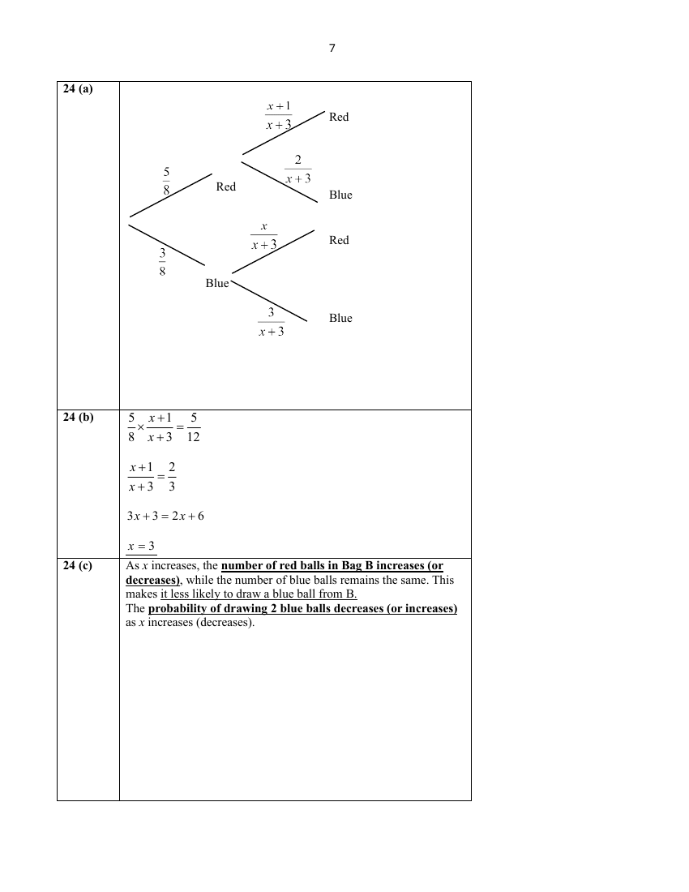

# St Joseph's Institution — Mathematics 4052/01 Paper 1 Solutions (cleaned)

> **Institution:** St Joseph's Institution
> **Exam:** Preliminary Examination 2025 (Year 4)
> **Level:** Year 4
> **Subjects:** Mathematics
> **Paper:** MA4052 Paper 1 Solutions
> **Date:** 15 August 2025
> **Duration:** 2 hours 15 minutes
> **Total Marks:** 90
> **Source:** `SJI 2025 EMATH PRELIM P1 MS.pdf` (cleaned & reformatted). **Page** is the question page in `SJI 2025 Prelim Paper 1 With Answer Key-1.pdf`.

---

## Solutions

### Q1

> **Marks:** 1
> **Sub-topic:** Approximation and bounds
> **Page:** 3

$26450\leq x\leq 26549$

---

### Q2

> **Marks:** 2
> **Sub-topic:** Simple interest
> **Page:** 3

$$
I=\frac{50000\times r\times\dfrac{q}{12}}{100}
$$

$$
=\frac{125rq}{3}\quad\text{or}\quad 41\frac{2}{3}rq
$$

---

### Q3

> **Marks:** 2
> **Sub-topic:** Trigonometry
> **Page:** 4

$$
\cos\angle BDC=\frac{9^{2}+10^{2}-8^{2}}{2(9)(10)}=\frac{13}{20}
$$

$$
\cos\angle BDC=-\frac{13}{20}
$$

---

### Q4

> **Marks:** (a) 1, (b) 1; total 2
> **Sub-topic:** Probability
> **Page:** 5

**(a)**

$$
P(\text{walks to school})=1-\frac{1}{5}=\frac{4}{5}
$$

**(b)**

$$
\text{No. of days}=\frac{4}{5}(190)=152
$$

---

### Q5

> **Marks:** 2
> **Sub-topic:** Polygons
> **Page:** 5

$$
\frac{(2n-2)\times 180}{2n}-\frac{(n-2)\times 180}{n}=20
$$

$$
(2n-2)(180)-(2n-4)(180)=40n
$$

$$
360=40n
$$

$$
n=9
$$

---

### Q6

> **Marks:** (a) 1, (b) 1; total 2
> **Sub-topic:** Stem-and-leaf diagrams
> **Page:** 6

**(a)** Median mark $= 34$

**(b)**

$$
\text{Max mark}-17=32
$$

$$
\text{Max mark}=49
$$

$$
\therefore x=9
$$

---

### Q7

> **Marks:** (a) 1, (b) 2; total 3
> **Sub-topic:** Statistical graphs
> **Page:** 7

**(a)**

$$
\%\text{ reduction}=\frac{142-130}{142}\times 100\%=8.45\%\text{ (to 3 sf)}
$$

**(b)** The graph gives the impression that water consumption in 2021 doubled compared to 2018/19, when the actual increase is only about one-third. This misinterpretation arises because the vertical axis does not start from zero, exaggerating the fluctuations and making the changes appear more significant than they really are.

OR

It misleads us into thinking that there is a gradual downward trend in water consumption from 2024 to 2030, which might not be the case.

---

### Q8

> **Marks:** 2
> **Sub-topic:** Indices
> **Page:** 8

$$
\left(\frac{16m^{6}}{9q^{8}}\right)^{-\frac{3}{2}}=\left(\frac{9q^{8}}{16m^{6}}\right)^{\frac{3}{2}}=\frac{27q^{12}}{64m^{9}}
$$

---

### Q9

> **Marks:** 2
> **Sub-topic:** Numbers and prime factors
> **Page:** 8

$$
18=2\times 3^{2}
$$

$$
N=(2\times 3)^{6}=46\,656
$$

---

### Q10

> **Marks:** 3
> **Sub-topic:** Algebraic fractions
> **Page:** 9

$$
\frac{1}{2-x}-\frac{3x+2}{x^{2}-7x+10}=\frac{-1}{x-2}-\frac{3x+2}{(x-2)(x-5)}
$$

$$
=\frac{-x+5-3x-2}{(x-2)(x-5)}=\frac{-4x+3}{(x-2)(x-5)}
$$

---

### Q11

> **Marks:** (a) 1, (b) 3; total 4
> **Sub-topic:** Number sequences
> **Page:** 10

**(a)** $T_{5}=17^{2}+5^{2}=314$

**(b)**

$$
T_{n}=(4n-3)^{2}+n^{2}=16n^{2}-24n+9+n^{2}=17n^{2}-24n+9
$$

---

### Q12

> **Marks:** (a) 1, (b) 2; total 3
> **Sub-topic:** Averages of a frequency distribution
> **Page:** 11

**(a)** $x=9$

**(b)**

$$
3+x=8+6+2+1
$$

$$
x=14
$$

---

### Q13

> **Marks:** 3
> **Sub-topic:** Speed, distance and time
> **Page:** 11

Let $x$ be the total distance travelled.

$$
\frac{x}{\dfrac{0.35x}{20}+\dfrac{0.65x}{30}}=x\div\left[\frac{1.05x+1.3x}{60}\right]=x\div\frac{2.35x}{60}=25.5\text{ km/h (to 3 sf)}
$$

---

### Q14

> **Marks:** (a) 2, (b) 1; total 3
> **Sub-topic:** Standard deviation
> **Page:** 12

**(a)** Set B has the larger standard deviation. All values in Set A are the same, so there is no spread and the standard deviation is 0. Set B’s values are spread out around the mean, so its standard deviation is greater than 0.

**(b)** $14$

Adding 10 to each score does not change the standard deviation, so it remains 7. Multiplying every score by 2 doubles the standard deviation.

---

### Q15

> **Marks:** (a) 2, (b) 2; total 4
> **Sub-topic:** Sets and probability
> **Page:** 13

**(a)** $6, 9, 12, 15, 18, 21, 24$

**(b)**

$$
\text{Probability}=\frac{9}{24}=\frac{3}{8}
$$

---

### Q16

> **Marks:** (a) 2, (b) 2; total 4
> **Sub-topic:** Circle theorems and similarity
> **Page:** 14

**(a)**

$$
\angle BAD=90^{\circ}\text{ (tangent perpendicular to radius)}
$$

$$
\angle ACB=90^{\circ}\text{ (angle in a semicircle)}
$$

$$
\angle ACD=90^{\circ}\text{ (adjacent angles on a straight line)}
$$

$$
\angle BAD=\angle ACD=90^{\circ}
$$

$$
\angle BDA=\angle ADC\text{ (common angle)}
$$

$\triangle CDA$ and $\triangle ADB$ are similar (AA Similarity Test)

**(b)**

$$
\frac{x}{9}=\frac{25}{x}
$$

$$
x^{2}=225
$$

$$
x=15\quad(x>0)
$$

---

### Q17

> **Marks:** 3
> **Sub-topic:** Proportion
> **Page:** 15

$$
F=kv^{2}
$$

$$
F_{\text{new}}=k(v_{\text{new}})^{2}=k(0.8v)^{2}
$$

$$
\text{Percentage change in }F=\frac{k(0.8v)^{2}-kv^{2}}{kv^{2}}\times 100\%=-36\%
$$

---

### Q18

> **Marks:** (a) 1, (b) 2; total 3
> **Sub-topic:** Factorisation
> **Page:** 15

**(a)** $x^{2}-169=(x+13)(x-13)$

**(b)**

$$
1431=40^{2}-169=(40+13)(40-13)=(53)(27)
$$

2 factors are 27 and 53.

---

### Q19

> **Marks:** (a) 2, (b) 1; total 3
> **Sub-topic:** Map scales
> **Page:** 16

**(a)** $6.25\text{ cm}^{2}$ represents $1.44\text{ km}^{2}$.

$2.5$ cm represents $1.2$ km.

$$
1:\frac{1.2\times 100000}{2.5}
$$

$$
1:48\,000
$$

**(b)**

$$
\text{Length (on the map)}=\frac{100x}{48000}=\frac{x}{480}\text{ cm}
$$

---

### Q20

> **Marks:** (a) 2, (b) 2; total 4
> **Sub-topic:** Highest common factor
> **Page:** 17

**(a)**

$$
120=2^{3}\times 3\times 5
$$

$$
84=2^{2}\times 3\times 7
$$

$$
96=2^{5}\times 3
$$

$$
\text{Largest possible length}=2^{2}\times 3=12
$$

**(b)**

$$
\text{No. of cubes}=\frac{120}{12}\times\frac{84}{12}\times\frac{96}{12}=560
$$

---

### Q21

> **Marks:** (a) 2, (b) 3; total 5
> **Sub-topic:** Factorisation and quadratic equations
> **Page:** 18

**(a)**

$$
2x^{2}-4xy-x+2y=2x(x-2y)-(x-2y)=(x-2y)(2x-1)
$$

**(b)**

$$
2x^{2}-8x-7=0
$$

$$
x^{2}-4x-\frac{7}{2}=0
$$

$$
(x-2)^{2}-2^{2}-\frac{7}{2}=0
$$

$$
(x-2)^{2}=\frac{15}{2}
$$

$$
x-2=\pm\sqrt{\frac{15}{2}}
$$

$$
x=4.74\text{ or }x=-0.74
$$

---

### Q22

> **Marks:** (a) 2, (b) 3; total 5
> **Sub-topic:** Arc length, sector area and tangents
> **Page:** 19

**(a)**

$$
\angle ADO=\frac{\pi}{8}
$$

(tangents from an external point, where line $OD$ bisects $\angle ADB$)

$$
\tan\frac{\pi}{8}=\frac{8}{AD}
$$

$$
AD=\frac{8}{\tan\dfrac{\pi}{8}}\approx 19.3137=19.3\text{ cm (to 3 sf)}
$$

**(b)**

$$
\text{Shaded area}=2\times\frac{1}{2}\times 19.3137\times 8-\frac{1}{2}(8)^{2}\left(2\pi-\frac{\pi}{2}-\frac{\pi}{2}-\frac{\pi}{4}\right)
$$

$$
\approx 79.111=79.1\text{ cm}^{2}\text{ (to 3 sf)}
$$

---

### Q23

> **Marks:** (a) 1, (b) 2, (c) 1, (d) 2; total 6
> **Sub-topic:** Matrices
> **Page:** 20–21

**(a)**

$$
N=\begin{pmatrix}4\\2\\x\end{pmatrix}
$$

**(b)**

$$
L=\begin{pmatrix}2&1&3\\3&2&1\\1&4&2\end{pmatrix}\begin{pmatrix}4\\2\\x\end{pmatrix}=\begin{pmatrix}10+3x\\16+x\\12+2x\end{pmatrix}
$$

**(c)** Matrix $L$ represents the total litres of red, blue, and yellow base colors, respectively, needed by the shop to create the three shades, A, B, and C.

OR

$10+3x$ represents the total litres of red base colour needed by the shop to create the 3 shades, A, B and C.

$16+x$ represents the total litres of blue base colour needed by the shop to create the 3 shades, A, B and C.

$12+2x$ represents the total litres of yellow base colour needed by the shop to create the 3 shades, A, B and C.

**(d)** Each colour must use at most 25 litres.

For Red:

$$
10+3x\leq 25,\quad x\leq 5
$$

For Blue:

$$
16+x\leq 25,\quad x\leq 9
$$

For Yellow:

$$
12+2x\leq 25,\quad x\leq 6.5
$$

Largest integer of $x=5$

---

### Q24

> **Marks:** (a) 2, (b) 2, (c) 1; total 5
> **Sub-topic:** Probability
> **Page:** 22–23

**(a)**

**(b)**

$$
\frac{5}{8}\times\frac{x+1}{x+3}=\frac{5}{12}
$$

$$
\frac{x+1}{x+3}=\frac{2}{3}
$$

$$
3x+3=2x+6
$$

$$
x=3
$$

**(c)** As $x$ increases, the number of red balls in Bag B increases (or decreases), while the number of blue balls remains the same. This makes it less likely to draw a blue ball from B.
The probability of drawing 2 blue balls decreases (or increases) as $x$ increases (decreases).

---

### Q25

> **Marks:** (a) 1, (b) 2, (c) 1, (d) 3; total 7
> **Sub-topic:** Quadratic graphs
> **Page:** 24–25

**(a)** $x=1$

**(b)**

$$
m=\frac{6-0}{0-6}=-1
$$

**(c)** The number of real solutions to the question is equal to the number of points where the horizontal line $y=m$ meets the graph.

**(d)** Draw $y=-0.5x+2.5$.

From the graph, $x=-1$ or $5$.

---

### Q26

> **Marks:** (a) 1, (b) 2, (c) 2, (d) 1, (e) 1; total 7
> **Sub-topic:** Distance-time graphs
> **Page:** 26–27

**(a)** Lily stopped (or rest / not moving / at Town B).

**(b)**

$$
\text{Average speed}=\frac{30-14}{\dfrac{48}{60}}=20\text{ km/h}
$$

**(c)**

$$
\text{Time taken}=\frac{20}{16\dfrac{2}{3}}=1\text{ h }12\text{ min}
$$

Correct straight line drawn.

**(d)** Line drawn on the travel graph. See the image above.

**(e)** Distance from Town D $= 9$ km
