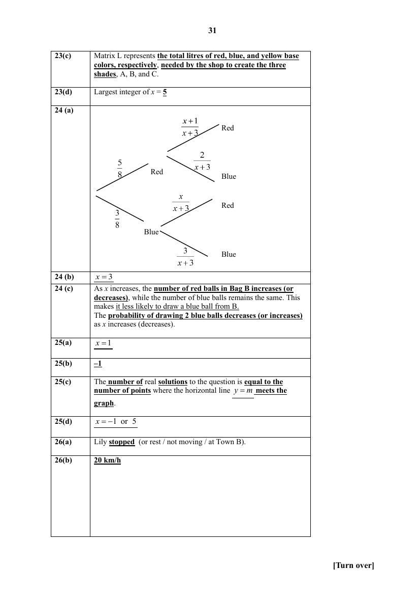
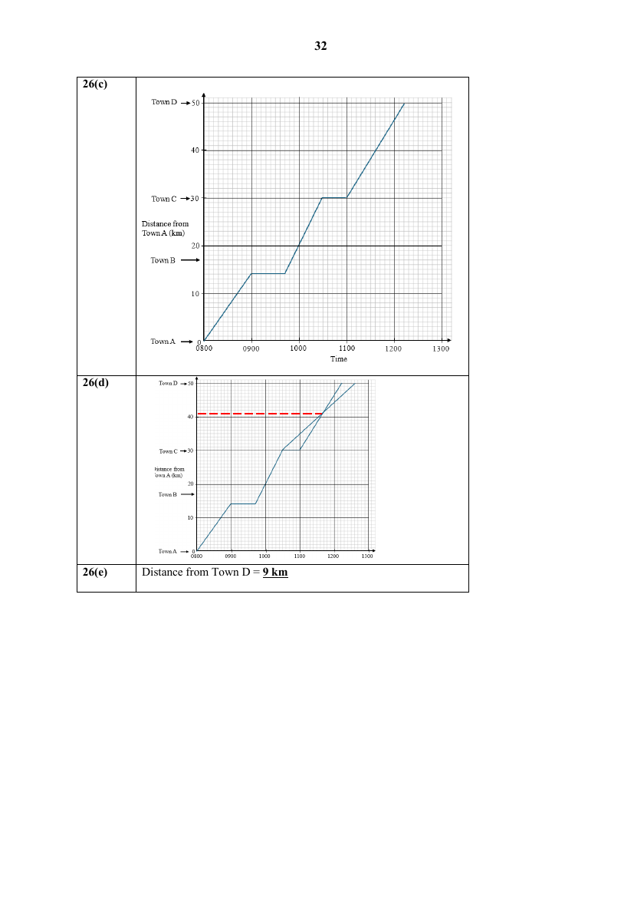

# St Joseph's Institution — Mathematics 4052/01 Paper 1 (cleaned)

> **Institution:** St Joseph's Institution
> **Exam:** Preliminary Examination 2025 (Year 4)
> **Level:** Year 4
> **Subjects:** Mathematics
> **Paper:** 4052/01 Paper 1
> **Date:** 15 August 2025
> **Duration:** 2 hours 15 minutes (10:15 – 12:30)
> **Total Marks:** 90
> **Source:** `SJI 2025 Prelim Paper 1 With Answer Key-1.pdf` (cleaned & reformatted)

---

## Instructions

Write your class, index number and name on all the work you hand in.
Write in dark blue or black pen on both sides of the paper.
You may use an HB pencil for any diagrams or graphs.
Do not use paper clips, glue or correction fluid.

Answer all questions.
If working is needed for any question it must be shown with the answer.
Omission of essential working will result in loss of marks.
The use of an approved scientific calculator is expected, where appropriate.
If the degree of accuracy is not specified in the question, and if the answer is not exact, give the answer to three significant figures. Give answers in degrees to one decimal place.
For $\pi$, use either your calculator value or $3.142$, unless the question requires the answer in terms of $\pi$.

The number of marks is given in brackets [ ] at the end of each question or part question.

The total marks for this paper is 90.

This document consist of 27 printed pages and 1 blank page.

---

## Mathematical Formulae

*Compound interest*

$$
\text{Total amount} = P\left(1+\frac{r}{100}\right)^{n}
$$

*Mensuration*

$$
\text{Curved surface area of a cone} = \pi rl
$$

$$
\text{Surface area of a sphere} = 4\pi r^{2}
$$

$$
\text{Volume of a cone} = \frac{1}{3}\pi r^{2}h
$$

$$
\text{Volume of a sphere} = \frac{4}{3}\pi r^{3}
$$

$$
\text{Area of triangle } ABC = \frac{1}{2}ab\sin C
$$

$$
\text{Arc length} = r\theta,\text{ where }\theta\text{ is in radians}
$$

$$
\text{Sector area} = \frac{1}{2}r^{2}\theta,\text{ where }\theta\text{ is in radians}
$$

*Trigonometry*

$$
\frac{a}{\sin A} = \frac{b}{\sin B} = \frac{c}{\sin C}
$$

$$
a^{2} = b^{2}+c^{2}-2bc\cos A
$$

*Statistics*

$$
\text{Mean} = \frac{\sum fx}{\sum f}
$$

$$
\text{Standard deviation} = \sqrt{\frac{\sum fx^{2}}{\sum f}-\left(\frac{\sum fx}{\sum f}\right)^{2}}
$$

---

## Answer all the questions

### Q1

> **Marks:** 1
> **Topic:** N1 Numbers and their operations
> **Sub-topic:** Numbers and their operations
> **LO:** [[context/subjects/o-level-e-maths/learning-objectives/o-level-e-maths-N1g.md|N1g]]
> **Page:** 3

At a football match, the attendance was reported as 26 500 people, rounded to the nearest hundred.
Using $x$ to represent the possible number of people who attended the match, write down an inequality in $x$. [1]

---

### Q2

> **Marks:** 2
> **Topic:** N3 Percentage
> **Sub-topic:** Percentage
> **LO:** [[context/subjects/o-level-e-maths/learning-objectives/o-level-e-maths-N3d.md|N3d]]
> **Page:** 3

Joseph invested &#36;50 000 at a simple interest of $r\%$ per year.
After $q$ months the interest was &#36;$I$.
Write down and simplify an expression for $I$, in terms of $q$ and $r$. [2]

---

### Q3

> **Marks:** 2
> **Topic:** G4 Pythagoras' theorem and trigonometry
> **Sub-topic:** Pythagoras' theorem and trigonometry
> **LO:** [[context/subjects/o-level-e-maths/learning-objectives/o-level-e-maths-G4c.md|G4c]]
> **Page:** 4

$ABD$ is a triangle.
$ADC$ is a straight line.
$AB = 8$ cm, $AD = 9$ cm and $BD = 10$ cm.
Without using a calculator, find the exact value of $\cos\angle BDC$. [2]

---

### Q4

> **Marks:** (a) 1, (b) 1; total 2
> **Page:** 5

Jane either walks or cycles to school.
The probability that she cycles to school is $\dfrac{1}{5}$.

**(a)** Write down the probability that Jane walks to school. [1]
> **Topic:** S2 Probability
> **Sub-topic:** Probability
> **LO:** [[context/subjects/o-level-e-maths/learning-objectives/o-level-e-maths-S2c.md|S2c]]

**(b)** There are 190 days in a school year.
Find the number of days Jane is likely to walk to school in a school year. [1]
> **Topic:** S2 Probability
> **Sub-topic:** Probability
> **LO:** [[context/subjects/o-level-e-maths/learning-objectives/o-level-e-maths-S2c.md|S2c]]

---

### Q5

> **Marks:** 2
> **Topic:** G1 Angles, triangles and polygons
> **Sub-topic:** Angles, triangles and polygons
> **LO:** [[context/subjects/o-level-e-maths/learning-objectives/o-level-e-maths-G1f.md|G1f]]
> **Page:** 5

A polygon has $n$ sides.
When the number of sides is doubled, the interior angle is increased by $20^{\circ}$.
Find the value of $n$. [2]

---

### Q6

> **Marks:** (a) 1, (b) 1; total 2
> **Page:** 6

The marks of 19 students in a Science test are shown in the stem-and-leaf diagram.

| Stem | Leaf |
| --- | --- |
| 0 | |
| 1 | 7 7 8 |
| 2 | 6 8 9 9 9 |
| 3 | 1 4 6 7 8 9 |
| 4 | 3 4 6 6 $x$ |

Key: $2\mid 6$ means 26 marks.

**(a)** Write down the median mark. [1]
> **Topic:** S1 Data handling and analysis
> **Sub-topic:** Data handling and analysis
> **LO:** [[context/subjects/o-level-e-maths/learning-objectives/o-level-e-maths-S1f.md|S1f]]

**(b)** The range of marks for the Science test is 32.
Find the value of $x$. [1]
> **Topic:** S1 Data handling and analysis
> **Sub-topic:** Data handling and analysis
> **LO:** [[context/subjects/o-level-e-maths/learning-objectives/o-level-e-maths-S1f.md|S1f]]

---

### Q7

> **Marks:** (a) 1, (b) 2; total 3
> **Page:** 7

The graph shows the average daily household water consumption per person in Singapore over the years.

Source: PUB
Straits Times Graphics

**(a)** Under the Singapore Green Plan 2030, find the projected percentage reduction in household water consumption from 2024 to 2030. [1]
> **Topic:** S1 Data handling and analysis
> **Sub-topic:** Data handling and analysis
> **LO:** [[context/subjects/o-level-e-maths/learning-objectives/o-level-e-maths-S1f.md|S1f]]

**(b)** State one aspect of the graph that may be misleading and explain how this may lead to a misinterpretation of the graph. [2]
> **Topic:** S1 Data handling and analysis
> **Sub-topic:** Data handling and analysis
> **LO:** [[context/subjects/o-level-e-maths/learning-objectives/o-level-e-maths-S1f.md|S1f]]

---

### Q8

> **Marks:** 2
> **Topic:** N1 Numbers and their operations
> **Sub-topic:** Numbers and their operations
> **LO:** [[context/subjects/o-level-e-maths/learning-objectives/o-level-e-maths-N1j.md|N1j]]
> **Page:** 8

Simplify $\left(\dfrac{16m^{6}}{9q^{8}}\right)^{-\frac{3}{2}}$. [2]

---

### Q9

> **Marks:** 2
> **Topic:** N1 Numbers and their operations
> **Sub-topic:** Numbers and their operations
> **LO:** [[context/subjects/o-level-e-maths/learning-objectives/o-level-e-maths-N1e.md|N1e]]
> **Page:** 8

The number $N$ is a multiple of 18 and is both a perfect square and a perfect cube.
Find the smallest possible value of $N$. [2]

---

### Q10

> **Marks:** 3
> **Topic:** N7 Equations and inequalities
> **Sub-topic:** Equations and inequalities
> **LO:** [[context/subjects/o-level-e-maths/learning-objectives/o-level-e-maths-N7b.md|N7b]]
> **Page:** 9

Write as a single fraction in its simplest form $\dfrac{1}{2-x}-\dfrac{3x+2}{x^{2}-7x+10}$. [3]

---

### Q11

> **Marks:** (a) 1, (b) 3; total 4
> **Page:** 10

The first four terms in a sequence of numbers are given below.

$$T_{1}=1^{2}+1^{2}=2$$

$$T_{2}=5^{2}+2^{2}=29$$

$$T_{3}=9^{2}+3^{2}=90$$

$$T_{4}=13^{2}+4^{2}=185$$

**(a)** Evaluate $T_{5}$. [1]
> **Topic:** N5 Algebraic expressions and formulae
> **Sub-topic:** Algebraic expressions and formulae
> **LO:** [[context/subjects/o-level-e-maths/learning-objectives/o-level-e-maths-N5e.md|N5e]]

**(b)** $T_{n}$ is the $n$th term of the sequence.
Find an expression, in terms of $n$, for $T_{n}$, in the form $an^{2}+bn+c$ where $a$, $b$ and $c$ are integers. [3]
> **Topic:** N5 Algebraic expressions and formulae
> **Sub-topic:** Algebraic expressions and formulae
> **LO:** [[context/subjects/o-level-e-maths/learning-objectives/o-level-e-maths-N5e.md|N5e]]

---

### Q12

> **Marks:** (a) 1, (b) 2; total 3
> **Page:** 11

The frequency table shows the number of mistakes made by a class in a Mathematics quiz.

| Number of mistakes | 0 | 1 | 2 | 3 | 4 | 5 |
| --- | --- | --- | --- | --- | --- | --- |
| Number of students | 3 | $x$ | 9 | 6 | 2 | 1 |

**(a)** If the distribution is bimodal (has two modes), state the value of $x$. [1]
> **Topic:** S1 Data handling and analysis
> **Sub-topic:** Data handling and analysis
> **LO:** [[context/subjects/o-level-e-maths/learning-objectives/o-level-e-maths-S1f.md|S1f]]

**(b)** If the median number of mistakes is 2, find the largest possible value of $x$. [2]
> **Topic:** S1 Data handling and analysis
> **Sub-topic:** Data handling and analysis
> **LO:** [[context/subjects/o-level-e-maths/learning-objectives/o-level-e-maths-S1f.md|S1f]]

---

### Q13

> **Marks:** 3
> **Topic:** N4 Rate and speed
> **Sub-topic:** Rate and speed
> **LO:** [[context/subjects/o-level-e-maths/learning-objectives/o-level-e-maths-N4a.md|N4a]]
> **Page:** 11

Mr Lee travels at 20 km/h for 35% of the total distance travelled and at a speed of 30 km/h for the remaining distance.
Calculate Mr Lee’s average speed in km/h for the total distance travelled. [3]

---

### Q14

> **Marks:** (a) 2, (b) 1; total 3
> **Page:** 12

Two sets of test scores are shown below.

Set A: 60, 60, 60, 60, 60

Set B: 50, 55, 60, 65, 70

**(a)** Without any calculation, explain which set has the larger standard deviation? [2]
> **Topic:** S1 Data handling and analysis
> **Sub-topic:** Data handling and analysis
> **LO:** [[context/subjects/o-level-e-maths/learning-objectives/o-level-e-maths-S1j.md|S1j]]

**(b)** Set C has a standard deviation of 7.
Every value is increased by 10, then multiplied by 2.
Find the new standard deviation. [1]
> **Topic:** S1 Data handling and analysis
> **Sub-topic:** Data handling and analysis
> **LO:** [[context/subjects/o-level-e-maths/learning-objectives/o-level-e-maths-S1j.md|S1j]]

---

### Q15

> **Marks:** (a) 2, (b) 2; total 4
> **Page:** 13

$\varepsilon = \{x : x\text{ is an integer and }1\leq x<25\}$

$P = \{x : x\text{ is a multiple of }3\}$

$R = \{x : (x-3)(x-7)=0\}$

**(a)** List the elements contained in the set $P\cap R'$. [2]
> **Topic:** N8 Set language and notation
> **Sub-topic:** Set language and notation
> **LO:** [[context/subjects/o-level-e-maths/learning-objectives/o-level-e-maths-N8a.md|N8a]]

**(b)** A number $q$ is chosen at random from the universal set.
Find the probability that $q\in P\cup R$. [2]
> **Topic:** N8 Set language and notation
> **Sub-topic:** Set language and notation
> **LO:** [[context/subjects/o-level-e-maths/learning-objectives/o-level-e-maths-N8a.md|N8a]]

---

### Q16

> **Marks:** (a) 2, (b) 2; total 4
> **Page:** 14

$A$, $B$ and $C$ are points on a circle.
$AB$ is the diameter of a circle.
$AD$ is the tangent to the circle at point $A$ and $BD$ is a straight line that passes through point $C$.

**(a)** Show that triangle $ABD$ is similar to triangle $CAD$. [2]
> **Topic:** G3 Properties of circles
> **Sub-topic:** Properties of circles
> **LO:** [[context/subjects/o-level-e-maths/learning-objectives/o-level-e-maths-G3b.md|G3b]]

**(b)** Given that $BD = 25$ cm, $DC = 9$ cm and $DA = x$ cm.
Find the value of $x$. [2]
> **Topic:** G3 Properties of circles
> **Sub-topic:** Properties of circles
> **LO:** [[context/subjects/o-level-e-maths/learning-objectives/o-level-e-maths-G3b.md|G3b]]

---

### Q17

> **Marks:** 3
> **Topic:** N2 Ratio and proportion
> **Sub-topic:** Ratio and proportion
> **LO:** [[context/subjects/o-level-e-maths/learning-objectives/o-level-e-maths-N2a.md|N2a]]
> **Page:** 15

$F$ is directly proportional to $v^{2}$.
Find the percentage change in $F$ when $v$ is reduced by 20%. [3]

---

### Q18

> **Marks:** (a) 1, (b) 2; total 3
> **Page:** 15

**(a)** Factorise $x^{2}-169$. [1]
> **Topic:** N5 Algebraic expressions and formulae
> **Sub-topic:** Algebraic expressions and formulae
> **LO:** [[context/subjects/o-level-e-maths/learning-objectives/o-level-e-maths-N5h.md|N5h]]

**(b)** Use your answer to part (a) to find the two factors of 1431 other than 1 and 1431. [2]
> **Topic:** N5 Algebraic expressions and formulae
> **Sub-topic:** Algebraic expressions and formulae
> **LO:** [[context/subjects/o-level-e-maths/learning-objectives/o-level-e-maths-N5h.md|N5h]]

---

### Q19

> **Marks:** (a) 2, (b) 1; total 3
> **Page:** 16

**(a)** A reservoir has an area of $1.44\text{ km}^{2}$.
The area of the reservoir on the map is $6.25\text{ cm}^{2}$.
Express the scale of the map in the form $1:n$. [2]
> **Topic:** N2 Ratio and proportion
> **Sub-topic:** Ratio and proportion
> **LO:** [[context/subjects/o-level-e-maths/learning-objectives/o-level-e-maths-N2c.md|N2c]]

**(b)** The actual length of a running track is $x$ m.
Find an expression of the length of the running track on the map in centimetres. [1]
> **Topic:** N2 Ratio and proportion
> **Sub-topic:** Ratio and proportion
> **LO:** [[context/subjects/o-level-e-maths/learning-objectives/o-level-e-maths-N2c.md|N2c]]

---

### Q20

> **Marks:** (a) 2, (b) 2; total 4
> **Page:** 17

A rectangular box has dimensions 120 cm by 84 cm by 96 cm.
Sally would like to fill the box completely with identical, largest possible cubes.

**(a)** Find the largest possible length of each side of the cube. [2]
> **Topic:** N1 Numbers and their operations
> **Sub-topic:** Numbers and their operations
> **LO:** [[context/subjects/o-level-e-maths/learning-objectives/o-level-e-maths-N1e.md|N1e]]

**(b)** How many such cubes can fit exactly into the box? [2]
> **Topic:** N1 Numbers and their operations
> **Sub-topic:** Numbers and their operations
> **LO:** [[context/subjects/o-level-e-maths/learning-objectives/o-level-e-maths-N1e.md|N1e]]

---

### Q21

> **Marks:** (a) 2, (b) 3; total 5
> **Page:** 18

**(a)** Factorise completely $2x^{2}-4xy-x+2y$. [2]
> **Topic:** N5 Algebraic expressions and formulae
> **Sub-topic:** Algebraic expressions and formulae
> **LO:** [[context/subjects/o-level-e-maths/learning-objectives/o-level-e-maths-N5h.md|N5h]]

**(b)** Solve the quadratic equation $2x^{2}-8x=7$ by completing the square.
Give your solutions correct to two decimal places. [3]
> **Topic:** N1 Numbers and their operations
> **Sub-topic:** Numbers and their operations
> **LO:** [[context/subjects/o-level-e-maths/learning-objectives/o-level-e-maths-N1g.md|N1g]]

---

### Q22

> **Marks:** (a) 2, (b) 3; total 5
> **Page:** 19

$ACB$ is an arc of a circle with centre $O$ and radius 8 cm.
$AD$ and $BD$ are tangents to the circle at $A$ and $B$ and angle $ADB = \dfrac{\pi}{4}$.

**(a)** Find the length of $AD$. [2]
> **Topic:** G5 Mensuration
> **Sub-topic:** Mensuration
> **LO:** [[context/subjects/o-level-e-maths/learning-objectives/o-level-e-maths-G5f.md|G5f]]

**(b)** Find the area of the shaded area. [3]
> **Topic:** G5 Mensuration
> **Sub-topic:** Mensuration
> **LO:** [[context/subjects/o-level-e-maths/learning-objectives/o-level-e-maths-G5b.md|G5b]]

---

### Q23

> **Marks:** (a) 1, (b) 2, (c) 1, (d) 2; total 6
> **Page:** 20–21

A paint shop mixes three base colours (Red, Blue, Yellow) to create three shades, A, B, and C.
1 can of Shade A needs 2 litres of red, 3 litres of blue and 1 litre yellow base colours.
1 can of Shade B needs 1 litre of red, 2 litres of blue and 4 litres of yellow base colours.
1 can of Shade C needs 3 litres of red, 1 litre of blue and 2 litres of yellow base colours.
The matrix $M$ shows the number of litres of each base colour needed for 1 can of each shade.

$$
M=\begin{pmatrix}
2 & 1 & 3 \\
3 & 2 & 1 \\
1 & 4 & 2
\end{pmatrix}
\begin{matrix}
\text{Red} \\
\text{Blue} \\
\text{Yellow}
\end{matrix}
$$

Columns are Shade A, Shade B and Shade C.

**(a)** The shop wants to make 4 cans of Shade A, 2 cans of Shade B, and $x$ cans of Shade C.
Represent this information in a $3\times 1$ column matrix, $N$, in terms of $x$. [1]
> **Topic:** N9 Matrices
> **Sub-topic:** Matrices
> **LO:** [[context/subjects/o-level-e-maths/learning-objectives/o-level-e-maths-N9b.md|N9b]]

**(b)** Find, in terms of $x$, the matrix $L=MN$. [2]
> **Topic:** N9 Matrices
> **Sub-topic:** Matrices
> **LO:** [[context/subjects/o-level-e-maths/learning-objectives/o-level-e-maths-N9b.md|N9b]]

**(c)** State what each of the element in matrix $L$ represents. [1]
> **Topic:** N9 Matrices
> **Sub-topic:** Matrices
> **LO:** [[context/subjects/o-level-e-maths/learning-objectives/o-level-e-maths-N9b.md|N9b]]

**(d)** The shop has 25 litres of red, 25 litres of blue, and 25 litres of yellow base colours in stock.
Find the largest integer value of $x$ so that none of the base colours runs out. [2]
> **Topic:** N1 Numbers and their operations
> **Sub-topic:** Numbers and their operations
> **LO:** [[context/subjects/o-level-e-maths/learning-objectives/o-level-e-maths-N1e.md|N1e]]

---

### Q24

> **Marks:** (a) 2, (b) 2, (c) 1; total 5
> **Page:** 22–23

Bag A contains 5 red balls and 3 blue balls.
Bag B initially contains $x$ red balls and 2 blue balls.
A ball is drawn at random from Bag A and placed into Bag B.
Then, a ball is drawn at random from Bag B.

**(a)** Draw a tree diagram to show the probabilities of the possible outcomes. [2]
> **Topic:** S2 Probability
> **Sub-topic:** Probability
> **LO:** [[context/subjects/o-level-e-maths/learning-objectives/o-level-e-maths-S2c.md|S2c]]

**(b)** The probability of drawing a red ball from Bag A and a red ball from Bag B is $\dfrac{5}{12}$.
Find the value of $x$. [2]
> **Topic:** S2 Probability
> **Sub-topic:** Probability
> **LO:** [[context/subjects/o-level-e-maths/learning-objectives/o-level-e-maths-S2c.md|S2c]]

**(c)** Explain how the value of $x$ affects the probability of drawing a blue ball from Bag B. [1]
> **Topic:** S2 Probability
> **Sub-topic:** Probability
> **LO:** [[context/subjects/o-level-e-maths/learning-objectives/o-level-e-maths-S2c.md|S2c]]

---

### Q25

> **Marks:** (a) 1, (b) 2, (c) 1, (d) 3; total 7
> **Page:** 24–25

The graph of $y=-0.25x^{2}+0.5x+3.75$ is drawn on the grid.

**(a)** Write down the equation of the line of symmetry of the graph. [1]
> **Topic:** G6 Coordinate geometry
> **Sub-topic:** Coordinate geometry
> **LO:** [[context/subjects/o-level-e-maths/learning-objectives/o-level-e-maths-G6c.md|G6c]]

**(b)** By drawing a tangent, find the gradient of the curve at $x=3$. [2]
> **Topic:** G6 Coordinate geometry
> **Sub-topic:** Coordinate geometry
> **LO:** [[context/subjects/o-level-e-maths/learning-objectives/o-level-e-maths-G6c.md|G6c]]

**(c)** Explain how you can determine, from the graph, for a given value of $m$, whether $-0.25x^{2}+0.5x+3.75=m$ has two, one, or no real solutions. [1]
> **Topic:** N6 Functions and graphs
> **Sub-topic:** Functions and graphs
> **LO:** [[context/subjects/o-level-e-maths/learning-objectives/o-level-e-maths-N6c.md|N6c]]

**(d)** By drawing a suitable straight line on the grid, solve the equation $-0.25x^{2}+0.5x+1.25=-0.5x$. [3]
> **Topic:** G6 Coordinate geometry
> **Sub-topic:** Coordinate geometry
> **LO:** [[context/subjects/o-level-e-maths/learning-objectives/o-level-e-maths-G6c.md|G6c]]

---

### Q26

> **Marks:** (a) 1, (b) 2, (c) 2, (d) 1, (e) 1; total 7
> **Page:** 26–27

Lily leaves Town A at 0800 and cycles to Town C.
The travel graph shows Lily’s journey.

**(a)** Write down what happens at 0930. [1]
> **Topic:** N6 Functions and graphs
> **Sub-topic:** Functions and graphs
> **LO:** [[context/subjects/o-level-e-maths/learning-objectives/o-level-e-maths-N6b.md|N6b]]

**(b)** Find Lily’s average speed, in kilometres per hour, from Town B to Town C. [2]
> **Topic:** N6 Functions and graphs
> **Sub-topic:** Functions and graphs
> **LO:** [[context/subjects/o-level-e-maths/learning-objectives/o-level-e-maths-N6b.md|N6b]]

**(c)** Lily leaves Town C at 1100.
She continues to Town D at a constant speed of $16\dfrac{2}{3}$ kilometres per hour.
On the travel graph, complete Lily’s journey. [2]
> **Topic:** N6 Functions and graphs
> **Sub-topic:** Functions and graphs
> **LO:** [[context/subjects/o-level-e-maths/learning-objectives/o-level-e-maths-N6c.md|N6c]]

**(d)** Emily leaves Town C at 1030 and arrives at Town D at 1236.
She cycles at a constant speed on the same road as Lily, without stopping.
Draw a line on the travel graph to show Emily’s journey. [1]
> **Topic:** N6 Functions and graphs
> **Sub-topic:** Functions and graphs
> **LO:** [[context/subjects/o-level-e-maths/learning-objectives/o-level-e-maths-N6c.md|N6c]]

**(e)** Find the distance from Town D when Emily and Lily pass each other. [1]
> **Topic:** N6 Functions and graphs
> **Sub-topic:** Functions and graphs
> **LO:** [[context/subjects/o-level-e-maths/learning-objectives/o-level-e-maths-N6b.md|N6b]]

---

## Answers

ST JOSEPH’S INSTITUTION
PRELIMINARY EXAMINATION 2025
(YEAR 4) MA4052 Paper 1 Answer Key

The printed answer key stops at Question 26. Part labels follow the key.

### Q1

> **Marks:** 1
> **Page:** 29

$26450\leq x\leq 26549$

---

### Q2

> **Marks:** 2
> **Page:** 29

$\dfrac{125rq}{3}$ or $41\dfrac{2}{3}rq$

---

### Q3

> **Marks:** 2
> **Page:** 29

$-\dfrac{13}{20}$

---

### Q4

> **Marks:** (a) 1, (b) 1; total 2
> **Page:** 29

**(a)** $\dfrac{4}{5}$

**(b)** $152$

---

### Q5

> **Marks:** 2
> **Page:** 29

$n=9$

---

### Q6

> **Marks:** (a) 1, (b) 1; total 2
> **Page:** 29

**(a)** Median mark $= 34$

**(b)** $x=9$

---

### Q7

> **Marks:** (a) 1, (b) 2; total 3
> **Page:** 29

**(a)** $8.45\%$

**(b)** The graph gives the impression that water consumption in 2021 doubled compared to 2018/19, when the actual increase is only about one-third. This misinterpretation arises because the vertical axis does not start from zero, exaggerating the fluctuations and making the changes appear more significant than they really are.

---

### Q8

> **Marks:** 2
> **Page:** 29

$\dfrac{27q^{12}}{64m^{9}}$

---

### Q9

> **Marks:** 2
> **Page:** 29

$46\,656$

---

### Q10

> **Marks:** 3
> **Page:** 29

$\dfrac{-4x+3}{(x-2)(x-5)}$

---

### Q11

> **Marks:** (a) 1, (b) 3; total 4
> **Page:** 29

**(a)** $T_{5}=17^{2}+5^{2}=314$

**(b)** $17n^{2}-24n+9$

---

### Q12

> **Marks:** (a) 1, (b) 2; total 3
> **Page:** 29

**(a)** $x=9$

**(b)** $x=14$

---

### Q13

> **Marks:** 3
> **Page:** 29

$25.5$ km/h

---

### Q14

> **Marks:** (a) 2, (b) 1; total 3
> **Page:** 30

**(a)** Set B has the larger standard deviation. All values in Set A are the same, so there is no spread and the standard deviation is 0. Set B’s values are spread out around the mean, so its standard deviation is greater than 0.

**(b)** $14$

---

### Q15

> **Marks:** (a) 2, (b) 2; total 4
> **Page:** 30

**(a)** $6, 9, 12, 15, 18, 21, 24$

**(b)** $\dfrac{3}{8}$

---

### Q16

> **Marks:** (a) 2, (b) 2; total 4
> **Page:** 30

**(a)** $\angle BAD=90^{\circ}$ (tangent perpendicular to radius)

$\angle ACD=90^{\circ}$ (angle in a semicircle)

$\angle BAD=\angle ACD=90^{\circ}$

$\angle BDA=\angle ADC$ (common angle)

$\triangle CDA$ and $\triangle ADB$ are similar (AA Similarity Test)

**(b)** $x=15$ ($x>0$)

---

### Q17

> **Marks:** 3
> **Page:** 30

$-36\%$

---

### Q18

> **Marks:** (a) 1, (b) 2; total 3
> **Page:** 30

**(a)** $(x+13)(x-13)$

**(b)** $27$ and $53$.

---

### Q19

> **Marks:** (a) 2, (b) 1; total 3
> **Page:** 30

**(a)** $1:48\,000$

**(b)** $\dfrac{x}{480}$ cm

---

### Q20

> **Marks:** (a) 2, (b) 2; total 4
> **Page:** 30

**(a)** $12$

**(b)** $560$

---

### Q21

> **Marks:** (a) 2, (b) 3; total 5
> **Page:** 30

**(a)** $(x-2y)(2x-1)$

**(b)** $x=4.74$ or $x=-0.74$

---

### Q22

> **Marks:** (a) 2, (b) 3; total 5
> **Page:** 30

**(a)** $19.3$ cm

**(b)** $79.1\text{ cm}^{2}$

---

### Q23

> **Marks:** (a) 1, (b) 2, (c) 1, (d) 2; total 6
> **Page:** 30–31

**(a)**

$$
N=\begin{pmatrix}4\\2\\x\end{pmatrix}
$$

**(b)**

$$
L=\begin{pmatrix}10+3x\\16+x\\12+2x\end{pmatrix}
$$

**(c)** Matrix $L$ represents the total litres of red, blue, and yellow base colors, respectively, needed by the shop to create the three shades, A, B, and C.

**(d)** Largest integer of $x=5$

---

### Q24

> **Marks:** (a) 2, (b) 2, (c) 1; total 5
> **Page:** 31

**(a)**

**(b)** $x=3$

**(c)** As $x$ increases, the number of red balls in Bag B increases (or decreases), while the number of blue balls remains the same. This makes it less likely to draw a blue ball from B.
The probability of drawing 2 blue balls decreases (or increases) as $x$ increases (decreases).

---

### Q25

> **Marks:** (a) 1, (b) 2, (c) 1, (d) 3; total 7
> **Page:** 31

**(a)** $x=1$

**(b)** $-1$

**(c)** The number of real solutions to the question is equal to the number of points where the horizontal line $y=m$ meets the graph.

**(d)** $x=-1$ or $5$

---

### Q26

> **Marks:** (a) 1, (b) 2, (c) 2, (d) 1, (e) 1; total 7
> **Page:** 31–32

**(a)** Lily stopped (or rest / not moving / at Town B).

**(b)** $20$ km/h

**(c)** and **(d)**

**(e)** Distance from Town D $= 9$ km
