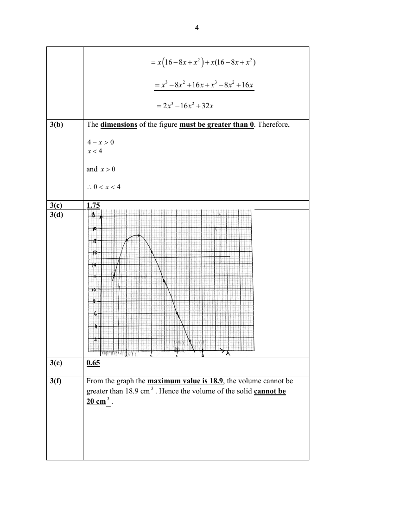

# St Joseph's Institution — Mathematics 4052/02 Paper 2 Solutions (cleaned)

> **Institution:** St Joseph's Institution
> **Exam:** Preliminary Examination 2025 (Year 4)
> **Level:** Year 4
> **Subjects:** Mathematics
> **Paper:** MA4052 Paper 2 Solutions
> **Date:** 21 August 2025
> **Duration:** 2 hours 15 minutes
> **Total Marks:** 90
> **Source:** `SJI 2025 EMATH PRELIM P2 MS.pdf` (cleaned & reformatted). **Page** is the question page in `SJI 2025 EMATH PRELIM P2 QP.pdf`.

---

## Solutions

### Q1

> **Marks:** (a)(i) 1, (a)(ii) 3, (b) 2, (c) 5; total 11
> **Sub-topic:** Formulae, inequalities and equations
> **Page:** 4–5

**(a)(i)**

$$
a=\sqrt{\frac{3n}{2n+5k}}=\sqrt{\frac{3\left(\dfrac{1}{3}\right)}{2\left(\dfrac{1}{3}\right)+5\left(\dfrac{2}{3}\right)}}=\frac{1}{2}
$$

**(a)(ii)**

$$
a=\sqrt{\frac{3n}{2n+5k}}
$$

$$
a^{2}=\frac{3n}{2n+5k}
$$

$$
2a^{2}n+5a^{2}k=3n
$$

$$
2a^{2}n-3n=-5a^{2}k
$$

$$
n(2a^{2}-3)=-5a^{2}k
$$

$$
n=\frac{-5a^{2}k}{2a^{2}-3}\quad\text{or}\quad n=\frac{5a^{2}k}{3-2a^{2}}
$$

**(b)**

$$
\frac{4-5x}{6}>1-\frac{x+5}{4}
$$

$$
\frac{4-5x}{6}>\frac{4-(x+5)}{4}
$$

$$
\frac{4-5x}{6}>\frac{-x-1}{4}
$$

$$
4-5x>\frac{6(-x-1)}{4}
$$

$$
4(4-5x)>6(-x-1)
$$

$$
16-20x>-6x-6
$$

$$
-14x>-22
$$

$$
x<\frac{22}{14}
$$

$$
x<\frac{11}{7}\quad\text{or}\quad x<1\frac{4}{7}
$$

**(c)**

$$
\frac{x-2}{x+1}-\frac{x+3}{x-1}=5
$$

$$
\frac{(x-2)(x-1)-(x+3)(x+1)}{(x+1)(x-1)}=5
$$

$$
\frac{(x^{2}-x-2x+2)-(x^{2}+x+3x+3)}{x^{2}-1}=5
$$

$$
\frac{-7x-1}{x^{2}-1}=5
$$

$$
-7x-1=5(x^{2}-1)
$$

$$
5x^{2}+7x-4=0
$$

$$
x=\frac{-7\pm\sqrt{7^{2}-4(5)(-4)}}{2(5)}=\frac{-7\pm\sqrt{129}}{10}
$$

$$
x\approx 0.44\text{ or }-1.84\text{ (2 dp)}
$$

---

### Q2

> **Marks:** (a)(i) 1, (a)(ii) 2, (b) 2, (c) 4; total 9
> **Sub-topic:** Standard form, ratio and percentage
> **Page:** 6–7

**(a)(i)**

$$
114.9\text{ million}=114.9\times 10^{6}=1.149\times 10^{2}\times 10^{6}\approx 1.15\times 10^{8}
$$

**(a)(ii)**

$$
\text{Population density in 2025}=\frac{116.79\times 10^{6}}{300000}=389.3
$$

Since $389.3>350$, the Philippines had exceeded the government’s population density.

**(b)**

$$
\%\text{ change}=\frac{(2.8x+1.5x+5x)-10x}{10x}\times 100\%=\frac{9.3x-10x}{10x}\times 100\%=-7\%
$$

**(c)**

$$
\text{Total cost}=x\times 12\times 1.1\times 1.09=14.388x
$$

$$
\text{Total bill}=30\times 11+29.7=14.388x
$$

$$
x=25
$$

---

### Q3

> **Marks:** (a) 3, (b) 1, (c) 1, (d) 3, (e) 1, (f) 1; total 10
> **Sub-topic:** Volume and cubic graphs
> **Page:** 8–9

**(a)**

$$
\text{Volume of the solid}=\frac{1}{2}(4-x)(2x)(4-x)+(4-x)^{2}x
$$

$$
=x(16-8x+x^{2})+x(16-8x+x^{2})
$$

$$
=x^{3}-8x^{2}+16x+x^{3}-8x^{2}+16x
$$

$$
=2x^{3}-16x^{2}+32x
$$

**(b)** The dimensions of the figure must be greater than 0. Therefore,

$$
4-x>0,\quad x<4
$$

and $x>0$.

$$
\therefore 0<x<4
$$

**(c)** $1.75$

**(d)**

**(e)** $0.65$

**(f)** From the graph the maximum value is 18.9, the volume cannot be greater than $18.9\text{ cm}^{3}$. Hence the volume of the solid cannot be $20\text{ cm}^{3}$.

---

### Q4

> **Marks:** (a) 4, (b) 4; total 8
> **Sub-topic:** Volume and surface area
> **Page:** 10–11

**(a)** Using similarity,

$$
\frac{h}{h-10}=\frac{24}{18}
$$

$$
18h=24h-240
$$

$$
h=40
$$

$$
\text{Volume of frustum}=\frac{1}{3}\pi(12)^{2}\times 40-\frac{1}{3}\pi(9)^{2}\times 30=1110\pi\text{ cm}^{3}=1.11\pi\text{ litres}
$$

**(b)**

$$
\pi r^{2}\times\frac{3}{4}\times 20=1110\pi
$$

$$
r^{2}=74
$$

$$
r=\sqrt{74}\approx 8.6023
$$

Therefore, area not in contact with water

$$
=2\pi\sqrt{74}\left[\frac{1}{4}(20)\right]\approx 270.250=270\text{ cm}^{2}\text{ (to 3 sf)}
$$

---

### Q5

> **Marks:** (a) 3, (b) 4, (c) 3; total 10
> **Sub-topic:** Coordinate geometry
> **Page:** 12–13

**(a)**

$$
3x-2y=6\quad(1)
$$

$$
x+y=5\quad(2)
$$

From (2), $x=5-y$ (2*).

Substitute (2*) into (1):

$$
3(5-y)-2y=6
$$

$$
y=\frac{9}{5}
$$

Substitute $y=\dfrac{9}{5}$ into (2*):

$$
x=5-\frac{9}{5}=\frac{16}{5}
$$

$T$ is $\left(3\dfrac{1}{5},1\dfrac{4}{5}\right)$.

**(b)**

$$
x+y=5
$$

$A$ is $(5,0)$.

$B$ is $(0,5)$.

$$
\text{Length of }AB=\sqrt{5^{2}+5^{2}}=5\sqrt{2}\quad(=7.07106)
$$

Using area of triangle $OAB$:

$$
\frac{1}{2}(7.07106)h=\frac{1}{2}(5)(5)
$$

$$
h=3.54\text{ units (to 3 sf)}
$$

**(c)** Let $m$ be the distance from $T$.

$$
\frac{1}{2}(5+m)\times 3.2=18
$$

$$
m=6.25
$$

$$
y=-4.45\text{ or }y=8.05
$$

---

### Q6

> **Marks:** (a) 2, (b)(i) 1, (b)(ii) 1, (b)(iii) 2, (b)(iv) 2; total 8
> **Sub-topic:** Circle theorems and congruence
> **Page:** 14–15

**(a)** $DF=AF$ (given $F$ midpoint of $AD$)

$\angle BFD=\angle BFA=90^{\circ}$ (perpendicular bisector of chord)

$BF$ is common

$\therefore$ triangle $ABF\equiv$ triangle $DBF$ (SAS)

**(b)(i)** $\angle DAC=\angle DBC=45^{\circ}$ (angles in the same segment)

**(b)(ii)**

$$
\angle ADC=90^{\circ}\text{ (angle in a semicircle)}
$$

$$
\angle DCA=180^{\circ}-90^{\circ}-45^{\circ}\text{ (angle sum of a triangle)}=45^{\circ}
$$

**(b)(iii)**

$$
\angle DBA=\angle DCA=45^{\circ}\text{ (angles in the same segment)}
$$

$$
\angle OBA=\frac{45^{\circ}}{2}\text{ (triangle }ABF\equiv\text{ triangle }DBF)=22.5^{\circ}
$$

$$
\angle OAB=\angle OBA=22.5^{\circ}\text{ (base angles of an isosceles triangle)}
$$

$$
\angle AOB=180^{\circ}-22.5^{\circ}-22.5^{\circ}\text{ (angle sum of a triangle)}=135^{\circ}
$$

**(b)(iv)**

$$
\angle ACB=\frac{135^{\circ}}{2}\text{ (angle at the centre }=2\times\text{ angle at the circumference)}=67.5^{\circ}
$$

$$
\angle CEB=180^{\circ}-67.5^{\circ}-45^{\circ}\text{ (angle sum of a triangle)}=67.5^{\circ}
$$

$$
\angle AED=\angle CEB=67.5^{\circ}\text{ (vertically opposite angles)}
$$

---

### Q7

> **Marks:** (a) 2, (b) 3, (c) 4; total 9
> **Sub-topic:** Trigonometry and bearings
> **Page:** 16–17

**(a)**

$$
\frac{BD}{\sin 44.2^{\circ}}=\frac{200}{\sin 95^{\circ}}
$$

$$
BD=\frac{200}{\sin 95^{\circ}}\times\sin 44.2^{\circ}\approx 139.965\approx 140\text{ m}
$$

**(b)**

$$
3300=\frac{1}{2}(48)(139.965)\sin\angle CBD
$$

$$
\sin\angle CBD=\frac{3300\times 2}{48(139.965)}
$$

$$
\angle CBD\approx 79.230^{\circ}
$$

$$
\text{bearing of }C\text{ from }B=360^{\circ}-(180^{\circ}-45.8^{\circ})-95^{\circ}-79.230^{\circ}\approx 051.6^{\circ}\text{ (to 1 dp)}
$$

**(c)** Let $h$ be the height of the vertical tower.

$$
\sin 79.230^{\circ}=\frac{\text{opp}}{48}
$$

$$
\text{opp}=48\times\sin 79.230^{\circ}\approx 47.1544
$$

$$
\tan\theta_{e}=\frac{80}{47.1544}
$$

$$
\theta_{e}=59.5^{\circ}\text{ (to 1 dp)}
$$

---

### Q8

> **Marks:** (a) 1, (b) 1, (c) 1, (d) 1, (e) 2, (f) 2; total 8
> **Sub-topic:** Vectors
> **Page:** 18–19

**(a)**

$$
\overrightarrow{AC}=\overrightarrow{AB}+\overrightarrow{BC}=3\mathbf{b}-2\mathbf{a}
$$

**(b)**

$$
\overrightarrow{XZ}=\frac{1}{2}\overrightarrow{AZ}=\frac{1}{2}(\overrightarrow{AC}+\overrightarrow{CZ})=\frac{1}{2}(3\mathbf{b}-2\mathbf{a}+\mathbf{a})=\frac{3}{2}\mathbf{b}-\frac{1}{2}\mathbf{a}
$$

**(c)**

$$
\overrightarrow{CX}=\overrightarrow{CZ}+\overrightarrow{ZX}=\mathbf{a}+\frac{1}{2}\mathbf{a}-\frac{3}{2}\mathbf{b}=\frac{3}{2}\mathbf{a}-\frac{3}{2}\mathbf{b}
$$

**(d)**

$$
\overrightarrow{CY}=\overrightarrow{CA}+\overrightarrow{AY}=-3\mathbf{b}+2\mathbf{a}+\mathbf{b}=2\mathbf{a}-2\mathbf{b}
$$

**(e)** Since $\overrightarrow{CY}=\dfrac{4}{3}\overrightarrow{CX}$ and $C$ is a common point, $C$, $X$ and $Y$ are collinear.

**(f)**

$$
\frac{\text{area of }\triangle ACY}{\text{area of }\triangle ACZ}=\frac{\text{area of }\triangle ACY}{\text{area of }\triangle ABC}\times\frac{\text{area of }\triangle ABC}{\text{area of }\triangle ACZ}=\frac{1}{3}\times\frac{2}{1}=\frac{2}{3}
$$

---

### Q9

> **Marks:** (a)(i) 1, (a)(ii) 1, (a)(iii) 2, (b)(i) 1, (b)(ii) 2, (c) 1; total 8
> **Sub-topic:** Cumulative frequency and box plots
> **Page:** 20–21

**(a)(i)** 56 minutes

**(a)(ii)** $\text{IQR}=65-51.5=13.5$ minutes

**(a)(iii)** Number of students who took more than 70 minutes $=600-490=110$.

$$
\text{Probability}=\frac{110}{600}=\frac{11}{60}
$$

**(b)(i)** The median time taken by students from School X to complete the task is 56 minutes, while for School Y it is 52 minutes. This means that students from School Y, on average, complete the task faster than those from School X.

**(b)(ii)** For School X: upper boundary $=85.25$.

For School Y: upper boundary $=89.25$.

88 minutes is considered an outlier for School X, but not for School Y. Therefore, 88 minutes would be considered more unexpected for School X.

**(c)** Since both tasks have the same IQR, the steepness of the curve will remain the same, but the curve will be shifted to the left because of the smaller median.

---

### Q10

> **Marks:** (a) 3, (b) 6; total 9
> **Sub-topic:** Percentages and financial mathematics
> **Page:** 22–25

**(a)** Total stamp duties

$$
=1\%\times 180000+2\%\times 180000+3\%\times 640000+4\%\times 500000+5\%\times 500000+17\%\times 2000000
$$

$$
=69600+340000=409600
$$

**(b)** If sold in April 2025 (more than 2 years):

$$
\text{Cost incurred}=2000000+409600=2409600
$$

$$
\text{Proceeds after SSD}=2300000-0.04\times 2300000=2208000
$$

$$
\text{Net profit}=2208000-2409600=-201600
$$

If sold in March 2026 (more than 3 years):

$$
\text{Future price}=2000000\times(1.07)^{3}=2450086
$$

SSD (more than 3 years) dropped to 0%.

$$
\text{Proceeds after SSD}=2450086
$$

$$
\text{Net profit}=2450086-2409600=40486
$$

If Rachel sells in April 2025: loss $=201600$.

Wait for another year: net profit $=40486$.

The drop in seller’s SSD to 0 and potential capital appreciation (property rise of 7%) mean Rachel stands to gain much more by waiting until April 2026.
