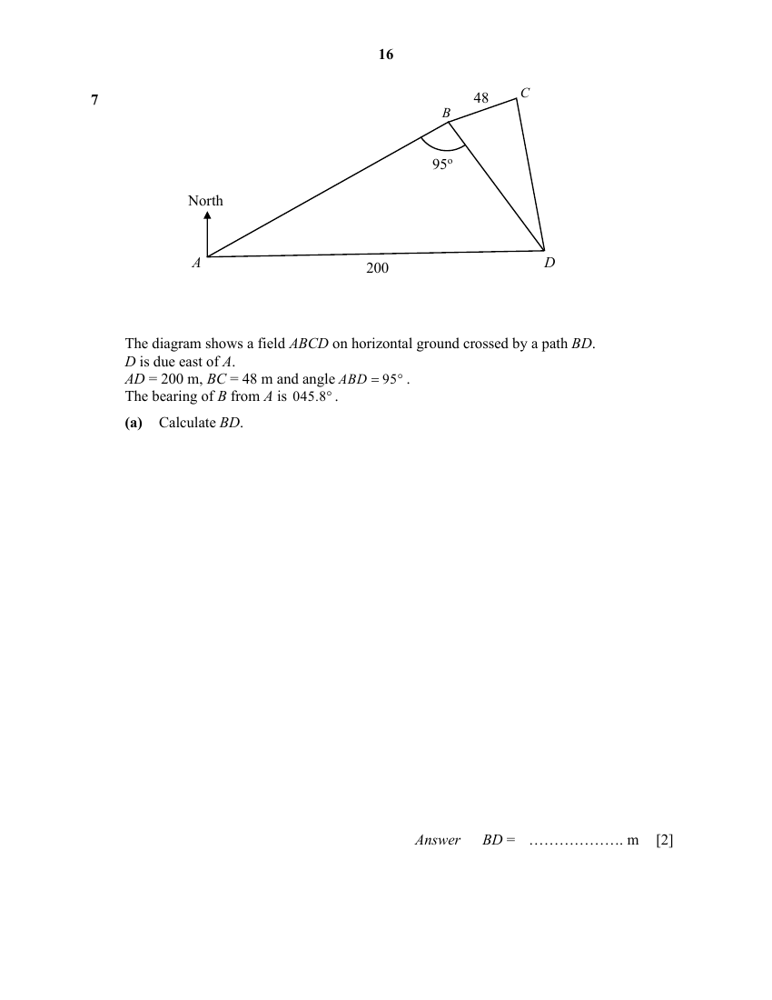
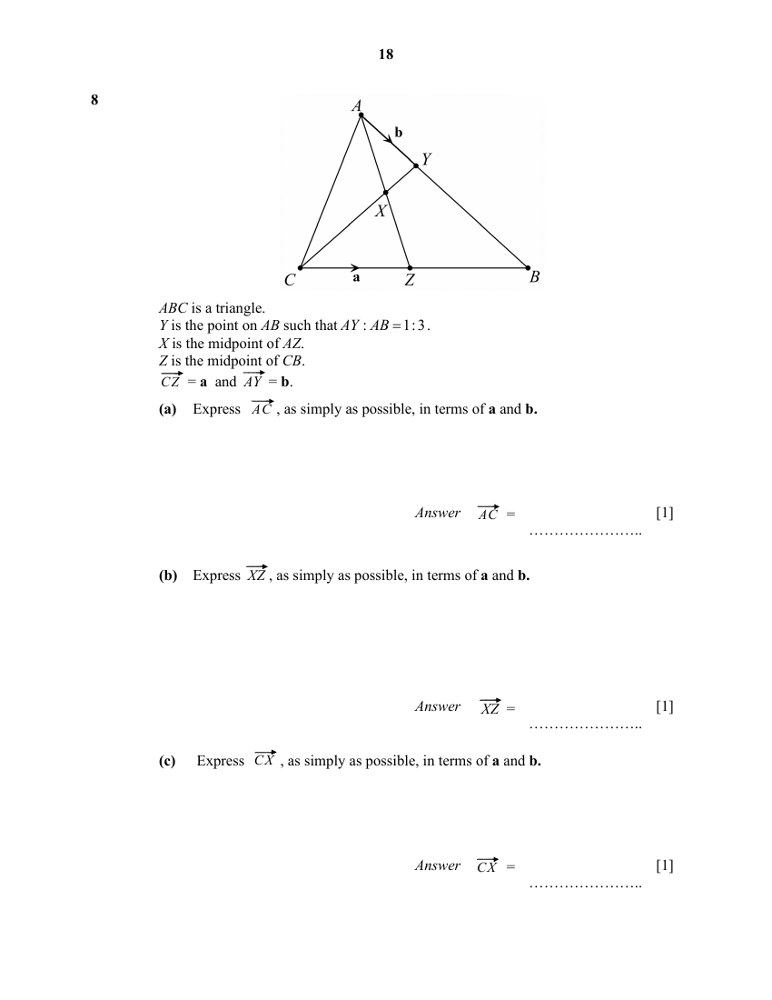
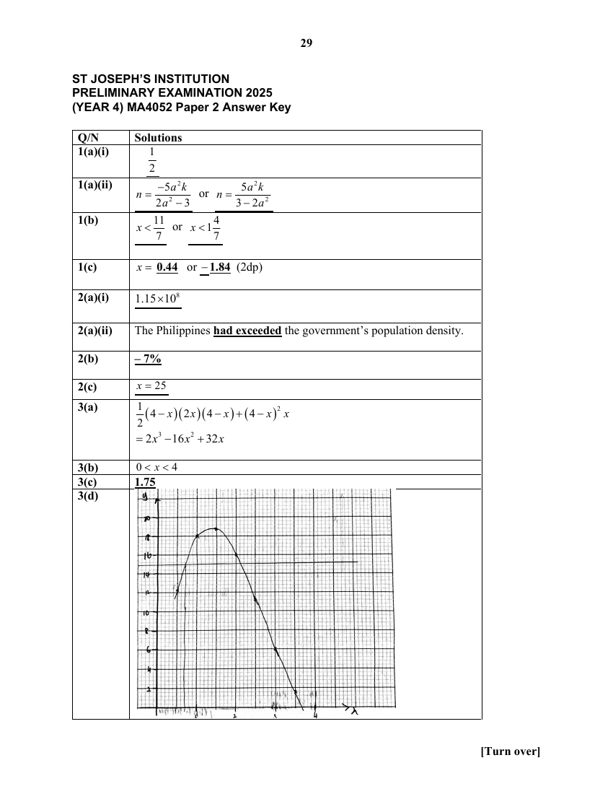

# St Joseph's Institution — Mathematics 4052/02 Paper 2 (cleaned)

> **Institution:** St Joseph's Institution
> **Exam:** Preliminary Examination 2025 (Year 4)
> **Level:** Year 4
> **Subjects:** Mathematics
> **Paper:** 4052/02 Paper 2
> **Date:** 21 August 2025
> **Duration:** 2 hours 15 minutes (08:05 – 10:20)
> **Total Marks:** 90
> **Source:** `SJI 2025 EMATH PRELIM P2 QP.pdf` (cleaned & reformatted)

---

## Instructions

Write your class, index number and name on all the work you hand in.
Write in dark blue or black pen on both sides of the paper.
You may use an HB pencil for any diagrams or graphs.
Do not use paper clips, glue or correction fluid.

Answer all questions.
If working is needed for any question it must be shown with the answer.
Omission of essential working will result in loss of marks.
The use of an approved scientific calculator is expected, where appropriate.
If the degree of accuracy is not specified in the question, and if the answer is not exact, give the answer to three significant figures. Give answers in degrees to one decimal place.
For $\pi$, use either your calculator value or $3.142$, unless the question requires the answer in terms of $\pi$.

The number of marks is given in brackets [ ] at the end of each question or part question.

The total marks for this paper is 90.

This document consists of 25 printed pages and 3 blank pages.

---

## Mathematical Formulae

*Compound interest*

$$
\text{Total amount} = P\left(1+\frac{r}{100}\right)^{n}
$$

*Mensuration*

$$
\text{Curved surface area of a cone} = \pi rl
$$

$$
\text{Surface area of a sphere} = 4\pi r^{2}
$$

$$
\text{Volume of a cone} = \frac{1}{3}\pi r^{2}h
$$

$$
\text{Volume of a sphere} = \frac{4}{3}\pi r^{3}
$$

$$
\text{Area of triangle } ABC = \frac{1}{2}ab\sin C
$$

$$
\text{Arc length} = r\theta,\text{ where }\theta\text{ is in radians}
$$

$$
\text{Sector area} = \frac{1}{2}r^{2}\theta,\text{ where }\theta\text{ is in radians}
$$

*Trigonometry*

$$
\frac{a}{\sin A} = \frac{b}{\sin B} = \frac{c}{\sin C}
$$

$$
a^{2} = b^{2}+c^{2}-2bc\cos A
$$

*Statistics*

$$
\text{Mean} = \frac{\sum fx}{\sum f}
$$

$$
\text{Standard deviation} = \sqrt{\frac{\sum fx^{2}}{\sum f}-\left(\frac{\sum fx}{\sum f}\right)^{2}}
$$

---

## Answer all the questions

### Q1

> **Marks:** (a)(i) 1, (a)(ii) 3, (b) 2, (c) 5; total 11
> **Page:** 4–5

**(a)** It is given that $a=\sqrt{\dfrac{3n}{2n+5k}}$.

**(i)** Find the value of $a$ when $n=\dfrac{1}{3}$ and $k=\dfrac{2}{3}$. [1]
> **Topic:** N1 Numbers and their operations
> **Sub-topic:** Numbers and their operations
> **LO:** [[context/subjects/o-level-e-maths/learning-objectives/o-level-e-maths-N1g.md|N1g]]

**(ii)** Express $n$ in terms of $a$ and $k$. [3]
> **Topic:** N1 Numbers and their operations
> **Sub-topic:** Numbers and their operations
> **LO:** [[context/subjects/o-level-e-maths/learning-objectives/o-level-e-maths-N1g.md|N1g]]

**(b)** Solve the inequality $\dfrac{4-5x}{6}>1-\dfrac{x+5}{4}$. [2]
> **Topic:** N1 Numbers and their operations
> **Sub-topic:** Numbers and their operations
> **LO:** [[context/subjects/o-level-e-maths/learning-objectives/o-level-e-maths-N1g.md|N1g]]

**(c)** Solve the equation $\dfrac{x-2}{x+1}-\dfrac{x+3}{x-1}=5$.
Give your solutions correct to 2 decimal places. [5]
> **Topic:** N1 Numbers and their operations
> **Sub-topic:** Numbers and their operations
> **LO:** [[context/subjects/o-level-e-maths/learning-objectives/o-level-e-maths-N1g.md|N1g]]

---

### Q2

> **Marks:** (a)(i) 1, (a)(ii) 2, (b) 2, (c) 4; total 9
> **Page:** 6–7

**(a)** The total population of the Philippines was estimated at 114.9 million in June 2023 and 116.79 million in June 2025.

**(i)** Write 114.9 million in standard form correct to 3 significant figures. [1]
> **Topic:** N2 Ratio and proportion
> **Sub-topic:** Ratio and proportion
> **LO:** [[context/subjects/o-level-e-maths/learning-objectives/o-level-e-maths-N2c.md|N2c]]

**(ii)** The land area of the Philippines is about 300 000 square kilometres.
The government wants to keep the population density below 350 people per square kilometre.
Based on the June 2025 population figure, determine whether the Philippines has exceeded this density limit. Show your calculations. [2]
> **Topic:** N2 Ratio and proportion
> **Sub-topic:** Ratio and proportion
> **LO:** [[context/subjects/o-level-e-maths/learning-objectives/o-level-e-maths-N2c.md|N2c]]

**(b)** The cost of making a bicycle was made up of three components: materials, wages, and factory rent.
These costs were split in the ratio $2:3:5$, respectively.
In the following year, the cost of materials increased by 40%, the cost of wages was halved, and the cost of factory rent remained unchanged.
Based on these changes, calculate the percentage change in the total cost of making the bicycle. [2]
> **Topic:** N2 Ratio and proportion
> **Sub-topic:** Ratio and proportion
> **LO:** [[context/subjects/o-level-e-maths/learning-objectives/o-level-e-maths-N2c.md|N2c]]

**(c)** Jia Min and 11 friends went for dinner.
The set meal cost &#36;$x$ per person excluding service charge and Goods and Services Tax (GST).
The restaurant applied a 10% service charge to the total meal cost, followed by a 9% GST on the amount including the service charge.
She collected &#36;30 from each of her 11 friends, then topped up the remaining &#36;29.70 herself to cover the full bill.
Find the value of $x$. [4]
> **Topic:** N2 Ratio and proportion
> **Sub-topic:** Ratio and proportion
> **LO:** [[context/subjects/o-level-e-maths/learning-objectives/o-level-e-maths-N2c.md|N2c]]

---

### Q3

> **Marks:** (a) 3, (b) 1, (c) 1, (d) 3, (e) 1, (f) 1; total 10
> **Page:** 8–9

The diagram shows a solid made up of a cuboid with dimensions $(4-x)$ cm by $(4-x)$ cm by $x$ cm and a triangular prism stacked on top of it.
The height of the triangular prism is $2x$ cm.

**(a)** Show that the volume of the solid, $y\text{ cm}^{3}$, is given by $y=2x^{3}-16x^{2}+32x$. [3]
> **Topic:** N6 Functions and graphs
> **Sub-topic:** Functions and graphs
> **LO:** [[context/subjects/o-level-e-maths/learning-objectives/o-level-e-maths-N6c.md|N6c]]

**(b)** Explain why $0<x<4$. [1]
> **Topic:** N6 Functions and graphs
> **Sub-topic:** Functions and graphs
> **LO:** [[context/subjects/o-level-e-maths/learning-objectives/o-level-e-maths-N6c.md|N6c]]

**(c)** Complete the table of values for $y=2x^{3}-16x^{2}+32x$. [1]
> **Topic:** N6 Functions and graphs
> **Sub-topic:** Functions and graphs
> **LO:** [[context/subjects/o-level-e-maths/learning-objectives/o-level-e-maths-N6c.md|N6c]]

| $x$ | 0.5 | 1 | 1.5 | 2 | 2.5 | 3 | 3.5 |
| --- | --- | --- | --- | --- | --- | --- | --- |
| $y$ | 12.25 | 18 | 18.75 | 16 | 11.25 | 6 | |

**(d)** On the grid, draw the graph of $y=2x^{3}-16x^{2}+32x$ for $0.5\leq x\leq 3.5$. [3]
> **Topic:** N6 Functions and graphs
> **Sub-topic:** Functions and graphs
> **LO:** [[context/subjects/o-level-e-maths/learning-objectives/o-level-e-maths-N6c.md|N6c]]

**(e)** Use your graph to find the smallest value of $x$ when the volume of the solid is equal to $15\text{ cm}^{3}$. [1]
> **Topic:** N6 Functions and graphs
> **Sub-topic:** Functions and graphs
> **LO:** [[context/subjects/o-level-e-maths/learning-objectives/o-level-e-maths-N6c.md|N6c]]

**(f)** Explain how the graph shows that the volume of the solid cannot be equal to $20\text{ cm}^{3}$. [1]
> **Topic:** N6 Functions and graphs
> **Sub-topic:** Functions and graphs
> **LO:** [[context/subjects/o-level-e-maths/learning-objectives/o-level-e-maths-N6c.md|N6c]]

---

### Q4

> **Marks:** (a) 4, (b) 4; total 8
> **Page:** 10–11

**(a)** Figure 1 shows a container in the shape of a frustum of a cone.
The container has an open circular top with a diameter of 24 cm and a circular base with a diameter of 18 cm.
It is completely filled with water to a height of 10 cm.
Calculate the volume of water in the container, in litres, leaving your answer in terms of $\pi$. [4]
> **Topic:** G5 Mensuration
> **Sub-topic:** Mensuration
> **LO:** [[context/subjects/o-level-e-maths/learning-objectives/o-level-e-maths-G5c.md|G5c]]

**(b)** All the water is poured into an open cylindrical container of height 20 cm, as shown in Figure 2.
The water fills the cylinder to $\dfrac{3}{4}$ of its height.
Calculate the surface area of the cylindrical container that is not in contact with the water. [4]
> **Topic:** G5 Mensuration
> **Sub-topic:** Mensuration
> **LO:** [[context/subjects/o-level-e-maths/learning-objectives/o-level-e-maths-G5c.md|G5c]]

---

### Q5

> **Marks:** (a) 3, (b) 4, (c) 3; total 10
> **Page:** 12–13

The equation of line $p$ is $3x-2y=6$.
The equation of line $q$ is $x+y=5$.
The two lines intersect at point $T$.

**(a)** Find the coordinates of point $T$. [3]
> **Topic:** G6 Coordinate geometry
> **Sub-topic:** Coordinate geometry
> **LO:** [[context/subjects/o-level-e-maths/learning-objectives/o-level-e-maths-G6c.md|G6c]]

**(b)** Line $q$ intersects the $x$-axis at point $A$ and the $y$-axis at point $B$.
Find the shortest distance from the origin $O$ to the line segment $AB$. [4]
> **Topic:** G6 Coordinate geometry
> **Sub-topic:** Coordinate geometry
> **LO:** [[context/subjects/o-level-e-maths/learning-objectives/o-level-e-maths-G6c.md|G6c]]

**(c)** Points $O$, $B$, $R$ and $T$ are vertices of a trapezium, where $OB$ is parallel to $RT$.
The area of trapezium is 18 square units.
Write down the two possible $y$-coordinates of point $R$. [3]
> **Topic:** G6 Coordinate geometry
> **Sub-topic:** Coordinate geometry
> **LO:** [[context/subjects/o-level-e-maths/learning-objectives/o-level-e-maths-G6c.md|G6c]]

---

### Q6

> **Marks:** (a) 2, (b)(i) 1, (b)(ii) 1, (b)(iii) 2, (b)(iv) 2; total 8
> **Page:** 14–15

The diagram shows a circle $ABCD$, centre $O$.
$F$ is the midpoint of the chord $AD$.
$BF$ passes through $O$.
$E$ is the point of intersection of $BD$ and diameter $AC$.
Angle $DBC=45^{\circ}$.

**(a)** Prove that triangle $ABF$ is congruent to triangle $DBF$.
Give a reason for each statement you make. [2]
> **Topic:** G3 Properties of circles
> **Sub-topic:** Properties of circles
> **LO:** [[context/subjects/o-level-e-maths/learning-objectives/o-level-e-maths-G3a.md|G3a]]

**(b)** Find, giving reasons for each answer,

**(i)** angle $DAC$, [1]
> **Topic:** G3 Properties of circles
> **Sub-topic:** Properties of circles
> **LO:** [[context/subjects/o-level-e-maths/learning-objectives/o-level-e-maths-G3a.md|G3a]]

**(ii)** angle $DCA$, [1]
> **Topic:** G3 Properties of circles
> **Sub-topic:** Properties of circles
> **LO:** [[context/subjects/o-level-e-maths/learning-objectives/o-level-e-maths-G3a.md|G3a]]

**(iii)** angle $AOB$, [2]
> **Topic:** G3 Properties of circles
> **Sub-topic:** Properties of circles
> **LO:** [[context/subjects/o-level-e-maths/learning-objectives/o-level-e-maths-G3a.md|G3a]]

**(iv)** angle $AED$. [2]
> **Topic:** G3 Properties of circles
> **Sub-topic:** Properties of circles
> **LO:** [[context/subjects/o-level-e-maths/learning-objectives/o-level-e-maths-G3a.md|G3a]]

---

### Q7

> **Marks:** (a) 2, (b) 3, (c) 4; total 9
> **Page:** 16–17

The diagram shows a field $ABCD$ on horizontal ground crossed by a path $BD$.
$D$ is due east of $A$.
$AD=200$ m, $BC=48$ m and angle $ABD=95^{\circ}$.
The bearing of $B$ from $A$ is $045.8^{\circ}$.

**(a)** Calculate $BD$. [2]
> **Topic:** G4 Pythagoras' theorem and trigonometry
> **Sub-topic:** Pythagoras' theorem and trigonometry
> **LO:** [[context/subjects/o-level-e-maths/learning-objectives/o-level-e-maths-G4g.md|G4g]]

**(b)** The area of triangle $BCD$ is $3300\text{ m}^{2}$.
Calculate the bearing of $C$ from $B$. [3]
> **Topic:** G4 Pythagoras' theorem and trigonometry
> **Sub-topic:** Pythagoras' theorem and trigonometry
> **LO:** [[context/subjects/o-level-e-maths/learning-objectives/o-level-e-maths-G4g.md|G4g]]

**(c)** A vertical tower of height 80 m stands at $C$.
Sally walks from $B$ to $D$ and reaches a point $P$ where the angle of elevation of the top of the tower from $P$ is the greatest.
Find the angle of elevation of the top of the tower from $P$. [4]
> **Topic:** G4 Pythagoras' theorem and trigonometry
> **Sub-topic:** Pythagoras' theorem and trigonometry
> **LO:** [[context/subjects/o-level-e-maths/learning-objectives/o-level-e-maths-G4g.md|G4g]]

---

### Q8

> **Marks:** (a) 1, (b) 1, (c) 1, (d) 1, (e) 2, (f) 2; total 8
> **Page:** 18–19

$ABC$ is a triangle.
$Y$ is the point on $AB$ such that $AY:AB=1:3$.
$X$ is the midpoint of $AZ$.
$Z$ is the midpoint of $CB$.
$\overrightarrow{CZ}=\mathbf{a}$ and $\overrightarrow{AY}=\mathbf{b}$.

**(a)** Express $\overrightarrow{AC}$, as simply as possible, in terms of $\mathbf{a}$ and $\mathbf{b}$. [1]
> **Topic:** G7 Vectors in two dimensions
> **Sub-topic:** Vectors in two dimensions
> **LO:** [[context/subjects/o-level-e-maths/learning-objectives/o-level-e-maths-G7h.md|G7h]]

**(b)** Express $\overrightarrow{XZ}$, as simply as possible, in terms of $\mathbf{a}$ and $\mathbf{b}$. [1]
> **Topic:** G7 Vectors in two dimensions
> **Sub-topic:** Vectors in two dimensions
> **LO:** [[context/subjects/o-level-e-maths/learning-objectives/o-level-e-maths-G7h.md|G7h]]

**(c)** Express $\overrightarrow{CX}$, as simply as possible, in terms of $\mathbf{a}$ and $\mathbf{b}$. [1]
> **Topic:** G7 Vectors in two dimensions
> **Sub-topic:** Vectors in two dimensions
> **LO:** [[context/subjects/o-level-e-maths/learning-objectives/o-level-e-maths-G7h.md|G7h]]

**(d)** Express $\overrightarrow{CY}$, as simply as possible, in terms of $\mathbf{a}$ and $\mathbf{b}$. [1]
> **Topic:** G7 Vectors in two dimensions
> **Sub-topic:** Vectors in two dimensions
> **LO:** [[context/subjects/o-level-e-maths/learning-objectives/o-level-e-maths-G7h.md|G7h]]

**(e)** Hence, use your result to (c) and (d), to explain why $C$, $X$ and $Y$ are collinear. [2]
> **Topic:** G7 Vectors in two dimensions
> **Sub-topic:** Vectors in two dimensions
> **LO:** [[context/subjects/o-level-e-maths/learning-objectives/o-level-e-maths-G7h.md|G7h]]

**(f)** Calculate the value of $\dfrac{\text{area of triangle }ACY}{\text{area of triangle }ACZ}$. [2]
> **Topic:** G7 Vectors in two dimensions
> **Sub-topic:** Vectors in two dimensions
> **LO:** [[context/subjects/o-level-e-maths/learning-objectives/o-level-e-maths-G7h.md|G7h]]

---

### Q9

> **Marks:** (a)(i) 1, (a)(ii) 1, (a)(iii) 2, (b)(i) 1, (b)(ii) 2, (c) 1; total 8
> **Page:** 20–21

School X recorded the number of minutes each of its 600 pupils took to complete Task A.
The cumulative frequency curve shows the distribution of the results.

**(a)** Use the curve to estimate

**(i)** the median time taken, [1]
> **Topic:** S1 Data handling and analysis
> **Sub-topic:** Data handling and analysis
> **LO:** [[context/subjects/o-level-e-maths/learning-objectives/o-level-e-maths-S1f.md|S1f]]

**(ii)** the interquartile range, [1]
> **Topic:** S1 Data handling and analysis
> **Sub-topic:** Data handling and analysis
> **LO:** [[context/subjects/o-level-e-maths/learning-objectives/o-level-e-maths-S1f.md|S1f]]

**(iii)** the probability that a pupil chosen at random from the school took more than 70 minutes. [2]
> **Topic:** S2 Probability
> **Sub-topic:** Probability
> **LO:** [[context/subjects/o-level-e-maths/learning-objectives/o-level-e-maths-S2c.md|S2c]]

**(b)** The box-and-whiskers plot shows the time taken by 600 pupils from School Y to complete Task A.

**(i)** Make a comment on the performance of the students from the two schools. [1]
> **Topic:** S1 Data handling and analysis
> **Sub-topic:** Data handling and analysis
> **LO:** [[context/subjects/o-level-e-maths/learning-objectives/o-level-e-maths-S1f.md|S1f]]

**(ii)** It is given that a value is an outlier if it is below $Q1-1.5\times\text{IQR}$ or above $Q3+1.5\times\text{IQR}$, where $Q1$ is the lower quartile, $Q3$ is the upper quartile and $\text{IQR}=Q3-Q1$.
If a randomly selected student from either school took 88 minutes to complete the task, explain for which school this result would be more unexpected. [2]
> **Topic:** S1 Data handling and analysis
> **Sub-topic:** Data handling and analysis
> **LO:** [[context/subjects/o-level-e-maths/learning-objectives/o-level-e-maths-S1f.md|S1f]]

**(c)** The times taken by School X to complete another task, Task B, have the same interquartile range but a smaller median.
Describe how the cumulative frequency curve will be different from the given curve in (a). [1]
> **Topic:** S1 Data handling and analysis
> **Sub-topic:** Data handling and analysis
> **LO:** [[context/subjects/o-level-e-maths/learning-objectives/o-level-e-maths-S1f.md|S1f]]

---

### Q10

> **Marks:** (a) 3, (b) 6; total 9
> **Page:** 22–25

In Singapore, stamp duties are taxes imposed on transactions related to the purchase or sale of properties. There are three main types of stamp duties:

Type 1: Buyer’s Stamp Duty (BSD)

BSD is applicable for all property purchases and is computed based on the purchase price or market value, whichever is higher.

Buyer’s Stamp Duty (BSD) rates

On or after 15 Feb 2023

| Purchase price or market value of the property | BSD rates for residential properties | BSD rates for non-residential properties |
| --- | --- | --- |
| First &#36;180,000 | 1% | 1% |
| Next &#36;180,000 | 2% | 2% |
| Next &#36;640,000 | 3% | 3% |
| Next &#36;500,000 | 4% | 4% |
| Next &#36;1,500,000 | 5% | 5% |
| Remaining amount | 6% | |

Type 2: Additional Buyer’s Stamp Duty (ABSD)

ABSD applies on top of BSD for certain property purchases, depending on the buyer’s residency status and number of properties owned.
Additional Buyer’s Stamp Duty (ABSD) rates is computed based on the purchase price or market value, whichever is higher.

| Profile of buyer | ABSD rates from 16 Dec 2021 to 26 Apr 2023 | ABSD rates on or after 27 Apr 2023 |
| --- | --- | --- |
| Singapore Citizens (SC) buying first residential property | Not applicable | Not applicable |
| SC buying second residential property | 17% | 20% |
| SC buying third and subsequent residential property | 25% | 30% |
| Singapore Permanent Residents (SPR) buying first residential property | 5% | 5% |
| SPR buying second residential property | 25% | 30% |
| SPR buying third and subsequent residential property | 30% | 35% |
| Foreigners (FR) buying any residential property | 30% | 60% |

Type 3: Seller’s Stamp Duty (SSD)

SSD applies if residential properties are sold within a specified holding period.

Seller’s Stamp Duty (SSD) rates in Singapore (2024)

| How long property has been held | SSD rate (of selling price or market value, whichever is higher) |
| --- | --- |
| Up to one year | 12% |
| More than one year and up to two years | 8% |
| More than 2 years and up to 3 years | 4% |
| More than 3 years | No SSD payable |

Rachel is a Singapore citizen who owns one private residential property.
In March 2023, she decided to purchase a second private residential property, Property P, at the market price of &#36;2 000 000 (excluding the stamp duties) and paid the full amount without taking loans.
In April 2025, Rachel receives an offer to sell Property P for &#36;2 300 000.

**(a)** Calculate the total stamp duties Rachel paid when she purchased Property P in 2023. [3]
> **Topic:** N3 Percentage
> **Sub-topic:** Percentage
> **LO:** [[context/subjects/o-level-e-maths/learning-objectives/o-level-e-maths-N3d.md|N3d]]

**(b)** Property prices have been rising by 7% every year.
Determine whether Rachel should accept the offer to sell Property P in April 2025 or wait until April 2026 to sell it at market value. Justify your decision and show your calculations clearly. [6]
> **Topic:** N3 Percentage
> **Sub-topic:** Percentage
> **LO:** [[context/subjects/o-level-e-maths/learning-objectives/o-level-e-maths-N3d.md|N3d]]

Some other information:

- All calculations should exclude legal fees, agent commissions, loan/mortgage costs, renovation/maintenance costs, and effects of interest rate changes.
- Market environment and government housing policies are assumed stable, with no sudden changes.

---

## Answers

ST JOSEPH’S INSTITUTION
PRELIMINARY EXAMINATION 2025
(YEAR 4) MA4052 Paper 2 Answer Key

### Q1

> **Marks:** (a)(i) 1, (a)(ii) 3, (b) 2, (c) 5; total 11
> **Page:** 29

**(a)(i)** $\dfrac{1}{2}$

**(a)(ii)** $n=\dfrac{-5a^{2}k}{2a^{2}-3}$ or $n=\dfrac{5a^{2}k}{3-2a^{2}}$

**(b)** $x<\dfrac{11}{7}$ or $x<1\dfrac{4}{7}$

**(c)** $x=0.44$ or $-1.84$ (2 dp)

---

### Q2

> **Marks:** (a)(i) 1, (a)(ii) 2, (b) 2, (c) 4; total 9
> **Page:** 29

**(a)(i)** $1.15\times 10^{8}$

**(a)(ii)** The Philippines had exceeded the government’s population density.

**(b)** $-7\%$

**(c)** $x=25$

---

### Q3

> **Marks:** (a) 3, (b) 1, (c) 1, (d) 3, (e) 1, (f) 1; total 10
> **Page:** 29–30

**(a)**

$$
\frac{1}{2}(4-x)(2x)(4-x)+(4-x)^{2}x=2x^{3}-16x^{2}+32x
$$

**(b)** $0<x<4$

**(c)** $1.75$

**(d)**

**(e)** $0.65$

**(f)** From the graph the maximum value is 18.9, the volume cannot be greater than $18.9\text{ cm}^{3}$. Hence the volume of the solid cannot be $20\text{ cm}^{3}$.

---

### Q4

> **Marks:** (a) 4, (b) 4; total 8
> **Page:** 30

**(a)** $1.11\pi$ litres

**(b)** $270\text{ cm}^{2}$ (to 3 sf)

---

### Q5

> **Marks:** (a) 3, (b) 4, (c) 3; total 10
> **Page:** 30

**(a)** $T\left(3\dfrac{1}{5},1\dfrac{4}{5}\right)$

**(b)** $h=3.54$ units (to 3 sf)

**(c)** $y=-4.45$ or $y=8.05$

---

### Q6

> **Marks:** (a) 2, (b)(i) 1, (b)(ii) 1, (b)(iii) 2, (b)(iv) 2; total 8
> **Page:** 30

**(a)** $DF=AF$ (given $F$ midpoint of $AD$)

$\angle BFD=\angle BFA=90^{\circ}$ (perpendicular bisector of chord)

$BF$ is common

$\therefore$ triangle $ABF\equiv$ triangle $DBF$ (SAS)

**(b)(i)** $45^{\circ}$

**(b)(ii)** $45^{\circ}$

**(b)(iii)** $135^{\circ}$

**(b)(iv)** $67.5^{\circ}$

---

### Q7

> **Marks:** (a) 2, (b) 3, (c) 4; total 9
> **Page:** 30

**(a)** $140$ m

**(b)** $051.6^{\circ}$

**(c)** $59.5^{\circ}$

---

### Q8

> **Marks:** (a) 1, (b) 1, (c) 1, (d) 1, (e) 2, (f) 2; total 8
> **Page:** 30–31

**(a)** $3\mathbf{b}-2\mathbf{a}$

**(b)** $\dfrac{3}{2}\mathbf{b}-\dfrac{1}{2}\mathbf{a}$

**(c)** $\dfrac{3}{2}\mathbf{a}-\dfrac{3}{2}\mathbf{b}$

**(d)** $2\mathbf{a}-2\mathbf{b}$

**(e)** Since $\overrightarrow{CY}=\dfrac{4}{3}\overrightarrow{CX}$ and $C$ is a common point, $C$, $X$ and $Y$ are collinear.

**(f)** $\dfrac{2}{3}$

---

### Q9

> **Marks:** (a)(i) 1, (a)(ii) 1, (a)(iii) 2, (b)(i) 1, (b)(ii) 2, (c) 1; total 8
> **Page:** 31

**(a)(i)** 56 minutes

**(a)(ii)** 13.5 minutes

**(a)(iii)** $\dfrac{11}{60}$

**(b)(i)** School Y, on average, complete the task faster than those from School X.

**(b)(ii)** Therefore, 88 minutes would be considered more unexpected for School X.

**(c)** Since both tasks have the same IQR, the steepness of the curve will remain the same, but the curve will be shifted to the left because of the smaller median.

---

### Q10

> **Marks:** (a) 3, (b) 6; total 9
> **Page:** 31

**(a)** &#36;409 600

**(b)** Wait for another year: Net profit = &#36;40 486
