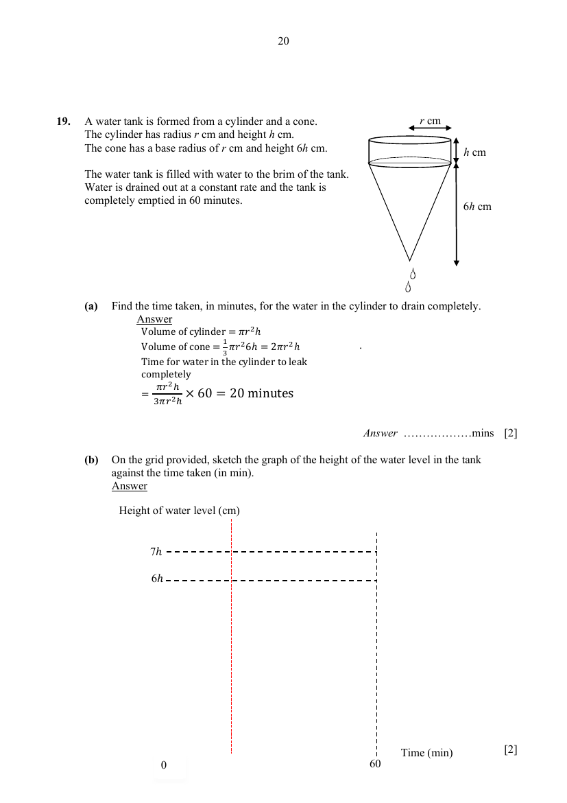

# School of Science and Technology — Mathematics 4052/01 Paper 1 Mark Scheme (cleaned)

> **Institution:** School of Science and Technology, Singapore
> **Exam:** 2025 Preliminary Examination
> **Level:** Secondary 4
> **Subjects:** Mathematics
> **Paper:** 4052/01 Paper 1 — Mark Scheme
> **Date:** 26 August 2025
> **Duration:** 2 hours 15 minutes
> **Total Marks:** 90
> **Source:** `SST 2025 EMATH PRELIM P1 MS.pdf` (cleaned & reformatted)

---

## Answer all the questions

---

### Q1

> **Marks:** (a) [1]; (b) [1]; total [2]
> **Sub-topic:** Sets
> **Page:** 3

$\xi=\{\text{integers }x:3<x<18\}$

$P=\{\text{multiples of }5\}$

$Q=\{\text{perfect squares}\}$

**(a)** List the elements in $(P\cup Q)'$.

$P\cup Q=\{4,5,9,10,15,16\}$

$(P\cup Q)'=\{6,7,8,11,12,13,14,17\}$

**(b)** On the Venn diagram, shade the region which represents $(P\cap Q)\cup(P\cap Q')$.

The region is the whole of set $P$.

---

### Q2

> **Marks:** (a) [2]; (b) [2]; total [4]
> **Sub-topic:** Prime factors
> **Page:** 4

**(a)** Use prime factors to explain why $18\times 63$ is not a perfect square.

$$
\begin{aligned}
18&=2\times 3^{2}\\
63&=7\times 3^{2}\\
18\times 63&=2\times 3^{2}\times 7\times 3^{2}\\
18\times 63&=2\times 3^{4}\times 7
\end{aligned}
$$

Since the indices of the prime factors of $18\times 63$ are not all even numbers, $18\times 63$ is not a perfect square.

**(b)** The number $18p$ is a perfect cube. Find the smallest positive integer value of $p$.

$$
\begin{aligned}
18&=2\times 3^{2}\\
18p&=2\times 3^{2}\times p\\
p&=2^{2}\times 3\\
p&=12
\end{aligned}
$$

---

### Q3

> **Marks:** (a) [2]; (b) [2]; total [4]
> **Sub-topic:** Indices
> **Page:** 5

**(a)** Given that $2^{m-1}\times 3^{m}=1$, find the value of $36^{m}$.

$$
\begin{aligned}
2^{m-1}\times 3^{m}&=1\\
2^{m}\times 3^{m}&=2\\
6^{m}&=2\\
36^{m}&=2^{2}\\
36^{m}&=4
\end{aligned}
$$

**(b)** Simplify $\dfrac{(2xy)^{-2}}{12}\div\dfrac{x^{3}}{4y^{2}}$.

$$
\begin{aligned}
\dfrac{(2xy)^{-2}}{12}\div\dfrac{x^{3}}{4y^{2}}&=\dfrac{1}{48x^{2}y^{2}}\times\dfrac{4y^{2}}{x^{3}}\\
&=\dfrac{1}{12x^{5}}
\end{aligned}
$$

---

### Q4

> **Marks:** (a) [3]; (b)(i) [1]; (b)(ii) [2]; total [6]
> **Sub-topic:** Quadratic equations and factorisation
> **Page:** 6

**(a)** Solve the equation $x^{2}-4x-11=0$ by completing the square. Give your answer correct to 2 decimal places.

$$
\begin{aligned}
x^{2}-4x-11&=0\\
(x^{2}-4x+2^{2}-2^{2})-11&=0\\
(x-2)^{2}-4-11&=0\\
(x-2)^{2}&=15\\
x-2&=\pm\sqrt{15}\\
x&=2\pm\sqrt{15}\\
x&=5.87\ (2\text{ d.p.})\text{ or }x=-1.87\ (2\text{ d.p.})
\end{aligned}
$$

**(b) (i)** Factorise completely $4x^{2}+5x-6$.

$$
4x^{2}+5x-6=(4x-3)(x+2)
$$

**(ii)** Hence, factorise completely $4(2t+2)^{2}+5(2t+2)-6$. Write your answer as simply as possible.

$$
\begin{aligned}
4(2t+2)^{2}+5(2t+2)-6&=[4(2t+2)-3][(2t+2)+2]\\
&=(8t+5)(2t+4)\\
&=2(8t+5)(t+2)
\end{aligned}
$$

---

### Q5

> **Marks:** [2]
> **Sub-topic:** Proportion
> **Page:** 7

It is given that $y$ is directly proportional to $x^{2}$. Find the percentage increase in $y$ if $x$ is increased by $25\%$ of its original value.

$y=kx^{2}$, where $k$ is a constant.

Let new $x=x_{1}$. Let new $y=y_{1}$.

$$
\begin{aligned}
x_{1}&=1.25x\\
y_{1}&=k(1.25x)^{2}\\
y_{1}&=1.5625kx^{2}\\
\text{Percentage increase in }y&=\dfrac{y_{1}-y}{y}\times 100\%\\
&=\dfrac{1.5625kx^{2}-kx^{2}}{kx^{2}}\times 100\%\\
&=\dfrac{kx^{2}(1.5625-1)}{kx^{2}}\times 100\%\\
&=56.25\%
\end{aligned}
$$

---

### Q6

> **Marks:** [3]
> **Sub-topic:** Algebraic fractions
> **Page:** 7

Express as a single fraction in its simplest form $\dfrac{4(x-2)}{x^{2}-4}-\dfrac{2(3x-1)}{3x^{2}+5x-2}$.

$$
\begin{aligned}
\dfrac{4(x-2)}{x^{2}-4}-\dfrac{2(3x-1)}{3x^{2}+5x-2}&=\dfrac{4(x-2)}{(x-2)(x+2)}-\dfrac{2(3x-1)}{(3x-1)(x+2)}\\
&=\dfrac{4}{x+2}-\dfrac{2}{x+2}\\
&=\dfrac{2}{x+2}
\end{aligned}
$$

---

### Q7

> **Marks:** (a) [2]; (b) [1]; (c) [1]; total [4]
> **Sub-topic:** Arithmetic sequences
> **Page:** 8

In the sequence, the difference between any two consecutive terms is the same number.

$$
17,\quad x,\quad y,\quad z,\quad 9,\quad \ldots
$$

**(a)** Find the values of $x$, $y$ and $z$.

$$
\begin{aligned}
T_{1}&=17\\
T_{2}&=x=17+1(-2)=15\\
T_{3}&=y=17+2(-2)=13\\
T_{4}&=z=17+3(-2)=11\\
T_{5}&=17+(5-1)(-2)=9
\end{aligned}
$$

Alternative method: common difference $=2$.

$x=17-2=15$, $y=17-4=13$, $z=17-6=11$.

**(b)** Write down an expression for the $n$th term of the sequence.

$$
\begin{aligned}
T_{n}&=17+(-2)(n-1)\\
T_{n}&=19-2n
\end{aligned}
$$

**(c)** Explain why $-317$ is a term of this sequence.

$$
\begin{aligned}
19-2n&=-317\\
n&=168
\end{aligned}
$$

Since $n$ is a positive integer, $-317$ is the 168th term of the sequence.

OR Since $n$ is a positive integer, $-317$ is a term of the sequence.

---

### Q8

> **Marks:** [3]
> **Sub-topic:** Quadratic graphs
> **Page:** 9

Sketch the graph of $y=-(2x-1)(x+3)$ on the axes below. Indicate clearly the coordinates of the turning point and where the graph crosses the axes.

The curve crosses the $x$-axis at $(-3,0)$ and $(0.5,0)$, crosses the $y$-axis at $(0,3)$, and has turning point $(-1.25,6.125)$.

---

### Q9

> **Marks:** (a) [1]; (b) [1]; (c) [1]; total [3]
> **Sub-topic:** Matrices
> **Page:** 10

Diana has two outlets that sell donuts of three flavours. The number of donuts sold in the outlets over a two-hour period is given by the matrix $\mathbf{D}$.

$$
\mathbf{D}=\begin{pmatrix}75&86&48\\108&56&36\end{pmatrix}
\begin{array}{l}\text{Outlet 1}\\\text{Outlet 2}\end{array}
$$

Columns are blueberry, chocolate and apple.

**(a)** Each blueberry donut is sold at SGD 3.50. Each chocolate donut is sold at SGD 4.50. Each apple donut is sold at SGD 2.50. Represent the selling price in a $3\times 1$ column matrix $\mathbf{P}$.

$$
\mathbf{P}=\begin{pmatrix}3.5\\4.5\\2.5\end{pmatrix}
$$

**(b)** Evaluate the matrix $\mathbf{M}=\mathbf{DP}$.

$$
\begin{aligned}
\mathbf{M}&=\mathbf{DP}\\
&=\begin{pmatrix}75&86&48\\108&56&36\end{pmatrix}\begin{pmatrix}3.5\\4.5\\2.5\end{pmatrix}\\
&=\begin{pmatrix}(75\times 3.5)+(86\times 4.5)+(48\times 2.5)\\
(108\times 3.5)+(56\times 4.5)+(36\times 2.5)\end{pmatrix}\\
&=\begin{pmatrix}769.5\\720\end{pmatrix}
\end{aligned}
$$

**(c)** Explain what each element in matrix $\mathbf{M}$ represents.

$769.5$ represents the total amount in dollars collected by Diana from selling donuts of the 3 flavours in outlet 1 over a two-hour period.

$720$ represents the total amount collected in dollars by Diana from selling donuts of the 3 flavours in outlet 2 over a two-hour period.

---

### Q10

> **Marks:** (a) [1]; (b) [2]; total [3]
> **Sub-topic:** Probability
> **Page:** 11

A bag contains some blue marbles, some green marbles and some red marbles. The probability of choosing a green marble is $0.2$. The probability of choosing a red marble is $0.35$.

**(a)** Find the probability of choosing a blue marble at random.

$$
\begin{aligned}
P(\text{blue marble})&=1-0.35-0.2\\
&=0.45
\end{aligned}
$$

$45\%$: not accepted.

**(b)** In the bag, there are $9$ more red marbles than green marbles. Find the total number of marbles in the bag.

$$
\begin{aligned}
\text{Total number of marbles in the bag}&=\dfrac{9}{0.35-0.2}\\
&=60
\end{aligned}
$$

---

### Q11

> **Marks:** [2]
> **Sub-topic:** Area of a kite
> **Page:** 12

The diagram shows a kite $ABCD$. $AC$ and $DB$ are the diagonals of the kite. $E$ is a point on $AC$ such that $AE:EC=1:3$.

Find the fraction of the kite that is shaded.

$$
\begin{aligned}
\dfrac{\text{Area of smaller triangle}}{\text{Area of bigger triangle}}&=\dfrac{\dfrac{1}{2}\times B\times H_{1}}{\dfrac{1}{2}\times B\times H_{2}}\\
&=\dfrac{1}{3}\\
\dfrac{\text{Area of shaded triangle}}{\text{Diagram}}&=\dfrac{1.5}{4}=\dfrac{3}{8}
\end{aligned}
$$

Alternative solution.

Let the height of the smaller triangle be $H_{1}$. Let the height of the larger triangle be $H_{2}$. $H_{2}=3H_{1}$.

$$
\begin{aligned}
\text{Fraction of the kite that is shaded}&=\dfrac{\dfrac{1}{2}\left(\dfrac{1}{2}\times H_{2}\times B\right)}{\left(\dfrac{1}{2}\times H_{1}\times B\right)+\left(\dfrac{1}{2}\times H_{2}\times B\right)}\\
&=\dfrac{\dfrac{1}{2}\left(\dfrac{1}{2}\times 3H_{1}\times B\right)}{\left(\dfrac{1}{2}\times H_{1}\times B\right)+\left(\dfrac{1}{2}\times 3H_{1}\times B\right)}\\
&=\dfrac{\dfrac{1}{2}\left(\dfrac{1}{2}\times 3H_{1}\times B\right)}{\left(\dfrac{1}{2}\times H_{1}\times B\right)(1+3)}\\
&=\dfrac{3}{8}
\end{aligned}
$$

---

### Q12

> **Marks:** (a) [2]; (b) [2]; total [4]
> **Sub-topic:** Percentage profit and exponential growth
> **Page:** 13

**(a)** Ben sold a painting to Carl at a profit of $20\%$ and Carl then sold it to Don at a profit of $40\%$. If Don paid SGD 12800 for the painting, calculate how much Ben paid for the painting.

Let the cost of the painting be $SGD x$.

$$
\begin{aligned}
\dfrac{140}{100}\left(\dfrac{120}{100}x\right)&=12800\\
1.4\times 1.2x&=12800\\
1.68x&=12800\\
x&=\dfrac{12800}{1.68}\\
x&=7619.05\ (2\text{ d.p.})
\end{aligned}
$$

**(b)** Some bacteria were introduced into a culture. The number, $N$, of bacteria, $t$ hours after being introduced is given by $N=2\times 5^{t}$. Find the increase in the number of bacteria after $5$ hours as a percentage of the number of bacteria originally introduced.

$$
\begin{aligned}
\text{Percentage increase}&=\dfrac{2\times 5^{5}-2\times 5^{0}}{2\times 5^{0}}\times 100\%\\
&=\dfrac{2(5^{5}-1)}{2}\times 100\%\\
&=3124\times 100\%\\
&=312400\%
\end{aligned}
$$

---

### Q13

> **Marks:** (a)(i) [1]; (a)(ii) [1]; (b) [2]; total [4]
> **Sub-topic:** Vectors
> **Page:** 14

A star is made up of a regular hexagon $ABCDEF$, centre $X$, surrounded by equilateral triangles. $\overrightarrow{OA}=2\mathbf{a}$ and $\overrightarrow{OB}=2\mathbf{b}$.

**(a)** Express the following vectors in terms of $\mathbf{a}$ and/or $\mathbf{b}$, giving your answers in the simplest form.

**(i)** $\overrightarrow{OR}$

$$
\begin{aligned}
\overrightarrow{OR}&=\overrightarrow{OA}+\overrightarrow{AF}+\overrightarrow{FE}+\overrightarrow{ER}\\
\overrightarrow{OR}&=4\mathbf{a}+4\mathbf{b}
\end{aligned}
$$

**(ii)** $\overrightarrow{FC}$

$$
\begin{aligned}
\overrightarrow{FC}&=\overrightarrow{FE}+\overrightarrow{ER}+\overrightarrow{RD}+\overrightarrow{DC}\\
\overrightarrow{FC}&=4\mathbf{b}-4\mathbf{a}
\end{aligned}
$$

**(b)** When $|\mathbf{a}|=6$ units, find the perimeter of the star $OATFSERDQCPBO$.

$$
\begin{aligned}
\text{Perimeter of the star}&=12(2\times 6)\\
&=144\text{ units}
\end{aligned}
$$

---

### Q14

> **Marks:** (a) [1]; (b) [1]; total [2]
> **Sub-topic:** Coordinate geometry
> **Page:** 15

The diagram shows the points $D(3,1)$, $E(5,6)$ and $F(5,9)$.

**(a)** Find the coordinates of $G$ such that $DEFG$ is a parallelogram.

$G(3,4)$

**(b)** Find the length of the line $DF$.

$$
\begin{aligned}
DF&=\sqrt{(5-3)^{2}+(9-1)^{2}}\\
&=8.2462\\
&=8.25\text{ units}\ (3\text{ s.f.})
\end{aligned}
$$

---

### Q15

> **Marks:** (a)(i) [1]; (a)(ii) [2]; (b) [1]; total [4]
> **Sub-topic:** Trigonometry and circles
> **Page:** 16

In the triangle $ABD$, $AD=17$ cm, $AC=10$ cm and $\angle ABC=90^{\circ}$.

**(a)** Given that $\sin\angle ACD=\dfrac{3}{5}$, find the exact value of

**(i)** $AB$

$$
\begin{aligned}
\sin\angle ACD&=\sin\angle ACB=\dfrac{3}{5}\\
\dfrac{AB}{AC}&=\dfrac{AB}{10}=\dfrac{3}{5}\\
AB&=6\text{ cm}
\end{aligned}
$$

**(ii)** $\tan\angle ACB$

$$
\begin{aligned}
BC&=\sqrt{10^{2}-6^{2}}=8\text{ cm}\\
\tan\angle ACB&=\dfrac{AB}{BC}=\dfrac{6}{8}=\dfrac{3}{4}
\end{aligned}
$$

**(b)** A circle $Q_{1}$ is drawn such that it passes through $A$, $B$ and $C$. A second circle $Q_{2}$ is drawn such that it passes through $A$, $B$ and $D$. Find the ratio of the circumference of $Q_{1}$ to the circumference of $Q_{2}$.

Note that $AC$ is the diameter of $Q_{1}$ (right angle in a semicircle) and $AD$ is the diameter of $Q_{2}$ (right angle in a semicircle).

$$
\dfrac{\text{circumference of }Q_{1}}{\text{circumference of }Q_{2}}=\dfrac{10}{17}
$$

The ratio of the circumference of $Q_{1}$ to the circumference of $Q_{2}$ is $10:17$.

---

### Q16

> **Marks:** (a) [2]; (b) [2]; (c) [2]; total [6]
> **Sub-topic:** Bearings
> **Page:** 17

Aris cycled from his house at Alley Way, point $A$, to meet Meng at point $B$, which is $500$ m away on a bearing of $121^{\circ}$. After that, they both cycled to the School of Science and Technology (SST), point $C$, on a bearing of $342^{\circ}$, which is $410$ m from $B$.

**(a)** Show that angle $ABC$ is $41^{\circ}$.

$$
\begin{aligned}
\angle ABN&=180^{\circ}-121^{\circ}=59^{\circ}\quad(\text{interior angles, parallel lines})\\
\angle CBN&=360^{\circ}-342^{\circ}=18^{\circ}\quad(\text{angles at a point})\\
\therefore\ \angle ABC&=59^{\circ}-18^{\circ}=41^{\circ}\quad(\text{adjacent angles})\ (\text{shown})
\end{aligned}
$$

**(b)** Calculate the distance $AC$.

$$
\begin{aligned}
AC^{2}&=AB^{2}+BC^{2}-2(AB)(BC)\cos 41^{\circ}\\
AC^{2}&=500^{2}+410^{2}-2(500)(410)\cos 41^{\circ}\\
AC&=329.64=330\text{ m}\quad(\text{correct to }3\text{ significant figures})
\end{aligned}
$$

**(c)** Calculate the shortest distance from $A$ to $BC$.

Let the shortest distance from $A$ to $BC$ be $h$.

$$
\begin{aligned}
\sin\angle ABC&=\dfrac{h}{500}\\
h&=500\sin 41^{\circ}\\
h&=328.02=328\text{ m}\quad(\text{correct to }3\text{ significant figures})
\end{aligned}
$$

---

### Q17

> **Marks:** (a) [1]; (b) [1]; (c) [1]; (d) [2]; total [5]
> **Sub-topic:** Polygons
> **Page:** 18

The diagram shows a nonagon. Six interior angles are each $x^{\circ}$. The remaining three interior angles are each $y^{\circ}$.

**(a)** State the number of lines of symmetry if $x^{\circ}\neq y^{\circ}$.

Lines of symmetry $=3$.

**(b)** Find the sum of the interior angles of the nonagon.

$$
(9-2)\times 180^{\circ}=1260^{\circ}
$$

**(c)** Hence, show that $y=-2x+420$.

Use $6x^{\circ}+3y^{\circ}=1260^{\circ}$.

$$
y=-2x+420\quad(\text{shown})
$$

**(d)** Given that $x:y=13:16$, find $x$.

$$
\begin{aligned}
\dfrac{x}{y}&=\dfrac{13}{16}\\
y&=\dfrac{16}{13}x\\
-2x+420&=\dfrac{16}{13}x\\
-26x+5460&=16x\\
42x&=5460\\
x&=130
\end{aligned}
$$

---

### Q18

> **Marks:** (a) [2]; (b) [3]; total [5]
> **Sub-topic:** Exchange rates and interest
> **Page:** 19

**(a)** Ellie went for a school exchange in the United Kingdom. She changed $250$ Singapore dollars (SGD ) to UK pounds (£). She spent £$100$ during her trip and converted the remaining pounds back to Singapore dollars.

| Exchange rate | Buying rate for one Singapore dollar (SGD ) | Selling rate for one Singapore dollar (SGD ) |
| --- | --- | --- |
| UK pounds (£) | $0.5746$ | $0.5830$ |

Using the exchange rate given, calculate how much Singapore dollars she had left. Give your answer to the nearest dollar.

Selling rate of UK pounds: SGD $1=$ £$0.5830$.

$$
\begin{aligned}
\text{Conversion of SGD }250\text{ to pounds}&=250\times 0.5830\\
&=£145.75\ (2\text{ d.p.})
\end{aligned}
$$

Buying rate of UK pounds: SGD $1=$ £$0.5746$.

$$
\begin{aligned}
\text{Conversion of pounds to SGD}&=SGD [(145.75-100)\div 0.5746]\\
&=SGD 79.62\\
&=SGD 80\quad(\text{to the nearest dollar})
\end{aligned}
$$

**(b)** Jane intends to borrow SGD 88000 for her business venture and is considering the loan schemes by Bank A and Bank B.

| Bank A | Bank B |
| --- | --- |
| Interest rate of $2.38\%$ per annum compound interest compounded half-yearly | Interest rate of $3.28\%$ per annum simple interest |

If Jane wishes to take a loan for a period of $5$ years, determine which bank should she borrow from. Explain your answer with mathematical calculations.

$$
\begin{aligned}
\text{Bank A total amount to repay}&=88000\left(1+\dfrac{2.38}{100\times 2}\right)^{5\times 2}\\
&=88000\left(1+\dfrac{1.19}{100}\right)^{10}\\
&=SGD 99050.95\ (2\text{ d.p.})\\
\text{Bank B total amount to repay}&=88000+88000\left(\dfrac{3.28}{100}\times 5\right)\\
&=88000+14432\\
&=SGD 102432
\end{aligned}
$$

Jane should borrow from Bank A as the total amount she has to repay is SGD 99050.95 which is less than the total amount of SGD 102432 from Bank B.

---

### Q19

> **Marks:** (a) [2]; (b) [2]; total [4]
> **Sub-topic:** Volume and graphs
> **Page:** 20

A water tank is formed from a cylinder and a cone. The cylinder has radius $r$ cm and height $h$ cm. The cone has a base radius of $r$ cm and height $6h$ cm.

The water tank is filled with water to the brim of the tank. Water is leaked out at a constant rate and the tank is completely emptied in $60$ minutes.

**(a)** Find the time taken, in minutes, for the water in the cylinder to drain completely.

$$
\begin{aligned}
\text{Volume of cylinder}&=\pi r^{2}h\\
\text{Volume of cone}&=\dfrac{1}{3}\pi r^{2}(6h)=2\pi r^{2}h\\
\text{Time for water in the cylinder to leak completely}&=\dfrac{\pi r^{2}h}{3\pi r^{2}h}\times 60\\
&=20\text{ minutes}
\end{aligned}
$$

**(b)** On the grid provided, sketch the graph of the height of the water level in the tank against the time taken (in min).

The graph starts at height $7h$ when time is $0$, falls to $6h$ at $20$ minutes, and reaches height $0$ at $60$ minutes.

---

### Q20

> **Marks:** (a) [4]; (b) [2]; total [6]
> **Sub-topic:** Cumulative frequency
> **Page:** 21–22

The cumulative frequency curve shows the distribution of the depth, $d$ mm, of a canal measured daily for a period of $200$ days.

**(a)** Use the curve to estimate

**(i)** the median depth of the canal,

Median $=400$ mm.

**(ii)** the interquartile range of the depth,

$$
\begin{aligned}
\mathrm{IQR}&=420-350\\
&=70\text{ mm}
\end{aligned}
$$

**(iii)** the depth at the $30$th percentile,

Reading at $60$ days $=365$ mm.

**(iv)** the number of days when the depth of the canal was at least $450$ mm.

$$
\begin{aligned}
\text{Number of days}&=200-178\\
&=22
\end{aligned}
$$

**(b)** The information on the cumulative frequency curve is shown in this table.

| Depth (mm) | $100<d\leq 200$ | $200<d\leq 300$ | $300<d\leq 400$ | $400<d\leq 500$ |
| --- | --- | --- | --- | --- |
| No. of days | $12$ | $m$ | $n$ | $100$ |

**(i)** Find the values of $m$ and $n$.

$$
\begin{aligned}
m&=30-12=18\\
n&=70
\end{aligned}
$$

**(ii)** Calculate an estimate of the mean depth of the canal.

$$
\begin{aligned}
\text{Estimated mean}&=\dfrac{(150\times 12)+(250\times 18)+(350\times 70)+(450\times 100)}{200}\\
&=\dfrac{1800+4500+24500+45000}{200}\\
&=\dfrac{77000}{200}\\
&=379\text{ mm}
\end{aligned}
$$

---

### Q21

> **Marks:** [2]
> **Sub-topic:** Misleading graphs
> **Page:** 23

State one aspect of the graph that may be misleading and explain how this may lead to a misinterpretation of the graph.

Possible answers:

**(i)** The vertical axis did not start from zero. This exaggerates the differences between the price difference of SGD 0.10.

**(ii)** The title is biased. This misguides the readers to think that the price of bubble tea has increased significantly and does not allow readers to make their own judgement.

**(iii)** Information from the month of April is missing. The reader may assume that the price of bubble tea for Shop B has remained constant compared to the price of bubble tea for Shop A which has increased.

---

### Q22

> **Marks:** (a) [2]; (b) [3]; (c) [1]; (d) [2]; total [8]
> **Sub-topic:** Frustum and arc length
> **Page:** 24–26

The diagram shows a lampshade in the shape of a frustum. The bottom radius of the frustum is $120$ mm. The top radius of the frustum is $70$ mm. The vertical height of the frustum is $200$ mm.

**(a)** Find the slant height, $h$, of the frustum.

$$
\begin{aligned}
\text{Slant height}&=\sqrt{(120-70)^{2}+200^{2}}\\
&=\sqrt{42500}\\
&=206.15\\
&=206\text{ mm}\ (3\text{ significant figures})
\end{aligned}
$$

Use of Pythagoras' Theorem.

**(b)** The shaded area represents the net of the lampshade. The radius of the inner arc is $r_{1}$ mm. The radius of the outer arc is $(r_{1}+h)$ mm. Show that the radius of the inner arc is $288.6$ mm.

$$
\begin{aligned}
\dfrac{\theta}{360^{\circ}}\times 2\pi r_{1}&=2\pi(70)\\
\dfrac{\theta}{360^{\circ}}\times 2\pi(r_{1}+h)&=2\pi(120)\\
\dfrac{\theta}{360^{\circ}}&=\dfrac{70}{r_{1}}\\
\dfrac{\theta}{360^{\circ}}&=\dfrac{120}{r_{1}+h}\\
\dfrac{70}{r_{1}}&=\dfrac{120}{r_{1}+\sqrt{42500}}\\
r_{1}&=70\sqrt{17}=288.6\text{ mm}\ (\text{shown})
\end{aligned}
$$

**(c)** Hence, find angle $\theta$.

$$
\begin{aligned}
\theta&=\dfrac{2\pi(70)\times 360}{2\pi(70\sqrt{17})}\\
&=87.312^{\circ}\\
&=87.3^{\circ}\ (1\text{ d.p.})
\end{aligned}
$$

**(d)** Calculate the amount of material required to make the lampshade, leaving your answer in square centimetres.

$$
\begin{aligned}
\text{Total surface area}&=\dfrac{87.312^{\circ}}{360^{\circ}}\times\pi(70\sqrt{17}+50\sqrt{17})^{2}-\dfrac{87.312^{\circ}}{360^{\circ}}\times\pi(70\sqrt{17})^{2}\\
&=123053.4615\ \mathrm{mm}^{2}\\
&=1230\ \mathrm{cm}^{2}\ (3\text{ significant figures})
\end{aligned}
$$

---

### Q23

> **Marks:** (a) [1]; (b) [1]; (c) [1]; (d) [1]; total [4]
> **Sub-topic:** Constructions and loci
> **Page:** 27

The diagram shows a plot of land, $PTVU$, on a campsite. $PT$ and $PU$ are tangents of an arc of a circle at $T$ and $U$.

**(a)** Find the centre of the circle and label it $X$.

Construction of perpendicular lines at $T$ and $U$. Labelling of the intersection of the perpendicular lines at $T$ and $U$ as point $X$.

**(b)** Construct the perpendicular bisector of $TP$.

Construction of the perpendicular bisector of $TP$ with working.

**(c)** Construct the angle bisector of angle $TPU$.

Construction of the angle bisector of angle $TPU$ with working.

**(d)** A lookout tower is to be built on the campsite $PTVU$, nearer to $T$ than $P$ and nearer to $PT$ than $PU$.

Shade the region where the lookout tower is to be built.

