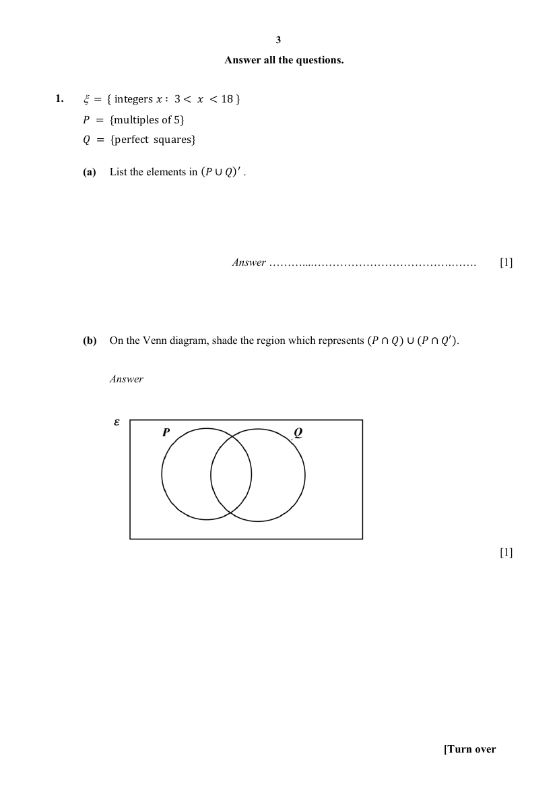
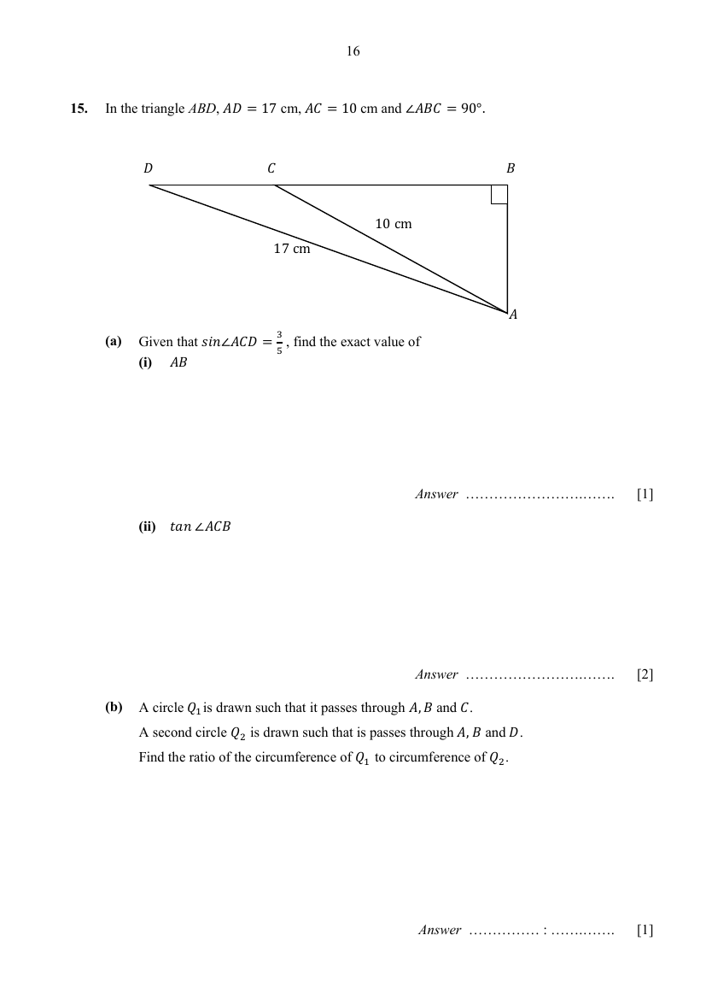
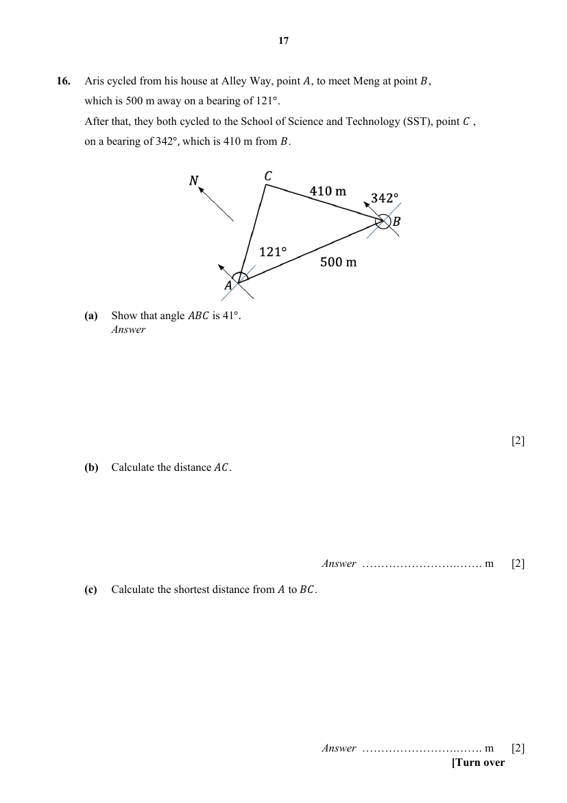
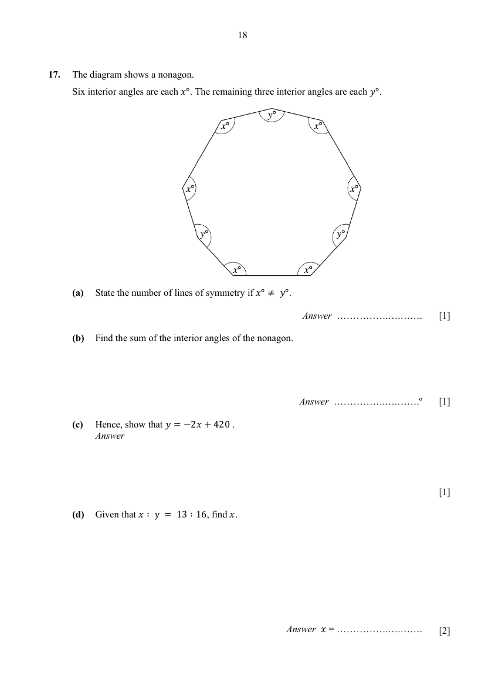
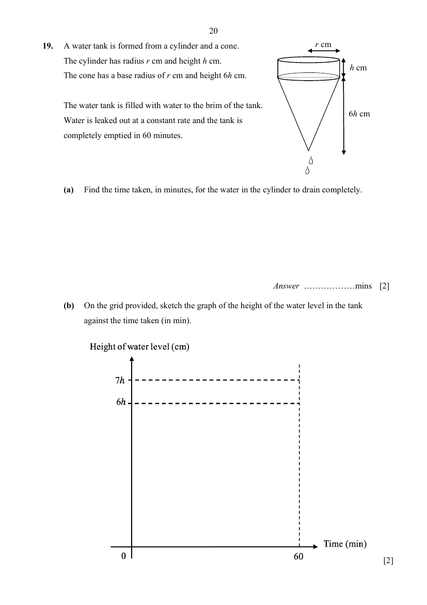
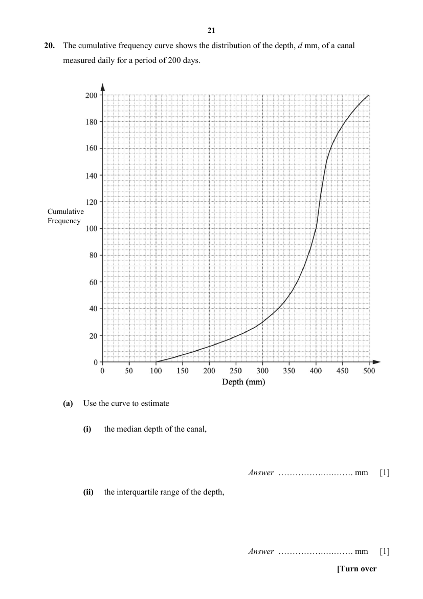
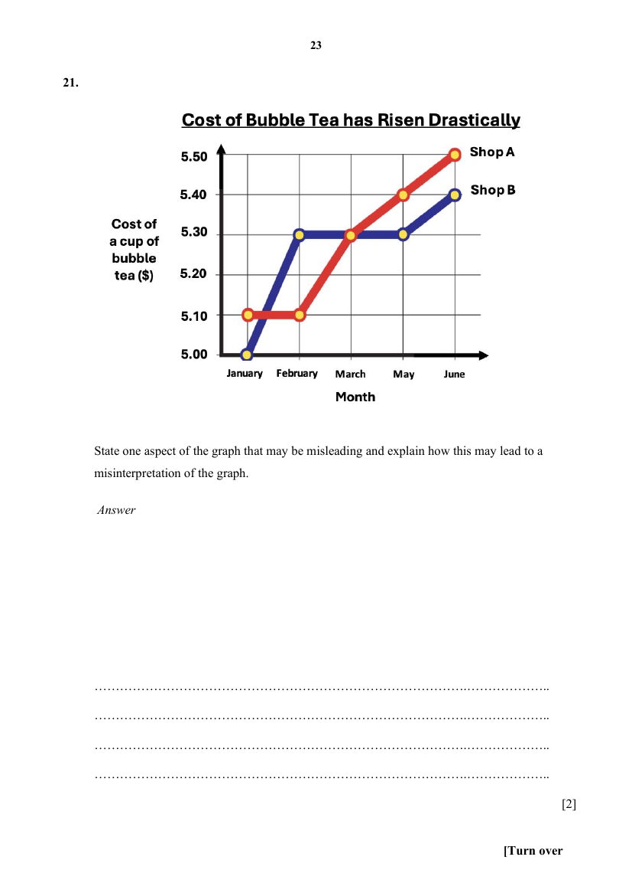
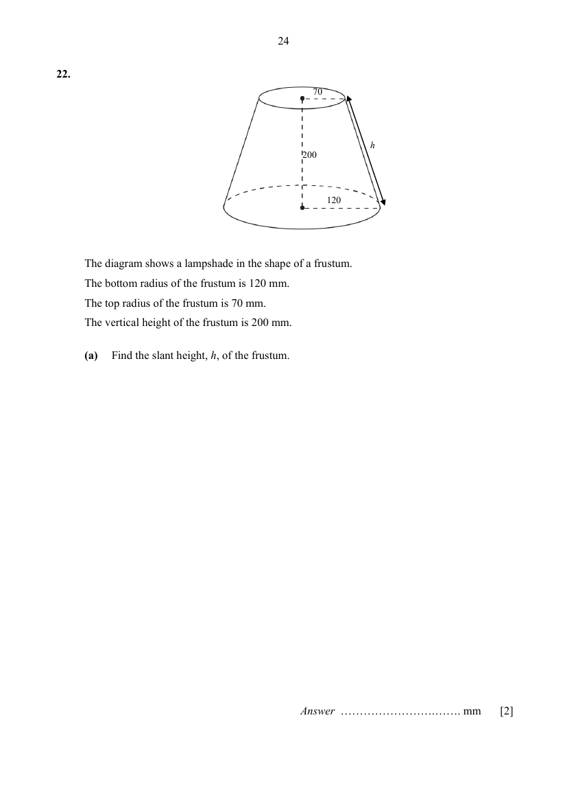
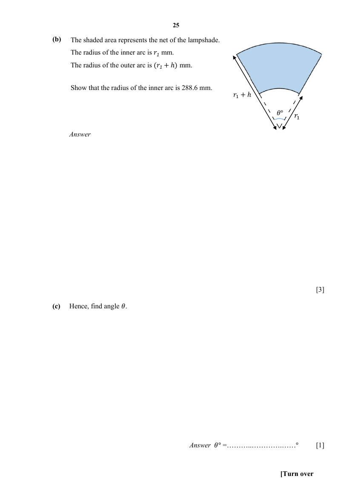

# School of Science and Technology — Mathematics 4052/01 Paper 1 (cleaned)

> **Institution:** School of Science and Technology, Singapore
> **Exam:** 2025 Preliminary Examination
> **Level:** Secondary 4
> **Subjects:** Mathematics
> **Paper:** 4052/01 Paper 1
> **Date:** 26 August 2025
> **Duration:** 2 hours 15 minutes
> **Total Marks:** 90
> **Source:** `SST 2025 EMATH PRELIM P1 QP.pdf` (cleaned & reformatted)

---

## Instructions

Write your full name, class and index number in the spaces above.
Write in dark blue or black pen in the space provided for each question.
You may use a HB pencil for any diagrams or graphs.
Do not use staples, paper clips, highlighters, glue or correction fluid.

Answer all the questions.
The number of marks is given in brackets [ ] at the end of each question or part question.
If working is needed for any question, it must be shown in the space below the question.
Omission of essential working will result in loss of marks.
The total of the marks for this paper is 90.

The use of an approved scientific calculator is expected, where appropriate.
If the degree of accuracy is not specified in the question and if the answer is not exact, give the answer to three significant figures. Give answers in degrees to one decimal place.
For $\pi$, use either your calculator value or $3.142$.

---

## Mathematical Formulae

*Compound interest*

$$
\text{Total amount} = P\left(1+\frac{r}{100}\right)^{n}
$$

*Mensuration*

$$
\text{Curved surface area of a cone} = \pi rl
$$

$$
\text{Surface area of a sphere} = 4\pi r^{2}
$$

$$
\text{Volume of a cone} = \frac{1}{3}\pi r^{2}h
$$

$$
\text{Volume of a sphere} = \frac{4}{3}\pi r^{3}
$$

$$
\text{Area of triangle } ABC = \frac{1}{2}ab\sin C
$$

$$
\text{Arc length} = r\theta,\text{ where }\theta\text{ is in radians}
$$

$$
\text{Sector area} = \frac{1}{2}r^{2}\theta,\text{ where }\theta\text{ is in radians}
$$

*Trigonometry*

$$
\frac{a}{\sin A} = \frac{b}{\sin B} = \frac{c}{\sin C}
$$

$$
a^{2} = b^{2}+c^{2}-2bc\cos A
$$

*Statistics*

$$
\text{Mean} = \frac{\sum fx}{\sum f}
$$

$$
\text{Standard deviation} = \sqrt{\frac{\sum fx^{2}}{\sum f}-\left(\frac{\sum fx}{\sum f}\right)^{2}}
$$

---

## Answer all the questions

### Q1

> **Marks:** (a) 1, (b) 1; total 2
> **Page:** 3

$\xi = \{\text{integers } x : 3 < x < 18\}$

$P = \{\text{multiples of } 5\}$

$Q = \{\text{perfect squares}\}$

**(a)** List the elements in $(P \cup Q)'$. [1]
> **Topic:** N8 Set language and notation
> **Sub-topic:** Set language and notation
> **LO:** [[context/subjects/o-level-e-maths/learning-objectives/o-level-e-maths-N8c.md|N8c]]

**(b)** On the Venn diagram, shade the region which represents $(P \cap Q) \cup (P \cap Q')$. [1]
> **Topic:** N8 Set language and notation
> **Sub-topic:** Set language and notation
> **LO:** [[context/subjects/o-level-e-maths/learning-objectives/o-level-e-maths-N8c.md|N8c]]

---

### Q2

> **Marks:** (a) 2, (b) 2; total 4
> **Page:** 4

**(a)** Use prime factors to explain why $18 \times 63$ is not a perfect square. [2]
> **Topic:** N1 Numbers and their operations
> **Sub-topic:** Numbers and their operations
> **LO:** [[context/subjects/o-level-e-maths/learning-objectives/o-level-e-maths-N1b.md|N1b]]

**(b)** The number $18p$ is a perfect cube. Find the smallest positive integer value of $p$. [2]
> **Topic:** N1 Numbers and their operations
> **Sub-topic:** Numbers and their operations
> **LO:** [[context/subjects/o-level-e-maths/learning-objectives/o-level-e-maths-N1b.md|N1b]]

---

### Q3

> **Marks:** (a) 2, (b) 2; total 4
> **Page:** 5

**(a)** Given that $2^{m-1}\times 3^{m} = 1$, find the value of $36^{m}$. [2]
> **Topic:** N1 Numbers and their operations
> **Sub-topic:** Numbers and their operations
> **LO:** [[context/subjects/o-level-e-maths/learning-objectives/o-level-e-maths-N1j.md|N1j]]

**(b)** Simplify $\dfrac{(2xy)^{-2}}{12}\div\dfrac{x^{3}}{4y^{2}}$. [2]
> **Topic:** N1 Numbers and their operations
> **Sub-topic:** Numbers and their operations
> **LO:** [[context/subjects/o-level-e-maths/learning-objectives/o-level-e-maths-N1j.md|N1j]]

---

### Q4

> **Marks:** (a) 3, (b)(i) 1, (b)(ii) 2; total 6
> **Page:** 6

**(a)** Solve the equation $x^{2}-4x-11 = 0$ by completing the square. Give your answer correct to $2$ decimal places. [3]

**(b)(i)** Factorise completely $4x^{2}+5x-6$. [1]
> **Topic:** N1 Numbers and their operations
> **Sub-topic:** Numbers and their operations
> **LO:** [[context/subjects/o-level-e-maths/learning-objectives/o-level-e-maths-N1g.md|N1g]]

**(ii)** Hence, factorise completely $4(2t+2)^{2}+5(2t+2)-6$. Write your answer as simply as possible. [2]
> **Topic:** N1 Numbers and their operations
> **Sub-topic:** Numbers and their operations
> **LO:** [[context/subjects/o-level-e-maths/learning-objectives/o-level-e-maths-N1g.md|N1g]]

---

### Q5

> **Marks:** 2
> **Topic:** N2 Ratio and proportion
> **Sub-topic:** Ratio and proportion
> **LO:** [[context/subjects/o-level-e-maths/learning-objectives/o-level-e-maths-N2b.md|N2b]]
> **Page:** 7

It is given that $y$ is directly proportional to $x^{2}$. Find the percentage increase in $y$ if $x$ is increased by $25\%$ of its original value. [2]

---

### Q6

> **Marks:** 3
> **Topic:** N7 Equations and inequalities
> **Sub-topic:** Equations and inequalities
> **LO:** [[context/subjects/o-level-e-maths/learning-objectives/o-level-e-maths-N7b.md|N7b]]
> **Page:** 7

Express as a single fraction in its simplest form

$$
\frac{4(x-2)}{x^{2}-4}-\frac{2(3x-1)}{3x^{2}+5x-2}.
$$

[3]

---

### Q7

> **Marks:** (a) 2, (b) 1, (c) 1; total 4
> **Page:** 8

In the sequence, the difference between any two consecutive terms is the same number.

$$
17,\quad x,\quad y,\quad z,\quad 9,\quad \ldots
$$

**(a)** Find the values of $x$, $y$ and $z$. [2]
> **Topic:** N5 Algebraic expressions and formulae
> **Sub-topic:** Algebraic expressions and formulae
> **LO:** [[context/subjects/o-level-e-maths/learning-objectives/o-level-e-maths-N5e.md|N5e]]

**(b)** Write down an expression for the $n$th term of the sequence. [1]
> **Topic:** N5 Algebraic expressions and formulae
> **Sub-topic:** Algebraic expressions and formulae
> **LO:** [[context/subjects/o-level-e-maths/learning-objectives/o-level-e-maths-N5e.md|N5e]]

**(c)** Explain why $-317$ is a term of this sequence. [1]
> **Topic:** N5 Algebraic expressions and formulae
> **Sub-topic:** Algebraic expressions and formulae
> **LO:** [[context/subjects/o-level-e-maths/learning-objectives/o-level-e-maths-N5e.md|N5e]]

---

### Q8

> **Marks:** 3
> **Topic:** N6 Functions and graphs
> **Sub-topic:** Functions and graphs
> **LO:** [[context/subjects/o-level-e-maths/learning-objectives/o-level-e-maths-N6c.md|N6c]]
> **Page:** 9

Sketch the graph of $y = -(2x-1)(x+3)$ on the axes below. Indicate clearly the coordinates of the turning point and where the graph crosses the axes. [3]

---

### Q9

> **Marks:** (a) 1, (b) 1, (c) 1; total 3
> **Page:** 10

Diana has two outlets that sell donuts of three flavours. The number of donuts sold in the outlets over a two-hour period is given by the matrix $\mathbf{D}$.

$$
\mathbf{D} = \begin{pmatrix} 75 & 86 & 48 \\ 108 & 56 & 36 \end{pmatrix}
\begin{array}{l} \text{Outlet 1} \\ \text{Outlet 2} \end{array}
$$

Columns are blueberry, chocolate and apple.

**(a)** Each blueberry donut is sold at &#36;3.50. Each chocolate donut is sold at &#36;4.50. Each apple donut is sold at &#36;2.50. Represent the selling price in a $3 \times 1$ column matrix $\mathbf{P}$. [1]
> **Topic:** N9 Matrices
> **Sub-topic:** Matrices
> **LO:** [[context/subjects/o-level-e-maths/learning-objectives/o-level-e-maths-N9b.md|N9b]]

**(b)** Evaluate the matrix $\mathbf{M} = \mathbf{DP}$. [1]
> **Topic:** N9 Matrices
> **Sub-topic:** Matrices
> **LO:** [[context/subjects/o-level-e-maths/learning-objectives/o-level-e-maths-N9b.md|N9b]]

**(c)** Explain what each element in matrix $\mathbf{M}$ represents. [1]
> **Topic:** N9 Matrices
> **Sub-topic:** Matrices
> **LO:** [[context/subjects/o-level-e-maths/learning-objectives/o-level-e-maths-N9b.md|N9b]]

---

### Q10

> **Marks:** (a) 1, (b) 2; total 3
> **Page:** 11

A bag contains some blue marbles, some green marbles and some red marbles. The probability of choosing a green marble is $0.2$. The probability of choosing a red marble is $0.35$.

**(a)** Find the probability of choosing a blue marble at random. [1]
> **Topic:** S2 Probability
> **Sub-topic:** Probability
> **LO:** [[context/subjects/o-level-e-maths/learning-objectives/o-level-e-maths-S2c.md|S2c]]

**(b)** In the bag, there are $9$ more red marbles than green marbles. Find the total number of marbles in the bag. [2]
> **Topic:** S2 Probability
> **Sub-topic:** Probability
> **LO:** [[context/subjects/o-level-e-maths/learning-objectives/o-level-e-maths-S2c.md|S2c]]

---

### Q11

> **Marks:** 2
> **Topic:** G5 Mensuration
> **Sub-topic:** Mensuration
> **LO:** [[context/subjects/o-level-e-maths/learning-objectives/o-level-e-maths-G5b.md|G5b]]
> **Page:** 12

The diagram shows a kite $ABCD$. $AC$ and $DB$ are the diagonals of the kite. $E$ is a point on $AC$ such that $AE:EC = 1:3$.

Find the fraction of the kite that is shaded. [2]

---

### Q12

> **Marks:** (a) 2, (b) 2; total 4
> **Page:** 13

**(a)** Ben sold a painting to Carl at a profit of $20\%$ and Carl then sold it to Don at a profit of $40\%$. If Don paid &#36;12800 for the painting, calculate how much Ben paid for the painting. [2]
> **Topic:** N3 Percentage
> **Sub-topic:** Percentage
> **LO:** [[context/subjects/o-level-e-maths/learning-objectives/o-level-e-maths-N3d.md|N3d]]

**(b)** Some bacteria were introduced into a culture. The number, $N$, of bacteria, $t$ hours after being introduced is given by $N = 2\times 5^{t}$. Find the increase in the number of bacteria after $5$ hours as a percentage of the number of bacteria originally introduced. [2]
> **Topic:** N3 Percentage
> **Sub-topic:** Percentage
> **LO:** [[context/subjects/o-level-e-maths/learning-objectives/o-level-e-maths-N3d.md|N3d]]

---

### Q13

> **Marks:** (a)(i) 1, (a)(ii) 1, (b) 2; total 4
> **Page:** 14

A star is made up of a regular hexagon $ABCDEF$, centre $X$, surrounded by equilateral triangles. $\overrightarrow{OA} = 2\mathbf{a}$ and $\overrightarrow{OB} = 2\mathbf{b}$.

**(a)** Express the following vectors in terms of $\mathbf{a}$ and/or $\mathbf{b}$, giving your answers in the simplest form.

**(i)** $\overrightarrow{OR}$ [1]
> **Topic:** G7 Vectors in two dimensions
> **Sub-topic:** Vectors in two dimensions
> **LO:** [[context/subjects/o-level-e-maths/learning-objectives/o-level-e-maths-G7h.md|G7h]]

**(ii)** $\overrightarrow{FC}$ [1]
> **Topic:** G7 Vectors in two dimensions
> **Sub-topic:** Vectors in two dimensions
> **LO:** [[context/subjects/o-level-e-maths/learning-objectives/o-level-e-maths-G7h.md|G7h]]

**(b)** When $|\mathbf{a}| = 6$ units, find the perimeter of the star $OATFSERDQCPBO$. [2]
> **Topic:** G7 Vectors in two dimensions
> **Sub-topic:** Vectors in two dimensions
> **LO:** [[context/subjects/o-level-e-maths/learning-objectives/o-level-e-maths-G7h.md|G7h]]

---

### Q14

> **Marks:** (a) 1, (b) 1; total 2
> **Page:** 15

The diagram shows the points $D(3,1)$, $E(5,6)$ and $F(5,9)$.

**(a)** Find the coordinates of $G$ such that $DEFG$ is a parallelogram. [1]
> **Topic:** G6 Coordinate geometry
> **Sub-topic:** Coordinate geometry
> **LO:** [[context/subjects/o-level-e-maths/learning-objectives/o-level-e-maths-G6c.md|G6c]]

**(b)** Find the length of the line $DF$. [1]
> **Topic:** G6 Coordinate geometry
> **Sub-topic:** Coordinate geometry
> **LO:** [[context/subjects/o-level-e-maths/learning-objectives/o-level-e-maths-G6c.md|G6c]]

---

### Q15

> **Marks:** (a)(i) 1, (a)(ii) 2, (b) 1; total 4
> **Page:** 16

In the triangle $ABD$, $AD = 17\text{ cm}$, $AC = 10\text{ cm}$ and $\angle ABC = 90^{\circ}$.

**(a)** Given that $\sin\angle ACD = \dfrac{3}{5}$, find the exact value of

**(i)** $AB$, [1]
> **Topic:** G4 Pythagoras' theorem and trigonometry
> **Sub-topic:** Pythagoras' theorem and trigonometry
> **LO:** [[context/subjects/o-level-e-maths/learning-objectives/o-level-e-maths-G4c.md|G4c]]

**(ii)** $\tan\angle ACB$. [2]
> **Topic:** G4 Pythagoras' theorem and trigonometry
> **Sub-topic:** Pythagoras' theorem and trigonometry
> **LO:** [[context/subjects/o-level-e-maths/learning-objectives/o-level-e-maths-G4c.md|G4c]]

**(b)** A circle $Q_{1}$ is drawn such that it passes through $A$, $B$ and $C$. A second circle $Q_{2}$ is drawn such that it passes through $A$, $B$ and $D$. Find the ratio of the circumference of $Q_{1}$ to the circumference of $Q_{2}$. [1]
> **Topic:** G4 Pythagoras' theorem and trigonometry
> **Sub-topic:** Pythagoras' theorem and trigonometry
> **LO:** [[context/subjects/o-level-e-maths/learning-objectives/o-level-e-maths-G4c.md|G4c]]

---

### Q16

> **Marks:** (a) 2, (b) 2, (c) 2; total 6
> **Page:** 17

Aris cycled from his house at Alley Way, point $A$, to meet Meng at point $B$, which is $500\text{ m}$ away on a bearing of $121^{\circ}$. After that, they both cycled to the School of Science and Technology (SST), point $C$, on a bearing of $342^{\circ}$, which is $410\text{ m}$ from $B$.

**(a)** Show that angle $ABC$ is $41^{\circ}$. [2]
> **Topic:** G4 Pythagoras' theorem and trigonometry
> **Sub-topic:** Pythagoras' theorem and trigonometry
> **LO:** [[context/subjects/o-level-e-maths/learning-objectives/o-level-e-maths-G4g.md|G4g]]

**(b)** Calculate the distance $AC$. [2]
> **Topic:** G4 Pythagoras' theorem and trigonometry
> **Sub-topic:** Pythagoras' theorem and trigonometry
> **LO:** [[context/subjects/o-level-e-maths/learning-objectives/o-level-e-maths-G4g.md|G4g]]

**(c)** Calculate the shortest distance from $A$ to $BC$. [2]
> **Topic:** G4 Pythagoras' theorem and trigonometry
> **Sub-topic:** Pythagoras' theorem and trigonometry
> **LO:** [[context/subjects/o-level-e-maths/learning-objectives/o-level-e-maths-G4g.md|G4g]]

---

### Q17

> **Marks:** (a) 1, (b) 1, (c) 1, (d) 2; total 5
> **Page:** 18

The diagram shows a nonagon. Six interior angles are each $x^{\circ}$. The remaining three interior angles are each $y^{\circ}$.

**(a)** State the number of lines of symmetry if $x^{\circ} \neq y^{\circ}$. [1]
> **Topic:** G1 Angles, triangles and polygons
> **Sub-topic:** Angles, triangles and polygons
> **LO:** [[context/subjects/o-level-e-maths/learning-objectives/o-level-e-maths-G1f.md|G1f]]

**(b)** Find the sum of the interior angles of the nonagon. [1]
> **Topic:** G1 Angles, triangles and polygons
> **Sub-topic:** Angles, triangles and polygons
> **LO:** [[context/subjects/o-level-e-maths/learning-objectives/o-level-e-maths-G1f.md|G1f]]

**(c)** Hence, show that $y = -2x+420$. [1]
> **Topic:** G1 Angles, triangles and polygons
> **Sub-topic:** Angles, triangles and polygons
> **LO:** [[context/subjects/o-level-e-maths/learning-objectives/o-level-e-maths-G1f.md|G1f]]

**(d)** Given that $x:y = 13:16$, find $x$. [2]
> **Topic:** G1 Angles, triangles and polygons
> **Sub-topic:** Angles, triangles and polygons
> **LO:** [[context/subjects/o-level-e-maths/learning-objectives/o-level-e-maths-G1f.md|G1f]]

---

### Q18

> **Marks:** (a) 2, (b) 3; total 5
> **Page:** 19

**(a)** Ellie went for a school exchange in the United Kingdom. She changed $250$ Singapore dollars (&#36;) to UK pounds (£). She spent £$100$ during her trip and converted the remaining pounds back to Singapore dollars.

| Exchange rate | Buying rate for one Singapore dollar (&#36;) | Selling rate for one Singapore dollar (&#36;) |
|---|---|---|
| UK pounds (£) | $0.5746$ | $0.5830$ |

Using the exchange rate given, calculate how much Singapore dollars she had left. Give your answer to the nearest dollar. [2]
> **Topic:** N3 Percentage
> **Sub-topic:** Percentage
> **LO:** [[context/subjects/o-level-e-maths/learning-objectives/o-level-e-maths-N3d.md|N3d]]

**(b)** Jane intends to borrow &#36;88000 for her business venture and is considering the loan schemes by Bank A and Bank B.

| Bank A | Bank B |
|---|---|
| Interest rate of $2.38\%$ per annum compound interest compounded half-yearly | Interest rate of $3.28\%$ per annum simple interest |

If Jane wishes to take a loan for a period of $5$ years, determine which bank should she borrow from. Explain your answer with mathematical calculations. [3]
> **Topic:** N3 Percentage
> **Sub-topic:** Percentage
> **LO:** [[context/subjects/o-level-e-maths/learning-objectives/o-level-e-maths-N3d.md|N3d]]

---

### Q19

> **Marks:** (a) 2, (b) 2; total 4
> **Page:** 20

A water tank is formed from a cylinder and a cone. The cylinder has radius $r\text{ cm}$ and height $h\text{ cm}$. The cone has a base radius of $r\text{ cm}$ and height $6h\text{ cm}$.

The water tank is filled with water to the brim of the tank. Water is leaked out at a constant rate and the tank is completely emptied in $60$ minutes.

**(a)** Find the time taken, in minutes, for the water in the cylinder to drain completely. [2]
> **Topic:** N6 Functions and graphs
> **Sub-topic:** Functions and graphs
> **LO:** [[context/subjects/o-level-e-maths/learning-objectives/o-level-e-maths-N6c.md|N6c]]

**(b)** On the grid provided, sketch the graph of the height of the water level in the tank against the time taken (in min). [2]
> **Topic:** N6 Functions and graphs
> **Sub-topic:** Functions and graphs
> **LO:** [[context/subjects/o-level-e-maths/learning-objectives/o-level-e-maths-N6c.md|N6c]]

---

### Q20

> **Marks:** (a) 4, (b) 2; total 6
> **Page:** 21–22

The cumulative frequency curve shows the distribution of the depth, $d\text{ mm}$, of a canal measured daily for a period of $200$ days.

**(a)** Use the curve to estimate

**(i)** the median depth of the canal, [1]
> **Topic:** S1 Data handling and analysis
> **Sub-topic:** Data handling and analysis
> **LO:** [[context/subjects/o-level-e-maths/learning-objectives/o-level-e-maths-S1f.md|S1f]]

**(ii)** the interquartile range of the depth, [1]
> **Topic:** S1 Data handling and analysis
> **Sub-topic:** Data handling and analysis
> **LO:** [[context/subjects/o-level-e-maths/learning-objectives/o-level-e-maths-S1f.md|S1f]]

**(iii)** the depth at the $30$th percentile, [1]
> **Topic:** S1 Data handling and analysis
> **Sub-topic:** Data handling and analysis
> **LO:** [[context/subjects/o-level-e-maths/learning-objectives/o-level-e-maths-S1f.md|S1f]]

**(iv)** the number of days when the depth of the canal was at least $450\text{ mm}$. [1]
> **Topic:** N6 Functions and graphs
> **Sub-topic:** Functions and graphs
> **LO:** [[context/subjects/o-level-e-maths/learning-objectives/o-level-e-maths-N6c.md|N6c]]

**(b)** The information on the cumulative frequency curve is shown in this table.

| Depth (mm) | $100 < d \leq 200$ | $200 < d \leq 300$ | $300 < d \leq 400$ | $400 < d \leq 500$ |
|---|---|---|---|---|
| No. of days | $12$ | $m$ | $n$ | $100$ |

**(i)** Find the values of $m$ and $n$. [1]
> **Topic:** S1 Data handling and analysis
> **Sub-topic:** Data handling and analysis
> **LO:** [[context/subjects/o-level-e-maths/learning-objectives/o-level-e-maths-S1f.md|S1f]]

**(ii)** Calculate an estimate of the mean depth of the canal. [1]
> **Topic:** S1 Data handling and analysis
> **Sub-topic:** Data handling and analysis
> **LO:** [[context/subjects/o-level-e-maths/learning-objectives/o-level-e-maths-S1f.md|S1f]]

---

### Q21

> **Marks:** 2
> **Topic:** N6 Functions and graphs
> **Sub-topic:** Functions and graphs
> **LO:** [[context/subjects/o-level-e-maths/learning-objectives/o-level-e-maths-N6c.md|N6c]]
> **Page:** 23

State one aspect of the graph that may be misleading and explain how this may lead to a misinterpretation of the graph. [2]

---

### Q22

> **Marks:** (a) 2, (b) 3, (c) 1, (d) 2; total 8
> **Page:** 24–26

The diagram shows a lampshade in the shape of a frustum. The bottom radius of the frustum is $120\text{ mm}$. The top radius of the frustum is $70\text{ mm}$. The vertical height of the frustum is $200\text{ mm}$.

**(a)** Find the slant height, $h$, of the frustum. [2]
> **Topic:** G5 Mensuration
> **Sub-topic:** Mensuration
> **LO:** [[context/subjects/o-level-e-maths/learning-objectives/o-level-e-maths-G5f.md|G5f]]

**(b)** The shaded area represents the net of the lampshade. The radius of the inner arc is $r_{1}\text{ mm}$. The radius of the outer arc is $(r_{1}+h)\text{ mm}$. Show that the radius of the inner arc is $288.6\text{ mm}$. [3]
> **Topic:** G5 Mensuration
> **Sub-topic:** Mensuration
> **LO:** [[context/subjects/o-level-e-maths/learning-objectives/o-level-e-maths-G5b.md|G5b]]

**(c)** Hence, find angle $\theta$. [1]
> **Topic:** G5 Mensuration
> **Sub-topic:** Mensuration
> **LO:** [[context/subjects/o-level-e-maths/learning-objectives/o-level-e-maths-G5f.md|G5f]]

**(d)** Calculate the amount of material required to make the lampshade, leaving your answer in square centimetres. [2]
> **Topic:** G5 Mensuration
> **Sub-topic:** Mensuration
> **LO:** [[context/subjects/o-level-e-maths/learning-objectives/o-level-e-maths-G5f.md|G5f]]

---

### Q23

> **Marks:** (a) 1, (b) 1, (c) 1, (d) 1; total 4
> **Page:** 27

The diagram shows a plot of land, $PTVU$, on a campsite. $PT$ and $PU$ are tangents of an arc of a circle at $T$ and $U$.

**(a)** Find the centre of the circle and label it $X$. [1]
> **Topic:** G2 Congruence and similarity
> **Sub-topic:** Congruence and similarity
> **LO:** [[context/subjects/o-level-e-maths/learning-objectives/o-level-e-maths-G2e.md|G2e]]

**(b)** Construct the perpendicular bisector of $TP$. [1]
> **Topic:** G2 Congruence and similarity
> **Sub-topic:** Congruence and similarity
> **LO:** [[context/subjects/o-level-e-maths/learning-objectives/o-level-e-maths-G2e.md|G2e]]

**(c)** Construct the angle bisector of angle $TPU$. [1]
> **Topic:** G2 Congruence and similarity
> **Sub-topic:** Congruence and similarity
> **LO:** [[context/subjects/o-level-e-maths/learning-objectives/o-level-e-maths-G2e.md|G2e]]

**(d)** A lookout tower is to be built on the campsite $PTVU$, nearer to $T$ than $P$ and nearer to $PT$ than $PU$. Shade the region where the lookout tower is to be built. [1]
> **Topic:** G2 Congruence and similarity
> **Sub-topic:** Congruence and similarity
> **LO:** [[context/subjects/o-level-e-maths/learning-objectives/o-level-e-maths-G2e.md|G2e]]
