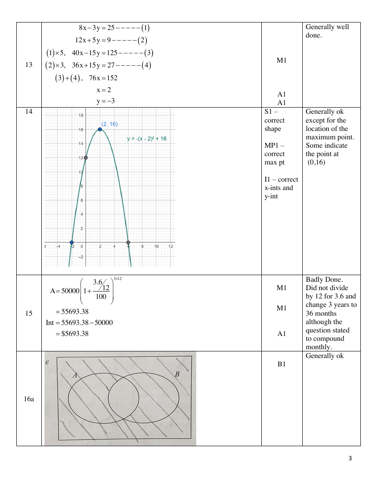

# Yio Chu Kang Secondary School — Mathematics 4052/01 Paper 1 Marking Scheme (cleaned)

> **Institution:** Yio Chu Kang Secondary School
> **Exam:** O-Level Preliminary Examination 2025
> **Level:** Secondary Four Express / Secondary Five Normal (Academic)
> **Subjects:** Mathematics
> **Paper:** 4052/01 Paper 1 Marking Scheme
> **Date:** 1 September 2025
> **Duration:** 2 hours 15 minutes
> **Total Marks:** 90
> **Source:** `YCKSS EM P1 PRELIM MS 2025.pdf` (cleaned & reformatted)

---

## Answer all the questions

### Q1

> **Marks:** M1, A1; total 2
> **Sub-topic:** Algebraic expressions
> **Page:** 3

Simplify $5p-4-(3+2p)+p-6$.

$$
5p-4-(3+2p)+p-6
$$

$$
=5p-4-3-2p+p-6
$$

$$
=4p-13
$$

> **Marker's Comments:** Well done

---

### Q2

> **Marks:** (a) A1, (b) B1; total 2
> **Sub-topic:** Inequalities
> **Page:** 3

**(a)** Write down the inequalities that represent the numbers indicated on the number line.

$$
x<0 \quad \text{or} \quad x\geq 3
$$

> **Marker's Comments:** Poorly done

**(b)** State the smallest prime number that satisfies the number line shown.

$$
3
$$

---

### Q3

> **Marks:** M1, M1, A1; total 3
> **Sub-topic:** Algebraic fractions
> **Page:** 3

Express as a single fraction in its simplest form $\dfrac{3x-2}{12}-\dfrac{5x-3}{8}-\dfrac{7(x+1)}{6}$.

$$
=\frac{2(3x-2)-3(5x-3)-4\times 7(x+1)}{24}
$$

$$
=\frac{6x-4-15x+9-28x-28}{24}
$$

$$
=\frac{-37x-23}{24}
$$

> **Marker's Comments:** Many did not use LCM of denominators, hence some final answers were not in lowest term

---

### Q4

> **Marks:** (a) B1, (b) B1; total 2
> **Sub-topic:** Statistical diagrams
> **Page:** 4

**(a)** Use the box-and-whisker plot to find the median mark.

$$
35
$$

**(b)** Layla says, "There are twice as many students who scored more than 35 marks as those who scored less than 35 marks". Is Layla correct? Give a reason for your answer.

Incorrect. Median mark means $50\%$ of students scored both more than or less than the mark.

> **Marker's Comments:** Poor

---

### Q5

> **Marks:** (a) B1, (b) M1, A1; total 3
> **Sub-topic:** Factorisation
> **Page:** 4

**(a)** Factorise $24pq^{2}+15pq-9p^{2}q$.

$$
=3pq(8q+5-3p)
$$

**(b)** Factorise $5+2a^{2}bc-5ac-2ab$.

$$
=5-5ac+2a^{2}bc-2ab
$$

$$
=5(1-ac)-2ab(1-ac)
$$

$$
=(1-ac)(5-2ab)
$$

Accept $(ac-1)(2ab-5)$.

---

### Q6

> **Marks:** (a) M1, A1; (b) M1, A1; total 4
> **Sub-topic:** Maps and scales
> **Page:** 5

**(a)** The length of the longest river in Singapore, Kallang River, is $10\text{ km}$. Calculate the length of Kallang River on the map.

$$
1.25\text{ km}:1\text{ cm}
$$

$$
1\text{ km}:\frac{1}{1.25}\text{ cm}
$$

$$
10\text{ km}:\frac{10}{1.25}=8\text{ cm}
$$

> **Marker's Comments:** Poor conversion of units

**(b)** The area of Pulau Ubin island on the map is $6.56\text{ cm}^{2}$. Calculate the area, in square kilometres, of Pulau Ubin island.

$$
1\text{ cm}^{2}:1.25^{2}\text{ km}^{2}=1.5625\text{ km}^{2}
$$

$$
6.56\text{ cm}^{2}:6.56\times 1.25^{2}\text{ km}^{2}=10.25\text{ km}^{2}
$$

> **Marker's Comments:** Some did not take square of the map scale

---

### Q7

> **Marks:** B2; total 2
> **Sub-topic:** Number sequences
> **Page:** 5

In this sequence, the difference between any two consecutive terms is the same number. The sum of the first five terms is 80. Find the values of $w$, $x$, $y$ and $z$.

$$
(23-3d)+(23-2d)+(23-d)+23+(23+d)=80
$$

$$
-5d+115=80
$$

$$
d=7
$$

$$
w=2,\quad x=9,\quad y=16,\quad z=30
$$

Deduct 1 mark for each error.

> **Marker's Comments:** Poorly done despite being a common past year's O level question

---

### Q8

> **Marks:** (a) M1, A1; (b) M1, A1; total 4
> **Sub-topic:** Arc length and sector area
> **Page:** 6

**(a)** Calculate angle $AOB$ in radians, leaving your answer in terms of $\pi$.

$$
2(44-28)+28\theta+44\theta=72\pi-76
$$

$$
72\theta=72\pi-76-32
$$

$$
\theta=\frac{72\pi-108}{72}
$$

$$
\text{angle }AOB=\pi-1.5
$$

> **Marker's Comments:** Poorly done as many used the formula for degree

**(b)** Calculate the area of the windscreen that the car wiper wipes through.

$$
\text{area}=\frac{1}{2}\times 44^{2}(\pi-1.5)-\frac{1}{2}\times 28^{2}(\pi-1.5)
$$

$$
=946\text{ cm}^{2}\ (3\text{ s.f.})
$$

Error carried forward accepted.

> **Marker's Comments:** Poorly done as many used the formula for degree

---

### Q9

> **Marks:** (a) M1, A1; (b) B1; total 3
> **Sub-topic:** Bearings
> **Page:** 7

**(a)** Calculate angle $ACD$.

$$
\cos\angle ACD=-\frac{5}{12}\quad\text{or}\quad\cos\angle ACB=\frac{5}{12}
$$

$$
\angle ACD=\cos^{-1}\left(-\frac{5}{12}\right)=114.624^{\circ}=114.6^{\circ}
$$

$$
\angle ACB=\cos^{-1}\frac{5}{12}=65.375^{\circ}
$$

$$
\angle ACD=180^{\circ}-65.375^{\circ}
$$

> **Marker's Comments:** Some did not leave answer in 1 d.p.

**(b)** Find the bearing of $A$ from $C$.

$$
360^{\circ}-(114.624^{\circ}-90^{\circ})=335.4^{\circ}
$$

> **Marker's Comments:** Some did not leave answer in 1 d.p.

---

### Q10

> **Marks:** (a)(i) M1, A1; (a)(ii) B1; (b) M1, A1; total 5
> **Sub-topic:** Cumulative frequency
> **Page:** 8

**(a) (i)** the interquartile range of the marks,

$$
60-30=30
$$

**(a) (ii)** the $35^{\text{th}}$ percentile.

$$
36\text{ marks}
$$

**(b)** Find the probability that this student's estimated mark is between 42 and 78.

$$
\frac{390-180}{400}=\frac{21}{40}
$$

Accept $0.525$ and $52.5\%$.

---

### Q11

> **Marks:** (a) B1; (b) M1, M1, A1; total 4
> **Sub-topic:** Formulae
> **Page:** 9

$$
P=2w-\frac{x^{2}y}{w}
$$

**(a)** Find $P$ when $w=86.3$, $x=21.41$ and $y=0.872$. Give your answer correct to 4 significant figures.

$$
168.0\ (4\text{ s.f.})
$$

> **Marker's Comments:** Generally ok

**(b)** Rearrange the formula to make $x$ the subject.

$$
\frac{x^{2}y}{w}=2w-P
$$

$$
x^{2}y=2w^{2}-Pw
$$

$$
x^{2}=\frac{2w^{2}-Pw}{y}
$$

$$
x=\pm\sqrt{\frac{2w^{2}-Pw}{y}}
$$

> **Marker's Comments:** Quite a number still weak in algebraic manipulation. Many did not include the $\pm$

---

### Q12

> **Marks:** M1, M1, A1; total 3
> **Sub-topic:** Circle theorems
> **Page:** 9

Explain, with reasons, why $AB$ is the diameter of the circle.

$$
AB^{2}=26^{2}=676
$$

$$
AC^{2}+BC^{2}=24^{2}+10^{2}=676=AB^{2}
$$

By the converse of Pythagoras' Theorem, $\triangle ABC$ is a right-angled triangle.

Hence, by the converse of right-angle in semi-circle, $AB$ is the diameter of the circle.

> **Marker's Comments:** Poorly done as students are weak in explanation. Did not use the word "converse" when explaining using Pythagoras' Theorem

---

### Q13

> **Marks:** M1, A1, A1; total 3
> **Sub-topic:** Simultaneous equations
> **Page:** 10

Solve the simultaneous equations.

$$
8x-3y=25 \quad (1)
$$

$$
12x+5y=9 \quad (2)
$$

$$
(1)\times 5,\quad 40x-15y=125 \quad (3)
$$

$$
(2)\times 3,\quad 36x+15y=27 \quad (4)
$$

$$
(3)+(4),\quad 76x=152
$$

$$
x=2
$$

$$
y=-3
$$

> **Marker's Comments:** Generally well done.

---

### Q14

> **Marks:** S1, MP1, I1; total 3
> **Sub-topic:** Quadratic graphs
> **Page:** 10

Sketch the graph of $y=-(x-2)^{2}+16$.

Maximum point $(2,16)$.
$y$-intercept $(0,12)$.
$x$-intercepts $(-2,0)$ and $(6,0)$.

> **Marker's Comments:** Generally ok except for the location of the maximum point. Some indicate the point at $(0,16)$

---

### Q15

> **Marks:** M1, M1, A1; total 3
> **Sub-topic:** Compound interest
> **Page:** 11

Calculate the amount of interest Aamon earned at the end of 3 years.

$$
A=50000\left(1+\frac{3.6/12}{100}\right)^{3\times 12}
$$

$$
=55693.38
$$

$$
\text{Int}=55693.38-50000=\$5693.38
$$

> **Marker's Comments:** Badly Done. Did not divide by 12 for 3.6 and change 3 years to 36 months although the question stated to compound monthly.

---

### Q16

> **Marks:** (a) B1, (b) B1; total 2
> **Sub-topic:** Sets and Venn diagrams
> **Page:** 11

**(a)** On the Venn diagram, shade the region which represents $A'\cup B'$.

> **Marker's Comments:** Generally ok

**(b)** Write down the set represented by the shaded region.

$$
A\cap B'
$$

> **Marker's Comments:** Generally ok

---

### Q17

> **Marks:** (a) B1; (b)(i) B1; (b)(ii) M1, A1; total 4
> **Sub-topic:** Standard form
> **Page:** 12

**(a)** Write $0.00728$ in standard form.

$$
7.28\times 10^{-3}
$$

> **Marker's Comments:** Generally well done

**(b) (i)** Write $8.17\times 10^{501}$ in the form $A\times 10^{500}$.

$$
81.7\times 10^{500}
$$

> **Marker's Comments:** Those who got it wrong did not understand what the question is asking.

**(b) (ii)** Work out $(6.3\times 10^{500})+(8.17\times 10^{501})$. Give your answer in standard form.

$$
=(6.3+81.7)\times 10^{500}
$$

$$
=88\times 10^{500}
$$

$$
=8.8\times 10^{501}
$$

> **Marker's Comments:** Most of the students who did not get (b)(i) correctly will not be able to solve (b)(ii) as well.

---

### Q18

> **Marks:** (i) B1; (ii) B2; total 3
> **Sub-topic:** Prime factors, HCF and LCM
> **Page:** 12

**(i)** Write $504$ as a product of its prime factors.

$$
504=2^{3}\times 3^{2}\times 7
$$

> **Marker's Comments:** Generally well done

**(ii)** Find the two numbers.

1st number: $(2^{2}\times 3\times 7)\times 2=168$

2nd number: $(2^{2}\times 3\times 7)\times 3=252$

> **Marker's Comments:** Generally ok. Those who did not answer correctly were mainly because they did not understand HCF and LCM fully.

---

### Q19

> **Marks:** B2; total 2
> **Sub-topic:** Trigonometry
> **Page:** 13

Find two possible values of $x$ in the range $0^{\circ}<x<180^{\circ}$.

$$
x=25.277^{\circ}\quad\text{or}\quad 180^{\circ}-25.277^{\circ}
$$

$$
x=25.3^{\circ}\quad\text{or}\quad 154.7^{\circ}
$$

> **Marker's Comments:** Many did not correct to 1 d.p. for degrees

---

### Q20

> **Marks:** (a) M1, A1; (b) M1, A1; total 4
> **Sub-topic:** Hire purchase
> **Page:** 13

**(a)** Calculate the amount of deposit to be paid.

$$
1944=D+66\times 24
$$

$$
D=1944-1584=\$360
$$

> **Marker's Comments:** Generally ok

**(b)** Calculate the interest rate per annum.

$$
1944-1800=\frac{(1800-360)(R)(2)}{100}
$$

$$
R=\frac{144\times 100}{1440\times 2}=5
$$

> **Marker's Comments:** Poorly done. Did not know that they need to use simple interest formula to calculate the interest rate per annum. For those who knew, they substitute either the wrong interest or principal value.

---

### Q21

> **Marks:** (a) M1, M1, A1; (b) B1, B1; total 5
> **Sub-topic:** Mean and standard deviation
> **Page:** 14

**(a)** Show that $t=1.5$.

$$
\frac{7+6t+28+25+13+8t^{2}+12}{7}=16
$$

$$
8t^{2}+6t-27=0
$$

$$
(2t-3)(4t+9)=0
$$

$$
t=1.5\ (\text{shown})\quad\text{or}\quad -2.25\ (\text{rej})
$$

> **Marker's Comments:** Generally ok.

**(b)** Compare the distributions for the number of hours studied by Kalea and her brother.

1. Kalea studied longer, on average, as her mean is higher.

2. Kalea's studying hour is more widespread as her SD is higher.

> **Marker's Comments:** Generally ok. Some students are not explain when SD is higher, it means more widespread.

---

### Q22

> **Marks:** M1, A1; total 2
> **Sub-topic:** Expansion
> **Page:** 14

Expand $(2x^{2}-5x+3)(5x-4)$.

$$
=10x^{3}-8x^{2}-25x^{2}+20x+15x-12
$$

$$
=10x^{3}-33x^{2}+35x-12
$$

> **Marker's Comments:** Generally ok except for some students are not able to expand with careless mistakes such as $-20x$ instead of $+20x$.

---

### Q23

> **Marks:** (a) M1, M1, A1; (b) B1; total 4
> **Sub-topic:** Algebraic area
> **Page:** 15

**(a)** Show that $y$ is an odd number.

$$
y=(8x-3)(2x+3)-(4x)^{2}
$$

$$
=16x^{2}+18x-9-16x^{2}
$$

$$
=18x-9
$$

Since $18x$ is an even number and $9$ is an odd number, therefore $18x-9$ will be an odd number.

> **Marker's Comments:** Poorly done. Some students assumed that $18x-9$ is the final answer and did not explain why $18x-9$ will be an odd number.

**(b)** Find a possible value of $y$ and the corresponding value of $x$.

$$
x=1\quad\text{and}\quad y=9
$$

> **Marker's Comments:** Poorly done as they did not substitute an appropriate value for $x$ to the equation $18x-9$. They did not see the connection to part (a)

---

### Q24

> **Marks:** M2, A1; total 3
> **Sub-topic:** Algebraic fractions
> **Page:** 16

Simplify $\dfrac{5x^{2}-15x}{x^{4}-81}$.

$$
=\frac{5x(x-3)}{(x^{2}-9)(x^{2}+9)}
$$

$$
=\frac{5x(x-3)}{(x-3)(x+3)(x^{2}+9)}
$$

$$
=\frac{5x}{(x+3)(x^{2}+9)}
$$

> **Marker's Comments:** Most is able to factorize the numerator by picking up common factor of $5x$. However, most did not factorize $x^{4}-81$. Those who manage to factorize $x^{4}-81=(x^{2}-9)(x^{2}+9)$ but did not factorize $(x^{2}-9)$

---

### Q25

> **Marks:** M1, A2; total 3
> **Sub-topic:** Completing the square
> **Page:** 16

Solve the equation $x^{2}+16x+18=0$ by completing the square.

$$
(x+8)^{2}-8^{2}=-18
$$

$$
(x+8)^{2}=-18+64
$$

$$
x+8=\pm\sqrt{46}
$$

$$
x=-1.22\ (2\text{ d.p.})\quad\text{or}\quad -14.78\ (2\text{ d.p.})
$$

> **Marker's Comments:** Generally ok for those who use the completing the square method. Some students use quadratic formula to solve. There are quite a number who round off to 3 s.f. instead of 2 d.p.

---

### Q26

> **Marks:** (i) B1; (ii) M1, A1; (iii) M1, A1; total 5
> **Sub-topic:** Volume of a cone
> **Page:** 17

**(i)** the capacity of the cone,

$$
V=\frac{1}{3}\pi(6)^{2}(14)=168\pi
$$

> **Marker's Comments:** Generally ok. Some students did not leave answers in terms of $\pi$

**(ii)** the volume of the water inside the cone.

Using similar triangles,

$$
\frac{r}{6}=\frac{7}{14}
$$

$$
r=3
$$

$$
V=\frac{1}{3}\pi(3)^{2}(7)=21\pi
$$

> **Marker's Comments:** Some students who did not use similar triangles to get radius is $3\text{ cm}$.

**(iii)** Find the value of $h$.

Using similar figures,

$$
\left(\frac{h}{14}\right)^{3}=\frac{168\pi-21\pi}{168\pi}
$$

$$
\frac{h^{3}}{14^{3}}=\frac{147}{168}
$$

$$
h=13.4\ (3\text{ s.f.})
$$

> **Marker's Comments:** Poorly done. Students did not see that they can use similar figures to get the volume. Some tried to get the values for radius or height but applied the wrong concept of using height of $7\text{ cm}$ and $14\text{ cm}$ as the ratio of similar heights.

---

### Q27

> **Marks:** (a) M1, A1; (b) M1, A1; (c) M1, A1; (d) B1; total 7
> **Sub-topic:** Vectors
> **Page:** 18–19

**(a)** Show that $\overrightarrow{AE}=-\dfrac{5}{3}\mathbf{a}+\mathbf{b}$.

$$
\overrightarrow{OC}=\overrightarrow{OB}+\overrightarrow{BC}=4\mathbf{a}+3\mathbf{b}
$$

$$
\overrightarrow{AE}=\overrightarrow{AO}+\overrightarrow{OE}
$$

$$
=\overrightarrow{AO}+\frac{1}{3}\overrightarrow{OC}
$$

$$
=-3\mathbf{a}+\frac{1}{3}(4\mathbf{a}+3\mathbf{b})
$$

$$
=-3\mathbf{a}+\frac{4}{3}\mathbf{a}+\mathbf{b}
$$

$$
=-\frac{5}{3}\mathbf{a}+\mathbf{b}\ (\text{shown})
$$

> **Marker's Comments:** Generally ok.

**(b)** Express vector $\overrightarrow{AF}$ in terms of $\mathbf{a}$ and/or $\mathbf{b}$, as simply as possible.

$$
\overrightarrow{AF}=\overrightarrow{AO}+\overrightarrow{OF}
$$

$$
=-3\mathbf{a}+\frac{3}{5}\overrightarrow{OB}
$$

$$
=-3\mathbf{a}+\frac{3}{5}(3\mathbf{b})
$$

$$
=-3\mathbf{a}+\frac{9}{5}\mathbf{b}
$$

$$
=\frac{9}{5}\left(-\frac{5}{3}\mathbf{a}+\mathbf{b}\right)
$$

> **Marker's Comments:** Generally ok.

**(c)** Determine if points $A$, $E$ and $F$ lie on a straight line.

$$
\text{Since }\overrightarrow{AF}=\frac{9}{5}\overrightarrow{AE}\text{ and }A\text{ is a common point,}
$$

points $A$, $E$ and $F$ lie on a straight line.

> **Marker's Comments:** Poorly done. Students did not know how to get the scalar and state that $A$ is a common point.

**(d)** The area of triangle $AEC$ is $30\text{ cm}^{2}$. Find the area of triangle $OAE$.

$$
\frac{1}{2}\times 30=15\text{ cm}^{2}
$$

> **Marker's Comments:** Generally ok.
