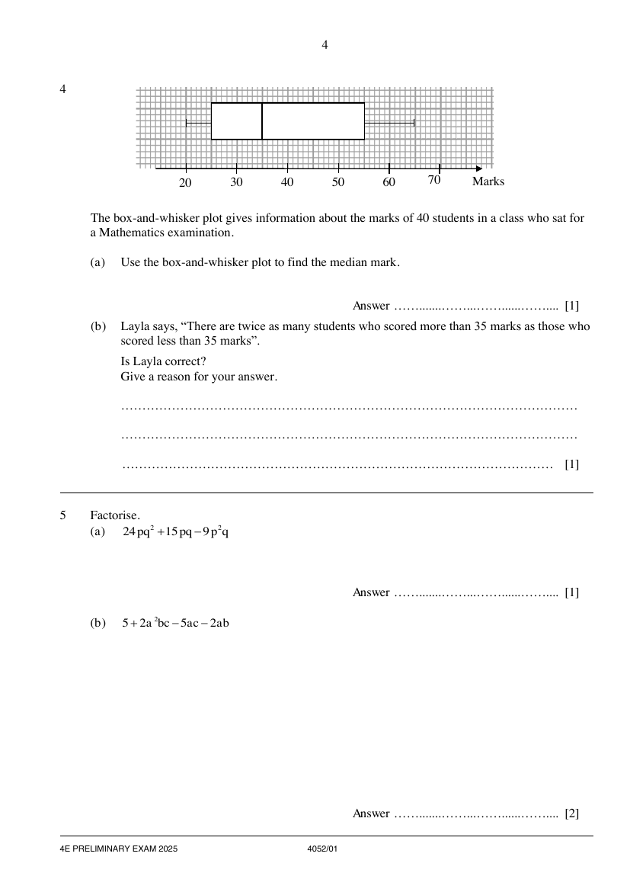
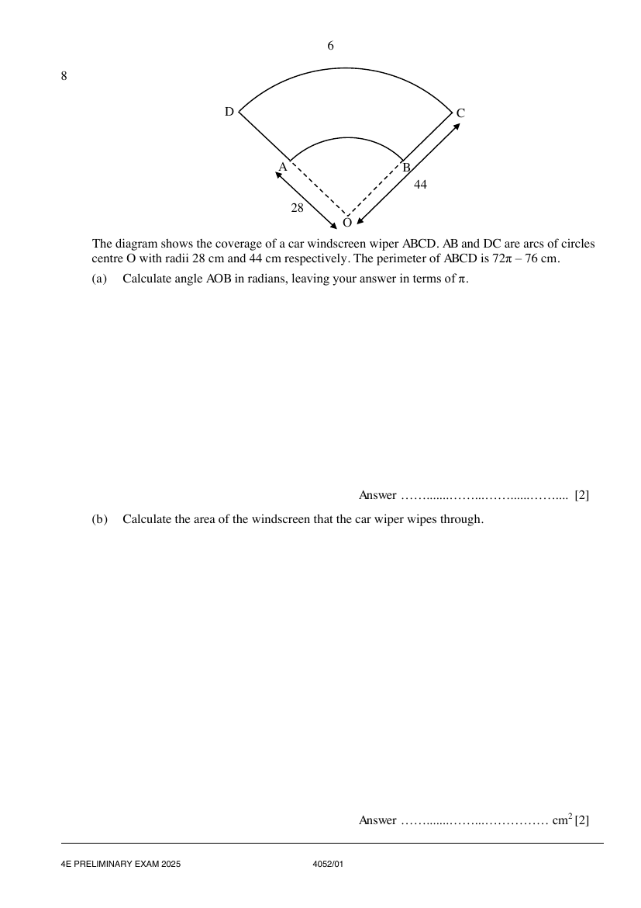
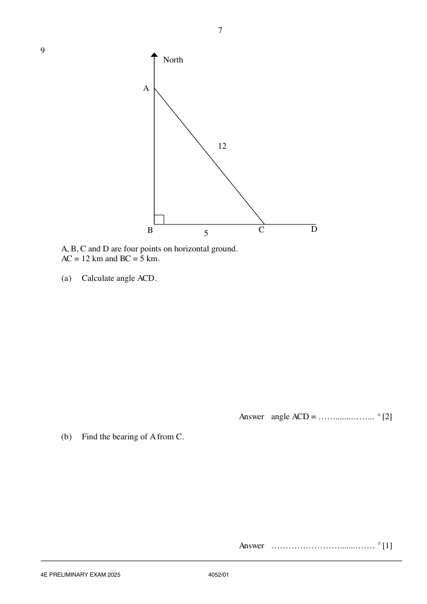
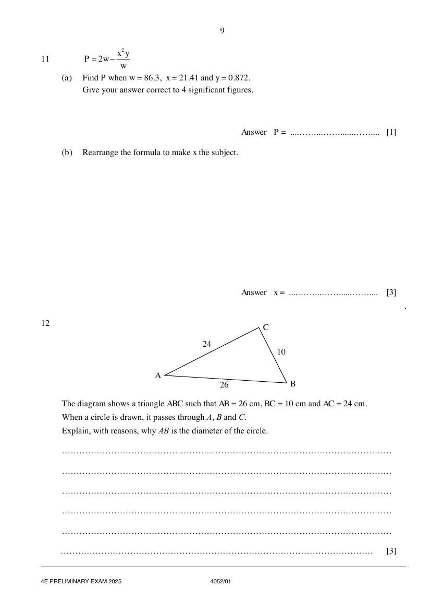
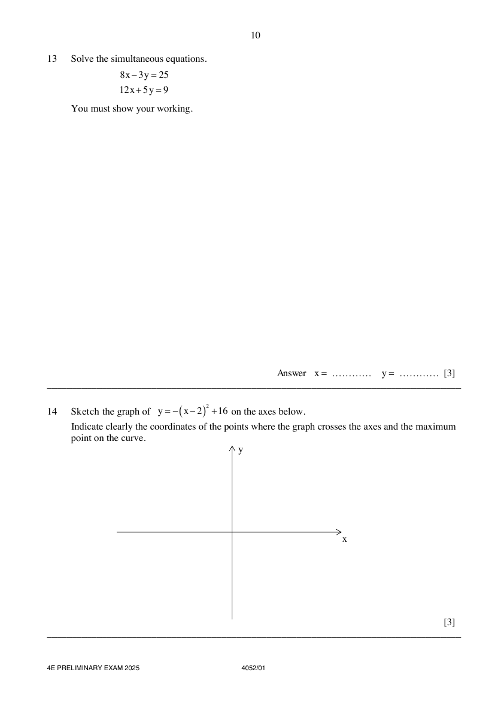
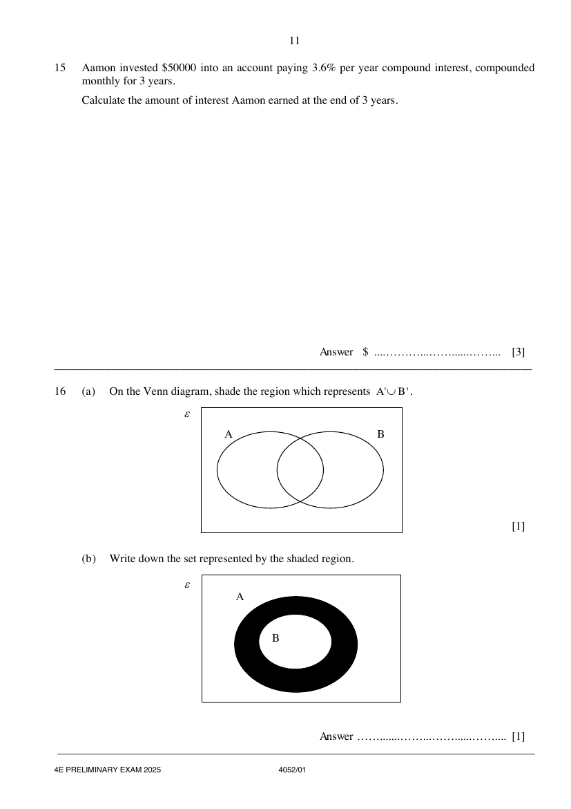
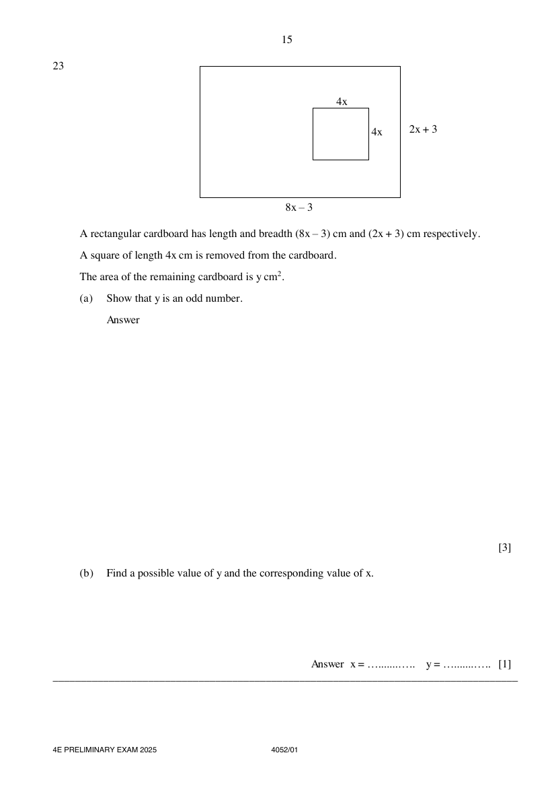
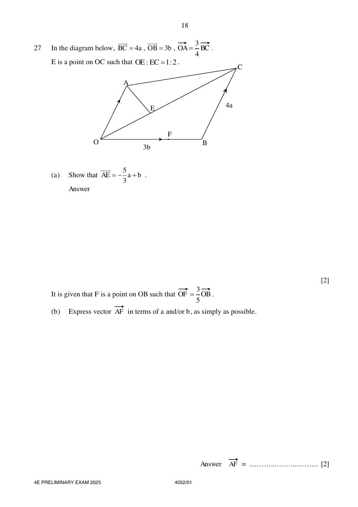

# Yio Chu Kang Secondary School — Mathematics 4052/01 Paper 1 (cleaned)

> **Institution:** Yio Chu Kang Secondary School
> **Exam:** O-Level Preliminary Examination 2025
> **Level:** Secondary Four Express / Secondary Five Normal (Academic)
> **Subjects:** Mathematics
> **Paper:** 4052/01 Paper 1
> **Date:** 1 September 2025
> **Duration:** 2 hours 15 minutes
> **Total Marks:** 90
> **Source:** `YCKSS EM PRELIM QP 2025 P1.pdf` (cleaned & reformatted)

---

## Instructions

Write your class, index number and name on all the work you hand in.
Write in dark blue or black pen.
You may use an HB pencil for any diagrams or graphs.
Do not use staples, paper clips, glue or correction fluid.
DO NOT WRITE ON ANY BARCODES.

Answer all the questions.
The number of marks is given in brackets [ ] at the end of each question or part question.

If working is needed for any question it must be shown with the answer.
Omission of essential working will result in loss of marks.
The total of the marks for this paper is 90.

The use of an approved scientific calculator is expected, where appropriate.
If the degree of accuracy is not specified in the question and if the answer is not exact, give the answer to three significant figures. Gives answers in degrees to one decimal place.
For $\pi$, use either your calculator value or $3.142$.

Setter: Mr Tan Thiam Boon

---

## Mathematical Formulae

*Compound interest*

$$
\text{Total Amount} = P\left(1+\frac{r}{100}\right)^{n}
$$

*Mensuration*

$$
\text{Curved surface area of a cone} = \pi rl
$$

$$
\text{Surface area of sphere} = 4\pi r^{2}
$$

$$
\text{Volume of cone} = \frac{1}{3}\pi r^{2}h
$$

$$
\text{Volume of sphere} = \frac{4}{3}\pi r^{3}
$$

$$
\text{Area of }\triangle ABC = \frac{1}{2}bc\sin A
$$

$$
\text{Arc length} = r\theta,\text{ where }\theta\text{ is in radian}
$$

$$
\text{Sector area} = \frac{1}{2}r^{2}\theta,\text{ where }\theta\text{ is in radian}
$$

*Trigonometry*

$$
\frac{a}{\sin A} = \frac{b}{\sin B} = \frac{c}{\sin C}
$$

$$
a^{2} = b^{2}+c^{2}-2bc\cos A
$$

*Statistics*

$$
\text{Mean} = \frac{\sum fx}{\sum f}
$$

$$
\text{Standard deviation} = \sqrt{\frac{\sum fx^{2}}{\sum f}-\left(\frac{\sum fx}{\sum f}\right)^{2}}
$$

---

## Answer all the questions

### Q1

> **Marks:** 2
> **Topic:** N5 Algebraic expressions and formulae
> **Sub-topic:** Algebraic expressions and formulae
> **LO:** [[context/subjects/o-level-e-maths/learning-objectives/o-level-e-maths-N5m.md|N5m]]
> **Page:** 3

Simplify $5p-4-(3+2p)+p-6$. [2]

---

### Q2

> **Marks:** (a) 1, (b) 1; total 2
> **Page:** 3

**(a)** Write down the inequalities that represent the numbers indicated on the number line. [1]
> **Topic:** N7 Equations and inequalities
> **Sub-topic:** Equations and inequalities
> **LO:** [[context/subjects/o-level-e-maths/learning-objectives/o-level-e-maths-N7g.md|N7g]]

**(b)** State the smallest prime number that satisfies the number line shown. [1]
> **Topic:** N1 Numbers and their operations
> **Sub-topic:** Numbers and their operations
> **LO:** [[context/subjects/o-level-e-maths/learning-objectives/o-level-e-maths-N1e.md|N1e]]

---

### Q3

> **Marks:** 3
> **Topic:** N7 Equations and inequalities
> **Sub-topic:** Equations and inequalities
> **LO:** [[context/subjects/o-level-e-maths/learning-objectives/o-level-e-maths-N7b.md|N7b]]
> **Page:** 3

Express as a single fraction in its simplest form

$$
\frac{3x-2}{12}-\frac{5x-3}{8}-\frac{7(x+1)}{6}.
$$

[3]

---

### Q4

> **Marks:** (a) 1, (b) 1; total 2
> **Page:** 4

The box-and-whisker plot gives information about the marks of 40 students in a class who sat for a Mathematics examination.

**(a)** Use the box-and-whisker plot to find the median mark. [1]
> **Topic:** S1 Data handling and analysis
> **Sub-topic:** Data handling and analysis
> **LO:** [[context/subjects/o-level-e-maths/learning-objectives/o-level-e-maths-S1f.md|S1f]]

**(b)** Layla says, "There are twice as many students who scored more than 35 marks as those who scored less than 35 marks".
Is Layla correct?
Give a reason for your answer. [1]
> **Topic:** S1 Data handling and analysis
> **Sub-topic:** Data handling and analysis
> **LO:** [[context/subjects/o-level-e-maths/learning-objectives/o-level-e-maths-S1f.md|S1f]]

---

### Q5

> **Marks:** (a) 1, (b) 2; total 3
> **Page:** 4

Factorise.

**(a)** $24pq^{2}+15pq-9p^{2}q$ [1]
> **Topic:** N5 Algebraic expressions and formulae
> **Sub-topic:** Algebraic expressions and formulae
> **LO:** [[context/subjects/o-level-e-maths/learning-objectives/o-level-e-maths-N5h.md|N5h]]

**(b)** $5+2a^{2}bc-5ac-2ab$ [2]
> **Topic:** N5 Algebraic expressions and formulae
> **Sub-topic:** Algebraic expressions and formulae
> **LO:** [[context/subjects/o-level-e-maths/learning-objectives/o-level-e-maths-N5h.md|N5h]]

---

### Q6

> **Marks:** (a) 2, (b) 2; total 4
> **Page:** 5

A map of Singapore has a scale of $1:125000$.

**(a)** The length of the longest river in Singapore, Kallang River, is $10\text{ km}$.
Calculate the length of Kallang River on the map. [2]
> **Topic:** N2 Ratio and proportion
> **Sub-topic:** Ratio and proportion
> **LO:** [[context/subjects/o-level-e-maths/learning-objectives/o-level-e-maths-N2c.md|N2c]]

**(b)** The area of Pulau Ubin island on the map is $6.56\text{ cm}^{2}$.
Calculate the area, in square kilometres, of Pulau Ubin island. [2]
> **Topic:** N2 Ratio and proportion
> **Sub-topic:** Ratio and proportion
> **LO:** [[context/subjects/o-level-e-maths/learning-objectives/o-level-e-maths-N2c.md|N2c]]

---

### Q7

> **Marks:** 2
> **Topic:** N5 Algebraic expressions and formulae
> **Sub-topic:** Algebraic expressions and formulae
> **LO:** [[context/subjects/o-level-e-maths/learning-objectives/o-level-e-maths-N5e.md|N5e]]
> **Page:** 5

In this sequence, the difference between any two consecutive terms is the same number.

$$
w \quad x \quad y \quad 23 \quad z \quad \ldots
$$

The sum of the first five terms is 80. Find the values of $w$, $x$, $y$ and $z$. [2]

---

### Q8

> **Marks:** (a) 2, (b) 2; total 4
> **Page:** 6

The diagram shows the coverage of a car windscreen wiper $ABCD$. $AB$ and $DC$ are arcs of circles centre $O$ with radii $28\text{ cm}$ and $44\text{ cm}$ respectively. The perimeter of $ABCD$ is $72\pi-76\text{ cm}$.

**(a)** Calculate angle $AOB$ in radians, leaving your answer in terms of $\pi$. [2]
> **Topic:** G5 Mensuration
> **Sub-topic:** Mensuration
> **LO:** [[context/subjects/o-level-e-maths/learning-objectives/o-level-e-maths-G5g.md|G5g]]

**(b)** Calculate the area of the windscreen that the car wiper wipes through. [2]
> **Topic:** G5 Mensuration
> **Sub-topic:** Mensuration
> **LO:** [[context/subjects/o-level-e-maths/learning-objectives/o-level-e-maths-G5b.md|G5b]]

---

### Q9

> **Marks:** (a) 2, (b) 1; total 3
> **Page:** 7

$A$, $B$, $C$ and $D$ are four points on horizontal ground.
$AC = 12\text{ km}$ and $BC = 5\text{ km}$.

**(a)** Calculate angle $ACD$. [2]
> **Topic:** G4 Pythagoras' theorem and trigonometry
> **Sub-topic:** Pythagoras' theorem and trigonometry
> **LO:** [[context/subjects/o-level-e-maths/learning-objectives/o-level-e-maths-G4g.md|G4g]]

**(b)** Find the bearing of $A$ from $C$. [1]
> **Topic:** G4 Pythagoras' theorem and trigonometry
> **Sub-topic:** Pythagoras' theorem and trigonometry
> **LO:** [[context/subjects/o-level-e-maths/learning-objectives/o-level-e-maths-G4g.md|G4g]]

---

### Q10

> **Marks:** (a)(i) 2, (a)(ii) 1, (b) 2; total 5
> **Page:** 8

The cumulative frequency curve shows the marks of 400 pupils who sat for a Mathematics Paper 1 examination.

**(a)** Use the diagram to find

**(i)** the interquartile range of the marks, [2]
> **Topic:** S1 Data handling and analysis
> **Sub-topic:** Data handling and analysis
> **LO:** [[context/subjects/o-level-e-maths/learning-objectives/o-level-e-maths-S1i.md|S1i]]

**(ii)** the $35^{\text{th}}$ percentile. [1]
> **Topic:** S1 Data handling and analysis
> **Sub-topic:** Data handling and analysis
> **LO:** [[context/subjects/o-level-e-maths/learning-objectives/o-level-e-maths-S1i.md|S1i]]

**(b)** One of the students is chosen at random.
Find the probability that this student's estimated mark is between 42 and 78. [2]
> **Topic:** S2 Probability
> **Sub-topic:** Probability
> **LO:** [[context/subjects/o-level-e-maths/learning-objectives/o-level-e-maths-S2c.md|S2c]]

---

### Q11

> **Marks:** (a) 1, (b) 3; total 4
> **Page:** 9

$$
P = 2w-\frac{x^{2}y}{w}
$$

**(a)** Find $P$ when $w = 86.3$, $x = 21.41$ and $y = 0.872$.
Give your answer correct to 4 significant figures. [1]
> **Topic:** N1 Numbers and their operations
> **Sub-topic:** Numbers and their operations
> **LO:** [[context/subjects/o-level-e-maths/learning-objectives/o-level-e-maths-N1g.md|N1g]]

**(b)** Rearrange the formula to make $x$ the subject. [3]
> **Topic:** N1 Numbers and their operations
> **Sub-topic:** Numbers and their operations
> **LO:** [[context/subjects/o-level-e-maths/learning-objectives/o-level-e-maths-N1g.md|N1g]]

---

### Q12

> **Marks:** 3
> **Topic:** G3 Properties of circles
> **Sub-topic:** Properties of circles
> **LO:** [[context/subjects/o-level-e-maths/learning-objectives/o-level-e-maths-G3b.md|G3b]]
> **Page:** 9

The diagram shows a triangle $ABC$ such that $AB = 26\text{ cm}$, $BC = 10\text{ cm}$ and $AC = 24\text{ cm}$.
When a circle is drawn, it passes through $A$, $B$ and $C$.
Explain, with reasons, why $AB$ is the diameter of the circle. [3]

---

### Q13

> **Marks:** 3
> **Topic:** N7 Equations and inequalities
> **Sub-topic:** Equations and inequalities
> **LO:** [[context/subjects/o-level-e-maths/learning-objectives/o-level-e-maths-N7c.md|N7c]]
> **Page:** 10

Solve the simultaneous equations.

$$
\begin{aligned}
8x-3y &= 25 \\
12x+5y &= 9
\end{aligned}
$$

You must show your working. [3]

---

### Q14

> **Marks:** 3
> **Topic:** N6 Functions and graphs
> **Sub-topic:** Functions and graphs
> **LO:** [[context/subjects/o-level-e-maths/learning-objectives/o-level-e-maths-N6c.md|N6c]]
> **Page:** 10

Sketch the graph of $y = -(x-2)^{2}+16$ on the axes below.
Indicate clearly the coordinates of the points where the graph crosses the axes and the maximum point on the curve. [3]

---

### Q15

> **Marks:** 3
> **Topic:** N3 Percentage
> **Sub-topic:** Percentage
> **LO:** [[context/subjects/o-level-e-maths/learning-objectives/o-level-e-maths-N3d.md|N3d]]
> **Page:** 11

Aamon invested &#36;50000 into an account paying $3.6\%$ per year compound interest, compounded monthly for 3 years.
Calculate the amount of interest Aamon earned at the end of 3 years. [3]

---

### Q16

> **Marks:** (a) 1, (b) 1; total 2
> **Page:** 11

**(a)** On the Venn diagram, shade the region which represents $A'\cup B'$. [1]
> **Topic:** N8 Set language and notation
> **Sub-topic:** Set language and notation
> **LO:** [[context/subjects/o-level-e-maths/learning-objectives/o-level-e-maths-N8c.md|N8c]]

**(b)** Write down the set represented by the shaded region. [1]
> **Topic:** N8 Set language and notation
> **Sub-topic:** Set language and notation
> **LO:** [[context/subjects/o-level-e-maths/learning-objectives/o-level-e-maths-N8c.md|N8c]]

---

### Q17

> **Marks:** (a) 1, (b)(i) 1, (b)(ii) 2; total 4
> **Page:** 12

**(a)** Write $0.00728$ in standard form. [1]
> **Topic:** N1 Numbers and their operations
> **Sub-topic:** Numbers and their operations
> **LO:** [[context/subjects/o-level-e-maths/learning-objectives/o-level-e-maths-N1h.md|N1h]]

**(b)**

**(i)** Write $8.17\times 10^{501}$ in the form $A\times 10^{500}$. [1]
> **Topic:** N1 Numbers and their operations
> **Sub-topic:** Numbers and their operations
> **LO:** [[context/subjects/o-level-e-maths/learning-objectives/o-level-e-maths-N1h.md|N1h]]

**(ii)** Work out $(6.3\times 10^{500})+(8.17\times 10^{501})$.
Give your answer in standard form. [2]
> **Topic:** N1 Numbers and their operations
> **Sub-topic:** Numbers and their operations
> **LO:** [[context/subjects/o-level-e-maths/learning-objectives/o-level-e-maths-N1h.md|N1h]]

---

### Q18

> **Marks:** (i) 1, (ii) 2; total 3
> **Page:** 12

Written as a product of its prime factors, $84 = 2^{2}\times 3\times 7$.

**(i)** Write $504$ as a product of its prime factors. [1]
> **Topic:** N1 Numbers and their operations
> **Sub-topic:** Numbers and their operations
> **LO:** [[context/subjects/o-level-e-maths/learning-objectives/o-level-e-maths-N1b.md|N1b]]

**(ii)** The highest common factor (HCF) of two numbers is 84.
The lowest common multiple (LCM) of the two numbers is 504.
Both numbers are greater than 100.
Find the two numbers. [2]
> **Topic:** N1 Numbers and their operations
> **Sub-topic:** Numbers and their operations
> **LO:** [[context/subjects/o-level-e-maths/learning-objectives/o-level-e-maths-N1b.md|N1b]]

---

### Q19

> **Marks:** 2
> **Topic:** G4 Pythagoras' theorem and trigonometry
> **Sub-topic:** Pythagoras' theorem and trigonometry
> **LO:** [[context/subjects/o-level-e-maths/learning-objectives/o-level-e-maths-G4c.md|G4c]]
> **Page:** 13

$$
\sin x^{\circ} = 0.427
$$

Find two possible values of $x$ in the range $0^{\circ}<x<180^{\circ}$. [2]

---

### Q20

> **Marks:** (a) 2, (b) 2; total 4
> **Page:** 13

The cash price of a laptop is &#36;1800.
The hire-purchase price of the laptop is &#36;1944.
The hire-purchase price is a deposit plus 24 equal monthly payments of &#36;66.

**(a)** Calculate the amount of deposit to be paid. [2]
> **Topic:** N3 Percentage
> **Sub-topic:** Percentage
> **LO:** [[context/subjects/o-level-e-maths/learning-objectives/o-level-e-maths-N3d.md|N3d]]

**(b)** Calculate the interest rate per annum. [2]
> **Topic:** N3 Percentage
> **Sub-topic:** Percentage
> **LO:** [[context/subjects/o-level-e-maths/learning-objectives/o-level-e-maths-N3d.md|N3d]]

---

### Q21

> **Marks:** (a) 3, (b) 2; total 5
> **Page:** 14

The list shows information about the total number of hours Kalea studied each week for 7 weeks.

$$
7 \quad 6t \quad 28 \quad 25 \quad 13 \quad 8t^{2} \quad 12
$$

The mean number of hours she studied per week is 16 hours.

**(a)** Show that $t = 1.5$. [3]
> **Topic:** S1 Data handling and analysis
> **Sub-topic:** Data handling and analysis
> **LO:** [[context/subjects/o-level-e-maths/learning-objectives/o-level-e-maths-S1l.md|S1l]]

**(b)** The standard deviation for Kalea's data is 7.41.

For the same 7 weeks, Kalea's brother also studied each week.
For his data, the mean is 13 hours and the standard deviation is 5.23.
By commenting on (1.) the means and (2.) the standard deviations, compare the distributions for the number of hours studied by Kalea and her brother. [2]
> **Topic:** S1 Data handling and analysis
> **Sub-topic:** Data handling and analysis
> **LO:** [[context/subjects/o-level-e-maths/learning-objectives/o-level-e-maths-S1l.md|S1l]]

---

### Q22

> **Marks:** 2
> **Topic:** N5 Algebraic expressions and formulae
> **Sub-topic:** Algebraic expressions and formulae
> **LO:** [[context/subjects/o-level-e-maths/learning-objectives/o-level-e-maths-N5j.md|N5j]]
> **Page:** 14

Expand $(2x^{2}-5x+3)(5x-4)$. [2]

---

### Q23

> **Marks:** (a) 3, (b) 1; total 4
> **Page:** 15

A rectangular cardboard has length and breadth $(8x-3)\text{ cm}$ and $(2x+3)\text{ cm}$ respectively.
A square of length $4x\text{ cm}$ is removed from the cardboard.
The area of the remaining cardboard is $y\text{ cm}^{2}$.

**(a)** Show that $y$ is an odd number. [3]
> **Topic:** G5 Mensuration
> **Sub-topic:** Mensuration
> **LO:** [[context/subjects/o-level-e-maths/learning-objectives/o-level-e-maths-G5b.md|G5b]]

**(b)** Find a possible value of $y$ and the corresponding value of $x$. [1]
> **Topic:** G5 Mensuration
> **Sub-topic:** Mensuration
> **LO:** [[context/subjects/o-level-e-maths/learning-objectives/o-level-e-maths-G5b.md|G5b]]

---

### Q24

> **Marks:** 3
> **Topic:** N7 Equations and inequalities
> **Sub-topic:** Equations and inequalities
> **LO:** [[context/subjects/o-level-e-maths/learning-objectives/o-level-e-maths-N7b.md|N7b]]
> **Page:** 16

Simplify

$$
\frac{5x^{2}-15x}{x^{4}-81}.
$$

[3]

---

### Q25

> **Marks:** 3
> **Topic:** N1 Numbers and their operations
> **Sub-topic:** Numbers and their operations
> **LO:** [[context/subjects/o-level-e-maths/learning-objectives/o-level-e-maths-N1g.md|N1g]]
> **Page:** 16

Solve the equation $x^{2}+16x+18 = 0$ by completing the square.
Give your solutions correct to 2 decimal places. [3]

---

### Q26

> **Marks:** (i) 1, (ii) 2, (iii) 2; total 5
> **Page:** 17

An inverted cone with base radius $6\text{ cm}$ and height $14\text{ cm}$ is filled with water to a depth of $7\text{ cm}$.

Find, in terms of $\pi$,

**(i)** the capacity of the cone, [1]
> **Topic:** G5 Mensuration
> **Sub-topic:** Mensuration
> **LO:** [[context/subjects/o-level-e-maths/learning-objectives/o-level-e-maths-G5c.md|G5c]]

**(ii)** the volume of the water inside the cone. [2]
> **Topic:** G5 Mensuration
> **Sub-topic:** Mensuration
> **LO:** [[context/subjects/o-level-e-maths/learning-objectives/o-level-e-maths-G5c.md|G5c]]

The cone is then turned upside down and the height of the empty space becomes $h\text{ cm}$.

**(iii)** Find the value of $h$. [2]
> **Topic:** G5 Mensuration
> **Sub-topic:** Mensuration
> **LO:** [[context/subjects/o-level-e-maths/learning-objectives/o-level-e-maths-G5c.md|G5c]]

---

### Q27

> **Marks:** (a) 2, (b) 2, (c) 2, (d) 1; total 7
> **Page:** 18–19

In the diagram below, $\overrightarrow{BC} = 4\mathbf{a}$, $\overrightarrow{OB} = 3\mathbf{b}$, $\overrightarrow{OA} = \dfrac{3}{4}\overrightarrow{BC}$.
$E$ is a point on $OC$ such that $OE:EC = 1:2$.

**(a)** Show that $\overrightarrow{AE} = -\dfrac{5}{3}\mathbf{a}+\mathbf{b}$. [2]
> **Topic:** G7 Vectors in two dimensions
> **Sub-topic:** Vectors in two dimensions
> **LO:** [[context/subjects/o-level-e-maths/learning-objectives/o-level-e-maths-G7h.md|G7h]]

It is given that $F$ is a point on $OB$ such that $\overrightarrow{OF} = \dfrac{3}{5}\overrightarrow{OB}$.

**(b)** Express vector $\overrightarrow{AF}$ in terms of $\mathbf{a}$ and/or $\mathbf{b}$, as simply as possible. [2]
> **Topic:** G7 Vectors in two dimensions
> **Sub-topic:** Vectors in two dimensions
> **LO:** [[context/subjects/o-level-e-maths/learning-objectives/o-level-e-maths-G7h.md|G7h]]

**(c)** Determine if points $A$, $E$ and $F$ lie on a straight line.
Justify your answer using vectors. [2]
> **Topic:** G7 Vectors in two dimensions
> **Sub-topic:** Vectors in two dimensions
> **LO:** [[context/subjects/o-level-e-maths/learning-objectives/o-level-e-maths-G7h.md|G7h]]

**(d)** The area of triangle $AEC$ is $30\text{ cm}^{2}$.
Find the area of triangle $OAE$. [1]
> **Topic:** G7 Vectors in two dimensions
> **Sub-topic:** Vectors in two dimensions
> **LO:** [[context/subjects/o-level-e-maths/learning-objectives/o-level-e-maths-G7h.md|G7h]]
