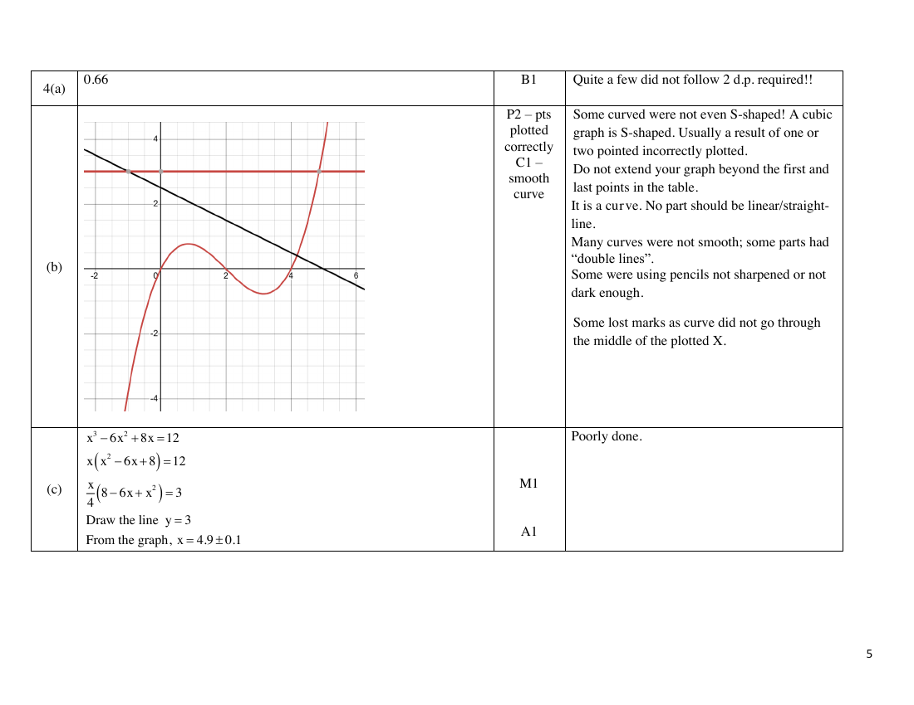

# Yio Chu Kang Secondary School — Mathematics 4052/02 Paper 2 Marking Scheme (cleaned)

> **Institution:** Yio Chu Kang Secondary School
> **Exam:** O-Level Preliminary Examination 2025
> **Level:** Secondary Four Express / Secondary Five Normal (Academic)
> **Subjects:** Mathematics
> **Paper:** 4052/02 Paper 2 Marking Scheme
> **Date:** 1 September 2025
> **Duration:** 2 hours 15 minutes
> **Total Marks:** 90
> **Source:** `YCKSS EM P2 PRELIM MS 2025.pdf` (cleaned & reformatted)

---

## Answer all questions

### Q1

> **Marks:** (a) M1, M1, A1; (b) B2; (c) M1, A1; (d) M1, A1; total 9
> **Sub-topic:** Number, indices and algebraic fractions
> **Page:** 3

**(a)** Find all the prime numbers that satisfy the inequality $-5\leq 2x-3\leq 7$.

$$
-5<2x-3,\qquad 2x-3\leq 7
$$

$$
-1<x,\qquad x\leq 5
$$

$$
-1<x\leq 5
$$

Prime numbers are $2$, $3$, $5$.

> **Marker's Comments:** Many students did not combine final inequality to $-1<x\leq 5$. Avoid doing by guess-and-check. Form simultaneous inequalities to solve. Those who simply wrote $2$, $3$, $5$ get a maximum of 2 marks. Some still think that negative numbers and $1$ are prime.

**(b)** Simplify $\dfrac{18c^{3}d^{3}}{5f^{3}}\div\dfrac{3c^{5}d^{2}}{10f}$.

$$
=\frac{18c^{3}d^{3}}{5f^{3}}\times\frac{10f}{3c^{5}d^{2}}
$$

$$
=\frac{12d}{c^{2}f^{2}}
$$

B2 (deduct 1 mark for 1 error).

> **Marker's Comments:** No mark awarded for 'keep, change, flip'.

**(c)** Simplify $\left(\dfrac{16y^{8}}{81x^{12}}\right)^{-\frac{3}{4}}$.

$$
=\left(\frac{3^{4}x^{12}}{2^{4}y^{8}}\right)^{\frac{3}{4}}
$$

$$
=\frac{27x^{9}}{8y^{6}}
$$

> **Marker's Comments:** Cannot have a fraction within another fraction. That is not simplified.

**(d)** Write as a single fraction in its simplest form $\dfrac{3x}{(2x-1)^{2}}-\dfrac{2}{2x-1}$.

$$
=\frac{3x-2(2x-1)}{(2x-1)^{2}}
$$

$$
=\frac{3x-4x+2}{(2x-1)^{2}}
$$

$$
=\frac{-x+2}{(2x-1)^{2}}
$$

> **Marker's Comments:** $(2x-1)^{2}\neq(2x-1)(2x+1)$. Many still get this Sec 2 identity mixed up.

---

### Q2

> **Marks:** (a)(i) M1, A1; (a)(ii) B1; (b)(i) B1; (b)(ii) A1 or A2; (b)(iii) B1; (c) M1, A1; total 9
> **Sub-topic:** Matrices
> **Page:** 4–5

**(a) (i)** Evaluate $T=5F\begin{pmatrix}1\\1\\1\end{pmatrix}$.

$$
T=5\begin{pmatrix}20&32&15\\15&35&18\end{pmatrix}\begin{pmatrix}1\\1\\1\end{pmatrix}
$$

$$
T=5\begin{pmatrix}67\\68\end{pmatrix}
$$

$$
T=\begin{pmatrix}335\\340\end{pmatrix}
$$

> **Marker's Comments:** 1 mark awarded for matrix multiplication without the $\begin{pmatrix}1\\1\\1\end{pmatrix}$ matrix.

**(a) (ii)** State what each of the elements of $T$ represents.

The elements represent the total number of mangoes, apples and oranges sold by seller A and B respectively in 5 days.

> **Marker's Comments:** "Weekdays" not allowed. It is '5 days', "weekday" or "weekend" not mentioned. Total number, not average number.

**(b) (i)** Represent this information in a $3\times 2$ matrix $C$.

$$
C=\begin{pmatrix}80&70\\50&40\\60&50\end{pmatrix}
\quad\text{or}\quad
C=\begin{pmatrix}0.80&0.70\\0.50&0.40\\0.60&0.50\end{pmatrix}
$$

**(b) (ii)** Evaluate the matrix $P=FC$.

$$
P=\begin{pmatrix}20&32&15\\15&35&18\end{pmatrix}\begin{pmatrix}80&70\\50&40\\60&50\end{pmatrix}
$$

$$
P=\begin{pmatrix}4100&3430\\4030&3350\end{pmatrix}
\quad\text{or}\quad
P=\begin{pmatrix}41.00&34.30\\40.30&33.50\end{pmatrix}
$$

A1 for 2 correct elements. A2 for 4 correct elements.

**(b) (iii)** Explain which seller made a higher profit.

Seller A receives a total of &#36;41 while seller B receives &#36;33.50.
Seller A made a higher profit.

> **Marker's Comments:** "Total sales/total revenue" not "total selling price".

**(c)** Find matrix $N$.

$$
N=\begin{pmatrix}0.8&0&0\\0&0.9&0\\0&0&1\end{pmatrix}\begin{pmatrix}80&70\\50&40\\60&50\end{pmatrix}
$$

$$
N=\begin{pmatrix}64&56\\45&36\\60&50\end{pmatrix}
$$

> **Marker's Comments:** Many still do not know that the orders of matrices are important for matrix multiplication.

---

### Q3

> **Marks:** (a) M1, M1, M1, A1; (b) M1, M1, A1; (c) M1, A1; total 9
> **Sub-topic:** Coordinate geometry
> **Page:** 6–7

**(a)** Find the equation of $SQ$.

$$
\text{Gradient of }PR=\frac{17-(-1)}{7-(-2)}=2
$$

$$
\text{Gradient of }SQ=-\frac{1}{2}
$$

$$
y=-\frac{1}{2}x+c
$$

Substitute $S(20,3)$:

$$
3=-\frac{1}{2}(20)+c
$$

$$
c=13
$$

$$
y=-\frac{1}{2}x+13
$$

Error carried forward (ecf) maximum of 2 marks.

**(b)** Find the value of $h$.

$$
[5-(-4)]^{2}+(3-h)^{2}=15^{2}
$$

$$
9^{2}+(3-h)^{2}=225
$$

$$
(3-h)^{2}=144
$$

$$
3-h=12\quad\text{or}\quad 3-h=-12
$$

$$
h=-9\quad\text{or}\quad h=15
$$

Since $h>0$, $h=15$.

> **Marker's Comments:** $81+(h-3)^{2}\neq 9+(h-3)$. For example, $\sqrt{81+25}=10.3$ is correct. $\sqrt{81+25}=\sqrt{9}+\sqrt{5}=14=3.74$ is incorrect.

**(c)** Find the value of $k$.

$$
y=-\frac{2}{k}x+\frac{6}{k}
$$

$$
\frac{6}{k}=-2
$$

$$
k=-3
$$

> **Marker's Comments:** Many wrote $2x+ky-6=-2$. '$-2$' is the $y$-intercept, so you should substitute $(0,-2)$ into the original equation $2x+ky-6=0$.

---

### Q4

> **Marks:** (a) B1; (b) P2, C1; (c) M1, A1; (d)(i) B2; (d)(ii) B1; (d)(iii) M1, A2; total 12
> **Sub-topic:** Graphs of functions
> **Page:** 8–9

**(a)** Complete the table. The missing value is $0.66$.

> **Marker's Comments:** Quite a few did not follow 2 d.p. required.

**(b)** Draw the graph of $y=\dfrac{x}{4}\left(8-6x+x^{2}\right)$ for $-1\leq x\leq 5$.

P2 — points plotted correctly. C1 — smooth curve.

> **Marker's Comments:** Some curves were not even S-shaped. A cubic graph is S-shaped. Usually a result of one or two points incorrectly plotted. Do not extend your graph beyond the first and last points in the table. It is a curve. No part should be linear/straight-line. Many curves were not smooth; some parts had "double lines". Some were using pencils not sharpened or not dark enough. Some lost marks as curve did not go through the middle of the plotted X.

**(c)** Use your graph to find the solution to $x^{3}-6x^{2}+8x=12$.

$$
x(x^{2}-6x+8)=12
$$

$$
\frac{x}{4}(8-6x+x^{2})=3
$$

Draw the line $y=3$.

From the graph, $x=4.9\pm 0.1$.

> **Marker's Comments:** Poorly done.

**(d) (i)** Line $L$ has gradient $-0.5$ and passes through $(3,1)$.

$$
y=-\frac{1}{2}x+c
$$

$$
1=-\frac{1}{2}(3)+c
$$

$$
c=\frac{5}{2}
$$

$$
y=-\frac{1}{2}x+\frac{5}{2}
$$

B1 for equation. B1 for drawing line. Or B2 for drawing line.

**(d) (ii)** Write down the $x$-coordinate of the point where line $L$ intersects the curve.

From the graph, $x=4.2\pm 0.1$.

> **Marker's Comments:** Poorly done. Some wrote unreadable answers. You can only read to the accuracy of half the smallest box.

**(d) (iii)** Find $A$, $B$ and $C$.

$$
\frac{x}{4}(8-6x+x^{2})=-\frac{1}{2}x+\frac{5}{2}
$$

$$
x(8-6x+x^{2})=-2x+10
$$

$$
x^{3}-6x^{2}+10x-10=0
$$

$$
A=-6,\quad B=10,\quad C=-10
$$

A2 for 3 answers.

> **Marker's Comments:** Poorly done.

---

### Q5

> **Marks:** (a) M1, A1; (b) M1, M1, A1; (c) M1, A1; (d) M1, M1, A1; total 10
> **Sub-topic:** Trigonometry and bearings
> **Page:** 10–11

**(a)** Calculate $HB$.

$$
HB^{2}=5.4^{2}+3.1^{2}-2(5.4)(3.1)\cos 128^{\circ}
$$

$$
HB=\sqrt{59.382346}=7.705994
$$

$$
HB=7.71\text{ km (to 3 s.f.)}
$$

**(b)** Show that angle $CAH=71.3^{\circ}$.

$$
\angle HCA=180^{\circ}-133^{\circ}=47^{\circ}
$$

$$
\frac{5.4}{\sin 47^{\circ}}=\frac{6.5}{\sin\angle CHA}
$$

$$
\sin\angle CHA=\frac{6.5\sin 47^{\circ}}{5.4}
$$

$$
\angle CHA=61.68256^{\circ}
$$

$$
\angle CAH=133^{\circ}-61.68256^{\circ}=71.31744^{\circ}
$$

$$
\angle CAH=71.3^{\circ}\text{ (to 1 d.p.) (shown)}
$$

> **Marker's Comments:** When question asks for a number to "show", you need to show the unrounded number before the rounded number that you are aiming to get.

**(c)** Find the bearing of $B$ from $A$.

Draw North line at $A$.

$$
\angle NAH=180^{\circ}-61.7^{\circ}=118.3^{\circ}\ (\text{int }\angle s)
$$

$$
\text{Bearing of }B\text{ from }A=360^{\circ}-128^{\circ}-118.3^{\circ}=113.7^{\circ}
$$

> **Marker's Comments:** Poor presentation in finding bearings. Many still rounded to 3 s.f.

**(d)** Calculate the angle of elevation of the top of the tower from $C$.

$$
\tan 14^{\circ}=\frac{h}{3.1}
$$

$$
h=0.772917\text{ km}
$$

$$
\tan\theta=\frac{0.772917}{6.5}
$$

$$
\theta=6.8^{\circ}\text{ (to 1 d.p.)}
$$

Angle of elevation $=6.8^{\circ}$.

> **Marker's Comments:** A few students have ecf mark(s) here.

---

### Q6

> **Marks:** (a) M1, A1, M1, M1, A1; (b) M1, A1, A1; (c) B1; (d) M1, A1; total 11
> **Sub-topic:** Speed, distance and time
> **Page:** 12–13

**(a)** Show that $5x^{2}-84x-81=0$.

$$
\text{Time from A to B}=\frac{12}{x-3}\text{ h}
$$

$$
\text{Time from B to C}=\frac{9}{x+3}\text{ h}
$$

$$
\frac{12}{x-3}+\frac{9}{x+3}=1\frac{1}{4}
$$

$$
\frac{12(x+3)+9(x-3)}{(x-3)(x+3)}=\frac{5}{4}
$$

$$
48x+144+36x-108=5(x^{2}-9)
$$

$$
84x+36=5x^{2}-45
$$

$$
5x^{2}-84x-81=0\quad(\text{shown})
$$

> **Marker's Comments:** Many students were not able to connect speed, distance and time to form an equation.

**(b)** Solve $5x^{2}-84x-81=0$.

$$
x=\frac{84\pm\sqrt{(-84)^{2}-4(5)(-81)}}{2(5)}
$$

$$
x=\frac{84\pm\sqrt{8676}}{10}
$$

$$
x=17.7145\quad\text{or}\quad -0.91450
$$

$$
x=17.71\quad\text{or}\quad -0.91
$$

> **Marker's Comments:** Some students failed to give the answers correct to 2 d.p.

**(c)** Explain why one of the answers in part (b) must be rejected.

The solution $x=-0.91$ must be rejected, as it results in the speed, $x\text{ km/h}$, to be a negative value.

> **Marker's Comments:** Some students took $x$ to be time rather than speed.

**(d)** Calculate the difference between the times.

$$
\text{Difference}=\left(\frac{12}{17.7145-3}-\frac{9}{17.7145+3}\right)\text{ h}
$$

$$
=0.381044\text{ h}
$$

$$
=22.8626\text{ min}
$$

$$
=22\text{ min }52\text{ sec}
$$

> **Marker's Comments:** Some used the 3 s.f. value of $17.7$ to find the difference in time. This resulted in inaccurate answer. Some students do not know how to convert minutes to minutes and seconds.

---

### Q7

> **Marks:** (a)(i) B1; (a)(ii) B1; (a)(iii) B1; (a)(iv) B1; (b)(i) M1, M1, A1; (b)(ii) B1; (b)(iii) M1, A1; total 10
> **Sub-topic:** Statistics and probability
> **Page:** 14–15

**(a) (i)** Find the interval that contains the median blood pressure.

$$
100<p\leq 120
$$

> **Marker's Comments:** Most were able to get the correct interval.

**(a) (ii)** Calculate an estimate of the mean blood pressure.

$$
125.6\text{ mmHg}
$$

> **Marker's Comments:** Well done

**(a) (iii)** Calculate an estimate of the standard deviation of the blood pressures.

$$
20.1\text{ mmHg}
$$

> **Marker's Comments:** Well done

**(a) (iv)** Comment on one difference between the two distributions.

The blood pressures of the second group of patients is less consistent than that of the first group of patients, since it has a higher SD compared to the first group.

> **Marker's Comments:** Good. Many correctly used the terms 'less consistent' or 'more consistent'.

**(b) (i)** Show that the value of $x$ is $3$.

Group B: $142$, $153$, $y$, $157$, $158$, $160$, $162$, $164$, $178$.

$$
Q_{3}=\frac{162+164}{2}=163
$$

$$
163-Q_{1}=10
$$

$$
Q_{1}=153
$$

$$
Q_{1}=\frac{153+y}{2}=153
$$

$$
y=153
$$

$$
x=3\quad(\text{shown})
$$

> **Marker's Comments:** Poorly done. A number of students gave wrong presentations: $15x$ means $15$ multiplied by $x$. Wrong interpretation: $x$ is not the height.

**(b) (ii)** Find the probability that the student has a height between $152\text{ cm}$ and $164\text{ cm}$.

$$
\frac{5}{10}=\frac{1}{2}
$$

> **Marker's Comments:** $\dfrac{7}{10}$ was a common answer, not realising that lengths $152\text{ cm}$ and $164\text{ cm}$ are not included.

**(b) (iii)** Find the probability that one has a height above $160\text{ cm}$ and the other has a height below $155\text{ cm}$.

$$
\frac{5}{10}\times\frac{3}{9}+\frac{2}{10}\times\frac{3}{9}=\frac{7}{30}
$$

> **Marker's Comments:** Many had only one possible outcome, $\dfrac{5}{10}\times\dfrac{3}{9}$, not realizing that there was another possible outcome.

---

### Q8

> **Marks:** (a)(i) M1, A1; (a)(ii) M1, A1; (b) M1, M1, M1, M1, A1; total 9
> **Sub-topic:** Circle geometry and area
> **Page:** 16–17

**(a) (i)** Show that triangle $ABC$ is similar to triangle $ADB$.

$$
\angle BAC=\angle DAB\ (\text{common})
$$

$$
\angle ACB=90^{\circ}\ (\text{angle in semicircle})
$$

$$
\angle ABD=90^{\circ}\ (\text{angle in semicircle})
$$

$$
\angle ACB=\angle ABD
$$

Triangle $ABC$ is similar to triangle $ADB$ (AA Similarity Test).

A1 only if both proofs are given.

> **Marker's Comments:** Poorly done. Instead of proving 2 pairs of equal angles, answers such as $AB$ is common were seen. Some proved 1 pair of equal angles only and concluded that the 2 triangles were similar.

**(a) (ii)** Calculate the length of $AB$.

$$
\frac{AB}{AC}=\frac{AD}{AB}
$$

$$
\frac{AB}{6}=\frac{18}{AB}
$$

$$
AB^{2}=108
$$

$$
AB=10.4\text{ cm (to 3 s.f.)}
$$

> **Marker's Comments:** Poorly done. Didn't apply ratio of sides to find $AB$. Some correctly used Pythagoras' Theorem. Diameter, $AD=18\text{ cm}$. Radius, $PB=9\text{ cm}$, $CP=3\text{ cm}$. Found $CB$ and $AB$.

**(b)** Calculate the shaded area.

$$
OD=12\text{ cm}
$$

$$
\angle OCD=90^{\circ}\ (\text{tangent perpendicular to radius})
$$

$$
\cos\angle COD=\frac{8}{12}
$$

$$
\angle COD=0.841069\text{ rad}
$$

$$
\text{Area of sector }COE=\frac{1}{2}(8)^{2}(0.841069)=26.9142\text{ cm}^{2}
$$

$$
\text{Area of }\triangle COD=\frac{1}{2}(8)(12)\sin 0.841069=35.7771\text{ cm}^{2}
$$

$$
\text{Shaded area}=2\times(35.7771-26.9142)=17.7\text{ cm}^{2}\text{ (to 3 s.f.)}
$$

> **Marker's Comments:** Some wrongly assumed $\angle AOB=\angle BOC=\angle COD=60^{\circ}$. Some wrongly calculated area of $\triangle COD=\dfrac{1}{2}(8)(12)$. Many left this question blank.

---

### Q9

> **Marks:** (a)(i) M1, A1; (a)(ii) M1, A1; (b) M1, A1; (c) EU1, EC1, SP1, CE1, A1; total 11
> **Sub-topic:** Practical applications
> **Page:** 18–19

**(a) (i)** Average monthly amount of electricity used by Chan.

$$
\frac{1007.8+1166.3+1133.6+1249+1248.5+1282.6}{6}=1181.3\text{ kWh}
$$

> **Marker's Comments:** Most were able to get this right. Some approximated the correct answer to 3 s.f.

**(a) (ii)** Average monthly cost that Chan paid for electricity usage.

$$
1181.3\times \$0.2812\times 1.09=\$362.08\ (2\text{ d.p.})
$$

> **Marker's Comments:** Many were able to do this. Some left the answer in cents, even though answer line showed dollar sign.

**(b)** Calculate the maximum number of solar panels.

$$
9\text{ m}\div 1.65\text{ m}=5.4545\approx 5,\qquad 4\text{ m}\div 1\text{ m}=4
$$

$$
5\times 4=20
$$

$$
9\text{ m}\div 1\text{ m}=9,\qquad 4\text{ m}\div 1.65\text{ m}=2.4242\approx 2
$$

$$
9\times 2=18
$$

Maximum number of solar panels $=20$.

> **Marker's Comments:** Few got the correct number of solar panels. Many wrongly divided $(9\text{ m by }4\text{ m})$ with $(1.65\text{ m by }1\text{ m})$ and got an answer of $21.8\approx 21$ or $22$ panels.

**(c)** Should Chan go ahead to install solar panels?

Amount of electricity produced by solar panels per month

$$
=45\text{ kWh}\times 20=900\text{ kWh}
$$

Average amount of electricity used per month after installation

$$
=1181.3-900=281.3\text{ kWh}
$$

Average cost of electricity per month after installation

$$
=281.3\times \$0.2812\times 1.09=\$86.22
$$

Average cost of solar panels per month

$$
=\frac{10250\times 2}{25\times 12}=\$68.33
$$

Total average cost of electricity per month after installation

$$
=\$86.22+\$68.33=\$154.55<\$362.08
$$

Since the average cost of electricity per month paid by Chan after installing the solar panels will be less than what he is currently paying, he should go ahead and install the solar panels.

Alternative (values calculated per year): electricity produced $=10800\text{ kWh}$; electricity used after installation $=3375.6\text{ kWh}$; cost of electricity $=&#36;1034.64$; cost of solar panels $=&#36;820$; total $=&#36;1854.64<&#36;362.08\times 12$. He should install the solar panels.

Alternative (values calculated for 25 years): electricity produced $=270000\text{ kWh}$; electricity used after installation $=84390\text{ kWh}$; cost of electricity $=&#36;25866$; cost of solar panels $=&#36;20500$; total $=&#36;46366<108624$. He should install the solar panels.

> **Marker's Comments:** Ecf from parts (a) and (b). There were some students who got full 5 marks from ecf. Some left this question blank.
