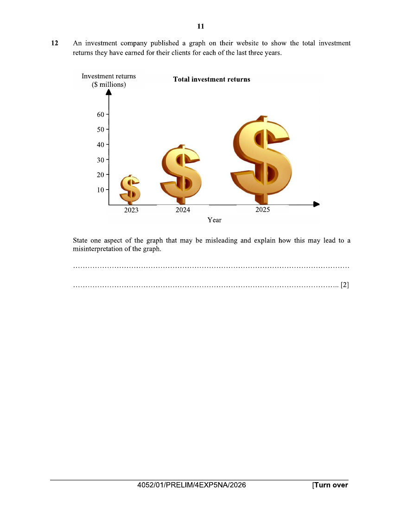
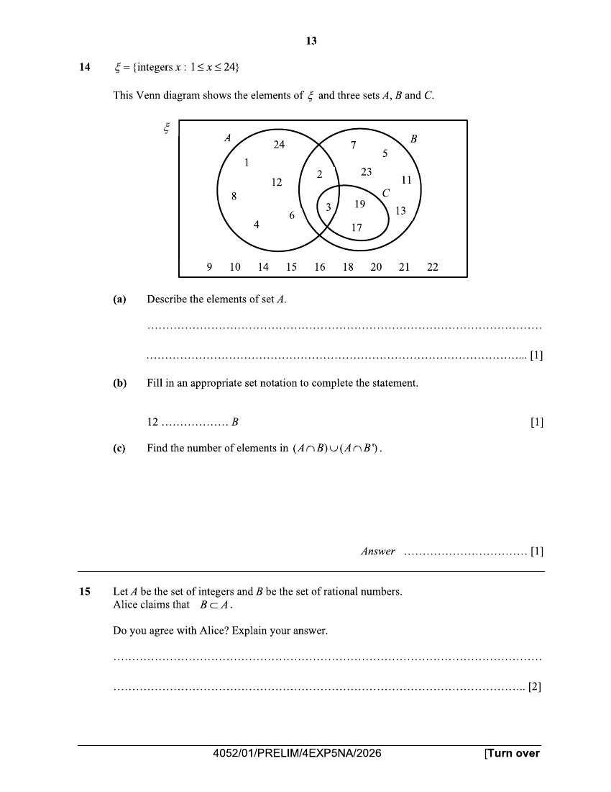
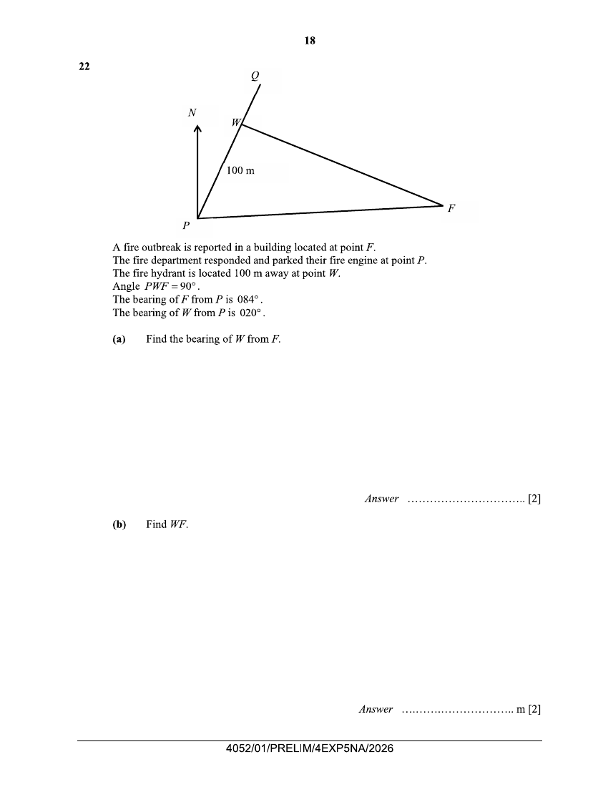
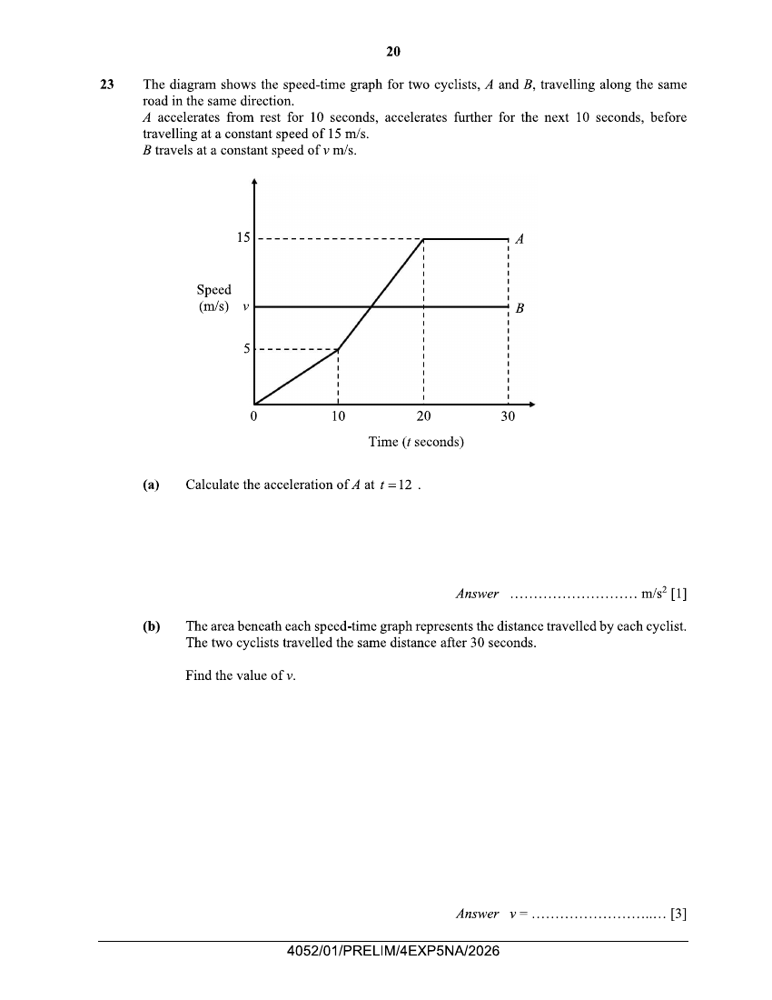
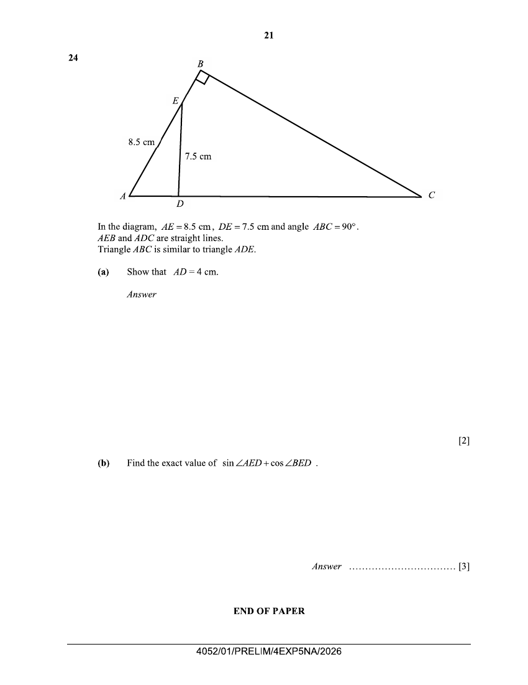

# Dunman Secondary School — Mathematics 4052/01 Paper 1 (cleaned)

> **Institution:** Dunman Secondary School
> **Exam:** Preliminary Examination 2026
> **Level:** Secondary 4 Express / 5 Normal Academic
> **Subjects:** Mathematics
> **Paper:** 4052/01 Paper 1
> **Date:** 18 August 2026
> **Duration:** 2 hours 15 minutes
> **Total Marks:** 90
> **Source:** `Dunman 2026 Emaths Prelims Paper 1.pdf` (scan — cleaned & reformatted)

---

## Instructions

Write your name, class and index number on all the work you hand in.
Write in dark blue or black pen.
You may use a pencil for any diagrams or graphs.
Do not use staples, paper clips, glue or correction fluid.

Answer all questions.
The number of marks is given in brackets [ ] at the end of each question or part question.

If working is needed for any question it must be shown with the answer.
Omission of essential working will result in loss of marks.
The total of the marks for this paper is 90.

The use of an approved scientific calculator is expected, where appropriate.
If the degree of accuracy is not specified in the question, and if the answer is not exact, give the answer to three significant figures. Give answers in degrees to one decimal place.
For $\pi$, use either your calculator value or $3.142$.

Candidates answer on the Question Paper.

This document consists of 21 printed pages and 1 blank page.

---

## Mathematical Formulae

*Compound interest*

$$
\text{Total amount} = P\left(1+\frac{r}{100}\right)^{n}
$$

*Mensuration*

$$
\text{Curved surface area of a cone} = \pi rl
$$

$$
\text{Surface area of a sphere} = 4\pi r^{2}
$$

$$
\text{Volume of a cone} = \frac{1}{3}\pi r^{2}h
$$

$$
\text{Volume of a sphere} = \frac{4}{3}\pi r^{3}
$$

$$
\text{Area of triangle } ABC = \frac{1}{2}ab\sin C
$$

$$
\text{Arc length} = r\theta,\text{ where }\theta\text{ is in radians}
$$

$$
\text{Sector area} = \frac{1}{2}r^{2}\theta,\text{ where }\theta\text{ is in radians}
$$

*Trigonometry*

$$
\frac{a}{\sin A} = \frac{b}{\sin B} = \frac{c}{\sin C}
$$

$$
a^{2} = b^{2}+c^{2}-2bc\cos A
$$

*Statistics*

$$
\text{Mean} = \frac{\sum fx}{\sum f}
$$

$$
\text{Standard deviation} = \sqrt{\frac{\sum fx^{2}}{\sum f}-\left(\frac{\sum fx}{\sum f}\right)^{2}}
$$

---

## Answer all the questions

---

### Q1

> **Marks:** (a) 1, (b) 2, (c) 2; total 5
> **Page:** 3

Simplify.

**(a)** $5-3(2x+1)$ [1]
> **Topic:** N5 Algebraic expressions and formulae
> **Sub-topic:** Algebraic expressions and formulae
> **LO:** [[context/subjects/o-level-e-maths/learning-objectives/o-level-e-maths-N5g.md|N5g]]

**(b)** $(2a^{4})^{3}+(a^{2})^{6}$ [2]
> **Topic:** N5 Algebraic expressions and formulae
> **Sub-topic:** Algebraic expressions and formulae
> **LO:** [[context/subjects/o-level-e-maths/learning-objectives/o-level-e-maths-N5g.md|N5g]]

**(c)** $\dfrac{14x^{5}y}{9a^{2}}\div\dfrac{21xy^{3}}{6a^{4}}$ [2]
> **Topic:** N5 Algebraic expressions and formulae
> **Sub-topic:** Algebraic expressions and formulae
> **LO:** [[context/subjects/o-level-e-maths/learning-objectives/o-level-e-maths-N5g.md|N5g]]

---

### Q2

> **Marks:** (a) 2, (b) 1; total 3
> **Page:** 4

252 boys and 280 girls signed up to participate in a leadership camp.
The participants are to form as many groups as possible such that each group has the same number of boys and the same number of girls.

**(a)** Find the greatest number of groups that can be formed. [2]
> **Topic:** N5 Algebraic expressions and formulae
> **Sub-topic:** Algebraic expressions and formulae
> **LO:** [[context/subjects/o-level-e-maths/learning-objectives/o-level-e-maths-N5h.md|N5h]]

**(b)** Hence, find the number of boys and the number of girls in each group. [1]
> **Topic:** N5 Algebraic expressions and formulae
> **Sub-topic:** Algebraic expressions and formulae
> **LO:** [[context/subjects/o-level-e-maths/learning-objectives/o-level-e-maths-N5h.md|N5h]]

---

### Q3

> **Marks:** 2
> **Topic:** N5 Algebraic expressions and formulae
> **Sub-topic:** Algebraic expressions and formulae
> **LO:** [[context/subjects/o-level-e-maths/learning-objectives/o-level-e-maths-N5h.md|N5h]]
> **Page:** 4

Factorise $6k^{2}ab-2kb+1-3ka$. [2]

---

### Q4

> **Marks:** (a) 2, (b) 3; total 5
> **Page:** 5

$$
a=\frac{5-b^{2}}{5c}
$$

**(a)** Find $a$ when $b=4.23$ and $c=-204$.
Give your answer correct to 2 significant figures. [2]
> **Topic:** N1 Numbers and their operations
> **Sub-topic:** Numbers and their operations
> **LO:** [[context/subjects/o-level-e-maths/learning-objectives/o-level-e-maths-N1g.md|N1g]]

**(b)** Rearrange the formula to make $b$ the subject. [3]
> **Topic:** N1 Numbers and their operations
> **Sub-topic:** Numbers and their operations
> **LO:** [[context/subjects/o-level-e-maths/learning-objectives/o-level-e-maths-N1g.md|N1g]]

---

### Q5

> **Marks:** 3
> **Topic:** N1 Numbers and their operations
> **Sub-topic:** Numbers and their operations
> **LO:** [[context/subjects/o-level-e-maths/learning-objectives/o-level-e-maths-N1g.md|N1g]]
> **Page:** 5

Solve the equation $x^{2}-7x+4=0$ by completing the square.
Give your solutions correct to two decimal places. [3]

---

### Q6

> **Marks:** 3
> **Topic:** N3 Percentage
> **Sub-topic:** Percentage
> **LO:** [[context/subjects/o-level-e-maths/learning-objectives/o-level-e-maths-N3d.md|N3d]]
> **Page:** 6

Mr Wee invests in an account that pays $2.2\%$ per year compound interest.
He leaves the money in the account for 8 years.
At the end of 8 years there is &#36;6545.91 in the account.

Calculate the total amount of interest Mr Wee earned over the 8 years. [3]

---

### Q7

> **Marks:** 3
> **Topic:** N7 Equations and inequalities
> **Sub-topic:** Equations and inequalities
> **LO:** [[context/subjects/o-level-e-maths/learning-objectives/o-level-e-maths-N7b.md|N7b]]
> **Page:** 6

Express as a single fraction in its simplest form $\dfrac{3-2x}{2x}+\dfrac{5}{16}-\dfrac{6-3x}{4x}$. [3]

---

### Q8

> **Marks:** (a) 3, (b) 1, (c) 1; total 5
> **Page:** 7

The table represents the monthly salary of workers in a company.

| Monthly salary (&#36;) | 3500 | 4000 | 5000 | 6000 | 30 000 |
| --- | --- | --- | --- | --- | --- |
| Number of workers | 4 | $x$ | 12 | 3 | 1 |

**(a)** The monthly mean salary of the workers is &#36;5680.

Show that $x=5$. [3]
> **Topic:** S1 Data handling and analysis
> **Sub-topic:** Data handling and analysis
> **LO:** [[context/subjects/o-level-e-maths/learning-objectives/o-level-e-maths-S1f.md|S1f]]

**(b)** Find the median monthly salary of the workers. [1]
> **Topic:** S1 Data handling and analysis
> **Sub-topic:** Data handling and analysis
> **LO:** [[context/subjects/o-level-e-maths/learning-objectives/o-level-e-maths-S1f.md|S1f]]

**(c)** Explain whether the mean or the median is the more appropriate measure of central tendency of the workers' monthly salaries. [1]
> **Topic:** S1 Data handling and analysis
> **Sub-topic:** Data handling and analysis
> **LO:** [[context/subjects/o-level-e-maths/learning-objectives/o-level-e-maths-S1f.md|S1f]]

---

### Q9

> **Marks:** 3
> **Topic:** G5 Mensuration
> **Sub-topic:** Mensuration
> **LO:** [[context/subjects/o-level-e-maths/learning-objectives/o-level-e-maths-G5c.md|G5c]]
> **Page:** 8

A solid consists of a cylinder and a hemisphere.
The cylinder has radius $r$ cm and length $4r$ cm.
The hemisphere has radius $2r$ cm.

The total surface area of the solid is twice the total surface area of a solid cone with radius $r$ cm and slant height $l$ cm.

Find $l$ in terms of $r$. [3]

---

### Q10

> **Marks:** 4
> **Topic:** S2 Probability
> **Sub-topic:** Probability
> **LO:** [[context/subjects/o-level-e-maths/learning-objectives/o-level-e-maths-S2c.md|S2c]]
> **Page:** 9

24 students participated in a science competition.

One of the 24 students is selected at random.
The probability that it is a boy who won a prize is $\dfrac{1}{6}$.

Two of the girls are selected at random.
The probability that they did not win a prize is $\dfrac{1}{7}$.

Complete the table of information about the 24 students who participated in the competition. [4]

|  | Won a prize | Did not win a prize |
| --- | --- | --- |
| Boys |  | 5 |
| Girls |  |  |

---

### Q11

> **Marks:** (a) 2, (b) 1; total 3
> **Page:** 10

The strength, $S$ units, of a magnetic signal at a point is inversely proportional to the cube of the distance, $d$ cm, from the transmitter.

**(a)** When $S=100$, $d=3$.

Find $S$ when $d=5$. [2]
> **Topic:** N2 Ratio and proportion
> **Sub-topic:** Ratio and proportion
> **LO:** [[context/subjects/o-level-e-maths/learning-objectives/o-level-e-maths-N2a.md|N2a]]

**(b)** When the value of $d$ is reduced to $25\%$ of its original value, $S$ changes by a factor of $m$.

Find $m$. [1]
> **Topic:** N2 Ratio and proportion
> **Sub-topic:** Ratio and proportion
> **LO:** [[context/subjects/o-level-e-maths/learning-objectives/o-level-e-maths-N2a.md|N2a]]

---

### Q12

> **Marks:** 2
> **Topic:** N6 Functions and graphs
> **Sub-topic:** Functions and graphs
> **LO:** [[context/subjects/o-level-e-maths/learning-objectives/o-level-e-maths-N6c.md|N6c]]
> **Page:** 11

An investment company published a graph on their website to show the total investment returns they have earned for their clients for each of the last three years.

State one aspect of the graph that may be misleading and explain how this may lead to a misinterpretation of the graph. [2]

---

### Q13

> **Marks:** (a) 1, (b) 1, (c) 1, (d) 2; total 5
> **Page:** 12

The diagram shows a park in the shape of a quadrilateral $ABCD$.

Scale: 1 cm to 20 m

**(a)** Construct the perpendicular bisector of $AB$. [1]
> **Topic:** G2 Congruence and similarity
> **Sub-topic:** Congruence and similarity
> **LO:** [[context/subjects/o-level-e-maths/learning-objectives/o-level-e-maths-G2e.md|G2e]]

**(b)** Construct the bisector of angle $ABC$. [1]
> **Topic:** G2 Congruence and similarity
> **Sub-topic:** Congruence and similarity
> **LO:** [[context/subjects/o-level-e-maths/learning-objectives/o-level-e-maths-G2e.md|G2e]]

**(c)** A statue $S$ is to be built in the park.
The statue is equidistant from $A$ and $B$ and equidistant from $AB$ and $CB$.

Mark and label point $S$ on the diagram. [1]
> **Topic:** G2 Congruence and similarity
> **Sub-topic:** Congruence and similarity
> **LO:** [[context/subjects/o-level-e-maths/learning-objectives/o-level-e-maths-G2e.md|G2e]]

**(d)** A running track is to be built in the park.
Every part of the track is equidistant from point $S$.
The track meets $AB$ and $BC$ at $X$ and $Y$ respectively.

Calculate the length, in metres, of the running track. [2]
> **Topic:** G2 Congruence and similarity
> **Sub-topic:** Congruence and similarity
> **LO:** [[context/subjects/o-level-e-maths/learning-objectives/o-level-e-maths-G2e.md|G2e]]

---

### Q14

> **Marks:** (a) 1, (b) 1, (c) 1; total 3
> **Page:** 13

$\xi=\{\text{integers }x:1\leq x\leq 24\}$

This Venn diagram shows the elements of $\xi$ and three sets $A$, $B$ and $C$.

**(a)** Describe the elements of set $A$. [1]
> **Topic:** N8 Set language and notation
> **Sub-topic:** Set language and notation
> **LO:** [[context/subjects/o-level-e-maths/learning-objectives/o-level-e-maths-N8c.md|N8c]]

**(b)** Fill in an appropriate set notation to complete the statement.

$12\text{ }\ldots\ldots\ldots\ldots B$ [1]
> **Topic:** N8 Set language and notation
> **Sub-topic:** Set language and notation
> **LO:** [[context/subjects/o-level-e-maths/learning-objectives/o-level-e-maths-N8c.md|N8c]]

**(c)** Find the number of elements in $(A\cap B)\cup(A\cap B')$. [1]
> **Topic:** N8 Set language and notation
> **Sub-topic:** Set language and notation
> **LO:** [[context/subjects/o-level-e-maths/learning-objectives/o-level-e-maths-N8c.md|N8c]]

---

### Q15

> **Marks:** 2
> **Topic:** N8 Set language and notation
> **Sub-topic:** Set language and notation
> **LO:** [[context/subjects/o-level-e-maths/learning-objectives/o-level-e-maths-N8b.md|N8b]]
> **Page:** 13

Let $A$ be the set of integers and $B$ be the set of rational numbers.
Alice claims that $B\subset A$.

Do you agree with Alice? Explain your answer. [2]

---

### Q16

> **Marks:** (a) 1, (b) 3, (c) 2, (d) 1; total 7
> **Page:** 14

The first four terms of a sequence are given below.

$$
\begin{aligned}
T_{1}&=(2-1)^{2}+5=6\\
T_{2}&=(4-1)^{2}+9=18\\
T_{3}&=(6-1)^{2}+13=38\\
T_{4}&=(8-1)^{2}+17=66
\end{aligned}
$$

**(a)** Find $T_{5}$. [1]
> **Topic:** N5 Algebraic expressions and formulae
> **Sub-topic:** Algebraic expressions and formulae
> **LO:** [[context/subjects/o-level-e-maths/learning-objectives/o-level-e-maths-N5e.md|N5e]]

**(b)** Show that the $n$th term of the sequence, $T_{n}$, is given by $4n^{2}+2$. [3]
> **Topic:** N5 Algebraic expressions and formulae
> **Sub-topic:** Algebraic expressions and formulae
> **LO:** [[context/subjects/o-level-e-maths/learning-objectives/o-level-e-maths-N5e.md|N5e]]

**(c)** $T_{k}$ and $T_{k+1}$ are consecutive terms in the sequence.

Find and simplify an expression, in terms of $k$, for $T_{k+1}-T_{k}$. [2]
> **Topic:** N5 Algebraic expressions and formulae
> **Sub-topic:** Algebraic expressions and formulae
> **LO:** [[context/subjects/o-level-e-maths/learning-objectives/o-level-e-maths-N5e.md|N5e]]

**(d)** Explain why two consecutive terms of the sequence cannot have a difference of 10. [1]
> **Topic:** N5 Algebraic expressions and formulae
> **Sub-topic:** Algebraic expressions and formulae
> **LO:** [[context/subjects/o-level-e-maths/learning-objectives/o-level-e-maths-N5e.md|N5e]]

---

### Q17

> **Marks:** 3
> **Topic:** N7 Equations and inequalities
> **Sub-topic:** Equations and inequalities
> **LO:** [[context/subjects/o-level-e-maths/learning-objectives/o-level-e-maths-N7c.md|N7c]]
> **Page:** 15

Solve these simultaneous equations.

$$
\begin{aligned}
4x+7y&=3\\
6x-8y&=23
\end{aligned}
$$

You must show your working. [3]

---

### Q18

> **Marks:** 3
> **Topic:** N2 Ratio and proportion
> **Sub-topic:** Ratio and proportion
> **LO:** [[context/subjects/o-level-e-maths/learning-objectives/o-level-e-maths-N2a.md|N2a]]
> **Page:** 15

For each of the statements, state whether it is **true** or **false** in the table.
If you have written false, give an example to justify your answer.

Let $n$ be a non-zero integer for each of the statements in the table. [3]

| Statement | True or False | Example (if false) |
| --- | --- | --- |
| $2n+1$ is always odd. |  |  |
| The product of two irrational numbers is always irrational |  |  |
| $\dfrac{1}{n}\geq\dfrac{1}{n^{2}}$ |  |  |

---

### Q19

> **Marks:** (a) 2, (b) 3; total 5
> **Page:** 16

The equation of line $L$ is $3y=4x+12$.

**(a)** A point $M$ on the line is thrice as far from the $x$-axis than the $y$-axis.

Find the coordinates of point $M$. [2]
> **Topic:** G6 Coordinate geometry
> **Sub-topic:** Coordinate geometry
> **LO:** [[context/subjects/o-level-e-maths/learning-objectives/o-level-e-maths-G6c.md|G6c]]

**(b)** The line intersects the $x$-axis at point $K$.

Find the length of $MK$. [3]
> **Topic:** G6 Coordinate geometry
> **Sub-topic:** Coordinate geometry
> **LO:** [[context/subjects/o-level-e-maths/learning-objectives/o-level-e-maths-G6c.md|G6c]]

---

### Q20

> **Marks:** 3
> **Topic:** G1 Angles, triangles and polygons
> **Sub-topic:** Angles, triangles and polygons
> **LO:** [[context/subjects/o-level-e-maths/learning-objectives/o-level-e-maths-G1f.md|G1f]]
> **Page:** 16

In a regular polygon, the ratio interior angle : exterior angle $=3:2$.

Calculate the number of sides of the polygon. [3]

---

### Q21

> **Marks:** 3
> **Topic:** G2 Congruence and similarity
> **Sub-topic:** Congruence and similarity
> **LO:** [[context/subjects/o-level-e-maths/learning-objectives/o-level-e-maths-G2i.md|G2i]]
> **Page:** 17

$ABCD$ is a trapezium.
Angle $DAB$ and angle $ABC$ are equal.

Show that $AD=BC$. [3]

---

### Q22

> **Marks:** (a) 2, (b) 2, (c) 2; total 6
> **Page:** 18–19

A fire outbreak is reported in a building located at point $F$.
The fire department responded and parked their fire engine at point $P$.
The fire hydrant is located 100 m away at point $W$.
Angle $PWF=90^{\circ}$.
The bearing of $F$ from $P$ is $084^{\circ}$.
The bearing of $W$ from $P$ is $020^{\circ}$.

**(a)** Find the bearing of $W$ from $F$. [2]
> **Topic:** G4 Pythagoras' theorem and trigonometry
> **Sub-topic:** Pythagoras' theorem and trigonometry
> **LO:** [[context/subjects/o-level-e-maths/learning-objectives/o-level-e-maths-G4g.md|G4g]]

**(b)** Find $WF$. [2]
> **Topic:** G4 Pythagoras' theorem and trigonometry
> **Sub-topic:** Pythagoras' theorem and trigonometry
> **LO:** [[context/subjects/o-level-e-maths/learning-objectives/o-level-e-maths-G4g.md|G4g]]

The fire outbreak is located 8 m above point $F$.
A firefighter of height 1.7 m walks along $PQ$ and stops at a point that is nearest to point $F$.

**(c)** Find the angle of elevation of the fire from the top of the firefighter's head. [2]
> **Topic:** G4 Pythagoras' theorem and trigonometry
> **Sub-topic:** Pythagoras' theorem and trigonometry
> **LO:** [[context/subjects/o-level-e-maths/learning-objectives/o-level-e-maths-G4g.md|G4g]]

---

### Q23

> **Marks:** (a) 1, (b) 3; total 4
> **Page:** 20

The diagram shows the speed-time graph for two cyclists, $A$ and $B$, travelling along the same road in the same direction.
$A$ accelerates from rest for 10 seconds, accelerates further for the next 10 seconds, before travelling at a constant speed of 15 m/s.
$B$ travels at a constant speed of $v$ m/s.

**(a)** Calculate the acceleration of $A$ at $t=12$. [1]
> **Topic:** N6 Functions and graphs
> **Sub-topic:** Functions and graphs
> **LO:** [[context/subjects/o-level-e-maths/learning-objectives/o-level-e-maths-N6c.md|N6c]]

**(b)** The area beneath each speed-time graph represents the distance travelled by each cyclist.
The two cyclists travelled the same distance after 30 seconds.

Find the value of $v$. [3]
> **Topic:** N6 Functions and graphs
> **Sub-topic:** Functions and graphs
> **LO:** [[context/subjects/o-level-e-maths/learning-objectives/o-level-e-maths-N6c.md|N6c]]

---

### Q24

> **Marks:** (a) 2, (b) 3; total 5
> **Page:** 21

In the diagram, $AE=8.5$ cm, $DE=7.5$ cm and angle $ABC=90^{\circ}$.
$AEB$ and $ADC$ are straight lines.
Triangle $ABC$ is similar to triangle $ADE$.

**(a)** Show that $AD=4$ cm. [2]
> **Topic:** G4 Pythagoras' theorem and trigonometry
> **Sub-topic:** Pythagoras' theorem and trigonometry
> **LO:** [[context/subjects/o-level-e-maths/learning-objectives/o-level-e-maths-G4c.md|G4c]]

**(b)** Find the exact value of $\sin\angle AED+\cos\angle BED$. [3]
> **Topic:** G4 Pythagoras' theorem and trigonometry
> **Sub-topic:** Pythagoras' theorem and trigonometry
> **LO:** [[context/subjects/o-level-e-maths/learning-objectives/o-level-e-maths-G4c.md|G4c]]

---

**END OF PAPER**
