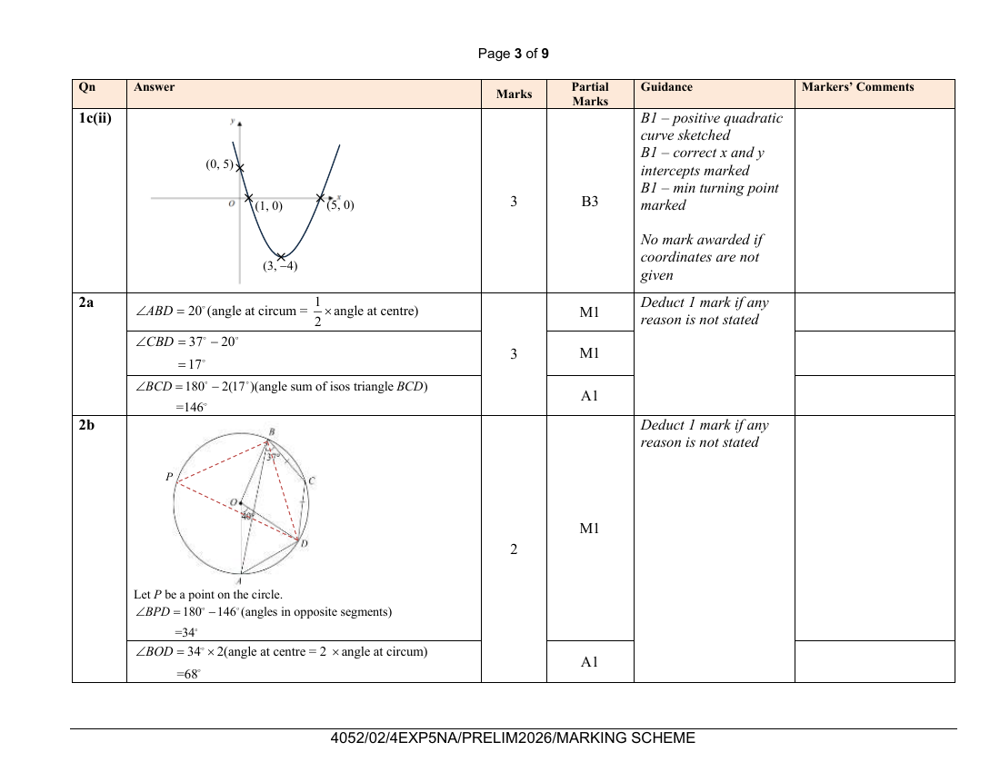
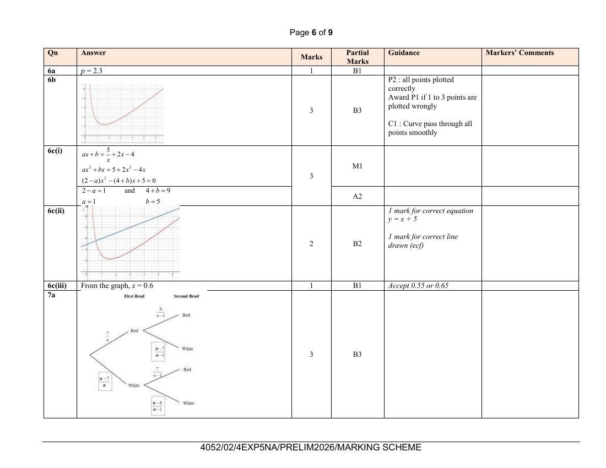

# Dunman Secondary School — Mathematics 4052/02 Paper 2 Marking Scheme (cleaned)

> **Institution:** Dunman Secondary School
> **Exam:** Preliminary Examination 2025
> **Level:** Secondary 4 Express / 5 Normal (Academic)
> **Subjects:** Mathematics
> **Paper:** 4052/02 Paper 2 Marking Scheme
> **Date:** 25 August 2026
> **Duration:** 2 hours 15 minutes
> **Total Marks:** 90
> **Source:** `Dunman-2026-Emaths-Paper-2-MS` (cleaned & reformatted)

The cover is printed "PRELIMINARY EXAMINATION 2025" and dated 25 August 2026. Note on the cover: (Updated 1 Dec 2022 by HOD/Math aligned to Marking Scheme for Specimen Papers).

Footer: `4052/02/4EXP5NA/PRELIM2026/MARKING SCHEME`.

Page numbers below are the paired question-paper physical pages.

---

### Q1

> **Marks:** (a) 3, (b) 2, (c) 2, (d)(i) 2, (d)(ii) 3; total 12
> **Sub-topic:** Inequalities, factorisation and graphs
> **Page:** 4–5

**(a)**

$$
5\leq 2x-7\text{ and }2x-7<11
$$

$$
2x\geq 12,\quad 2x<18
$$

$$
x\geq 6,\quad x<9
$$

$$
6\leq x<9
$$

The integers are $6$, $7$ and $8$.

[M1, M1, A1]

**(b)**

$$
80x^{2}-45y^{2}=5(16x^{2}-9y^{2})=5(4x-3y)(4x+3y)
$$

[M1, A1]

**(c)** Rewrite to a non-fractional equation.

$$
\frac{18}{5-3x}=4
$$

$$
18=20-12x
$$

$$
12x=2,\quad x=\frac{1}{6}
$$

[M1, A1]

Do not accept $x=0.167$ or $0.1666$. Can accept $x=0.1\dot{6}$.

**(d) (i)** Show expansion and simplify to the general form of a quadratic expression. If no working step is shown, no marks.

$$
(x-3)^{2}-4=x^{2}-6x+9-4=x^{2}-6x+5=(x-1)(x-5)
$$

[M1, A1]

**(ii)**

B1 positive quadratic curve sketched.

B1 correct $x$-intercepts and $y$-intercept marked: $(1,0)$, $(5,0)$ and $(0,5)$.

B1 minimum turning point marked: $(3,-4)$.

[B3]

No mark awarded if coordinates are not given.

---

### Q2

> **Marks:** (a) 3, (b) 2, (c) 4; total 9
> **Sub-topic:** Circle theorems and segment area
> **Page:** 6–7

**(a)** Deduct 1 mark if any reason is not stated.

$$
\angle ABD=20^{\circ}\quad\left(\text{angle at circumference}=\frac{1}{2}\times\text{angle at centre}\right)
$$

$$
\angle CBD=37^{\circ}-20^{\circ}=17^{\circ}
$$

$$
\angle BCD=180^{\circ}-2(17^{\circ})=146^{\circ}\quad(\text{angle sum of isosceles triangle }BCD)
$$

[M1, M1, A1]

**(b)** Deduct 1 mark if any reason is not stated.

Let $P$ be a point on the circle.

$$
\angle BPD=180^{\circ}-146^{\circ}=34^{\circ}\quad(\text{angles in opposite segments})
$$

$$
\angle BOD=34^{\circ}\times 2=68^{\circ}\quad(\text{angle at centre}=2\times\text{angle at circumference})
$$

[M1, A1]

**(c)**

$$
\angle AOB=68^{\circ}+40^{\circ}=108^{\circ}
$$

Area of sector $OADCB$

$$
=\frac{108}{360}\times\pi(7^{2})=46.1814\text{ cm}^{2}
$$

Area of triangle $AOB$

$$
=\frac{1}{2}(7^{2})\sin 108^{\circ}=23.300\text{ cm}^{2}
$$

Area of segment

$$
=46.1819-23.300=22.9\text{ cm}^{2}\text{ (3 sig. fig.)}
$$

[M1, M1, M1, A1]

---

### Q3

> **Marks:** (a) 1, (b) 1, (c) 2, (d) 1, (e) 4; total 9
> **Sub-topic:** Matrices
> **Page:** 8–9

**(a)**

$$
\mathbf{N}=\begin{pmatrix}23&18&39\\17&31&44\end{pmatrix}
$$

[B1]

**(b)** $k=0.95$ [B1]

**(c)** ecf from 3(b)

$$
\mathbf{D}=0.95\begin{pmatrix}3700&3000\end{pmatrix}=\begin{pmatrix}3515&2850\end{pmatrix}
$$

$$
\mathbf{R}=\begin{pmatrix}3515&2850\end{pmatrix}\begin{pmatrix}23&18&39\\17&31&44\end{pmatrix}=\begin{pmatrix}129295&151620&262485\end{pmatrix}
$$

[M1, A1]

**(d)** The elements of $\mathbf{R}$ represent the total cost of the discounted packages sold at the travel fair on Friday, Saturday and Sunday respectively. [B1]

The scheme prints "represents".

**(e)** ecf from 3(c)

Total cost of packages sold outside of the travel fair

$$
=132(\$3700)+95(\$3000)=\$773400
$$

Total cost of packages sold during the travel fair

$$
=\$129295+\$151620+\$262485=\$543400
$$

Month's total sales

$$
=\$773400+\$543400=\$1316800
$$

$$
\frac{543400}{1316800}\times 100\%=41.3\%\text{ (3 sig. fig.)}
$$

[M1, M1, M1, A1]

---

### Q4

> **Marks:** (a) 2, (b) 4; total 6
> **Sub-topic:** Vectors
> **Page:** 10

**(a)**

$$
\overrightarrow{AB}=\frac{2}{3}\overrightarrow{OD}=2\mathbf{n}
$$

$$
\overrightarrow{OB}=\overrightarrow{OA}+\overrightarrow{AB}=4\mathbf{m}+2\mathbf{n}
$$

[M1, A1]

**(b)**

$$
\overrightarrow{AD}=3\mathbf{n}-4\mathbf{m}
$$

$$
\overrightarrow{AT}=\frac{2}{5}(3\mathbf{n}-4\mathbf{m})
$$

$$
\begin{aligned}
\overrightarrow{OT}&=\overrightarrow{OA}+\overrightarrow{AT}\\
&=4\mathbf{m}+\frac{2}{5}(3\mathbf{n}-4\mathbf{m})\\
&=\frac{3}{5}(4\mathbf{m}+2\mathbf{n})\\
&=\frac{3}{5}\overrightarrow{OB}
\end{aligned}
$$

Since $\overrightarrow{OT}=\dfrac{3}{5}\overrightarrow{OB}$ and $O$ is the common point, therefore $O$, $T$ and $B$ are collinear.

[M1, M1, M1, A1]

---

### Q5

> **Marks:** (a) 3, (b) 3, (c) 1; total 7
> **Sub-topic:** Algebraic fractions and quadratic equations
> **Page:** 11

**(a)**

$$
\frac{1}{x}+\frac{1}{x-2}=\frac{1}{4}
$$

$$
\frac{2x-2}{x(x-2)}=\frac{1}{4}
$$

$$
4(2x-2)=x(x-2)
$$

$$
8x-8=x^{2}-2x
$$

$$
x^{2}-10x+8=0\quad(\text{shown})
$$

[M1, M1, A1]

**(b)**

$$
x=\frac{-(-10)\pm\sqrt{(-10)^{2}-4(1)(8)}}{2(1)}
$$

$x=9.12$ or $0.88$ (2 dec. places)

[M1 for the discriminant $(-10)^{2}-4(1)(8)$; M2 overall; A1]

**(c)** Time taken $=9.123-2=7.123$ hours $=7$ hours $7$ minutes. [B1]

---

### Q6

> **Marks:** (a) 1, (b) 3, (c)(i) 3, (c)(ii) 2, (c)(iii) 1; total 10
> **Sub-topic:** Graphs of functions
> **Page:** 12–13

**(a)** $p=2.3$ [B1]

**(b)** P2: all points plotted correctly. Award P1 if 1 to 3 points are plotted wrongly. C1: curve passes through all points smoothly. [B3]

**(c) (i)**

$$
ax+b=\frac{5}{x}+2x-4
$$

$$
ax^{2}+bx=5+2x^{2}-4x
$$

$$
(2-a)x^{2}-(4+b)x+5=0
$$

$$
2-a=1\quad\text{and}\quad 4+b=9
$$

$$
a=1,\quad b=5
$$

[M1, A2]

**(ii)** 1 mark for the correct equation $y=x+5$. 1 mark for the correct line drawn (ecf). [B2]

**(iii)** From the graph, $x=0.6$. Accept $0.55$ or $0.65$. [B1]

---

### Q7

> **Marks:** (a) 3, (b) 3, (c) 2, (d) 1, (e) 1; total 10
> **Sub-topic:** Probability
> **Page:** 14–15

**(a)** Completed tree diagram. [B3]

The scheme drawing is on the same marking-scheme page as the graph for Question 6. Blanks are the white branches:

- first bead White: $\dfrac{n-7}{n}$
- second bead White given Red: $\dfrac{n-7}{n-1}$
- second bead White given White: $\dfrac{n-8}{n-1}$

**(b)** Formulate the equation. Simplify to a non-fractional equation.

$$
\frac{7}{n}\left(\frac{6}{n-1}\right)+\frac{n-7}{n}\left(\frac{n-8}{n-1}\right)=\frac{11}{18}
$$

$$
\frac{42+(n-7)(n-8)}{n(n-1)}=\frac{11}{18}
$$

$$
18(42+n^{2}-15n+56)=11n(n-1)
$$

$$
7n^{2}-259n+1764=0
$$

$$
n^{2}-37n+252=0\quad(\text{shown})
$$

[M1, M1, A1]

**(c)** $(n-9)(n-28)=0$, so $n=9$ or $28$. Or using the general formula. [M1, A1]

**(d)** Since there are more white beads than red beads, if $n=9$, then there are only 2 white beads which is less than the red beads. Therefore $n\neq 9$. [B1]

**(e)**

$$
P(\text{at least one white})=1-\frac{11}{18}=\frac{7}{18}
$$

The scheme labels this line "P(two beads chosen are of different colours)". [B1]

---

### Q8

> **Marks:** (a)(i) 1, (a)(ii) 1, (b) 1, (c)(i) 1, (c)(ii) 1, (c)(iii) 1, (c)(iv) 1; total 7
> **Sub-topic:** Statistics
> **Page:** 16–17

**(a) (i)** $34$ seconds [B1]

**(ii)** $\mathrm{IQR}=60-22=38$ seconds [B1]

**(b)** Total number of residents $=30\times 4=120$ [B1]

**(c) (i)** $15<t\leq 30$ [B1]

**(ii)** Working must be shown to be awarded B1.

$$
\frac{7.5(8)+22.5(27)+37.5(10)+52.5(13)+67.5(5)+82.5(2)}{8+27+10+13+5+2}=34.269=34.3\text{ (3 sig. fig.)}
$$

[B1]

**(iii)** Working must be shown to be awarded B1.

$$
\sqrt{\frac{100406.25}{65}-34.269^{2}}=19.3\text{ (3 sig. fig.)}
$$

[B1]

**(iv)** The lift at Blk 302 is more efficient because the median waiting time is in the interval of $15\leq t\leq 30$ is shorter than the median waiting time of Blk 301 which is $34$ s. [B1]

---

### Q9

> **Marks:** (a) 2, (b)(i) 1, (b)(ii) 1, (b)(iii) 2, (c) 2, (d) 2; total 10
> **Sub-topic:** Similar triangles and area
> **Page:** 18–19

**(a)** B1 for each pair of corresponding angles indicated with reason.

$\angle ADX=\angle CBX$ (alt. $\angle$, $AD//BC$)

$\angle AXD=\angle CXB$ (vert. opp. $\angle$s)

$\triangle CBX$ is similar to $\triangle ADX$ (AA similarity test)

[B2]

**(b) (i)** Area of $\triangle DAX$ : area of $\triangle BCX$ $=4:25$ [B1]

**(ii)** Note that $\triangle ABD$ and $\triangle ABC$ are triangles of the same height.

Area of $\triangle ABD$ : area of $\triangle ABC$ $=AD:BC=2:5$ [B1]

**(iii)**

$$
\begin{aligned}
\text{Area of }\triangle ABD:\text{area of }\triangle ABC
&=\text{area of }(\triangle ABX+\triangle DAX):\text{area of }(\triangle ABX+\triangle BCX)\\
&=4+p:25+p
\end{aligned}
$$

$$
\frac{4+p}{25+p}=\frac{2}{5}
$$

$$
20+5p=50+2p,\quad 3p=30,\quad p=10
$$

Area of triangle $ABX$ : area of trapezium $ABCD$

$$
=10:(10+10+4+25)=10:49
$$

[M1, A1]

**(c)** $10$ units represent $8\text{ cm}^{2}$

$$
\text{Area of shaded region}=\frac{8}{10}\times(4+25)=23.2\text{ cm}^{2}
$$

[M1, A1]

**(d)** $AB=DC$ is the additional condition. [B1]

Then $AX=DX$ and $BX=CX$. Therefore triangle $BAX$ and triangle $CDX$ will be congruent (SSS). [B1]

Alternatively the condition can be $AX=DX$ or $BX=CX$. State based on the condition. The condition set will make trapezium $ABCD$ an isosceles trapezium.

---

### Q10

> **Marks:** (a)(i) 1, (a)(ii) 1, (b) 2, (c) 6; total 10
> **Sub-topic:** Real-world data and nutrition
> **Page:** 20–23

**(a) (i)** Total protein content

$$
=1.2+3.5+18+2.5+1.0=26.2\text{ g}
$$

[B1]

**(ii)** Amount of energy

$$
=20+40+80+210+160=510\text{ kcal}
$$

[B1]

The scheme prints kCal.

**(b)** B1 for base and toppings. B1 for main and dressing.

Base: Brown Rice or Quinoa

Toppings: Sunflower seeds and (Roasted Corn or Avocado Slices)

Main: Tofu Medley

Dressing: Balsamic Vinagrette

[B2]

**(c)** B1 for each correct total calculated for energy, protein and sodium.

| Ingredients of Signature Wellness Bowl | Energy | Protein | Sodium |
| --- | --- | --- | --- |
| Brown Rice | 250 | 6.5 | 5 |
| Smoked Duck | 210 | 18 | 450 |
| Hard-Boiled Egg | 70 | 6 | 60 |
| Roasted Corn | 65 | 2.0 | 5 |
| Creamy Caesar | 160 | 1.0 | 310 |
| Total | 755 | 33.5 | 830 |

[M3]

The Chef's comment is correct as the total energy gained is $755$ kCal and the sodium content $830$ mg have exceeded the standard requirements of between $500$ kCal and $700$ kCal amount of energy and less than $600$ mg of sodium. [A1]

Must indicate the 2 nutritional standards that are not met.

| Ingredients | Energy | Protein | Sodium |
| --- | --- | --- | --- |
| Brown Rice | 250 | 6.5 | 5 |
| Grilled Salmon Fillet | 130 | 22 | 90 |
| Hard-Boiled Egg | 70 | 6 | 60 |
| Roasted Corn | 65 | 2.0 | 5 |
| Creamy Caesar | 160 | 1.0 | 310 |
| Total | 675 kcal | 37.5 | 470 mg |

[M1 correct calculation of all 3 nutritional categories]

Replace the main smoked duck slices with grilled salmon fillet. The amount of energy gained is reduced to $675$ kCal and the amount of sodium content is also reduced to $470$ mg and keeping the amount of protein above $25$ g. [A1]
