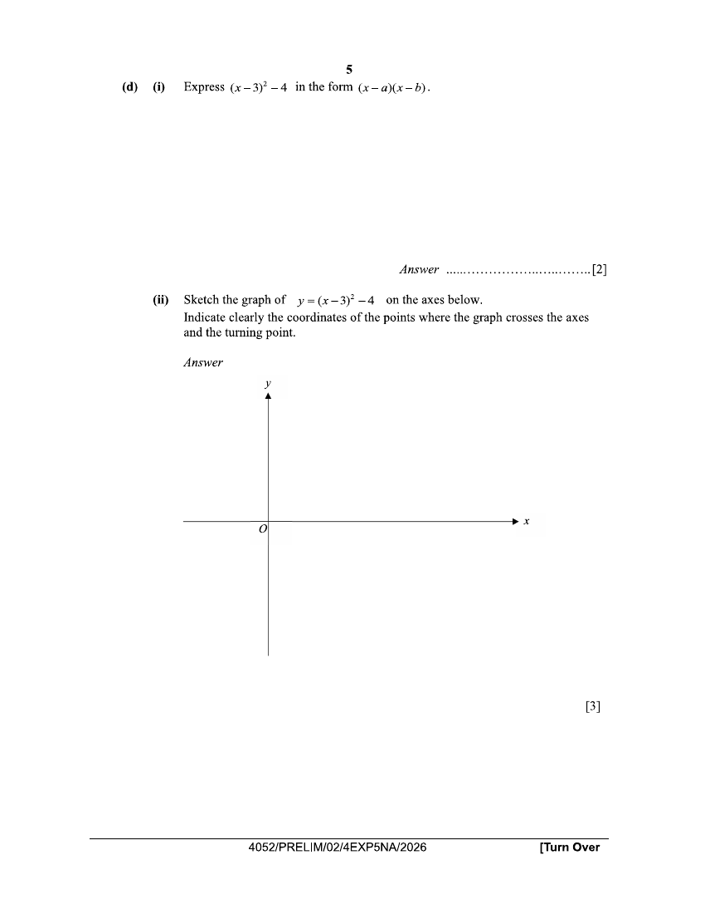
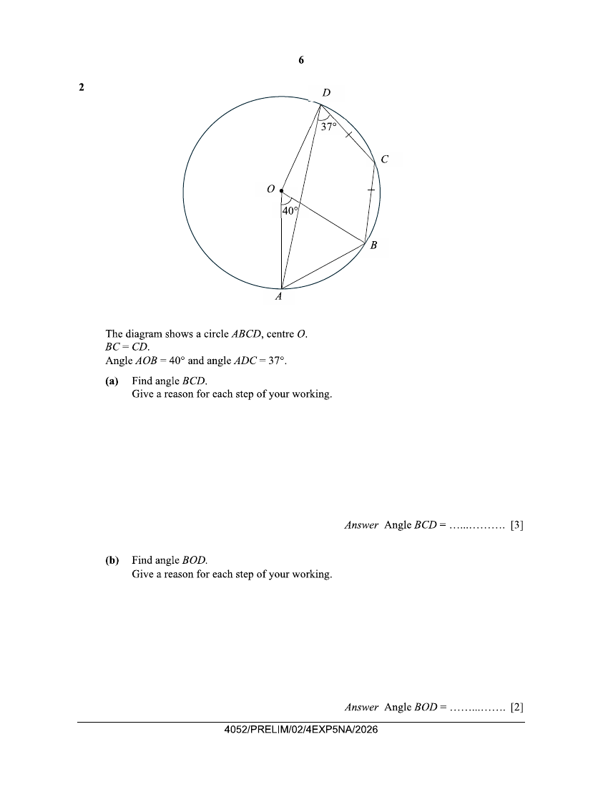
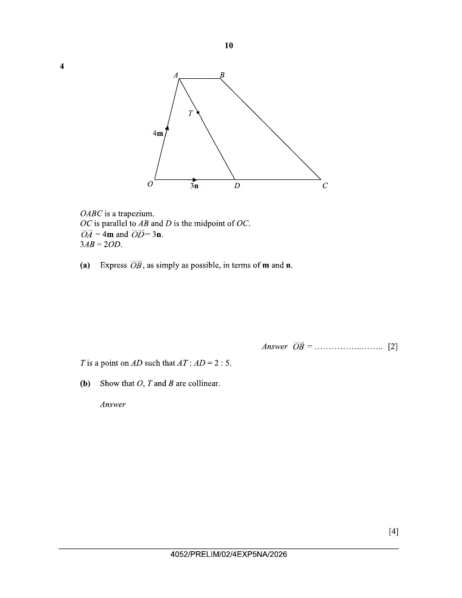
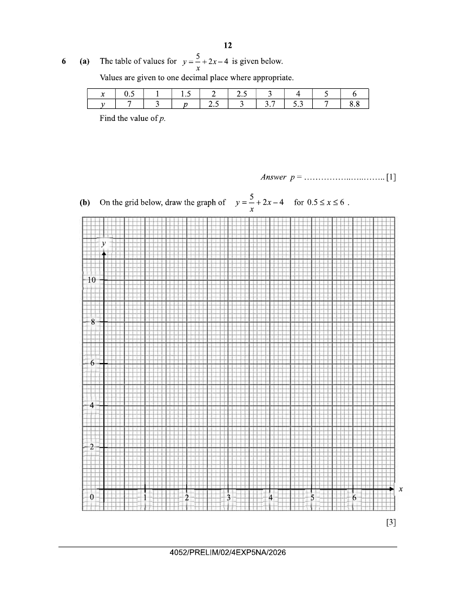
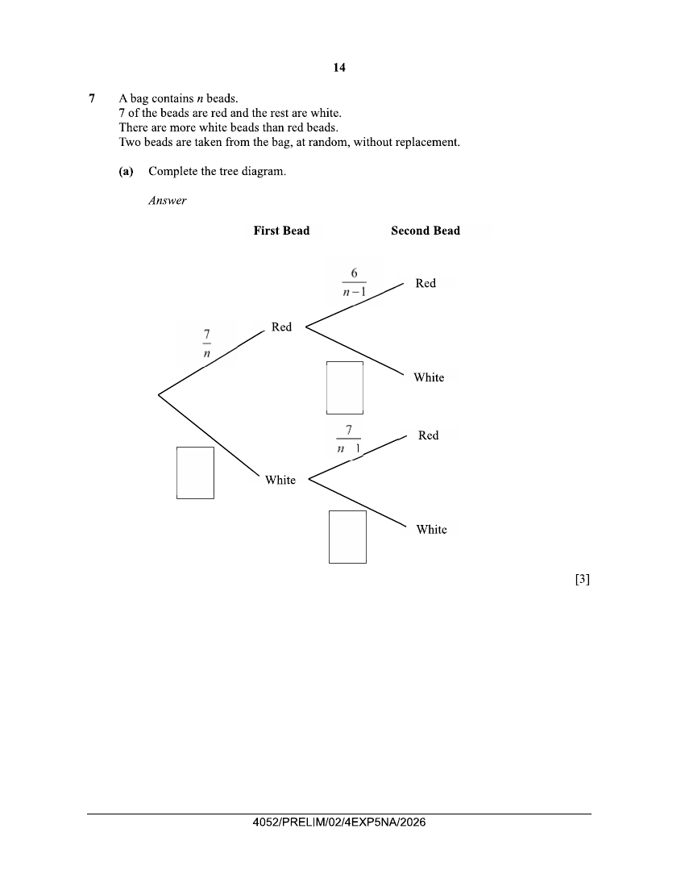
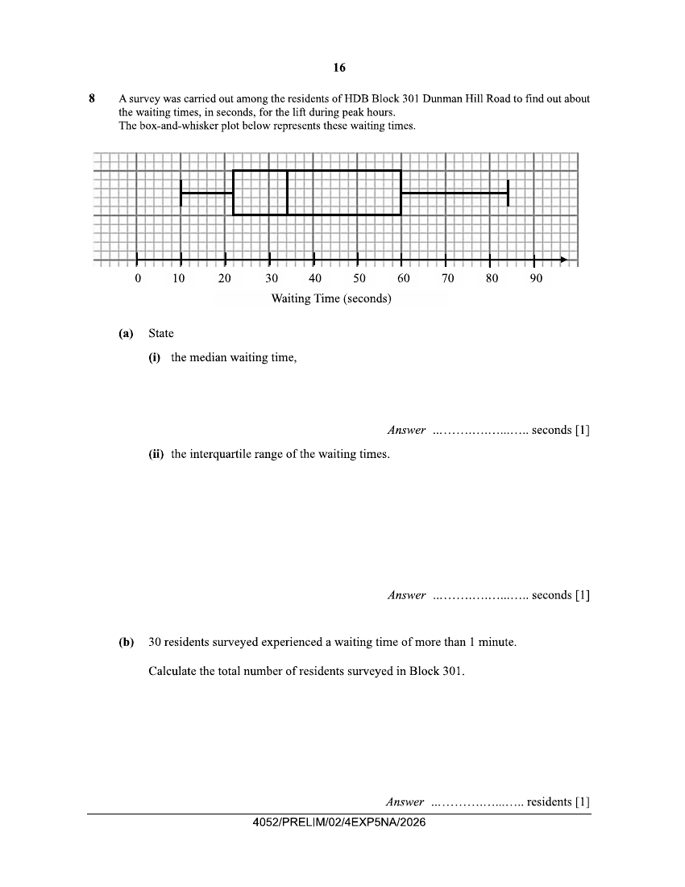

# Dunman Secondary School — Mathematics 4052/02 Paper 2 (cleaned)

> **Institution:** Dunman Secondary School
> **Exam:** Preliminary Examination 2026
> **Level:** Secondary 4 Express / 5 Normal Academic
> **Subjects:** Mathematics
> **Paper:** 4052/02 Paper 2
> **Date:** 25 August 2026
> **Duration:** 2 hours 15 minutes
> **Total Marks:** 90
> **Source:** `Dunman 2026 Emaths Prelims Paper 2.pdf` (scan — cleaned & reformatted)

---

## Instructions

Write your name, class and index number on all the work you hand in.
Write in dark blue or black pen.
You may use a pencil for any diagrams or graphs.
Do not use staples, paper clips, glue or correction fluid.

Answer all questions.
If working is needed for any question it must be shown with the answer.
Omission of essential working will result in loss of marks.
The total of the marks for this paper is 90.

The use of an approved scientific calculator is expected, where appropriate.
If the degree of accuracy is not specified in the question, and if the answer is not exact, give the answer to three significant figures. Give answers in degrees to one decimal place.
For $\pi$, use either your calculator value or $3.142$, unless the question requires the answer in terms of $\pi$.

Candidates answer on the Question Paper.

This document consists of 22 printed pages and 2 blank pages.

---

## Mathematical Formulae

*Compound interest*

$$
\text{Total amount} = P\left(1+\frac{r}{100}\right)^{n}
$$

*Mensuration*

$$
\text{Curved surface area of a cone} = \pi rl
$$

$$
\text{Surface area of a sphere} = 4\pi r^{2}
$$

$$
\text{Volume of a cone} = \frac{1}{3}\pi r^{2}h
$$

$$
\text{Volume of a sphere} = \frac{4}{3}\pi r^{3}
$$

$$
\text{Area of triangle } ABC = \frac{1}{2}ab\sin C
$$

$$
\text{Arc length} = r\theta,\text{ where }\theta\text{ is in radians}
$$

$$
\text{Sector area} = \frac{1}{2}r^{2}\theta,\text{ where }\theta\text{ is in radians}
$$

*Trigonometry*

$$
\frac{a}{\sin A} = \frac{b}{\sin B} = \frac{c}{\sin C}
$$

$$
a^{2} = b^{2}+c^{2}-2bc\cos A
$$

*Statistics*

$$
\text{Mean} = \frac{\sum fx}{\sum f}
$$

$$
\text{Standard deviation} = \sqrt{\frac{\sum fx^{2}}{\sum f}-\left(\frac{\sum fx}{\sum f}\right)^{2}}
$$

---

## Answer all the questions

---

### Q1

> **Marks:** (a) 3, (b) 2, (c) 2, (d)(i) 2, (d)(ii) 3; total 12
> **Page:** 4–5

**(a)** Find all the integers that satisfy the inequality $5\leq 2x-7<11$. [3]
> **Topic:** N6 Functions and graphs
> **Sub-topic:** Functions and graphs
> **LO:** [[context/subjects/o-level-e-maths/learning-objectives/o-level-e-maths-N6c.md|N6c]]

**(b)** Factorise $80x^{2}-45y^{2}$. [2]
> **Topic:** N6 Functions and graphs
> **Sub-topic:** Functions and graphs
> **LO:** [[context/subjects/o-level-e-maths/learning-objectives/o-level-e-maths-N6c.md|N6c]]

**(c)** Solve $\dfrac{18}{5-3x}=4$. [2]
> **Topic:** N6 Functions and graphs
> **Sub-topic:** Functions and graphs
> **LO:** [[context/subjects/o-level-e-maths/learning-objectives/o-level-e-maths-N6c.md|N6c]]

**(d) (i)** Express $(x-3)^{2}-4$ in the form $(x-a)(x-b)$. [2]
> **Topic:** N6 Functions and graphs
> **Sub-topic:** Functions and graphs
> **LO:** [[context/subjects/o-level-e-maths/learning-objectives/o-level-e-maths-N6c.md|N6c]]

**(ii)** Sketch the graph of $y=(x-3)^{2}-4$ on the axes below.
Indicate clearly the coordinates of the points where the graph crosses the axes and the turning point. [3]
> **Topic:** N6 Functions and graphs
> **Sub-topic:** Functions and graphs
> **LO:** [[context/subjects/o-level-e-maths/learning-objectives/o-level-e-maths-N6c.md|N6c]]

---

### Q2

> **Marks:** (a) 3, (b) 2, (c) 4; total 9
> **Page:** 6–7

The diagram shows a circle $ABCD$, centre $O$.
$BC=CD$.
Angle $AOB=40^{\circ}$ and angle $ADC=37^{\circ}$.

**(a)** Find angle $BCD$.
Give a reason for each step of your working. [3]
> **Topic:** G5 Mensuration
> **Sub-topic:** Mensuration
> **LO:** [[context/subjects/o-level-e-maths/learning-objectives/o-level-e-maths-G5f.md|G5f]]

**(b)** Find angle $BOD$.
Give a reason for each step of your working. [2]
> **Topic:** G5 Mensuration
> **Sub-topic:** Mensuration
> **LO:** [[context/subjects/o-level-e-maths/learning-objectives/o-level-e-maths-G5f.md|G5f]]

**(c)** The radius of the circle is 7 cm.
Calculate the area of the minor segment $ABCD$. [4]
> **Topic:** G5 Mensuration
> **Sub-topic:** Mensuration
> **LO:** [[context/subjects/o-level-e-maths/learning-objectives/o-level-e-maths-G5b.md|G5b]]

---

### Q3

> **Marks:** (a) 1, (b) 1, (c) 2, (d) 1, (e) 4; total 9
> **Page:** 8–9

A tour agency sold tour packages to Japan and Korea during a weekend travel fair.
The usual cost of each Japan package is \$3700.
The usual cost of each Korea package is \$3000.
This information can be represented by the matrix $\mathbf{C}=\begin{pmatrix}3700&3000\end{pmatrix}$.
The tour agency gave a $5\%$ discount to all the tour packages sold during the travel fair.
	The discounted costs of the packages can be represented by the matrix $\mathbf{D}$, where $\mathbf{D}=k\mathbf{C}$.

The number of tour packages sold to each of the destinations during the travel fair is shown in the table below.

| Destination | Number of Packages sold |  |  |
| --- | --- | --- | --- |
|  | Fri | Sat | Sun |
| Japan | 23 | 18 | 39 |
| Korea | 17 | 31 | 44 |

**(a)** Represent the number of tour packages sold in a $2\times 3$ matrix $\mathbf{N}$. [1]
> **Topic:** N9 Matrices
> **Sub-topic:** Matrices
> **LO:** [[context/subjects/o-level-e-maths/learning-objectives/o-level-e-maths-N9b.md|N9b]]

**(b)** State the value of $k$. [1]
> **Topic:** N9 Matrices
> **Sub-topic:** Matrices
> **LO:** [[context/subjects/o-level-e-maths/learning-objectives/o-level-e-maths-N9b.md|N9b]]

**(c)** Evaluate the matrix $\mathbf{R}=\mathbf{D}\mathbf{N}$. [2]
> **Topic:** N9 Matrices
> **Sub-topic:** Matrices
> **LO:** [[context/subjects/o-level-e-maths/learning-objectives/o-level-e-maths-N9b.md|N9b]]

**(d)** State what the elements of $\mathbf{R}$ represent. [1]
> **Topic:** N9 Matrices
> **Sub-topic:** Matrices
> **LO:** [[context/subjects/o-level-e-maths/learning-objectives/o-level-e-maths-N9b.md|N9b]]

**(e)** In addition to the sales made at the travel fair, the agency sold 132 Japan tour packages and 95 Korea tour packages that month without any discount given.

Calculate the percentage of the month's overall sales revenue that came from the travel fair. [4]
> **Topic:** N3 Percentage
> **Sub-topic:** Percentage
> **LO:** [[context/subjects/o-level-e-maths/learning-objectives/o-level-e-maths-N3d.md|N3d]]

---

### Q4

> **Marks:** (a) 2, (b) 4; total 6
> **Page:** 10

$OABC$ is a trapezium.
$OC$ is parallel to $AB$ and $D$ is the midpoint of $OC$.
$\overrightarrow{OA}=4\mathbf{m}$ and $\overrightarrow{OD}=3\mathbf{n}$.
$3AB=2OD$.

**(a)** Express $\overrightarrow{OB}$, as simply as possible, in terms of $\mathbf{m}$ and $\mathbf{n}$. [2]
> **Topic:** G7 Vectors in two dimensions
> **Sub-topic:** Vectors in two dimensions
> **LO:** [[context/subjects/o-level-e-maths/learning-objectives/o-level-e-maths-G7h.md|G7h]]

$T$ is a point on $AD$ such that $AT:AD=2:5$.

**(b)** Show that $O$, $T$ and $B$ are collinear. [4]
> **Topic:** G7 Vectors in two dimensions
> **Sub-topic:** Vectors in two dimensions
> **LO:** [[context/subjects/o-level-e-maths/learning-objectives/o-level-e-maths-G7h.md|G7h]]

---

### Q5

> **Marks:** (a) 3, (b) 3, (c) 1; total 7
> **Page:** 11

Tap A takes $x$ hours to fill a swimming pool.
Tap B fills the same pool 2 hours faster than Tap A.
Tap A and Tap B can fill up the swimming pool in 4 hours if they are both turned on together.

**(a)** Write down an equation to represent this information and show that it reduces to $x^{2}-10x+8=0$. [3]
> **Topic:** N1 Numbers and their operations
> **Sub-topic:** Numbers and their operations
> **LO:** [[context/subjects/o-level-e-maths/learning-objectives/o-level-e-maths-N1g.md|N1g]]

**(b)** Solve the equation $x^{2}-10x+8=0$, giving your solutions correct to two decimal places. [3]
> **Topic:** N1 Numbers and their operations
> **Sub-topic:** Numbers and their operations
> **LO:** [[context/subjects/o-level-e-maths/learning-objectives/o-level-e-maths-N1g.md|N1g]]

**(c)** Calculate how long it would take Tap B to fill the tank alone.
Give your answer in hours and minutes, correct to the nearest minute. [1]
> **Topic:** N1 Numbers and their operations
> **Sub-topic:** Numbers and their operations
> **LO:** [[context/subjects/o-level-e-maths/learning-objectives/o-level-e-maths-N1g.md|N1g]]

---

### Q6

> **Marks:** (a) 1, (b) 3, (c)(i) 3, (c)(ii) 2, (c)(iii) 1; total 10
> **Page:** 12–13

**(a)** The table of values for $y=\dfrac{5}{x}+2x-4$ is given below.

Values are given to one decimal place where appropriate.

| $x$ | 0.5 | 1 | 1.5 | 2 | 2.5 | 3 | 4 | 5 | 6 |
| --- | --- | --- | --- | --- | --- | --- | --- | --- | --- |
| $y$ | 7 | 3 | $p$ | 2.5 | 3 | 3.7 | 5.3 | 7 | 8.8 |

Find the value of $p$. [1]
> **Topic:** G6 Coordinate geometry
> **Sub-topic:** Coordinate geometry
> **LO:** [[context/subjects/o-level-e-maths/learning-objectives/o-level-e-maths-G6c.md|G6c]]

**(b)** On the grid below, draw the graph of $y=\dfrac{5}{x}+2x-4$ for $0.5\leq x\leq 6$. [3]
> **Topic:** G6 Coordinate geometry
> **Sub-topic:** Coordinate geometry
> **LO:** [[context/subjects/o-level-e-maths/learning-objectives/o-level-e-maths-G6c.md|G6c]]

**(c)** The equation $x^{2}-9x+5=0$ can be solved by finding the points of intersection of the straight line $y=ax+b$ and the curve $y=\dfrac{5}{x}+2x-4$.

**(i)** Find the values of $a$ and $b$. [3]
> **Topic:** G6 Coordinate geometry
> **Sub-topic:** Coordinate geometry
> **LO:** [[context/subjects/o-level-e-maths/learning-objectives/o-level-e-maths-G6c.md|G6c]]

**(ii)** On the same grid, draw the straight line $y=ax+b$. [2]
> **Topic:** G6 Coordinate geometry
> **Sub-topic:** Coordinate geometry
> **LO:** [[context/subjects/o-level-e-maths/learning-objectives/o-level-e-maths-G6c.md|G6c]]

**(iii)** Hence, from the graph, state the solution of $x^{2}-9x+5=0$ for $0.5\leq x\leq 6$. [1]
> **Topic:** G6 Coordinate geometry
> **Sub-topic:** Coordinate geometry
> **LO:** [[context/subjects/o-level-e-maths/learning-objectives/o-level-e-maths-G6c.md|G6c]]

---

### Q7

> **Marks:** (a) 3, (b) 3, (c) 2, (d) 1, (e) 1; total 10
> **Page:** 14–15

A bag contains $n$ beads.
7 of the beads are red and the rest are white.
There are more white beads than red beads.
Two beads are taken from the bag, at random, without replacement.

**(a)** Complete the tree diagram. [3]
> **Topic:** S2 Probability
> **Sub-topic:** Probability
> **LO:** [[context/subjects/o-level-e-maths/learning-objectives/o-level-e-maths-S2c.md|S2c]]

Printed probabilities on the diagram: first bead Red $\dfrac{7}{n}$; second bead Red given Red $\dfrac{6}{n-1}$; second bead Red given White $\dfrac{7}{n-1}$. The remaining three branches are blank.

**(b)** The probability that both beads taken are of the same colour is $\dfrac{11}{18}$.

Show that $n^{2}-37n+252=0$. [3]
> **Topic:** S2 Probability
> **Sub-topic:** Probability
> **LO:** [[context/subjects/o-level-e-maths/learning-objectives/o-level-e-maths-S2c.md|S2c]]

**(c)** By factorising $n^{2}-37n+252=0$, find the values of $n$. [2]
> **Topic:** S2 Probability
> **Sub-topic:** Probability
> **LO:** [[context/subjects/o-level-e-maths/learning-objectives/o-level-e-maths-S2c.md|S2c]]

**(d)** Explain why one of the solutions in **part (c)** must be rejected. [1]
> **Topic:** S2 Probability
> **Sub-topic:** Probability
> **LO:** [[context/subjects/o-level-e-maths/learning-objectives/o-level-e-maths-S2c.md|S2c]]

**(e)** Find, as a fraction in its simplest form, the probability that at least one of the two beads chosen is white colour. [1]
> **Topic:** S2 Probability
> **Sub-topic:** Probability
> **LO:** [[context/subjects/o-level-e-maths/learning-objectives/o-level-e-maths-S2c.md|S2c]]

---

### Q8

> **Marks:** (a)(i) 1, (a)(ii) 1, (b) 1, (c)(i) 1, (c)(ii) 1, (c)(iii) 1, (c)(iv) 1; total 7
> **Page:** 16–17

A survey was carried out among the residents of HDB Block 301 Dunman Hill Road to find out about the waiting times, in seconds, for the lift during peak hours.
The box-and-whisker plot below represents these waiting times.

**(a)** State

**(i)** the median waiting time, [1]
> **Topic:** S1 Data handling and analysis
> **Sub-topic:** Data handling and analysis
> **LO:** [[context/subjects/o-level-e-maths/learning-objectives/o-level-e-maths-S1f.md|S1f]]

**(ii)** the interquartile range of the waiting times. [1]
> **Topic:** S1 Data handling and analysis
> **Sub-topic:** Data handling and analysis
> **LO:** [[context/subjects/o-level-e-maths/learning-objectives/o-level-e-maths-S1i.md|S1i]]

**(b)** 30 residents surveyed experienced a waiting time of more than 1 minute.

Calculate the total number of residents surveyed in Block 301. [1]
> **Topic:** S1 Data handling and analysis
> **Sub-topic:** Data handling and analysis
> **LO:** [[context/subjects/o-level-e-maths/learning-objectives/o-level-e-maths-S1f.md|S1f]]

**(c)** A similar survey was also carried out at the next block, Block 302.
The table shows the waiting times of the residents surveyed.

| Waiting Time ($t$ seconds) | $0<t\leq 15$ | $15<t\leq 30$ | $30<t\leq 45$ | $45<t\leq 60$ | $60<t\leq 75$ | $75<t\leq 90$ |
| --- | --- | --- | --- | --- | --- | --- |
| Number of residents | 8 | 27 | 10 | 13 | 5 | 2 |

**(i)** Find the interval that contains the median waiting time for the lift at Block 302 during peak hours. [1]
> **Topic:** S1 Data handling and analysis
> **Sub-topic:** Data handling and analysis
> **LO:** [[context/subjects/o-level-e-maths/learning-objectives/o-level-e-maths-S1f.md|S1f]]

**(ii)** Calculate an estimate of the mean waiting time. [1]
> **Topic:** S1 Data handling and analysis
> **Sub-topic:** Data handling and analysis
> **LO:** [[context/subjects/o-level-e-maths/learning-objectives/o-level-e-maths-S1f.md|S1f]]

**(iii)** Calculate an estimate of the standard deviation of the waiting time. [1]
> **Topic:** S1 Data handling and analysis
> **Sub-topic:** Data handling and analysis
> **LO:** [[context/subjects/o-level-e-maths/learning-objectives/o-level-e-maths-S1k.md|S1k]]

**(iv)** The lift is considered more efficient if the average waiting time is shorter.

Make a comment comparing the efficiency of the lifts at the two blocks during peak hours. [1]
> **Topic:** S1 Data handling and analysis
> **Sub-topic:** Data handling and analysis
> **LO:** [[context/subjects/o-level-e-maths/learning-objectives/o-level-e-maths-S1f.md|S1f]]

---

### Q9

> **Marks:** (a) 2, (b)(i) 1, (b)(ii) 1, (b)(iii) 2, (c) 2, (d) 2; total 10
> **Page:** 18–19

In the diagram below, $ABCD$ is a trapezium such that $AD$ is parallel to $BC$.
Lines $AC$ and $BD$ intersect at point $X$.

**(a)** Show that triangle $CBX$ is similar to triangle $ADX$. [2]
> **Topic:** G5 Mensuration
> **Sub-topic:** Mensuration
> **LO:** [[context/subjects/o-level-e-maths/learning-objectives/o-level-e-maths-G5a.md|G5a]]

**(b)** The ratio $AD:BC=2:5$.

Find the ratio of

**(i)** area of triangle $ADX$ : area of triangle $CBX$, [1]
> **Topic:** G4 Pythagoras' theorem and trigonometry
> **Sub-topic:** Pythagoras' theorem and trigonometry
> **LO:** [[context/subjects/o-level-e-maths/learning-objectives/o-level-e-maths-G4e.md|G4e]]

**(ii)** area of triangle $ABD$ : area of triangle $ABC$, [1]
> **Topic:** G4 Pythagoras' theorem and trigonometry
> **Sub-topic:** Pythagoras' theorem and trigonometry
> **LO:** [[context/subjects/o-level-e-maths/learning-objectives/o-level-e-maths-G4e.md|G4e]]

**(iii)** area of triangle $ABX$ : area of trapezium $ABCD$. [2]
> **Topic:** G4 Pythagoras' theorem and trigonometry
> **Sub-topic:** Pythagoras' theorem and trigonometry
> **LO:** [[context/subjects/o-level-e-maths/learning-objectives/o-level-e-maths-G4e.md|G4e]]

**(c)** Given that the area of triangle $ABX$ is $8\text{ cm}^{2}$, find the area of the shaded region. [2]
> **Topic:** G4 Pythagoras' theorem and trigonometry
> **Sub-topic:** Pythagoras' theorem and trigonometry
> **LO:** [[context/subjects/o-level-e-maths/learning-objectives/o-level-e-maths-G4e.md|G4e]]

**(d)** State an additional condition for triangle $BAX$ and triangle $CDX$ to be congruent.
Support your answer with reasons. [2]
> **Topic:** G5 Mensuration
> **Sub-topic:** Mensuration
> **LO:** [[context/subjects/o-level-e-maths/learning-objectives/o-level-e-maths-G5a.md|G5a]]

---

### Q10

> **Marks:** (a)(i) 1, (a)(ii) 1, (b) 2, (c) 6; total 10
> **Page:** 20–23

Green Delights Cafe allows customers to create their own healthy salad bowl where they choose:

- 1 base,
- 2 toppings,
- 1 main and
- 1 dressing.

Values read from the menu. A figure that is hard to read is marked.

| Item | Energy (kcal) | Protein (g) | Sodium (mg) |
| --- | --- | --- | --- |
| Brown Rice | 250 | 6.5 | 5 |
| Romaine Lettuce | 20 | 1.2 | 10 |
| Quinoa | 220 | 8.0 | 5 |
| Soba Noodles | 190 | 5.5 | 40 |
| Hard-boiled Egg | 70 | 6.0 | 60 |
| Roasted Corn | 65 | 2.0 | 5 |
| Parmesan Cheese | 40 | 3.5 | 150 |
| Avocado Slices | 120 | 1.5 | 5 |
| Sunflower Seeds | 80 | 2.5 | 2 |
| Grilled Salmon Fillet | 130 | 22.0 | 90 |
| Smoked Duck Slices | 210 | 18.0 | 450 |
| Teriyaki Chicken | 160 | 20.0 | 380 |
| Tofu Medley | 110 | 9.0 | 20 |
| Balsamic Vinaigrette | 45 | 0.2 | 120 |
| Creamy Caesar | 160 | 1.0 | 310 |
| Sesame Ginger | 90 | 0.5 | 250 |
| Honey Mustard | 120 | 0.3 | 280 |

**(a)** Karen selected romaine lettuce, parmesan cheese, sunflower seeds, smoked duck slices with creamy caesar dressing for her own salad bowl combination.

**(i)** Calculate the total protein content in Karen's choice of salad bowl. [1]
> **Topic:** N6 Functions and graphs
> **Sub-topic:** Functions and graphs
> **LO:** [[context/subjects/o-level-e-maths/learning-objectives/o-level-e-maths-N6h.md|N6h]]

**(ii)** Calculate the amount of energy (in kcal) Karen will gain from her choice of salad bowl. [1]
> **Topic:** N6 Functions and graphs
> **Sub-topic:** Functions and graphs
> **LO:** [[context/subjects/o-level-e-maths/learning-objectives/o-level-e-maths-N6h.md|N6h]]

**(b)** Propose the ingredients to select for a healthy salad bowl that offers the lowest amount of sodium content possible. [2]
> **Topic:** N6 Functions and graphs
> **Sub-topic:** Functions and graphs
> **LO:** [[context/subjects/o-level-e-maths/learning-objectives/o-level-e-maths-N6h.md|N6h]]

The cafe also offers a few specialty bowl combinations.

**(c)** A dish that meets the following three key nutritional standards is awarded a "Healthy Choice Label" by the Health Promotion Board.

| Nutritional Category | Standard Requirement (per meal) |
| --- | --- |
| Energy | Between 500 kcal and 700 kcal |
| Protein | At least 25 g |
| Sodium | No more than 600 mg |

The cafe would like to obtain the "Healthy Choice Label" for its chef's recommendation "Signature Wellness Bowl".
However, the chef commented that it did not meet the nutritional standards requirements.

Show that the chef's comment is correct and state which requirement(s) are not met.

Suggest 1 replacement (either base, topping, main or dressing) to the combination so that it will meet all the nutritional standards requirements.

Support your answers with appropriate calculations. [6]
> **Topic:** N6 Functions and graphs
> **Sub-topic:** Functions and graphs
> **LO:** [[context/subjects/o-level-e-maths/learning-objectives/o-level-e-maths-N6h.md|N6h]]

Answer space for Question 10c is on the following page of the paper.
