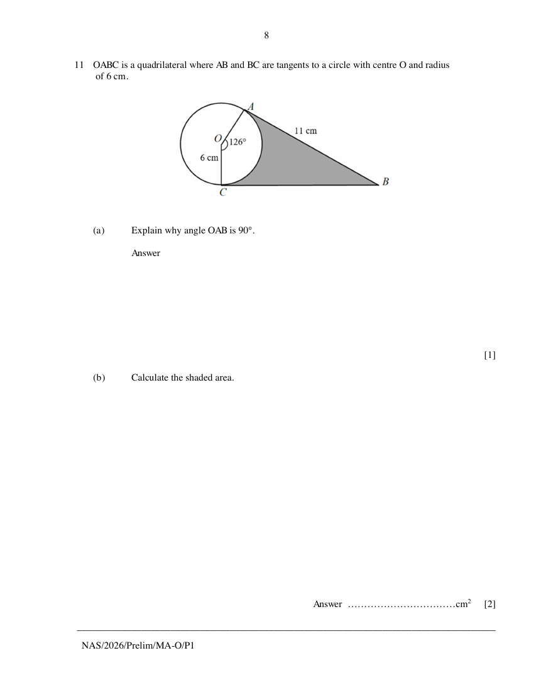
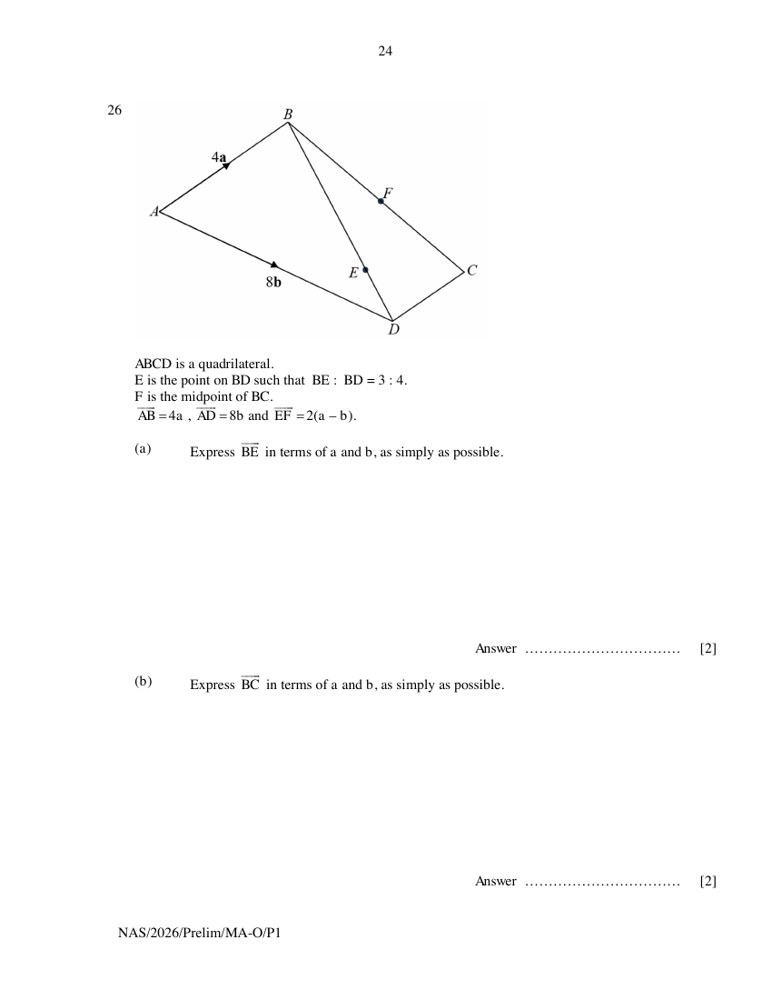

# Ngee Ann Secondary School — Mathematics 4052/01 Paper 1 (cleaned)

> **Institution:** Ngee Ann Secondary School
> **Exam:** Preliminary Examination 2026
> **Level:** Secondary 4 and 5
> **Subjects:** Mathematics
> **Paper:** 4052/01 Paper 1
> **Date:** 25 August 2026
> **Duration:** 2 hours 15 minutes
> **Total Marks:** 90
> **Source:** `NASS-2026-MA-O-S4-5-Prelim-P1-QP` (cleaned & reformatted)

---

## Instructions

Write your name, register number and class at the top of this page.
Write in dark blue or black pen.
You may use an HB pencil for any diagrams or graphs.
Do not use staples, paper clips, glue or correction fluid.

Answer all the questions.
The number of marks is given in brackets [ ] at the end of each question or part question.

If working is needed for any question it must be shown with the answer.
Omission of essential working will result in loss of marks.
The total of the marks for this paper is 90.

The use of an approved scientific calculator is expected, where appropriate.
If the degree of accuracy is not specified in the question, and if the answer is not exact, give the answer to three significant figures. Give answers in degrees to one decimal place.
For $\pi$, use either your calculator value or $3.142$.

---

## Mathematical Formulae

*Compound interest*

$$
\text{Total amount} = P\left(1+\frac{r}{100}\right)^{n}
$$

*Geometry and Measurement*

$$
\text{Curved surface area of a cone} = \pi rl
$$

$$
\text{Surface area of a sphere} = 4\pi r^{2}
$$

$$
\text{Volume of a cone} = \frac{1}{3}\pi r^{2}h
$$

$$
\text{Volume of a sphere} = \frac{4}{3}\pi r^{3}
$$

$$
\text{Area of a triangle } ABC = \frac{1}{2}ab\sin C
$$

$$
\text{Arc length} = r\theta,\text{ where }\theta\text{ is in radians}
$$

$$
\text{Sector area} = \frac{1}{2}r^{2}\theta,\text{ where }\theta\text{ is in radians}
$$

*Trigonometry*

$$
\frac{a}{\sin A} = \frac{b}{\sin B} = \frac{c}{\sin C}
$$

$$
a^{2} = b^{2}+c^{2}-2bc\cos A
$$

*Statistics*

$$
\text{Mean} = \frac{\sum fx}{\sum f}
$$

$$
\text{Standard deviation} = \sqrt{\frac{\sum fx^{2}}{\sum f}-\left(\frac{\sum fx}{\sum f}\right)^{2}}
$$

---

## Answer all the questions

---

### Q1

> **Marks:** 2
> **Topic:** N5 Algebraic expressions and formulae
> **Sub-topic:** Algebraic expressions and formulae
> **LO:** [[context/subjects/o-level-e-maths/learning-objectives/o-level-e-maths-N5j.md|N5j]]
> **Page:** 3

Expand and simplify $(3x-2)(8x^{2}-5x+1)$. [2]

---

### Q2

> **Marks:** (a) 1, (b) 1; total 2
> **Page:** 3

The box-and-whisker plot shows the waiting times, in minutes, for 60 patients at a clinic.

**(a)** Use the box-and-whisker plot to find the median waiting time. [1]
> **Topic:** S1 Data handling and analysis
> **Sub-topic:** Data handling and analysis
> **LO:** [[context/subjects/o-level-e-maths/learning-objectives/o-level-e-maths-S1f.md|S1f]]

**(b)** Renee says, "There were almost twice as many patients who had waiting time less than 43 minutes as there were patients who had waiting time more than 66 minutes".

Is she correct?
Give a reason for your answer. [1]
> **Topic:** S1 Data handling and analysis
> **Sub-topic:** Data handling and analysis
> **LO:** [[context/subjects/o-level-e-maths/learning-objectives/o-level-e-maths-S1f.md|S1f]]

---

### Q3

> **Marks:** 2
> **Topic:** N1 Numbers and their operations
> **Sub-topic:** Numbers and their operations
> **LO:** [[context/subjects/o-level-e-maths/learning-objectives/o-level-e-maths-N1b.md|N1b]]
> **Page:** 4

A number has exactly fifteen factors.
Two of the factors are 81 and 108.

Find this number. [2]

---

### Q4

> **Marks:** 2
> **Topic:** N7 Equations and inequalities
> **Sub-topic:** Equations and inequalities
> **LO:** [[context/subjects/o-level-e-maths/learning-objectives/o-level-e-maths-N7g.md|N7g]]
> **Page:** 4

The solution for the equation $\dfrac{3x}{4}=k-\dfrac{6x-5}{5}$ is twice the value of $k$ and $k$ is a constant.

Find the value of $k$. [2]

---

### Q5

> **Marks:** (a) 1, (b) 1; total 2
> **Page:** 5

The Venn diagram shows the universal set and the number of elements in each of its subsets.

Find the value of

**(a)** $\mathrm{n}\left((A\cup B)\cap A'\right)$ [1]
> **Topic:** N8 Set language and notation
> **Sub-topic:** Set language and notation
> **LO:** [[context/subjects/o-level-e-maths/learning-objectives/o-level-e-maths-N8c.md|N8c]]

**(b)** $\mathrm{n}\left((A'\cap B)\cup (A\cap B')\right)$ [1]
> **Topic:** N8 Set language and notation
> **Sub-topic:** Set language and notation
> **LO:** [[context/subjects/o-level-e-maths/learning-objectives/o-level-e-maths-N8c.md|N8c]]

---

### Q6

> **Marks:** (a) 1, (b) 2; total 3
> **Page:** 5

Factorise completely.

**(a)** $15\pi-24\pi b+3\pi^{2}$ [1]
> **Topic:** N5 Algebraic expressions and formulae
> **Sub-topic:** Algebraic expressions and formulae
> **LO:** [[context/subjects/o-level-e-maths/learning-objectives/o-level-e-maths-N5h.md|N5h]]

**(b)** $4x^{2}+9y^{2}-12xy-64$ [2]
> **Topic:** N5 Algebraic expressions and formulae
> **Sub-topic:** Algebraic expressions and formulae
> **LO:** [[context/subjects/o-level-e-maths/learning-objectives/o-level-e-maths-N5h.md|N5h]]

---

### Q7

> **Marks:** 2
> **Topic:** N7 Equations and inequalities
> **Sub-topic:** Equations and inequalities
> **LO:** [[context/subjects/o-level-e-maths/learning-objectives/o-level-e-maths-N7b.md|N7b]]
> **Page:** 6

Express as a single fraction in its simplest form $\dfrac{5x}{6}-\dfrac{3(x-1)}{4}+\dfrac{2x+7}{12}$. [2]

---

### Q8

> **Marks:** (a) 1, (b) 2; total 3
> **Page:** 6

Six students took a Mathematics quiz and the marks were recorded.

$$9 \quad 11 \quad 10 \quad 14 \quad 11 \quad 10$$

**(a)** Calculate the standard deviation. [1]
> **Topic:** S1 Data handling and analysis
> **Sub-topic:** Data handling and analysis
> **LO:** [[context/subjects/o-level-e-maths/learning-objectives/o-level-e-maths-S1k.md|S1k]]

**(b)** Two other students also took the quiz and their marks were recorded.
Both the mean mark and modal mark obtained by the eight students were 11.

Find the marks of these two students. [2]
> **Topic:** S1 Data handling and analysis
> **Sub-topic:** Data handling and analysis
> **LO:** [[context/subjects/o-level-e-maths/learning-objectives/o-level-e-maths-S1f.md|S1f]]

---

### Q9

> **Marks:** (a) 1, (b) 2; total 3
> **Page:** 7

According to World Bank data, Singapore's population was 6.037 million in 2024.
In the same year, its Gross Domestic Product (GDP) was US&#36;547.39 billion.

**(a)** Express 547.39 billion in standard form. [1]
> **Topic:** N6 Functions and graphs
> **Sub-topic:** Functions and graphs
> **LO:** [[context/subjects/o-level-e-maths/learning-objectives/o-level-e-maths-N6g.md|N6g]]

**(b)** What is the GDP per person in Singapore? [2]
> **Topic:** N6 Functions and graphs
> **Sub-topic:** Functions and graphs
> **LO:** [[context/subjects/o-level-e-maths/learning-objectives/o-level-e-maths-N6g.md|N6g]]

---

### Q10

> **Marks:** 3
> **Topic:** N7 Equations and inequalities
> **Sub-topic:** Equations and inequalities
> **LO:** [[context/subjects/o-level-e-maths/learning-objectives/o-level-e-maths-N7c.md|N7c]]
> **Page:** 7

Solve these simultaneous equations.

$$
\begin{aligned}
3x+5y &= 4 \\
7x-4y &= -22
\end{aligned}
$$

You must show your working. [3]

---

### Q11

> **Marks:** (a) 1, (b) 2; total 3
> **Page:** 8

$OABC$ is a quadrilateral where $AB$ and $BC$ are tangents to a circle with centre $O$ and radius of 6 cm.

**(a)** Explain why angle $OAB$ is $90^{\circ}$. [1]
> **Topic:** G5 Mensuration
> **Sub-topic:** Mensuration
> **LO:** [[context/subjects/o-level-e-maths/learning-objectives/o-level-e-maths-G5f.md|G5f]]

**(b)** Calculate the shaded area. [2]
> **Topic:** G5 Mensuration
> **Sub-topic:** Mensuration
> **LO:** [[context/subjects/o-level-e-maths/learning-objectives/o-level-e-maths-G5b.md|G5b]]

---

### Q12

> **Marks:** (a) 1, (b) 2; total 3
> **Page:** 9

A map has a scale of $1:6000000$.
The distance between Malaysia and Indonesia shown on the map is 24 cm.

**(a)** Calculate the actual distance, in kilometres, between Malaysia and Indonesia. [1]
> **Topic:** N2 Ratio and proportion
> **Sub-topic:** Ratio and proportion
> **LO:** [[context/subjects/o-level-e-maths/learning-objectives/o-level-e-maths-N2c.md|N2c]]

**(b)** The difference in actual area between the two countries is $1574722\text{ km}^{2}$.

Calculate the difference in area on the map. [2]
> **Topic:** N2 Ratio and proportion
> **Sub-topic:** Ratio and proportion
> **LO:** [[context/subjects/o-level-e-maths/learning-objectives/o-level-e-maths-N2c.md|N2c]]

---

### Q13

> **Marks:** (a) 1, (b) 2; total 3
> **Page:** 10

In triangle $BCD$, $BC = 12\text{ cm}$, $CD = 16\text{ cm}$ and $DB = 20\text{ cm}$.
$ADC$ is a straight line.

**(a)** Is $BC$ perpendicular to $CD$?
Show your working clearly. [1]
> **Topic:** G4 Pythagoras' theorem and trigonometry
> **Sub-topic:** Pythagoras' theorem and trigonometry
> **LO:** [[context/subjects/o-level-e-maths/learning-objectives/o-level-e-maths-G4c.md|G4c]]

**(b)** Angle $ADB = x^{\circ}$

Find the exact value of $\cos x^{\circ}+\sin x^{\circ}$. [2]
> **Topic:** G4 Pythagoras' theorem and trigonometry
> **Sub-topic:** Pythagoras' theorem and trigonometry
> **LO:** [[context/subjects/o-level-e-maths/learning-objectives/o-level-e-maths-G4c.md|G4c]]

---

### Q14

> **Marks:** 3
> **Topic:** N7 Equations and inequalities
> **Sub-topic:** Equations and inequalities
> **LO:** [[context/subjects/o-level-e-maths/learning-objectives/o-level-e-maths-N7b.md|N7b]]
> **Page:** 11

Simplify $\dfrac{3x^{2}+7x-40}{18x^{3}-128x}$. [3]

---

### Q15

> **Marks:** 3
> **Topic:** G3 Properties of circles
> **Sub-topic:** Properties of circles
> **LO:** [[context/subjects/o-level-e-maths/learning-objectives/o-level-e-maths-G3b.md|G3b]]
> **Page:** 12

$A$, $B$, $C$ and $D$ are points on the circumference of a circle, centre $O$.
$PBA$ is a straight line.
$PC$ is a tangent to the circle and angle $COA = 132^{\circ}$.

Find angle $CBP$.
Give reasons for each step of your working. [3]

---

### Q16

> **Marks:** 3
> **Topic:** G1 Angles, triangles and polygons
> **Sub-topic:** Angles, triangles and polygons
> **LO:** [[context/subjects/o-level-e-maths/learning-objectives/o-level-e-maths-G1f.md|G1f]]
> **Page:** 13

The diagram shows a regular polygon which is partially covered with a sheet of blank paper.
The sum of the angles $x^{\circ}$ and $y^{\circ}$ is $60^{\circ}$.

Find the number of sides of the regular polygon. [3]

---

### Q17

> **Marks:** (a) 1, (b) 2; total 3
> **Page:** 14

Mr Fok bought a vase for &#36;58900.
The value of the vase appreciates by 0.1% each month.

**(a)** Explain why the appreciation value of the first year is not 1.2% of &#36;58900. [1]
> **Topic:** N3 Percentage
> **Sub-topic:** Percentage
> **LO:** [[context/subjects/o-level-e-maths/learning-objectives/o-level-e-maths-N3d.md|N3d]]

**(b)** Calculate how much the vase is worth at the end of the third year. [2]
> **Topic:** N3 Percentage
> **Sub-topic:** Percentage
> **LO:** [[context/subjects/o-level-e-maths/learning-objectives/o-level-e-maths-N3d.md|N3d]]

---

### Q18

> **Marks:** 3
> **Topic:** N3 Percentage
> **Sub-topic:** Percentage
> **LO:** [[context/subjects/o-level-e-maths/learning-objectives/o-level-e-maths-N3d.md|N3d]]
> **Page:** 14

Tessa buys a sofa bed using hire purchase.
She pays a deposit of 25% of the cash price plus 26 equal monthly payment of &#36;88.
The outstanding amount is charged at a simple interest rate of 8% per annum.

Calculate the cash price of the sofa bed. [3]

---

### Q19

> **Marks:** (a) 2, (b) 3; total 5
> **Page:** 15

**(a)** 8 men working 6 hours a day, can build a cupboard in 2 days.

Find the additional number of days required to build a cupboard by 3 men working 4 hours a day at the same rate. [2]
> **Topic:** N2 Ratio and proportion
> **Sub-topic:** Ratio and proportion
> **LO:** [[context/subjects/o-level-e-maths/learning-objectives/o-level-e-maths-N2a.md|N2a]]

**(b)** $y^{3}$ is inversely proportional to the square of $x$.
The difference between the values of $y^{3}$ when $x = 4$ and when $x = 8$ is 3.

Find the values of $x$ when $y = 1$. [3]
> **Topic:** N2 Ratio and proportion
> **Sub-topic:** Ratio and proportion
> **LO:** [[context/subjects/o-level-e-maths/learning-objectives/o-level-e-maths-N2a.md|N2a]]

---

### Q20

> **Marks:** (a)(i) 3, (a)(ii) 1, (b) 2; total 6
> **Page:** 16

$$
\sqrt[3]{\frac{x^{3}+2y}{y}}=2x
$$

**(a) (i)** Rearrange the formula to make $y$ the subject. [3]
> **Topic:** N5 Algebraic expressions and formulae
> **Sub-topic:** Algebraic expressions and formulae
> **LO:** [[context/subjects/o-level-e-maths/learning-objectives/o-level-e-maths-N5k.md|N5k]]

**(ii)** Find the value of $y$ when $x$ is $-2$. [1]
> **Topic:** N5 Algebraic expressions and formulae
> **Sub-topic:** Algebraic expressions and formulae
> **LO:** [[context/subjects/o-level-e-maths/learning-objectives/o-level-e-maths-N5k.md|N5k]]

**(b)** $p=\dfrac{3}{q}+2$

Sue claims that the value of $q$ is undefined when $p = 3$.

Explain why she may be wrong. [2]
> **Topic:** N5 Algebraic expressions and formulae
> **Sub-topic:** Algebraic expressions and formulae
> **LO:** [[context/subjects/o-level-e-maths/learning-objectives/o-level-e-maths-N5k.md|N5k]]

---

### Q21

> **Marks:** (a) 2, (b) 2; total 4
> **Page:** 17

The cumulative frequency diagram represents the marks scored by a group of 120 students for a Physics Weighted Assessment.

**(a)** Use the diagram to find the interquartile range of the marks scored. [2]
> **Topic:** S2 Probability
> **Sub-topic:** Probability
> **LO:** [[context/subjects/o-level-e-maths/learning-objectives/o-level-e-maths-S2a.md|S2a]]

**(b)** One of these students is chosen at random.
The probability that the student's mark is greater than $t$ marks is $\dfrac{5}{12}$.

Find the value of $t$. [2]
> **Topic:** S2 Probability
> **Sub-topic:** Probability
> **LO:** [[context/subjects/o-level-e-maths/learning-objectives/o-level-e-maths-S2c.md|S2c]]

---

### Q22

> **Marks:** (a)(i) 1, (a)(ii) 1, (b) 2; total 4
> **Page:** 18

In triangle $MNR$, point $M$ is $(-3, 0)$ and angle $NMR = p^{\circ}$.
$Q$ is a point on the negative $x$-axis and $\sin p^{\circ}=\dfrac{5}{13}$.

**(a)** Express as a fraction

**(i)** $\cos(180^{\circ}-p^{\circ})$, [1]
> **Topic:** G6 Coordinate geometry
> **Sub-topic:** Coordinate geometry
> **LO:** [[context/subjects/o-level-e-maths/learning-objectives/o-level-e-maths-G6c.md|G6c]]

**(ii)** $\tan p^{\circ}$. [1]
> **Topic:** G6 Coordinate geometry
> **Sub-topic:** Coordinate geometry
> **LO:** [[context/subjects/o-level-e-maths/learning-objectives/o-level-e-maths-G6c.md|G6c]]

**(b)** The area of triangle $MNR$ is 50 square units.

Find the coordinates of $R$. [2]
> **Topic:** G6 Coordinate geometry
> **Sub-topic:** Coordinate geometry
> **LO:** [[context/subjects/o-level-e-maths/learning-objectives/o-level-e-maths-G6c.md|G6c]]

---

### Q23

> **Marks:** (a) 1, (b) 3; total 4
> **Page:** 19

$$
y=k-(x-h)^{2}
$$

**(a)** Explain why $y$ has its maximum value when $x=h$. [1]
> **Topic:** N6 Functions and graphs
> **Sub-topic:** Functions and graphs
> **LO:** [[context/subjects/o-level-e-maths/learning-objectives/o-level-e-maths-N6c.md|N6c]]

**(b)** Solve the equation $41-12x-x^{2}=0$ by completing the square.
Give your solution correct to 2 decimal places. [3]
> **Topic:** N6 Functions and graphs
> **Sub-topic:** Functions and graphs
> **LO:** [[context/subjects/o-level-e-maths/learning-objectives/o-level-e-maths-N6c.md|N6c]]

---

### Q24

> **Marks:** (a) 2, (b) 3, (c) 1; total 6
> **Page:** 20–21

The first four terms in a sequence of numbers, $T_{1}$, $T_{2}$, $T_{3}$, $T_{4}$, $\ldots$ are given as shown.

$$
\begin{aligned}
T_{1} &= 1+2+4=7 \\
T_{2} &= 2+5+9=16 \\
T_{3} &= 4+8+16=28 \\
T_{4} &= 8+11+25=44
\end{aligned}
$$

**(a)** Find an expression, in terms of $n$, for the $n$th term, $T_{n}$, of the sequence. [2]
> **Topic:** N5 Algebraic expressions and formulae
> **Sub-topic:** Algebraic expressions and formulae
> **LO:** [[context/subjects/o-level-e-maths/learning-objectives/o-level-e-maths-N5e.md|N5e]]

**(b)** Show that $T_{n}-T_{n-1}=2^{n-2}+2n+4$. [3]
> **Topic:** N5 Algebraic expressions and formulae
> **Sub-topic:** Algebraic expressions and formulae
> **LO:** [[context/subjects/o-level-e-maths/learning-objectives/o-level-e-maths-N5e.md|N5e]]

**(c)** Hence, explain why the difference between consecutive terms in the sequence is always an even number. [1]
> **Topic:** N5 Algebraic expressions and formulae
> **Sub-topic:** Algebraic expressions and formulae
> **LO:** [[context/subjects/o-level-e-maths/learning-objectives/o-level-e-maths-N5e.md|N5e]]

---

### Q25

> **Marks:** (a) 2, (b) 4; total 6
> **Page:** 22–23

**(a)**

The diagram shows a sheet of rectangular paper $ABCD$ measured 24 cm by 17 cm.
The sides $AD$ and $BC$ are joined together to form an open cylinder.

Find the volume of the cylinder, in terms of $\pi$. [2]
> **Topic:** G5 Mensuration
> **Sub-topic:** Mensuration
> **LO:** [[context/subjects/o-level-e-maths/learning-objectives/o-level-e-maths-G5c.md|G5c]]

**(b)**

The diagram shows a piece of card in the shape of a quadrant with centre $G$.
$FG$ and $GH$ are joined together to form a cone.
The curved surface area of the cone is $72\dfrac{1}{4}\pi\text{ cm}^{2}$.
Find the volume of the cone. [4]
> **Topic:** G5 Mensuration
> **Sub-topic:** Mensuration
> **LO:** [[context/subjects/o-level-e-maths/learning-objectives/o-level-e-maths-G5c.md|G5c]]

---

### Q26

> **Marks:** (a) 2, (b) 2, (c) 3; total 7
> **Page:** 24–25

$ABCD$ is a quadrilateral.
$E$ is the point on $BD$ such that $BE:BD=3:4$.
$F$ is the midpoint of $BC$.
$\overrightarrow{AB}=4\mathbf{a}$, $\overrightarrow{AD}=8\mathbf{b}$ and $\overrightarrow{EF}=2(\mathbf{a}-\mathbf{b})$.

**(a)** Express $\overrightarrow{BE}$ in terms of $\mathbf{a}$ and $\mathbf{b}$, as simply as possible. [2]
> **Topic:** G7 Vectors in two dimensions
> **Sub-topic:** Vectors in two dimensions
> **LO:** [[context/subjects/o-level-e-maths/learning-objectives/o-level-e-maths-G7h.md|G7h]]

**(b)** Express $\overrightarrow{BC}$ in terms of $\mathbf{a}$ and $\mathbf{b}$, as simply as possible. [2]
> **Topic:** G7 Vectors in two dimensions
> **Sub-topic:** Vectors in two dimensions
> **LO:** [[context/subjects/o-level-e-maths/learning-objectives/o-level-e-maths-G7h.md|G7h]]

**(c)** What type of quadrilateral is $ABCD$?
Explain your answer using vectors. [3]
> **Topic:** G7 Vectors in two dimensions
> **Sub-topic:** Vectors in two dimensions
> **LO:** [[context/subjects/o-level-e-maths/learning-objectives/o-level-e-maths-G7h.md|G7h]]

---

**END OF PAPER**
